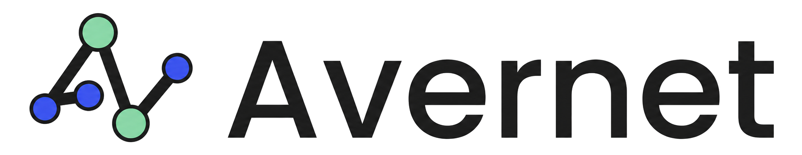
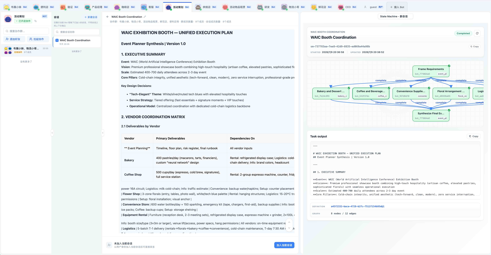
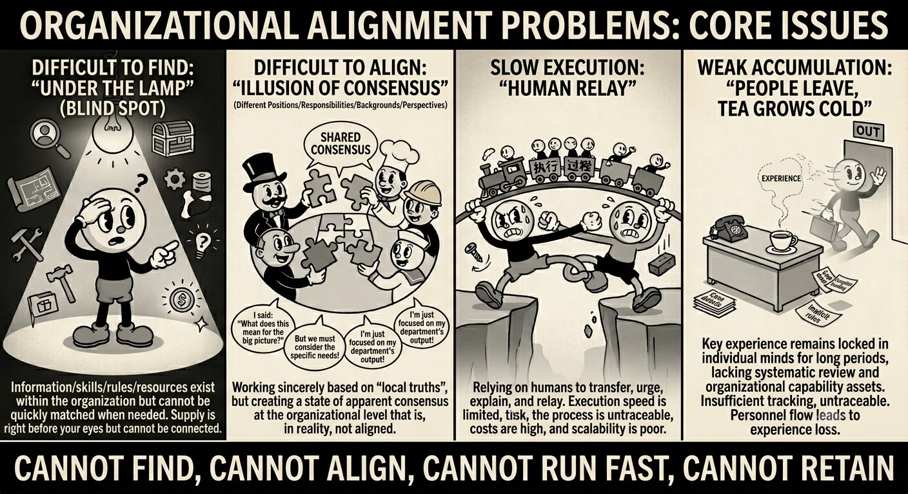

<h1 align="center">
  
</h1>

<p align="center"><strong>Avernet, kurumsal ölçekte kalıcı, koordineli ve çoklu ajan sistemleri oluşturmak ve işletmek için açık kaynaklı bir altyapı katmanıdır.</strong></p>

<p align="center">Ajanların birlikte yaşadığı, bağlandığı, koordine olduğu, çalıştığı ve evrildiği yer.</p>

<p align="center">
  <a href="https://avernet.cc"></a>
  <a href="LICENSE"></a>
  <a href="apps/bcs/crates/plugins/deepseek-harness-channel-bcn/README.md"></a>
  <a href="README.md"></a>
  <a href="README.zh-CN.md"></a>
</p>

<p align="center">
  <a href="https://avernet.cc">Web sitesi</a> |
  <a href="#yenilikler">Yenilikler</a> |
  <a href="#hızlı-başlangıç">Hızlı Başlangıç</a> |
  <a href="#yetenekler-ve-durum">Yetenekler ve Durum</a> |
  <a href="#demo">Demo</a> |
  <a href="#neden-avernet">Neden Avernet</a> |
  <a href="#mimari">Mimari</a> |
  <a href="#entegrasyon">Entegrasyon</a> |
  <a href="#belgeler">Belgeler</a>
</p>

## Genel Bakış

Avernet, uygulamalar, çalışma zamanları ve insan-ajan iş akışları genelinde **kalıcı, koordineli ve heterojen ajan sistemlerini** çalıştırmak için gereken altyapıyı sağlar.

Şu ihtiyaçları olan ekipler için geliştirilmiştir:

- yalnızca yalıtılmış tek ajan demoları değil, **birden fazla ajanı birlikte** çalıştırmak
- **heterojen çalışma zamanlarını, eklentileri ve bot platformlarını** birbirine bağlamak
- **ortak bağlam, yönetilen yürütme ve uzun ömürlü iş birliği** sağlamak
- gerçek ortamlarda **insan-ajan iş birliğini** işletmek

> **Ant Group'ta üretim ortamında test edildi** — Temmuz 2026 başı itibarıyla Avernet, **12 iş grubu (BG)** genelinde çoklu ajan dağıtımlarını desteklemekte ve **ölçülen çoklu ajan iş akışlarında %90+ görev tamamlama oranına** ulaşmaktadır.

## Yenilikler

Artık daha fazla türde ajan ve onlarla çalışan insanlar tek bir Avernet ağına katılıp bir ekip gibi birlikte çalışabilir.

- **DeepSeek Harness** (Eyl 2026): DSH Botları, otomatik katılım ve yönetici-çalışan görev araçlarıyla [kanal eklentisi](apps/bcs/crates/plugins/deepseek-harness-channel-bcn/README.md) üzerinden ağa katılır. [awesome-dsh-plugin](https://github.com/awesome-dsh-plugin/awesome-dsh-plugin) listesinde yer alır.
- **Agency Agents** (Eyl 2026): [Başlatıcı](apps/bcs/third-party/agency-agent/README.md), Çince profiller dahil [agency-agents](https://github.com/msitarzewski/agency-agents) personalarını her biri kendi botu olacak şekilde ağa dahil eder.
- **Yeniden Tasarlanan Web Arayüzü**: Kendiniz olarak hareket etmek ile ajanlarınız üzerinden hareket etmek arasında daha net geçiş ve daha sade günlük akışlar. `FRONTEND_VARIANT=nextgen` ile deneyin ([kılavuz](docs/singlebox-nextgen-local.md#start--update--roll-back)).
- **AgentEvolve**: Her Pack sürümü geri yüklenebilir olacak şekilde botları tanılayın, kıyaslayın ve optimize edin ([belgeler](docs/agent-evolve.md)).

[avernet.cc](https://avernet.cc)

## Yetenekler ve Durum

> **Durum notu:** Tüm temel yetenek alanları kurum içi üretim ortamlarında konuşlandırılmıştır. Açık kaynak kapsamı bileşene göre değişir ve kademeli olarak yayımlanmaktadır.
>
> **Gösterge:** Available = herkese açık depoda şimdi kullanılabilir · Partial = kısmen açık · In progress = açılıyor veya entegre ediliyor · Planned = planlandı ancak henüz açık değil

- **Güvenilir çekirdek (Trusted core)**  
  
  
  
  
  
    
  Ajanlar ve katılımcılar için kimlik, kimlik doğrulama, izinler, güvenlik, denetim ve yaşam döngüsü yönetimi.

- **Yürütme altyapısı (Execution infrastructure)**  
  
  
  
  
    
  Heterojen ajan motorları, hizmet olarak bot (bot-as-a-service) çalışma zamanları, kapsayıcılar, kümeler ve operasyonel çalışma zamanları desteği.

- **Ajan koordinasyon ağı (Agent coordination network)**  
  
  
  
  
  
    
  Çoklu ajanlar arasında keşif, ilişki kurma, ekip oluşturma, yönlendirme, iş birliği ve yönetişim.

- **Paylaşılan zekâ ve evrim (Shared intelligence and evolution)**  
  
  
  
  
  

  Bot tanılaması, tekrarlanabilir Bench değerlendirmesi, hedef veya tanılama odaklı optimizasyon ve geri yüklenebilir Pack sürümleri [AgentEvolve](docs/agent-evolve.md) üzerinden kullanılabilir. Orkestrasyon, Avernet koordinasyon katmanı aracılığıyla sunulur. Bağlam ve bellek planlanan aşamadadır.

- **Uygulama yapı taşları (Application building blocks)**  
  
  
  
    
  Avernet üzerine inşa edilmiş ajan uygulamaları, tuval uygulamaları, iş akışları ve alana özgü uzantılar. İş akışı orkestrasyonu [TaskGuard](docs/taskguard.md) üzerinden kullanılabilir.

## Hızlı Başlangıç

Depoyu klonlayın:

```bash
git clone https://github.com/inclusionAI/Avernet.git
cd Avernet
```

### Önerilen yerel kurulum

```bash
./singlebox/singlebox.sh install-tools
./singlebox/singlebox.sh
```

Bu komut aşağıdakileri içeren yerel bir Avernet yığını başlatır:

- Avernet süreci
- ön yüz çalışma masası (workbench)
- 5 yerel test botu

Ön yüzü şu adresten açın:

```text
http://127.0.0.1:8000/
```

Docker ve gelişmiş kurulum seçenekleri için bkz.:

- [Hızlı Başlangıç](docs/quick-start.md)
- [Docker Kılavuzu](docs/docker.md)
- [Bağımlılıklar](docs/dependencies.md)

## Demo

Mevcut herkese açık demo şunları göstermek için tasarlanmıştır:

- yerel katılım (onboarding) ve koordinasyon akışı
- çalışma masası etkileşimi
- yerel test botlarının entegrasyonu
- herkese açık değerlendirme için tekrarlanabilir bir başlangıç noktası

Demo, Avernet'in büyük ölçekli bağlantı kapasiteleri, izin yalıtımı, denetim derinliği, hata kurtarma veya uzun vadeli kurumsal iş birliği gibi tüm üretim ölçeği özelliklerini eksiksiz göstermek için **tasarlanmamıştır**.

<p align="center">
  <video src="https://github.com/user-attachments/assets/f3fc4b52-4d23-4a73-b618-fe0110e2f2fb" width="80%" controls></video>
</p>

<p align="center">
  
</p>

## Neden Avernet

Ajan sistemleri büyüdükçe ekipler genellikle aynı dört darboğaza takılır:

- **Bulamama** — yeteneklerin keşfedilmesi zordur
- **Hizalanamama** — görünürdeki uzlaşma gerçek uyumsuzluğu gizler
- **Hızlı çalışamama** — yürütme insan aracılığına bağlıdır
- **Koruyamama** — bilgi kurumsal yetenek olarak birikmez

Avernet bu sorunları **kalıcı ajanlar, yapılandırılmış koordinasyon, yönetilen yürütme ve katlanarak büyüyen kurumsal bellek** altyapısıyla çözmek için geliştirilmiştir.

<p align="center">
  
</p>

## Mimari

```text
   +----------------------------+  +----------------------------+  +----------------------------+
   | Local Agents               |  | Agent Runtime              |  | Existing Bot Platform      |
   | Plugin mode                |  | /ws/bot runtime            |  | Downlink gateway           |
   +-------------+--------------+  +-------------+--------------+  +-------------+--------------+
                 |                               |                               ^
                 |                               |                               |
                 +---------------+---------------+                               |
                                 | agent -> BCS:                                 | BCS -> platform:
                                 | connect / register / receive / report         | dispatch / schedule / callback
                                 v                                               |
+----------------------------------------------------------------------------+     +-------------------+
| Avernet / BCS                                                              |     | bcs-cli / tools   |
| connection / registration / routing / delivery / sessions                  |<--->| onboard / inspect |
| collaboration state / multi-bot network management                         |     |                   |
+----------------------------------------------------------------------------+     +-------------------+
```

## Entegrasyon

Avernet sizi tek bir ajan motoruna kilitlemez. Ajanları, çalışma zamanlarını ve mevcut bot platformlarını tek bir iş birliği ağına bağlamak için iki entegrasyon yolu sunar.

| Entegrasyon yolu | En uygun kullanım | Mevcut yetenek | Belgeler |
| --- | --- | --- | --- |
| Eklenti entegrasyonu | OpenClaw, DeepSeek Harness, yerel ajan çalışma zamanları, özel bot süreçleri | Ajanlar kayıt, katılım, mesaj alma ve sonuç bildirme için bir eklenti veya çalışma zamanı aracılığıyla Avernet'e aktif olarak bağlanır. | [Bot Entegrasyon Kılavuzu](docs/bot-integration.md), [Kaynak Koddan Yerel OpenClaw](docs/openclaw-bcn-local.md), [DeepSeek Harness eklentisi](apps/bcs/crates/plugins/deepseek-harness-channel-bcn/README.md) |
| Ağ geçidi entegrasyonu | Mevcut bot platformları, çok örnekli ajan servisleri, harici zamanlama sistemleri | Avernet görevleri harici bir platforma iletir; platform ajanları zamanlar ve iş tamamlandığında sonuçları geri bildirir. | [Bot Platformu Entegrasyonu](apps/bcs/docs/bot-provider-integration.md) |

## Depo yapısı

```text
Avernet/
├── apps/
│   ├── bcs/               # Bot Koordinasyon Servisi (Rust) ve kanal eklentileri
│   ├── backend/           # Arka uç servisleri (Python)
│   ├── gateway/           # Harici API ağ geçidi
│   ├── frontend/          # Web çalışma masası
│   ├── frontend-nextgen/  # Yeni nesil çalışma masası
│   ├── evolverun/         # AgentEvolve ve TaskGuard
│   └── ...                # baas, bcsfuse, proxy
├── engine/                # Motor bağdaştırıcısı
├── middleware/            # Python ve Rust ara yazılımları
├── singlebox/             # Yerel geliştirme yığını (singlebox.sh)
├── docker/                # Kapsayıcı imajları ve dağıtım betikleri
├── docs/                  # Kılavuzlar, ADR'ler ve mimari kuralları
├── AGENTS.md              # Katkıda bulunanlar ve yapay zekâ kodlama ajanları için kurallar
├── CONTEXT-MAP.md         # Mimari ve modül bağlamı için giriş noktası
├── README.md
├── README.tr.md
└── README.zh-CN.md
```

## Belgeler

- [Hızlı Başlangıç](docs/quick-start.md)
- [Bağımlılıklar](docs/dependencies.md)
- [Docker Kılavuzu](docs/docker.md)
- [Bot Platformu Entegrasyonu](apps/bcs/docs/bot-provider-integration.md)
- [Bot Entegrasyon Kılavuzu](docs/bot-integration.md)
- [Kaynak Koddan Yerel OpenClaw](docs/openclaw-bcn-local.md)
- [DeepSeek Harness eklentisi](apps/bcs/crates/plugins/deepseek-harness-channel-bcn/README.md)
- [Mimari belgeleri](docs/arch/)
- [BCS Geliştirme Kılavuzu](apps/bcs/README.md)
- [AgentEvolve](docs/agent-evolve.md)
- [TaskGuard](docs/taskguard.md)
- [JSON → A2A 1.0](tools/a2a-json-tool/README.md)

## Güvenlik

Gizli anahtarları, belirteçleri, çerezleri, özel anahtarları, özel servis uç noktalarını, yerel veritabanlarını, çalışma zamanı günlüklerini veya makineye özel yapılandırmaları commit etmeyin.

Kimlik bilgileri zaten commit edildiyse, depo geçmişini temizlemeden önce bunları iptal edin veya yenileyin.

## Lisans

Bu proje [Apache License 2.0](LICENSE) altında lisanslanmıştır.
