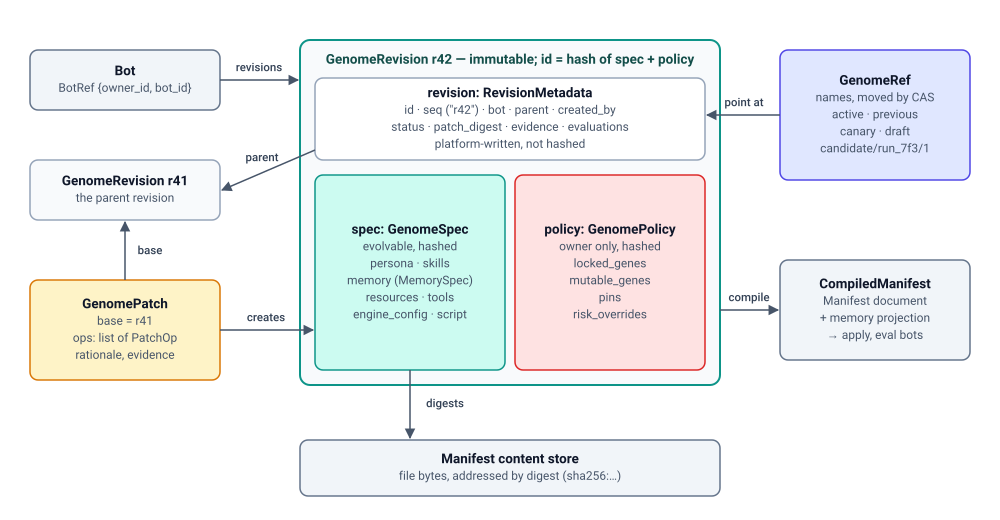

# Genome

> 中文版：[01-genome.zh-CN.md](01-genome.zh-CN.md)

> Status: DRAFT. Component in the [bot evolution architecture](design.md).
> This doc covers the Bot Genome: immutable, versioned revisions of a bot's
> definition, the refs that point at them, the patches that change them, and
> the Genome Registry that stores and serves them.

Accepted decision: [DR-1](../../../../docs/adr/0019-bot-genome-is-the-unit-of-evolution.md).
Builds on the Bot Config Manifest (`apps/backend/docs/bot-config-manifest/`).
Normative format (work item RSI-02):
[`apps/backend/api-contracts/genome/v1/`](../../api-contracts/genome/v1/README.md). Where this
design doc and the contract differ, the contract wins.

## 1. Purpose and scope

A **Bot Genome** is the evolvable, declarative definition of one bot: persona
files, skills, curated memory, resources, tools, engine config, and a
non-evolvable `policy` section. A **Genome Revision** is one recorded,
immutable version of it. The Genome is the unit of evolution: every strategy
reads a revision and proposes a change to it, and every change that reaches a
running bot through the genome is a revision being applied.

In one sentence: a Genome Revision is **a complete, pinned Manifest, plus
curated memory, plus a parent pointer and a locked policy, changed only
through patches**.

The **Genome Registry** is the component that implements this. It owns:

- Genome Revisions (content, parent, provenance, status);
- named **refs** (`active`, `previous`, `canary`, `draft`, `candidate/<run>/<n>`)
  and their compare-and-swap updates;
- **Genome Patches**: their schema, applying them to a base revision, and
  the structural checks run when one is recorded (it applies cleanly to its
  base and stays inside the policy, §6.2). Whether a change is *good* is not
  checked here: that is [Verification](07-verification.md);
- the **genome policy** (mutable genes, pins, risk overrides)
  and its structural enforcement when a patch is recorded;
- content addressing: file bytes referenced by digest in the existing
  manifest content store;
- **compiling** a revision into a pinned Manifest document, which is what
  apply and eval bots consume. Curated memory travels in the document's new
  `memory` category; at apply, the engine adapter writes those items into
  the engine's own memory format (for OpenClaw, its memory files). This
  hand-off is the *memory projection*; see §7;
- diffs between any two revisions.

It explicitly does **not** own:

| Not owned here | Owner |
| --- | --- |
| Deciding whether a candidate is good (suites, graders, verdicts) | [07-verification.md](07-verification.md) |
| Deciding whether a revision may become `active`, risk-tier approvals, the review queue, rollout, and the promotion endpoint that moves `active` | [08-promotion.md](08-promotion.md) |
| Running strategies, bindings, `allowed_genes` per binding, budgets | [06-evolution-run.md](06-evolution-run.md) |
| The strategy-side view of a revision (`ctx.parent`, `ctx.workspace`, `ctx.candidates`) | [03-strategy.md](03-strategy.md) |
| Episodes and feedback that carry a revision id | [02-experience.md](02-experience.md) |
| The audit log of revisions, ref moves, gate decisions; the archive view of the ledger; lineage-aware parent selectors | [05-experiment-ledger.md](05-experiment-ledger.md) |
| Mechanism (strategy) revisions, which reuse this revision/ref/patch machinery | [10-meta-evolution.md](10-meta-evolution.md) |
| Physical projection of a revision onto an engine workspace, runtime memory | Engine adapter (`engine/adapter/`); Backend must not know engine paths, per the repository rule in `AGENTS.md` ("Physical layout ownership belongs to Engine Runtime and its versioned layout contract"; ADR 0014 is one application of it) |

**Placement.** Backend, as a new core package `core/bot_genome/` next to
`core/bot_config_manifest/`, because Backend owns desired state and the
Manifest already lives there. Content reuses the content store
(`core/content_store/`, its own component since #3064). Promotion sits beside it in
Backend because promotion must sit beside apply.

**Layering.** The genome sits on top of the Manifest. The Manifest is not
revision-aware: it gains only format features and one fact of its own, the
digest of the document each apply applied (§8). Which revision a digest
belongs to is known only to the Genome Registry. A direct Manifest edit
bypasses the genome and is detected as drift (§5.5).

**Useful on its own.** The Genome Registry is phase P1: versioned bots,
attributable apply, and going back to any earlier revision are useful
independently of any evolution strategy.

## 2. Domain model



How the types relate:

- A bot has many **revisions**. Each revision holds one `spec` (the
  evolvable content) and one `policy` (the owner's rules), plus metadata the
  platform writes.
- Every revision except the bot's first has exactly one **parent**. A
  **patch**, a list of ops, is what turns the parent into the new revision.
  An owner can also **capture** the bot's current state as a revision, with
  no patch.
- **Refs** are names (`active`, `draft`, …) that point at revisions.
- **Compiling** a revision gives the `CompiledManifest` that apply and eval
  bots consume.
- File content is never stored inline: every file in `spec` is a **digest**,
  the address of its bytes in the content store.

| Type | What it is | Owned by | Lifecycle |
| --- | --- | --- | --- |
| `GenomeRevision` | One immutable version of a bot's definition: `spec` + `policy`, plus platform-written metadata (`revision`) | Genome Registry | Recorded once (from a patch or by capture), never edited; only its `status`, annotations and the append-only `evaluations` list change; never deleted |
| `GenomeSpec` | The evolvable content of a revision: persona, skills, memory, resources, tools, engine config, script | Genome Registry (authored by owners, proposed by strategies) | Part of a revision; hashed |
| `GenomePolicy` | The non-evolvable section: mutable genes, pins, risk overrides | Bot owner / tenant admin | Part of a revision; hashed; copied forward verbatim by the platform; no patch may touch it |
| `RevisionMetadata` | Id, per-bot `seq`, parent, provenance, status, evidence and evaluation ids, annotations | Genome Registry (platform-written) | Written at record time; status/annotations updated later, evaluation ids appended by Verification; not hashed |
| `Provenance` | Who or what created a revision (a person, a strategy run, later a bot) | Genome Registry | Written once at record time |
| `GenomeRef` | A named, movable pointer to a revision (`active`, `previous`, `canary`, `draft`, `candidate/<run>/<n>`) | Genome Registry; each ref has exactly one kind of mover | Moved by compare-and-swap; every move is an audited event |
| `GenomePatch` | A typed, itemized change against a named base revision; the only thing a strategy may submit | Submitted by strategies (via [Evolution Run](06-evolution-run.md)) or humans; checked by the Registry | Stored content-addressed; its digest is the candidate id |
| `PatchOp` | One item of a patch (`file.edit`, `skill.add`, `memory.add`, …) | Part of a patch | Each op maps to a risk tier |
| `MemoryItem` | One curated memory fact/rule/lesson, keyed | Genome (curated memory) | Added, updated, and retired by patch ops |
| `CompiledManifest` | A revision rendered as a plain Manifest document (pinned, every category present), plus the revision id and the document's digest for bookkeeping | Genome Registry (derived, not stored as truth) | Produced on demand for apply and eval bots |

### 2.1 Genes

A **gene** is a named, addressable part of `spec` that the policy and
bindings can refer to. A **gene path** names it: a category (`persona`,
`skills`, `memory`, `resources`, `tools`, `engine_config`, `script`), then
`/`-separated segments: `tools/mcp`, one item (`skills/refund-policy`,
`memory/returns-window`, `tools/mcp/mcp.x.meet`), or a file inside an item
(`skills/refund-policy/SKILL.md`, `resources/data/kb/faq.md`). The same
grammar is used by the policy, a binding's `allowed_genes`, every patch op's
target, and diff output.

- `/` is the only separator, so names with dots (`SOUL.md`, `mcp.x.meet`) are
  single segments.
- A path `P` covers `X` when `X == P` or `X` starts with `P/`, so matching is
  by whole segments: `skills/pdf` covers `skills/pdf/SKILL.md` but not
  `skills/pdf-tools`.
- An MCP `server_code` can contain any character; bytes outside
  `A–Z a–z 0–9 . _ -` are percent-encoded, and only the canonical spelling is
  valid.

Full grammar: [contract README §2](../../api-contracts/genome/v1/README.md#2-gene-paths).

### 2.2 GenomeSpec

Shared aliases first; every type below uses them.

```python
from dataclasses import dataclass, field
from datetime import datetime
from enum import StrEnum

RevisionId = str   # identity of a revision: "sha256:" + 64 hex chars, the hash of canonical({spec, policy}) (§4.4).
                   # Example: "sha256:7c1e…" (shortened here and below)
Digest = str       # address of stored bytes: "sha256:" + 64 hex chars of the bytes themselves.
                   # Example: "sha256:3f9a…" is the address of one SOUL.md file;
                   # GET …/genome/content/sha256:3f9a… returns "# Soul\nYou are a patient support agent…" (§9.1).
                   # One store and one endpoint serve every digest below (persona file, skill, memory items,
                   # resource, script); the field that holds a digest says what the bytes are.
# RiskTier (T0 < T1 < T2 < T3) is defined once in 08-promotion.md §5.
# BotRef {owner_id, bot_id}: the bot's full identity (a bot_id alone is not unique
# across users); defined once in 09-evolution-api.md §2.6.
```

Persona files and skills:

```python
class PersonaFileType(StrEnum):
    """The persona files a bot may have: VALID_IDENTITY_FILES in core/services/identity.py,
    minus MEMORY.md and IDENTITY.md (reserved, §7). Which of these an engine accepts is
    checked when a revision is recorded (claude_code: CLAUDE.md only)."""
    SOUL = "SOUL.md"
    AGENTS = "AGENTS.md"
    RULES = "RULES.md"
    OKR = "OKR.md"
    SAFETY = "SAFETY.md"
    OUTPUT = "OUTPUT.md"
    USER = "USER.md"
    TOOLS = "TOOLS.md"
    HEARTBEAT = "HEARTBEAT.md"
    BOOTSTRAP = "BOOTSTRAP.md"
    KNOWLEDGE = "KNOWLEDGE.md"
    CLAUDE = "CLAUDE.md"
    GREETING = "GREETING.md"
    README = "README.md"

@dataclass(frozen=True)
class PersonaFile:
    type: PersonaFileType            # which persona file, e.g. PersonaFileType.SOUL ("SOUL.md")
    digest: Digest                   # where its bytes are, e.g. "sha256:3f9a…"

class SkillOrigin(StrEnum):
    CENTER = "center"                # a governed skill from Skill Center: pinned by version, not copied
    LOCAL = "local"                  # the skill's files are stored (fetched from git or OSS, uploaded, or created
                                     # by a patch); where they were fetched from is not part of the revision (§4.2)

@dataclass(frozen=True)
class SkillEntry:
    name: str                        # the skill's name, the entry's key, e.g. "refund-policy"
    origin: SkillOrigin
    digest: Digest | None = None     # LOCAL only: the acm-tree-v1 encoding of the skill's files (§9.1), e.g. "sha256:0c55…"
    center_version: str | None = None  # CENTER only: the pinned Skill Center version, e.g. "v7"
```

Curated memory:

```python
class EvidenceKind(StrEnum):
    """The Experience records a change can cite (02-experience.md)."""
    EPISODE = "episode"              # one recorded session or trajectory of the bot, id "ep_…"
    FEEDBACK = "feedback"            # one feedback record, id "fb_…": a rating, a correction, or a producer's
                                     # finding such as a ClawInsight improvement item
    EVAL = "eval"                    # one evaluation rollout trace, id "et_…"

EvidenceRef = str  # "<EvidenceKind>:<id>", e.g. "episode:ep_91", "feedback:fb_311". Each one names exactly one
                   # Experience record, which GET …/experience/episodes/ep_91 (or …/feedback/fb_311) returns.
                   # It is an id to look up, not a URL.

@dataclass(frozen=True)
class MemoryItem:
    key: str                         # stable name of the item, e.g. "returns-window"; updates and retires address it
    text: str                        # the fact, rule, or lesson itself, e.g. "Returns are accepted within 30 days."
    tags: list[str]                  # free-form topic labels, e.g. ["returns"]
    source: list[EvidenceRef]        # what the item was learned from, e.g. ["episode:ep_97"]

class MemoryMode(StrEnum):
    """How apply writes the curated items into the engine's memory (§7). Besides curated items, the
    engine's memory holds what the bot wrote itself while running ("runtime items")."""
    SEED = "seed"                    # write each item only if the engine has no item with that key yet;
                                     # anything already there, including runtime items, is kept as it is
    MERGE = "merge"                  # write every item, overwriting an existing item with the same key;
                                     # runtime items with other keys are kept
    REPLACE = "replace"              # the engine's memory becomes exactly the curated items; runtime items are
                                     # dropped (T3: needs human approval)

@dataclass(frozen=True)
class MemorySpec:
    mode: MemoryMode
    items_digest: Digest             # where the stored list of MemoryItem is, e.g. "sha256:9e20…"
```

The stored list that `items_digest` points at, for a support bot:

```jsonc
// Illustrative. Comments explain the example only; the canonical form is plain JSON (RFC 8785).
[
  {"key": "returns-window",                       // stable name; memory.update / memory.retire address it
   "text": "Returns are accepted within 30 days of delivery.",
   "tags": ["returns"],
   "source": ["episode:ep_97", "feedback:fb_204"]},   // the sessions and feedback it was learned from
  {"key": "customer-tier-rules",
   "text": "Gold customers get free return shipping.",
   "tags": ["billing", "returns"],
   "source": ["episode:ep_91"]}
]
```

An example of the modes. The curated set has `returns-window` = "Returns
are accepted within 30 days." While running, the bot wrote its own
`returns-window` = "Returns are accepted within 14 days." and a new item
`vip-contact`. On the next apply:

| Mode | `returns-window` afterwards | `vip-contact` afterwards |
| --- | --- | --- |
| `seed` | "14 days" (the key existed, so the bot's own item stays) | kept |
| `merge` | "30 days" (the curated item overwrites the key) | kept |
| `replace` | "30 days" | removed |

Resources, tools, and the whole spec:

```python
@dataclass(frozen=True)
class ResourceEntry:
    path: str                        # where the resource appears in the bot's workspace, the entry's key;
                                     # a trailing "/" marks a directory, e.g. "data/kb/"
    digest: Digest                   # a file's bytes, or the acm-tree-v1 encoding of a directory (§9.1)

@dataclass(frozen=True)
class McpConfig:
    """The bot-level override, the Manifest's own closed set. Absent fields are not overridden."""
    url: str | None = None           # absolute http(s) URL
    headers: dict[str, str] | None = None   # header names and values as written (#2860)
    endpoint_env: str | None = None  # "PROD" | "PRE"
    transport_protocol: str | None = None   # "SSE" | "STREAMABLE_HTTP"

@dataclass(frozen=True)
class McpServerEntry:
    server_code: str                 # the MCP server's registered code, the entry's key, e.g. "mcp.x.meet"
    config: McpConfig | None = None  # inline: an MCP entry has no stored bytes; None means no bot override

@dataclass(frozen=True)
class ToolsSpec:
    mcp: list[McpServerEntry]        # CLI tools are not part of genome v1 (acli replaces them)

@dataclass(frozen=True)
class ScriptEntry:
    digest: Digest                   # the startup script body, after placeholder substitution; not mutable by default (§4.5)

@dataclass(frozen=True)
class GenomeSpec:
    persona: list[PersonaFile]       # every list is sorted by its key, keys unique (canonical order, §9.3)
    skills: list[SkillEntry]
    memory: MemorySpec | None        # None until RSI-05 lands (§7)
    resources: list[ResourceEntry]
    tools: ToolsSpec
    engine_config: dict[str, str]    # always {} in v1: nothing applies engine_config yet (#2858)
    script: ScriptEntry | None       # None when the bot has no startup script
```

Every category is present in every revision. An empty list means "none";
it never means "leave as it was" (totality, §4.3). Each entry is a **key**
(the field that names it: `type`, `name`, `path`, `server_code`) plus a
**value**: a digest when the entry has stored bytes, inline fields when it has
none (an MCP server's config, a Center skill's version). File content is always
a digest, whether it was fetched, written inline in a Manifest, or produced by a
patch. CLI tools built through the Manifest are not part of genome v1; acli
replaces them before the revision feature goes live.

```jsonc
// Illustrative. Comments explain the example only; the canonical form is plain JSON (RFC 8785).
// Normative schema: apps/backend/api-contracts/genome/v1/genome-revision.schema.json.
{
  "persona": [                                    // == manifest.identity, but pinned; sorted by type
    {"type": "AGENTS.md", "digest": "sha256:81bd…"},
    {"type": "SOUL.md", "digest": "sha256:3f9a…"}
  ],
  "skills": [                                     // sorted by name
    {"name": "quality-check", "origin": "local", "digest": "sha256:0c55…"},   // stored: acm-tree-v1 of its files
    {"name": "refund-policy", "origin": "center", "center_version": "v7"}     // pinned Center version, not copied
  ],
  "memory": {                                     // new category, see §7
    "mode": "seed",                               // seed | merge | replace (MemoryMode)
    "items_digest": "sha256:9e20…"                // the stored list of memory items
  },
  "resources": [{"path": "data/kb/", "digest": "sha256:d4a7…"}],   // a directory: acm-tree-v1 of its files
  "tools": {
    "mcp": [{"server_code": "mcp.x.meet",                           // no bytes, so the config is inline
             "config": {"endpoint_env": "PRE", "transport_protocol": "STREAMABLE_HTTP"}}]
  },
  "engine_config": {},                            // always {} until #2858
  "script": {"digest": "sha256:e1f0…"}            // carried, but not mutable by default
}
```

### 2.3 GenomePolicy

The policy says what automated actors may change on this bot. It is owned by
the bot owner or tenant admin, never by a strategy, and the platform rejects
any patch that touches it.

**Why a policy.** The policy holds the owner's rules that bound evolution of
*this* bot: which genes are mutable, which items are pinned, and which genes
get a higher risk tier. It lives inside the revision
and is part of its hash, so every revision records the rules it was made and
verified under; looking at an old revision tells you what automated actors
were allowed to change at that time. Strategies can read it (to avoid
proposing changes that would be rejected), but no patch can change it: only
the owner can, through a normal edit that records a new revision (§4.4). An
automated actor therefore cannot loosen its own limits. Example: on a
customer-facing support bot, the owner pins `persona/RULES.md` (the refund
and escalation rules legal signed off on); no patch op can reach
`tools/mcp` at all, so a nightly strategy may improve tone in `SOUL.md` and
add skills, but can never rewrite the rules or give the bot a new tool.

There are two lists. `mutable_genes` is an allowlist: an op is allowed only
when an entry covers its gene path, and everything not listed is off limits.
`pins` protects single items inside a mutable gene: an op is rejected when its
gene path overlaps a pin (either covers the other), so removing a skill is
rejected when one of its files is pinned. The default policy of a new bot
makes `persona`, `skills`, `memory` and `resources` mutable and pins
`persona/SAFETY.md`; `script` and `tools/mcp` are not mutable, and `policy` is
not a gene path at all (open decision G-3, closed).

```python
@dataclass(frozen=True)
class GenomePolicy:
    mutable_genes: list[str]         # gene paths (§2.1) a patch may touch; everything else is off limits
    pins: list[str]                  # items inside a mutable gene that stay write-protected, e.g. "skills/refund-policy"
    risk_overrides: dict[str, RiskTier]   # gene path -> a higher tier for ops overlapping it; can only RAISE a tier
```

```jsonc
// Illustrative. Comments explain the example only; the canonical form is plain JSON (RFC 8785).
{
  "mutable_genes": ["memory", "persona", "resources", "skills"],   // the default; script and tools/mcp are not listed
  "pins": ["persona/RULES.md", "persona/SAFETY.md", "skills/refund-policy"],   // the default pins only SAFETY.md
  "risk_overrides": {"persona/SOUL.md": "T3"}     // owner raises the tier of ops on this file
}
```

How the policy is used:

- **At patch record time** (§6.2): ops outside `mutable_genes` and ops
  overlapping a pin are rejected.
- **At binding configuration time**: a **binding** attaches one evolution
  strategy to the bot: which strategy, when it runs, which genes it may
  change (`allowed_genes`), and its budget. A bot has a list of them (its
  bindings), e.g. ClawEvolve nightly on persona and skills. A
  binding's `allowed_genes` must stay within the bot's `mutable_genes`; a
  mismatch is rejected before any paid run starts. Bindings
  are defined in [06-evolution-run.md](06-evolution-run.md).
- **At candidate submission**: Promotion's static floor (`FloorCheck`)
  re-checks "only mutable genes, no pinned item touched" before any
  verification is spent; see [08-promotion.md](08-promotion.md).

This is where "tool and permission changes are human-only" is enforced
**structurally** rather than by convention: no patch op exists for tools or
the script, so they change only when an owner edits the bot and captures
it, and the policy itself is outside what a patch can reach.
Changing the policy is an owner action that records a new revision (§4.4).

### 2.4 GenomeRevision

```python
class ProvenanceKind(StrEnum):
    USER = "user"                    # a person edited the bot through the genome API (UI or API);
                                     # a direct PUT /config-manifest records no revision (§5.5)
    STRATEGY_RUN = "strategy_run"    # a strategy submitted it as a candidate during an Evolution Run
    BOT = "bot"                      # postponed with DR-3

@dataclass(frozen=True)
class Provenance:
    kind: ProvenanceKind
    actor: str                       # who: a user id ("user_owner_1"), or a strategy "id@version"
                                     # ("clawevolve/bot-evolution@2.0.0")
    run_id: str | None = None        # STRATEGY_RUN only: the Evolution Run that produced it, e.g. "run_7f3"
    step: str | None = None          # STRATEGY_RUN only: the strategy's own label for the step, e.g. "propose"

EvaluationId = str  # id of one Verification evaluation, e.g. "ev_301";
                    # GET …/evolution/evaluations/ev_301 returns it with its scores (07-verification.md)

class RevisionStatus(StrEnum):
    """Meaning of each status and who sets it: §4.4."""
    DRAFT = "draft"
    CANDIDATE = "candidate"
    ACCEPTED = "accepted"
    REJECTED = "rejected"
    PROMOTED = "promoted"
    ARCHIVED = "archived"

@dataclass
class RevisionMetadata:
    id: RevisionId                   # the revision's identity: hash of {spec, policy} (§4.4)
    seq: int                         # per-bot counter for people: the bot's 1st recorded revision is 1 ("r1"), the
                                     # 42nd is 42 ("r42"). UIs show it, and paths accept it
                                     # (GET …/revisions/r42), but it is not an identity: other records store `id`
    bot: BotRef                      # the bot this revision belongs to (owner + bot id)
    parent: RevisionId | None        # the revision this one was made from: the patch's `base`, or `active` when the
                                     # bot was captured or its policy changed (the bot's latest revision while it has
                                     # no `active` yet); None only for the bot's first revision
    created_by: Provenance
    created_at: datetime
    status: RevisionStatus
    patch_digest: Digest | None      # digest of the stored GenomePatch that turned `parent` into this revision
                                     # (= the candidate id, §6.5); None when the revision was captured or is a
                                     # policy change instead of a patch (§4.1)
    evidence: list[EvidenceRef]      # the Experience records that motivated the change, e.g.
                                     # ["episode:ep_91", "feedback:fb_311"]; [] for most manual edits
    evaluations: list[EvaluationId]  # the Verification evaluations run on this revision, e.g. ["ev_301", "ev_302"];
                                     # ids only: scores stay in Verification
    annotations: dict[str, str] = field(default_factory=dict)
                                     # free-form labels people or the platform add after recording, e.g.
                                     # {"experiment": "escalation-wording", "review_note": "checked by legal"};
                                     # not hashed, so they change without creating a new revision

@dataclass(frozen=True)
class GenomeRevision:
    genome_schema: int               # version of this record's format, so a reader knows how to parse it: 1 today;
                                     # a breaking change to the shape of spec or policy bumps it (RSI-02)
    revision: RevisionMetadata       # platform-written, excluded from the hash
    spec: GenomeSpec
    policy: GenomePolicy
```

A **run id** (`run_7f3`) is the id of one Evolution Run: one execution of
one binding for one bot. Evolution Run assigns it when the run is
submitted. It is globally unique and opaque. It is not a counter per
strategy or per bot ([06-evolution-run.md](06-evolution-run.md)).

```jsonc
// Illustrative. Comments explain the example only; the canonical form is plain JSON (RFC 8785).
// `spec` and `policy` are shortened; full examples are in §2.2 and §2.3.
{
  "genome_schema": 1,                             // format version of this record
  "revision": {                                   // computed / platform-written, not authored
    "id": "sha256:7c1e…",                         // hash of canonical({spec, policy}): the identity
    "seq": 42,                                    // the bot's 42nd revision, shown as "r42"; not an identity
    "bot": {"owner_id": "user_owner_5", "bot_id": "bot_123"},   // owner + bot id; a bot id alone is not unique
    "parent": "sha256:a90b…",                     // r41, the patch's base
    "created_by": {"kind": "strategy_run", "run_id": "run_7f3", "step": "propose",
                   "actor": "clawevolve/bot-evolution@2.0.0"},
    "created_at": "2026-10-08T03:12:00Z",
    "status": "candidate",
    "patch_digest": "sha256:c41e…",               // the stored Genome Patch that produced it = candidate id
    "evidence": ["episode:ep_91", "episode:ep_97", "feedback:fb_311"],
    "evaluations": ["ev_301", "ev_302"],          // Verification evaluation ids, not embedded scores
    "annotations": {"experiment": "escalation-wording"}
  },
  "spec": {"persona": [{"type": "SOUL.md", "digest": "sha256:3f9a…"}], "skills": [], "memory": null,
           "resources": [], "tools": {"mcp": []}, "engine_config": {}, "script": null},
  "policy": {"mutable_genes": ["memory", "persona", "resources", "skills"], "pins": ["persona/SAFETY.md"],
             "risk_overrides": {}}
}
```

### 2.5 GenomeRef

```python
class FixedRefName(StrEnum):
    """The refs every bot can have, at most one of each (§5.1, §5.2)."""
    ACTIVE = "active"
    PREVIOUS = "previous"
    CANARY = "canary"
    DRAFT = "draft"

@dataclass(frozen=True)
class CandidateRefName:
    """The ref of one submitted candidate; serialized as "candidate/<run_id>/<n>" (§5.2)."""
    run_id: str                      # the Evolution Run that submitted it, e.g. "run_7f3"
    n: int                           # 1 for the run's first candidate, 2 for the second, …

RefName = FixedRefName | CandidateRefName   # on the wire: "active" or "candidate/run_7f3/1"; any other
                                            # string fails to parse, so no free-form names exist

@dataclass(frozen=True)
class GenomeRef:
    name: RefName
    revision: RevisionId             # the revision it points at now
    moved_at: datetime
    moved_by: Provenance
    reason: str | None = None        # required for active/previous/canary moves

@dataclass(frozen=True)
class RefUpdate:
    name: RefName
    revision: RevisionId             # where the ref should point
    expected_revision: RevisionId | None   # compare-and-swap: where the caller believes it points now;
                                           # None only when the ref must not exist yet (§5.3)
    reason: str | None = None
```

```jsonc
// Illustrative. Comments explain the example only; the canonical form is plain JSON (RFC 8785).
{
  "name": "active",
  "revision": "sha256:a90b…",
  "moved_at": "2026-10-01T09:30:00Z",
  "moved_by": {"kind": "user", "actor": "user_owner_1"},
  "reason": "approved after review of run_6c2"
}
```

### 2.6 GenomePatch and PatchOp

```python
class EditKind(StrEnum):
    REPLACE_SECTION = "replace_section"   # replace everything under a Markdown heading; the heading line stays
    INSERT_AFTER = "insert_after"         # insert text directly below one exact line
    DIFF = "diff"                         # a unified diff of the file: expresses any text change, so a sandbox's
                                          # edits can always be turned into a patch (03-strategy.md, to_patch)

@dataclass(frozen=True)
class TextEdit:
    kind: EditKind
    content: str | None = None       # REPLACE_SECTION, INSERT_AFTER: the new text to write
    heading: str | None = None       # REPLACE_SECTION only: the heading line, e.g. "## Escalation"
    anchor: str | None = None        # INSERT_AFTER only: the line to insert below, e.g. "## Tone"
    diff: str | None = None          # DIFF only: hunks starting at "@@", no ---/+++ header lines

@dataclass(frozen=True)
class DigestRef:
    digest: Digest                   # a file uploaded first with PUT …/genome/content

@dataclass(frozen=True)
class FileDiff:
    path: str                        # file inside the skill, e.g. "SKILL.md"
    diff: str                        # the change to that file in unified diff format (what `git diff` prints)

@dataclass(frozen=True)
class FileEdit:
    """Op "file.edit": edits to one existing text file (persona md, a file in a local skill, resource text)."""
    target: str                      # the file's gene path, e.g. "persona/SOUL.md", "skills/refund-policy/SKILL.md",
                                     # "resources/data/kb/faq.md"
    edits: list[TextEdit]

@dataclass(frozen=True)
class PersonaAdd:
    """Op "persona.add": a persona file the bot does not have yet."""
    type: PersonaFileType
    content: str | DigestRef         # small text inline, or a larger file uploaded first

@dataclass(frozen=True)
class PersonaRemove:
    """Op "persona.remove"."""
    type: PersonaFileType

@dataclass(frozen=True)
class SkillAdd:
    """Op "skill.add": a new bot-owned skill."""
    name: str                        # the new skill's name, e.g. "invoice-lookup"
    files: dict[str, str | DigestRef]   # path in the skill -> small text inline, or a larger file uploaded first

@dataclass(frozen=True)
class SkillUpdate:
    """Op "skill.update": changes files of an existing local skill (at least one of the two fields)."""
    name: str                        # the skill, e.g. "refund-policy"
    file_diffs: list[FileDiff] | None = None          # text changes, one unified diff per file
    files: dict[str, str | DigestRef | None] | None = None   # whole-file writes; None deletes (never SKILL.md)

@dataclass(frozen=True)
class SkillRemove:
    """Op "skill.remove": removes a local or Center skill."""
    name: str

@dataclass(frozen=True)
class ResourceAdd:
    """Op "resource.add": a file resource, or a directory resource from an uploaded acm-tree-v1 blob."""
    path: str                        # e.g. "data/returns.md", or "data/faq/" for a directory
    content: str | DigestRef         # a directory always takes a DigestRef

@dataclass(frozen=True)
class ResourceRemove:
    """Op "resource.remove"."""
    path: str

@dataclass(frozen=True)
class MemoryAdd:
    """Op "memory.add": a new curated memory item."""
    item: MemoryItem

@dataclass(frozen=True)
class MemoryUpdate:
    """Op "memory.update": replaces the text, tags, and source of an existing key."""
    item: MemoryItem

@dataclass(frozen=True)
class MemoryRetire:
    """Op "memory.retire": retires an item; it stays in history."""
    key: str                         # the item to retire

@dataclass(frozen=True)
class MemorySetMode:
    """Op "memory.set_mode": T1 for seed or merge, T3 for replace."""
    mode: MemoryMode

# No op reaches tools, script, engine_config or the policy: MCP servers and the script change only when
# an owner edits the bot and captures it; the policy has its own operation; engine_config waits for #2858.
PatchOp = (FileEdit | PersonaAdd | PersonaRemove | SkillAdd | SkillUpdate | SkillRemove | ResourceAdd
           | ResourceRemove | MemoryAdd | MemoryUpdate | MemoryRetire | MemorySetMode)

@dataclass(frozen=True)
class GenomePatch:
    patch_schema: int                # schema version of the patch format; 1
    base: RevisionId                 # the revision the patch was written against; becomes the new revision's parent
    ops: list[PatchOp]
    rationale: str                   # required; shown to reviewers
    evidence: list[EvidenceRef]      # required for non-trivial ops
```

```jsonc
// Illustrative. Comments explain the example only; the canonical form is plain JSON (RFC 8785).
{
  "patch_schema": 1,
  "base": "sha256:a90b…",                               // r41; becomes the parent
  "ops": [
    {"op": "file.edit", "target": "persona/SOUL.md",     // text files: persona md, SKILL.md, resources
     "edits": [
       {"kind": "replace_section", "heading": "## Escalation", "content": "Escalate to a human when a refund exceeds the policy limit…"},
       {"kind": "insert_after", "anchor": "## Tone", "content": "Confirm the order id before quoting amounts."}
     ]},
    {"op": "skill.add", "name": "invoice-lookup",
     "files": {"SKILL.md": "---\nname: invoice-lookup\n---\nLook up an invoice by order id…",   // small text: inline
               "scripts/lookup.py": {"digest": "sha256:6b1d…"}}},                              // larger file: uploaded first
    {"op": "skill.update", "name": "refund-policy",
     "file_diffs": [{"path": "SKILL.md", "diff": "@@ -12,3 +12,4 @@ partial refunds…"}]},
    {"op": "memory.add",                                  // itemized memory, see §7
     "item": {"key": "customer-tier-rules", "text": "Gold customers get free return shipping.", "tags": ["billing"], "source": ["episode:ep_91"]}},
    {"op": "memory.update",
     "item": {"key": "returns-window", "text": "Returns are accepted within 30 days.", "tags": ["returns"], "source": ["episode:ep_97"]}},
    {"op": "memory.retire", "key": "old-shipping-sla"},
    {"op": "resource.add", "path": "data/returns.md", "content": {"digest": "sha256:91c0…"}}
  ],
  "rationale": "Partial-refund requests were escalated too late in 6 of 9 failing episodes.",
  "evidence": ["feedback:fb_311", "episode:ep_91"]
}
```

This example shows several op kinds at once. Against the §2.3 example policy
it would be rejected, because `skills/refund-policy` is pinned there (§6.2); a
real patch only touches mutable, unpinned genes. One example of every op is in
[`api-contracts/genome/v1/examples/patches/`](../../api-contracts/genome/v1/examples/patches/).

How the two `file.edit` kinds change a file, using the two edits in the
example above:

```text
Before (persona/SOUL.md)          After
------------------------          -----
## Tone                           ## Tone
Be friendly and brief.            Confirm the order id before quoting amounts.   <- insert_after "## Tone":
                                  Be friendly and brief.                            new line directly below the anchor
## Escalation                     ## Escalation                                  <- replace_section "## Escalation":
Escalate when the customer        Escalate to a human when a refund exceeds        heading kept, everything under it
asks for a manager.               the policy limit…                                 up to the next heading of the same
Always apologise first.                                                             or higher level is replaced
## Closing                        ## Closing
```

`skill.update` instead carries one unified diff per changed file: the
standard text diff format that `git diff` and `diff -u` print, with `@@`
hunk headers, `-` for removed lines and `+` for added lines.

### 2.7 CompiledManifest

```python
@dataclass(frozen=True)
class CompiledManifest:
    revision_id: RevisionId          # bookkeeping: which revision this was compiled from (not inside the document)
    document: dict                   # a plain Manifest document, exactly what apply consumes (shape below)
    document_digest: Digest          # digest of that document; apply reports record it (§8 item 5), and the
                                     # Registry maps it back to `revision_id`
```

`document` is just a Manifest document. Compiling adds nothing to the
Manifest format beyond the Manifest changes listed in §8: every category is
present, file entries point at the content store by digest (§8 item 1), and
curated memory is the Manifest's new `memory` category (§8 item 3). The two
other fields are bookkeeping kept next to the document, not sent to apply.
When Promotion applies the document, the apply report records its digest
(§8 item 5), and the Registry records that this revision compiled to it, so
the digest maps back to the revision (§5.5).

```jsonc
// Illustrative. Comments explain the example only; the canonical form is plain JSON (RFC 8785).
{
  "revision_id": "sha256:7c1e…",
  "document_digest": "sha256:f27a…",
  "document": {
    "schema_version": 1,
    "manifest": {
      "identity": [{"type": "SOUL.md", "source": {"protocol": "content_store", "digest": "sha256:3f9a…"}}],
      "skills": [{"name": "quality-check", "source": {"protocol": "content_store", "digest": "sha256:0c55…"}},
                 {"name": "refund-policy", "source": {"protocol": "center", "version": "v7"}}],   // §8 item 6
      "resources": [{"path": "data/kb/", "source": {"protocol": "content_store", "digest": "sha256:d4a7…"}}],
      "mcp": [],
      "memory": {"mode": "seed", "items": {"source": {"protocol": "content_store", "digest": "sha256:9e20…"}}}   // §8 item 3
    }
  }
}
```

The exact field names in `document` follow Manifest schema v1; the
`content_store`, `center` and `repo` source spellings are the compiled
document's own (contract README §7), consumed by direct delivery (§8), never
by `PUT /config-manifest`. The mapping of every Manifest v1 field is in
[`manifest-v1-compatibility.md`](../../api-contracts/genome/v1/manifest-v1-compatibility.md).

## 3. Why the Manifest is not enough

The Manifest was built so that users can manage a bot's assets themselves:
they keep skills, persona files, resources, MCP and CLI tools in their own
sources and declare them in one document that the platform applies. It is the
right **foundation**: engine-neutral, declarative, converges on every engine
including teclaw, applies only through existing core services, and already
has a capability matrix and append-only apply reports. Reusing it means
evolution gets delivery to every engine for free.

But as the artifact of an evolving bot it is missing what evolution needs
(codebase evidence in [research.md](research.md), section "Bot Config
Manifest": one mutable row `ac_bot_config_manifest`,
`repository/models.py:64`; no revision, hash, parent, or ETag,
`services/config_manifest_service.py:141-184`; apply re-reads the current
document, `services/config_manifest_apply_service.py:846-875`; unknown keys
rejected, `schema/validator.py:58`; service-bot rollback one step back only,
`core/service_bot/services/publish_rollback_mixin.py:38-80`):

| Gap in Manifest v1 | Why evolution needs it | Addressed by |
| --- | --- | --- |
| One mutable row per bot, no revision history, no content hash | Lineage, archive, reproducibility, going back to any point | Revisions (§4) |
| No parent pointer | Lineage tree; descendant-aware selection | `parent` |
| No optimistic concurrency control. HTTP offers it through an `ETag` (a version tag the server returns with a document) and an `If-Match` request header (the client sends back the tag it read; the server rejects the write with `412 Precondition Failed` if the document changed since). `PUT /config-manifest` has neither | A strategy and a human editing at the same time silently overwrite each other; whoever writes last wins without knowing | Compare-and-swap on refs (§5) |
| Apply re-reads the current document; the report does not say which bytes were applied | Cannot attribute behaviour or experience to a version | Apply reports record the applied document digest; the Registry maps it to a revision (§8) |
| Sources are moving refs (git branch, OSS key) re-resolved on each apply | A genome must be immutable: every source pinned to commit SHA / digest | Pinned content (§4.2) |
| Whole-document PUT, category-atomic replace | Strategies must submit small, reviewable, itemized patches | Genome Patch (§6) |
| `MEMORY.md` / `IDENTITY.md` reserved and rejected | Learned memory is half of what self-improvement produces | Curated memory (§7) |
| `engine_config` is validated by the schema, but nothing applies it (moved out of the first wave; no materialiser) | Model / temperature / reasoning budget are legitimate tunables | A materialiser for an allowlist of `engine_config` keys (§8) |
| A category left out of the document means "leave it untouched" | A revision must fully determine the bot; otherwise two applies of the same revision can produce different bots depending on prior state | Totality (§4.3) |
| No place for metadata: unknown keys are rejected | Evolution needs **provenance** (who or what produced a version, from which evidence, with which patch) and **annotations** (free-form labels such as review notes or experiment tags) | Kept on the revision record, not inside the Manifest document, so the Manifest schema does not change for this |
| Personal bots have no way back to an earlier configuration; service bots have their own publish rollback (one step back) | Going back must work for every bot and to any earlier revision | Going back = promoting an earlier revision (§5.4) |

Rejected alternatives (from DR-1):

- **A separate evolution artifact (e.g. a ClawEvolve Pack) delivered by its
  own path.** Rejected: two sources of truth, and Packs are OpenClaw-specific
  workspace snapshots that cannot reach teclaw.
- **Version outside the Manifest and leave the Manifest entirely
  unchanged.** Rejected: without a content-store source and the applied
  document digest on the apply report, apply would still re-fetch moving
  sources and could not say which document it applied, so behaviour could
  not be attributed to a version. The genome does sit on top of the
  Manifest, but the Manifest gains those format features (§8).
- **Git repository per bot as source of truth.** Deferred; see §9.2.

## 4. Revisions

### 4.1 What a revision adds to the Manifest

Concretely, a revision adds exactly these things on top of the Manifest:

1. **Revision identity and lineage**: a content-hash id plus a readable
   per-bot sequence number, a parent, provenance, status, and named refs
   moved by compare-and-swap (§5).
2. **A non-evolvable `policy` section**: the owner's rules that bound
   evolution of this bot, recorded with every revision and changeable only by
   the owner (why: §2.3).
3. **Pinned content**: every source resolved to a commit SHA or content
   digest, so the same revision always yields the same bytes (§4.2).
4. **Totality**: every category is present in every revision (§4.3).
5. **Patch-only change for automated actors**: strategies submit typed,
   itemized patches against the patch's own base revision (§6). Humans can
   still edit the bot any way they like (the console, `PUT /config-manifest`)
   and then **capture** its current state as a revision, through the genome
   API (`POST …/genome/revisions:capture`, §12); the owner's policy changes
   through its own operation (`PUT …/genome/policy`). Such revisions have no
   `patch_digest` and `active` as their parent. A document sent to
   `PUT /config-manifest` records no revision by itself (§5.5).
6. **One new content category, curated memory** (§7), which needs a new
   engine contract.

Deliberately **not** added:

- **Evaluation scores.** They live in [Verification](07-verification.md) and
  are only linked (`evaluations`); the archive view of the ledger in
  [05-experiment-ledger.md](05-experiment-ledger.md) joins them. The genome
  stays a pure definition.
- **`engine_config` as a genome-only addition.** The Manifest schema already
  has the category; applying an allowlisted subset is a Manifest change
  evolution benefits from (§8).

### 4.2 Digests and pinning

- **Digests, not content.** A `digest` (`sha256:…`) is the *address* of a
  file's bytes, not the bytes. The bytes are stored once in the existing
  manifest content store and fetched by digest when needed (§9.1). Two
  revisions that share a file share its bytes, so storage is deduplicated
  and diffs are cheap.
- **Pinned, not floating.** When a Manifest with `sources` on moving refs
  is applied and the bot captured, the revision holds the bytes apply
  fetched, by digest. A floating Manifest is an *input*; a revision is a
  *fact*.
- **Addresses are not hashed.** Where the bytes were fetched from (git
  `url`, `ref`, `subpath`; OSS `bucket`, `key`; the `auth` credential name)
  is not part of `spec`, so the same bytes from a moved repository give the
  same revision. The Manifest's own apply report keeps them as provenance.
  `${BOT_*}` placeholders were resolved by apply with the bot's values.
- **Directories are one tree.** A skill or a directory resource is stored
  and hashed as the `acm-tree-v1` encoding of its files (§9.1), so its digest
  never depends on how an archive was compressed.
- **Center skills are pinned, not copied.** Skill Center already stores
  immutable, governed versions (ADR 0010). A revision records the Center
  version; only bot-owned skills and git/OSS-sourced content are stored in
  the content store. A `center://` version in a revision is a pinned
  reference to a governed, published version, not evidence of activation.

### 4.3 Totality

Capture records every category of the bot's current state, and a patch
starts from a total base, so a stored revision is always complete.
Compiling a revision for delivery always emits every category. `[]` means
"none". Unlike a Manifest document, a revision never leaves a category to
prior state, so two deliveries of the same revision always produce the same
bot.

### 4.4 Identity, sequence numbers, and status

- **Id.** `id = "sha256:" + hex(SHA-256(RFC8785({spec, policy})))`. The
  `revision` metadata is excluded, so identical content always has the same
  id, whoever produced it. Recording content that already exists returns the
  existing revision; no duplicate is created and no new `seq` is assigned.
  A run's candidate is the one exception: its candidate id is its patch
  digest and names its revision's patch, so a candidate patch whose result
  is a revision recorded from another patch (or a capture) is refused
  (`already_recorded`) rather than handed that revision, and so is a
  candidate whose result another run or an owner already recorded from the
  same patch; promote the existing revision instead. Only the run that
  first recorded a candidate, resubmitting the same patch, gets its
  revision back (another patch of the same run producing the same content
  is refused too: the revision's `patch_digest` names the first).
- **`seq`.** A per-bot counter assigned when a new id is first recorded, for
  humans: the bot's first recorded revision is `r1`, the next new one `r2`,
  and so on. Example: a strategy submits a candidate whose content is new,
  so it becomes `r42`; a retry of the same submission returns `r42` again
  instead of creating `r43`. It is never an identity and never used in
  hashes: two bots both have an `r42`, and other records store the `id`.
  `seq` is the order of recording, not ancestry: `r42`'s parent is
  whatever its base was, which can be `r39` (for example, a run that
  started from `r39` while it was `active`), while `r41`'s parent is `r38`.
- **Parent.** Every revision except the bot's first has exactly one
  `parent`: the base the patch was written against, or the `base` given
  when the bot was captured or its policy changed. Following `parent` links gives a bot's
  history as a tree (two candidates made from `r41` are siblings).
- **Status** is platform-written metadata, outside the hash:

| Status | Meaning (proposed) | Set by |
| --- | --- | --- |
| `draft` | Recorded from an owner's manual edit through the genome API (UI or API) | Genome Registry |
| `candidate` | Recorded from a patch submitted during a run, not yet decided | Genome Registry |
| `accepted` | The gate accepted it (it may wait for review or rollout) | [Promotion](08-promotion.md) |
| `rejected` | Verification or the gate rejected it; kept in the archive | [Promotion](08-promotion.md) |
| `promoted` | Has been made `active` at least once | [Promotion](08-promotion.md) |
| `archived` | Retired from consideration; still never deleted | Promotion / owner |

Rejected and retired revisions are never deleted; the archive keeps every
candidate.

- **Policy changes.** Because `policy` is part of the hashed content, an
  owner changing the policy records a new revision (provenance `user`) with
  the same `spec`. It is a human-only change (T3 in
  [08-promotion.md](08-promotion.md)).

### 4.5 `script` and `engine_config`

- **`script` is not evolvable.** Imperative startup scripts are the most
  dangerous surface and are already rejected on teclaw. They remain part of
  the genome so a revision is complete, but no patch op reaches them: the
  script changes only when an owner edits the bot and captures it.
- **`engine_config`** is always `{}` in v1, because nothing applies it yet
  (the Manifest refuses the category on every bot). Its keys and value types
  are decided with the Manifest in
  [#2858](https://github.com/inclusionAI/Avernet/issues/2858).

## 5. Refs

### 5.1 Ref kinds

Refs are named, movable pointers to immutable revisions, git-style:

| Ref | Meaning | Who moves it |
| --- | --- | --- |
| `active` | What the bot runs | [Promotion](08-promotion.md) only |
| `previous` | Last `active`, kept for quick "go back" | Promotion only |
| `canary` | Revision on canary instances | Promotion only |
| `draft` | Owner's in-progress manual edit | Owner (UI/API) |
| `candidate/<run>/<n>` | The n-th candidate of a run | [Evolution Run](06-evolution-run.md) |
| `inbox/<id>` | Bot-submitted draft patches (fast loop) | Postponed: bot callers are a later, separate design |

Refs are names, not identity. Every revision has its own identity, the
content-hash id (plus the per-bot `seq`, e.g. `r42`), whether or not any ref
points at it. A revision can have no ref, or several.

### 5.2 Each ref in detail

The running example: a support bot runs `r41`. A nightly run `run_7f3`
proposes two candidates, and the owner is also editing the bot by hand.

**`active`: what the bot runs.** Every apply (personal bot) and every
publish (service bot) made through the genome uses the revision `active`
points at (a direct Manifest edit is drift, §5.5), so it is the one
ref every bot has once it has been applied. Only Promotion moves it: when a
revision is promoted, whether newer or older ([08-promotion.md](08-promotion.md)).
*Example:* the gate accepts `r42` and the owner approves it; Promotion moves
`active` from `r41` to `r42` and applies `r42`.

**`previous`: one step back.** The revision `active` pointed at before its
last move. Promotion moves it in the same step as `active`, so going back
one step needs no lookup: promote `previous`. *Example:* after the move
above, `previous` = `r41`. If `r42` misbehaves, promoting `previous` makes
`active` = `r41` again, and `previous` becomes `r42`.

**`canary`: the trial revision on part of the fleet.** Only for
multi-instance (service) bots whose binding uses a canary rollout. A share
of instances runs `canary` while the rest run `active`, and Verification
compares the two online. Promotion sets it when the trial starts. When the
trial succeeds, `active` moves to the same revision; when it is stopped,
the canary instances run `active` again ([08-promotion.md](08-promotion.md)).
*Example:* `canary` = `r42` on 10% of instances for a day, then `active`
moves to `r42`.

**`draft`: the owner's work in progress.** Each manual edit through the
genome API (UI or API) records a revision and moves `draft` to it. Nothing runs `draft` until the
owner promotes it, so an owner can save half-done work. *Example:* the owner
edits `SOUL.md` twice; that records `r43` and `r44`, `draft` = `r44`, and
`active` stays `r42` until the owner promotes `r44`.

**`candidate/<run_id>/<n>`: one candidate of one run.** The `n`-th
candidate (counting from 1, in submission order) that the Evolution Run
`run_id` submitted. Evolution Run creates it when the strategy submits a
candidate ([06-evolution-run.md](06-evolution-run.md)). It is never moved
afterwards, so the name keeps working after the gate decides and can be used
in the UI, API paths, and ledger links. *Example:* `run_7f3` submits two patches;
they are recorded as `r42` and `r45`, and named `candidate/run_7f3/1` and
`candidate/run_7f3/2`. `GET …/genome/revisions/candidate/run_7f3/2` returns `r45`. A
revision made by an owner's manual edit gets no candidate ref.

### 5.3 Compare-and-swap

Every ref update carries `expected_revision`: the revision the caller
believes the ref points at now. The Registry moves the ref only if that is
still true; otherwise it returns `409 Conflict` with the current revision,
and the caller re-reads and decides. This closes the concurrent-edit gap: a
strategy and a human editing at the same time can no longer silently
overwrite each other. Patches add a second CAS: a patch's `base` must equal
the revision it is applied to (§6.2).

Every ref move is an append-only event (ref, from, to, actor, reason, time).
The audit log and its read model are in
[05-experiment-ledger.md](05-experiment-ledger.md).

### 5.4 Going back is promotion

Within the evolution platform, "rolling back" to `r41` means **promoting
`r41` again**. There is no separate rollback path. Because ids are content
hashes, no new revision is created: the `active` ref moves back to `r41`,
`previous` moves to the revision that was active, and the ref log records the
move with actor and reason. To the rest of the platform this is just "apply
this revision", exactly like any forward promotion:

- **Personal bot:** the revision is applied through Manifest apply.
- **Service bot:** the revision goes out as the **next published version**
  through the existing draft → verify → publish flow. The publish record
  records the digest of the published document, which the Registry maps to
  the revision.

The existing service-bot rollback feature is left as it is. This design
neither replaces nor extends it. The promotion endpoint
(`POST /bots/{bot_id}/genome/promotions`) and the rollout rules are specified in
[08-promotion.md](08-promotion.md); the Genome Registry provides the CAS ref
move and the compile step it uses.

### 5.5 Direct Manifest edits and drift

The Manifest is not revision-aware, and the existing `/config-manifest`
endpoints keep working exactly as today. A direct `PUT /config-manifest`
bypasses the genome: it records no revision and moves no ref. Owners who
want history record a revision through the genome API and promote it: a
patch (`POST …/genome/revisions`), or an edit made any way at all followed
by a capture of the bot (`POST …/genome/revisions:capture`, §12). Capture
is a genome operation, not a Manifest one.

**How the Registry knows what a bot runs.** Every promotion records the
revision id next to the digest of the document it compiled to
(`CompiledManifest.document_digest`, §2.7). Once delivery is direct (§8,
RSI-04), the apply report (personal bot) and the publish record (service
bot) repeat that digest, and the Registry maps a bot's last applied digest
to the revision it runs. Until then the join is by apply id: the Registry
takes the bot's last Manifest apply and looks for the promotion that
started it (`apply_reference`), counting only a `SUCCEEDED` apply; a last
apply no promotion started, or one still running or failed, means the bot
runs something no revision describes.

**Drift.** A bot has *drifted* when its last applied document digest (from
the latest apply report, or the publish record of the version that is
serving) differs from the digest `active` compiles to. It usually follows a
direct Manifest edit. Drift is detected, not prevented. The Registry checks
for it at run start and at promotion:

- **Run start.** A run does not start on a drifted bot: Evolution Run ends
  it with end reason `out_of_band_change`
  ([06-evolution-run.md](06-evolution-run.md)).
- **Promotion.** Promotions by the gate, by review-queue approvals, and by
  an auto-rollback rule are refused with `409 drifted`
  ([08-promotion.md](08-promotion.md)). An owner promotion is allowed,
  because it is how the owner reconciles.

The owner reconciles in one of two ways:

1. **Keep the direct edit.** Record the bot's current Manifest as a
   revision and promote it.
2. **Discard the direct edit.** Promote `active` again, which re-applies it
   and overwrites the direct edit.

Either way the new apply records the digest the new `active` compiles to,
and the drift ends. Experience recorded while the bot was drifted stays
unattributed ([02-experience.md](02-experience.md) §3).

*Example:* `bot_123` runs `r42`, which compiles to `sha256:f27a…`.

1. On Oct 9 the owner edits `SOUL.md` and sends the document straight to
   `PUT /config-manifest`. Apply succeeds; its report records
   `sha256:b7e3…`, which no revision compiles to. The bot has drifted.
2. On Oct 10 at 02:00 the nightly binding fires. The Registry reports
   drift, so `run_8a1` is ended with `out_of_band_change` before any
   budget is reserved.
3. The owner records the current Manifest as a revision
   (`POST …/genome/revisions:capture`; its parent is `active`, `r42`), which becomes
   `r46`, and promotes `r46`. Its apply report records the digest `r46`
   compiles to, which is what `active` now compiles to. The next nightly run
   starts from `r46`.

## 6. Genome Patch

### 6.1 Why patches

A Genome Patch is the only thing a strategy may submit. It is itemized and
typed, following ACE's finding that delta updates avoid context collapse
(whole rewrites gradually erase accumulated detail). Whole-document
replacement by automated actors is not supported. Humans can submit a patch
too (through `POST …/genome/revisions`, §12), or edit the bot and capture it.

The op set (open decisions G-2 and G-10, closed; normative:
[contract README §6](../../api-contracts/genome/v1/README.md#6-patches)):

| Op | Changes | Notes |
| --- | --- | --- |
| `file.edit` | One existing text file: persona md, a file in a local skill, a file resource, a file inside a directory resource | Kinds `replace_section` (by heading), `insert_after` (by anchor), and `diff` (a unified diff), which can express any text change |
| `persona.add` / `persona.remove` | A persona file | Content inline or by digest |
| `skill.add` | A new local skill | Small text inline; larger files uploaded first with `PUT …/genome/content`, referenced by digest |
| `skill.update` | Files of an existing local skill | One unified diff per changed text file, or whole-file writes and deletes |
| `skill.remove` | A local or Center skill | |
| `resource.add` / `resource.remove` | A resource entry | A directory is added from an uploaded `acm-tree-v1` blob |
| `memory.add` | Adds a curated memory item | Item carries `key`, `text`, `tags`, `source` evidence |
| `memory.update` | Replaces the text, tags, and source of an existing item, by key | Needed by memory consolidation ([04-default-strategies.md](04-default-strategies.md)); the earlier version stays in history |
| `memory.retire` | Retires an item by key | Retired items are not deleted from history |
| `memory.set_mode` | The memory mode | `replace` is T3 |

No op reaches `tools`, `script`, `engine_config` or the policy. Ops do not map
onto JSON Patch (RFC 6902): they change file contents inside stored blobs, not
JSON values, and their risk tier depends on what each op means.

### 6.2 Rules enforced when recording a patch

The Registry enforces these when recording a candidate or draft from a patch
(a structural subset of the gate's static floor; the full floor, including
secret/PII/URL scanning, is in [08-promotion.md](08-promotion.md)):

- **Base must match.** `base` must equal the parent; ops must apply cleanly
  or the patch is rejected. There is no fuzzy merge in v1.
- **Policy.** Ops on genes outside `mutable_genes`, or overlapping a pin,
  are rejected. No op can reach the policy.
- **Binding scope.** When recorded for a run, ops must also stay within the
  run's `allowed_genes` (passed by [Evolution Run](06-evolution-run.md)).
- **Rewrite detection.** An op that changes more than 2/5 of an existing
  text file's lines, measured with the exact longest common subsequence of
  lines (contract README §6.3), is flagged `rewrite` and raises the risk tier.
  So is an entry a patch removes and re-adds under the same gene path: it is judged
  as a replacement, not as a new entry.
- **Limits.** Patch size, file count, and file size limits mirror Manifest
  limits.
- **Rationale and evidence.** `rationale` is required; `evidence` is
  required for non-trivial ops.

### 6.3 Risk tier per op

Each op maps to a **risk tier**; a patch takes the maximum over its ops.
What each tier means for promotion (auto vs human review, owner ceilings) is
defined in [08-promotion.md](08-promotion.md). The normative mapping is
[`risk-tiers.json`](../../api-contracts/genome/v1/risk-tiers.json): for each
op, the first rule whose target covers the op's gene path and whose condition
holds. The table below and the one in 08-promotion.md are that file, and a
contract test fails if they drift. Annotation changes on a revision record are
not patches (T0); no op can reach `tools`, `script` or the policy.

<!-- risk-tiers:begin -->
| Op | Target | Condition | Tier |
| --- | --- | --- | --- |
| `file.edit` | `persona` | — | T2 |
| `file.edit` | `skills` | `description_only` | T1 |
| `file.edit` | `skills` | — | T2 |
| `file.edit` | `resources` | — | T1 |
| `persona.add` | `persona` | — | T2 |
| `persona.remove` | `persona` | — | T2 |
| `skill.add` | `skills` | — | T2 |
| `skill.update` | `skills` | `description_only` | T1 |
| `skill.update` | `skills` | — | T2 |
| `skill.remove` | `skills` | — | T2 |
| `resource.add` | `resources` | — | T1 |
| `resource.remove` | `resources` | — | T1 |
| `memory.add` | `memory` | — | T1 |
| `memory.update` | `memory` | — | T1 |
| `memory.retire` | `memory` | — | T1 |
| `memory.set_mode` | `memory` | `mode=replace` | T3 |
| `memory.set_mode` | `memory` | — | T1 |
<!-- risk-tiers:end -->

Raises applied after this mapping (a `rewrite`-flagged edit and edits that
touch guardrail-like text are at least T2) are explained in
[08-promotion.md](08-promotion.md).

`policy.risk_overrides` lets an owner raise the tier of every op whose gene
path overlaps the override's path; it can never lower a tier (open decision
G-7, closed).

### 6.4 Composition

Patches compose: a run with several accepted iterations can be squashed into
one patch for review, while the archive keeps each step.

### 6.5 Patch identity and candidates

The stored patch is content-addressed. Its digest is the **candidate id**
used by strategies and by Promotion (`sha256:c41e…`): the same run
resubmitting the same patch gets the same id and creates nothing new. The resulting
revision has its own id (hash of `{spec, policy}`) and records the patch in
`patch_digest`. Keeping both identities is open decision G-9. See [03-strategy.md](03-strategy.md) for the
strategy-side `ctx.candidates.submit`.

## 7. Memory

Today `MEMORY.md` and `IDENTITY.md` are reserved: apply never writes or
deletes them, because the engine's runtime writes them. Self-improvement
needs part of memory to be evolvable, so memory is split:

| Layer | Owner | In genome? | Evolution |
| --- | --- | --- | --- |
| **Episodic / runtime memory**: what the bot writes as it works | Engine runtime | No | Captured into [Experience](02-experience.md) as evidence |
| **Curated memory (seed)**: facts, rules, lessons the bot should start with | Genome | **Yes**, itemized | Proposed by consolidation ("dream") strategies, gated, promoted |

**Why curated memory is its own category, not a persona file.** The
Manifest's lack of a memory file is only part of the reason. Three
things would stay true even if the Manifest accepted `MEMORY.md`:

- **The bot writes its memory while it runs.** A file in the genome would
  be overwritten by the bot between applies, and each apply would erase
  what the bot learned. Items plus a mode (§2.2) say exactly what apply
  writes and what it leaves alone.
- **The format belongs to the engine.** Each engine stores memory its own
  way. Backend must not know engine paths (below), so the genome holds
  engine-neutral items and the engine adapter writes them.
- **Changes are per fact.** A strategy adds, updates, or retires one item,
  with the evidence it came from (`source`). Each change is a small,
  reviewable op with its own risk tier (§6.3). An edit to one large file
  would be neither.

**How curated memory reaches the engine.** It travels like every other
category: compiled into the Manifest document's `memory` category (§8 item
3) and applied by Manifest apply, which hands the items and the mode to the
engine adapter. Projection onto the engine is engine-owned: Backend must not
know engine paths, per the repository rule in `AGENTS.md` ("Physical layout ownership belongs to Engine Runtime and its versioned layout contract"; ADR 0014 is one application of it). Proposed **engine memory projection contract** (work item
RSI-05), a Plugin API implemented by the engine adapter:

```python
class EngineMemoryProjection(Protocol):
    """Engine-owned. Backend never learns where or how memory is stored."""

    def export_memory(self, bot: BotRef) -> list[MemoryItem]:
        """Read the engine's runtime memory into normalized items, for consolidation strategies."""

    def project_memory(self, bot: BotRef, items: list[MemoryItem],
                       mode: MemoryMode) -> None:
        """Materialise curated items into the engine's layout. The modes and an
        example are in §2.2: seed writes only keys the engine does not have yet,
        merge overwrites by key, replace makes the curated set the whole memory."""
```

- Engines declare support per mode in the capability matrix; teclaw support
  goes through the `BotConfigArtifact` contract like other categories.
- This amends the "reserved files are never touched" rule. It is a stated
  consequence of DR-1 (the Bot Genome, built on the Manifest, is the unit
  of evolution, so curated memory must be part of it), and must be
  confirmed with the engine owners.
- **Interim:** until RSI-05 lands, memory evolution is limited to a
  platform-managed persona file, and `spec.memory` stays `null`. `LESSONS.md`,
  the name proposed earlier, is not a Manifest identity type
  (`VALID_IDENTITY_FILES`), so using it needs that whitelist extended first;
  until then the interim can only use an existing persona file such as
  `KNOWLEDGE.md`.

## 8. Manifest changes

The Manifest stays revision-unaware (§1, §5.5), and its grammar gains **no
new source kinds**: a compiled revision is delivered **directly** into the
apply engine's materialisers (RSI-04), with no Manifest document in between.
The Registry leaves a `RevisionApplier` seam for that; until it lands, a
promotion moves no ref and is refused as `not_appliable` (RSI-03). What the
Manifest side still gains, all backward compatible with schema v1 documents:

1. **Direct delivery of a compiled document.** New components take the
   compiled revision (every category present, file entries by content-store
   digest, Center skills by pinned version, shared-repository skills by
   path) and feed the materialisers, reading bytes from the content store
   and resolving Center and repo skills. A compiled document is fully
   reproducible (P1; RSI-04).
2. **`engine_config` applies.** The category already exists in the
   Manifest schema (`schema/validator.py` validates an
   `engine_config.config` mapping), but nothing applies it today: it was
   moved out of the first wave and has no materialiser. The change is a
   materialiser for an allowlist of keys, decided together with the genome's
   value types (open decision G-4,
   [#2858](https://github.com/inclusionAI/Avernet/issues/2858); after the RSI
   work).
3. **`memory` category**: curated items plus a mode, handed by apply to the
   engine adapter (`EngineMemoryProjection`, §7; P5, depends on RSI-05).
4. **Produced-content write path.** The manifest content store accepts
   **produced** (non-fetched) content, such as content created by a patch,
   with patch provenance (§9.1; P2).
5. **Applied-document digest on the apply report.** When delivery finishes,
   the apply report records the digest of the exact compiled document it
   applied (`document_digest`, for example `sha256:f27a…`). For service
   bots, the publish record records the digest of the published document.
   This is an apply fact with no revision concept; the Genome Registry maps
   digests to revisions (§5.5) (P1; RSI-04).

Two Manifest bugs also break totality and must be fixed before compiled
revisions are delivered: removing a resource from a document does not remove
it from the bot ([#2162](https://github.com/inclusionAI/Avernet/issues/2162)),
and `script: null` is read as "absent", so a document cannot remove a script
([#2862](https://github.com/inclusionAI/Avernet/issues/2862)).

Revisions, refs, compare-and-swap, pinning, provenance, and annotations need
no Manifest change: they live in the Genome Registry, on top of the
Manifest.

## 9. Storage

### 9.1 Content: reuse the content store

The manifest apply pipeline already keeps the platform's own durable copy of
everything it fetches (`core/content_store/`, built as the Manifest's W11 and
moved out as its own component in #3064):

- **Bytes** live in a content-addressed blob directory,
  `<root>/blobs/<hex[:2]>/<hex64>`, written once and atomically and
  hash-verified on read. A directory (a skill, or a directory resource) is one
  blob: the `acm-tree-v1` encoding of its files (`canonical_tree_bytes`),
  which is deterministic, uncompressed, and decodable back into the files.
  Editing one file of a directory therefore stores a new blob for the whole
  tree; per-file blobs would avoid that and are the recorded follow-up (open
  decision G-1, closed for v1). The root is
  `user_config.bot_config_manifest.content_store_dir` (default
  `./data/manifest_content`; deployments point it at a shared volume).
- **Provenance** lives in `ac_manifest_content`, an append-only log of store
  events (bot, source URL, credential *name*, apply). The table holds no
  bytes.
- **Retention** in v1 is unconditional: no delete, no sweep, no TTL.

Genome revisions reference content in this same store by digest; there is no
second copy.

How content is fetched from a digest:

- **Inside Backend,** `ContentStoreService.read(digest)` returns the bytes
  and re-verifies the hash on read.
- **Outside Backend** (UI, pipelines, strategies, evaluators), the Registry API
  serves `GET /bots/{bot_id}/genome/content/{digest}`. It is access-checked
  against the bot, so a digest is not a capability by itself. New content is
  uploaded with `PUT /bots/{bot_id}/genome/content`, which returns its digest.
- **At apply,** compiling a revision emits Manifest entries that point at the
  content store by digest (§8 item 1). Apply hands those bytes to the
  materialisers exactly as it does with fetched content today.
- **Center skills** have no digest in the revision; they resolve through
  Skill Center by their pinned version.

Three extensions are needed:

1. **A write path for produced content** (shipped in RSI-03,
   `ContentStoreService.store_produced`). Before it every store event was
   a *fetch* (`source_url` required). Content created by a strategy, such as
   an edited `SKILL.md` or a new memory item, captured from the bot, or
   uploaded, is stored with its origin (`capture`, `patch`, `upload`) and
   the recording actor as provenance, one row per bot and digest; a digest
   is readable for a bot only through such a row.
2. **Retention for the archive.** The archive keeps every candidate. Most
   blobs are small text and deduplicate, but manifest resources may be
   100–200 MiB each. Unconditional retention is acceptable for v1. Any later
   sweep may only remove blobs that no revision references, and must never
   remove a blob reachable from a `promoted` revision.
3. **Readers outside Backend.** Strategies and evaluators in
   `apps/evolution` read content through the Registry API (or a materialised
   sandbox), never from the blob directory directly.

### 9.2 Revisions: database, not git (decision D-6, closed)

| Option | For | Against |
| --- | --- | --- |
| **DB revisions + existing content-addressed store** (recommended) | Tenancy, ACL, queries over lineage and status, reuses the manifest content store, fits Backend patterns | Need our own diff/merge tooling |
| Git repository per bot | Free history, diff, blame; coding agents already speak git | Multi-tenant hosting, ACL, querying across bots, GC: a new infrastructure dependency |

Decision (RSI-03): DB-native. A **git export** of the revision history
(proposed; not yet an endpoint in §12) can follow so humans and coding-agent
strategies can work on a familiar filesystem history (the Meta-Harness
lesson) without git being the source of truth.

Tables (`core/bot_genome/sql/2026_10_19_bot_genome.sql`):
`ac_genome_revision` (id, env, entity, bot, seq, parent, provenance, status,
the canonical JSON of `{spec, policy}`, annotations), `ac_genome_ref` (one
row per name, the revision and a version for CAS), `ac_genome_ref_event`
(append-only ref log), `ac_genome_patch` (digest, base, canonical JSON) and
`ac_genome_promotion` (the moved refs, the compiled document and its digest,
the delivery seam's answer).

### 9.3 Serialization: canonical JSON

Every platform-owned record in this design is stored and exchanged as JSON:
genome revisions, Genome Patches, mechanism revisions, job inputs and
outputs, verdicts, and Experiment Ledger entries.

- **Canonical form.** A record is serialized with the JSON Canonicalization
  Scheme (RFC 8785) before hashing. The revision `id` is the SHA-256 of the
  canonical form of `{spec, policy}`; `revision` metadata is excluded. RFC
  8785 keeps array order, so every list in `spec` and `policy` is sorted by
  its key and free of duplicates; rules and test vectors:
  [contract README §3](../../api-contracts/genome/v1/README.md#3-canonical-json-and-identity).
- **No floats in hashed content.** RFC 8785 formats numbers as IEEE doubles,
  so hashed content uses integers, strings, and enums only (for example
  `max_wall_clock_s: 7200`, `temperature: "0.2"`).
- **Validation.** Every record type has a JSON Schema (RSI-02, RSI-06), the
  same mechanism `BotConfigArtifact` already uses (`artifact.schema.json`)
  and the one OpenAPI is built on. The genome's are
  [`genome-revision.schema.json`](../../api-contracts/genome/v1/genome-revision.schema.json)
  and [`genome-patch.schema.json`](../../api-contracts/genome/v1/genome-patch.schema.json).
- **JSON only for everything new**, both when authored and when stored.
- **The Bot Config Manifest stays YAML.** It is an existing contract and is
  not changed. The Registry never parses a Manifest document: the document is
  applied as today, and capture records the bot's resulting state as
  canonical JSON. The YAML is never the hashed or exchanged form.

Why not YAML as the stored form: it has no canonical serialization (the same
data can be written many ways, so it cannot be hashed directly); its implicit
typing differs between YAML 1.1 and 1.2 and between libraries (`no`, `on`,
`1.10`, dates); and every plugin, in any language, must read exactly the
same values. Patch and diff tooling (JSON Patch, RFC 6902; JSON Merge Patch,
RFC 7396) is also defined over JSON.

## 10. Beyond one bot

- **Teams (future).** A genome is per bot. BCS owns relationships and
  routing, so a future **team genome** (roles, routing hints, shared skills)
  would be a separate artifact owned by BCS that references member genome
  revisions. Out of scope for v1, but nothing here prevents it: revision ids
  and refs are generic.
- **Mechanisms (level 3, later).** The Registry is designed to be generic
  over `target_kind` (`bot_genome` now, `mechanism` later): strategy versions
  can be stored with the same revision / ref / patch machinery, with refs
  scoped per strategy family. See [10-meta-evolution.md](10-meta-evolution.md).
- **Cross-bot skill transfer (P6)** goes through Skill Center governance
  (ADR 0010) and is re-evaluated per consuming bot.

## 11. Service interface

The Genome Registry is a Backend core service, transport-agnostic, with a
`GenomeRegistryProtocol`. Callers in Backend (Promotion) use it in
process; callers in
`apps/evolution` (Evolution Run, Verification) use it through the API in §12.

```python
from typing import Protocol

class GeneChangeKind(StrEnum):
    ADDED = "added"
    REMOVED = "removed"
    MODIFIED = "modified"

@dataclass(frozen=True)
class GeneChange:
    gene: str                        # gene path (§2.1), e.g. "persona/SOUL.md"
    kind: GeneChangeKind
    diff: str | None = None          # unified diff for modified text files; None otherwise

@dataclass(frozen=True)
class GenomeDiff:
    revision: RevisionId             # the newer side
    against: RevisionId              # the side it is compared with
    changes: list[GeneChange]
    risk_tier: RiskTier              # highest tier over the changes, by the §6.3 mapping
    rewrite_flags: list[str]         # paths of files flagged `rewrite` (§6.2)

# Page[T] {total, items}: the shared pagination shape, 09-evolution-api.md.

@dataclass(frozen=True)
class RecordedRevision:
    revision: GenomeRevision
    created: bool                    # False when the content already existed (same id, seq and parent)
    risk_tier: RiskTier | None = None   # a patch's tier; None for a capture or a policy change
    flags: list[str] = ()            # gene paths of files the patch rewrote (§6.2)
    ref: str | None = None           # the candidate ref a run's candidate was named

@dataclass(frozen=True)
class RunScope:
    run_id: str                      # names candidate/<run_id>/<n>
    strategy: str                    # "<id>@<version>": recorded as the candidate's actor
    allowed_genes: list[str]         # what the run's binding lets it change
    step: str | None = None          # the strategy's own label for the step

class GenomeRegistryProtocol(Protocol):          # core/bot_genome/genome_registry_protocol.py
    # --- revisions -------------------------------------------------------
    def get_revision(self, bot: BotRef, rev: str) -> GenomeRevision:
        """Accepts a revision id, "r<seq>", or a ref name. Raises RevisionNotFound."""

    def list_revisions(self, bot: BotRef, *, status: RevisionStatus | None = None,
                       parent: RevisionId | None = None,
                       page: int = 1, page_size: int = 20) -> RevisionPage:
        """Metadata only, newest seq first."""

    async def capture(self, bot: BotRef, *, created_by: Provenance) -> RecordedRevision:
        """Record the bot's current state; parent `active` (the latest revision until there is one; none for the first); policy copied from `active`.
        Idempotent: unchanged state returns the existing revision with created=False.
        Raises CaptureRefused naming what cannot be recorded."""

    async def commit_patch(self, bot: BotRef, patch: GenomePatch, *, created_by: Provenance,
                           status: RevisionStatus,          # DRAFT (owner) or CANDIDATE (run) only
                           run: RunScope | None = None) -> RecordedRevision:
        """Apply `patch` to its own `base` (a revision of this bot) and record the result (contract §6.4).
        A CANDIDATE needs `run`, whose allowed_genes bound the ops and whose run_id names
        candidate/<run>/<n>. Idempotent for the recorder: the same run retrying the same patch gets its
        revision; a candidate whose result another run, a draft or a capture recorded is refused.
        Raises RevisionNotFound (the base), PatchRejected(reasons), LimitExceeded, ContentNotReachable."""

    def set_policy(self, bot: BotRef, policy: GenomePolicy, *, created_by: Provenance) -> RecordedRevision:
        """Record a revision with `active`'s spec and the new policy. Raises PolicyRejected(reasons)."""

    def set_status(self, bot: BotRef, revision_id: RevisionId, status: RevisionStatus,
                   *, actor: Provenance, reason: str) -> None:
        """Platform-internal (Promotion). Status is metadata; content never changes."""

    def diff(self, bot: BotRef, rev: str, against: str) -> GenomeDiff:
        """Per-category, per-item differences; text files as unified diffs."""

    # --- refs ------------------------------------------------------------
    def list_refs(self, bot: BotRef) -> list[GenomeRef]: ...

    def move_ref(self, bot: BotRef, update: RefUpdate, *, actor: Provenance, mover: RefMover) -> GenomeRef:
        """Compare-and-swap. Raises RefConflict(current) if the ref moved, MoverNotAllowed when
        `mover` is not the ref kind's designated mover (§5.1): `active` and `previous` move only
        through Promotion, `draft` through the owner, candidate refs through the registry itself."""

    # --- content ---------------------------------------------------------
    def read_content(self, bot: BotRef, digest: Digest) -> bytes:
        """Access-checked against the bot: the digest must have been stored for it (captured, written
        by a patch or uploaded). Hash re-verified on read. Raises ContentNotReachable."""

    def put_content(self, bot: BotRef, data: bytes, *, provenance: Provenance) -> ContentReceipt:
        """Produced content (§9.1 extension 1). Idempotent by digest; the receipt says whether it was new."""

    # --- delivery --------------------------------------------------------
    def compile(self, bot: BotRef, rev: str) -> CompiledManifest:
        """Pinned, total document (curated memory in its `memory` category) and its digest.
        Used by Promotion and Verification (eval bot materialisation)."""

    def applied_revision(self, bot: BotRef) -> RevisionId | None:
        """The revision the bot runs. Until RSI-04: the bot's last Manifest apply, joined by apply id
        to the promotion that started it. From RSI-04: the last applied document digest mapped back
        through the digests recorded at promotion. None when nothing maps. The bot is drifted when
        this differs from `active` (§5.5); Evolution Run checks it at run start and Promotion
        before promoting."""

class GenomePromotionServiceProtocol(Protocol):   # core/bot_genome/promotion/promotion_service_protocol.py
    async def promote(self, bot: BotRef, *, revision: str, ref: str, expected_revision: RevisionId | None,
                      actor: Provenance, reason: str) -> Promotion:
        """Move `ref` (`active`) by compare-and-swap, record the promotion with the compiled document and
        its digest, hand the compiled revision to the RevisionApplier seam. The seam's preflight runs
        before any ref moves; a delivery that fails to start after the move is recorded as apply_failed.
        Raises RevisionNotFound, NotPromotable, Drifted (automated actors only), NotAppliable,
        PromotionUnsupported, RefConflict."""

    def get_promotion(self, bot: BotRef, promotion_id: str) -> Promotion: ...
    def list_promotions(self, bot: BotRef, *, page: int = 1, page_size: int = 20) -> PromotionPage: ...
```

The in-process callers reach both through the Service API re-exports
(`api/bot_genome_registry_service.py`, `api/bot_genome_promotion_service.py`).

Errors are typed and map onto HTTP statuses in §12: `RevisionNotFound` /
`RefNotFound` / `ContentNotReachable` → 404, `RefConflict` / `Drifted` →
409, `PatchRejected` (and `PolicyRejected`) / `CaptureRefused` /
`NotPromotable` / `NotAppliable` / `PromotionUnsupported` → 422,
`LimitExceeded` → 413, `MoverNotAllowed` → 403. A base that is not a
revision of the bot is a `RevisionNotFound`, not a separate conflict.

## 12. API

Public API prefix: `/openapi/v1`. Paths below are relative to it. All
request and response bodies are JSON except content bytes. POSTs accept an
`Idempotency-Key` header (rules in [09-evolution-api.md](09-evolution-api.md)).
Responses below show the `data` payload of the standard envelope; see
[09-evolution-api.md](09-evolution-api.md) for the envelope, errors,
pagination, and idempotency.
Callers in the first iteration are humans through the workbench UI,
pipelines and CI over HTTP, and platform services; bot callers are
postponed to a later, separate design.

### GET /bots/{bot_id}/genome/revisions

List revision metadata, filtered. Called by UI,
pipelines, the Ledger read model.

```http
GET /openapi/v1/bots/bot_123/genome/revisions?status=candidate&parent=sha256:a90b…&page=1&page_size=2
```

```jsonc
// Illustrative. Comments explain the example only; the canonical form is plain JSON (RFC 8785).
{
  "total": 1,
  "items": [
    {"id": "sha256:7c1e…", "seq": 42, "parent": "sha256:a90b…", "status": "candidate",
     "created_by": {"kind": "strategy_run", "run_id": "run_7f3", "step": "propose", "actor": "clawevolve/bot-evolution@2.0.0"},
     "created_at": "2026-10-08T03:12:00Z", "patch_digest": "sha256:c41e…"}
  ]
}
```

Errors: 404 unknown bot; 400 invalid filter.

### POST /bots/{bot_id}/genome/revisions

Record a revision by applying a Genome Patch to its own `patch.base`. There
is no request-level `base`: the patch names it. Called by Evolution Run
(when a strategy calls `ctx.candidates.submit`; strategies never call this
directly), and by owners through the UI or the API. Returns the revision;
recording content that already exists returns the existing one with `200`
and `created: false`. Who recorded it is the audit identity: a user record
names the caller (an admitted application as `app:<id>:on-behalf-of:<user>`);
a run's candidate names the strategy (`id@version`) and its run id, and the
application that submitted it on the run's behalf is kept by the run record
([06-evolution-run.md](06-evolution-run.md)), not by every revision.

```jsonc
// Illustrative. Comments explain the example only; the canonical form is plain JSON (RFC 8785).
// Request: a patch recorded as a run candidate (internal caller: Evolution Run)
{
  "status": "candidate",
  "run": {"run_id": "run_7f3", "strategy": "clawevolve/bot-evolution@2.0.0", "step": "propose", "allowed_genes": ["persona", "skills"]},
  "patch": {
    "patch_schema": 1,
    "base": "sha256:a90b…",
    "ops": [{"op": "file.edit", "target": "persona/SOUL.md",
             "edits": [{"kind": "replace_section", "heading": "## Escalation", "content": "Escalate to a human when…"}]}],
    "rationale": "Partial-refund requests were escalated too late.",
    "evidence": ["episode:ep_91"]
  }
}
```

```jsonc
// Illustrative. Comments explain the example only; the canonical form is plain JSON (RFC 8785).
// Response 201 Created
{
  "id": "sha256:7c1e…",
  "seq": 42,
  "status": "candidate",
  "parent": "sha256:a90b…",
  "patch_digest": "sha256:c41e…",
  "risk_tier": "T2",
  "flags": [],
  "ref": "candidate/run_7f3/1",
  "created": true
}
```

Errors: 404 the patch's `base` is not a revision of this bot; 422
`patch_rejected` with every reason (`does_not_apply`, `gene_not_mutable`,
`pinned_item`, `gene_not_allowed`, `missing_rationale`, `missing_evidence`,
`schema`, `not_canonical`, `already_recorded` for a candidate whose result is
an existing revision, and the apply predicates of contract §6.4); 413
`limit_exceeded`. A body outside the canonical JSON subset (a duplicate member
name, a float, a lone surrogate) is refused before it is parsed (contract
§3.1). An audit identity longer than 1024 characters (the width of the content
store's `modifier` column; an application's is `app:<id>:on-behalf-of:<user>`)
is refused as 413 `limit_exceeded` before anything is written.

### POST /bots/{bot_id}/genome/revisions:capture

Record the bot's current state as a revision: parent `active` (the bot's
latest revision until it has an `active`; none for the bot's first), policy
copied from `active`, status `draft`. No body. This is
how an edit made outside the genome (the console, `PUT /config-manifest`)
becomes a revision, and how a bot gets its first one. Called by owners
through the UI or the API, and by pipelines after a Manifest apply.

```jsonc
// Illustrative. Comments explain the example only; the canonical form is plain JSON (RFC 8785).
// Response 201 Created (200 with `created: false` when nothing changed since the last record)
{"id": "sha256:7c1e…", "seq": 42, "status": "draft", "parent": "sha256:a90b…",
 "patch_digest": null, "risk_tier": null, "flags": [], "ref": null, "created": true}
```

Errors: 422 `capture_refused` naming what cannot be recorded (a resource
path outside the Manifest's path rule, contract §7; a platform-managed
bot).

### PUT /bots/{bot_id}/genome/policy

Record a revision with `active`'s content and this policy (§2.3, §4.4).
The policy is not bot state, so it has its own operation rather than a
patch op. Called by owners through the UI or the API.

```jsonc
// Illustrative. Comments explain the example only; the canonical form is plain JSON (RFC 8785).
// Request
{"mutable_genes": ["memory", "persona", "resources", "skills"], "pins": ["persona/SAFETY.md"], "risk_overrides": {}}
```

Answers like a capture (`201`, or `200` when `active` already has this
policy). Errors: 422 `policy_rejected` with the policy's reasons (`schema`,
`not_canonical`, `order`) or, since the record carries `active`'s spec, the
spec's apply-time reasons when that content no longer applies (contract
§7): a tightening is refused too, and the reasons say what to fix first. An
override below an op's own tier is not an error; it has no effect, since
overrides only raise (§6.3).

### GET /bots/{bot_id}/genome/revisions/{rev}

Full revision (metadata, `spec`, `policy`). `{rev}` is an id, `r<seq>`, or a
ref name. Called by UI, pipelines, Evolution Run (to build
`ctx.parent`), Verification.

```http
GET /openapi/v1/bots/bot_123/genome/revisions/r41
```

```jsonc
// Illustrative. Comments explain the example only; the canonical form is plain JSON (RFC 8785).
{
  "genome_schema": 1,
  "revision": {"id": "sha256:a90b…", "seq": 41, "bot": {"owner_id": "user_owner_5", "bot_id": "bot_123"},
               "parent": "sha256:5d02…", "status": "promoted", "created_at": "2026-09-30T02:40:00Z",
               "created_by": {"kind": "user", "actor": "user_owner_1"}, "patch_digest": null,
               "evidence": [], "evaluations": ["ev_288"], "annotations": {}},
  "spec": {"persona": [{"type": "SOUL.md", "digest": "sha256:2b77…"}], "skills": [], "memory": null,
           "resources": [], "tools": {"mcp": []}, "engine_config": {}, "script": null},
  "policy": {"mutable_genes": ["memory", "persona", "resources", "skills"], "pins": ["persona/SAFETY.md"],
             "risk_overrides": {}}
}
```

Errors: 404.

### GET /bots/{bot_id}/genome/revisions/{rev}/diff?against=

Diff two revisions. Called by the review UI and the candidate report in
[08-promotion.md](08-promotion.md), and pipelines.

```http
GET /openapi/v1/bots/bot_123/genome/revisions/r42/diff?against=r41
```

```jsonc
// Illustrative. Comments explain the example only; the canonical form is plain JSON (RFC 8785).
{
  "revision": "sha256:7c1e…",
  "against": "sha256:a90b…",
  "risk_tier": "T2",
  "rewrite_flags": [],
  "changes": [
    {"gene": "persona/SOUL.md", "kind": "modified",
     "diff": "@@ -14,3 +14,3 @@ ## Escalation\n-Escalate when the customer asks.\n+Escalate to a human when a refund exceeds the policy limit.\n"},
    {"gene": "skills/invoice-lookup", "kind": "added"}
  ]
}
```

Errors: 404 either revision (a revision of another bot is not found here).

### GET /bots/{bot_id}/genome/refs

List refs. Called by UI, pipelines, Evolution Run (resolving a
binding's `parent`), Promotion.

```http
GET /openapi/v1/bots/bot_123/genome/refs
```

```jsonc
// Illustrative. Comments explain the example only; the canonical form is plain JSON (RFC 8785).
{
  "refs": [
    {"name": "active", "revision": "sha256:a90b…", "moved_at": "2026-10-01T09:30:00Z",
     "moved_by": {"kind": "user", "actor": "user_owner_1"}, "reason": "approved after review of run_6c2"},
    {"name": "previous", "revision": "sha256:5d02…", "moved_at": "2026-10-01T09:30:00Z",
     "moved_by": {"kind": "user", "actor": "user_owner_1"}, "reason": "approved after review of run_6c2"},
    {"name": "candidate/run_7f3/1", "revision": "sha256:7c1e…", "moved_at": "2026-10-08T03:12:00Z",
     "moved_by": {"kind": "strategy_run", "actor": "clawevolve/bot-evolution@2.0.0", "run_id": "run_7f3"}, "reason": null}
  ]
}
```

### PUT /bots/{bot_id}/genome/refs/draft

Move the owner's `draft` ref, with compare-and-swap. Recording does not
move it: the owner points it at the revision they are working on. Called by
the owner via the UI or the API. (`active`, `previous`, `canary` are not
movable here; `active` and `previous` move only through
`POST /bots/{bot_id}/genome/promotions` in [08-promotion.md](08-promotion.md).)

```jsonc
// Illustrative. Comments explain the example only; the canonical form is plain JSON (RFC 8785).
// Request
{"revision": "sha256:7c1e…", "expected_revision": "sha256:a90b…"}
```

```jsonc
// Illustrative. Comments explain the example only; the canonical form is plain JSON (RFC 8785).
// Response 200
{"name": "draft", "revision": "sha256:7c1e…", "moved_at": "2026-10-08T10:02:00Z",
 "moved_by": {"kind": "user", "actor": "user_owner_1"}, "reason": null}
```

Errors: 409 `ref_conflict` with the current revision in the body; 404 unknown revision.

```jsonc
// Illustrative. Comments explain the example only; the canonical form is plain JSON (RFC 8785).
// Response 409
{"error": "ref_conflict", "ref": "draft", "expected_revision": "sha256:a90b…", "current_revision": "sha256:3e61…"}
```

### GET /bots/{bot_id}/genome/content/{digest}

Fetch bytes by digest. Access-checked against the bot. Called by UI,
pipelines, strategies' workspace materialisation (through
Evolution Run), Verification.

```http
GET /openapi/v1/bots/bot_123/genome/content/sha256:3f9a…
Accept: application/octet-stream
```

```http
HTTP/1.1 200 OK
Content-Type: application/octet-stream

# Soul
You are the support agent for …
```

Errors: 404 unknown digest, or a digest never stored for this bot (captured,
written by a patch or uploaded for it).

### PUT /bots/{bot_id}/genome/content

Upload produced content; returns its digest. Used before submitting a patch
that references a large file by digest. Called by Evolution Run (on behalf of
strategies) and by owners through the UI or the API.

```http
PUT /openapi/v1/bots/bot_123/genome/content
Content-Type: application/octet-stream

import sys
def lookup(order_id): ...
```

```jsonc
// Illustrative. Comments explain the example only; the canonical form is plain JSON (RFC 8785).
// Response 201 (200 with `created: false` if this bot already held the bytes)
{"digest": "sha256:6b1d…", "size": 1834, "created": true}
```

Errors: 413 over the Manifest file size limit.

### Related endpoints owned elsewhere

`POST /bots/{bot_id}/genome/promotions` moves `active` (including going back to
an earlier revision), `GET …/genome/promotions` and
`GET …/genome/promotions/{promotion_id}` read the promotion records. They
live under the genome path but are specified in
[08-promotion.md](08-promotion.md). Until direct delivery lands (RSI-04),
every promotion is refused with `422 not_appliable` before any ref moves.

### Internal

- In-process `GenomeRegistryProtocol` (§11) for Promotion in Backend.
- Engine memory projection contract (§7), a Plugin API implemented by engine
  adapters (RSI-05).

## 13. Examples

### 13.1 An owner edits a bot and goes back

The owner (or a pipeline acting for the owner) uses the public endpoints of
§12, in this order:

1. `GET /openapi/v1/bots/bot_123/genome/revisions/active` returns `r41`
   (`sha256:a90b…`).
2. `POST /openapi/v1/bots/bot_123/genome/revisions` with
   `Idempotency-Key: owner-edit-2026-10-08-01` and the body below records the
   edit as a `draft` revision and returns its id.
3. `PUT /openapi/v1/bots/bot_123/genome/refs/draft` with
   `{"revision": "<the new id>", "expected_revision": "sha256:a90b…"}` moves
   `draft`. A `409 ref_conflict` means someone else moved `draft` first; its
   body names the current revision, and the owner re-reads and decides.
4. `GET /openapi/v1/bots/bot_123/genome/revisions/<the new id>/diff?against=r41`
   shows the change.
5. Going back later is promoting the earlier revision:
   `POST /openapi/v1/bots/bot_123/genome/promotions` with an `Idempotency-Key`
   and `{"revision": "r41", "expected_revision": "<what active points at now>", "reason": "r42 increased escalations"}`
   (specified in [08-promotion.md](08-promotion.md)).

```jsonc
// Illustrative. Comments explain the example only; the canonical form is plain JSON (RFC 8785).
// Request body of step 2
{
  "status": "draft",
  "patch": {
    "patch_schema": 1,
    "base": "sha256:a90b…",
    "ops": [{"op": "file.edit", "target": "persona/SOUL.md",
             "edits": [{"kind": "insert_after", "anchor": "## Tone",
                        "content": "Confirm the order id before quoting amounts."}]}],
    "rationale": "Owner edit after a customer complaint.",
    "evidence": []
  }
}
```

### 13.2 Evolution Run records a candidate (platform side)

```python
# Illustrative only: inside apps/evolution, handling ctx.candidates.submit for run_7f3
async def submit_candidate(run: Run, candidate: Candidate) -> str:
    rev = await genome_api.record_revision(
        bot_id=run.bot.bot_id, entity_id=run.bot.owner_id,   # the run's bot: id in the path, owner as entity_id
        status="candidate",
        run={"run_id": run.id, "strategy": run.strategy, "step": candidate.step, "allowed_genes": run.allowed_genes},
        patch=candidate.patch,
        idempotency_key=f"{run.id}/candidate/{candidate.patch_digest}",
    )
    # rev.patch_digest == candidate id ("sha256:c41e…"); a retry returns the same revision
    await verification.enqueue(candidate_id=rev.patch_digest, revision=rev.id, profile=run.profile)
    return rev.patch_digest
```

The strategy itself never sees this: it calls `ctx.candidates.submit(...)`
and gets the candidate id back ([03-strategy.md](03-strategy.md)).

### 13.3 Promotion applies a revision (Backend, in process)

```python
# Illustrative only: inside Backend promotion, after the gate accepted r42
bot = BotRef(owner_id="user_owner_5", bot_id="bot_123", entity_id="user_owner_5", engine_type="openclaw", bot_type="personal")
compiled = registry.compile(bot, "sha256:7c1e…")       # the document and its document_digest
applier.preflight(bot, compiled)                       # the delivery seam refuses here, before any ref moves
promotions.start(row, expected_active=current_active, expected_statuses=PROMOTABLE, moved_at=now)   # one transaction: previous <- active,
                                                       # active <- r42 (CAS), r42 promoted, the promotion row
await applier.start(bot, compiled, actor=actor, reason=reason)       # direct delivery (RSI-04); its apply id is the
                                                       # row's apply_reference, which applied_revision joins on
# The apply report will record compiled.document_digest (§8 item 5); the Manifest knows nothing about r42.
```

The ordering, failure handling, and service-bot publish path are owned by
[08-promotion.md](08-promotion.md); the only applier bound today refuses
everything as `not_appliable` naming RSI-04.

## 14. Interactions

| Other component / service | Direction | What flows |
| --- | --- | --- |
| Bot Config Manifest (existing) | Genome → Manifest | The genome never reads a Manifest document: a document is applied as today and the bot captured; compiled revisions are delivered directly into the apply engine (RSI-04), and apply reports carry the compiled document's digest, which the Registry maps to revisions; direct Manifest edits bypass the genome and are detected as drift (§5.5) |
| Manifest content store (existing) | Genome → store | Bytes by digest; new write path for produced content |
| Skill Center (existing) | Genome → Center | Pinned Center versions resolved at compile/apply |
| [Experience](02-experience.md) | Experience → Genome (by id) | Every episode and feedback record carries the revision id that produced it, attributed through the Registry's digest → revision mapping; `null` while the bot is drifted |
| [Strategy](03-strategy.md) | via Evolution Run | Strategies read the parent revision (`ctx.parent`), materialise and diff workspaces, submit patches as candidates |
| [Experiment Ledger](05-experiment-ledger.md) | Genome → Ledger | Revision records, ref-move events, lineage for the archive view of the ledger and audit |
| [Evolution Run](06-evolution-run.md) | Run → Genome | Drift check at run start (§5.5); resolve binding `parent`; record candidates with `allowed_genes`; upload produced content; binding checks against `policy` |
| [Verification](07-verification.md) | Verification → Genome | Compile/materialise parent and candidate into eval bots; link evaluations to revisions |
| [Promotion](08-promotion.md) | Promotion → Genome | Move `active`/`previous`/`canary` by CAS; set status; compile and apply; record which document digest the applied revision compiled to; refuse on drift (§5.5) |
| [Evolution API](09-evolution-api.md) | callers → Genome | Public genome endpoints |
| [Meta-evolution](10-meta-evolution.md) | later | Same revision/ref/patch machinery for mechanism revisions |
| Engine adapter | Genome → Engine | Memory projection (`project_memory`, `export_memory`); physical layout |
| BCS | future | A team genome would reference member revisions |

## 15. Open decisions

| ID | Decision | Notes |
| --- | --- | --- |
| D-6 | Genome storage: DB revisions + content store vs git repository per bot | **Closed (RSI-03):** DB revisions (`ac_genome_revision`, `ac_genome_ref`, `ac_genome_ref_event`, `ac_genome_patch`, `ac_genome_promotion`) plus the manifest content store for bytes (§9.2); a git export can follow |
| G-1 | How a directory is stored | **Closed (RSI-02):** one `acm-tree-v1` blob per directory; per-file blobs are the follow-up if editing large trees becomes common (§9.1) |
| G-2 | Full patch op set and whether ops map onto JSON Patch (RFC 6902) | **Closed (RSI-02):** the op set in §6.1; no JSON Patch |
| G-3 | Policy defaults | **Closed (RSI-02):** `mutable_genes` = persona, skills, memory, resources; `pins` = `persona/SAFETY.md`; no `locked_genes` list (§2.3) |
| G-4 | `engine_config` key allowlist and value types | [#2858](https://github.com/inclusionAI/Avernet/issues/2858), after the RSI work |
| G-5 | Engine memory projection contract (the engine owner signed off on amending the reserved-file rule when accepting DR-1) | RSI-05; DR-1 consequence; interim: a platform-managed persona file (§7) |
| G-6 | Lineage when a patch produces content identical to an existing revision (same id, different parent path) | Proposed: return the existing revision, record the extra derivation as a Ledger event |
| G-7 | Whether `risk_overrides` may lower a tier | **Closed (RSI-02):** raise only, by construction (§6.3) |
| G-8 | Blob retention sweep for the archive | v1 unconditional; any sweep must keep blobs reachable from any revision, never those of `promoted` revisions |
| G-9 | Candidate id vs revision id | Proposed: keep both identities. The candidate id is the content hash of the stored patch (§6.5); the recorded candidate revision id is the content hash of `{spec, policy}` (§4.4). Both appear in the verdict ([07-verification.md](07-verification.md)) and in ledger entries. Alternative: use only the revision id as the handle |
| G-10 | `memory.update` op | **Closed (RSI-02):** kept, tier T1 |

Related: DR-1 was accepted in RSI-01 ([ADR 0019](../../../../docs/adr/0019-bot-genome-is-the-unit-of-evolution.md)), unblocking RSI-02 (schema and patch
format), RSI-03 (Registry in Backend), and RSI-04 (direct delivery of a
compiled revision); see [work-items.md](work-items.md).
