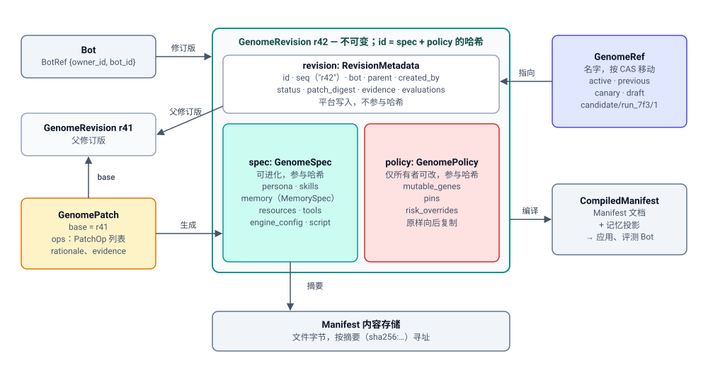

# 基因组

> English version: [01-genome.md](01-genome.md)

> 状态：草案（DRAFT）。[Bot 进化架构](design.zh-CN.md)中的一个组件。
> 本文档介绍 Bot 基因组（Bot Genome）：Bot 定义的不可变、带版本的修订版，
> 指向这些修订版的引用（ref），用于变更它们的补丁，以及存储并提供这些内容的
> 基因组注册表（Genome Registry）。

已接受的决策：[DR-1](../../../../docs/adr/0019-bot-genome-is-the-unit-of-evolution.zh-CN.md)。
基于 Bot Config Manifest（`apps/backend/docs/bot-config-manifest/`）构建。
规范格式（工作项 RSI-02）：
[`apps/backend/api-contracts/genome/v1/`](../../api-contracts/genome/v1/README.md)。本设计文档
与该契约不一致时，以契约为准。

## 1. 目的与范围

**Bot 基因组**是一个 Bot 的可进化、声明式定义：人设文件、技能、精选记忆、
资源、工具、引擎配置，以及一个不可进化的 `policy` 部分。**基因组修订版**
（Genome Revision）是它的一个已记录的、不可变的版本。基因组是进化的单位：
每个进化策略都读取一个修订版并提出对它的变更，而每一个经由基因组到达运行中
Bot 的变更都是对某个修订版的应用。

一句话概括：基因组修订版是**一份完整、已固定版本的 Manifest，加上精选记忆，
再加上一个父代指针和锁定的策略配置，且只能通过补丁变更**。

**基因组注册表**是实现这一点的组件。它负责：

- 基因组修订版（内容、父代、来源、状态）；
- 具名**引用**（`active`、`previous`、`canary`、`draft`、`candidate/<run>/<n>`）
  及其比较并交换（compare-and-swap）更新；
- **基因组补丁**（Genome Patch）：其模式、将其应用到基础修订版，以及记录补丁时执行的
  结构性检查（它能干净地应用到其基础修订版，并保持在策略配置范围内，§6.2）。变更是否
  *良好*不在此处检查：那是[验证](07-verification.zh-CN.md)的职责；
- **基因组策略配置**（可变基因、固定项、风险覆盖），以及在记录补丁时
  对其进行的结构性强制执行；
- 内容寻址：文件字节通过摘要在现有 manifest 内容存储中被引用；
- 将修订版**编译**为一份已固定版本的 Manifest 文档，供应用和评估 Bot 使用。
  精选记忆放在该文档新增的 `memory` 类别中；应用时，引擎适配器把这些条目写入
  引擎自己的记忆格式（对 OpenClaw 来说就是它的记忆文件）。这一交接就是
  *记忆投影*；见 §7；
- 任意两个修订版之间的差异。

它明确**不**负责：

| 不在此处负责 | 负责方 |
| --- | --- |
| 判断候选是否良好（套件、评分器、判定） | [07-verification.zh-CN.md](07-verification.zh-CN.md) |
| 判断修订版是否可以成为 `active`、风险等级审批、评审队列、发布，以及移动 `active` 的晋升端点 | [08-promotion.zh-CN.md](08-promotion.zh-CN.md) |
| 运行进化策略、绑定、每个绑定的 `allowed_genes`、预算 | [06-evolution-run.zh-CN.md](06-evolution-run.zh-CN.md) |
| 进化策略侧对修订版的视图（`ctx.parent`、`ctx.workspace`、`ctx.candidates`） | [03-strategy.zh-CN.md](03-strategy.zh-CN.md) |
| 携带修订版 id 的片段（episode）与反馈 | [02-experience.zh-CN.md](02-experience.zh-CN.md) |
| 修订版、引用移动、门禁决策的审计日志；实验记录的归档视图；感知谱系的父代选择器 | [05-experiment-ledger.zh-CN.md](05-experiment-ledger.zh-CN.md) |
| 改进机制（进化策略）修订版，复用本文的修订版/引用/补丁机制 | [10-meta-evolution.zh-CN.md](10-meta-evolution.zh-CN.md) |
| 修订版在引擎工作区上的物理投影、运行时记忆 | 引擎适配器（`engine/adapter/`）；依据仓库根目录 `AGENTS.md` 的规则（“物理布局归 Engine Runtime 及其带版本的布局契约所有”；ADR 0014 是这条规则的一个应用），Backend 不得知晓引擎路径 |

**放置位置。** 放在 Backend 中，作为新的核心包 `core/bot_genome/`，与
`core/bot_config_manifest/` 并列，因为 Backend 负责期望状态，且 Manifest
已经位于此处。内容复用 manifest 内容存储
（`core/bot_config_manifest/content/service.py`）。晋升同样位于 Backend 中、
与其相邻，因为晋升必须与应用放在一起。

**分层。** 基因组构建在 Manifest 之上。Manifest 不感知修订版：它只获得格式特性
以及一项自身的事实，即每次应用所应用文档的摘要（§8）。某个摘要属于哪个修订版，
只有基因组注册表知道。直接的 Manifest 编辑会绕过基因组，并作为漂移被检测到
（§5.5）。

**可独立使用。** 基因组注册表属于 P1 阶段：带版本的 Bot、可归因的应用，以及
回到任意更早修订版，这些能力独立于任何进化策略都有价值。

## 2. 领域模型



各类型之间的关系：

- 一个 Bot 有多个**修订版**。每个修订版持有一个 `spec`（可进化内容）和一个
  `policy`（所有者的规则），外加平台写入的元数据。
- 除 Bot 的第一个修订版外，每个修订版恰好有一个**父代**。**补丁**（一组操作）
  就是把父代变成新修订版的东西。所有者也可以把 Bot 的当前状态**捕获**为一个修订版，
  而不使用补丁。
- **引用**是指向修订版的名字（`active`、`draft`……）。
- **编译**一个修订版会得到 `CompiledManifest`，供应用和评估 Bot 使用。
- 文件内容从不内联存储：`spec` 中的每个文件都是一个**摘要**，即其字节在内容存储中的
  地址。

| 类型 | 含义 | 负责方 | 生命周期 |
| --- | --- | --- | --- |
| `GenomeRevision` | Bot 定义的一个不可变版本：`spec` + `policy`，加上平台写入的元数据（`revision`） | 基因组注册表 | 只记录一次（来自补丁或通过捕获），从不编辑；只有其 `status`、注解和只追加的 `evaluations` 列表会变化；从不删除 |
| `GenomeSpec` | 修订版的可进化内容：人设、技能、记忆、资源、工具、引擎配置、脚本 | 基因组注册表（由所有者编写，由进化策略提议） | 修订版的一部分；参与哈希 |
| `GenomePolicy` | 不可进化的部分：可变基因、固定项、风险覆盖 | Bot 所有者 / 租户管理员 | 修订版的一部分；参与哈希；由平台原样向后复制；任何补丁都不得触及 |
| `RevisionMetadata` | Id、每个 Bot 的 `seq`、父代、来源、状态、证据与评估 id、注解 | 基因组注册表（平台写入） | 在记录时写入；状态/注解之后更新，评估 id 由验证追加；不参与哈希 |
| `Provenance` | 谁或什么创建了修订版（某个人、某次进化策略运行、以后可能是某个 Bot） | 基因组注册表 | 在记录时写入一次 |
| `GenomeRef` | 指向某个修订版的具名、可移动指针（`active`、`previous`、`canary`、`draft`、`candidate/<run>/<n>`） | 基因组注册表；每个引用恰好有一种移动者 | 通过比较并交换移动；每次移动都是一个被审计的事件 |
| `GenomePatch` | 针对具名基础修订版的、带类型的逐项变更；进化策略唯一可提交的内容 | 由进化策略（通过[进化运行](06-evolution-run.zh-CN.md)）或人提交；由注册表校验 | 以内容寻址方式存储；其摘要即候选 id |
| `PatchOp` | 补丁中的一项（`file.edit`、`skill.add`、`memory.add`……） | 补丁的一部分 | 每个操作映射到一个风险等级 |
| `MemoryItem` | 一条精选记忆事实/规则/教训，带键 | 基因组（精选记忆） | 由补丁操作添加、更新和退役 |
| `CompiledManifest` | 渲染为一份普通 Manifest 文档（已固定版本，每个类别都存在）的修订版，另附修订版 id 和该文档的摘要用于记账 | 基因组注册表（派生而来，不作为事实存储） | 按需为应用和评估 Bot 生成 |

### 2.1 基因

**基因**（gene）是 `spec` 中一个具名、可寻址的部分，策略配置和绑定可以引用它。
**基因路径**为它命名：先是一个类别（`persona`、`skills`、`memory`、`resources`、
`tools`、`engine_config`、`script`），然后是以 `/` 分隔的段：`tools/mcp`、一个条目
（`skills/refund-policy`、`memory/returns-window`、`tools/mcp/mcp.x.meet`），或条目中
的一个文件（`skills/refund-policy/SKILL.md`、`resources/data/kb/faq.md`）。策略配置、
绑定的 `allowed_genes`、每个补丁操作的目标以及差异输出都使用同一套语法。

- `/` 是唯一的分隔符，因此带点的名称（`SOUL.md`、`mcp.x.meet`）是单个段。
- 当 `X == P` 或 `X` 以 `P/` 开头时，路径 `P` 覆盖 `X`，因此匹配按完整的段进行：
  `skills/pdf` 覆盖 `skills/pdf/SKILL.md`，但不覆盖 `skills/pdf-tools`。
- MCP 的 `server_code` 可以包含任意字符；`A–Z a–z 0–9 . _ -` 之外的字节使用百分号
  编码，并且只有规范写法有效。

完整语法见[契约 README §2](../../api-contracts/genome/v1/README.md#2-gene-paths)。

### 2.2 GenomeSpec

先列出共享的别名；下面的每个类型都会用到它们。

```python
from dataclasses import dataclass, field
from datetime import datetime
from enum import StrEnum

RevisionId = str   # identity of a revision: "sha256:" + 64 hex chars, the hash of canonical({spec, policy}) (§4.4).
                   # Example: "sha256:7c1e…" (shortened here and below)
Digest = str       # address of stored bytes: "sha256:" + 64 hex chars of the bytes themselves.
                   # Example: "sha256:3f9a…" is the address of one SOUL.md file;
                   # GET …/genome/content/sha256:3f9a… returns "# Soul\nYou are a patient support agent…" (§9.1).
                   # One store and one endpoint serve every digest below (persona file, skill, memory items,
                   # resource, script); the field that holds a digest says what the bytes are.
# RiskTier (T0 < T1 < T2 < T3) is defined once in 08-promotion.md §5.
# BotRef {owner_id, bot_id}: the bot's full identity (a bot_id alone is not unique
# across users); defined once in 09-evolution-api.md §2.6.
```

人设文件与技能：

```python
class PersonaFileType(StrEnum):
    """The persona files a bot may have: VALID_IDENTITY_FILES in core/services/identity.py,
    minus MEMORY.md and IDENTITY.md (reserved, §7). Which of these an engine accepts is
    checked when a revision is recorded (claude_code: CLAUDE.md only)."""
    SOUL = "SOUL.md"
    AGENTS = "AGENTS.md"
    RULES = "RULES.md"
    OKR = "OKR.md"
    SAFETY = "SAFETY.md"
    OUTPUT = "OUTPUT.md"
    USER = "USER.md"
    TOOLS = "TOOLS.md"
    HEARTBEAT = "HEARTBEAT.md"
    BOOTSTRAP = "BOOTSTRAP.md"
    KNOWLEDGE = "KNOWLEDGE.md"
    CLAUDE = "CLAUDE.md"
    GREETING = "GREETING.md"
    README = "README.md"

@dataclass(frozen=True)
class PersonaFile:
    type: PersonaFileType            # which persona file, e.g. PersonaFileType.SOUL ("SOUL.md")
    digest: Digest                   # where its bytes are, e.g. "sha256:3f9a…"

class SkillOrigin(StrEnum):
    CENTER = "center"                # a governed skill from Skill Center: pinned by version, not copied
    LOCAL = "local"                  # the skill's files are stored (fetched from git or OSS, uploaded, or created
                                     # by a patch); where they were fetched from is not part of the revision (§4.2)

@dataclass(frozen=True)
class SkillEntry:
    name: str                        # the skill's name, the entry's key, e.g. "refund-policy"
    origin: SkillOrigin
    digest: Digest | None = None     # LOCAL only: the acm-tree-v1 encoding of the skill's files (§9.1), e.g. "sha256:0c55…"
    center_version: str | None = None  # CENTER only: the pinned Skill Center version, e.g. "v7"
```

精选记忆：

```python
class EvidenceKind(StrEnum):
    """The Experience records a change can cite (02-experience.md)."""
    EPISODE = "episode"              # one recorded session or trajectory of the bot, id "ep_…"
    FEEDBACK = "feedback"            # one feedback record, id "fb_…": a rating, a correction, or a producer's
                                     # finding such as a ClawInsight improvement item
    EVAL = "eval"                    # one evaluation rollout trace, id "et_…"

EvidenceRef = str  # "<EvidenceKind>:<id>", e.g. "episode:ep_91", "feedback:fb_311". Each one names exactly one
                   # Experience record, which GET …/experience/episodes/ep_91 (or …/feedback/fb_311) returns.
                   # It is an id to look up, not a URL.

@dataclass(frozen=True)
class MemoryItem:
    key: str                         # stable name of the item, e.g. "returns-window"; updates and retires address it
    text: str                        # the fact, rule, or lesson itself, e.g. "Returns are accepted within 30 days."
    tags: list[str]                  # free-form topic labels, e.g. ["returns"]
    source: list[EvidenceRef]        # what the item was learned from, e.g. ["episode:ep_97"]

class MemoryMode(StrEnum):
    """How apply writes the curated items into the engine's memory (§7). Besides curated items, the
    engine's memory holds what the bot wrote itself while running ("runtime items")."""
    SEED = "seed"                    # write each item only if the engine has no item with that key yet;
                                     # anything already there, including runtime items, is kept as it is
    MERGE = "merge"                  # write every item, overwriting an existing item with the same key;
                                     # runtime items with other keys are kept
    REPLACE = "replace"              # the engine's memory becomes exactly the curated items; runtime items are
                                     # dropped (T3: needs human approval)

@dataclass(frozen=True)
class MemorySpec:
    mode: MemoryMode
    items_digest: Digest             # where the stored list of MemoryItem is, e.g. "sha256:9e20…"
```

以一个客服 Bot 为例，`items_digest` 指向的已存储列表：

```jsonc
// Illustrative. Comments explain the example only; the canonical form is plain JSON (RFC 8785).
[
  {"key": "returns-window",                       // stable name; memory.update / memory.retire address it
   "text": "Returns are accepted within 30 days of delivery.",
   "tags": ["returns"],
   "source": ["episode:ep_97", "feedback:fb_204"]},   // the sessions and feedback it was learned from
  {"key": "customer-tier-rules",
   "text": "Gold customers get free return shipping.",
   "tags": ["billing", "returns"],
   "source": ["episode:ep_91"]}
]
```

模式示例。精选集合中有 `returns-window` = "Returns are accepted within 30
days."。运行期间，Bot 自己写入了 `returns-window` = "Returns are accepted
within 14 days."，以及一个新条目 `vip-contact`。在下一次应用时：

| 模式 | 之后的 `returns-window` | 之后的 `vip-contact` |
| --- | --- | --- |
| `seed` | "14 days"（该键已存在，因此 Bot 自己的条目保留） | 保留 |
| `merge` | "30 days"（精选条目覆盖该键） | 保留 |
| `replace` | "30 days" | 被移除 |

资源、工具以及完整的 spec：

```python
@dataclass(frozen=True)
class ResourceEntry:
    path: str                        # where the resource appears in the bot's workspace, the entry's key;
                                     # a trailing "/" marks a directory, e.g. "data/kb/"
    digest: Digest                   # a file's bytes, or the acm-tree-v1 encoding of a directory (§9.1)

@dataclass(frozen=True)
class McpConfig:
    """The bot-level override, the Manifest's own closed set. Absent fields are not overridden."""
    url: str | None = None           # absolute http(s) URL
    headers: dict[str, str] | None = None   # header names and values as written (#2860)
    endpoint_env: str | None = None  # "PROD" | "PRE"
    transport_protocol: str | None = None   # "SSE" | "STREAMABLE_HTTP"

@dataclass(frozen=True)
class McpServerEntry:
    server_code: str                 # the MCP server's registered code, the entry's key, e.g. "mcp.x.meet"
    config: McpConfig | None = None  # inline: an MCP entry has no stored bytes; None means no bot override

@dataclass(frozen=True)
class ToolsSpec:
    mcp: list[McpServerEntry]        # CLI tools are not part of genome v1 (acli replaces them)

@dataclass(frozen=True)
class ScriptEntry:
    digest: Digest                   # the startup script body, after placeholder substitution; not mutable by default (§4.5)

@dataclass(frozen=True)
class GenomeSpec:
    persona: list[PersonaFile]       # every list is sorted by its key, keys unique (canonical order, §9.3)
    skills: list[SkillEntry]
    memory: MemorySpec | None        # None until RSI-05 lands (§7)
    resources: list[ResourceEntry]
    tools: ToolsSpec
    engine_config: dict[str, str]    # always {} in v1: nothing applies engine_config yet (#2858)
    script: ScriptEntry | None       # None when the bot has no startup script
```

每个修订版中都包含所有类别。空列表表示“无”；它从不表示“保持原样”
（完整性，§4.3）。每个条目由一个**键**（为它命名的字段：`type`、`name`、`path`、
`server_code`）和一个**值**组成：条目有存储字节时值是摘要，没有存储字节时值是内联
字段（MCP 服务器的配置、Center 技能的版本）。文件内容总是摘要，无论它是获取得到的、
在 Manifest 中内联书写的，还是由补丁产出的。通过 Manifest 构建的 CLI 工具不属于
基因组 v1；在修订版功能上线之前由 acli 取代。

```jsonc
// Illustrative. Comments explain the example only; the canonical form is plain JSON (RFC 8785).
// Normative schema: apps/backend/api-contracts/genome/v1/genome-revision.schema.json.
{
  "persona": [                                    // == manifest.identity, but pinned; sorted by type
    {"type": "AGENTS.md", "digest": "sha256:81bd…"},
    {"type": "SOUL.md", "digest": "sha256:3f9a…"}
  ],
  "skills": [                                     // sorted by name
    {"name": "quality-check", "origin": "local", "digest": "sha256:0c55…"},   // stored: acm-tree-v1 of its files
    {"name": "refund-policy", "origin": "center", "center_version": "v7"}     // pinned Center version, not copied
  ],
  "memory": {                                     // new category, see §7
    "mode": "seed",                               // seed | merge | replace (MemoryMode)
    "items_digest": "sha256:9e20…"                // the stored list of memory items
  },
  "resources": [{"path": "data/kb/", "digest": "sha256:d4a7…"}],   // a directory: acm-tree-v1 of its files
  "tools": {
    "mcp": [{"server_code": "mcp.x.meet",                           // no bytes, so the config is inline
             "config": {"endpoint_env": "PRE", "transport_protocol": "STREAMABLE_HTTP"}}]
  },
  "engine_config": {},                            // always {} until #2858
  "script": {"digest": "sha256:e1f0…"}            // carried, but not mutable by default
}
```

### 2.3 GenomePolicy

策略配置规定了自动化参与者可以在该 Bot 上变更什么。它由 Bot 所有者或租户管理员
负责，从不由进化策略负责，平台会拒绝任何触及它的补丁。

**为什么需要策略配置。** 策略配置保存所有者为*该* Bot 的进化设定的边界规则：哪些
基因可变、哪些条目被固定，以及哪些基因使用更高的风险等级。它位于修订版
内部并参与其哈希，因此每个修订版都记录了它在何种规则下产生并通过验证；查看一个旧
修订版，就能知道当时自动化参与者被允许变更什么。进化策略可以读取它（以避免提议会被
拒绝的变更），但任何补丁都不能修改它：只有所有者可以通过一次记录新修订版的常规编辑
来修改（§4.4）。因此，自动化参与者无法放宽自身的限制。示例：在一个面向客户的支持
Bot 上，所有者固定 `persona/RULES.md`（经法务签字确认的退款与升级规则）；没有任何
补丁操作能触及 `tools/mcp`，这样夜间运行的进化策略可以改进 `SOUL.md` 中的语气并添加
技能，但永远无法改写这些规则，也无法为 Bot 添加新工具。

策略配置有两个列表。`mutable_genes` 是允许列表：只有当某个条目覆盖操作的基因路径时，
操作才被允许，未列出的一切都不可触及。`pins` 保护可变基因中的单个条目：当操作的基因
路径与某个固定项重叠（任一方覆盖另一方）时，操作被拒绝，因此当某个技能的文件被固定时，
删除该技能也会被拒绝。新 Bot 的默认策略配置使 `persona`、`skills`、`memory` 和
`resources` 可变，并固定 `persona/SAFETY.md`；`script` 和 `tools/mcp` 不可变，而
`policy` 根本不是基因路径（待定决策 G-3，已关闭）。

```python
@dataclass(frozen=True)
class GenomePolicy:
    mutable_genes: list[str]         # gene paths (§2.1) a patch may touch; everything else is off limits
    pins: list[str]                  # items inside a mutable gene that stay write-protected, e.g. "skills/refund-policy"
    risk_overrides: dict[str, RiskTier]   # gene path -> a higher tier for ops overlapping it; can only RAISE a tier
```

```jsonc
// Illustrative. Comments explain the example only; the canonical form is plain JSON (RFC 8785).
{
  "mutable_genes": ["memory", "persona", "resources", "skills"],   // the default; script and tools/mcp are not listed
  "pins": ["persona/RULES.md", "persona/SAFETY.md", "skills/refund-policy"],   // the default pins only SAFETY.md
  "risk_overrides": {"persona/SOUL.md": "T3"}     // owner raises the tier of ops on this file
}
```

策略配置的使用方式：

- **在记录补丁时**（§6.2）：`mutable_genes` 之外的操作，以及与固定项重叠的操作
  都会被拒绝。
- **在配置绑定时**：一个**绑定**把一个进化策略挂接到该 Bot 上：用哪个策略、何时
  运行、可以修改哪些基因（`allowed_genes`）以及它的预算。一个 Bot 有一组绑定（即它的
  绑定列表），例如每晚针对人设和技能运行的 ClawEvolve。绑定的 `allowed_genes`
  必须保持在该 Bot 的 `mutable_genes` 范围内；不匹配会在任何付费运行
  开始前被拒绝。绑定的定义见 [06-evolution-run.zh-CN.md](06-evolution-run.zh-CN.md)。
- **在提交候选时**：晋升的静态底线检查（`FloorCheck`）会在花费任何验证成本之前
  再次检查“只触及可变基因，未触及固定条目”；见 [08-promotion.zh-CN.md](08-promotion.zh-CN.md)。

正是在这里，“工具和权限变更只能由人完成”得以**结构性地**而非靠约定来强制执行：
不存在针对工具或脚本的补丁操作，因此它们只能在所有者编辑 Bot 并捕获它时
变更，而策略配置本身处于补丁可触及的范围之外。
更改策略配置是一项所有者操作，会记录一个新的修订版（§4.4）。

### 2.4 GenomeRevision

```python
class ProvenanceKind(StrEnum):
    USER = "user"                    # a person edited the bot through the genome API (UI or API);
                                     # a direct PUT /config-manifest records no revision (§5.5)
    STRATEGY_RUN = "strategy_run"    # a strategy submitted it as a candidate during an Evolution Run
    BOT = "bot"                      # postponed with DR-3

@dataclass(frozen=True)
class Provenance:
    kind: ProvenanceKind
    actor: str                       # who: a user id ("user_owner_1"), or a strategy "id@version"
                                     # ("clawevolve/bot-evolution@2.0.0")
    run_id: str | None = None        # STRATEGY_RUN only: the Evolution Run that produced it, e.g. "run_7f3"
    step: str | None = None          # STRATEGY_RUN only: the strategy's own label for the step, e.g. "propose"

EvaluationId = str  # id of one Verification evaluation, e.g. "ev_301";
                    # GET …/evolution/evaluations/ev_301 returns it with its scores (07-verification.md)

class RevisionStatus(StrEnum):
    """Meaning of each status and who sets it: §4.4."""
    DRAFT = "draft"
    CANDIDATE = "candidate"
    ACCEPTED = "accepted"
    REJECTED = "rejected"
    PROMOTED = "promoted"
    ARCHIVED = "archived"

@dataclass
class RevisionMetadata:
    id: RevisionId                   # the revision's identity: hash of {spec, policy} (§4.4)
    seq: int                         # per-bot counter for people: the bot's 1st recorded revision is 1 ("r1"), the
                                     # 42nd is 42 ("r42"). UIs show it, and paths accept it
                                     # (GET …/revisions/r42), but it is not an identity: other records store `id`
    bot: BotRef                      # the bot this revision belongs to (owner + bot id)
    parent: RevisionId | None        # the revision this one was made from: the patch's `base`, or `active` when the
                                     # bot was captured or its policy changed; None only for the bot's first revision
    created_by: Provenance
    created_at: datetime
    status: RevisionStatus
    patch_digest: Digest | None      # digest of the stored GenomePatch that turned `parent` into this revision
                                     # (= the candidate id, §6.5); None when the revision was captured or is a
                                     # policy change instead of a patch (§4.1)
    evidence: list[EvidenceRef]      # the Experience records that motivated the change, e.g.
                                     # ["episode:ep_91", "feedback:fb_311"]; [] for most manual edits
    evaluations: list[EvaluationId]  # the Verification evaluations run on this revision, e.g. ["ev_301", "ev_302"];
                                     # ids only: scores stay in Verification
    annotations: dict[str, str] = field(default_factory=dict)
                                     # free-form labels people or the platform add after recording, e.g.
                                     # {"experiment": "escalation-wording", "review_note": "checked by legal"};
                                     # not hashed, so they change without creating a new revision

@dataclass(frozen=True)
class GenomeRevision:
    genome_schema: int               # version of this record's format, so a reader knows how to parse it: 1 today;
                                     # a breaking change to the shape of spec or policy bumps it (RSI-02)
    revision: RevisionMetadata       # platform-written, excluded from the hash
    spec: GenomeSpec
    policy: GenomePolicy
```

**运行 id**（`run_7f3`）是一次进化运行的 id：针对一个 Bot 执行一次绑定。进化运行
在提交运行时分配它。它全局唯一且不透明。它不是按进化策略或按 Bot 递增的计数器
（[06-evolution-run.zh-CN.md](06-evolution-run.zh-CN.md)）。

```jsonc
// Illustrative. Comments explain the example only; the canonical form is plain JSON (RFC 8785).
// `spec` and `policy` are shortened; full examples are in §2.2 and §2.3.
{
  "genome_schema": 1,                             // format version of this record
  "revision": {                                   // computed / platform-written, not authored
    "id": "sha256:7c1e…",                         // hash of canonical({spec, policy}): the identity
    "seq": 42,                                    // the bot's 42nd revision, shown as "r42"; not an identity
    "bot": {"owner_id": "user_owner_5", "bot_id": "bot_123"},   // owner + bot id; a bot id alone is not unique
    "parent": "sha256:a90b…",                     // r41, the patch's base
    "created_by": {"kind": "strategy_run", "run_id": "run_7f3", "step": "propose",
                   "actor": "clawevolve/bot-evolution@2.0.0"},
    "created_at": "2026-10-08T03:12:00Z",
    "status": "candidate",
    "patch_digest": "sha256:c41e…",               // the stored Genome Patch that produced it = candidate id
    "evidence": ["episode:ep_91", "episode:ep_97", "feedback:fb_311"],
    "evaluations": ["ev_301", "ev_302"],          // Verification evaluation ids, not embedded scores
    "annotations": {"experiment": "escalation-wording"}
  },
  "spec": {"persona": [{"type": "SOUL.md", "digest": "sha256:3f9a…"}], "skills": [], "memory": null,
           "resources": [], "tools": {"mcp": []}, "engine_config": {}, "script": null},
  "policy": {"mutable_genes": ["memory", "persona", "resources", "skills"], "pins": ["persona/SAFETY.md"],
             "risk_overrides": {}}
}
```

### 2.5 GenomeRef

```python
class FixedRefName(StrEnum):
    """The refs every bot can have, at most one of each (§5.1, §5.2)."""
    ACTIVE = "active"
    PREVIOUS = "previous"
    CANARY = "canary"
    DRAFT = "draft"

@dataclass(frozen=True)
class CandidateRefName:
    """The ref of one submitted candidate; serialized as "candidate/<run_id>/<n>" (§5.2)."""
    run_id: str                      # the Evolution Run that submitted it, e.g. "run_7f3"
    n: int                           # 1 for the run's first candidate, 2 for the second, …

RefName = FixedRefName | CandidateRefName   # on the wire: "active" or "candidate/run_7f3/1"; any other
                                            # string fails to parse, so no free-form names exist

@dataclass(frozen=True)
class GenomeRef:
    name: RefName
    revision: RevisionId             # the revision it points at now
    moved_at: datetime
    moved_by: Provenance
    reason: str | None = None        # required for active/previous/canary moves

@dataclass(frozen=True)
class RefUpdate:
    name: RefName
    revision: RevisionId             # where the ref should point
    expected_revision: RevisionId | None   # compare-and-swap: where the caller believes it points now;
                                           # None only when the ref must not exist yet (§5.3)
    reason: str | None = None
```

```jsonc
// Illustrative. Comments explain the example only; the canonical form is plain JSON (RFC 8785).
{
  "name": "active",
  "revision": "sha256:a90b…",
  "moved_at": "2026-10-01T09:30:00Z",
  "moved_by": {"kind": "user", "actor": "user_owner_1"},
  "reason": "approved after review of run_6c2"
}
```

### 2.6 GenomePatch 与 PatchOp

```python
class EditKind(StrEnum):
    REPLACE_SECTION = "replace_section"   # replace everything under a Markdown heading; the heading line stays
    INSERT_AFTER = "insert_after"         # insert text directly below one exact line
    DIFF = "diff"                         # a unified diff of the file: expresses any text change, so a sandbox's
                                          # edits can always be turned into a patch (03-strategy.md, to_patch)

@dataclass(frozen=True)
class TextEdit:
    kind: EditKind
    content: str | None = None       # REPLACE_SECTION, INSERT_AFTER: the new text to write
    heading: str | None = None       # REPLACE_SECTION only: the heading line, e.g. "## Escalation"
    anchor: str | None = None        # INSERT_AFTER only: the line to insert below, e.g. "## Tone"
    diff: str | None = None          # DIFF only: hunks starting at "@@", no ---/+++ header lines

@dataclass(frozen=True)
class DigestRef:
    digest: Digest                   # a file uploaded first with PUT …/genome/content

@dataclass(frozen=True)
class FileDiff:
    path: str                        # file inside the skill, e.g. "SKILL.md"
    diff: str                        # the change to that file in unified diff format (what `git diff` prints)

@dataclass(frozen=True)
class FileEdit:
    """Op "file.edit": edits to one existing text file (persona md, a file in a local skill, resource text)."""
    target: str                      # the file's gene path, e.g. "persona/SOUL.md", "skills/refund-policy/SKILL.md",
                                     # "resources/data/kb/faq.md"
    edits: list[TextEdit]

@dataclass(frozen=True)
class PersonaAdd:
    """Op "persona.add": a persona file the bot does not have yet."""
    type: PersonaFileType
    content: str | DigestRef         # small text inline, or a larger file uploaded first

@dataclass(frozen=True)
class PersonaRemove:
    """Op "persona.remove"."""
    type: PersonaFileType

@dataclass(frozen=True)
class SkillAdd:
    """Op "skill.add": a new bot-owned skill."""
    name: str                        # the new skill's name, e.g. "invoice-lookup"
    files: dict[str, str | DigestRef]   # path in the skill -> small text inline, or a larger file uploaded first

@dataclass(frozen=True)
class SkillUpdate:
    """Op "skill.update": changes files of an existing local skill (at least one of the two fields)."""
    name: str                        # the skill, e.g. "refund-policy"
    file_diffs: list[FileDiff] | None = None          # text changes, one unified diff per file
    files: dict[str, str | DigestRef | None] | None = None   # whole-file writes; None deletes (never SKILL.md)

@dataclass(frozen=True)
class SkillRemove:
    """Op "skill.remove": removes a local or Center skill."""
    name: str

@dataclass(frozen=True)
class ResourceAdd:
    """Op "resource.add": a file resource, or a directory resource from an uploaded acm-tree-v1 blob."""
    path: str                        # e.g. "data/returns.md", or "data/faq/" for a directory
    content: str | DigestRef         # a directory always takes a DigestRef

@dataclass(frozen=True)
class ResourceRemove:
    """Op "resource.remove"."""
    path: str

@dataclass(frozen=True)
class MemoryAdd:
    """Op "memory.add": a new curated memory item."""
    item: MemoryItem

@dataclass(frozen=True)
class MemoryUpdate:
    """Op "memory.update": replaces the text, tags, and source of an existing key."""
    item: MemoryItem

@dataclass(frozen=True)
class MemoryRetire:
    """Op "memory.retire": retires an item; it stays in history."""
    key: str                         # the item to retire

@dataclass(frozen=True)
class MemorySetMode:
    """Op "memory.set_mode": T1 for seed or merge, T3 for replace."""
    mode: MemoryMode

# No op reaches tools, script, engine_config or the policy: MCP servers and the script change only when
# an owner edits the bot and captures it; the policy has its own operation; engine_config waits for #2858.
PatchOp = (FileEdit | PersonaAdd | PersonaRemove | SkillAdd | SkillUpdate | SkillRemove | ResourceAdd
           | ResourceRemove | MemoryAdd | MemoryUpdate | MemoryRetire | MemorySetMode)

@dataclass(frozen=True)
class GenomePatch:
    patch_schema: int                # schema version of the patch format; 1
    base: RevisionId                 # the revision the patch was written against; becomes the new revision's parent
    ops: list[PatchOp]
    rationale: str                   # required; shown to reviewers
    evidence: list[EvidenceRef]      # required for non-trivial ops
```

```jsonc
// Illustrative. Comments explain the example only; the canonical form is plain JSON (RFC 8785).
{
  "patch_schema": 1,
  "base": "sha256:a90b…",                               // r41; becomes the parent
  "ops": [
    {"op": "file.edit", "target": "persona/SOUL.md",     // text files: persona md, SKILL.md, resources
     "edits": [
       {"kind": "replace_section", "heading": "## Escalation", "content": "Escalate to a human when a refund exceeds the policy limit…"},
       {"kind": "insert_after", "anchor": "## Tone", "content": "Confirm the order id before quoting amounts."}
     ]},
    {"op": "skill.add", "name": "invoice-lookup",
     "files": {"SKILL.md": "---\nname: invoice-lookup\n---\nLook up an invoice by order id…",   // small text: inline
               "scripts/lookup.py": {"digest": "sha256:6b1d…"}}},                              // larger file: uploaded first
    {"op": "skill.update", "name": "refund-policy",
     "file_diffs": [{"path": "SKILL.md", "diff": "@@ -12,3 +12,4 @@ partial refunds…"}]},
    {"op": "memory.add",                                  // itemized memory, see §7
     "item": {"key": "customer-tier-rules", "text": "Gold customers get free return shipping.", "tags": ["billing"], "source": ["episode:ep_91"]}},
    {"op": "memory.update",
     "item": {"key": "returns-window", "text": "Returns are accepted within 30 days.", "tags": ["returns"], "source": ["episode:ep_97"]}},
    {"op": "memory.retire", "key": "old-shipping-sla"},
    {"op": "resource.add", "path": "data/returns.md", "content": {"digest": "sha256:91c0…"}}
  ],
  "rationale": "Partial-refund requests were escalated too late in 6 of 9 failing episodes.",
  "evidence": ["feedback:fb_311", "episode:ep_91"]
}
```

此示例同时展示了多种操作类型。按照 §2.3 的示例策略配置，它会被拒绝，因为
`skills/refund-policy` 在那里被固定（§6.2）；真实的补丁只会触及可变且未固定的基因。
每种操作各有一个示例，见
[`api-contracts/genome/v1/examples/patches/`](../../api-contracts/genome/v1/examples/patches/)。

下面用上例中的两处编辑，说明两种 `file.edit` 如何修改文件：

```text
Before (persona/SOUL.md)          After
------------------------          -----
## Tone                           ## Tone
Be friendly and brief.            Confirm the order id before quoting amounts.   <- insert_after "## Tone":
                                  Be friendly and brief.                            new line directly below the anchor
## Escalation                     ## Escalation                                  <- replace_section "## Escalation":
Escalate when the customer        Escalate to a human when a refund exceeds        heading kept, everything under it
asks for a manager.               the policy limit…                                 up to the next heading of the same
Always apologise first.                                                             or higher level is replaced
## Closing                        ## Closing
```

`skill.update` 则为每个变更的文件携带一个 unified diff：即 `git diff` 和 `diff -u`
输出的标准文本差异格式，用 `@@` 标出 hunk 头，`-` 表示删除的行，`+` 表示新增的行。

### 2.7 CompiledManifest

```python
@dataclass(frozen=True)
class CompiledManifest:
    revision_id: RevisionId          # bookkeeping: which revision this was compiled from (not inside the document)
    document: dict                   # a plain Manifest document, exactly what apply consumes (shape below)
    document_digest: Digest          # digest of that document; apply reports record it (§8 item 5), and the
                                     # Registry maps it back to `revision_id`
```

`document` 就是一份 Manifest 文档。除 §8 列出的 Manifest 变更外，编译不会给
Manifest 格式增加任何东西：每个类别都存在，文件条目按摘要指向内容存储（§8 第 1
项），精选记忆就是 Manifest 新增的 `memory` 类别（§8 第 3 项）。另外两个字段是
放在文档旁边用于记账的信息，不会发送给应用。当晋升应用该文档时，应用报告会记录
其摘要（§8 第 5 项），注册表也会记录该修订版编译出了这个摘要，因此该摘要可以
映射回该修订版（§5.5）。

```jsonc
// Illustrative. Comments explain the example only; the canonical form is plain JSON (RFC 8785).
{
  "revision_id": "sha256:7c1e…",
  "document_digest": "sha256:f27a…",
  "document": {
    "schema_version": 1,
    "manifest": {
      "identity": [{"type": "SOUL.md", "source": {"protocol": "content_store", "digest": "sha256:3f9a…"}}],
      "skills": [{"name": "quality-check", "source": {"protocol": "content_store", "digest": "sha256:0c55…"}},
                 {"name": "refund-policy", "source": {"protocol": "center", "version": "v7"}}],   // §8 item 6
      "resources": [{"path": "data/kb/", "source": {"protocol": "content_store", "digest": "sha256:d4a7…"}}],
      "mcp": [],
      "memory": {"mode": "seed", "items": {"source": {"protocol": "content_store", "digest": "sha256:9e20…"}}}   // §8 item 3
    }
  }
}
```

`document` 中确切的字段名遵循 Manifest schema v1；`content_store`、`center` 和
`repo` 这几种来源写法是已编译文档自己的写法（契约 README §7），由直接投递（§8）
消费，从不经过 `PUT /config-manifest`。每个 Manifest v1 字段的映射见
[`manifest-v1-compatibility.md`](../../api-contracts/genome/v1/manifest-v1-compatibility.md)。

## 3. 为什么 Manifest 还不够

Manifest 的构建初衷是让用户能够自行管理 Bot 的资产：他们将技能、人设文件、资源、
MCP 和 CLI 工具保存在自己的来源中，并在一份由平台应用的文档中声明它们。它是正确的
**基础**：与引擎无关、声明式、在包括 teclaw 在内的每个引擎上收敛、只通过现有核心
服务应用，并且已经拥有能力矩阵和仅追加的应用报告。复用它意味着进化可以免费获得
向每个引擎交付的能力。

但作为一个不断进化的 Bot 的产物，它缺少进化所需的东西
（代码库证据见 [research.zh-CN.md](research.zh-CN.md) 的“Bot Config
Manifest”一节：每个 Bot 一行可变记录 `ac_bot_config_manifest`，
`repository/models.py:64`；没有修订版、哈希、父代或 ETag，
`services/config_manifest_service.py:141-184`；应用时重新读取当前文档，
`services/config_manifest_apply_service.py:846-875`；未知键被拒绝，
`schema/validator.py:58`；服务 Bot 只能回滚一步，
`core/service_bot/services/publish_rollback_mixin.py:38-80`）：

| Manifest v1 中的缺口 | 进化为何需要它 | 解决方式 |
| --- | --- | --- |
| 每个 Bot 一行可变记录，没有修订历史，没有内容哈希 | 谱系、归档、可复现性、回到任意时间点 | 修订版（§4） |
| 没有父代指针 | 谱系树；感知后代的选择 | `parent` |
| 没有乐观并发控制。HTTP 通过 `ETag`（服务器随文档返回的版本标签）和 `If-Match` 请求头（客户端回传其读取到的标签；若文档自那以后已变更，服务器以 `412 Precondition Failed` 拒绝写入）提供这一能力。`PUT /config-manifest` 两者都没有 | 进化策略与人同时编辑时会静默地互相覆盖；最后写入者在不知情的情况下胜出 | 引用上的比较并交换（§5） |
| 应用时重新读取当前文档；报告不说明应用的是哪些字节 | 无法将行为或经验归因到某个版本 | 应用报告记录所应用文档的摘要；注册表将其映射到修订版（§8） |
| 来源是可移动的引用（git 分支、OSS 键），每次应用都重新解析 | 基因组必须不可变：每个来源都固定到提交 SHA / 摘要 | 固定版本的内容（§4.2） |
| 整份文档 PUT，按类别原子替换 | 进化策略必须提交小型、可评审、逐项的补丁 | 基因组补丁（§6） |
| `MEMORY.md` / `IDENTITY.md` 被保留并拒绝 | 习得的记忆是自我改进产出的一半 | 精选记忆（§7） |
| `engine_config` 由模式校验，但没有任何东西应用它（已移出第一批；没有物化器） | 模型 / 温度 / 推理预算是合理的可调参数 | 为白名单中的 `engine_config` 键提供物化器（§8） |
| 文档中省略的类别表示“保持不变” | 修订版必须完全确定 Bot；否则同一修订版的两次应用可能因先前状态不同而产生不同的 Bot | 完整性（§4.3） |
| 没有存放元数据的位置：未知键会被拒绝 | 进化需要**来源**（谁或什么产生了某个版本、依据哪些证据、使用哪个补丁）和**注解**（自由格式的标签，例如评审备注或实验标签） | 保存在修订版记录上，而不是 Manifest 文档内，因此 Manifest 模式无需为此改变 |
| 个人 Bot 无法回到更早的配置；服务 Bot 有自己的发布回滚（只能回退一步） | 回到旧版本必须对每个 Bot 都可用，并且可以回到任意更早的修订版 | 回到旧版本 = 晋升一个更早的修订版（§5.4） |

被否决的替代方案（来自 DR-1）：

- **一个通过独立路径交付的单独进化产物（例如 ClawEvolve Pack）。** 否决原因：
  两个事实来源，而且 Pack 是 OpenClaw 专属的工作区快照，无法触达 teclaw。
- **在 Manifest 之外做版本管理，并让 Manifest 完全保持不变。** 否决原因：如果
  没有内容存储来源以及应用报告上的已应用文档摘要，应用仍会重新获取可移动的来源，
  也无法说明它应用了哪份文档，因此行为无法归因到某个版本。基因组确实构建在
  Manifest 之上，但 Manifest 会获得这些格式特性（§8）。
- **每个 Bot 一个 Git 仓库作为事实来源。** 暂缓；见 §9.2。

## 4. 修订版

### 4.1 修订版在 Manifest 之上增加了什么

具体来说，修订版在 Manifest 之上恰好增加了以下内容：

1. **修订版标识与谱系**：一个内容哈希 id 加上一个可读的每 Bot 序号、一个父代、来源、
   状态，以及通过比较并交换移动的具名引用（§5）。
2. **一个不可进化的 `policy` 部分**：所有者为该 Bot 的进化设定的边界规则，随每个
   修订版一同记录，且只能由所有者修改（原因见 §2.3）。
3. **固定版本的内容**：每个来源都解析为提交 SHA 或内容摘要，因此同一修订版总是
   产生相同的字节（§4.2）。
4. **完整性**：每个修订版中都包含所有类别（§4.3）。
5. **自动化参与者只能通过补丁变更**：进化策略针对补丁自身的基础修订版提交带类型的
   逐项补丁（§6）。人仍然可以用任何方式编辑 Bot（控制台、`PUT /config-manifest`），
   然后通过基因组 API（`POST …/genome/revisions:capture`，§12）把它的当前状态
   **捕获**为一个修订版；所有者的策略配置则通过它自己的操作
   （`PUT …/genome/policy`）变更。这样的修订版没有 `patch_digest`，其父代是
   `active`。发送到 `PUT /config-manifest` 的文档本身不会记录修订版（§5.5）。
6. **一个新的内容类别：精选记忆**（§7），这需要新的引擎契约。

刻意**不**增加的内容：

- **评估分数。** 它们存放在[验证](07-verification.zh-CN.md)中，仅以链接方式
  关联（`evaluations`）；[05-experiment-ledger.zh-CN.md](05-experiment-ledger.zh-CN.md)
  中实验记录的归档视图会将它们关联起来。基因组保持为纯粹的定义。
- **作为基因组专属新增项的 `engine_config`。** Manifest 模式已经有这个类别；应用
  一个白名单子集是一项对进化有益的 Manifest 变更（§8）。

### 4.2 摘要与固定版本

- **摘要，而非内容。** `digest`（`sha256:…`）是文件字节的*地址*，而不是字节本身。
  字节在现有 manifest 内容存储中只存储一次，需要时按摘要获取（§9.1）。共享同一
  文件的两个修订版共享其字节，因此存储被去重，差异计算也很廉价。
- **固定，而非浮动。** 当一份 `sources` 指向可移动引用的 Manifest 被应用、随后 Bot
  被捕获时，修订版按摘要持有应用所获取到的字节。浮动的 Manifest 是一种*输入*；
  修订版是一项*事实*。
- **地址不参与哈希。** 字节从哪里获取（git 的 `url`、`ref`、`subpath`；OSS 的
  `bucket`、`key`；`auth` 凭证名）不属于 `spec`，因此从迁移后的仓库获取到相同的字节
  会得到相同的修订版。Manifest 自己的应用报告把它们作为来源信息保留。`${BOT_*}`
  占位符已由应用使用该 Bot 的值解析过。
- **目录是一棵树。** 技能或目录资源以其文件的 `acm-tree-v1` 编码存储和计算哈希
  （§9.1），因此其摘要永远不取决于归档的压缩方式。
- **Center 技能被固定，而不是被复制。** Skill Center 已经存储了不可变、受治理的版本
  （ADR 0010）。修订版记录 Center 版本；只有 Bot 自有技能和来自 git/OSS 的内容
  才存入内容存储。修订版中的 `center://` 版本是对一个受治理、已发布版本的固定
  引用，而不是已激活的证据。

### 4.3 完整性

捕获会记录 Bot 当前状态的每个类别，而补丁从一个完整的基础修订版出发，因此存储的
修订版总是完整的。为投递而编译修订版时，总会输出每个类别。`[]` 表示“无”。与
Manifest 文档不同，修订版从不把某个类别留给先前状态，因此同一修订版的两次投递
总是产生相同的 Bot。

### 4.4 标识、序号与状态

- **Id。** `id = "sha256:" + hex(SHA-256(RFC8785({spec, policy})))`。`revision`
  元数据被排除在外，因此相同的内容总是具有相同的 id，无论由谁产生。记录已存在的
  内容会返回已有的修订版；不会创建重复项，也不会分配新的 `seq`。
- **`seq`。** 一个每 Bot 计数器，在新的 id 首次被记录时分配，供人阅读：Bot 第一个
  记录的修订版是 `r1`，下一个新修订版是 `r2`，依此类推。示例：进化策略提交了一个内容
  全新的候选，于是它成为 `r42`；同一提交的重试会再次返回 `r42`，而不是创建 `r43`。
  它从不作为标识，也从不用于哈希：两个 Bot 可以各有一个 `r42`，其他记录存储的是 `id`。
  `seq` 是记录的先后顺序，而不是父子关系：`r42` 的父代是它的 base，可以是 `r39`
  （例如一次在 `r39` 为 `active` 时开始的运行），而 `r41` 的父代可以是 `r38`。
- **父代。** 除 Bot 的第一个修订版外，每个修订版恰好有一个 `parent`：补丁所针对的基础
  修订版，或捕获 Bot 或更改其策略配置时的 `base`。沿着 `parent` 链接可以得到 Bot
  的历史，它呈树状（由 `r41` 生成的两个候选互为兄弟）。
- **状态**是平台写入的元数据，位于哈希之外：

| 状态 | 含义（提议） | 设置者 |
| --- | --- | --- |
| `draft` | 由所有者通过基因组 API 进行的手动编辑记录（UI 或 API） | 基因组注册表 |
| `candidate` | 由运行期间提交的补丁记录，尚未决定 | 基因组注册表 |
| `accepted` | 门禁已接受它（它可能还在等待评审或发布） | [晋升](08-promotion.zh-CN.md) |
| `rejected` | 验证或门禁拒绝了它；保留在归档中 | [晋升](08-promotion.zh-CN.md) |
| `promoted` | 至少被设为 `active` 一次 | [晋升](08-promotion.zh-CN.md) |
| `archived` | 不再被考虑；仍然从不删除 | 晋升 / 所有者 |

被拒绝和已退役的修订版从不删除；归档保留每一个候选。

- **策略配置变更。** 由于 `policy` 是参与哈希的内容的一部分，所有者更改策略配置
  会记录一个新的修订版（来源为 `user`），其 `spec` 不变。这是一项只能由人完成的
  变更（[08-promotion.zh-CN.md](08-promotion.zh-CN.md) 中的 T3）。

### 4.5 `script` 与 `engine_config`

- **`script` 不可进化。** 命令式启动脚本是最危险的面，并且已经在 teclaw 上被拒绝。
  它们仍是基因组的一部分，以保证修订版完整，但没有任何补丁操作能触及它们：脚本只能在
  所有者编辑 Bot 并捕获它时变更。
- **`engine_config`** 在 v1 中总是 `{}`，因为目前没有任何东西应用它（Manifest 对每个
  Bot 都拒绝该类别）。它的键和值类型与 Manifest 一起在
  [#2858](https://github.com/inclusionAI/Avernet/issues/2858) 中确定。

## 5. 引用

### 5.1 引用类型

引用是指向不可变修订版的具名、可移动指针，类似 git：

| 引用 | 含义 | 由谁移动 |
| --- | --- | --- |
| `active` | Bot 正在运行的内容 | 仅限[晋升](08-promotion.zh-CN.md) |
| `previous` | 上一个 `active`，保留用于快速“回到旧版本” | 仅限晋升 |
| `canary` | 金丝雀实例上的修订版 | 仅限晋升 |
| `draft` | 所有者正在进行的手动编辑 | 所有者（UI/API） |
| `candidate/<run>/<n>` | 某次运行的第 n 个候选 | [进化运行](06-evolution-run.zh-CN.md) |
| `inbox/<id>` | Bot 提交的草稿补丁（快速循环） | 暂缓：Bot 调用方是之后单独的设计 |

引用只是名字，不是身份。每个修订版都有自己的身份：内容哈希 id（加上按 bot 递增的
`seq`，例如 `r42`），无论是否有引用指向它。一个修订版可以没有引用，也可以被多个
引用指向。

### 5.2 逐个说明每个引用

贯穿本节的示例：一个支持 Bot 正在运行 `r41`。夜间运行 `run_7f3` 提出了两个候选，
同时所有者也在手动编辑该 Bot。

**`active`：Bot 正在运行的内容。** 经由基因组进行的每次应用（个人 Bot）和每次
发布（服务 Bot）都使用 `active` 指向的修订版（直接的 Manifest 编辑属于漂移，§5.5），
因此只要 Bot 被应用过，它就是每个 Bot 都有的那个引用。
只有晋升会移动它：在某个修订版被晋升时，无论该修订版更新还是更旧
（[08-promotion.zh-CN.md](08-promotion.zh-CN.md)）。
*示例：* 门禁接受了 `r42`，所有者批准了它；晋升将 `active` 从 `r41` 移到 `r42`，
并应用 `r42`。

**`previous`：后退一步。** `active` 在上一次移动之前指向的修订版。晋升在移动
`active` 的同一步中移动它，因此后退一步无需查找：晋升 `previous` 即可。*示例：*
在上述移动之后，`previous` = `r41`。如果 `r42` 表现异常，晋升 `previous` 会使
`active` 再次变为 `r41`，而 `previous` 变为 `r42`。

**`canary`：在部分实例上试运行的修订版。** 仅用于绑定采用金丝雀发布的多实例
（服务）Bot。一部分实例运行 `canary`，其余实例运行 `active`，由验证在线比较两者。
晋升在试运行开始时设置它。试运行成功时，`active` 移到同一个修订版；试运行被停止时，
金丝雀实例重新运行 `active`（[08-promotion.zh-CN.md](08-promotion.zh-CN.md)）。
*示例：* `canary` = `r42`，在 10% 的实例上运行一天，然后 `active` 移到 `r42`。

**`draft`：所有者正在进行的工作。** 每次通过基因组 API 进行的手动编辑（UI 或 API）
都会记录一个修订版，并将 `draft` 移到它。在所有者晋升之前，没有任何东西运行 `draft`，因此所有者可以
保存未完成的工作。*示例：* 所有者两次编辑 `SOUL.md`；这会记录 `r43` 和 `r44`，
`draft` = `r44`，而 `active` 保持为 `r42`，直到所有者晋升 `r44`。

**`candidate/<run_id>/<n>`：某次运行的一个候选。** 进化运行 `run_id` 提交的第 `n`
个候选（从 1 开始，按提交顺序计数）。当进化策略提交候选时，由进化运行创建它
（[06-evolution-run.zh-CN.md](06-evolution-run.zh-CN.md)）。它之后从不移动，因此在
门禁做出决定后这个名字仍然有效，可以用在 UI、API 路径和实验记录链接中。*示例：*
`run_7f3` 提交了两个补丁；它们被记录为 `r42` 和 `r45`，并分别命名为
`candidate/run_7f3/1` 和 `candidate/run_7f3/2`。`GET …/genome/revisions/candidate/run_7f3/2`
返回 `r45`。所有者手动编辑得到的修订版不会有 candidate 引用。

### 5.3 比较并交换

每次引用更新都携带 `expected_revision`：调用方认为该引用当前指向的修订版。
只有在这一点仍然成立时，注册表才会移动该引用；否则返回 `409 Conflict` 及当前
修订版，由调用方重新读取并做出决定。这弥补了并发编辑的缺口：进化策略与人同时编辑
时，不再会静默地互相覆盖。补丁增加了第二个 CAS：补丁的 `base` 必须等于它所应用到的
修订版（§6.2）。

每次引用移动都是一个仅追加的事件（引用、源、目标、参与者、原因、时间）。
审计日志及其读模型见 [05-experiment-ledger.zh-CN.md](05-experiment-ledger.zh-CN.md)。

### 5.4 回到旧版本就是晋升

在进化平台内，“回滚”到 `r41` 意味着**再次晋升 `r41`**。没有单独的回滚路径。
由于 id 是内容哈希，不会创建新的修订版：`active` 引用移回 `r41`，`previous` 移到
原先处于 active 的修订版，引用日志记录这次移动及其参与者和原因。对平台的其余部分
而言，这只是“应用这个修订版”，与任何向前的晋升完全相同：

- **个人 Bot：** 修订版通过 Manifest 应用进行应用。
- **服务 Bot：** 修订版通过现有的 草稿 → 验证 → 发布 流程，作为**下一个发布版本**
  发出。发布记录会记录所发布文档的摘要，注册表将其映射到该修订版。

现有的服务 Bot 回滚功能保持不变。本设计既不替代也不扩展它。晋升端点
（`POST /bots/{bot_id}/genome/promotions`）和发布规则在
[08-promotion.zh-CN.md](08-promotion.zh-CN.md) 中定义；基因组注册表提供它所使用的
CAS 引用移动和编译步骤。

### 5.5 直接的 Manifest 编辑与漂移

Manifest 不感知修订版，现有的 `/config-manifest` 端点也与今天完全一样继续工作。
直接的 `PUT /config-manifest` 会绕过基因组：它不记录修订版，也不移动任何引用。
想要保留历史的所有者应通过基因组 API 记录一个修订版并晋升它：要么提交一个补丁
（`POST …/genome/revisions`），要么用任意方式编辑之后再捕获该 Bot
（`POST …/genome/revisions:capture`，§12）。捕获是一项基因组操作，而不是 Manifest
操作。

**注册表如何知道 Bot 在运行什么。** 每次晋升都会把修订版 id 与它编译出的文档摘要
（`CompiledManifest.document_digest`，§2.7）记录在一起。一旦投递变为直接投递
（§8，RSI-04），应用报告（个人 Bot）和发布记录（服务 Bot）会重复记录该摘要，
注册表据此把 Bot 最近一次应用的摘要映射到它所运行的修订版。在此之前，关联靠的是
应用 id：注册表取 Bot 最近一次 Manifest 应用，查找发起它的那次晋升
（`apply_reference`）；且只计入 `SUCCEEDED` 的应用；若最近一次应用不是任何晋升发起的、或仍在运行或已失败，则说明 Bot 运行的是没有
任何修订版描述的东西。

**漂移。** 当 Bot 最近一次应用的文档摘要（来自最新的应用报告，或正在提供服务的
版本的发布记录）与 `active` 编译出的摘要不同时，该 Bot 就*发生了漂移*。漂移通常
发生在直接的 Manifest 编辑之后。漂移是被检测的，而不是被阻止的。注册表在运行开始
和晋升时检查漂移：

- **运行开始。** 运行不会在已漂移的 Bot 上启动：进化运行以结束原因
  `out_of_band_change` 结束它（[06-evolution-run.zh-CN.md](06-evolution-run.zh-CN.md)）。
- **晋升。** 由门禁、评审队列批准以及自动回滚规则发起的晋升会以 `409 drifted`
  被拒绝（[08-promotion.zh-CN.md](08-promotion.zh-CN.md)）。所有者的晋升是允许的，
  因为这正是所有者进行调和的方式。

所有者可以通过以下两种方式之一进行调和：

1. **保留直接编辑。** 将 Bot 当前的 Manifest 记录为一个修订版，并晋升它。
2. **丢弃直接编辑。** 再次晋升 `active`，这会重新应用它并覆盖直接编辑。

无论哪种方式，新的应用都会记录新的 `active` 编译出的摘要，漂移随之结束。Bot 处于
漂移状态期间记录的经验保持未归因（[02-experience.zh-CN.md](02-experience.zh-CN.md)
§3）。

*示例：* `bot_123` 运行 `r42`，它编译为 `sha256:f27a…`。

1. 10 月 9 日，所有者编辑 `SOUL.md`，并把文档直接发送到 `PUT /config-manifest`。
   应用成功；其报告记录 `sha256:b7e3…`，没有任何修订版编译为该摘要。Bot 发生了漂移。
2. 10 月 10 日 02:00，夜间绑定触发。注册表报告漂移，因此 `run_8a1` 在预留任何预算
   之前就以 `out_of_band_change` 结束。
3. 所有者将当前的 Manifest 记录为一个修订版（`POST …/genome/revisions:capture`；
   其父代是 `active`，即 `r42`），它成为 `r46`，然后晋升 `r46`。其应用报告记录
   `r46` 编译出的摘要，也正是 `active` 现在编译出的摘要。下一次夜间运行从 `r46`
   开始。

## 6. 基因组补丁

### 6.1 为什么使用补丁

基因组补丁是进化策略唯一可以提交的东西。它是逐项且带类型的，这遵循了 ACE 的发现：
增量更新可以避免上下文坍缩（整体重写会逐渐抹去累积的细节）。不支持自动化参与者进行
整份文档替换。人也可以提交补丁（通过 `POST …/genome/revisions`，§12），或编辑 Bot 然后捕获它。

操作集（待定决策 G-2 和 G-10，已关闭；规范定义见
[契约 README §6](../../api-contracts/genome/v1/README.md#6-patches)）：

| 操作 | 变更内容 | 说明 |
| --- | --- | --- |
| `file.edit` | 一个现有文本文件：人设 md、本地技能中的文件、文件资源、目录资源中的文件 | 种类 `replace_section`（按标题）、`insert_after`（按锚点）和 `diff`（unified diff），后者能表达任何文本变更 |
| `persona.add` / `persona.remove` | 一个人设文件 | 内容内联或按摘要引用 |
| `skill.add` | 一个新的本地技能 | 小型文本内联；较大的文件先通过 `PUT …/genome/content` 上传，再按摘要引用 |
| `skill.update` | 一个现有本地技能的文件 | 每个变更的文本文件一个 unified diff，或整文件写入与删除 |
| `skill.remove` | 一个本地技能或 Center 技能 | |
| `resource.add` / `resource.remove` | 一个资源条目 | 目录通过已上传的 `acm-tree-v1` blob 添加 |
| `memory.add` | 添加一条精选记忆条目 | 条目携带 `key`、`text`、`tags`、`source` 证据 |
| `memory.update` | 按键替换一条现有条目的文本、标签和来源 | 记忆整合需要它（[04-default-strategies.zh-CN.md](04-default-strategies.zh-CN.md)）；旧版本保留在历史中 |
| `memory.retire` | 按键退役一条条目 | 已退役的条目不会从历史中删除 |
| `memory.set_mode` | 记忆模式 | `replace` 为 T3 |

没有任何操作能触及 `tools`、`script`、`engine_config` 或策略配置。操作不映射到 JSON
Patch（RFC 6902）：它们修改的是存储 blob 中的文件内容，而不是 JSON 值，而且风险等级
取决于每个操作的含义。

### 6.2 记录补丁时强制执行的规则

注册表在从补丁记录候选或草稿时强制执行以下规则（这是门禁静态底线的一个结构性子集；
完整的底线，包括密钥/PII/URL 扫描，见 [08-promotion.zh-CN.md](08-promotion.zh-CN.md)）：

- **基础必须匹配。** `base` 必须等于父代；操作必须能干净地应用，否则补丁被拒绝。
  v1 中没有模糊合并。
- **策略配置。** 针对 `mutable_genes` 之外的基因或与固定项重叠的操作会被拒绝。没有
  任何操作能触及策略配置。
- **绑定范围。** 为某次运行记录时，操作还必须保持在该运行的 `allowed_genes` 范围内
  （由[进化运行](06-evolution-run.zh-CN.md)传入）。
- **重写检测。** 变更超过现有文本文件 2/5 行数的操作（按行的精确最长公共子序列
  计算，见契约 README §6.3）会被标记为 `rewrite`，并提升风险等级。补丁中先删除
  再以同一基因路径重新添加的条目也是如此：它按替换判断，而不是按新条目判断。
- **限制。** 补丁大小、文件数量和文件大小限制与 Manifest 的限制一致。
- **理由与证据。** `rationale` 是必需的；对于非平凡的操作，`evidence` 是必需的。

### 6.3 每个操作的风险等级

每个操作映射到一个**风险等级**；补丁取其所有操作中的最高等级。
每个等级对晋升意味着什么（自动还是人工评审、所有者上限）在
[08-promotion.zh-CN.md](08-promotion.zh-CN.md) 中定义。规范映射是
[`risk-tiers.json`](../../api-contracts/genome/v1/risk-tiers.json)：对每个操作，取第一条
目标覆盖该操作基因路径且条件成立的规则。下表和 08-promotion.zh-CN.md 中的表格就是该
文件的内容，如有偏差，契约测试会失败。修订版记录上的注解变更不是补丁（T0）；没有任何
操作能触及 `tools`、`script` 或策略配置。

<!-- risk-tiers:begin -->
| Op | Target | Condition | Tier |
| --- | --- | --- | --- |
| `file.edit` | `persona` | — | T2 |
| `file.edit` | `skills` | `description_only` | T1 |
| `file.edit` | `skills` | — | T2 |
| `file.edit` | `resources` | — | T1 |
| `persona.add` | `persona` | — | T2 |
| `persona.remove` | `persona` | — | T2 |
| `skill.add` | `skills` | — | T2 |
| `skill.update` | `skills` | `description_only` | T1 |
| `skill.update` | `skills` | — | T2 |
| `skill.remove` | `skills` | — | T2 |
| `resource.add` | `resources` | — | T1 |
| `resource.remove` | `resources` | — | T1 |
| `memory.add` | `memory` | — | T1 |
| `memory.update` | `memory` | — | T1 |
| `memory.retire` | `memory` | — | T1 |
| `memory.set_mode` | `memory` | `mode=replace` | T3 |
| `memory.set_mode` | `memory` | — | T1 |
<!-- risk-tiers:end -->

在此映射之后应用的等级提升（被标记为 `rewrite` 的编辑，以及触及类护栏文本的编辑，
至少为 T2）在 [08-promotion.zh-CN.md](08-promotion.zh-CN.md) 中说明。

`policy.risk_overrides` 允许所有者提升所有与覆盖路径重叠的操作的等级；它永远不能
降低等级（待定决策 G-7，已关闭）。

### 6.4 组合

补丁可以组合：一次包含多个已接受迭代的运行可以被压缩为一个补丁供评审，
同时归档保留每一步。

### 6.5 补丁标识与候选

存储的补丁以内容寻址。其摘要即进化策略和晋升所使用的**候选 id**
（`sha256:c41e…`）：重试提交同一补丁会返回相同的 id，且不会创建任何新内容。
由此产生的修订版有自己的 id（`{spec, policy}` 的哈希），并在 `patch_digest`
中记录该补丁。同时保留这两种标识是待定决策 G-9。进化策略侧的
`ctx.candidates.submit` 见 [03-strategy.zh-CN.md](03-strategy.zh-CN.md)。

## 7. 记忆

目前 `MEMORY.md` 和 `IDENTITY.md` 是保留文件：应用从不写入或删除它们，因为由引擎
运行时写入它们。自我改进需要让一部分记忆可进化，因此记忆被拆分：

| 层 | 负责方 | 是否在基因组中？ | 进化方式 |
| --- | --- | --- | --- |
| **情景 / 运行时记忆**：Bot 在工作时写下的内容 | 引擎运行时 | 否 | 作为证据被采集到[经验](02-experience.zh-CN.md)中 |
| **精选记忆（种子）**：Bot 启动时应具备的事实、规则、教训 | 基因组 | **是**，逐项存储 | 由整合（“dream”）类进化策略提议，经门禁检查后晋升 |

**为什么精选记忆是一个独立类别，而不是人设文件。** Manifest 缺少记忆文件只是部分
原因。即使 Manifest 接受 `MEMORY.md`，以下三点仍然成立：

- **Bot 在运行时写入自己的记忆。** 基因组中的文件会在两次应用之间被 Bot 覆盖，而每次
  应用又会抹去 Bot 学到的东西。条目加上模式（§2.2）明确规定了应用写入什么、保留什么
  不动。
- **格式归引擎所有。** 每个引擎都以自己的方式存储记忆。Backend 不得知晓引擎路径
  （见下文），因此基因组保存与引擎无关的条目，由引擎适配器写入它们。
- **变更以单条事实为单位。** 进化策略添加、更新或退役一个条目，并附上其来源证据
  （`source`）。每次变更都是一个小型、可评审、拥有自己风险等级（§6.3）的操作。
  对一个大文件的编辑则两者都做不到。

**精选记忆如何到达引擎。** 它和其他每个类别一样传递：编译进 Manifest 文档的
`memory` 类别（§8 第 3 项），并由 Manifest 应用来应用，后者把条目和模式交给引擎
适配器。到引擎上的投影由引擎负责：依据仓库根目录 `AGENTS.md` 的规则（“物理布局归 Engine Runtime 及其带版本的布局契约所有”；ADR 0014 是这条规则的一个应用），Backend 不得知晓引擎路径。提议的
**引擎记忆投影契约**（工作项 RSI-05），一个由引擎适配器实现的 Plugin API：

```python
class EngineMemoryProjection(Protocol):
    """Engine-owned. Backend never learns where or how memory is stored."""

    def export_memory(self, bot: BotRef) -> list[MemoryItem]:
        """Read the engine's runtime memory into normalized items, for consolidation strategies."""

    def project_memory(self, bot: BotRef, items: list[MemoryItem],
                       mode: MemoryMode) -> None:
        """Materialise curated items into the engine's layout. The modes and an
        example are in §2.2: seed writes only keys the engine does not have yet,
        merge overwrites by key, replace makes the curated set the whole memory."""
```

- 引擎在能力矩阵中按模式声明支持情况；teclaw 的支持与其他类别一样，通过
  `BotConfigArtifact` 契约实现。
- 这修改了“保留文件从不被触碰”的规则。它是 DR-1 的一项明确后果（建立在 Manifest
  之上的 Bot 基因组是进化的单元，因此精选记忆必须是其一部分），必须与引擎负责人
  确认。
- **过渡方案：** 在 RSI-05 落地之前，记忆进化仅限于一个由平台管理的人设文件，
  `spec.memory` 保持为 `null`。之前提议的 `LESSONS.md` 不是 Manifest 的身份文件类型
  （`VALID_IDENTITY_FILES`），使用它需要先扩展该白名单；在此之前过渡方案只能使用现有
  的人设文件，例如 `KNOWLEDGE.md`。

## 8. Manifest 变更

Manifest 保持对修订版无感知（§1、§5.5），其语法也**不新增任何来源类型**：已编译的
修订版被**直接**投递进应用引擎的各物化器（RSI-04），中间不经过 Manifest 文档。
注册表为此留下一个 `RevisionApplier` 接缝；在它落地之前，晋升不移动任何引用，并以
`not_appliable` 被拒绝（RSI-03）。Manifest 一侧仍然获得的内容如下，全部与 schema v1
文档保持向后兼容：

1. **已编译文档的直接投递。** 新组件接收已编译的修订版（每个类别都存在；文件条目
   以内容存储摘要表示，Center 技能以固定版本表示，共享仓库技能以路径表示），并
   喂给各物化器：从内容存储读取字节，解析 Center 技能与仓库技能。已编译的文档是
   完全可复现的（P1；RSI-04）。
2. **`engine_config` 生效。** 该类别已经存在于 Manifest 模式中
   （`schema/validator.py` 会校验 `engine_config.config` 映射），但目前没有任何东西
   应用它：它已被移出第一批，也没有物化器。这项变更是为白名单中的键提供一个物化器，
   与基因组的值类型一起确定（待定决策 G-4，
   [#2858](https://github.com/inclusionAI/Avernet/issues/2858)；在 RSI 工作之后）。
3. **`memory` 类别**：精选条目加一种模式，由应用交给引擎适配器
   （`EngineMemoryProjection`，§7；P5，依赖 RSI-05）。
4. **产出型内容写入路径。** manifest 内容存储接受带补丁来源的**产出型**（非获取
   得到的）内容，例如由补丁创建的内容（§9.1；P2）。
5. **应用报告上的已应用文档摘要。** 投递完成时，应用报告记录它所应用的确切
   已编译文档的摘要（`document_digest`，例如 `sha256:f27a…`）。对于服务 Bot，发布
   记录记录所发布文档的摘要。这是一项不含修订版概念的应用事实；基因组注册表把
   摘要映射到修订版（§5.5）（P1；RSI-04）。

另外两个 Manifest 缺陷也会破坏完整性，必须在投递已编译的修订版之前修复：从文档中
删除一个资源不会把它从 Bot 上删除
（[#2162](https://github.com/inclusionAI/Avernet/issues/2162)），而 `script: null` 被当作
“未声明”，因此文档无法删除脚本
（[#2862](https://github.com/inclusionAI/Avernet/issues/2862)）。

修订版、引用、比较并交换、固定版本、来源和注解都无需修改 Manifest：它们存放在
基因组注册表中，位于 Manifest 之上。

## 9. 存储

### 9.1 内容：复用 manifest 内容存储

manifest 应用流水线已经为其获取的所有内容保留了平台自己的持久副本
（`core/bot_config_manifest/content/service.py`）：

- **字节**存放在一个内容寻址的 blob 目录中，
  `<root>/blobs/<hex[:2]>/<hex64>`，只原子地写入一次，并在读取时校验哈希。一个目录
  （技能或目录资源）是一个 blob：其文件的 `acm-tree-v1` 编码（`canonical_tree_bytes`），
  它是确定性的、未压缩的，并且可以解码回各个文件。因此编辑目录中的一个文件会为整棵树
  存储一个新的 blob；每个文件一个 blob 可以避免这一点，这是已记录的后续工作（待定决策
  G-1，对 v1 已关闭）。根目录为
  `user_config.bot_config_manifest.content_store_dir`（默认
  `./data/manifest_content`；部署时将其指向共享卷）。
- **来源**存放在 `ac_manifest_content` 中，这是一个仅追加的存储事件日志（Bot、
  来源 URL、凭据*名称*、应用）。该表不保存字节。
- **保留策略**在 v1 中是无条件的：不删除、不清扫、无 TTL。

基因组修订版通过摘要引用同一存储中的内容；不存在第二份副本。

如何根据摘要获取内容：

- **在 Backend 内部，** `ManifestContentService.read(digest)` 返回字节，并在读取时
  重新校验哈希。
- **在 Backend 外部**（UI、流水线、进化策略、评估器），注册表 API 提供
  `GET /bots/{bot_id}/genome/content/{digest}`。它会针对 Bot 进行访问检查，因此摘要
  本身并不是一种访问凭证。新内容通过 `PUT /bots/{bot_id}/genome/content` 上传，该接口
  返回其摘要。
- **在应用时，** 编译修订版会输出按摘要指向内容存储的 Manifest 条目（§8 第 1 项）。
  应用将这些字节交给物化器，方式与目前处理获取到的内容完全相同。
- **Center 技能**在修订版中没有摘要；它们通过其固定版本经由 Skill Center 解析。

需要三项扩展：

1. **产出型内容的写入路径**（已在 RSI-03 交付，`ManifestContentService.store_produced`）。
   在此之前，每个存储事件都是一次*获取*（`source_url` 是必需的）。由进化策略创建的
   内容（例如编辑过的 `SKILL.md` 或新的记忆条目）、从 Bot 捕获的内容，或上传的内容，
   都以其来历（`capture`、`patch`、`upload`）和记录它的参与者作为来源信息存储，
   每个 Bot 和摘要一行；一个摘要只有通过这样的一行才能被某个 Bot 读取。
2. **归档的保留策略。** 归档保留每一个候选。大多数 blob 是小型文本且可去重，但
   manifest 资源每个可能有 100–200 MiB。v1 可以接受无条件保留。之后的任何清扫
   都只能删除没有任何修订版引用的 blob，并且绝不能删除可从 `promoted` 修订版
   到达的 blob。
3. **Backend 外部的读取方。** `apps/evolution` 中的进化策略和评估器通过注册表 API
   （或一个已物化的沙箱）读取内容，从不直接读取 blob 目录。

### 9.2 修订版：数据库，而非 git（决策 D-6，已关闭）

| 选项 | 优点 | 缺点 |
| --- | --- | --- |
| **数据库修订版 + 现有的内容寻址存储**（推荐） | 租户隔离、ACL、可对谱系和状态进行查询、复用 manifest 内容存储、符合 Backend 的模式 | 需要自己的 diff/merge 工具 |
| 每个 Bot 一个 Git 仓库 | 免费获得历史、diff、blame；编码智能体本就熟悉 git | 多租户托管、ACL、跨 Bot 查询、GC：一项新的基础设施依赖 |

决策（RSI-03）：原生数据库方案。**修订版历史的 git 导出**（提议；§12 中尚无对应端点）
可以随后跟进，使人和编码智能体类进化策略可以在熟悉的文件系统历史上工作
（Meta-Harness 的经验），而无需让 git 成为事实来源。

表（`core/bot_genome/sql/2026_10_19_bot_genome.sql`）：`ac_genome_revision`
（id、env、entity、bot、seq、父代、来源、状态、`{spec, policy}` 的规范 JSON、注解），
`ac_genome_ref`（每个名称一行，含修订版和用于 CAS 的版本），`ac_genome_ref_event`
（仅追加的引用日志），`ac_genome_patch`（摘要、基础、规范 JSON）以及
`ac_genome_promotion`（移动的引用、已编译文档及其摘要、投递接缝的答复）。

### 9.3 序列化：规范 JSON

本设计中每一种由平台拥有的记录都以 JSON 形式存储和交换：基因组修订版、基因组补丁、
机制修订版、作业输入和输出、判定，以及实验记录条目。

- **规范形式。** 记录在哈希之前使用 JSON 规范化方案（RFC 8785）进行序列化。
  修订版 `id` 是 `{spec, policy}` 规范形式的 SHA-256；`revision` 元数据被排除在外。
  RFC 8785 保留数组顺序，因此 `spec` 和 `policy` 中的每个列表都按其键排序且没有重复；
  规则与测试向量见
  [契约 README §3](../../api-contracts/genome/v1/README.md#3-canonical-json-and-identity)。
- **参与哈希的内容中不使用浮点数。** RFC 8785 将数字格式化为 IEEE 双精度数，因此
  参与哈希的内容只使用整数、字符串和枚举（例如 `max_wall_clock_s: 7200`、
  `temperature: "0.2"`）。
- **校验。** 每种记录类型都有一个 JSON Schema（RSI-02、RSI-06），这与
  `BotConfigArtifact` 已在使用的机制（`artifact.schema.json`）相同，也是 OpenAPI
  所基于的机制。
- **所有新内容都只使用 JSON**，无论是编写时还是存储时。
- **Bot Config Manifest 仍使用 YAML。** 它是一个现有契约，不做改变。注册表从不解析
  Manifest 文档：文档像今天一样被应用，捕获再把 Bot 由此产生的状态记录为规范 JSON。
  YAML 从不作为参与哈希或用于交换的形式。

为什么不使用 YAML 作为存储形式：它没有规范序列化（同样的数据可以有多种写法，因此
无法直接哈希）；其隐式类型在 YAML 1.1 与 1.2 之间以及不同库之间存在差异（`no`、`on`、
`1.10`、日期）；而每个插件，无论使用何种语言，都必须读取到完全相同的值。补丁和 diff
工具（JSON Patch，RFC 6902；JSON Merge Patch，RFC 7396）也是基于 JSON 定义的。

## 10. 超越单个 Bot

- **团队（未来）。** 基因组以 Bot 为单位。BCS 负责关系和路由，因此未来的
  **团队基因组**（角色、路由提示、共享技能）将是一个由 BCS 负责、引用成员基因组
  修订版的单独产物。不在 v1 范围内，但这里没有任何东西阻碍它：修订版 id 和引用是通用的。
- **机制（第 3 层，之后）。** 注册表被设计为对 `target_kind` 通用（现在是
  `bot_genome`，之后是 `mechanism`）：进化策略的版本可以使用同一套
  修订版 / 引用 / 补丁机制存储，引用按进化策略族划分作用域。
  见 [10-meta-evolution.zh-CN.md](10-meta-evolution.zh-CN.md)。
- **跨 Bot 技能迁移（P6）** 经由 Skill Center 治理（ADR 0010），并针对每个使用它的
  Bot 重新评估。

## 11. 服务接口

基因组注册表是一个 Backend 核心服务，与传输无关，提供 `GenomeRegistryProtocol`。
Backend 中的调用方（晋升）在进程内使用它；
`apps/evolution` 中的调用方（进化运行、验证）通过 §12 中的 API 使用它。

```python
from typing import Protocol

class GeneChangeKind(StrEnum):
    ADDED = "added"
    REMOVED = "removed"
    MODIFIED = "modified"

@dataclass(frozen=True)
class GeneChange:
    gene: str                        # gene path (§2.1), e.g. "persona/SOUL.md"
    kind: GeneChangeKind
    diff: str | None = None          # unified diff for modified text files; None otherwise

@dataclass(frozen=True)
class GenomeDiff:
    revision: RevisionId             # the newer side
    against: RevisionId              # the side it is compared with
    changes: list[GeneChange]
    risk_tier: RiskTier              # highest tier over the changes, by the §6.3 mapping
    rewrite_flags: list[str]         # paths of files flagged `rewrite` (§6.2)

# Page[T] {total, items}: the shared pagination shape, 09-evolution-api.md.

@dataclass(frozen=True)
class RecordedRevision:
    revision: GenomeRevision
    created: bool                    # False when the content already existed (same id, seq and parent)
    risk_tier: RiskTier | None = None   # a patch's tier; None for a capture or a policy change
    flags: list[str] = ()            # gene paths of files the patch rewrote (§6.2)
    ref: str | None = None           # the candidate ref a run's candidate was named

@dataclass(frozen=True)
class RunScope:
    run_id: str                      # 命名 candidate/<run_id>/<n>
    allowed_genes: list[str]         # 运行的绑定允许其改动的基因

class GenomeRegistryProtocol(Protocol):          # core/bot_genome/genome_registry_protocol.py
    # --- revisions -------------------------------------------------------
    def get_revision(self, bot: BotRef, rev: str) -> GenomeRevision:
        """Accepts a revision id, "r<seq>", or a ref name. Raises RevisionNotFound."""

    def list_revisions(self, bot: BotRef, *, status: RevisionStatus | None = None,
                       parent: RevisionId | None = None,
                       page: int = 1, page_size: int = 20) -> RevisionPage:
        """Metadata only, newest seq first."""

    async def capture(self, bot: BotRef, *, created_by: Provenance) -> RecordedRevision:
        """Record the bot's current state; parent `active` or none; policy copied from `active`.
        Idempotent: unchanged state returns the existing revision with created=False.
        Raises CaptureRefused naming what cannot be recorded."""

    async def record_patch(self, bot: BotRef, patch: dict, *, created_by: Provenance,
                           status: RevisionStatus,          # DRAFT (owner) or CANDIDATE (run) only
                           run: RunScope | None = None) -> RecordedRevision:
        """Apply `patch` to its own `base` (a revision of this bot) and record the result (contract §6.4).
        A CANDIDATE needs `run`, whose allowed_genes bound the ops and whose run_id names
        candidate/<run>/<n>. Idempotent: the same patch returns the same revision.
        Raises RevisionNotFound (the base), PatchRejected(reasons), LimitExceeded, ContentNotReachable."""

    def set_policy(self, bot: BotRef, policy: dict, *, created_by: Provenance) -> RecordedRevision:
        """Record a revision with `active`'s spec and the new policy. Raises PolicyRejected(reasons)."""

    def set_status(self, bot: BotRef, revision_id: RevisionId, status: RevisionStatus,
                   *, actor: Provenance, reason: str) -> None:
        """Platform-internal (Promotion). Status is metadata; content never changes."""

    def diff(self, bot: BotRef, rev: str, against: str) -> GenomeDiff:
        """Per-category, per-item differences; text files as unified diffs."""

    # --- refs ------------------------------------------------------------
    def list_refs(self, bot: BotRef) -> list[GenomeRef]: ...

    def move_ref(self, bot: BotRef, update: RefUpdate, *, actor: Provenance, mover: RefMover) -> GenomeRef:
        """Compare-and-swap. Raises RefConflict(current) if the ref moved, MoverNotAllowed when
        `mover` is not the ref kind's designated mover (§5.1): `active` and `previous` move only
        through Promotion, `draft` through the owner, candidate refs through the registry itself."""

    # --- content ---------------------------------------------------------
    def read_content(self, bot: BotRef, digest: Digest) -> bytes:
        """Access-checked against the bot: the digest must have been stored for it (captured, written
        by a patch or uploaded). Hash re-verified on read. Raises ContentNotReachable."""

    def put_content(self, bot: BotRef, data: bytes, *, provenance: Provenance) -> ContentReceipt:
        """Produced content (§9.1 extension 1). Idempotent by digest; the receipt says whether it was new."""

    # --- delivery --------------------------------------------------------
    def compile(self, bot: BotRef, rev: str) -> CompiledManifest:
        """Pinned, total document (curated memory in its `memory` category) and its digest.
        Used by Promotion and Verification (eval bot materialisation)."""

    def applied_revision(self, bot: BotRef) -> RevisionId | None:
        """The revision the bot runs. Until RSI-04: the bot's last Manifest apply, joined by apply id
        to the promotion that started it. From RSI-04: the last applied document digest mapped back
        through the digests recorded at promotion. None when nothing maps. The bot is drifted when
        this differs from `active` (§5.5); Evolution Run checks it at run start and Promotion
        before promoting."""

class GenomePromotionServiceProtocol(Protocol):   # core/bot_genome/promotion/promotion_service_protocol.py
    async def promote(self, bot: BotRef, *, revision: str, ref: str, expected_revision: RevisionId | None,
                      actor: Provenance, reason: str) -> Promotion:
        """Move `ref` (`active`) by compare-and-swap, record the promotion with the compiled document and
        its digest, hand the compiled revision to the RevisionApplier seam. The seam's preflight runs
        before any ref moves; a delivery that fails to start after the move is recorded as apply_failed.
        Raises RevisionNotFound, NotPromotable, Drifted (automated actors only), NotAppliable,
        PromotionUnsupported, RefConflict."""

    def get_promotion(self, bot: BotRef, promotion_id: str) -> Promotion: ...
    def list_promotions(self, bot: BotRef, *, page: int = 1, page_size: int = 20) -> PromotionPage: ...
```

进程内调用方通过 Service API 的再导出（`api/bot_genome_registry_service.py`、
`api/bot_genome_promotion_service.py`）使用这两个接口。

错误是带类型的，并映射到 §12 中的 HTTP 状态码：`RevisionNotFound` /
`RefNotFound` / `ContentNotReachable` → 404，`RefConflict` / `Drifted` → 409，
`PatchRejected`（以及 `PolicyRejected`）/ `CaptureRefused` / `NotPromotable` /
`NotAppliable` / `PromotionUnsupported` → 422，`LimitExceeded` → 413，
`MoverNotAllowed` → 403。不是该 Bot 的修订版的 base 属于 `RevisionNotFound`，
而不是单独的一种冲突。

## 12. API

公共 API 前缀：`/openapi/v1`。以下路径均相对于它。除内容字节外，所有请求和响应体
都是 JSON。POST 接受 `Idempotency-Key` 请求头（规则见
[09-evolution-api.zh-CN.md](09-evolution-api.zh-CN.md)）。以下响应展示的是标准信封中的
`data` 负载；信封、错误、分页和幂等性见
[09-evolution-api.zh-CN.md](09-evolution-api.zh-CN.md)。
第一轮迭代中的调用方是通过工作台 UI 操作的人、通过 HTTP 调用的流水线和 CI，以及平台服务；
Bot 调用方推迟到之后单独的设计中。

### GET /bots/{bot_id}/genome/revisions

列出经过筛选的修订版元数据。调用方：UI、流水线、
实验记录读模型。

```http
GET /openapi/v1/bots/bot_123/genome/revisions?status=candidate&parent=sha256:a90b…&page=1&page_size=2
```

```jsonc
// Illustrative. Comments explain the example only; the canonical form is plain JSON (RFC 8785).
{
  "total": 1,
  "items": [
    {"id": "sha256:7c1e…", "seq": 42, "parent": "sha256:a90b…", "status": "candidate",
     "created_by": {"kind": "strategy_run", "run_id": "run_7f3", "step": "propose", "actor": "clawevolve/bot-evolution@2.0.0"},
     "created_at": "2026-10-08T03:12:00Z", "patch_digest": "sha256:c41e…"}
  ]
}
```

错误：404 未知 Bot；400 无效筛选条件。

### POST /bots/{bot_id}/genome/revisions

通过把基因组补丁应用到它自己的 `patch.base` 上来记录修订版。请求级别没有 `base`：
由补丁指明它。调用方：进化运行（当进化策略调用 `ctx.candidates.submit` 时；
进化策略从不直接调用此接口），以及通过 UI 或 API 操作的所有者。返回该修订版；
记录已存在的内容时，以 `200` 和 `created: false` 返回已有修订版。

```jsonc
// Illustrative. Comments explain the example only; the canonical form is plain JSON (RFC 8785).
// Request: a patch recorded as a run candidate (internal caller: Evolution Run)
{
  "status": "candidate",
  "run": {"run_id": "run_7f3", "allowed_genes": ["persona", "skills"]},
  "patch": {
    "patch_schema": 1,
    "base": "sha256:a90b…",
    "ops": [{"op": "file.edit", "target": "persona/SOUL.md",
             "edits": [{"kind": "replace_section", "heading": "## Escalation", "content": "Escalate to a human when…"}]}],
    "rationale": "Partial-refund requests were escalated too late.",
    "evidence": ["episode:ep_91"]
  }
}
```

```jsonc
// Illustrative. Comments explain the example only; the canonical form is plain JSON (RFC 8785).
// Response 201 Created
{
  "id": "sha256:7c1e…",
  "seq": 42,
  "status": "candidate",
  "parent": "sha256:a90b…",
  "patch_digest": "sha256:c41e…",
  "risk_tier": "T2",
  "flags": [],
  "ref": "candidate/run_7f3/1",
  "created": true
}
```

错误：404 补丁的 `base` 不是此 Bot 的修订版；422 `patch_rejected` 并附带全部原因
（`does_not_apply`、`gene_not_mutable`、`pinned_item`、`gene_not_allowed`、
`missing_rationale`、`missing_evidence`、`schema`、`not_canonical`，以及契约 §6.4
的各项应用判定）；413 `limit_exceeded`。

### POST /bots/{bot_id}/genome/revisions:capture

把 Bot 的当前状态记录为一个修订版：父代为 `active`（Bot 的第一个修订版没有父代），
策略配置从 `active` 复制，状态为 `draft`。无请求体。在基因组之外做出的编辑
（控制台、`PUT /config-manifest`）正是通过它成为修订版，Bot 也正是通过它获得第一个
修订版。调用方：通过 UI 或 API 操作的所有者，以及在 Manifest 应用之后的流水线。

```jsonc
// Illustrative. Comments explain the example only; the canonical form is plain JSON (RFC 8785).
// Response 201 Created (200 with `created: false` when nothing changed since the last record)
{"id": "sha256:7c1e…", "seq": 42, "status": "draft", "parent": "sha256:a90b…",
 "patch_digest": null, "risk_tier": null, "flags": [], "ref": null, "created": true}
```

错误：422 `capture_refused`，指明无法记录的内容（资源路径不符合 Manifest 的路径
规则，契约 §7；由平台管理的 Bot）。

### PUT /bots/{bot_id}/genome/policy

用 `active` 的内容和这份策略配置记录一个修订版（§2.3、§4.4）。策略配置不是 Bot
状态，因此它有自己的操作，而不是一种补丁操作。调用方：通过 UI 或 API 操作的所有者。

```jsonc
// Illustrative. Comments explain the example only; the canonical form is plain JSON (RFC 8785).
// Request
{"mutable_genes": ["memory", "persona", "resources", "skills"], "pins": ["persona/SAFETY.md"], "risk_overrides": {}}
```

响应与捕获相同（`201`；当 `active` 已经持有这份策略配置时为 `200`）。错误：422
`policy_rejected` 并附带策略配置自身的原因（`schema`、`not_canonical`、`order`），
或者——由于该记录携带的是 `active` 的 spec——当该内容已不再可应用时附带 spec 的
应用期原因（契约 §7）：收紧策略配置同样会被拒绝，原因会说明需要先修复什么。低于某个操作
自身等级的覆盖不是错误；它没有效果，因为覆盖只能提升（§6.3）。

### GET /bots/{bot_id}/genome/revisions/{rev}

完整修订版（元数据、`spec`、`policy`）。`{rev}` 可以是 id、`r<seq>` 或引用名。
调用方：UI、流水线、进化运行（用于构建 `ctx.parent`）、验证。

```http
GET /openapi/v1/bots/bot_123/genome/revisions/r41
```

```jsonc
// Illustrative. Comments explain the example only; the canonical form is plain JSON (RFC 8785).
{
  "genome_schema": 1,
  "revision": {"id": "sha256:a90b…", "seq": 41, "bot": {"owner_id": "user_owner_5", "bot_id": "bot_123"},
               "parent": "sha256:5d02…", "status": "promoted", "created_at": "2026-09-30T02:40:00Z",
               "created_by": {"kind": "user", "actor": "user_owner_1"}, "patch_digest": null,
               "evidence": [], "evaluations": ["ev_288"], "annotations": {}},
  "spec": {"persona": [{"type": "SOUL.md", "digest": "sha256:2b77…"}], "skills": [], "memory": null,
           "resources": [], "tools": {"mcp": []}, "engine_config": {}, "script": null},
  "policy": {"mutable_genes": ["memory", "persona", "resources", "skills"], "pins": ["persona/SAFETY.md"],
             "risk_overrides": {}}
}
```

错误：404。

### GET /bots/{bot_id}/genome/revisions/{rev}/diff?against=

比较两个修订版的差异。调用方：评审 UI 和 [08-promotion.zh-CN.md](08-promotion.zh-CN.md)
中的候选报告，以及流水线。

```http
GET /openapi/v1/bots/bot_123/genome/revisions/r42/diff?against=r41
```

```jsonc
// Illustrative. Comments explain the example only; the canonical form is plain JSON (RFC 8785).
{
  "revision": "sha256:7c1e…",
  "against": "sha256:a90b…",
  "risk_tier": "T2",
  "rewrite_flags": [],
  "changes": [
    {"gene": "persona/SOUL.md", "kind": "modified",
     "diff": "@@ -14,3 +14,3 @@ ## Escalation\n-Escalate when the customer asks.\n+Escalate to a human when a refund exceeds the policy limit.\n"},
    {"gene": "skills/invoice-lookup", "kind": "added"}
  ]
}
```

错误：404 任一修订版不存在（属于另一个 Bot 的修订版在这里视为不存在）。

### GET /bots/{bot_id}/genome/refs

列出引用。调用方：UI、流水线、进化运行（解析绑定的 `parent`）、
晋升。

```http
GET /openapi/v1/bots/bot_123/genome/refs
```

```jsonc
// Illustrative. Comments explain the example only; the canonical form is plain JSON (RFC 8785).
{
  "refs": [
    {"name": "active", "revision": "sha256:a90b…", "moved_at": "2026-10-01T09:30:00Z",
     "moved_by": {"kind": "user", "actor": "user_owner_1"}, "reason": "approved after review of run_6c2"},
    {"name": "previous", "revision": "sha256:5d02…", "moved_at": "2026-10-01T09:30:00Z",
     "moved_by": {"kind": "user", "actor": "user_owner_1"}, "reason": "approved after review of run_6c2"},
    {"name": "candidate/run_7f3/1", "revision": "sha256:7c1e…", "moved_at": "2026-10-08T03:12:00Z",
     "moved_by": {"kind": "strategy_run", "actor": "clawevolve/bot-evolution@2.0.0", "run_id": "run_7f3"}, "reason": null}
  ]
}
```

### PUT /bots/{bot_id}/genome/refs/draft

以比较并交换方式移动所有者的 `draft` 引用。记录修订版不会移动它：由所有者把它指向
自己正在处理的修订版。由所有者通过 UI 或 API 调用。（`active`、`previous`、`canary`
不能在此移动；`active` 和 `previous` 只能通过
[08-promotion.zh-CN.md](08-promotion.zh-CN.md) 中的 `POST /bots/{bot_id}/genome/promotions`
移动。）

```jsonc
// Illustrative. Comments explain the example only; the canonical form is plain JSON (RFC 8785).
// Request
{"revision": "sha256:7c1e…", "expected_revision": "sha256:a90b…"}
```

```jsonc
// Illustrative. Comments explain the example only; the canonical form is plain JSON (RFC 8785).
// Response 200
{"name": "draft", "revision": "sha256:7c1e…", "moved_at": "2026-10-08T10:02:00Z",
 "moved_by": {"kind": "user", "actor": "user_owner_1"}, "reason": null}
```

错误：409 `ref_conflict`，响应体中包含当前修订版；404 未知修订版。

```jsonc
// Illustrative. Comments explain the example only; the canonical form is plain JSON (RFC 8785).
// Response 409
{"error": "ref_conflict", "ref": "draft", "expected_revision": "sha256:a90b…", "current_revision": "sha256:3e61…"}
```

### GET /bots/{bot_id}/genome/content/{digest}

按摘要获取字节。针对 Bot 进行访问检查。调用方：UI、
流水线、进化策略的工作区物化（通过进化运行）、验证。

```http
GET /openapi/v1/bots/bot_123/genome/content/sha256:3f9a…
Accept: application/octet-stream
```

```http
HTTP/1.1 200 OK
Content-Type: application/octet-stream

# Soul
You are the support agent for …
```

错误：404 未知摘要，或该摘要从未为此 Bot 存储过（为它捕获、由补丁写入或上传）。

### PUT /bots/{bot_id}/genome/content

上传产出型内容；返回其摘要。在提交按摘要引用大文件的补丁之前使用。调用方：
进化运行（代表进化策略），以及通过 UI 或 API 操作的所有者。

```http
PUT /openapi/v1/bots/bot_123/genome/content
Content-Type: application/octet-stream

import sys
def lookup(order_id): ...
```

```jsonc
// Illustrative. Comments explain the example only; the canonical form is plain JSON (RFC 8785).
// Response 201 (200 with `created: false` if this bot already held the bytes)
{"digest": "sha256:6b1d…", "size": 1834, "created": true}
```

错误：413 超过 Manifest 文件大小限制。

### 由其他组件负责的相关端点

`POST /bots/{bot_id}/genome/promotions` 移动 `active`（包括回到更早的修订版），
`GET …/genome/promotions` 和 `GET …/genome/promotions/{promotion_id}` 读取晋升记录。
它们位于基因组路径下，但在 [08-promotion.zh-CN.md](08-promotion.zh-CN.md) 中定义。
在直接投递落地之前（RSI-04），每次晋升都会在移动任何引用之前以 `422 not_appliable`
被拒绝。

### 内部接口

- 进程内的 `GenomeRegistryProtocol`（§11），供 Backend 中的晋升使用。
- 引擎记忆投影契约（§7），一个由引擎适配器实现的 Plugin API（RSI-05）。

## 13. 示例

### 13.1 所有者编辑 Bot 并回到旧版本

所有者（或代表所有者的流水线）按以下顺序使用 §12 的公共端点：

1. `GET /openapi/v1/bots/bot_123/genome/revisions/active` 返回 `r41`
   （`sha256:a90b…`）。
2. `POST /openapi/v1/bots/bot_123/genome/revisions`，带
   `Idempotency-Key: owner-edit-2026-10-08-01` 和下面的请求体，将这次编辑记录为
   `draft` 修订版并返回其 id。
3. `PUT /openapi/v1/bots/bot_123/genome/refs/draft`，带
   `{"revision": "<the new id>", "expected_revision": "sha256:a90b…"}`，移动
   `draft`。`409 ref_conflict` 表示别人先移动了 `draft`；其响应体给出当前修订版，
   所有者重新读取后再做决定。
4. `GET /openapi/v1/bots/bot_123/genome/revisions/<the new id>/diff?against=r41`
   显示这次改动。
5. 之后回到旧版本就是晋升较早的修订版：
   `POST /openapi/v1/bots/bot_123/genome/promotions`，带 `Idempotency-Key`
   和 `{"revision": "r41", "expected_revision": "<what active points at now>", "reason": "r42 increased escalations"}`
   （定义见 [08-promotion.zh-CN.md](08-promotion.zh-CN.md)）。

```jsonc
// Illustrative. Comments explain the example only; the canonical form is plain JSON (RFC 8785).
// Request body of step 2
{
  "status": "draft",
  "patch": {
    "patch_schema": 1,
    "base": "sha256:a90b…",
    "ops": [{"op": "file.edit", "target": "persona/SOUL.md",
             "edits": [{"kind": "insert_after", "anchor": "## Tone",
                        "content": "Confirm the order id before quoting amounts."}]}],
    "rationale": "Owner edit after a customer complaint.",
    "evidence": []
  }
}
```

### 13.2 进化运行记录一个候选（平台侧）

```python
# Illustrative only: inside apps/evolution, handling ctx.candidates.submit for run_7f3
async def submit_candidate(run: Run, candidate: Candidate) -> str:
    rev = await genome_api.record_revision(
        bot_id=run.bot.bot_id, entity_id=run.bot.owner_id,   # the run's bot: id in the path, owner as entity_id
        status="candidate",
        run={"run_id": run.id, "allowed_genes": run.allowed_genes},
        patch=candidate.patch,
        idempotency_key=f"{run.id}/candidate/{candidate.patch_digest}",
    )
    # rev.patch_digest == candidate id ("sha256:c41e…"); a retry returns the same revision
    await verification.enqueue(candidate_id=rev.patch_digest, revision=rev.id, profile=run.profile)
    return rev.patch_digest
```

进化策略本身看不到这些：它调用 `ctx.candidates.submit(...)` 并取回候选 id
（[03-strategy.zh-CN.md](03-strategy.zh-CN.md)）。

### 13.3 晋升应用一个修订版（Backend，进程内）

```python
# Illustrative only: inside Backend promotion, after the gate accepted r42
bot = BotRef(owner_id="user_owner_5", bot_id="bot_123", entity_id="user_owner_5", engine_type="openclaw", bot_type="personal")
compiled = registry.compile(bot, "sha256:7c1e…")       # the document and its document_digest
applier.preflight(bot, compiled)                       # the delivery seam refuses here, before any ref moves
promotions.start(row, expected_active=current_active, expected_statuses=PROMOTABLE, moved_at=now)   # one transaction: previous <- active,
                                                       # active <- r42 (CAS), r42 promoted, the promotion row
await applier.start(bot, compiled, actor=actor, reason=reason)       # direct delivery (RSI-04); its apply id is the
                                                       # row's apply_reference, which applied_revision joins on
# The apply report will record compiled.document_digest (§8 item 5); the Manifest knows nothing about r42.
```

顺序、失败处理和服务 Bot 发布路径由 [08-promotion.zh-CN.md](08-promotion.zh-CN.md) 负责；
目前唯一绑定的 applier 会以 `not_appliable` 拒绝一切，并指明 RSI-04。

## 14. 交互

| 其他组件 / 服务 | 方向 | 传递内容 |
| --- | --- | --- |
| Bot Config Manifest（现有） | 基因组 → Manifest | 基因组从不读取 Manifest 文档：文档像今天一样被应用，然后捕获该 Bot；编译后的修订版被直接投递进应用引擎（RSI-04），应用报告携带已编译文档的摘要，由注册表映射到修订版；直接的 Manifest 编辑会绕过基因组，并作为漂移被检测到（§5.5） |
| Manifest 内容存储（现有） | 基因组 → 存储 | 按摘要的字节；面向产出型内容的新写入路径 |
| Skill Center（现有） | 基因组 → Center | 在编译/应用时解析固定的 Center 版本 |
| [经验](02-experience.zh-CN.md) | 经验 → 基因组（按 id） | 每个片段和反馈记录都携带产生它的修订版 id，该 id 通过注册表的摘要 → 修订版映射归因得到；Bot 处于漂移状态期间为 `null` |
| [进化策略](03-strategy.zh-CN.md) | 经由进化运行 | 进化策略读取父修订版（`ctx.parent`），物化工作区并计算差异，将补丁作为候选提交 |
| [实验记录](05-experiment-ledger.zh-CN.md) | 基因组 → 实验记录 | 修订版记录、引用移动事件、供实验记录归档视图和审计使用的谱系 |
| [进化运行](06-evolution-run.zh-CN.md) | 运行 → 基因组 | 运行开始时的漂移检查（§5.5）；解析绑定的 `parent`；以 `allowed_genes` 记录候选；上传产出型内容；针对 `policy` 检查绑定 |
| [验证](07-verification.zh-CN.md) | 验证 → 基因组 | 将父代和候选编译/物化为评估 Bot；将评估链接到修订版 |
| [晋升](08-promotion.zh-CN.md) | 晋升 → 基因组 | 通过 CAS 移动 `active`/`previous`/`canary`；设置状态；编译并应用；记录已应用的修订版编译出了哪个文档摘要；发生漂移时拒绝（§5.5） |
| [进化 API](09-evolution-api.zh-CN.md) | 调用方 → 基因组 | 公共基因组端点 |
| [元进化](10-meta-evolution.zh-CN.md) | 之后 | 用于机制修订版的同一套修订版/引用/补丁机制 |
| 引擎适配器 | 基因组 → 引擎 | 记忆投影（`project_memory`、`export_memory`）；物理布局 |
| BCS | 未来 | 团队基因组将引用成员修订版 |

## 15. 待定决策

| ID | 决策 | 说明 |
| --- | --- | --- |
| D-6 | 基因组存储：数据库修订版 + 内容存储与每个 Bot 一个 git 仓库 | **已关闭（RSI-03）：** 数据库修订版（`ac_genome_revision`、`ac_genome_ref`、`ac_genome_ref_event`、`ac_genome_patch`、`ac_genome_promotion`）加上用于存放字节的 manifest 内容存储（§9.2）；git 导出可以随后跟进 |
| G-1 | 目录如何存储 | **已关闭（RSI-02）：** 每个目录一个 `acm-tree-v1` blob；如果编辑大型目录树变得常见，后续改为每个文件一个 blob（§9.1） |
| G-2 | 完整的补丁操作集，以及操作是否映射到 JSON Patch（RFC 6902） | **已关闭（RSI-02）：** §6.1 中的操作集；不使用 JSON Patch |
| G-3 | 策略配置默认值 | **已关闭（RSI-02）：** `mutable_genes` = persona、skills、memory、resources；`pins` = `persona/SAFETY.md`；没有 `locked_genes` 列表（§2.3） |
| G-4 | `engine_config` 键白名单与值类型 | [#2858](https://github.com/inclusionAI/Avernet/issues/2858)，在 RSI 工作之后 |
| G-5 | 引擎记忆投影契约（引擎负责人在接受 DR-1 时已签字认可修改保留文件规则） | RSI-05；DR-1 的后果；过渡方案：一个由平台管理的人设文件（§7） |
| G-6 | 当补丁产生与已有修订版完全相同的内容时的谱系（相同 id、不同的父代路径） | 提议：返回已有修订版，并将额外的派生关系记录为一个实验记录事件 |
| G-7 | `risk_overrides` 是否可以降低等级 | **已关闭（RSI-02）：** 只能提升，由构造保证（§6.3） |
| G-8 | 归档的 blob 保留清扫 | v1 无条件保留；任何清扫都必须保留可从任意修订版到达的 blob，绝不能删除 `promoted` 修订版的 blob |
| G-9 | 候选 id 与修订版 id | 提议：保留两种标识。候选 id 是存储的补丁的内容哈希（§6.5）；记录的候选修订版 id 是 `{spec, policy}` 的内容哈希（§4.4）。两者都出现在判定（[07-verification.zh-CN.md](07-verification.zh-CN.md)）和实验记录条目中。替代方案：只使用修订版 id 作为句柄 |
| G-10 | `memory.update` 操作 | **已关闭（RSI-02）：** 保留，等级 T1 |

相关：DR-1 已在 RSI-01 中被接受（[ADR 0019](../../../../docs/adr/0019-bot-genome-is-the-unit-of-evolution.zh-CN.md)），
RSI-02（模式与补丁格式）、RSI-03（Backend 中的注册表）和 RSI-04
（已编译修订版的直接投递）因此可以开始；见
[work-items.zh-CN.md](work-items.zh-CN.md)。
