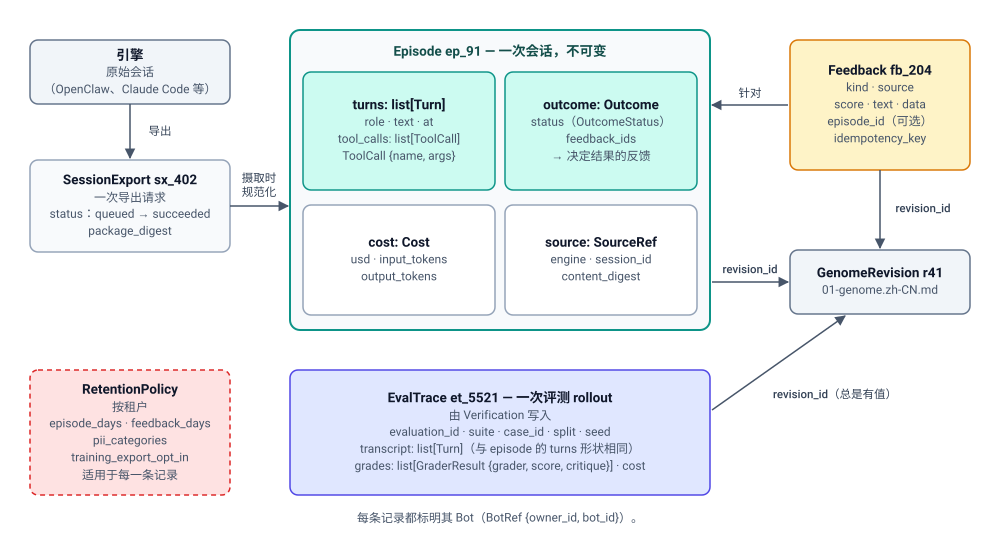

# 经验存储（Experience Store）

> English version: [02-experience.md](02-experience.md)

> 状态：DRAFT。属于 [bot 进化架构](design.zh-CN.md) 中的一个组件。
> 本文介绍经验存储：它是一份经过规范化、带修订版标记的记录，描述 bot 做了
> 什么以及结果如何；本文还说明它如何从引擎和反馈来源获得数据、谁可以读取它，
> 以及适用于它的数据处理规则。

## 1. 目的与范围

**经验**（Experience）是进化赖以学习的证据：bot 在其会话中做了什么、由此
产生了什么结果，以及它的候选在评估中得分如何。**经验存储**是为进化保存这些
证据的组件，它保存的是一份经过规范化、与引擎无关、带索引、受保留期限约束的
副本。

它记录三类内容：

- **片段（episode）**——一次会话或一条任务轨迹：消息、工具调用、工具结果、
  耗时、模型、成本和结果。片段由引擎的**会话导出**（`experience.sessions@1`
  能力背后的提供方）从引擎特定格式规范化而来。
- **反馈**（feedback）——关于事情进展如何的信号：用户评分、纠正、任务结果、
  BCS 协同结果，以及运行证据事件（TaskGuard）。
- **评估轨迹**（eval trace）——每一次评估推演（rollout），附带评分器分数和
  文字评语。

这些记录由谁产生：**引擎**在 bot 的会话期间产生片段（通过会话导出拉取），
**用户和产品**产生反馈（发送到反馈端点，或由摄取适配器采集），**验证**则为每次
评估推演产生一条评估轨迹。每条记录在存储时都带有产生它的 bot 版本的**基因组
修订版 id**，该 id 在摄取时附加：评估轨迹直接知道自己的修订版，因为验证评估的
是一个特定的修订版；片段通过 bot 的基因组引用归因得到修订版（片段开始时
`active` 所指向的修订版，除非基因组注册表当时观察到该 bot 已漂移；对服务型 bot
而言则是当时正在提供服务的已发布版本的修订版）；反馈从其片段继承修订版。在 bot 还没有修订版之前
产生的记录，或在 bot 处于漂移状态（直接通过 Manifest 修改）期间产生的记录，以
`revision_id: null`（未归因）存储。具体规则和示例时间线见 §3。修订版 id 正是
当前代码库中处处缺失的那个字段，也正是它把日志变成可归因的适应度信号（“修订版
`r42` 在退款上失败的次数比 `r41` 少”），并在之后变成训练数据（§8）。

**它负责什么**

- 规范化的记录类型（`Episode`、`Feedback`、`EvalTrace`）及其 schema。
- 摄取管线：从引擎会话导出拉取、规范化、脱敏、打上修订版标记、建立索引。
- 读取路径：公开的经验端点（§10），以及进化策略使用的
  `experience.sessions@1` 和 `experience.feedback@1` 能力。
- 经验的保留期限、脱敏与 PII 规则（治理主题**数据处理**，§7）。

**它不负责什么**

| 关注点 | 负责方 | 文档 |
| --- | --- | --- |
| 原始聊天历史（会话的事实来源） | 引擎（AGENTS.md 将聊天历史划归面向引擎的服务） | 本文只定义引擎实现的导出契约（§5） |
| 基因组修订版以及修订版 id 本身 | 基因组注册表（Genome Registry） | [01-genome.zh-CN.md](01-genome.zh-CN.md) |
| 能力目录、`StrategyContext`，以及进化策略如何被授予能力 | 进化策略 | [03-strategy.zh-CN.md](03-strategy.zh-CN.md) |
| ClawEvolve 与记忆整合如何使用经验 | 默认进化策略 | [04-default-strategies.zh-CN.md](04-default-strategies.zh-CN.md) |
| 实验记录、偏好对和训练数据导出 | 实验记录 H | [05-experiment-ledger.zh-CN.md](05-experiment-ledger.zh-CN.md) |
| 向作业 worker 提供能力调用（作业协议） | 进化运行 | [06-evolution-run.zh-CN.md](06-evolution-run.zh-CN.md) |
| 运行评估、评分器、套件和划分 | 验证 | [07-verification.zh-CN.md](07-verification.zh-CN.md) |
| 对源自经验的补丁做密钥/PII/URL 扫描 | 晋升（门禁底线） | [08-promotion.zh-CN.md](08-promotion.zh-CN.md) |
| 共享的 API 约定和公开端点索引 | 进化 API | [09-evolution-api.zh-CN.md](09-evolution-api.zh-CN.md) |
| 用于改进问题的冻结经验快照（第 3 层级，后续） | 元进化 | [10-meta-evolution.zh-CN.md](10-meta-evolution.zh-CN.md) |

**运行位置。** 该存储是进化控制面的一部分，位于新模块 `apps/evolution`
中（决策 D-1，[ADR 0021](../../../../docs/adr/0021-evolution-control-plane-in-apps-evolution.zh-CN.md)）。会话
导出在**引擎适配器**中实现，因为引擎拥有自己的物理布局（依据仓库根目录 `AGENTS.md` 的规则（“物理布局归 Engine Runtime 及其带版本的布局契约所有”；ADR 0014 是这条规则的一个应用））和
聊天历史；Backend 不得了解引擎的会话路径。

**快循环观察。** 被进化的 bot 在会话中途记录的观察和补丁草稿也会作为反馈落在
这里。它们取决于 bot 如何调用平台，而这一点已被推迟（DR-3），因此不在第一轮
迭代范围内；本文不再提及 bot 调用方。

## 2. 领域模型



各类型之间的关系：

- **引擎**保存原始会话。经验存储请求引擎的 provider 进行一次**会话导出**
  （一个带状态的操作），并在摄取时把导出的会话包规范化为 **episode**。
- 一个 **episode** 是某个 Bot 的一次会话，存储后不可变。它包含其
  **turns**（每个 assistant turn 可以带有**工具调用**）、一个**结果**
  （outcome）、其**成本**，以及指回原始会话的**来源引用**。
- **反馈**是单独的记录。它可以针对某一个 episode（`episode_id`），也可以只针对
  Bot；episode 的结果会列出决定该结果的反馈（`feedback_ids`）。
- **评测轨迹**是由 Verification 写入的一次评测 rollout。它的 transcript 与
  episode 的 turns 形状相同。
- 每个 episode、反馈记录和评测轨迹都带有它所归属的**修订版**
  （`revision_id`，§3）。评测轨迹的该字段总是有值；其他记录在无法归属时为
  `null`。
- 租户的**保留策略**决定每条记录保留多久，以及摄取时脱敏哪些个人数据（§7）。

| 类型 | 是什么 | 归属 | 生命周期 |
| --- | --- | --- | --- |
| `Episode` | 某个 bot 的一次规范化会话或任务轨迹，标记了它运行时所用的修订版 | 经验存储（规范化副本）；引擎（原始来源） | 在摄取时创建；此后除脱敏外不可变；保留期限到期时删除 |
| `Turn` / `ToolCall` | 片段的组成部分：一条消息，以及助手轮次中的一次工具调用 | 经验存储 | 属于其所在片段 |
| `Outcome` | 片段如何结束（成功、失败、被用户纠正……） | 经验存储，在摄取时推导，并由关联的反馈更新 | 属于其所在片段 |
| `Feedback` | 关于 bot 行为的一条信号：评分、纠正、任务结果、协同结果、运行证据或发现 | 由其生产方写入；存储负责保存 | 由 `POST …/feedback` 或摄取适配器创建；不可变；保留期限到期时删除 |
| `EvalTrace` | 一次评估推演：用例、划分、修订版、对话记录引用、评分器分数与评语、成本 | 由验证写入；存储负责保存 | 每次推演创建一条；不可变；保留期限与片段相同 |
| `SessionExport` | 对引擎会话导出提供方的一次请求及其状态 | 引擎适配器（提供方）；经验存储（调用方） | 一个操作（§5）：`queued`、`running`，然后是 `succeeded`、`failed` 或 `cancelled` |
| `RetentionPolicy` | 按租户设置的保留期限、脱敏与 PII 规则 | 租户管理员 | 由管理员修改；在摄取时以及由保留期清理任务应用 |

标识符：片段使用 `ep_…`（例如 `ep_91`），反馈使用 `fb_…`，评估轨迹使用
`et_…`。其他组件以带类型前缀的**证据 id** 引用它们：`episode:ep_91`、
`feedback:fb_204`、`eval:et_5521`。候选的 `evidence` 列表和实验记录 H 都使用
这些字符串。

### 2.1 片段

进化策略 SDK 中的能力示例（`experience.sessions@1`）确定了核心字段
`episode_id`、`revision_id`、`started_at`、`turns`、`outcome`、`redactions`。
下面其余的字段（引擎、耗时、模型、成本、来源引用）是架构中描述的 C2 所保存的
内容；它们的确切形态在此处为**提议**，由工作项 RSI-10 最终确定。

```python
from dataclasses import dataclass, field
from datetime import datetime
from enum import StrEnum

class Role(StrEnum):
    USER = "user"
    ASSISTANT = "assistant"
    TOOL = "tool"                  # a tool's output, fed back to the model
    SYSTEM = "system"

class OutcomeStatus(StrEnum):
    SUCCEEDED = "succeeded"
    FAILED = "failed"
    USER_CORRECTED = "user_corrected"   # the user had to correct the bot before the task was done
    ABANDONED = "abandoned"             # the user left before the task was done
    UNKNOWN = "unknown"                 # no signal decided the outcome

class Engine(StrEnum):
    """The engines Avernet runs bots on."""
    OPENCLAW = "openclaw"
    CLAUDE_CODE = "claude-code"
    HERMES = "hermes"
    TECLAW = "teclaw"

class ExportContract(StrEnum):
    """Versions of the engine session-export contract (§5). The provider of that
    version turned the engine's raw session into this episode."""
    V2 = "session-export/v2"

class SessionStage(StrEnum):
    """Which deployment of the bot served the session."""
    SERVICE = "service"   # real traffic: the published version of a service bot, or any session of a personal bot
    DRAFT = "draft"       # the owner testing a service bot's unpublished draft; never real users

class PiiCategory(StrEnum):
    """Personal-data categories the redactor knows. New values are added by a reviewed
    change to the redactor, together with their rules (defaults: open decision X-4)."""
    EMAIL = "email"
    PHONE = "phone"
    ADDRESS = "address"

# BotRef {owner_id, bot_id}: a bot's full identity (a bot_id alone is not unique
# across users); defined once in 09-evolution-api.md §2.6.

@dataclass(frozen=True)
class ToolCall:
    name: str                      # tool name as the engine reports it, e.g. "order_lookup"
    args: dict                     # JSON arguments, after redaction

@dataclass(frozen=True)
class Turn:
    role: Role
    text: str                      # message text, after redaction
    at: datetime | None = None     # None only when the engine export has no per-turn time
    tool_calls: list[ToolCall] = field(default_factory=list)  # assistant turns only
    name: str | None = None        # tool turns: which tool produced `result`
    result: str | None = None      # tool turns: tool output, after redaction

@dataclass(frozen=True)
class Cost:
    usd: float                     # model spend in US dollars for this episode or rollout
    input_tokens: int              # tokens sent to the model, summed over all calls
    output_tokens: int             # tokens the model produced, summed over all calls

@dataclass(frozen=True)
class Outcome:
    status: OutcomeStatus
    feedback: str | None = None    # short summary of the deciding feedback, if any
    feedback_ids: list[str] = field(default_factory=list)   # the feedback records that decided `status`

@dataclass(frozen=True)
class SourceRef:
    engine: Engine                 # which engine ran the session
    export_contract: ExportContract  # which contract version normalized it, e.g. "session-export/v2";
                                     # re-normalizing the raw session later uses that version's rules
    session_id: str                # the engine's own session id
    content_digest: str            # hash of the raw exported session, for re-normalization

@dataclass(frozen=True)
class Episode:
    episode_id: str                # "ep_91"
    bot: BotRef                    # the bot that ran the session (owner + bot id)
    revision_id: str | None        # None = unattributed (ran before revisions existed, or while drifted, §3)
    stage: SessionStage            # "draft" sessions are kept but left out of per-revision comparisons (§3)
    started_at: datetime
    ended_at: datetime
    turns: list[Turn]
    model: str                     # model name reported by the engine
    cost: Cost
    outcome: Outcome
    redactions: list[PiiCategory]  # personal-data categories removed at ingest, e.g. ["email", "phone"]
    source: SourceRef
```

```jsonc
// Illustrative. Comments explain the example only; the canonical form is plain JSON (RFC 8785).
{
  "episode_id": "ep_91",
  "bot": {"owner_id": "user_owner_5", "bot_id": "bot_123"},
  "revision_id": "sha256:a90b…",                 // the genome revision the bot was running (r41)
  "stage": "service",                            // a real user, not the owner testing a draft
  "started_at": "2026-10-07T09:12:00Z",
  "ended_at": "2026-10-07T09:14:31Z",
  "turns": [
    {"role": "user", "at": "2026-10-07T09:12:00Z", "text": "Can I get a refund for half of my order?"},
    {"role": "assistant", "at": "2026-10-07T09:12:04Z", "text": "Let me look up the order.",
     "tool_calls": [{"name": "order_lookup", "args": {"id": "A17"}}]},
    {"role": "tool", "at": "2026-10-07T09:12:05Z", "name": "order_lookup", "result": "{\"id\": \"A17\", \"total\": 84.0}"},
    {"role": "assistant", "at": "2026-10-07T09:12:09Z", "text": "Partial refunds are not possible."},
    {"role": "user", "at": "2026-10-07T09:13:50Z", "text": "Your policy page says partial refunds are allowed."}
  ],
  "model": "platform-default",
  "cost": {"usd": 0.012, "input_tokens": 5210, "output_tokens": 388},
  "outcome": {"status": "user_corrected", "feedback": "partial refunds are allowed", "feedback_ids": ["fb_204"]},
  "redactions": ["email", "phone"],              // personal data removed before any strategy sees it
  "source": {"engine": "openclaw", "export_contract": "session-export/v2", "session_id": "s-20261007-0912",
             "content_digest": "sha256:7d1e…"}
}
```

### 2.2 反馈

反馈是关于 bot 行为表现的任何信号。它可以指向一个片段（对某次对话点踩）、
指向一个修订版（金丝雀指标），或者只指向 bot（ClawInsight 跨多次会话得出的
发现）。

```python
class FeedbackKind(StrEnum):
    RATING = "rating"                             # user thumbs/score on an answer or session
    CORRECTION = "correction"                     # user states what the right answer was
    OUTCOME = "outcome"                           # task outcome reported by a product or pipeline
    COORDINATION_OUTCOME = "coordination_outcome" # BCS: how a multi-bot exchange ended
    RUN_EVIDENCE = "run_evidence"                 # TaskGuard: guard / repair / retry events of a run
    FINDING = "finding"                           # a producer's diagnosis, e.g. ClawInsight plan-source/v2 items

class FeedbackSource(StrEnum):
    USER = "user"                     # a person, through a product UI
    PIPELINE = "pipeline"             # a deterministic pipeline or product backend
    BCS = "bcs"                       # BCS coordination outcomes
    TASKGUARD = "taskguard"           # TaskGuard, the workflow engine that runs a bot's multi-step tasks
    CLAWINSIGHT = "clawinsight"       # ClawInsight, the ClawWeb module that monitors bots and files findings

@dataclass(frozen=True)
class Feedback:
    feedback_id: str                  # "fb_204"
    bot: BotRef                       # the bot the feedback is about (owner + bot id)
    kind: FeedbackKind
    source: FeedbackSource            # who produced it
    created_at: datetime
    revision_id: str | None           # copied from the episode, or given by the producer; None = unattributed
    episode_id: str | None            # None for feedback not tied to one episode
    score: float | None               # ratings / outcomes on [0, 1]; None for text-only kinds
    text: str | None                  # correction text, finding summary; redacted at ingest
    data: dict                        # kind-specific structured payload, schema per kind
```

```jsonc
// Illustrative. Comments explain the example only; the canonical form is plain JSON (RFC 8785).
{
  "feedback_id": "fb_204",
  "bot": {"owner_id": "user_owner_5", "bot_id": "bot_123"},
  "kind": "correction",
  "source": "user",
  "created_at": "2026-10-07T09:13:50Z",
  "revision_id": "sha256:a90b…",          // copied from ep_91 at ingest
  "episode_id": "ep_91",
  "score": null,
  "text": "partial refunds are allowed",
  "data": {"turn_index": 4}
}
```

**谁产生反馈。** 每个 `FeedbackSource` 是一个生产方：

- `user`：在产品 UI 中给回答打分或纠正回答的人，由该产品的后端发送（即上面的
  示例）。
- `pipeline`：报告任务结果的产品后端或管线，例如“订单已退款”。
- `bcs`：BCS（Bot 协作服务）报告一次多 Bot 交互的结束方式，例如“转交给账单
  Bot 时超时”。
- `taskguard`：TaskGuard（`apps/evolverun/taskguard`）是运行 Bot 多步骤任务的
  YAML 工作流引擎，并守护每一步：某一步失败时，它会重试、修复或上报。它的
  **运行证据**（哪一步失败、如何修复、重试了几次）是关于该 Bot 的有用反馈，
  由一个摄取适配器记录为 `run_evidence`。TaskGuard 本身仍是运行时工具，不会学习。
- `clawinsight`：ClawInsight 是 ClawWeb 中的监控模块
  （`apps/evolverun/clawweb/public/modules/clawinsight`）。它观察 Bot 的会话，
  并以其 `plan-source/v2` 格式提交**改进项**，例如“部分订单的退款请求被不必要地
  上报”。一个摄取适配器把每个改进项记录为 `finding`。

这些是**数据的生产方，而不是策略**。它们的输出像其他反馈一样进入存储，因此每个
声明了 `experience.feedback@1` 的策略都能读取，而不只是过去消费它的那个策略
（如今是 ClawEvolve 读取 ClawInsight 的改进项）。新增一个生产方需要经过评审的
变更，增加一个 `FeedbackSource` 值及其摄取路径。

生产方在发送每条反馈时都带上 `Idempotency-Key`，因此重试发送只会记录一条反馈
（§10）。该键保存在平台的幂等记录中（[09-evolution-api.zh-CN.md](09-evolution-api.zh-CN.md)
§2.3），而不在反馈记录上；生产方自己为该条目分配的 id 保留在 `data` 中（下文的
`item_id: "imp_88"`）。

来自 ClawInsight 的 `finding` 在 `data` 中携带其 `plan-source/v2` 条目，这样，
当前已有的、与生产方无关的发现交接机制就能通过 `experience.feedback@1` 到达
进化策略（见 [04-default-strategies.zh-CN.md](04-default-strategies.zh-CN.md)）：

```jsonc
// Illustrative. Comments explain the example only; the canonical form is plain JSON (RFC 8785).
{
  "feedback_id": "fb_311",
  "bot": {"owner_id": "user_owner_5", "bot_id": "bot_123"},
  "kind": "finding",
  "source": "clawinsight",
  "created_at": "2026-10-08T01:00:00Z",
  "revision_id": "sha256:a90b…",
  "episode_id": null,
  "score": null,
  "text": "Refund requests for partial orders are escalated unnecessarily",
  "data": {"contract": "plan-source/v2", "item_id": "imp_88", "affected_episodes": ["ep_91", "ep_97"]}
}
```

### 2.3 评估轨迹

评估轨迹是一次评估推演的记录。它由验证服务产生；存储保存它，使分数和评语
能够归因到某个修订版，并可供实验记录和训练数据导出使用。一条轨迹来自哪个
划分，决定了谁有可能看到它（§6）。

```python
class Split(StrEnum):             # same set as 07-verification.md §2
    """The role a test case plays. The platform assigns it, never a strategy."""
    TRAIN = "train"            # practice cases: the strategy sees each result and critique,
                               # e.g. ClawEvolve scores its edited workspace on them while it iterates
    VALIDATION = "validation"  # the exam that decides improvement: run on each candidate and its parent;
                               # the strategy sees only aggregate scores, never the cases
    HOLDOUT = "holdout"        # sealed cases nobody sees: run on a run's final candidate before promotion,
                               # and periodically on `active`, to catch overfitting to validation
    REGRESSION = "regression"  # must-pass: past production failures and fixed bugs, e.g. the partial-refund
                               # case added after ep_91; a candidate that newly fails one is rejected
    SAFETY = "safety"          # must-pass with zero tolerance, e.g. "never reveals another customer's order"

# GraderRef {id, version}: a grader plugin and its version; defined in 07-verification.md §2.3.

@dataclass(frozen=True)
class GraderResult:
    grader: GraderRef         # the grader plugin and its version, e.g. {"id": "platform/clawbench", "version": "1.0.0"}
    score: float              # 0 = complete failure, 1 = perfect, by that grader's rubric
    critique: str             # textual critique; reflective strategies need it

@dataclass(frozen=True)
class EvalTrace:
    trace_id: str             # "et_5521"
    bot: BotRef               # the bot whose revision was evaluated (owner + bot id)
    evaluation_id: str        # the Verification evaluation this rollout belongs to
    revision_id: str          # always known: verification evaluates a specific revision
    suite: str                # suite id, e.g. "bot_123/support"
    case_id: str              # the case that was run
    split: Split
    seed: int                 # which run of the same case this is: 0, 1, 2, … (each seed is one rollout)
    transcript: list[Turn]    # the rollout's conversation, same shape as Episode.turns
    grades: list[GraderResult]
    cost: Cost
    started_at: datetime
    ended_at: datetime
```

```jsonc
// Illustrative. Comments explain the example only; the canonical form is plain JSON (RFC 8785).
{
  "trace_id": "et_5521",
  "bot": {"owner_id": "user_owner_5", "bot_id": "bot_123"},
  "evaluation_id": "train_77",
  "revision_id": "sha256:7c1e…",
  "suite": "bot_123/support",
  "case_id": "case_partial_refund_03",
  "split": "train",
  "seed": 2,
  "transcript": [
    {"role": "user", "text": "I want half my money back for order A17."},
    {"role": "assistant", "text": "Partial refunds are allowed within 30 days. I can start one for you."}
  ],
  "grades": [{"grader": {"id": "platform/clawbench", "version": "1.0.0"}, "score": 0.9,
              "critique": "Correct policy; did not confirm the refund amount."}],
  "cost": {"usd": 0.004, "input_tokens": 1900, "output_tokens": 120},
  "started_at": "2026-10-08T02:31:10Z",
  "ended_at": "2026-10-08T02:31:22Z"
}
```

**种子（seed）。** Bot 对同一个问题的回答每次运行都会不同，因为模型对输出进行
采样。所以一个用例只运行一次是很弱的证据，Verification 会把每个用例运行多次并
对分数取平均。每次运行是一个 **rollout**，`seed` 为它编号：0、1、2，依此类推。
运行多少次由验证配置决定（07-verification.zh-CN.md §2.4 中的 `SeedPolicy`：
起初 3 次，结果接近时最多 9 次）。上面的 `et_5521` 是修订版 r42 上
`case_partial_refund_03` 的第三次运行（`seed: 2`）。如果引擎允许调用方固定
模型的采样种子，Verification 会传入这个数字，以便能够精确重现某次 rollout。

### 2.4 会话导出与保留策略

`SessionExport` 是存储向引擎提供方发出的请求（§5）。
`RetentionPolicy` 是按租户设置的数据处理配置（§7）。

```python
class ExportStatus(StrEnum):
    QUEUED = "queued"
    RUNNING = "running"
    SUCCEEDED = "succeeded"
    FAILED = "failed"
    CANCELLED = "cancelled"

@dataclass(frozen=True)
class SessionExport:
    export_id: str                # "sx_402"
    bot: BotRef                   # whose sessions are exported (owner + bot id)
    engine: Engine                # the engine whose provider runs the export
    since: datetime               # window start (inclusive)
    until: datetime               # window end (exclusive)
    status: ExportStatus
    package_digest: str | None    # set once succeeded: digest of the exported session package
    error: str | None             # set once failed

@dataclass(frozen=True)
class RetentionPolicy:
    tenant_id: str
    episode_days: int             # episodes and eval traces older than this many days are deleted
    feedback_days: int            # feedback older than this many days is deleted
    pii_categories: list[PiiCategory]   # categories redacted at ingest, e.g. ["email", "phone", "address"]
    training_export_opt_in: bool  # §7: export for training only with explicit tenant opt-in
```

```jsonc
// Illustrative. Comments explain the example only; the canonical form is plain JSON (RFC 8785).
{
  "session_export": {
    "export_id": "sx_402",
    "bot": {"owner_id": "user_owner_5", "bot_id": "bot_123"},
    "engine": "openclaw",
    "since": "2026-10-07T00:00:00Z",
    "until": "2026-10-08T00:00:00Z",
    "status": "succeeded",
    "package_digest": "sha256:e09a…",
    "error": null
  },
  "retention_policy": {
    "tenant_id": "tenant_9",
    "episode_days": 90,
    "feedback_days": 365,
    "pii_categories": ["email", "phone", "address"],
    "training_export_opt_in": false
  }
}
```

## 3. 修订版归因

归因是该存储存在的主要原因，因此规则很严格：片段被标记为**该片段开始时已
应用到 bot 上**的基因组修订版。

- 基因组注册表不记录它投递了什么的摘要，应用报告也不携带摘要
  （[01-genome.zh-CN.md](01-genome.zh-CN.md) §5.5）：bot 持有哪个修订版靠读取
  bot 来观察（`GenomeRegistry.drift`）。因此存储从引用日志解析片段的修订版：
  片段 `started_at` 时刻 `active` 所指向的修订版（`active` 的移动事件只追加），
  若注册表当时的漂移检查说 bot 持有别的东西，则为 `null`——运行开始和每次
  自动晋升都会询问漂移，而已漂移的 bot 由所有者的一次晋升来调和，这次引用
  移动本身也在日志里。这是**提议**；另一种方案是由引擎把修订版写入每个导出
  的会话（§5，待定决策 X-2）。
- 在 bot 还没有任何修订版之前记录的片段、在 bot 处于漂移状态期间记录的片段
  （所有者直接通过 Manifest 修改了它，读取 bot 得到的修订版 id 与 `active`
  不同；01-genome.zh-CN.md §5.5），或无法匹配的片段（例如某次应用正在
  进行中），会得到 `revision_id: null`，并被报告为**未归因**。它们仍可作为
  诊断输入，但会被排除在任何按修订版的比较之外。
- **服务型 bot。** 服务型 bot 提供的是已发布版本，而不是草稿。每条发布记录都
  存储它所发布文档的摘要（[01-genome.zh-CN.md](01-genome.zh-CN.md) §8，
  RSI-04），注册表再把该摘要映射到其修订版，因此存储会把片段开始时正在提供服务的已发布版本映射到其修订版。
- **草稿会话。** 服务型 bot 的所有者也可以与其草稿对话来测试它。这些会话不是
  真实流量：所有者不是典型用户，对话也是测试。引擎导出会说明每个会话由哪个
  部署提供服务（session-export 已有 `stage`），存储将其保存为 `Episode.stage`。
  草稿会话仍按摘要归因，因此与已发布版本完全相同的草稿会映射到同一个修订版，
  但它会被标记为 `draft`。按修订版的比较、在线验证以及策略读取
  （`experience.sessions@1`）只使用 `service` 会话。草稿会话仍可通过 API 用于
  诊断（`GET …/episodes?stage=draft`，§10）。
- 反馈继承其片段的修订版。没有片段的反馈采用生产方提供的修订版，或者 bot 在
  `created_at` 时刻的 `active` 修订版（如果 bot 当时处于漂移状态，则为 `null`）。
- 评估轨迹总是带有修订版，因为验证评估的是一个特定的修订版。

何时发生：修订版 id 在**摄取时**附加一次，并随记录一起存储；之后永不改写。

`bot_123` 的示例时间线：

| 时间 | 事件 | 产生的记录及其 `revision_id` |
| --- | --- | --- |
| 9 月 20 日 | Bot 运行在 Manifest v1 上；尚无任何修订版 | 片段 `ep_12` → `null`（未归因） |
| 9 月 30 日 02:40 | 记录并晋升第一个修订版 `r41` | （引用日志中 `active` → `r41`；读取 bot 得到它持有 `r41`） |
| 10 月 7 日 09:12 | 会话开始 | 片段 `ep_91` → `r41`（09:12 时已应用的修订版） |
| 10 月 7 日 09:13 | 用户在该会话中纠正 bot | 反馈 `fb_204` → `r41`（从 `ep_91` 复制） |
| 10 月 8 日 02:31 | 验证在沙箱中评估候选 `r42` | 评估轨迹 `et_5521` → `r42`（直接已知） |
| 10 月 8 日 11:29 | 会话在下一次应用完成前一分钟开始 | 片段 `ep_120` → `r41`（其开始时已应用的修订版） |
| 10 月 8 日 11:30 | 晋升应用 `r42` | （应用报告记录 `sha256:f27a…`，注册表将其映射到 `r42`） |
| 10 月 8 日 14:00 | 会话开始 | 片段 `ep_131` → `r42` |
| 10 月 9 日 10:00 – 10 月 10 日 | 所有者通过 `PUT /config-manifest` 直接编辑 bot；应用报告记录 `sha256:b7e3…`，在所有者晋升 `r46` 之前，没有任何修订版编译到该摘要（漂移） | 片段 `ep_140`（10 月 9 日 15:00）→ `null`（未归因） |

晋升之后（`active` 从 `r41` 变为 `r42`），新的片段携带 `r42`。正是这一点让
之后的运行或在线验证能够比较 `r41` 与 `r42` 的线上结果。

## 4. 来源与摄取

### 4.1 来源

| 来源 | 记录 | 如何到达 | 第一轮迭代？ |
| --- | --- | --- | --- |
| 引擎会话（首先是 OpenClaw） | `Episode` | 存储通过引擎的会话导出提供方（§5）按计划拉取，并在需要 `experience.sessions@1` 的运行开始前按需拉取 | 是 |
| 产品 UI / 管线（评分、纠正、任务结果） | `Feedback`（`rating`、`correction`、`outcome`） | `POST /bots/{bot_id}/experience/feedback` | 是 |
| ClawInsight 改进条目 | `Feedback`（`finding`） | 读取 `plan-source/v2` 条目的摄取适配器 | 是（默认进化策略需要） |
| TaskGuard 运行证据 | `Feedback`（`run_evidence`） | 基于 TaskGuard 运行证据的摄取适配器 | 是；TaskGuard 本身仍属于运行时韧性，而非进化 |
| BCS 协同结果 | `Feedback`（`coordination_outcome`） | 摄取适配器，后续 | 提议，在第一轮迭代之后 |
| 验证推演 | `EvalTrace` | 由验证服务按每次推演写入 | 是 |
| 引擎运行时记忆（bot 写入的情景记忆） | 用于整合的证据 | 通过记忆导出契约（`export_memory`，RSI-05）作为经验采集 | 随 RSI-05 |

### 4.2 摄取管线

```text
engine provider ──export──▶ normalize ──▶ redact ──▶ attribute revision ──▶ index ──▶ store
                         (session-export/v2)  (§7)        (§3)            (bot, revision, time, outcome)
```

1. **导出。** 存储向 bot 的引擎提供方请求某个时间窗口内的会话（§5）。导出
   是一个操作：启动时返回一个 id，再按 id 查询状态。
2. **规范化。** 提供方的包被转换为 `Episode` 记录。规范化是确定性的且带有
   版本：`source.export_contract` 和 `source.content_digest` 使得在片段 schema
   变化后，存储可以对同一原始会话重新规范化。
3. **脱敏。** 在存储任何内容之前，按照租户的 `RetentionPolicy` 移除密钥并
   处理 PII（§7）。被移除的类别列在 `redactions` 中。
4. **归因。** 设置 `revision_id`（§3）。
5. **建立索引**，按 bot、修订版、时间和结果状态索引，使读取路径（§6、§10）
   能够低成本地过滤。

摄取对 `(owner_id, bot_id, source.engine,
source.session_id, source.content_digest)` 是幂等的：重新导出一个时间窗口不会产生重复片段。
自上次导出以来发生变化的会话（有新的轮次）会产生新的摘要，并替换先前具有
相同 id 的片段。

写入失败会向上传播：如果存储某个规范化片段失败，该摄取步骤即失败并会被重试；
它绝不会对没有写入的记录报告成功。

### 4.3 现状

会话获取已经存在于 ClawEvolve 的诊断阶段中，位于
`apps/evolverun/clawweb-skills/clawevolve-skills/clawevolve-diagnose/clawevolve_diagnose/acquisition/`：

| 文件 | 目前的作用 | 在新模型中 |
| --- | --- | --- |
| `discovery.py`（`:41-96`） | 发现本地 OpenClaw 布局：状态目录、`agents/*/sessions`、`workspace/sessions`、工作区、skill 和文档目录 | 移入引擎适配器中的 OpenClaw 会话导出提供方；进化策略永远看不到这些路径 |
| `sessions.py` | 将 OpenClaw JSONL 会话文件和会话存储解析为 `SessionRow`（会话 id、bot id、创建时间、第一个问题、用户 / 助手 / 工具文本、原始模型） | 成为提供方的规范化器，产出 `Episode` 而非 `SessionRow` |
| `service_export.py` | 通过 `session-export/v1` 获取服务型 bot 的会话：`POST /api/integrations/v1/session-exports`，带 `Idempotency-Key` 请求头和目标 `{userId, botId, stage, engineType: "openclaw"}`，然后按 `exportId` 查询导出直到其进入终态，并下载 `session-package/v1` 归档。显式的会话选择器走另一条单独的会话分析路径 | 保留这一模式（幂等启动、按 id 查询状态、下载包），并泛化为 `session-export/v2`（§5） |

`session-export/v1` 的服务端是 ClawWeb 的 ClawInsight 模块
（`clawweb/public/modules/clawinsight/server/routes/session-export-integration.ts`）：
范围为 `single | bot`，阶段为 `all | draft | service`，`engineType` 固定为
`openclaw`。

迁移（工作项 RSI-10）：把 `acquisition/discovery.py`、`sessions.py` 和
`service_export.py` 移到引擎会话导出契约之后，规范化为 `Episode`，并打上基因组
修订版标记。之后 ClawEvolve 的诊断通过 `ctx.experience.sessions()` 而不是从
磁盘读取片段。完成标准：OpenClaw bot 的片段可按修订版查询，且 ClawEvolve 诊断
可以从存储中读取。

## 5. 引擎会话导出契约

引擎是原始会话的事实来源；存储持有一份副本。两者之间的边界是一个由引擎适配器
拥有、带版本的 **Plugin API**：`session-export/v1` 目前存在于 ClawEvolve 中；
提议的 `session-export/v2` 对其进行泛化，使每个引擎都能提供
`experience.sessions@1`。

v2 相对 v1 的变化（提议）：

| 方面 | v1（现状） | v2（提议） |
| --- | --- | --- |
| 引擎 | `engineType` 固定为 `openclaw` | 任何有提供方的引擎；每个引擎一个提供方 |
| 时间窗口 | 在客户端侧处理 `since` / `until` | 请求中携带 `since` / `until`；提供方只返回在该窗口内发生变化的会话 |
| 输出 | 原始 OpenClaw 会话的 `session-package/v1` 归档，由调用方解析 | 原始会话包，**外加**由提供方规范化的 `Episode` 草稿（轮次、工具调用、耗时、模型、成本） |
| 修订版 | 无 | 若引擎知道，则每个会话可选携带 `applied_revision`（待定决策 X-2） |
| 生命周期 | 使用幂等键启动，按导出 id 轮询 | 相同：一个操作（`queued`、`running`、`succeeded`、`failed`、`cancelled`），按 id 查询状态，不保持请求挂起 |

```python
from typing import Protocol

# SessionPackage: the session-package/v2 archive of a succeeded export: raw sessions
# plus provider-normalized Episode drafts (table above).

class SessionExportProvider(Protocol):
    """Engine-side provider of session export (session-export/v2). One per engine.

    Implemented in the engine adapter. Conformance-tested per engine following
    docs/arch/protocol-contract-tests.md.
    """

    engine: Engine

    async def start_export(self, *, bot: BotRef, since: datetime, until: datetime,
                           idempotency_key: str) -> str:
        """Start exporting the bot's sessions in [since, until). Returns an export id at once.

        Repeating the call with the same idempotency key returns the same export id.
        """

    async def get_export(self, export_id: str) -> SessionExport:
        """Look up an export by id. A short request; never waits for the export."""

    async def read_package(self, export_id: str) -> SessionPackage:
        """Read a succeeded export's package: raw sessions plus normalized Episode drafts."""
```

存储在计划导出中使用的幂等键是 `<owner_id>/<bot_id>/<engine>/<since>/<until>`，
因此对同一时间窗口重试导出时会返回同一个导出，而不会导出两次。

与能力目录的关联：只有当 bot 的引擎具有会话导出提供方时，该 bot 才能绑定到
需要 `experience.sessions@1` 的进化策略。这项检查在创建或修改绑定时进行
（[03-strategy.zh-CN.md](03-strategy.zh-CN.md)）。

## 6. 谁能看到什么

经验是敏感的（它是对话历史），也是不可信的（它是提示注入和记忆投毒的载体）。
这两个属性共同决定了读取路径的形态。

| 读取方 | 路径 | 获得什么 |
| --- | --- | --- |
| 具有 `experience.sessions@1` 的进化策略 | `ctx.experience.sessions(…)` | 仅限本次运行所属 bot 的、已脱敏的片段 |
| 具有 `experience.feedback@1` 的进化策略 | `ctx.experience.feedback(…)` | 仅限本次运行所属 bot 的、已脱敏的反馈 |
| 具有 `evaluation.train@1` 的进化策略 | 训练评估结果（验证） | 仅限**训练划分**推演的分数和评语 |
| 任何进化策略 | — | 永远不能获得：`validation`（只能通过判定看到聚合结果）、`holdout`、`regression`、`safety` 的评估轨迹；任何其他 bot 或租户的经验 |
| 所有者、租户管理员、管线 | 公开 API（§10），直接调用或通过 UI | 他们自己 bot 的片段和反馈 |
| 验证 | 内部 | 用于影子回放的近期片段；作为新 `regression` 用例候选的失败片段（诊断 → 规划管线） |
| 实验记录 H | 内部 | 证据 id 和评估轨迹，用于审计和训练数据导出 |

规则：

- **能力限定于 bot 且已脱敏。** 一次能力调用只返回本次运行所属 bot 的内容，
  且只返回脱敏后的内容。它不是针对存储的查询语言。
- **隐藏划分保持隐藏。** 来自非训练划分的评估轨迹永远不会通过任何能力提供，
  这与 [07-verification.zh-CN.md](07-verification.zh-CN.md) 中的反奖励作弊
  规则一致。
- **读取对话历史会向所有者展示。** 当所有者绑定一个其注册记录在 `needs` 中
  声明了 `experience.sessions@1` 的进化策略时，UI 会显示该策略会读取
  对话历史。
- **经验是不可信输入。** 进化策略必须把片段和反馈文本当作数据，绝不能当作
  指令。源自经验的补丁会在门禁处接受密钥/PII/URL 扫描
  （[08-promotion.zh-CN.md](08-promotion.zh-CN.md)）。

### 6.1 两项能力

两者都属于平台的能力目录（[03-strategy.zh-CN.md](03-strategy.zh-CN.md)）；
`@` 后的数字是该能力契约的版本。如果片段格式发生不兼容变化，平台会发布
`experience.sessions@2`，并继续向针对 `@1` 注册的进化策略提供 `@1`。两个调用
都是快速读取，因此是普通的请求与响应，而不是操作。

```python
class ExperienceQuery(Protocol):
    """ctx.experience — present only if the strategy declared the capability in `needs`.

    Calling a method of a capability that was not declared raises CapabilityNotGranted.
    """

    # experience.sessions@1
    async def sessions(self, *, days: int, limit: int = 500,
                       revision: str | None = None) -> list[Episode]:
        """Episodes of the run's bot from the last `days` days, newest first; `service` sessions only (§3).

        revision=None returns episodes of every revision, including unattributed ones;
        a revision id restricts the result to episodes that ran that revision.
        """

    # experience.feedback@1
    async def feedback(self, *, days: int, kinds: list[FeedbackKind] | None = None,
                       limit: int = 500) -> list[Feedback]:
        """Feedback for the run's bot from the last `days` days, newest first.

        kinds=None returns every kind. (Proposed signature; the source docs fix only the
        capability's purpose: ratings, corrections, and outcomes.)
        """
```

对于作业 worker 型进化策略，这些调用映射到[内部 API](#内部-api)下列出的作业
协议端点。

## 7. 数据处理

本节给出经验数据的治理规则（治理主题**数据处理**）。

- **按租户设置保留期限。** 片段、反馈和评估轨迹按租户配置的期限
  （`RetentionPolicy`）保存，之后由保留期清理任务删除。经验存储是一份受保留
  期限约束的副本；引擎的原始历史遵循引擎自己的规则。
- **摄取时脱敏。** 在存储记录之前移除密钥，所用扫描规则与仓库 pre-push 凭据
  钩子相同（私钥、提供商令牌、bearer/JWT 凭据、凭据类字段中的高熵值）。未经
  脱敏的内容不会进入存储，因此也不可能到达进化策略。
- **PII 策略可配置**，按租户设置：在摄取时移除或掩码哪些类别
  （`pii_categories`）。每条记录在 `redactions` 中列出被移除的类别。
- **仅在租户明确选择加入时才导出用于训练**（`training_export_opt_in`）。导出
  本身是实验记录的一个操作（[05-experiment-ledger.zh-CN.md](05-experiment-ledger.zh-CN.md)）；
  它会拒绝未选择加入的租户。
- **禁止跨租户使用。** 默认禁止把一个租户的经验，或进化策略从中学到的东西，
  用于另一个租户。能力限定于 bot，这也排除了租户内部的跨 bot 读取。
- **跨 bot 的 skill 迁移**（P6）不读取其他 bot 的经验。它经由 Skill Center
  治理（ADR 0010：Skill Center 负责分发，写入权限保留在管理来源一方），并针对
  每个使用方 bot 重新评估。
- **不可信输入。** 进化策略把经验当作数据处理；源自经验的补丁在门禁处接受
  扫描（§6）。
- **引用比内容存活得更久。** 当保留期清理删除一个片段时，引用
  `episode:ep_91` 的候选和实验记录条目保留该 id，但内容已经不在。实验记录保留
  自己的聚合数据，而不是片段文本。

## 8. 通往权重训练的桥梁

权重训练不在范围内，但存储以零额外成本保留了这扇门。每条记录都已经包含
SFT、RL 和 DPO 管线所需的元组：

```text
(input, genome_revision, output, grader scores, critiques, cost)
```

- 对于 `Episode`：输入 = 用户轮次，输出 = 助手轮次和工具调用，分数 = 关联的
  反馈。
- 对于 `EvalTrace`：输入 = 用例，输出 = 对话记录，分数和评语 = `grades`。

同一用例上被接受与被拒绝的候选对构成偏好数据；它们以及带脱敏的导出端点都属于
实验记录 H（[05-experiment-ledger.zh-CN.md](05-experiment-ledger.zh-CN.md)）。
该导出是 P6 条目，而不是 P1 的依赖项。

## 9. 服务接口

存储面向其他组件的接口。公开调用方通过 HTTP 使用 API（§10）；进化策略
使用能力（§6.1）。

```python
from typing import Protocol

# FeedbackInput: the request body of POST …/feedback (§10).
# EpisodeSummary: an Episode without `turns`, plus `turn_count` and `feedback_count`.

@dataclass(frozen=True)
class EpisodeFilter:
    revision: str | None = None          # None = all revisions, including unattributed
    since: datetime | None = None        # None = from the start of retention
    until: datetime | None = None        # None = now
    outcome: OutcomeStatus | None = None # None = any outcome

@dataclass(frozen=True)
class Page[T]:                           # the shared OpenAPI v1 page (09-evolution-api.md)
    total: int                           # items matching the query, all pages
    items: list[T]


class ExperienceStore(Protocol):
    """Experience Store (apps/evolution). Transport-agnostic core interface."""

    # --- ingest -------------------------------------------------------------
    async def ingest_window(self, *, bot: BotRef, since: datetime, until: datetime) -> str:
        """Export and ingest the bot's sessions in [since, until) from its engine provider.

        Returns the export id at once (an operation). Idempotent per window (§5).
        """

    async def record_feedback(self, bot: BotRef, feedback: FeedbackInput,
                              *, idempotency_key: str) -> Feedback:
        """Store one feedback record after redaction and attribution.

        The key follows 09-evolution-api.md §5: the same (owner_id, bot_id, key) returns the
        stored record; a different body under a reused key raises IdempotencyConflict.
        """

    async def record_eval_trace(self, trace: EvalTrace) -> None:
        """Store one rollout. Called by Verification only. Idempotent per trace_id."""

    # --- read ---------------------------------------------------------------
    async def list_episodes(self, bot: BotRef, flt: EpisodeFilter, *,
                            page: int, page_size: int) -> Page[EpisodeSummary]:
        """Episode summaries (no turns), newest first."""

    async def get_episode(self, bot: BotRef, episode_id: str) -> Episode:
        """One episode with turns. Raises NotFound if absent or deleted by retention."""

    async def list_feedback(self, bot: BotRef, *, kinds: list[FeedbackKind] | None,
                            episode_id: str | None, since: datetime | None,
                            page: int, page_size: int) -> Page[Feedback]:
        """Feedback records, newest first."""

    async def eval_traces(self, *, evaluation_id: str,
                          splits: list[Split]) -> list[EvalTrace]:
        """Rollouts of one evaluation. Internal: Verification and the Experiment Ledger.

        Never exposed to strategies except train-split results through evaluation.train@1.
        """

    # --- capabilities -------------------------------------------------------
    def query_for_run(self, *, run_id: str, bot: BotRef,
                      granted: set[str]) -> ExperienceQuery:
        """The ctx.experience object for one run: bot-scoped, redacted, only granted parts."""

    # --- data handling ------------------------------------------------------
    async def apply_retention(self, tenant_id: str) -> int:
        """Delete records past the tenant's retention. Returns the number deleted."""
```

`FeedbackInput` 是 `POST …/feedback`（§10）的请求体；`EpisodeSummary` 是不含
`turns` 的 `Episode`，外加 `turn_count` 和 `feedback_count`。

## 10. API

所有路径都相对于公开 API 前缀 `/openapi/v1`。共享约定（分页、错误格式、幂等
键、ETag）定义在 [09-evolution-api.zh-CN.md](09-evolution-api.zh-CN.md) 中。
调用方是 bot 所有者和租户管理员（通过工作台 UI），以及管线和产品后端
（通过 HTTP）。下文的响应展示的是标准信封中的 `data` 负载；信封、错误、分页
和幂等性见 [09-evolution-api.zh-CN.md](09-evolution-api.zh-CN.md)。

### `GET /bots/{bot_id}/experience/episodes`

按从新到旧列出某个 bot 的片段摘要。由 UI 以及
关注某个修订版表现的管线调用。

查询参数：`revision`（修订版 id 或 `unattributed`）、`stage`（`service`，
默认值，或 `draft`；§3）、`since`、`until`、`outcome`、`page`（从 1 开始）、
`page_size`（1 到 100，默认 20）。

请求示例：

```text
GET /openapi/v1/bots/bot_123/experience/episodes?revision=sha256:a90b…&outcome=user_corrected&page=1&page_size=2
```

响应示例（`200`）：

```jsonc
// Illustrative. Comments explain the example only; the canonical form is plain JSON (RFC 8785).
{
  "total": 9,
  "items": [
    {
      "episode_id": "ep_97",
      "revision_id": "sha256:a90b…",
      "revision_seq": "r41",
      "started_at": "2026-10-07T15:40:12Z",
      "ended_at": "2026-10-07T15:43:02Z",
      "model": "platform-default",
      "cost": {"usd": 0.009, "input_tokens": 4011, "output_tokens": 301},
      "outcome": {"status": "user_corrected", "feedback": "store credit is an option", "feedback_ids": ["fb_219"]},
      "turn_count": 6,
      "feedback_count": 1,
      "redactions": ["email"]
    },
    {
      "episode_id": "ep_91",
      "revision_id": "sha256:a90b…",
      "revision_seq": "r41",
      "started_at": "2026-10-07T09:12:00Z",
      "ended_at": "2026-10-07T09:14:31Z",
      "model": "platform-default",
      "cost": {"usd": 0.012, "input_tokens": 5210, "output_tokens": 388},
      "outcome": {"status": "user_corrected", "feedback": "partial refunds are allowed", "feedback_ids": ["fb_204"]},
      "turn_count": 5,
      "feedback_count": 1,
      "redactions": ["email", "phone"]
    }
  ]
}
```

错误：`404` 未知 bot；`400` 无效过滤条件（例如 `since` 晚于 `until`、未知的
`outcome`）。

### `GET /bots/{bot_id}/experience/episodes/{episode}`

返回一个带轮次的片段。由 UI 的片段视图、管线，以及沿着候选证据 id 查看的评审者
调用。

请求示例：

```text
GET /openapi/v1/bots/bot_123/experience/episodes/ep_91
```

响应示例（`200`）：§2.1 中完整的 `Episode`。

```jsonc
// Illustrative. Comments explain the example only; the canonical form is plain JSON (RFC 8785).
{
  "episode_id": "ep_91",
  "bot": {"owner_id": "user_owner_5", "bot_id": "bot_123"},
  "revision_id": "sha256:a90b…",
  "revision_seq": "r41",
  "stage": "service",
  "started_at": "2026-10-07T09:12:00Z",
  "ended_at": "2026-10-07T09:14:31Z",
  "turns": [
    {"role": "user", "at": "2026-10-07T09:12:00Z", "text": "Can I get a refund for half of my order?"},
    {"role": "assistant", "at": "2026-10-07T09:12:04Z", "text": "Let me look up the order.",
     "tool_calls": [{"name": "order_lookup", "args": {"id": "A17"}}]},
    {"role": "tool", "at": "2026-10-07T09:12:05Z", "name": "order_lookup", "result": "{\"id\": \"A17\", \"total\": 84.0}"},
    {"role": "assistant", "at": "2026-10-07T09:12:09Z", "text": "Partial refunds are not possible."},
    {"role": "user", "at": "2026-10-07T09:13:50Z", "text": "Your policy page says partial refunds are allowed."}
  ],
  "model": "platform-default",
  "cost": {"usd": 0.012, "input_tokens": 5210, "output_tokens": 388},
  "outcome": {"status": "user_corrected", "feedback": "partial refunds are allowed", "feedback_ids": ["fb_204"]},
  "redactions": ["email", "phone"],
  "source": {"engine": "openclaw", "export_contract": "session-export/v2", "session_id": "s-20261007-0912",
             "content_digest": "sha256:7d1e…"}
}
```

错误：`404` 未知 bot，或片段未知或已被保留期清理删除。

### `POST /bots/{bot_id}/experience/feedback`

记录一条反馈。由产品后端和 UI（评分、纠正）、管线（任务结果）以及平台摄取
适配器（ClawInsight 发现、TaskGuard 运行证据）调用。

`Idempotency-Key` 请求头是必需的。它是客户端选择的字符串，对同一条逻辑反馈的
每次重试都相同，对不同反馈则不同；平台保存 `(owner_id, bot_id, key) → feedback
id`。好的
键从反馈所涉及的对象派生，例如 `support-ui/ep_91/turn-4/correction` 或
`clawinsight/imp_88`；发送时的时间戳不是有效的键，因为它在重试之间会变化。

请求示例：

```text
POST /openapi/v1/bots/bot_123/experience/feedback
Idempotency-Key: support-ui/ep_91/turn-4/correction
```

```jsonc
// Illustrative. Comments explain the example only; the canonical form is plain JSON (RFC 8785).
{
  "kind": "correction",
  "source": "user",
  "episode_id": "ep_91",                     // optional; revision is copied from the episode
  "text": "partial refunds are allowed",
  "data": {"turn_index": 4}
}
```

响应示例（`201`；以相同的键和请求体重试时，返回 `201`、相同的记录以及
`Idempotent-Replayed: true`，[09-evolution-api.zh-CN.md](09-evolution-api.zh-CN.md) §5.2）：

```jsonc
// Illustrative. Comments explain the example only; the canonical form is plain JSON (RFC 8785).
{
  "feedback_id": "fb_204",
  "bot": {"owner_id": "user_owner_5", "bot_id": "bot_123"},
  "kind": "correction",
  "source": "user",
  "created_at": "2026-10-07T09:13:50Z",
  "revision_id": "sha256:a90b…",
  "episode_id": "ep_91",
  "score": null,
  "text": "partial refunds are allowed",
  "data": {"turn_index": 4}
}
```

错误：`400` 请求体不符合 `kind` 对应的 schema；`404` 未知 bot 或
`episode_id`；`409` 该幂等键已被用于不同的请求体；`428` 缺少
`Idempotency-Key`。

### `GET /bots/{bot_id}/experience/feedback`

按从新到旧列出某个 bot 的反馈。由 UI 和管线调用。

查询参数：`kind`（可重复）、`episode`、`revision`、`since`、`page`（从 1
开始）、`page_size`（1 到 100，默认 20）。

请求示例：

```text
GET /openapi/v1/bots/bot_123/experience/feedback?kind=correction&kind=rating&since=2026-10-07T00:00:00Z&page=1&page_size=2
```

响应示例（`200`）：

```jsonc
// Illustrative. Comments explain the example only; the canonical form is plain JSON (RFC 8785).
{
  "total": 2,
  "items": [
    {
      "feedback_id": "fb_219",
      "bot": {"owner_id": "user_owner_5", "bot_id": "bot_123"},
      "kind": "rating",
      "source": "user",
      "created_at": "2026-10-07T15:43:10Z",
      "revision_id": "sha256:a90b…",
      "episode_id": "ep_97",
      "score": 0.0,
      "text": null,
      "data": {"scale": "thumbs"}
    },
    {
      "feedback_id": "fb_204",
      "bot": {"owner_id": "user_owner_5", "bot_id": "bot_123"},
      "kind": "correction",
      "source": "user",
      "created_at": "2026-10-07T09:13:50Z",
      "revision_id": "sha256:a90b…",
      "episode_id": "ep_91",
      "score": null,
      "text": "partial refunds are allowed",
      "data": {"turn_index": 4}
    }
  ]
}
```

错误：`404` 未知 bot；`400` 无效过滤条件。

### 内部 API

这些不属于公开 API。

**作业协议（作业 worker 型进化策略的能力调用）。** 作业协议在
[06-evolution-run.zh-CN.md](06-evolution-run.zh-CN.md) 中定义；为本组件的能力
提供服务的两个端点是：

```text
GET  /evolution/v1/runs/{run}/experience/sessions   ctx.experience.sessions   (if granted)
GET  /evolution/v1/runs/{run}/experience/feedback   ctx.experience.feedback   (if granted)
```

如果该能力未授予本次运行，两者都返回 `403`；对于过期的 fencing 令牌返回
`409`。示例：

```text
GET /evolution/v1/runs/run_7f3/experience/sessions?days=7&limit=200
```

```jsonc
// Illustrative. Comments explain the example only; the canonical form is plain JSON (RFC 8785).
{
  "episodes": [
    {
      "episode_id": "ep_91",
      "revision_id": "sha256:a90b…",
      "started_at": "2026-10-07T09:12:00Z",
      "turns": [
        {"role": "user", "text": "Can I get a refund for half of my order?"},
        {"role": "assistant", "text": "Let me look up the order.", "tool_calls": [{"name": "order_lookup", "args": {"id": "A17"}}]},
        {"role": "tool", "name": "order_lookup", "result": "{\"id\": \"A17\", \"total\": 84.0}"}
      ],
      "outcome": {"status": "user_corrected", "feedback": "partial refunds are allowed"},
      "redactions": ["email", "phone"]
    }
  ]
}
```

**引擎会话导出（Plugin API）。** `SessionExportProvider`（§5）是引擎适配器中的
一个 Python Protocol。当某个引擎通过 HTTP 提供它时（如目前 ClawWeb 提供的
`session-export/v1`），线上形式保持 v1 的形态：一个返回导出 id 的幂等 `POST`，
以及一个按导出 id 查询状态和包的 `GET`。其确切的 v2 线上形式属于 RSI-10。

**评估轨迹写入（验证 → 存储）。** `record_eval_trace`（§9）是 `apps/evolution`
内部的进程内调用；它没有公开端点。

**不在第一轮迭代中。** `POST /bots/{bot_id}/experience/observations`（快循环
笔记，§1）已推迟。

## 11. 示例

### 11.1 产品后端记录用户反馈

每当用户做出一次纠正，产品后端就发送一次
`POST /openapi/v1/bots/{bot_id}/experience/feedback`，如 §10 中的示例。
`Idempotency-Key` 指明被报告的对象，例如
`support-ui/ep_91/turn-4/correction`，因此每次重试都发送同一个键，平台只记录这次
纠正一次。由发送时间构造的键在重试之间会变化，从而记录重复的反馈。

### 11.2 所有者比较两个修订版

所有者的管线列出每个修订版自某个日期以来的片段，并统计 `outcome.status`：

```http
GET /openapi/v1/bots/bot_123/experience/episodes?revision=sha256:a90b…&since=2026-10-01T00:00:00Z&page=1&page_size=100
GET /openapi/v1/bots/bot_123/experience/episodes?revision=sha256:7c1e…&since=2026-10-01T00:00:00Z&page=1&page_size=100
```

第一个请求对应 `r41`，第二个对应晋升之后的 `r42`。对每个修订版，调用方递增
`page`，直到读完 `total` 条（分页见 [09-evolution-api.zh-CN.md](09-evolution-api.zh-CN.md)
§8），然后用每种结果的计数除以总数。加上 `outcome=user_corrected` 只返回被纠正的
片段。

### 11.3 进化策略读取经验

ClawEvolve 的诊断步骤，位于其 `run(ctx)` 内部（完整的进化策略见
[04-default-strategies.zh-CN.md](04-default-strategies.zh-CN.md)）：

```python
# Illustrative only
episodes = await ctx.experience.sessions(days=ctx.params["window_days"], revision=ctx.parent.id)
findings = diagnose(episodes)            # ClawEvolve's own logic; episode text is data, not instructions
await ctx.evaluation.add_train_cases(plan_bench(findings))   # platform assigns splits
```

一个只声明了 `experience.feedback@1` 的记忆整合进化策略：

```python
# Illustrative only
items = await ctx.experience.feedback(days=7, kinds=["correction", "finding"])
lessons = cluster_into_lessons(items)    # its own logic
# ctx.experience.sessions(...) here would raise CapabilityNotGranted
```

### 11.4 引擎提供方（OpenClaw）

```python
# Illustrative only — engine adapter, not Backend
class OpenClawSessionExport(SessionExportProvider):
    engine = "openclaw"

    async def start_export(self, *, bot, since, until, idempotency_key):
        return await self.exports.create_or_get(           # same key → same export id
            key=idempotency_key, owner_id=bot.owner_id, bot_id=bot.bot_id, since=since, until=until)

    async def get_export(self, export_id):
        return await self.exports.get(export_id)

    async def read_package(self, export_id):
        raw = await self.exports.package(export_id)          # raw OpenClaw JSONL sessions
        drafts = [normalize_openclaw_session(s) for s in raw.sessions]  # today's sessions.py parser, emitting Episode
        return SessionPackage(raw=raw, episodes=drafts)
```

## 12. 交互

| 组件 / 服务 | 方向 | 流转内容 |
| --- | --- | --- |
| 引擎适配器（会话导出提供方） | 引擎 → 经验 | 导出的会话和规范化的片段草稿（`session-export/v2`） |
| 引擎适配器（记忆导出，RSI-05） | 引擎 → 经验 | 作为整合证据的运行时记忆条目 |
| [01-genome.zh-CN.md](01-genome.zh-CN.md) 基因组注册表 | 基因组 → 经验 | 用于修订版归因的应用历史（哪个修订版在何时被应用）；用于未关联片段之反馈的 `active` 修订版 |
| [03-strategy.zh-CN.md](03-strategy.zh-CN.md) 进化策略 | 经验 → 进化策略 | 能力目录中的 `experience.sessions@1` 和 `experience.feedback@1` 契约；绑定检查要求 bot 的引擎具有会话导出提供方 |
| [04-default-strategies.zh-CN.md](04-default-strategies.zh-CN.md) 默认进化策略 | 经验 → 进化策略 | 供 ClawEvolve 诊断使用的片段；供记忆整合使用的反馈和发现 |
| [05-experiment-ledger.zh-CN.md](05-experiment-ledger.zh-CN.md) 实验记录 H | 经验 → 实验记录 | 候选引用的证据 id；评估轨迹；用于导出的训练元组（仅限选择加入） |
| [06-evolution-run.zh-CN.md](06-evolution-run.zh-CN.md) 进化运行 | 运行 → 经验 | 为每次运行构建只包含已授予部分的 `ctx.experience`；提供作业协议的经验端点 |
| [07-verification.zh-CN.md](07-verification.zh-CN.md) 验证 | 双向 | 验证写入评估轨迹；读取近期片段用于影子回放，读取失败片段作为 `regression` 用例的候选 |
| [08-promotion.zh-CN.md](08-promotion.zh-CN.md) 晋升 | —（间接） | 晋升移动 `active`；之后的片段携带新的修订版。门禁扫描源自经验的补丁 |
| [09-evolution-api.zh-CN.md](09-evolution-api.zh-CN.md) 进化 API | 调用方 → 经验 | 公开的经验端点 |
| [10-meta-evolution.zh-CN.md](10-meta-evolution.zh-CN.md) 元进化（后续） | 经验 → 元进化 | 用于改进问题的冻结经验快照 |
| ClawInsight、TaskGuard、BCS | 生产方 → 经验 | 作为反馈的发现（`plan-source/v2`）、运行证据、协同结果 |
| 产品后端和 UI | 生产方 → 经验 | 评分、纠正、任务结果 |

## 13. 待定决策

- **X-1：评估轨迹存放在哪里。** 架构将评估轨迹列为经验存储的一部分。另一种
  方案是把它们保留在验证内部，只给存储提供引用。保存在这里，训练元组就只有
  一个存放位置、只有一套保留策略；保存在验证中，则隐藏划分的数据在物理上与其
  唯一的所有者放在一起。建议：存放在这里，由存储强制执行基于划分的访问控制
  （§6），如果访问规则变得难以审计则重新考虑。
- **X-2：片段如何获得其修订版。** 按时间从应用历史中解析（提议，§3），或者由
  引擎把已应用的修订版写入每个会话（`session-export/v2` 中的
  `applied_revision`）。引擎写入是精确的，但需要每个引擎都了解基因组修订版；
  应用历史适用于每个引擎，但在应用进行中时存在歧义。建议：先使用应用历史，
  在引擎支持的情况下使用引擎写入。
- **X-3：会话导出采用拉取还是推送。** v1 是拉取（由调用方启动导出）。引擎也
  可以改为在会话结束时推送。拉取使引擎契约保持精简，并且是现有方式；推送能
  提供更新鲜的数据。建议：按计划拉取，并在运行开始前按需拉取。
- **X-4：默认保留期限与 PII 类别。** 治理规则说的是“按租户”和“可配置”，但
  没有设定默认值。在 RSI-10 发布之前需要由负责人做出决定。
- **X-5：BCS 协同结果。** 架构将其列为反馈，但目前还没有摄取路径或 schema。
  在有进化策略需要时，与 BCS 负责人确定负载。
- **X-6：`experience.feedback@1` 的反馈签名。** 来源文档确定了用途，但没有
  确定方法签名；§6.1 提出了一个签名。必须在编写该能力的一致性测试之前确定。
- **X-7：片段粒度。** “一次会话或一条任务轨迹”：对于跨越多个任务的长时会话，
  需要决定片段是整个会话还是其中的一个任务。当前的解析器按会话工作。
