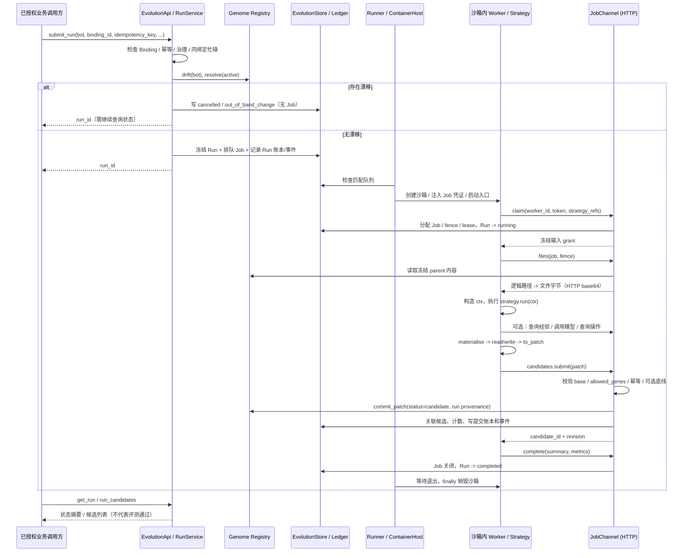

> **2026-11-18 源码归属更新**：当前实现、控制面 API 和部署以
> [Evolution README](../../../evolution/README.md) 及其领域文档为准。本文其余正文保留
> 2026-11-17 接口讲解与历史接线背景；Backend 已不默认组装旧 Runtime/Jobs，也不挂载
> Worker HTTP。旧 DI 路径、默认消费者描述不得用于新部署；仅保留
> [显式平台验收组合](../../src/agentclaw/community/di/evolution_acceptance/README.md)。
> 用户入口复用默认 Gateway 登录和 Bot 权限，不新增 RSI 用户登录；新旧消费者不可并行写同一库。

# Evolution Run：01–06 当前实现与接口对接

> **实现对接说明，2026-11-17 源码工作树基线（含尚未提交的实现）。**
> 面向接入方、策略开发者和运行环境维护者；不是部署验收报告，也不表示任意
> simulator/预发环境已升级到此版本。规范目标仍见
> [06 运行服务](06-evolution-run.zh-CN.md)、[03 策略契约](03-strategy.zh-CN.md)
> 和 [09 公共 API 设计](09-evolution-api.zh-CN.md)。本文标明的实现缺口不改变规范要求。
> 本文历史基线代码当时位于 Backend；当前已迁至 apps/evolution，遵循
> [ADR 0021 的最终控制面归属](../../../../docs/adr/0021-evolution-control-plane-in-apps-evolution.zh-CN.md)。

## 1. 先对齐：这条链路做什么、不做什么

**一句话：** Evolution Run 把一次 Bot 进化请求变成可追踪的策略执行：冻结父版本和
权限 → 排队 → Worker 认领执行 → 在副本上生成 Patch → 记录候选和实验账本 → 回写运行结果。

- **输入不是一个自然语言 prompt**，而是某个已配置 Binding 的一次触发；Binding
  选择策略、可改基因、预算、参数和验证配置。策略内部可以使用 prompt/模型。
- **输出不是直接改好的线上 Bot**，而是 `run_id`、运行状态/摘要、零个或多个候选
  `candidate_id` / Genome `revision`，以及账本和执行事件。
- **`completed` 只表示策略成功返回并回写完成**。零候选也可完成；不表示更优、
  评测通过、晋升成功或线上配置改变。01–06 不等待 07/08。
- 当前共享 DI 未安装验证器/晋升器；正常候选是 `pending`，已有底线拒绝保留
  `reject`。提交候选不移动 `active`、不 apply、不 publish。
- **Owner 管理入口目前是 Python 进程内门面；Worker 作业协议才有已挂载的 HTTP
  路由。** 不要按 09 的设计路径直接给前端承诺已能调用。

## 2. 对接边界与分工

| 接入角色 | 当前入口 | 负责什么 | 不应做什么 |
| --- | --- | --- | --- |
| Owner/业务编排方 | `EvolutionApi` → `BindingsService` / `RunService` | 解析已授权 Bot、维护 Binding、提交/查询/取消 Run | 绕过鉴权、拼造 Bot 身份；把 Job token 发给前端 |
| 策略开发者 | `async run(ctx) -> RunSummary` | 读取父版本/经验，在工作区改动，提交 Candidate | 直写真实 Bot，持有 Owner Cookie，自己决定晋升 |
| 容器 Worker | `WorkerTransport` / Job HTTP | 认领、续租、调用获授能力、提交候选、完成/失败 | 用管理身份访问平台，读取别的 Run 的候选 |
| 运行平台 | `EvolutionRunner` + `ContainerHost` + 沙箱插件 | 消费队列，配置镜像和回连地址，监管/销毁沙箱 | 把“规格中声明隔离”当成已验证的隔离 |
| 后续验证/发布方 | Verifier / Promotion 接缝 | 下一阶段评测、门禁、apply/publish | 把本阶段 `pending` 改成假 `accept` |

**三类标识必须分开：**

- Bot 使用已解析的 `BotRef(entity_id, bot_id, owner_id, engine_type, bot_type,
  entity_type="staff")`。Genome 的规范身份键是 **`entity_id + bot_id`**；
  `owner_id` 是当前所有者，**不等于 entity_id**。应从权威 Bot 解析服务取得，不能只
  根据 URL/user_id 构造。调用者身份 `actor` 也应由认证层产生。
- 当前 Evolution SQLite 的 Binding、Run 查询和幂等键作用域使用
  **`owner_id + bot_id`**；不要据此推断已完整支持 Bot 转移所有权。
- `run_id` 是一次逻辑运行；`job_id` 是一次尝试（通常 `<run_id>_<attempt>`）；
  `worker_id` 是沙箱 Worker 身份；`sandbox_id` 是运行平台的容器/沙箱标识。
- `parent_revision` 是冻结的内容哈希；`candidate_id` 是候选标识，**不是 revision**；
  候选需通过返回的 `revision` 查询 Genome。

## 3. 全流程：从提交到候选持久化



### 3.1 提交阶段：`RunService.submit`

1. 读取 Bot 的 Binding；找不到绑定抛 `RunNotFound`。
2. 按 Bot 作用域查幂等键：相同请求返回旧 Run；同键不同输入抛
   `IdempotencyKeyReused`。当前请求摘要使用 Python `repr`，不是规范 JSON；
   重试应保持参数表示和 actor 等输入一致，不承诺键重排后的语义幂等。
3. 再做绑定检查、策略/Bot/平台停止开关检查。同一 Binding 存在
   `queued/running` Run 时抛 `BindingBusy`；不同 Binding 不受此检查直接互斥。
4. 检查真实 Bot 相对 Genome `active` 是否漂移。**正常返回漂移结果**时写一条
   `cancelled / out_of_band_change` Run，`parent_revision=""`，返回 Run ID；
   **不创建 Job、不派发 Worker、不预留预算、不写 `Ledger.record_run`**。
   读取/capture 本身抛异常则直接失败，不等同于该取消分支。
5. 无漂移时解析 `active`，冻结父 revision、策略 ID/版本、有效参数、预算、
   allowed genes、验证配置、能力 grants 和 Agent Definition digests。之后修改
   Binding 不会改变已排队 Run 的这份输入。
6. 参数为 Binding params 与本次 params 的**浅合并**。预算覆盖只能缩小 Binding
   上限；`reserve` 当前只是治理上限检查，不是多 Run 共享的资金占用。
7. 写 `queued` Run（attempt=1，max_attempts=3）、首个 Job，调用已配置的
   `Ledger.record_run`，追加 `run.queued`，然后返回 ID。

这些写入跨 Store、Registry、Ledger，**不是一个跨库事务**。失败会向上传播，但
已提交的先前写入不自动回滚；收到异常时要按幂等键/Run 查询核查，不要换键盲目重试。

### 3.2 排队、派发和 Worker 到底在哪里执行

- `EvolutionRunner` 默认关闭。开启后每轮依次：回收过期租约 → scheduler tick →
  host dispatch。cron 使用 UTC 分钟与触发去重；内部有 `fire_event` 接缝，
  不表示已接业务事件总线，当前事件 Binding 的解析/序列化兼容性也需补验。
- `ContainerHost` 先确认配置的策略有排队 Job，再建沙箱；**看队首不等于认领**。
  实际关联关系来自沙箱中 Worker 发出的 `claim`。
- Host 注入 Job endpoint、worker token、worker ID；启动 Worker 入口，等待执行，
  在 finally 中尝试销毁沙箱。销毁失败向上传播，需运维核查残留。
- **当前不保证“一条 Run 一个沙箱”**：镜像入口执行 `run_pending(max_jobs=100)`，
  同一个 Worker 可以连续认领匹配的多个 Run。Host 单次等待整个 Worker 退出。
  单 Runner 的 host 调用是串行等待，`max_jobs_per_tick` 不是并发度保证。
- claim 默认租期 60 秒；Worker 每 20 秒心跳。失败/租约丢失可在同一 Run 下增加
  attempt 并生成新 Job，超过尝试上限失败。Host 对退出后遗留的开放 Job，在
  **确认销毁沙箱后**才做兜底重派发。策略要能从不可变父版本重跑并幂等提交。
- `InProcessHost` 是另一种执行适配，适用于测试/受控本地组合；不能据其测试通过
  宣称已运行了隔离容器。Simulator 的 acceptance 沙箱组合也不同于生产 DI。

### 3.3 Worker 内部：`Worker._execute`

1. 按自身安装的策略表匹配 grant 的 `strategy_ref`，构造策略实例。
2. 通过 files 端点拉取冻结 parent；构造 `StaticRevision` 和 SDK `ctx`。
3. 启动心跳；记录 `strategy.started`；`await strategy.run(ctx)`。
4. 成功时记录 `strategy.finished`，将 `RunSummary(summary, metrics)` 序列化后
   complete。异常时 fail（当前 HTTP 路径按可重试处理）；回写本身失败不视为成功确认，
   由租约/宿主恢复。退出时停止心跳。

**工作区不是目标 Bot 的运行目录：** SDK 默认构造内存写时复制工作区。
`ctx.workspace.materialise(parent_id, key=...)` 得到可编辑副本，`to_patch` 计算变更。
这不启动目标 Bot，也不把修改写回引擎。Worker 当前将传来的文件解码为 UTF-8
（`errors="replace"`）再建文本快照，**不应承诺二进制资源无损往返**。

### 3.4 候选提交：`submit_candidate`

1. 校验 Patch schema、`base == run.parent_revision`、改动不超出 `allowed_genes`。
2. 由规范 Patch JSON 计算候选 ID（包含 rationale/evidence），预占该 Run 下的
   候选序号；重复相同提交返回同 ID，中断后可补齐下游写入。
3. 如安装 Promotion port，先检查底线；失败记 `reject`，不产出 Registry revision。
4. 调用 Registry 提交 `candidate` revision，记录策略/Run 来源和 RunScope。
   Registry 的候选 ref 使用 `candidate/<run_id>/<n>`；不要自行假定其序号和每个
   失败占位记录的序号必然相同。
5. 在 Run 库关联 revision 并更新 `candidate_count`，再写候选事件、提交账本和
   账本事件；可选调用 Verifier。最后标记 submission complete，表示**提交写入链
   完成**，不是候选已验证通过。无验证器时仍 pending。
6. SDK `ctx.candidates.submit(...)` 返回 **candidate ID 字符串**；Job HTTP 返回
   `{candidate_id, revision}`。`candidate_count` 计已记录 revision，不把底线拒绝
   占位算作已持久化候选修订。

## 4. 管理侧入口：当前可用的进程内门面

源码：[api.py](../../src/agentclaw/community/core/evolution_run/api.py)。
**以下不是已上线 HTTP 端点**；接入方需要在可信服务组合中装配门面，或后续按 09
增加管理适配器和鉴权。门面本身不自动验证 actor 是否有 Bot Owner 权限。

| 方法 | 关键输入 | 返回 |
| --- | --- | --- |
| `get_bindings(bot)` | 已授权 BotRef | `{bindings: [...], etag: str}` |
| `put_bindings(bot, payload, expected_etag=..., actor=...)` | **完整列表**，非单项 patch | `{bindings: [...], etag: str}` |
| `submit_run(bot, payload, actor=...)` | binding_id、idempotency_key；可选 trigger/params/budget | **`{run: "run_..."}`**，不是 Run 对象 |
| `get_run(bot, run_id)` | BotRef + Run ID | `{run: RunJSON}` |
| `list_runs(bot, status=None, binding_id=None, page=1, page_size=20)` | status 为字符串列表 | `{runs: [...], total, page, page_size}` |
| `cancel_run(bot, run_id, reason=..., actor=...)` | 取消原因和认证 actor | `{run: RunJSON}`；当前取消限制见 §8 |
| `run_candidates(bot, run_id)` | BotRef + Run ID | `{candidates: [{candidate_id, revision, verdict}]}` |

### 4.1 Binding 配置示例

下面的策略 ref 和 profile 是**示例名，须先注册/配置，不是内置值**：

```json
{
  "id": "persona-example",
  "strategy": "example/persona@1.0.0",
  "trigger": {"manual": true},
  "parent": "active",
  "allowed_genes": ["persona"],
  "verification_profile": "example-profile",
  "budget": {
    "max_usd": 1.0,
    "max_wall_clock_s": 600,
    "max_rollouts": null,
    "max_tokens": null
  },
  "params": {},
  "auto_promote_ceiling": null,
  "rollout": null
}
```

- `id` 在列表内唯一；当前 parent 只接受 `active`。本阶段即使不跑验证，
  `verification_profile` 仍必填，治理层会检查它。
- `allowed_genes` 是修改权限，**不是**能力 grants。能力由策略注册 `needs` 与目录
  推导。Gene 范围还需满足 Genome policy。
- `auto_promote_ceiling` 可为 null/T0/T1/T2，默认 T1，不接受 T3；不是启用自动
  晋升的开关。本例显式 null，且运行组合不安装晋升器。可选 rollout 为
  `{canary_share: str, auto_rollback: bool}`，供后续 08 使用，当前不配置。
- 首次不存在配置时 GET 返回 `etag=""`，**首次 PUT 应传 `expected_etag=None`**
  （只允许创建，不是无条件覆盖）；已有配置则传最新 GET/PUT 的真实 etag。
  PUT 是整表替换，必须保留不想删除的其他 Binding。
- Binding 检查涵盖策略注册/启用、停止开关、引擎能力/定义兼容、可改基因、profile、
  Bot/租户预算上限、参数 schema。**当前 conformance 为 pending 也能通过注册状态
  检查，不等于平台已要求 passed；本次 params 覆盖合并后也未再次校验 schema。**

### 4.2 最小调用顺序

只展示 Run 调用；`api` 应使用同一 Store/服务组合构造，`bot` 必须由认证层解析。
不要直接用不受信任的 owner_id/entity_id 参数代替授权。

```python
from agentclaw.community.core.bot_genome.models import BotRef
from agentclaw.community.core.evolution_run.api import EvolutionApi


async def start_and_inspect(api: EvolutionApi, bot: BotRef, actor: str):
    # 前置：Binding 已按上述 ETag 规则配置，active 已存在且无漂移。
    accepted = await api.submit_run(
        bot,
        {"binding_id": "persona-example", "idempotency_key": "request-001"},
        actor=actor,
    )
    run_id = accepted["run"]
    # 异步运行：第一次通常仍 queued；也可能已因漂移 cancelled。
    status = await api.get_run(bot, run_id)
    candidates = await api.run_candidates(bot, run_id)
    return run_id, status, candidates
```

不传 trigger 时按手工触发，actor 进入触发记录；可选 `params` 是对象，`budget`
使用完整的 `max_usd`、`max_wall_clock_s` 和可选的其他维度，不能提高上限。
重试用原幂等键；**独立的新实验**才使用新键。

### 4.3 查询输出

RunJSON 的**实际字段**如下（ID、哈希和时间仅为示意；不代表真实执行）：

```json
{
  "run": {
    "id": "run_example",
    "binding_id": "persona-example",
    "strategy": "example/persona@1.0.0",
    "status": "completed",
    "attempt": 1,
    "parent_revision": "sha256:<parent-content-hash>",
    "candidate_count": 1,
    "budget_used": {"usd": 0.0, "wall_clock_s": 0, "rollouts": 0, "tokens": 0},
    "created_at": "2026-11-17T01:00:00+00:00",
    "started_at": "2026-11-17T01:00:01+00:00",
    "ended_at": "2026-11-17T01:00:02+00:00",
    "end_reason": null,
    "summary": {"summary": "Candidate recorded: candidate_example", "metrics": {"candidates": 1.0}}
  }
}
```

`started_at/ended_at/end_reason` 可为 null。`summary` 来自 Worker/取消等路径，不能
假定永远有 metrics；它不替代候选列表。完整冻结输入目前没有对应的门面导出方法。

| Run status | 正常含义 |
| --- | --- |
| `queued` | 等待 Worker 认领，包括重试的下一 attempt |
| `running` | 当前 Job 已认领，策略执行中 |
| `completed` | complete 已回写；不保证有候选或候选更优 |
| `failed` | 不可重试失败或尝试用尽；常见 end_reason 为 worker_failed / max_attempts |
| `cancelled` | 例如漂移 out_of_band_change 或 Owner 取消 cancelled_by_owner |
| `budget_exhausted` | 服务端计费检测超限；不等于容器已强制终止 |

正常状态流为 queued → running → completed；可重试失败回 queued，保持同一 Run ID
并增加 attempt。上述终态保护目前存在 §8 的缺口，不应当作已保证的不可逆状态机。
HTTP fail 接收 reason，但当前 Store 的失败结束路径主要保存分类 end_reason，不能
承诺 get_run 会返回完整异常文本。

```json
{
  "candidates": [
    {"candidate_id": "candidate_example", "revision": "sha256:<candidate-content-hash>", "verdict": "pending"}
  ]
}
```

候选列表读取的是 Run 库保存的关联/判定字段；不要假定它已与外部验证器最新结果自动同步。

### 4.4 错误处理

进程内方法抛异常；`error_envelope(error)` 是给管理适配器准备的映射工具，**不是
当前已挂载 Owner HTTP 的响应保证**：

| 异常 | 工具映射状态 / error.code |
| --- | --- |
| `BindingCheckFailed` | 422 / `binding_check_failed`（details 有检查问题） |
| `PreconditionFailed` | 412 / `precondition_failed` |
| `EvolutionFrozen` / `CeilingExceeded` / `BindingBusy` | 409 / `evolution_frozen` / `ceiling_exceeded` / `binding_busy` |
| `IdempotencyKeyReused` / `RunAlreadyEnded` | 409 / `idempotency_key_reused` / `run_already_ended` |
| `RunNotFound` | 404 / `run_not_found` |
| `BudgetExhausted` / `StaleFencingToken` | 409 / `budget_exhausted` / `stale_fencing_token` |

工具格式为 `{status, body: {error: {code, message, details}}}`，未列出的异常工具会
映射到 400/invalid_request。接入时仍要区分输入、依赖故障和持久化异常，不能把
未知故障包装成成功。停止开关在 submit 检查路径也可能体现为 `BindingCheckFailed`。

## 5. 策略入口和上下文

入口只有 `async run(ctx)`。平台负责提供上下文，策略不需要知道 Bot 的 Cookie、
Registry 数据库或沙箱控制器凭据。

| ctx 部分 | 当前含义 / 限制 |
| --- | --- |
| `parent` | 冻结父 revision，内容不是实时 Bot 的可变目录 |
| `workspace` | 内存写时复制；materialise/read/write/to_patch |
| `candidates` | 提交 Patch 返回候选 ID；按 ID 查 verdict |
| `experience.sessions/feedback` | 需相应 grant 和真实 provider；平台从 Run 的 BotRef 定位数据，不接收策略自选 Bot |
| `models.complete` | 需配置模型 provider；平台调用后计费，不保证已具备真实模型连通性 |
| `agents.start` / `operations` | 需 agents provider、定义解析、工作区映射和异步执行器；操作记录不等于已执行真实 Agent |
| `budget` | Worker 的本地预算视图，不是与服务端实时同步的完整总账 |
| `log` / `artifacts` | 经作业协议发送；事件不存任意日志正文；artifacts 当前仅通道内存 |
| `cancelled` | 不应据此承诺容器 Worker 能可靠感知并中断取消，见 §8 |

目录始终授予 `candidates@1`、`models@1`；`experience.sessions@1`、
`experience.feedback@1`、`agents@1`、`evaluation.train@1` 需注册时声明。
parent/workspace/operations/budget/log/artifacts/cancelled 是基础部分。
**目录可授予不代表部署已提供实现**；Worker HTTP 尚无 evaluation.train 端点/远程适配。

### 5.1 可读的最小策略示例

前置：persona 可改且父版本已有 `persona/SOUL.md`。本例只是确定性改写演示，
不证明从经验中学到了改进，也不依赖模型、02 或 07。

```python
from agentclaw.community.core.evolution_strategy import Candidate, RunSummary


class PersonaExample:
    async def run(self, ctx):
        ws = await ctx.workspace.materialise(ctx.parent.id, key="persona")
        before = await ws.read("persona/SOUL.md")
        suffix = b"\nPrefer clear answers.\n"
        if suffix in before:
            return RunSummary(summary="No change required")
        await ws.write("persona/SOUL.md", before + suffix)
        patch = await ws.to_patch(rationale="Clarify answer style", evidence=())
        candidate_id = await ctx.candidates.submit(
            Candidate(patch=patch, rationale=patch.rationale, evidence=tuple(patch.evidence))
        )
        return RunSummary(
            summary=f"Candidate recorded: {candidate_id}", metrics={"candidates": 1.0}
        )
```

不安装 07 时不要无限轮询 pending 等待 accept。更完整的经验读取例子见
[identity_hardening.py](../../src/agentclaw/community/core/evolution_strategy/strategies/identity_hardening.py)：
读取 episode 并附证据，但改动来自预置规则，不是语义学习效果的证明。

### 5.2 01 文件、02 经验和 Agent 的实际适配范围

`RegistryGenomePort.files` 当前物化：persona、**Local Skill 的 acm-tree-v1 包成员**
（`skills/<name>/<member>`）、非目录资源（`resources/<path>`）。这些是逻辑路径，
不是引擎物理布局契约。Repo/Center Skill 不在这里复制内容，Set 来源目前在 capture
时被排除；tools/MCP/memory/startup 等也不能一概视作已在工作区落成文件。

02 接口通过 `ExperienceQueryFactory.for_bot(run.bot)` 绑定数据范围。生产共享 DI
只在明确绑定 provider 时启用；没有自动把真实 Bot 全部历史接进来。当前 simulator
最小快照桥接见
[SessionSnapshotExperience](../../src/agentclaw/community/plugins/evolution/session_experience.py)：

- **仅显式 acceptance 组合启用，不是生产默认，也不是 session-export/v2 完整实现**。
- 经 Engine relay 显式摄取指定会话，脱敏后存不可变私有 SQLite 快照；默认查询 service，
  draft 必须显式允许。未知历史 `revision_id=null`，不伪造为当前 parent；按 revision
  过滤时这些未知归属的片段不会命中。`feedback` 尚未实现。
- episode 包含 episode_id、bot、stage、时间、turns、outcome、cost、source；source
  标明 `engine-session-api/snapshot@1`、session ID、content digest、
  `history_complete=false` 和脱敏策略；未知 outcome/cost 不冒充已知结果。
- HTTP sessions/feedback 返回 provider 的列表，完整领域目标见
  [02](02-experience.zh-CN.md)。不要把某个快照桥接的响应当成全平台历史完整性保证。

同理，`OperationService.start` 本身只创建 queued 操作记录。要真正运行 Agent，
还需 provider 完成定义和工作区解析、执行与结果回填；不能仅传一个 SDK 本地 workspace
ID 就认为真实 Bot 会话已启动。生产 JobChannel 目前未注入 agents provider。

## 6. Worker HTTP：独立服务中的 15 个接口

源码：[jobs.py](../../../evolution/src/avernet_evolution/adapters/jobs.py)，
客户端：[job_http.py](../../../evolution/src/avernet_evolution/plugins/job_http.py)。

独立 Evolution 应用 **BASE = `/openapi/v1/evolution/jobs`**，下表路径要拼在 BASE 后。
因此 claim 实际完整路径为 **`/openapi/v1/evolution/jobs/jobs:claim`**，这里的两层
`jobs` 是当前代码事实，不要擅自按设计简化。独立测试/冒烟的 `build_job_app`
默认 prefix 为空，可能只暴露 `/jobs:claim`；接入必须确认启动方式。

除 claim 外，下表的 `F` 表示 JSON body 中必需的 `fencing_token`；GET 和原始字节
PUT 用 query 参数 `fencing_token`。示例中的凭证只表示字段，不应写入文档或日志。

| 方法 | BASE 后的路径 | 输入（除路径参数外） | 正常输出 |
| --- | --- | --- | --- |
| POST | `/jobs:claim` | worker_id, token, strategy_refs（默认 []） | 200 grant；无作业 204 |
| POST | `/jobs/{job_id}:heartbeat` | F | 200 `{lease_expires_at, cancelled}` |
| POST | `/jobs/{job_id}/files` | F | 200 `{files: {逻辑路径: base64字符串}}` |
| POST | `/jobs/{job_id}/candidates` | F, patch（GenomePatch JSON） | 200 `{candidate_id, revision}` |
| GET | `/jobs/{job_id}/candidates/{candidate_id}/verdict` | query fence | 200 VerdictJSON |
| POST | `/jobs/{job_id}:complete` | F, summary（默认 {}） | 204 |
| POST | `/jobs/{job_id}:fail` | F, reason（默认空字符串） | 204；HTTP 不提供 retryable 参数 |
| POST | `/jobs/{job_id}/experience/sessions` | F, days=7, limit=500, revision 可选 | 200 列表 |
| POST | `/jobs/{job_id}/experience/feedback` | F, days=7, limit=500, kinds 可选 | 200 列表 |
| POST | `/jobs/{job_id}/models:complete` | F, messages=[], model 可选, max_tokens=4096 | 200 `{text, model, cost_usd}` |
| POST | `/jobs/{job_id}/agents:start` | F, definition, workspace_id, idempotency_key；prompt="", timeout_s=1800 | 200 `{operation_id}` |
| GET | `/jobs/{job_id}/operations/{operation_id}` | query fence | 200 `{id, kind, status, result, error, cost_usd, created_at, finished_at}` |
| POST | `/jobs/{job_id}/operations/{operation_id}:cancel` | F | 200 `{id, status}` |
| POST | `/jobs/{job_id}/log` | F, lines=[]，每行 `{level, msg, fields}` | 204 |
| PUT | `/jobs/{job_id}/artifacts/{name}` | query fence，body 原始字节 | 200 `{artifact_id}` |

grant 的字段为：`job_id, fencing_token, run_id, strategy_ref, attempt,
parent_revision, allowed_genes, params, granted, budget`，**不携带 BotRef/Owner Cookie**。
`budget` 是冻结的 max_* 上限，granted 是能力字符串列表。

无验证器时 VerdictJSON 示例（标识仅为示意）：

```json
{
  "candidate": "candidate_example",
  "status": "pending",
  "revision": "sha256:<candidate-content-hash>",
  "aggregates": {},
  "reasons": []
}
```

中断提交尚无 revision 时可为 null；底线拒绝保留 reject。候选必须属于当前 Run。
Operation 状态为 queued/running/succeeded/failed/cancelled；启动按 Run+幂等键去重。

### 鉴权和错误边界

- claim 的 token 由 `JobTokenIssuer` 对 Worker 签发；后续用当前 Job 的非空、精确
  fence。不是 IAM Cookie、Owner user_id，也不是 Authorization bearer。
- 通道检查冻结的 capability grants；绕过 SDK 直接 HTTP 也不能扩权。
  未授予 → **403 `{"error":{"code":"capability_not_granted"}}`**；
  无效 Worker/fence、未知或跨 Run 候选 → **401 `{"error":{"code":"job_unauthorized"}}`**。
- Router 使用通用 dict DTO，仅显式映射上述两类异常；不能承诺任意非法 Patch/参数都
  有稳定的 4xx 信封，provider/持久化故障也不能作为成功处理。不要套用 §4.4 的管理映射。
- 当前 HMAC secret 每进程随机，token 未内置 TTL；共享数据库不等于跨节点共享签发
  能力。需受控网络/TLS、Worker 凭证生命周期和 URL 查询参数脱敏，不能直接暴露公网。
- complete 后 Job 已关闭，其后不能再用旧 fence 查询 verdict/上传文件；应通过
  管理侧候选/Registry 查询结果。当前每次 RPC 的过期/终态检查限制见 §8。

## 7. 输出存在哪里，怎么观察

| 输出 | 当前存储/入口 | 接入注意 |
| --- | --- | --- |
| Binding、Run、Job、候选关联、Operation、费用、触发记录、事件 | `EvolutionStore` SQLite，`EVOLUTION_DB_PATH` | 默认 `:memory:` 不持久化；所有参与者需用同一实例/库 |
| 不可变父版本/候选内容、revision/ref | 部署的 Genome Registry 仓储与内容存储 | 和运行 SQLite 是不同存储，按实际 BotRef/revision 查询 |
| Run 与提交实验记录 | `LocalExperimentLedger`，文件型默认 `<EVOLUTION_DB_PATH>.ledger` | 提交记录当前传入零成本，不是完整结算报表 |
| 策略摘要/metrics | Run.summary | Worker 自报，不是评测分数；SDK candidate.self_metrics 未随 Patch wire 发送 |
| Artifact | 当前 JobChannel 进程内存 | 无持久化/读取 HTTP，不要用于唯一恢复证据 |

**本地运行的 Run/候选不必然出现在另一个环境的网关。** 查询前核对 Backend 构建、
Registry 数据源、运行 DB 路径、Bot 身份和候选 revision；不能用 parent 或 candidate ID
代替 candidate revision，也不能假定后端输出在哪儿都能查到。

### 7.1 只读查看执行事件

从仓库根目录、已安装 Backend 依赖的环境运行：

```bash
apps/evolution/.venv/bin/python apps/evolution/scripts/evolution_events.py \
  --database '/absolute/path/to/runs.db' \
  --run-id 'run_example' --follow
```

脚本只读 SQLite（mode=ro），不登录、不创建数据库、不装配生产 DI。
`--after <event-id>` 断点接续；不带 `--follow` 输出 JSONL。容器里的 DB 应在容器内
读取或安全备份后读取，不能把本机同名文件当成同一运行库。

正常、确实提交了候选的容器路径可观察：

`run.queued → sandbox.created → job.claimed → worker.strategy.started →`
`experience.query.completed（若读取经验）→ candidate.persisted →`
`ledger.submission.persisted → worker.strategy.finished → job.completed →`
`sandbox.exited → sandbox.destroyed`。

不是每条 Run 都有全部事件：短任务可无心跳；零候选没有候选事件；未派发/漂移取消
没有沙箱事件；`experience.snapshot.persisted` 只在显式快照摄取组合出现。
`run.cancelled` 当前用于漂移分支，Owner cancel 不应被假定一定追加同名事件。

### 7.2 如何证明不是“打印了一行成功”

1. 用 `run_id` 核对 Run 的冻结 parent、attempt、候选关联和完成状态。
2. 用 `job.claimed` 的 worker_id 关联宿主的 sandbox_id；宿主创建事件未必已有
   run_id，**不要按队首猜关联**。结合运行平台独立查看容器/Pod 的 UID、imageID、
   退出码及销毁结果。
3. 用候选 revision 读取同一 Registry，核对 Patch、parent、Run 来源；用 Ledger
   核对 candidate/run/evidence；比较运行前后 `active` 和真实配置未被修改。
4. 若启用 02，核对实际摄取 episode ID 与查询事件/候选证据，不打印原始会话。

事件是**元数据日志，不是聊天正文**：经验记录 ID/count（查询 ID 最多前 100 项）；
Worker 任意日志正文只存 SHA256，任意 fields 不作为可信结构化审计。
`authority=worker-reported` 的策略起止不独立证明执行；`platform` 也应和外部运行
事实交叉核查。状态写入与事件追加为独立提交，事件失败会报错，但不是原子审计流。
Simulator 的具体准备、受限真实会话摄取、Kubernetes acceptance 及销毁证据见
[运行模块 runbook](../../src/agentclaw/community/core/evolution_run/README.md)。

## 8. 当前实现缺口：对接时不能承诺的保证

以下是源码边界，**本次仅记录，不顺带修改运行逻辑**：

| 边界 | 当前事实 / 对接影响 |
| --- | --- |
| 取消不是硬停止 | cancel 写 Run 终态/请求并取消未结束操作，但不立即关闭 Job/销毁沙箱；Worker 心跳见 cancelled 只停止心跳，不中断策略任务，也未可靠传递到远程 ctx.cancelled |
| 历史：终态不可变尚不完整 | Job complete 当前可覆盖已 cancelled/budget_exhausted 的 Run；过期回收在尝试耗尽时也可能覆盖取消结果。上线强取消/预算语义前需补回归与状态条件保护 |
| 每 RPC 过期/终态保护不完整 | `_run_for` 校验开放 Job 和非空精确 fence，但不是每次调用都检查租约时间与 Run 终态；不能把 token/fence 描述成完整的租约强制中断机制 |
| 多消费者并发未充分保证 | claim 的选取/更新、Run 更新及同 Binding 忙碌检查不是统一原子状态转换；共享 SQLite/多副本不能直接宣称只派发一次或支持生产集群调度 |
| 预算不是硬实时截止 | Worker 本地预算和服务端不同步；本地仅带 USD/墙钟主要上限；模型先调用后计费，token 统计依赖 provider（可能为 0），墙钟上限不是自动任务截止。沙箱 TTL 也不等于 Run deadline |
| 下游能力按组合启用 | 生产共享 DI 中 models、Experience factory 可选；agents/evaluation/verifier/promotion 未注入；默认空策略表、宽松治理与无操作 kill switches 不是生产安全治理验收 |
| 存储与隔离 | 跨库无统一事务；artifacts 非持久；UTF-8 快照不保证二进制无损；只读 rootfs/出网控制依赖具体沙箱实现和独立验证 |

以上为历史基线的缺口记录，不代表当前源码仍逐项存在；独立服务已补终态/租约保护、
原子认领和 artifacts 持久化等回归，仍有的限制以 [当前说明](../../../evolution/README.md#持久化恢复与观测) 为准。
当前仍可围绕 01–06 做受控串行验收，对外接口承诺必须以当前边界为准。补齐管理 HTTP、
权限、状态保护等与做 07/08 评测不是同一件事，不能以“等评测再说”代替运行安全边界。

## 9. 历史显式验收配置与最小联调清单

> 下表仅属于显式 `di/evolution_acceptance` 旧组合，Backend 默认已不加载。
> 独立服务必须使用 [Evolution 配置](../../../evolution/README.md#配置环境变量前缀-evolution_)；
> 不可用 `EVOLUTION_DB_PATH` / `EVOLUTION_CONSUMER_ENABLED` 代替独立服务的配置。

配置由组合根读取，不应由 core 或策略读取任意环境变量。

| 配置 | 当前默认 / 要求 |
| --- | --- |
| `EVOLUTION_DB_PATH` | `:memory:`；需持久化时显式配置文件路径与访问权限 |
| `EVOLUTION_CONSUMER_ENABLED` | `0`；只有 `1` 开启 Lifecycle 消费 |
| `EVOLUTION_WORKER_IMAGE` | 空；派发需固定 digest 镜像（规格校验含 `@sha256:`，还应核查实际 imageID） |
| `EVOLUTION_STRATEGY_REFS` | 空；逗号分隔，空则不派发 |
| `EVOLUTION_JOB_ENDPOINT` | `http://127.0.0.1:8000/openapi/v1/evolution/jobs`；容器通常不能用宿主 loopback，需显式可路由地址 |
| `EVOLUTION_POLL_INTERVAL_S` | 15 秒 |
| `EVOLUTION_MAX_JOBS_PER_TICK` | 1；串行派发调用上限，不是“一容器只执行一个 Run” |
| `EVOLUTION_WORKER_TEMPLATE_ID` | 空；具体沙箱插件按部署配置 |
| 镜像内 `EVOLUTION_WORKER_STRATEGIES` | `ref=module:attr` 逗号列表；由镜像声明，不由 Host 的三个注入变量代替 |

沙箱规格默认 2 CPU、4096 MB、90 分钟 TTL；Host 只注入
`EVOLUTION_JOB_ENDPOINT`、`EVOLUTION_JOB_TOKEN`、`EVOLUTION_WORKER_ID`。
只读根目录和仅允许 Job endpoint 的出网需求不代表所有适配器已强制实现。

**给对接同事的执行顺序：**

- [ ] 确认是接 Owner 管理服务还是写策略；当前跨服务 Owner HTTP 需另做适配，勿调 Job HTTP 冒充 Owner。
- [ ] 同一环境装配 Registry、EvolutionStore、Ledger；BotRef 已验证，schema/内容存储已就绪。
- [ ] 测试 Bot 已有合法 `active` 且无漂移；建立/调和基线是独立授权准备，不在 submit 中自动覆盖。
- [ ] 注册的 strategy ref、Binding、consumer refs、镜像策略实现一致；引擎、genes、profile、权限与预算匹配。
- [ ] Provider 明确：不用就不请求可选能力；需要 02/模型/Agent 就先装配对应实现并验证失败路径。
- [ ] 用有限预算和手工触发提交，保存 `run_id`；无 Job 时先看 drift/校验，不先排查容器。
- [ ] 看 claim/Worker/候选/账本/销毁证据；状态 completed 和候选 pending 可以同时成立。
- [ ] 确认真实 Bot 配置与 active 未改变；前端“提升效果验收”不属于此阶段，仅状态观测也需管理 API/UI 接入。

## 10. SkillSet 后续 TODO（未实现）

已记录为 [RSI-25：Genome 兼容 SkillSet 的捕获与编辑](work-items.zh-CN.md#rsi-25-genome-兼容-skillset-的捕获与编辑)。
目标是把 Set 中**已启用成员的实际内容**纳入可追踪基线，并支持受治理编辑；不是把
Set 排除问题绕过成 resources 上传，也不是修改一个共享 Skill 就无意影响所有 Bot。

Direct 表示安装/引用关系，Local/Repo/Center 表示来源，二者不是同一维度。当前 Set
来源不进入 capture 的 Direct Skill 集合，Repo/Center 也未按 Local 内容物化；不能
只放开一个来源过滤器就声称“已有 Skill 都能进化”。`skills/` 保留路径不属于普通
resources，把 SKILL.md 上传到该资源路径可能被拒绝，不代表正式 Skill 已安装。
本 TODO 的复制写入/共享源发布、版本冻结、授权和冲突语义需先评审，再实现与测试。

## 11. 源码与验证索引

| 关注点 | 证据入口 |
| --- | --- |
| 身份 / Binding / Run / 候选输入输出 | [BotRef](../../src/agentclaw/community/core/bot_genome/models.py)、[api](../../src/agentclaw/community/core/evolution_run/api.py)、[Binding 检查](../../src/agentclaw/community/core/evolution_run/bindings_service.py)、[RunService](../../src/agentclaw/community/core/evolution_run/run_service.py) |
| 消费 / 沙箱 / Worker | [runner](../../src/agentclaw/community/core/evolution_run/runner.py)、[container_host](../../src/agentclaw/community/core/evolution_run/container_host.py)、[worker](../../src/agentclaw/community/core/evolution_run/worker.py) |
| Job 鉴权、grants、RPC | [job_protocol](../../src/agentclaw/community/core/evolution_run/job_protocol.py)、[HTTP 适配器](../../src/agentclaw/community/adapters/http/evolution_jobs/README.md) |
| 文件与提交 / 持久化 | [平台 Genome 适配器](../../src/agentclaw/community/plugins/evolution/genome_registry.py)、[submission](../../src/agentclaw/community/core/evolution_run/submission.py)、[store](../../src/agentclaw/community/core/evolution_run/store.py) |
| 显式验收 DI / 可选 provider | [jobs module](../../src/agentclaw/community/di/evolution_acceptance/jobs_module.py)、[runtime module](../../src/agentclaw/community/di/evolution_acceptance/runtime_module.py) |
| 观测 | [events](../../src/agentclaw/community/core/evolution_run/events.py)、[只读脚本](../../../evolution/scripts/evolution_events.py) |
| 测试 | [01–06 Registry 集成](../../tests/community/core/bot_genome/test_evolution_run_integration.py)、[Job 边界](../../../evolution/tests/unit/evolution_run/test_job_boundaries.py)、[Worker HTTP 实际契约用例](../../../evolution/tests/contracts/test_worker_http.py) |

集成测试使用真实 Registry/仓储/账本/Worker，外部 Bot/治理/经验使用夹具；其中独立
HTTP Worker 进程不是实际沙箱或真实模型证明。Worker HTTP 已迁入独立应用，以实际 ASGI 请求执行58项契约用例；
Backend 仅保留 Bot 控制入口的框架端点用例。仅阅读用例不算执行过验证。

### 本次文档核对的回归范围（2026-11-17）

从 Backend 目录执行：

```bash
DEPLOY_PROFILE=test .venv/bin/python -m pytest \
  tests/community/unit/evolution_run \
  tests/community/core/bot_genome/test_evolution_run_integration.py -q -p no:warnings
# 145 passed；独立 HTTP Worker 用例需要允许监听本机临时回环端口。

DEPLOY_PROFILE=test .venv/bin/python -m pytest \
  tests/community/endpoints/test_endpoint_runner.py -k 'evolution/jobs' -q -p no:warnings
# 58 passed（其余 1923 个用例未选中）。
```

这只说明本次工作树的上述回归通过，不是合并、部署、真实 Bot/模型或 simulator
沙箱验收。本次仅补文档与 TODO，没有实现 SkillSet 或修复 §8 的运行逻辑。
