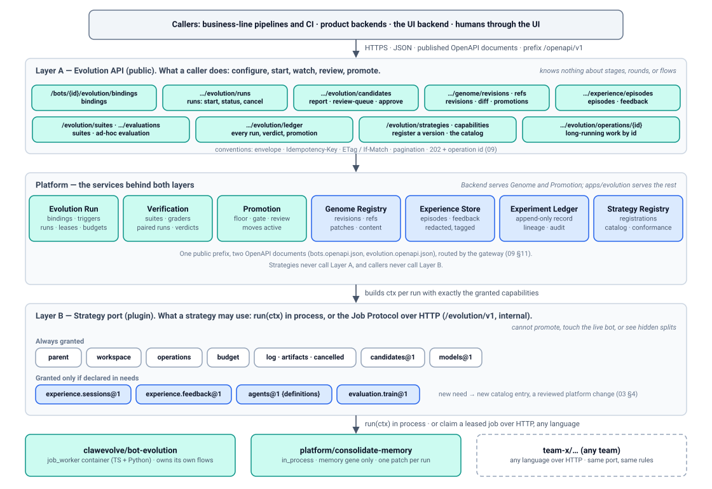
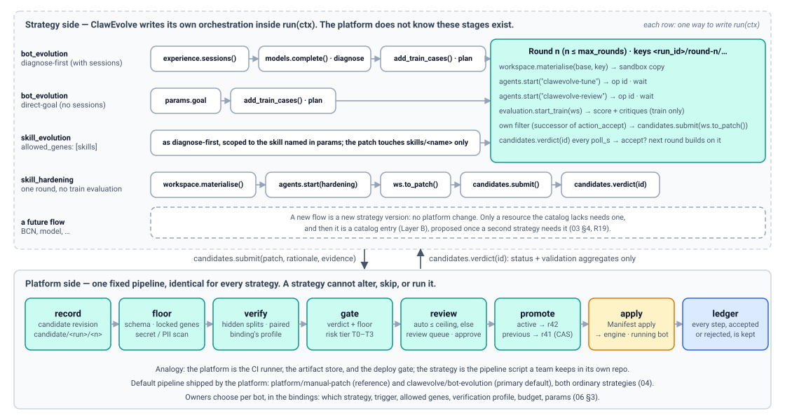
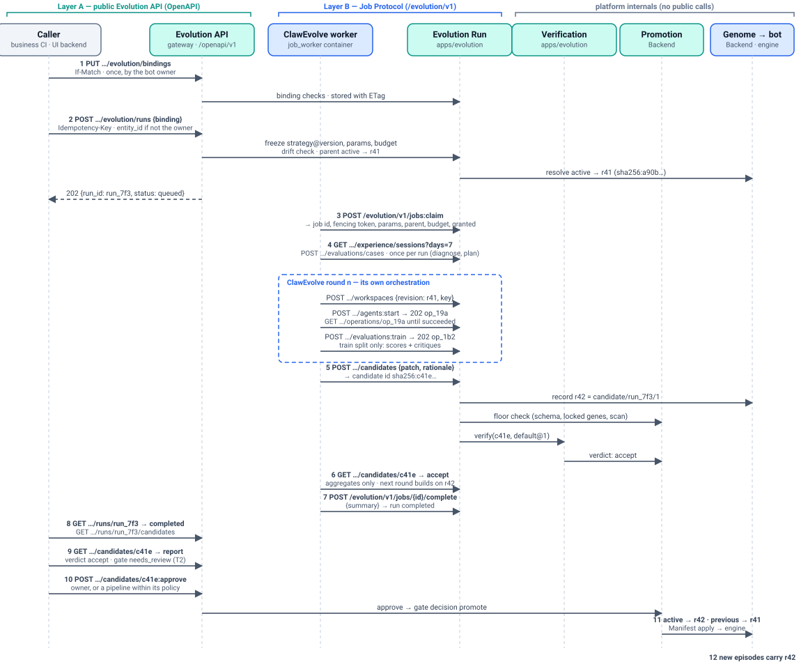
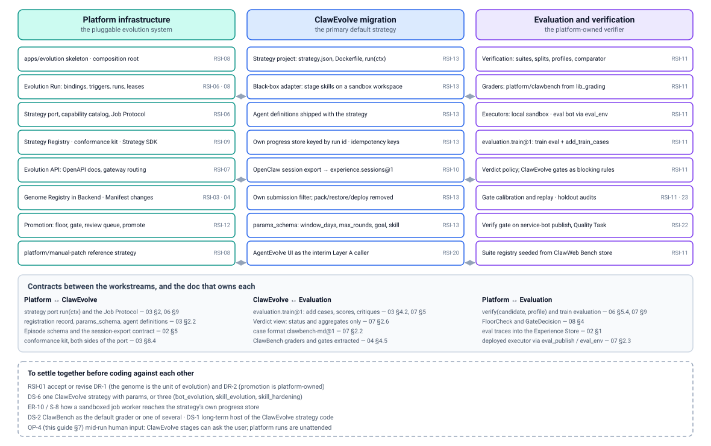

# Integration guide — API layers, orchestration, and who builds what

> 中文版：[integration-guide.zh-CN.md](integration-guide.zh-CN.md)

> Status: DRAFT. A companion to [design.md](design.md) for the people who
> will build on the platform and plug into it: the ClawEvolve team (the
> migration), the evaluation team (verification), and the business lines
> that will call it. It adds no new contract. Every rule here points at the
> numbered doc that owns it, and where this guide proposes something the
> numbered docs do not yet say, it says so.

## 1. Why this document

Three questions came up when the design was first read from the ClawEvolve
side. They are the right questions, and this guide answers each one in one
place:

| # | Question | Short answer | Section |
| --- | --- | --- | --- |
| 1 | How do external teams and ClawEvolve use the platform: an OpenAPI-style HTTP surface, or an SDK? Where are the examples? | HTTP only. One public REST API, described by OpenAPI documents (Layer A). Strategies use a second, internal HTTP protocol (Layer B). There is no client SDK; the Strategy SDK is optional helper code around Layer B. | [§2](#2-two-api-layers), [§5](#5-examples) |
| 2 | ClawEvolve has several orchestrations (diagnose-first, direct-goal, skill evolution, skill hardening, more coming). Can the platform be the CI/CD-like resource layer and leave orchestration to ClawEvolve through lower-level APIs? | Yes; that is the design. The platform owns exactly one fixed pipeline (record → floor → verify → gate → promote) and hands resources to the strategy through its context. Everything between "the run started" and "a candidate was submitted" is the strategy's own orchestration. | [§3](#3-where-orchestration-lives) |
| 3 | One API, or a ClawEvolve-specific product API as well? How do skill, BCN, and model optimization relate to Backend? | One API. ClawEvolve's product features map onto Layer A resources; ClawEvolve-specific vocabulary lives in its params, artifacts, and agent definitions. Skill optimization fits today; BCN and model weights are outside v1, and the boundary rule says where each would go. | [§4](#4-one-api-not-two) |

The two API layers are summarized in [§2](#2-two-api-layers); the glossary
is in [README.md](README.md#glossary).

## 2. Two API layers



| | **Layer A — Evolution API** | **Layer B — Strategy port** |
| --- | --- | --- |
| Who uses it | Pipelines and CI of business lines, product backends, the UI backend, humans through the UI | Strategy code: ClawEvolve, the platform's own strategies, another team's optimizer |
| What it is about | A bot's evolution as a resource: configure, start, watch, review, promote, go back | Doing work inside one run, under the run's budget and isolation |
| Transport | HTTPS, JSON, under the public prefix `/openapi/v1`, through the gateway | `run(ctx)` in process, or the Job Protocol: HTTP, JSON, under the internal prefix `/evolution/v1`, not exposed by the gateway |
| Published as | Two OpenAPI documents: `bots.openapi.json` (Backend) and `evolution.openapi.json` (`apps/evolution`) | The capability catalog (`GET /evolution/capabilities`) and the Job Protocol's JSON Schemas |
| Owning docs | [09-evolution-api.md](09-evolution-api.md) (conventions and the endpoint index); each resource's doc | [03-strategy.md](03-strategy.md) (port, catalog, context); [06-evolution-run.md](06-evolution-run.md) (Job Protocol wire form) |
| Cannot | See a strategy's internals: stages, rounds, prompts | Promote, touch the live bot, read hidden evaluation splits, change the verifier |

The two layers never meet: strategies never call Layer A, and callers never
call Layer B. A caller starts a run and later reads what it produced; a
strategy works inside that run and never learns who started it.

### 2.1 Layer A: what a caller does

Every public endpoint is listed, with its owning doc and conventions, in
[09-evolution-api.md §10](09-evolution-api.md#10-endpoint-index). Grouped
by what a caller wants to do:

| Intent | Endpoints | Owning doc |
| --- | --- | --- |
| Configure which strategies run on a bot, when, with what budget and permissions | `GET`/`PUT /bots/{bot_id}/evolution/bindings` (ETag, `If-Match`) | [06 §3](06-evolution-run.md#3-bindings) |
| Start a run and follow it | `POST /bots/{bot_id}/evolution/runs` (`Idempotency-Key`, 202 + run id); `GET …/runs/{run}`; `POST …/runs/{run}:cancel`; `GET …/runs/{run}/candidates` | [06 §14.1](06-evolution-run.md#141-public-api) |
| Review and decide | `GET /bots/{bot_id}/evolution/candidates/{candidate}` (report); `GET …/evolution/review-queue`; `POST …/candidates/{candidate}:approve` / `:reject` | [08 §10](08-promotion.md#10-api) |
| Promote, or go back to an earlier revision | `POST /bots/{bot_id}/genome/promotions` (CAS on `active`) | [08 §10](08-promotion.md#10-api) |
| Read what the bot is and was | `GET /bots/{bot_id}/genome/revisions`, `…/refs`, `…/revisions/{rev}/diff` | [01 §12](01-genome.md#12-api) |
| Feed signals in | `POST /bots/{bot_id}/experience/feedback` | [02 §10](02-experience.md#10-api) |
| Evaluate a revision on demand (operators) | `POST /bots/{bot_id}/evolution/evaluations` (202 + operation id); `GET /evolution/suites` | [07 §10](07-verification.md#10-api) |
| Audit | `GET /bots/{bot_id}/evolution/ledger`; `POST …/ledger:export` | [05 §12](05-experiment-ledger.md#12-api) |
| Register a strategy version | `POST /evolution/strategies`; `GET /evolution/capabilities` | [03 §10](03-strategy.md#10-api) |
| Follow long-running work | `GET /bots/{bot_id}/evolution/operations/{operation}` | [09 §10.8](09-evolution-api.md#108-operations--this-doc) |

Conventions shared by every endpoint (envelope, request ids, idempotency
keys, ETags, error codes, pagination, long-running work by id) are in
[09-evolution-api.md §4 to §9](09-evolution-api.md#4-request-and-response-conventions).
Bot addressing follows OpenAPI v1 today: the bot id in the path and the
owner as `entity_id`, defaulting to the caller
([09 §2.6](09-evolution-api.md#26-botref-bot-identity)).

### 2.2 Layer B: what a strategy may use

A strategy is code with one method, `run(ctx)`
([03 §2.1](03-strategy.md#21-strategy)). The context `ctx` is its only door
to the platform. Its parts are the **resources** the platform provides; each
one is a catalog entry with a contract and a provider per engine
([03 §4](03-strategy.md#4-capability-catalog)), and over the Job Protocol
each `ctx` call is one HTTP endpoint
([06 §9.1](06-evolution-run.md#91-the-job-protocol)):

| Resource | `ctx` part | Job Protocol endpoint(s) | What the platform does for the strategy |
| --- | --- | --- | --- |
| The bot as it is now | `ctx.parent` (always) | `GET …/runs/{run}/parent`, `GET …/content/{digest}` | Serves the frozen parent revision and its files by digest |
| A sandbox to edit | `ctx.workspace.materialise(revision, key)` (always) | `POST …/runs/{run}/workspaces`, `…/files`, `…/files/{path}`, `…:patch` | Materialises an isolated copy, idempotent per key; turns edits into an itemized Genome Patch |
| Agents that edit or review | `ctx.agents.start(definition, workspace, prompt, idempotency_key)` (`agents@1`) | `POST …/runs/{run}/agents:start` → 202 + operation id | Runs the strategy's own registered agent definition in the sandbox, on the bot's engine, as a long-running operation |
| Model calls | `ctx.models.complete(messages)` (always) | `POST …/runs/{run}/models:complete` | Routes a single model call through the platform's model list, charges it, records the model used |
| Training-split evaluation | `ctx.evaluation.add_train_cases(cases)`, `ctx.evaluation.start_train(workspace, idempotency_key)` (`evaluation.train@1`) | `POST …/runs/{run}/evaluations/cases`, `POST …/evaluations:train` → 202 | Scores the sandbox on the train cases, with critiques; assigns splits; keeps validation, holdout, regression, and safety hidden |
| Past sessions and feedback | `ctx.experience.sessions(days)`, `ctx.experience.feedback(days)` (`experience.sessions@1`, `experience.feedback@1`) | `GET …/runs/{run}/experience/sessions`, `…/feedback` | Normalized, redacted episodes and feedback, tagged with the revision that produced them |
| Long-running work | `ctx.operations.get(op_id)`, `cancel(op_id)` (always) | `GET …/runs/{run}/operations/{id}`, `POST …:cancel` | Status and result by id; every request returns promptly |
| Budget | `ctx.budget.remaining()`, `charge()` (always) | `POST …/runs/{run}/budget:charge` | Meters model, agent, and evaluation spend; stops the run at the limit |
| Handing in results | `ctx.candidates.submit(candidate)`, `ctx.candidates.verdict(id)` (always) | `POST …/runs/{run}/candidates`, `GET …/candidates/{id}` | Records the candidate as a revision, runs floor, verification, gate; returns the verdict with validation aggregates only |
| Keeping evidence | `ctx.log`, `ctx.artifacts.put(name, bytes)` (always) | `POST …/runs/{run}/log`, `PUT …/runs/{run}/artifacts/{name}` | Shows the log on the run; keeps reports and transcripts by artifact id |
| Lifecycle | `ctx.cancelled`, `ctx.attempt` (always) | `POST /evolution/v1/jobs:claim`, `…/jobs/{id}/heartbeat`, `…/complete`, `…/fail` | Leases the run to one worker; re-dispatches with the same run id after a crash; delivers cancellation through the heartbeat |

The platform grants exactly the always-granted parts plus what the
registration record declares in `needs`. Anything else raises
`CapabilityNotGranted` in process, or `403` over the wire
([03 §4.3](03-strategy.md#43-errors-a-strategy-sees)).

### 2.3 SDK or not

- **Layer A has no client SDK.** The OpenAPI documents are the contract. If
  a client library is ever wanted, it is generated from them and adds no
  capability the API lacks ([09 §1](09-evolution-api.md#1-purpose-and-scope)).
  Business lines integrate the way they integrate with any HTTP service.
- **Layer B's contract is the Job Protocol, not the SDK.** A job worker in
  any language needs only HTTP:
  [06 §15.4](06-evolution-run.md#154-a-minimal-job-worker-over-the-job-protocol)
  shows a complete worker without the SDK. The Strategy SDK
  (`avernet-evolution-strategy`, Python first, TypeScript second,
  [03 §8.3](03-strategy.md#83-strategy-sdk)) wraps those same calls, adds a
  local harness with a fake platform, and ships the conformance kit. For
  ClawEvolve, whose control plane is TypeScript and whose stage skills are
  stdlib Python, the first integration step can call the Job Protocol
  directly from the existing Python skills; the SDK is a convenience to
  adopt when it exists (RSI-09), not a prerequisite.

The "SDK" that was discussed in the meeting is therefore a different thing
from what the design means: the design has no SDK for callers at all, and
for strategies the SDK is optional.

### 2.4 Cheat sheet

| I want to… | Layer | Call |
| --- | --- | --- |
| …let a bot be improved by ClawEvolve every night | A | `PUT /bots/{bot_id}/evolution/bindings` with a `clawevolve/bot-evolution@2.0.0` binding and a schedule trigger |
| …improve one bot now, from my CI | A | `POST /bots/{bot_id}/evolution/runs {binding}` with an `Idempotency-Key`, then poll `GET …/runs/{run}` |
| …see what a run changed and whether it is better | A | `GET …/runs/{run}/candidates`, then `GET …/evolution/candidates/{candidate}` |
| …approve a change that needs a human | A | `POST …/evolution/candidates/{candidate}:approve` |
| …undo last week's promotion | A | `POST /bots/{bot_id}/genome/promotions {revision: <earlier>, expected_revision: <current>}` |
| …tell the platform a session went badly | A | `POST /bots/{bot_id}/experience/feedback` |
| …ship a new version of ClawEvolve's tune prompt | A | `POST /evolution/strategies` with a new `version` and the agent definition directories |
| …read the last seven days of sessions inside my strategy | B | `ctx.experience.sessions(days=7)` / `GET …/runs/{run}/experience/sessions` |
| …run my tune agent on a copy of the bot | B | `ctx.workspace.materialise(...)` then `ctx.agents.start("clawevolve-tune", ...)` |
| …know if my candidate was accepted | B | `ctx.candidates.verdict(id)` / `GET …/runs/{run}/candidates/{id}` |
| …use a resource the catalog does not have | — | Propose a catalog entry ([§3.4](#34-adding-a-resource-the-catalog-lacks)) |

## 3. Where orchestration lives



The question behind this section: ClawEvolve runs several orchestrations
today, and more are planned (skill optimization, BCN optimization). It is
hard to abstract a high-level, scenario-independent API over them now, and
easy to provide low-level flow and resource scheduling. The design agrees,
and draws the line as follows.

### 3.1 The platform's fixed pipeline

The platform owns one pipeline, and it is the same for every strategy:

1. A **trigger** (schedule, manual, event) submits a run; the submission is
   idempotent ([06 §4](06-evolution-run.md#4-triggers), [§6](06-evolution-run.md#6-idempotent-submission-and-status-by-id)).
2. The run's inputs are **frozen**: strategy version, params, parent
   revision, allowed genes, verification profile, budget
   ([06 §5.1](06-evolution-run.md#51-start)).
3. The run is **dispatched** as a leased job; a dead worker's run is
   dispatched again with the same run id
   ([06 §7](06-evolution-run.md#7-leases-re-dispatch-and-crash-recovery)).
4. The platform builds the **context** with the granted capabilities and
   calls `run(ctx)`. *What happens inside is the strategy's business.*
5. Each **candidate** the strategy submits is validated against the patch
   schema and the run's `allowed_genes`, recorded as a revision, and checked
   against the **platform floor** before any verification is spent
   ([06 §5.4](06-evolution-run.md#54-candidates-submitted-by-a-run),
   [08 §4.2](08-promotion.md#42-the-platform-floor-and-patch-scanning)).
6. **Verification** runs parent and candidate paired on hidden splits under
   the binding's profile and produces a verdict
   ([07 §4](07-verification.md#4-bot-verification-protocol-level-2)).
7. The **gate** combines verdict, floor, and risk tier; low tiers
   auto-promote under owner policy, the rest wait in the **review queue**
   ([08 §4](08-promotion.md#4-the-gate), [§5](08-promotion.md#5-risk-tiers),
   [§6](08-promotion.md#6-review-queue)).
8. **Promotion** moves `active` and applies the revision through the
   Manifest apply path ([08 §7](08-promotion.md#7-promotion)). Going back is
   promoting an earlier revision ([08 §8.4](08-promotion.md#84-going-back)).
9. Every step is appended to the **Experiment Ledger**
   ([05](05-experiment-ledger.md)).

Only steps 5 to 9 touch the question "is this change good, and may it go
live", and they are deliberately not pluggable: a loop that can grade or
promote its own work reward-hacks
([08 §3](08-promotion.md#3-separation-of-powers), DR-2). In CI/CD terms:
the platform is the runner, the artifact store, and the deploy gate. The
strategy is the pipeline script a team keeps in its own repository.

### 3.2 The strategy's own orchestration

Everything in step 4 is the strategy's. The platform does not know what a
stage is. ClawEvolve's flows today
(`services/evolve/evolution-flow.ts`, keys `bot_evolution`,
`skill_evolution`, `skill_hardening`, with the stage catalog in
`official-stage-catalog.json`) map onto `run(ctx)` like this:

| ClawEvolve flow today | Shape of `run(ctx)` | Context calls it uses | Binding fields that scope it |
| --- | --- | --- | --- |
| `bot_evolution`, diagnose-first (`diagnose → plan → optimize`, driven by real sessions) | First attempt: read episodes, diagnose, propose train cases. Then up to `max_rounds` rounds of tune → review → train evaluation → own filter → submit → verdict by id ([04 §4.4](04-default-strategies.md#44-the-round-loop)) | `experience.sessions`, `models.complete`, `evaluation.add_train_cases`, `workspace.materialise`, `agents.start` (tune, review), `evaluation.start_train`, `candidates.submit`, `candidates.verdict` | `allowed_genes: [persona, skills]`, `params: {window_days, max_rounds, poll_s}` |
| `bot_evolution`, direct-goal (`plan → optimize`, no session diagnosis) | Same round loop; the plan step starts from `params.goal` instead of a diagnosis | As above, without `experience.sessions` | `params: {goal, max_rounds}` |
| `skill_evolution` (same stages, scoped to one skill) | Same as diagnose-first, with the target skill named in params; the submitted patch touches `skills/<name>` only | As above | `allowed_genes: [skills]`, `params: {target_skill, …}` (one strategy with params, or its own strategy id: open decision DS-6, [04 §14](04-default-strategies.md#14-open-decisions)) |
| `skill_hardening` (single `hardening` stage) | One round, no train evaluation: materialise, run the hardening agent, `to_patch`, submit, read the verdict | `workspace.materialise`, `agents.start` (hardening), `candidates.submit`, `candidates.verdict` | `allowed_genes: [skills]`; a skill-scoped strategy ([04 §9](04-default-strategies.md#9-other-pipelines-in-appsevolverun)) |
| `taskType: diagnose` (Bot diagnosis, read-only today) | A run that submits nothing: it reads episodes, writes its report with `ctx.artifacts.put("diagnosis.md", …)`, and returns a `RunSummary` *(reading of the design; not stated in 04)* | `experience.sessions`, `models.complete`, `artifacts` | Any binding of the same strategy with a `diagnose_only` param, or a manual trigger |
| Stage extensions (`preprocess`, `postprocess`, `replace`) and uploaded stage skills | A changed stage is a new strategy version; swapping one stage for another team's piece is the composed tier, defined only once a second team needs it ([03 §8.1](03-strategy.md#81-two-tiers-on-the-same-port)) | — | `strategy: clawevolve/bot-evolution@<version>` |

What the strategy keeps for itself, in full: which window of sessions to
look at, the diagnosis logic, its prompts and agent definitions, the round
loop and any search algorithm, the filter that decides what is worth
submitting, and its own progress record keyed by run id
([03 §7](03-strategy.md#7-what-the-strategy-owns-and-what-the-platform-executes)).

### 3.3 Resources the platform provides, and what it deliberately does not

The resources are the rows of the table in [§2.2](#22-layer-b-what-a-strategy-may-use).
The deliberate omissions matter as much
([06 §10](06-evolution-run.md#10-sandboxing)):

| Not provided to a strategy | Why |
| --- | --- |
| The live workspace or the live bot | A strategy edits sandbox copies only; ClawEvolve's tune editing `/home/admin/.openclaw/workspace` directly, with pack/restore around it, is the one behaviour that must go ([04 §4.1](04-default-strategies.md#41-black-box)) |
| Its own model keys, network egress, or agent runtime | Every model call and agent session goes through `ctx`, so budgets, isolation, and attribution are enforced in one place |
| Validation, holdout, regression, and safety cases, or per-case validation results | The strategy sees train results and verdict aggregates only; otherwise it could tune to the exam ([07 §7](07-verification.md#7-governance-anti-reward-hacking-and-verifier-integrity)) |
| Promotion, the review queue, gate decisions | Only Promotion moves `active`; strategies read their own verdicts and nothing else ([08 §3](08-promotion.md#3-separation-of-powers)) |
| Changing suites, graders, or profiles | The verifier changes only through human-reviewed changes; teams can contribute graders and executors as plugins on the verifier's side of the line, never from inside a run ([07 §1](07-verification.md#1-purpose-and-scope)) |

### 3.4 Adding a resource the catalog lacks

The catalog is small, closed, and platform-owned on purpose: a new need is
met by adding a catalog entry, not by an exception for one strategy
([06 §10](06-evolution-run.md#10-sandboxing)). The procedure:

1. Check whether the need is really a platform resource. Parsing, search,
   ranking, and any computation on data the strategy already has are
   unrestricted and need nothing from the platform.
2. If it is a resource (data the platform holds, something that must run on
   the bot's engine, something that must be charged or isolated), propose
   the entry: name and version (`<name>@1`), method signatures and data
   shapes, which calls are operations, and a provider per engine with its
   conformance test ([03 §4](03-strategy.md#4-capability-catalog),
   `docs/arch/protocol-contract-tests.md`).
3. The platform adds an entry once a second strategy needs it (R19:
   abstract after two examples). Until then the first strategy does without
   it or the need is discussed as a one-off in the work item.

Adding an entry is a reviewed platform change, so it is cheap to propose and
deliberately not something a strategy can do for itself.

### 3.5 Low-level now, high-level later

The only high-level abstraction the platform imposes on a strategy is its
**output**: a candidate is a Genome Patch with a rationale and evidence, and
a verdict comes back by id. Every ClawEvolve flow already ends in "a set of
file changes to a bot, judged by a bench", so this is not new shape, only a
new boundary. The composed tier (step types such as analyze or propose that
several strategies could share) is explicitly deferred until two teams need
to swap a piece ([03 §8.1](03-strategy.md#81-two-tiers-on-the-same-port)).

## 4. One API, not two

### 4.1 ClawEvolve's product surface on Layer A

The AgentEvolve features in [docs/agent-evolve.md](../../../../docs/agent-evolve.md)
map onto Layer A resources. Nothing ClawEvolve-specific becomes a public
endpoint; what is specific lives in the strategy's `params_schema`,
artifacts, `RunSummary` metrics, and agent definitions.

| AgentEvolve feature today | On the platform | Layer A resource |
| --- | --- | --- |
| Task center: tasks, steps, outputs | Runs, with their log, artifacts, operations, and candidates | `GET …/evolution/runs`, `GET …/runs/{run}`, `GET …/runs/{run}/candidates` |
| Create a task: full evolution, direct-goal, skill evolution, hardening | Start a run of the matching binding; the flow choice is the binding's strategy and params | `POST …/evolution/runs {binding, params?}` |
| Bot diagnosis (read-only) | A run that submits no candidate and keeps its report as an artifact ([§3.2](#32-the-strategys-own-orchestration)) | `POST …/evolution/runs`, then the run's artifacts |
| Bench diagnosis | An ad-hoc evaluation of a revision on chosen suites (operator-only), or the train evaluation inside a run | `POST …/evolution/evaluations` → operation → `GET …/evaluations/{evaluation}` |
| Diff and bench result of a round | The candidate report: diff against the parent, verification report, gate decision | `GET …/evolution/candidates/{candidate}` |
| Pack (recoverable snapshot) | Automatic: every candidate is an immutable genome revision; every promotion records `previous` | `GET …/genome/revisions`, `…/refs` |
| Apply a previous version | Promote the earlier revision (going back is promotion) | `POST …/genome/promotions` |
| Skill decision (human approval before `replaceLocalSkill`) | The review queue; approval generalizes to every T2 patch | `GET …/evolution/review-queue`, `POST …/candidates/{candidate}:approve` |
| Task cleanup (remove evolution agents and sessions) | Not needed: sandboxes and agent sessions are platform-owned and discarded after the run | — |

The AgentEvolve UI stays the interim UI and becomes a Layer A caller, with
platform runs shown next to legacy tasks during the migration
([04 §6](04-default-strategies.md#6-migration-plan-strangler-no-big-bang),
step 2).

### 4.2 Business lines as callers

A business line (a credit, treasury, or internal-security team, for
example) owns its bots and reaches the platform only through Layer A:

- Its owner picks strategies per bot in the bindings and sets what they may
  change, how strictly candidates are verified, the budget, and the
  auto-promote ceiling. The team never sees a strategy's internals and
  never needs to.
- Its CI or scheduler starts runs with deterministic idempotency keys, polls
  by id, reads candidate reports, and approves within the policy the owner
  gave it ([09 §13.1](09-evolution-api.md#131-nightly-pipeline)).
- Its product sends feedback (ratings, corrections, outcomes) to the
  feedback endpoint so that the next run has evidence
  ([02 §10](02-experience.md#10-api)). Alerts from its monitoring reach
  strategies as event triggers once the event name is in the platform's
  closed set ([06 §4](06-evolution-run.md#4-triggers)); adding one is a
  reviewed change.
- Who may act on a bot is decided by the existing OpenAPI v1 access check
  with `entity_id`; a dedicated authentication and authorization design for
  the evolution surface is postponed
  ([09 §1](09-evolution-api.md#1-purpose-and-scope)).

### 4.3 The boundary rule for new scenarios

When a new scenario comes up, one question decides where it lands:

| The scenario needs… | It is… | Change required |
| --- | --- | --- |
| a different way to produce candidates (a new flow, a new agent, a new search) | a **strategy** or a strategy version | None on the platform; register and bind it |
| a resource inside a run that the catalog lacks | a **capability** (Layer B) | A catalog entry with a provider per engine ([§3.4](#34-adding-a-resource-the-catalog-lacks)) |
| a new thing callers do with a bot's evolution | a **Layer A endpoint** | Added to the owning doc and its OpenAPI document, through the compatibility gate ([09 §11](09-evolution-api.md#11-openapi-documents-and-gateway-routing)) |
| a new kind of thing to evolve (not part of a bot's genome) | a **genome change** | The largest change: the genome schema and DR-1 ([01](01-genome.md)) |

Applied to the three directions named in the discussion:

| Direction | Where it lands | Status |
| --- | --- | --- |
| **Skill optimization** (skill evolution, skill hardening, future skill methodologies) | Strategies, scoped by `allowed_genes: [skills]`; patch ops `skill.add` / `skill.update` with their risk tiers ([08 §5.1](08-promotion.md#51-tier-table-and-assignment)) | Fits today; migration step 4 ([04 §9](04-default-strategies.md#9-other-pipelines-in-appsevolverun)) |
| **BCN optimization** (team topology, routing, coordination) | A new unit of evolution: the genome is per bot in v1, and team topology and BCS routing are a stated non-goal ([README](README.md#non-goals)) | Needs a team-level genome, which is a DR-1-level decision, not a capability. The strategy side would then reuse the same port |
| **Model optimization** (weights) | Outside the platform: it evolves the harness, not the model. The ledger keeps every experience record as `(input, revision, output, scores, critiques, cost)` and exports preference pairs for training pipelines ([design §9](design.md#9-bridge-to-weight-training), [05 §9.2](05-experiment-ledger.md#92-training-data-export)) | Bridge only, phase P6 |

The rule keeps one API: a scenario adds strategies freely, capabilities
rarely, endpoints only when callers need a new action, and genome changes
only with a decision record.

## 5. Examples

Ids, codes, and shapes below are the ones used across the design set
(`bot_123`, `run_7f3`, candidate `sha256:c41e…`, revisions `r41` and
`r42`); the full request and response bodies are in the owning docs.



### 5.1 A business-line pipeline runs ClawEvolve on its bot (Layer A)

Once, the bot owner attaches ClawEvolve to the bot. The pipeline acts on a
bot it does not own, so it names the owner with `entity_id`.

```http
PUT /openapi/v1/bots/bot_123/evolution/bindings?entity_id=user_owner_5
Content-Type: application/json
If-Match: "bind-v12"
```

```jsonc
// Illustrative. Comments explain the example only; the canonical form is plain JSON (RFC 8785).
{
  "bindings": [
    {"id": "bind_01", "strategy": "clawevolve/bot-evolution@2.0.0",
     "trigger": {"manual": true},                       // the pipeline decides when; or a schedule
     "parent": "active", "allowed_genes": ["persona", "skills"],
     "verification_profile": "default@1",
     "budget": {"max_usd": 20, "max_wall_clock_s": 7200},
     "params": {"window_days": 7, "max_rounds": 3}}
  ]
}
```

Each night, the pipeline starts a run. The key is deterministic, so a rerun
of the job re-attaches to the same run instead of starting a second one.

```http
POST /openapi/v1/bots/bot_123/evolution/runs?entity_id=user_owner_5
Content-Type: application/json
Idempotency-Key: nightly-bot_123-2026-10-08
```

```jsonc
// Illustrative. Comments explain the example only; the canonical form is plain JSON (RFC 8785).
{"binding": "bind_01"}
```

```jsonc
// Illustrative. Comments explain the example only; the canonical form is plain JSON (RFC 8785).
// 202; Location: /openapi/v1/bots/bot_123/evolution/runs/run_7f3?entity_id=user_owner_5
{"code": 202000, "message": "Accepted", "data": {"run_id": "run_7f3", "status": "queued"},
 "request_id": "4b5c6d7e8f9a0b1c2d3e4f5a6b7c8d9e"}
```

It polls the run by id until the status is terminal, then reads the
candidates and their reports.

```http
GET /openapi/v1/bots/bot_123/evolution/runs/run_7f3?entity_id=user_owner_5
GET /openapi/v1/bots/bot_123/evolution/runs/run_7f3/candidates?entity_id=user_owner_5
GET /openapi/v1/bots/bot_123/evolution/candidates/sha256%3Ac41e…?entity_id=user_owner_5
```

```jsonc
// Illustrative. Comments explain the example only; the canonical form is plain JSON (RFC 8785).
// data of the candidate report: verified, but the gate wants a human for a T2 patch
{"candidate_id": "sha256:c41e…", "verdict": "accept",
 "gate": {"id": "gd_204", "outcome": "needs_review", "risk": {"tier": "T2", "raised_by": []},
          "auto_promote_ceiling": "T1"}}
```

A human approves it in the UI, or the pipeline tries within the policy the
owner gave it and leaves it in the queue when the policy says no.

```http
POST /openapi/v1/bots/bot_123/evolution/candidates/sha256%3Ac41e…:approve?entity_id=user_owner_5
Content-Type: application/json
Idempotency-Key: nightly-bot_123-2026-10-08/approve/sha256:c41e
```

```jsonc
// Illustrative. Comments explain the example only; the canonical form is plain JSON (RFC 8785).
{"reason": "Reviewed diff and verification report; escalation fix is correct."}
```

Promotion moves `active` to `r42` and applies it. If the new revision turns
out worse on real traffic, going back is one more promotion:

```http
POST /openapi/v1/bots/bot_123/genome/promotions?entity_id=user_owner_5
Content-Type: application/json
Idempotency-Key: rollback-bot_123-2026-10-09
```

```jsonc
// Illustrative. Comments explain the example only; the canonical form is plain JSON (RFC 8785).
{"revision": "sha256:a90b…", "ref": "active", "expected_revision": "sha256:7c1e…",   // r41 again; CAS on active
 "reason": "refund escalations up since r42"}
```

The full version of this pipeline, with error handling, is
[09 §13.1](09-evolution-api.md#131-nightly-pipeline).

### 5.2 ClawEvolve as a job worker (Layer B)

The ClawEvolve container has no credentials to the bot and one network
route: the Job Protocol endpoint. It claims the run, works in a sandbox,
and hands in a candidate. Every long call returns an operation id at once.

```http
POST /evolution/v1/jobs:claim
Content-Type: application/json
```

```jsonc
// Illustrative. Comments explain the example only; the canonical form is plain JSON (RFC 8785).
{"worker_id": "clawevolve-worker-01", "strategy_ids": ["clawevolve/bot-evolution"]}
```

```jsonc
// Illustrative. Comments explain the example only; the canonical form is plain JSON (RFC 8785).
// 200: the run's frozen values; the strategy keeps the fencing token for every later call
{"job_id": "job_7f3_1", "run_id": "run_7f3", "attempt": 1, "strategy": "clawevolve/bot-evolution@2.0.0",
 "params": {"window_days": 7, "max_rounds": 3, "poll_s": 60},
 "parent": "sha256:a90b…",                                        // r41
 "budget": {"max_usd": 20, "max_wall_clock_s": 7200},
 "budget_used": {"usd": 0, "wall_clock_s": 0, "rollouts": 0, "tokens": 0},
 "granted": ["parent", "workspace", "operations", "budget", "log", "artifacts", "cancelled",
             "candidates@1", "models@1", "experience.sessions@1", "agents@1", "evaluation.train@1"],
 "fencing_token": "ft_7f3_1_…", "lease_expires_at": "2026-10-08T02:16:10Z"}
```

Diagnose and plan, once per run (the keys make a re-dispatch harmless):

```http
GET /evolution/v1/runs/run_7f3/experience/sessions?days=7&limit=500
Evolution-Fencing-Token: ft_7f3_1_…

POST /evolution/v1/runs/run_7f3/evaluations/cases
Evolution-Fencing-Token: ft_7f3_1_…
```

Each round: a sandbox, the tune agent, the review agent, a train
evaluation, then the strategy's own filter decides whether to submit.

```http
POST /evolution/v1/runs/run_7f3/workspaces
Evolution-Fencing-Token: ft_7f3_1_…
Content-Type: application/json
```

```jsonc
// Illustrative. Comments explain the example only; the canonical form is plain JSON (RFC 8785).
{"revision": "sha256:a90b…", "key": "run_7f3/round-1"}        // idempotent per key → {"workspace_id": "ws_7f3_r1", …}
```

```http
POST /evolution/v1/runs/run_7f3/agents:start
Evolution-Fencing-Token: ft_7f3_1_…
Content-Type: application/json
```

```jsonc
// Illustrative. Comments explain the example only; the canonical form is plain JSON (RFC 8785).
{"definition": "clawevolve-tune", "workspace_id": "ws_7f3_r1",
 "prompt": "Apply the plan in artifacts/plan.md; edit SOUL.md and skills/refund-policy only",
 "idempotency_key": "run_7f3/round-1/tune", "timeout_s": 1800}   // → 202 {"operation_id": "op_19a", "status": "queued"}
```

```http
GET /evolution/v1/runs/run_7f3/operations/op_19a
Evolution-Fencing-Token: ft_7f3_1_…
```

```jsonc
// Illustrative. Comments explain the example only; the canonical form is plain JSON (RFC 8785).
// repeated until status is no longer queued or running
{"id": "op_19a", "kind": "agent_session", "status": "succeeded",
 "result": {"exit_status": "completed", "transcript_artifact": "art_91"}, "error": null, "cost_usd": 2.3}
```

```http
POST /evolution/v1/runs/run_7f3/evaluations:train
Evolution-Fencing-Token: ft_7f3_1_…
Content-Type: application/json
```

```jsonc
// Illustrative. Comments explain the example only; the canonical form is plain JSON (RFC 8785).
{"workspace_id": "ws_7f3_r1", "idempotency_key": "run_7f3/round-1/train"}   // → 202 {"operation_id": "op_1b2", "status": "queued"}
```

When the train score beats the best so far, the strategy turns the sandbox
into a patch and submits it:

```http
POST /evolution/v1/runs/run_7f3/workspaces/ws_7f3_r1:patch
Evolution-Fencing-Token: ft_7f3_1_…

POST /evolution/v1/runs/run_7f3/candidates
Evolution-Fencing-Token: ft_7f3_1_…
Content-Type: application/json
```

```jsonc
// Illustrative. Comments explain the example only; the canonical form is plain JSON (RFC 8785).
{
  "patch": {"patch_schema": 1, "base": "sha256:a90b…",
            "ops": [{"op": "file.edit", "target": "skills/refund-policy/SKILL.md",
                     "edits": [{"kind": "replace_section", "heading": "## When to use", "content": "…"}]}]},
  "rationale": "Best on 14/20 train cases; fixes trigger misses on partial refunds",
  "evidence": ["episode:ep_91", "eval:et_5521"],
  "self_metrics": {"train_score_pct": 82}
}
```

```jsonc
// Illustrative. Comments explain the example only; the canonical form is plain JSON (RFC 8785).
// 200: the id is the content hash of the patch, so resubmitting after a crash returns the same id
{"candidate_id": "sha256:c41e…", "ref": "candidate/run_7f3/1", "verdict": {"status": "pending"}}
```

The strategy looks the verdict up by id until it is no longer `pending`,
and sees aggregates only:

```http
GET /evolution/v1/runs/run_7f3/candidates/sha256%3Ac41e…
Evolution-Fencing-Token: ft_7f3_1_…
```

```jsonc
// Illustrative. Comments explain the example only; the canonical form is plain JSON (RFC 8785).
{"candidate": "sha256:c41e…", "status": "accept", "revision": "sha256:7c1e…",
 "aggregates": {"validation": {"cases": 30, "seeds": 3, "mean_delta": 0.061, "ci": [0.028, 0.094]}},
 "reasons": ["validation_improved"]}
```

If accepted, the next round materialises from `sha256:7c1e…` (`r42`). When
the rounds are done:

```http
POST /evolution/v1/jobs/job_7f3_1/complete
Evolution-Fencing-Token: ft_7f3_1_…
Content-Type: application/json
```

```jsonc
// Illustrative. Comments explain the example only; the canonical form is plain JSON (RFC 8785).
{"summary": {"rounds": 3, "notes": "1 candidate submitted, accepted in round 1", "extra": {"best_train_score_pct": 82}}}
```

The ClawEvolve code that makes these calls is sketched in
[04 §12.2](04-default-strategies.md#122-clawevolvebot-evolution-native-strategy)
(native) and [04 §12.3](04-default-strategies.md#123-clawevolve-black-box-adapter-migration-step-2)
(the black-box adapter, migration step 2).

### 5.3 The AgentEvolve UI as a Layer A caller

The UI backend needs nothing beyond Layer A: `GET …/evolution/runs` for the
task list, `GET …/runs/{run}` for status, log, and budget, the run's
artifacts for the diagnosis and plan, `GET …/evolution/review-queue` and the
candidate report for the review page, and `GET …/genome/revisions` for the
version history. [09 §13.3](09-evolution-api.md#133-review-queue-in-the-ui-backend)
shows the review-queue page in requests.

## 6. Who builds what



Three workstreams, with the work items from [work-items.md](work-items.md)
and what each needs from the others:

| Workstream | Builds | Work items | Needs from the others |
| --- | --- | --- | --- |
| **Platform infrastructure** | `apps/evolution` skeleton and composition root; Evolution Run (bindings, triggers, runs, leases, budgets); the strategy port, capability catalog, and Job Protocol; Strategy Registry, conformance kit, Strategy SDK; the Evolution API, its OpenAPI documents, and gateway routing; Genome Registry and Manifest changes in Backend; Promotion; the `platform/manual-patch` reference strategy | RSI-03, 04, 06, 07, 08, 09, 12 | From ClawEvolve: the real list of resources its flows need, so the catalog is not guessed. From evaluation: `verify(candidate, profile)` and the train-evaluation provider to call |
| **ClawEvolve migration** | The strategy project (`strategy.json`, Dockerfile, `run(ctx)` entry); the black-box adapter that runs the existing stage skills on a sandbox workspace; agent definitions shipped with the strategy; its own progress store and idempotency keys; the OpenClaw session-export provider; the submission filter that replaces `action_accept`; the `params_schema`; AgentEvolve UI as a Layer A caller | RSI-10 (with platform), RSI-13, RSI-20 (interim UI) | From platform: a live Job Protocol to code against (the singlebox profile of RSI-08) and the catalog contracts. From evaluation: `evaluation.train@1` and the verdict view, and the ClawBench case format kept byte-compatible |
| **Evaluation and verification** | The Verification service (suites, splits, profiles, comparator, verdict policy); graders (`platform/clawbench` extracted from `lib_grading`, ensemble judges); executors (local sandbox, deployed eval bot via `eval_env`); the `evaluation.train@1` provider; ClawEvolve's gates re-expressed as blocking rules; gate calibration and replay; the verify gate on service-bot publish | RSI-11, RSI-22, later RSI-23 | From platform: the `Verification` and `FloorCheck` interfaces and the eval-trace write path. From ClawEvolve: the ClawBench runner, splits, and gate code to extract, and the bench store to seed the suite registry |

Contracts between the pairs, each owned by one doc:

| Between | Contract | Defined in |
| --- | --- | --- |
| Platform ↔ ClawEvolve | The strategy port and the Job Protocol; the registration record with `params_schema` and agent definitions; the Episode schema and the session-export contract; the conformance kit on both sides of the port | [03 §2](03-strategy.md#2-domain-model), [06 §9](06-evolution-run.md#9-runtimes-and-the-job-protocol), [02 §5](02-experience.md#5-engine-session-export-contract), [03 §8.4](03-strategy.md#84-conformance) |
| ClawEvolve ↔ Evaluation | `evaluation.train@1` (add cases, scores, critiques); the verdict view (status and aggregates only); the case format `clawbench-md@1`; the ClawBench graders and gates that move to the verifier | [03 §4.2](03-strategy.md#42-what-capabilities-look-like), [07 §5](07-verification.md#5-train-split-evaluation-evaluationtrain1), [07 §2.6](07-verification.md#26-verdict), [04 §4.5](04-default-strategies.md#45-clawevolve-evaluation-assets-the-platform-reuses) |
| Platform ↔ Evaluation | `verify(candidate, profile)` and the train evaluation; `FloorCheck` and `GateDecision`; eval traces written to the Experience Store; the deployed executor through `eval_publish` / `eval_env` | [06 §5.4](06-evolution-run.md#54-candidates-submitted-by-a-run), [07 §9](07-verification.md#9-service-interface), [08 §4](08-promotion.md#4-the-gate), [07 §2.3](07-verification.md#23-grader-and-executor) |

The order that lets the three work in parallel without waiting on each
other, following [design §8](design.md#8-phasing) and
[04 §6](04-default-strategies.md#6-migration-plan-strangler-no-big-bang):

1. **Contracts first (P0).** DR-1 and DR-2 accepted or revised (RSI-01);
   the catalog, the Job Protocol, and the API conventions reviewed by all
   three workstreams (RSI-06, RSI-07). This is where the open points in
   [§7](#7-open-points-from-the-discussion) get decided.
2. **Platform skeleton with the reference strategy (P2).** `apps/evolution`
   on singlebox, running `platform/manual-patch` end to end with
   deterministic checks (RSI-08). From this point the ClawEvolve team has a
   live Job Protocol to code against, and the evaluation team has the
   `verify` hook to fill in.
3. **In parallel:** ClawEvolve migration step 1 (shadow-record genome
   revisions from today's packs, through the Genome API) and step 2 (the
   black-box adapter, RSI-13), while the evaluation team builds
   Verification with the extracted ClawBench grader (RSI-11).
4. **Converge (P3).** The first nightly ClawEvolve run through the platform,
   verified by the platform, compared with legacy AgentEvolve on its own
   bench. RSI-13 is done when the result is the same or better without the
   live workspace being touched.

## 7. Open points from the discussion

These are not decided by the numbered docs, or are decided there but were
questioned in the discussion. Each needs a decision before the pairs code
against each other.

| Id | Point | Proposal in this guide | Decides |
| --- | --- | --- | --- |
| OP-1 | Raw HTTP or SDK for ClawEvolve's first integration | Raw Job Protocol from the existing Python stage skills first; adopt the Python SDK when RSI-09 lands; a TypeScript SDK only if the control plane itself becomes the worker | ClawEvolve + platform |
| OP-2 | One ClawEvolve strategy with params, or three registered strategies (`bot_evolution`, `skill_evolution`, `skill_hardening`) | Open decision DS-6 ([04 §14](04-default-strategies.md#14-open-decisions)). Leaning: `bot_evolution` and `skill_evolution` as one strategy (same stages, different `allowed_genes` and params); `skill_hardening` as its own, because its `run(ctx)` is a different shape | ClawEvolve |
| OP-3 | How a sandboxed job worker reaches ClawEvolve's own progress store (`ce_tasks` / `ce_steps`) | Open decisions ER-10 / S-8 ([06 §17](06-evolution-run.md#17-open-decisions), [03 §13](03-strategy.md#13-open-decisions)): an egress allowlist entry in the registration record, or a platform-held opaque per-run blob | Platform |
| OP-4 | Mid-run human input. ClawEvolve's stage inputs carry `human_input` ("the user answered the previous question"); platform runs are unattended, and the only human step is the review queue | Not covered by the design set. Proposal: a run that needs an answer stores the question as an artifact, returns a `RunSummary` saying so, and a later run (manual trigger, with the answer in params) continues from the strategy's own saved state. Needs a decision whether that is enough for the first iteration | Platform + ClawEvolve |
| OP-5 | Event triggers from business systems (alerts, monitoring) | Event names are a closed platform set ([06 §2.2](06-evolution-run.md#22-trigger-and-binding)); the first three are proposed. Business signals enter as feedback through the feedback endpoint; a new event name is a reviewed change | Platform |
| OP-6 | Where the ClawEvolve strategy code lives long-term, and what happens to the TypeScript control plane once orchestration moves into `run(ctx)` | Open decision DS-1 ([04 §14](04-default-strategies.md#14-open-decisions)); the control plane stays the UI host during migration ([design §6](design.md#6-ownership-and-module-placement)) | ClawEvolve + platform |
