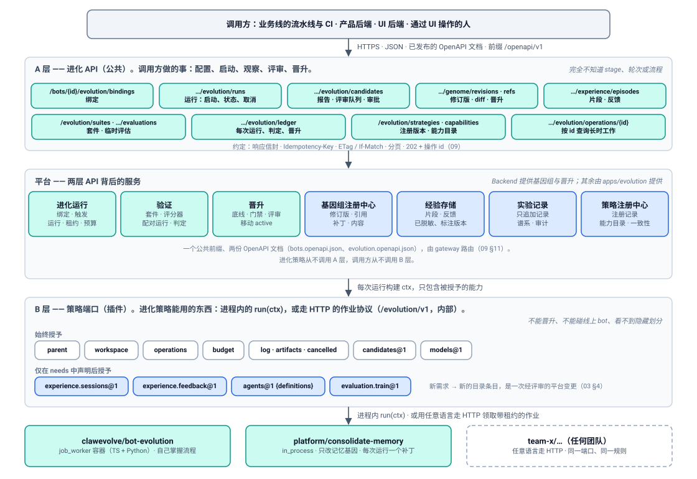
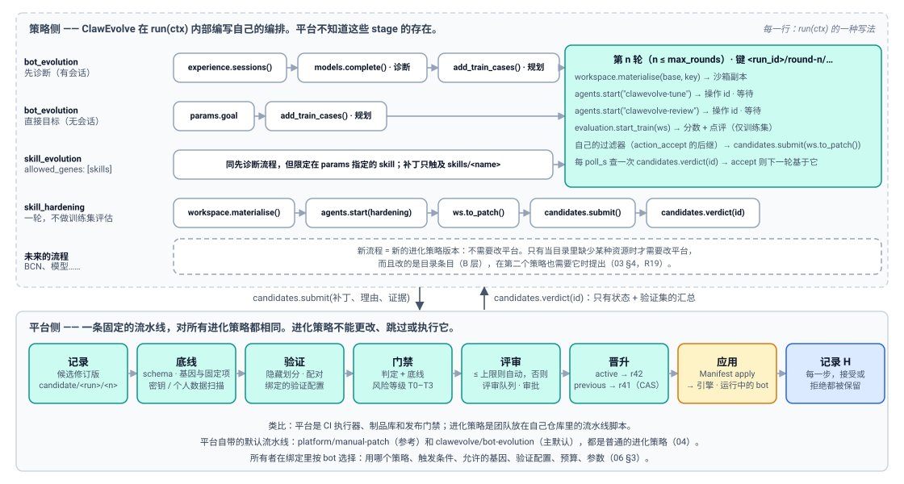
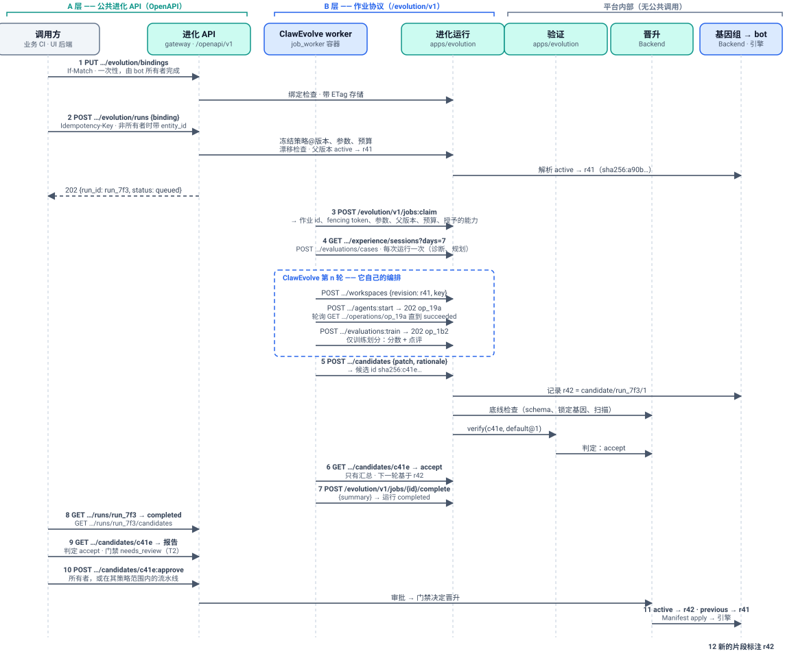
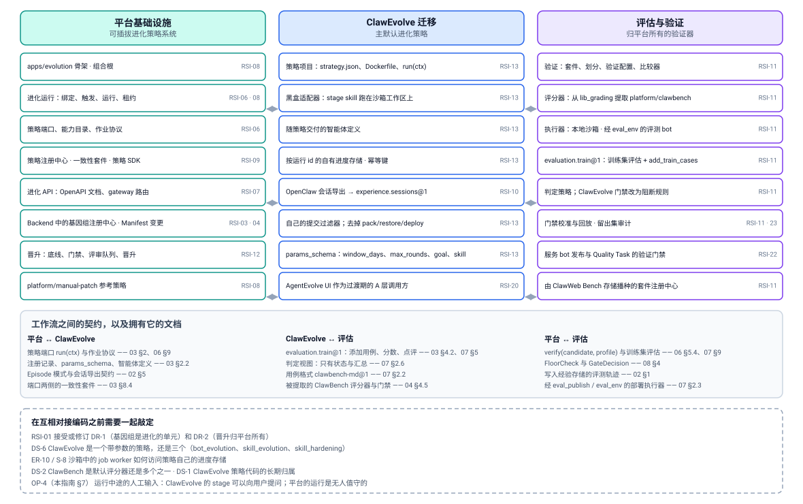

# 接入指南 —— API 分层、编排归属，以及谁负责什么

> English version: [integration-guide.md](integration-guide.md)

> 状态：草案（DRAFT）。这是 [design.zh-CN.md](design.zh-CN.md) 的配套文档，面向
> 将要在平台之上构建、并接入平台的人：ClawEvolve 团队（迁移）、评估团队
> （验证），以及将要调用平台的业务线。它不新增任何契约。这里的每条规则都
> 指向拥有它的编号文档；凡是编号文档尚未说明、而本指南作出提议的地方，都
> 会明确标注。

## 1. 为什么要有这份文档

设计稿第一次被 ClawEvolve 一侧阅读时，提出了三个问题。它们问得很对，本指南
把每个问题的答案集中在一处：

| # | 问题 | 简答 | 章节 |
| --- | --- | --- | --- |
| 1 | 外部团队和 ClawEvolve 如何使用平台：类似 OpenAPI 的 HTTP 接口，还是 SDK？示例在哪里？ | 只有 HTTP。一套公共 REST API，由 OpenAPI 文档描述（A 层）。进化策略使用第二套内部 HTTP 协议（B 层）。没有客户端 SDK；策略 SDK 只是围绕 B 层的可选辅助代码。 | [§2](#2-两层-api)、[§5](#5-示例) |
| 2 | ClawEvolve 有多种编排（先诊断、直接目标、Skill 进化、Skill 加固，还会有更多）。平台能否扮演类似 CI/CD 的资源层，通过更底层的 API 把编排留给 ClawEvolve？ | 可以；设计正是如此。平台恰好拥有一条固定流水线（记录 → 底线 → 验证 → 门禁 → 晋升），并通过策略上下文把资源交给进化策略。从"运行开始"到"候选被提交"之间的一切，都是策略自己的编排。 | [§3](#3-编排归属于哪里) |
| 3 | 一套 API，还是再加一套 ClawEvolve 专属的产品级 API？Skill、BCN 和模型的优化与 Backend 是什么关系？ | 一套 API。ClawEvolve 的产品功能映射到 A 层资源；ClawEvolve 专属的词汇留在它的参数、产物和智能体定义里。Skill 优化今天就能放进来；BCN 和模型权重在 v1 之外，边界规则说明了各自该落在哪里。 | [§4](#4-一套-api而不是两套) |

两层 API 的概览见 [§2](#2-两层-api)；术语表见
[README.zh-CN.md](README.zh-CN.md#术语表)。

## 2. 两层 API



| | **A 层 —— 进化 API** | **B 层 —— 策略端口** |
| --- | --- | --- |
| 谁使用 | 业务线的流水线与 CI、产品后端、UI 后端、通过 UI 操作的人 | 策略代码：ClawEvolve、平台自带的策略、其他团队的优化器 |
| 它关于什么 | 把一个 bot 的进化当作资源：配置、启动、观察、评审、晋升、回退 | 在一次运行内部、在该运行的预算与隔离之下做事 |
| 传输 | HTTPS、JSON，位于公共前缀 `/openapi/v1` 之下，经过 gateway | 进程内的 `run(ctx)`，或作业协议：HTTP、JSON，位于内部前缀 `/evolution/v1` 之下，不经 gateway 暴露 |
| 发布形式 | 两份 OpenAPI 文档：`bots.openapi.json`（Backend）和 `evolution.openapi.json`（`apps/evolution`） | 能力目录（`GET /evolution/capabilities`）和作业协议的 JSON Schema |
| 所属文档 | [09-evolution-api.zh-CN.md](09-evolution-api.zh-CN.md)（约定与端点索引）；各资源各自的文档 | [03-strategy.zh-CN.md](03-strategy.zh-CN.md)（端口、目录、上下文）；[06-evolution-run.zh-CN.md](06-evolution-run.zh-CN.md)（作业协议线上格式） |
| 不能做 | 看到策略的内部：stage、轮次、prompt | 晋升、触碰线上 bot、读取隐藏的评估划分、修改验证器 |

两层永不相遇：进化策略从不调用 A 层，调用方从不调用 B 层。调用方启动一次
运行，之后读取它产出了什么；策略在那次运行内部工作，永远不知道是谁启动
了它。

### 2.1 A 层：调用方做什么

每个公共端点及其所属文档和约定都列在
[09-evolution-api.zh-CN.md §10](09-evolution-api.zh-CN.md#10-端点索引)。按调用方
想做的事分组：

| 意图 | 端点 | 所属文档 |
| --- | --- | --- |
| 配置哪些策略在一个 bot 上运行、何时运行、预算与权限如何 | `GET`/`PUT /bots/{bot_id}/evolution/bindings`（ETag、`If-Match`） | [06 §3](06-evolution-run.zh-CN.md#3-绑定) |
| 启动一次运行并跟踪它 | `POST /bots/{bot_id}/evolution/runs`（`Idempotency-Key`，202 + 运行 id）；`GET …/runs/{run}`；`POST …/runs/{run}:cancel`；`GET …/runs/{run}/candidates` | [06 §14.1](06-evolution-run.zh-CN.md#141-公共-api) |
| 评审并决定 | `GET /bots/{bot_id}/evolution/candidates/{candidate}`（报告）；`GET …/evolution/review-queue`；`POST …/candidates/{candidate}:approve` / `:reject` | [08 §10](08-promotion.zh-CN.md#10-api) |
| 晋升，或回到更早的修订版 | `POST /bots/{bot_id}/genome/promotions`（对 `active` 做 CAS） | [08 §10](08-promotion.zh-CN.md#10-api) |
| 读取 bot 现在是什么、曾经是什么 | `GET /bots/{bot_id}/genome/revisions`、`…/refs`、`…/revisions/{rev}/diff` | [01 §12](01-genome.zh-CN.md#12-api) |
| 送入信号 | `POST /bots/{bot_id}/experience/feedback` | [02 §10](02-experience.zh-CN.md#10-api) |
| 按需评估一个修订版（运维人员） | `POST /bots/{bot_id}/evolution/evaluations`（202 + 操作 id）；`GET /evolution/suites` | [07 §10](07-verification.zh-CN.md#10-api) |
| 审计 | `GET /bots/{bot_id}/evolution/ledger`；`POST …/ledger:export` | [05 §12](05-experiment-ledger.zh-CN.md#12-api) |
| 注册一个策略版本 | `POST /evolution/strategies`；`GET /evolution/capabilities` | [03 §10](03-strategy.zh-CN.md#10-api) |
| 跟踪长时工作 | `GET /bots/{bot_id}/evolution/operations/{operation}` | [09 §10.8](09-evolution-api.zh-CN.md#108-操作--本文档) |

所有端点共享的约定（响应信封、请求 id、幂等键、ETag、错误码、分页、按 id
查询的长时工作）见
[09-evolution-api.zh-CN.md §4 至 §9](09-evolution-api.zh-CN.md#4-请求与响应约定)。
bot 的寻址沿用今天的 OpenAPI v1：bot id 在路径里，所有者是 `entity_id`，默认
为调用方（[09 §2.6](09-evolution-api.zh-CN.md#26-botrefbot-标识)）。

### 2.2 B 层：进化策略能用什么

进化策略是只有一个方法 `run(ctx)` 的代码
（[03 §2.1](03-strategy.zh-CN.md#21-进化策略)）。上下文 `ctx` 是它通往平台的唯一
一扇门。它的各个部分就是平台提供的**资源**；每一个都是一条目录条目，有契
约，并按引擎有各自的提供方（[03 §4](03-strategy.zh-CN.md#4-能力目录)）；在作业
协议上，每个 `ctx` 调用对应一个 HTTP 端点
（[06 §9.1](06-evolution-run.zh-CN.md#91-作业协议)）：

| 资源 | `ctx` 部分 | 作业协议端点 | 平台为策略做什么 |
| --- | --- | --- | --- |
| bot 当前的样子 | `ctx.parent`（始终） | `GET …/runs/{run}/parent`、`GET …/content/{digest}` | 提供冻结的父修订版及其按摘要索引的文件 |
| 可编辑的沙箱 | `ctx.workspace.materialise(revision, key)`（始终） | `POST …/runs/{run}/workspaces`、`…/files`、`…/files/{path}`、`…:patch` | 物化一份隔离副本，按键幂等；把编辑转成逐项列出的基因组补丁 |
| 负责编辑或评审的智能体 | `ctx.agents.start(definition, workspace, prompt, idempotency_key)`（`agents@1`） | `POST …/runs/{run}/agents:start` → 202 + 操作 id | 在沙箱里、在 bot 的引擎上运行策略自己注册的智能体定义，作为一次长时操作 |
| 模型调用 | `ctx.models.complete(messages)`（始终） | `POST …/runs/{run}/models:complete` | 把单次模型调用路由到平台的模型列表，计费，并记录所用模型 |
| 训练划分上的评估 | `ctx.evaluation.add_train_cases(cases)`、`ctx.evaluation.start_train(workspace, idempotency_key)`（`evaluation.train@1`） | `POST …/runs/{run}/evaluations/cases`、`POST …/evaluations:train` → 202 | 在训练用例上给沙箱打分并给出点评；分配划分；让验证集、留出集、回归集和安全集保持隐藏 |
| 过往会话与反馈 | `ctx.experience.sessions(days)`、`ctx.experience.feedback(days)`（`experience.sessions@1`、`experience.feedback@1`） | `GET …/runs/{run}/experience/sessions`、`…/feedback` | 规范化、已脱敏的片段与反馈，标注产生它们的修订版 |
| 长时工作 | `ctx.operations.get(op_id)`、`cancel(op_id)`（始终） | `GET …/runs/{run}/operations/{id}`、`POST …:cancel` | 按 id 查询状态与结果；每个请求都立即返回 |
| 预算 | `ctx.budget.remaining()`、`charge()`（始终） | `POST …/runs/{run}/budget:charge` | 计量模型、智能体和评估的花费；到达上限即停止运行 |
| 交付结果 | `ctx.candidates.submit(candidate)`、`ctx.candidates.verdict(id)`（始终） | `POST …/runs/{run}/candidates`、`GET …/candidates/{id}` | 把候选记录为一个修订版，执行底线、验证、门禁；返回只含验证集汇总的判定 |
| 保留证据 | `ctx.log`、`ctx.artifacts.put(name, bytes)`（始终） | `POST …/runs/{run}/log`、`PUT …/runs/{run}/artifacts/{name}` | 在运行页面展示日志；按产物 id 保留报告与转录 |
| 生命周期 | `ctx.cancelled`、`ctx.attempt`（始终） | `POST /evolution/v1/jobs:claim`、`…/jobs/{id}/heartbeat`、`…/complete`、`…/fail` | 把运行租给一个 worker；崩溃后以同一运行 id 重新派发；通过心跳传递取消 |

平台恰好授予始终授予的部分，再加上注册记录在 `needs` 中声明的能力。访问其
他任何东西，在进程内会抛出 `CapabilityNotGranted`，在线上会返回 `403`
（[03 §4.3](03-strategy.zh-CN.md#43-策略会遇到的错误)）。

### 2.3 要不要 SDK

- **A 层没有客户端 SDK。** OpenAPI 文档就是契约。如果将来需要客户端库，它
  由这些文档生成，并且不会增加 API 本身没有的能力
  （[09 §1](09-evolution-api.zh-CN.md#1-目的与范围)）。业务线接入它的方式，和
  接入任何 HTTP 服务一样。
- **B 层的契约是作业协议，不是 SDK。** 任何语言的 job worker 只需要 HTTP：
  [06 §15.4](06-evolution-run.zh-CN.md#154-基于作业协议的最小-job-worker)
  给出了一个不用 SDK 的完整 worker。策略 SDK（`avernet-evolution-strategy`，
  先 Python，后 TypeScript，[03 §8.3](03-strategy.zh-CN.md#83-策略-sdk)）封装的
  正是这些调用，另外提供一个带假平台的本地测试环境，并附带一致性套件。对
  于控制面是 TypeScript、stage skill 是纯标准库 Python 的 ClawEvolve 来说，接
  入的第一步可以直接从现有的 Python skill 调用作业协议；SDK 是等它存在之后
  （RSI-09）可以采用的便利，不是前提。

因此，会上讨论的那个"SDK"和设计里所指的并不是一回事：设计里面向调用方
根本没有 SDK，面向策略的 SDK 是可选的。

### 2.4 速查表

| 我想…… | 层 | 调用 |
| --- | --- | --- |
| ……让一个 bot 每晚由 ClawEvolve 改进 | A | `PUT /bots/{bot_id}/evolution/bindings`，带一条 `clawevolve/bot-evolution@2.0.0` 的绑定和定时触发 |
| ……现在就从我的 CI 改进一个 bot | A | `POST /bots/{bot_id}/evolution/runs {binding}`，带 `Idempotency-Key`，然后轮询 `GET …/runs/{run}` |
| ……看看一次运行改了什么、是否更好 | A | `GET …/runs/{run}/candidates`，然后 `GET …/evolution/candidates/{candidate}` |
| ……批准一个需要人审的变更 | A | `POST …/evolution/candidates/{candidate}:approve` |
| ……撤销上周的晋升 | A | `POST /bots/{bot_id}/genome/promotions {revision: <更早的>, expected_revision: <当前的>}` |
| ……告诉平台某次会话很糟糕 | A | `POST /bots/{bot_id}/experience/feedback` |
| ……发布 ClawEvolve tune prompt 的新版本 | A | `POST /evolution/strategies`，带新的 `version` 和智能体定义目录 |
| ……在我的策略里读取最近七天的会话 | B | `ctx.experience.sessions(days=7)` / `GET …/runs/{run}/experience/sessions` |
| ……在 bot 的一份副本上运行我的 tune 智能体 | B | `ctx.workspace.materialise(...)`，然后 `ctx.agents.start("clawevolve-tune", ...)` |
| ……知道我的候选是否被接受 | B | `ctx.candidates.verdict(id)` / `GET …/runs/{run}/candidates/{id}` |
| ……使用目录里没有的资源 | — | 提议一条目录条目（[§3.4](#34-添加目录里缺少的资源)） |

## 3. 编排归属于哪里



这一节背后的问题是：ClawEvolve 今天有多种编排，还计划更多（Skill 优化、BCN
优化）。现阶段很难在它们之上抽象出一套高层的、与场景无关的 API；而提供底
层的流程调度与资源调度则容易得多。设计对此是认同的，并按如下方式划线。

### 3.1 平台的固定流水线

平台拥有一条流水线，对每个进化策略都相同：

1. 一个**触发**（定时、手动、事件）提交一次运行；提交是幂等的
   （[06 §4](06-evolution-run.zh-CN.md#4-触发器)、[§6](06-evolution-run.zh-CN.md#6-幂等提交与按-id-查询状态)）。
2. 运行的输入被**冻结**：策略版本、参数、父修订版、允许的基因、验证配置、
   预算（[06 §5.1](06-evolution-run.zh-CN.md#51-启动)）。
3. 运行作为带租约的作业被**派发**；worker 死亡后，运行以同一运行 id 再次
   派发（[06 §7](06-evolution-run.zh-CN.md#7-租约重新派发与崩溃恢复)）。
4. 平台用授予的能力构建**上下文**并调用 `run(ctx)`。*里面发生什么是策略自
   己的事。*
5. 策略提交的每个**候选**都会按补丁 schema 和运行的 `allowed_genes` 校验，
   记录为一个修订版，并在花费任何验证之前先过**平台底线**
   （[06 §5.4](06-evolution-run.zh-CN.md#54-运行提交的候选)、
   [08 §4.2](08-promotion.zh-CN.md#42-平台底线与补丁扫描)）。
6. **验证**在绑定的验证配置下，于隐藏划分上配对运行父版本与候选，并给出判
   定（[07 §4](07-verification.zh-CN.md#4-bot-验证协议第-2-层)）。
7. **门禁**综合判定、底线和风险等级；低等级在所有者策略下自动晋升，其余进
   入**评审队列**等待（[08 §4](08-promotion.zh-CN.md#4-门禁)、[§5](08-promotion.zh-CN.md#5-风险等级)、
   [§6](08-promotion.zh-CN.md#6-评审队列)）。
8. **晋升**移动 `active`，并通过 Manifest 应用链路应用该修订版
   （[08 §7](08-promotion.zh-CN.md#7-晋升)）。回退就是晋升一个更早的修订版
   （[08 §8.4](08-promotion.zh-CN.md#84-回到旧版本)）。
9. 每一步都追加到**实验记录**（[05](05-experiment-ledger.zh-CN.md)）。

只有第 5 到第 9 步涉及"这个变更好不好、能不能上线"这个问题，而它们故意不
可插拔：一个能给自己打分或自行晋升的循环会 reward hacking
（[08 §3](08-promotion.zh-CN.md#3-权力分立)，DR-2）。用 CI/CD 的话说：平台是执行
器、制品库和发布门禁；进化策略是团队放在自己仓库里的流水线脚本。

### 3.2 策略自己的编排

第 4 步里的一切都属于策略。平台不知道 stage 是什么。ClawEvolve 今天的流程
（`services/evolve/evolution-flow.ts`，键为 `bot_evolution`、`skill_evolution`、
`skill_hardening`，stage 目录在 `official-stage-catalog.json`）按下表映射到
`run(ctx)`：

| ClawEvolve 今天的流程 | `run(ctx)` 的形状 | 用到的上下文调用 | 限定它范围的绑定字段 |
| --- | --- | --- | --- |
| `bot_evolution`，先诊断（`diagnose → plan → optimize`，由真实会话驱动） | 第一次尝试：读片段、诊断、提议训练用例。然后最多 `max_rounds` 轮 tune → review → 训练集评估 → 自己的过滤器 → 提交 → 按 id 查判定（[04 §4.4](04-default-strategies.zh-CN.md#44-轮次循环)） | `experience.sessions`、`models.complete`、`evaluation.add_train_cases`、`workspace.materialise`、`agents.start`（tune、review）、`evaluation.start_train`、`candidates.submit`、`candidates.verdict` | `allowed_genes: [persona, skills]`，`params: {window_days, max_rounds, poll_s}` |
| `bot_evolution`，直接目标（`plan → optimize`，不做会话诊断） | 同样的轮次循环；规划步骤从 `params.goal` 出发而不是从诊断出发 | 同上，但不用 `experience.sessions` | `params: {goal, max_rounds}` |
| `skill_evolution`（相同 stage，限定在一个 skill） | 同先诊断流程，目标 skill 在 params 里指定；提交的补丁只触及 `skills/<name>` | 同上 | `allowed_genes: [skills]`，`params: {target_skill, …}`（是一个带参数的策略，还是独立的策略 id：待定决策 DS-6，[04 §14](04-default-strategies.zh-CN.md#14-待定决策)） |
| `skill_hardening`（单个 `hardening` stage） | 一轮，不做训练集评估：物化、运行加固智能体、`to_patch`、提交、读判定 | `workspace.materialise`、`agents.start`（hardening）、`candidates.submit`、`candidates.verdict` | `allowed_genes: [skills]`；一个限定在 skill 的策略（[04 §9](04-default-strategies.zh-CN.md#9-appsevolverun-中的其他流水线)） |
| `taskType: diagnose`（Bot 诊断，今天是只读的） | 一次不提交任何东西的运行：读片段，用 `ctx.artifacts.put("diagnosis.md", …)` 写报告，返回 `RunSummary` *（对设计的解读；04 中未明说）* | `experience.sessions`、`models.complete`、`artifacts` | 同一策略的任意绑定，带 `diagnose_only` 参数，或手动触发 |
| stage 扩展（`preprocess`、`postprocess`、`replace`）与上传的 stage skill | 改动一个 stage 就是一个新的策略版本；把某个 stage 换成另一个团队的部件属于组合层，只在第二个团队需要时才定义（[03 §8.1](03-strategy.zh-CN.md#81-同一端口上的两个层级)） | — | `strategy: clawevolve/bot-evolution@<version>` |

策略完整保留给自己的东西：看哪个时间窗的会话、诊断逻辑、它的 prompt 与智
能体定义、轮次循环和任何搜索算法、决定什么值得提交的过滤器，以及按运行 id
保存的自有进度记录
（[03 §7](03-strategy.zh-CN.md#7-策略负责什么平台执行什么)）。

### 3.3 平台提供的资源，以及它刻意不提供的东西

资源就是 [§2.2](#22-b-层进化策略能用什么) 表格里的各行。刻意的省略同样重要
（[06 §10](06-evolution-run.zh-CN.md#10-沙箱)）：

| 不向策略提供的东西 | 原因 |
| --- | --- |
| 线上工作区或线上 bot | 策略只编辑沙箱副本；ClawEvolve 的 tune 直接编辑 `/home/admin/.openclaw/workspace`、并用 pack/restore 包裹的做法，是唯一必须去掉的行为（[04 §4.1](04-default-strategies.zh-CN.md#41-黑盒)） |
| 自己的模型密钥、网络出口或智能体运行时 | 每次模型调用和智能体会话都经过 `ctx`，预算、隔离和归因因此在一处得到强制执行 |
| 验证集、留出集、回归集和安全集的用例，或逐用例的验证结果 | 策略只能看到训练集结果与判定汇总；否则它可以针对考题调优（[07 §7](07-verification.zh-CN.md#7-治理防奖励作弊与验证器完整性)） |
| 晋升、评审队列、门禁决策 | 只有晋升服务能移动 `active`；策略只读自己的判定，别的都读不到（[08 §3](08-promotion.zh-CN.md#3-权力分立)） |
| 修改套件、评分器或验证配置 | 验证器只通过人工评审的变更来改变；团队可以在验证器这一侧以插件形式贡献评分器和执行器，但永远不能从运行内部进行（[07 §1](07-verification.zh-CN.md#1-目的与范围)） |

### 3.4 添加目录里缺少的资源

能力目录小、封闭且归平台所有，这是有意为之：新需求通过添加目录条目来满
足，而不是为某一个策略开例外（[06 §10](06-evolution-run.zh-CN.md#10-沙箱)）。
流程如下：

1. 先确认这个需求真的是平台资源。解析、搜索、排序，以及对策略已有数据的
   任何计算都不受限制，不需要平台提供任何东西。
2. 如果它是资源（平台持有的数据、必须在 bot 引擎上运行的东西、必须计费或
   隔离的东西），就提议这条条目：名称与版本（`<name>@1`）、方法签名与数据
   形状、哪些调用是操作，以及按引擎的提供方及其一致性测试
   （[03 §4](03-strategy.zh-CN.md#4-能力目录)，`docs/arch/protocol-contract-tests.md`）。
3. 平台在第二个策略也需要它时添加条目（R19：有两个例子之后再抽象）。在那
   之前，第一个策略要么不用它，要么在工作项里作为一次性需求讨论。

添加条目是一次经评审的平台变更，所以提议它很便宜，而且刻意不让策略自己
来做。

### 3.5 现在是底层的，高层的以后再说

平台强加给策略的唯一高层抽象是它的**输出**：候选是一个带理由和证据的基因
组补丁，判定按 id 返回。ClawEvolve 的每个流程本来就以"对 bot 的一组文件改
动，由 bench 评判"结束，所以这不是新的形状，只是新的边界。组合层（analyze、
propose 之类可供多个策略共享的步骤类型）明确推迟到有两个团队需要替换某个
部件时再定义（[03 §8.1](03-strategy.zh-CN.md#81-同一端口上的两个层级)）。

## 4. 一套 API，而不是两套

### 4.1 ClawEvolve 在 A 层上的产品面

[docs/agent-evolve.zh-CN.md](../../../../docs/agent-evolve.zh-CN.md) 中的 AgentEvolve
功能映射到 A 层资源。没有任何 ClawEvolve 专属的东西成为公共端点；专属的部
分留在策略的 `params_schema`、产物、`RunSummary` 指标和智能体定义里。

| AgentEvolve 今天的功能 | 在平台上 | A 层资源 |
| --- | --- | --- |
| 任务中心：任务、步骤、输出 | 运行，以及它的日志、产物、操作和候选 | `GET …/evolution/runs`、`GET …/runs/{run}`、`GET …/runs/{run}/candidates` |
| 创建任务：完整进化、直接目标、Skill 进化、加固 | 启动对应绑定的一次运行；流程的选择就是绑定的策略和参数 | `POST …/evolution/runs {binding, params?}` |
| Bot 诊断（只读） | 一次不提交候选、把报告保留为产物的运行（[§3.2](#32-策略自己的编排)） | `POST …/evolution/runs`，然后读运行的产物 |
| Bench 诊断 | 对一个修订版在选定套件上的临时评估（仅运维人员），或运行内部的训练集评估 | `POST …/evolution/evaluations` → 操作 → `GET …/evaluations/{evaluation}` |
| 某一轮的 diff 与 bench 结果 | 候选报告：相对父版本的 diff、验证报告、门禁决策 | `GET …/evolution/candidates/{candidate}` |
| Pack（可恢复的快照） | 自动完成：每个候选都是不可变的基因组修订版；每次晋升都记录 `previous` | `GET …/genome/revisions`、`…/refs` |
| 应用之前的版本 | 晋升更早的修订版（回退就是晋升） | `POST …/genome/promotions` |
| Skill 决策（`replaceLocalSkill` 之前的人工批准） | 评审队列；审批推广到所有 T2 补丁 | `GET …/evolution/review-queue`、`POST …/candidates/{candidate}:approve` |
| 任务清理（删除进化智能体和会话） | 不再需要：沙箱和智能体会话归平台所有，运行结束后即丢弃 | — |

AgentEvolve UI 仍是过渡期的 UI，并成为 A 层调用方，在迁移期间把平台运行与
遗留任务并列展示
（[04 §6](04-default-strategies.zh-CN.md#6-迁移计划绞杀者模式不搞一次性切换)，第 2 步）。

### 4.2 作为调用方的业务线

一条业务线（例如信贷、资金或内安团队）拥有自己的 bot，并且只通过 A 层接触
平台：

- 它的所有者在绑定里按 bot 选择策略，设定策略可以改什么、候选验证多严格、
  预算，以及自动晋升上限。该团队看不到策略的内部，也不需要看到。
- 它的 CI 或调度器用确定性的幂等键启动运行、按 id 轮询、读取候选报告，并
  在所有者授予的策略范围内审批（[09 §13.1](09-evolution-api.zh-CN.md#131-夜间流水线)）。
- 它的产品把反馈（评分、纠正、结果）送到反馈端点，让下一次运行有证据可用
  （[02 §10](02-experience.zh-CN.md#10-api)）。来自其监控的告警，在事件名进入平
  台的封闭集合后，以事件触发的形式到达策略
  （[06 §4](06-evolution-run.zh-CN.md#4-触发器)）；添加一个事件名是一次经评审的
  变更。
- 谁可以操作某个 bot，由现有的 OpenAPI v1 访问检查结合 `entity_id` 决定；进
  化接入面专门的认证与授权设计已推迟
  （[09 §1](09-evolution-api.zh-CN.md#1-目的与范围)）。

### 4.3 新场景的边界规则

出现新场景时，一个问题决定它落在哪里：

| 该场景需要…… | 它是…… | 需要的改动 |
| --- | --- | --- |
| 另一种产生候选的方式（新流程、新智能体、新搜索） | 一个**策略**或一个策略版本 | 平台无需改动；注册并绑定它 |
| 运行内部某种目录里没有的资源 | 一项**能力**（B 层） | 一条目录条目，附按引擎的提供方（[§3.4](#34-添加目录里缺少的资源)） |
| 调用方对 bot 进化要做的一件新事 | 一个 **A 层端点** | 添加到所属文档及其 OpenAPI 文档，经过兼容性门禁（[09 §11](09-evolution-api.zh-CN.md#11-openapi-文档与网关路由)） |
| 一种新的可进化对象（不属于 bot 基因组） | 一次**基因组变更** | 最大的改动：基因组 schema 与 DR-1（[01](01-genome.zh-CN.md)） |

套用到讨论中提到的三个方向：

| 方向 | 落在哪里 | 状态 |
| --- | --- | --- |
| **Skill 优化**（Skill 进化、Skill 加固、未来的 Skill 方法论） | 策略，用 `allowed_genes: [skills]` 限定范围；补丁操作 `skill.add` / `skill.update` 及其风险等级（[08 §5.1](08-promotion.zh-CN.md#51-等级表与分配)） | 今天就能放进来；迁移第 4 步（[04 §9](04-default-strategies.zh-CN.md#9-appsevolverun-中的其他流水线)） |
| **BCN 优化**（团队拓扑、路由、协同） | 一种新的进化单元：v1 中基因组按 bot 划分，团队拓扑和 BCS 路由是明确的非目标（[README](README.zh-CN.md#非目标)） | 需要团队级基因组，这是 DR-1 级别的决策，不是一项能力。策略一侧随后复用同一端口 |
| **模型优化**（权重） | 在平台之外：平台进化的是 harness，不是模型。实验记录把每条经验保存为 `(input, revision, output, scores, critiques, cost)`，并为训练流水线导出偏好对（[design §9](design.zh-CN.md#9-通往权重训练的桥梁)、[05 §9.2](05-experiment-ledger.zh-CN.md#92-训练数据导出)） | 仅作桥梁，阶段 P6 |

这条规则维持了一套 API：场景可以自由添加策略，很少添加能力，只在调用方需
要新动作时添加端点，只在有决策记录时改动基因组。

## 5. 示例

下面的 id、码值和形状与整套设计文档一致（`bot_123`、`run_7f3`、候选
`sha256:c41e…`、修订版 `r41` 和 `r42`）；完整的请求与响应体见各所属文档。



### 5.1 业务线流水线在自己的 bot 上运行 ClawEvolve（A 层）

bot 所有者一次性地把 ClawEvolve 挂到 bot 上。流水线操作的不是自己拥有的
bot，所以用 `entity_id` 指明所有者。

```http
PUT /openapi/v1/bots/bot_123/evolution/bindings?entity_id=user_owner_5
Content-Type: application/json
If-Match: "bind-v12"
```

```jsonc
// Illustrative. Comments explain the example only; the canonical form is plain JSON (RFC 8785).
{
  "bindings": [
    {"id": "bind_01", "strategy": "clawevolve/bot-evolution@2.0.0",
     "trigger": {"manual": true},                       // the pipeline decides when; or a schedule
     "parent": "active", "allowed_genes": ["persona", "skills"],
     "verification_profile": "default@1",
     "budget": {"max_usd": 20, "max_wall_clock_s": 7200},
     "params": {"window_days": 7, "max_rounds": 3}}
  ]
}
```

每晚，流水线启动一次运行。键是确定性的，所以作业重跑会重新挂到同一次运
行上，而不是再启动第二次。

```http
POST /openapi/v1/bots/bot_123/evolution/runs?entity_id=user_owner_5
Content-Type: application/json
Idempotency-Key: nightly-bot_123-2026-10-08
```

```jsonc
// Illustrative. Comments explain the example only; the canonical form is plain JSON (RFC 8785).
{"binding": "bind_01"}
```

```jsonc
// Illustrative. Comments explain the example only; the canonical form is plain JSON (RFC 8785).
// 202; Location: /openapi/v1/bots/bot_123/evolution/runs/run_7f3?entity_id=user_owner_5
{"code": 202000, "message": "Accepted", "data": {"run_id": "run_7f3", "status": "queued"},
 "request_id": "4b5c6d7e8f9a0b1c2d3e4f5a6b7c8d9e"}
```

它按 id 轮询运行直到状态为终态，然后读取候选及其报告。

```http
GET /openapi/v1/bots/bot_123/evolution/runs/run_7f3?entity_id=user_owner_5
GET /openapi/v1/bots/bot_123/evolution/runs/run_7f3/candidates?entity_id=user_owner_5
GET /openapi/v1/bots/bot_123/evolution/candidates/sha256%3Ac41e…?entity_id=user_owner_5
```

```jsonc
// Illustrative. Comments explain the example only; the canonical form is plain JSON (RFC 8785).
// data of the candidate report: verified, but the gate wants a human for a T2 patch
{"candidate_id": "sha256:c41e…", "verdict": "accept",
 "gate": {"id": "gd_204", "outcome": "needs_review", "risk": {"tier": "T2", "raised_by": []},
          "auto_promote_ceiling": "T1"}}
```

由人在 UI 里批准它，或者由流水线在所有者授予的策略范围内尝试批准，策略不
允许时就把它留在队列里。

```http
POST /openapi/v1/bots/bot_123/evolution/candidates/sha256%3Ac41e…:approve?entity_id=user_owner_5
Content-Type: application/json
Idempotency-Key: nightly-bot_123-2026-10-08/approve/sha256:c41e
```

```jsonc
// Illustrative. Comments explain the example only; the canonical form is plain JSON (RFC 8785).
{"reason": "Reviewed diff and verification report; escalation fix is correct."}
```

晋升把 `active` 移到 `r42` 并应用它。如果新修订版在真实流量上表现更差，回
退就是再做一次晋升：

```http
POST /openapi/v1/bots/bot_123/genome/promotions?entity_id=user_owner_5
Content-Type: application/json
Idempotency-Key: rollback-bot_123-2026-10-09
```

```jsonc
// Illustrative. Comments explain the example only; the canonical form is plain JSON (RFC 8785).
{"revision": "sha256:a90b…", "ref": "active", "expected_revision": "sha256:7c1e…",   // r41 again; CAS on active
 "reason": "refund escalations up since r42"}
```

这条流水线的完整版本（含错误处理）见
[09 §13.1](09-evolution-api.zh-CN.md#131-夜间流水线)。

### 5.2 作为 job worker 的 ClawEvolve（B 层）

ClawEvolve 容器没有访问 bot 的凭据，只有一条网络路由：作业协议端点。它领
取运行、在沙箱里工作，然后交付一个候选。每个长时调用都立即返回一个操作
id。

```http
POST /evolution/v1/jobs:claim
Content-Type: application/json
```

```jsonc
// Illustrative. Comments explain the example only; the canonical form is plain JSON (RFC 8785).
{"worker_id": "clawevolve-worker-01", "strategy_ids": ["clawevolve/bot-evolution"]}
```

```jsonc
// Illustrative. Comments explain the example only; the canonical form is plain JSON (RFC 8785).
// 200: the run's frozen values; the strategy keeps the fencing token for every later call
{"job_id": "job_7f3_1", "run_id": "run_7f3", "attempt": 1, "strategy": "clawevolve/bot-evolution@2.0.0",
 "params": {"window_days": 7, "max_rounds": 3, "poll_s": 60},
 "parent": "sha256:a90b…",                                        // r41
 "budget": {"max_usd": 20, "max_wall_clock_s": 7200},
 "budget_used": {"usd": 0, "wall_clock_s": 0, "rollouts": 0, "tokens": 0},
 "granted": ["parent", "workspace", "operations", "budget", "log", "artifacts", "cancelled",
             "candidates@1", "models@1", "experience.sessions@1", "agents@1", "evaluation.train@1"],
 "fencing_token": "ft_7f3_1_…", "lease_expires_at": "2026-10-08T02:16:10Z"}
```

诊断与规划，每次运行一次（键使得重新派发无害）：

```http
GET /evolution/v1/runs/run_7f3/experience/sessions?days=7&limit=500
Evolution-Fencing-Token: ft_7f3_1_…

POST /evolution/v1/runs/run_7f3/evaluations/cases
Evolution-Fencing-Token: ft_7f3_1_…
```

每一轮：一个沙箱、tune 智能体、review 智能体、一次训练集评估，然后由策略
自己的过滤器决定是否提交。

```http
POST /evolution/v1/runs/run_7f3/workspaces
Evolution-Fencing-Token: ft_7f3_1_…
Content-Type: application/json
```

```jsonc
// Illustrative. Comments explain the example only; the canonical form is plain JSON (RFC 8785).
{"revision": "sha256:a90b…", "key": "run_7f3/round-1"}        // idempotent per key → {"workspace_id": "ws_7f3_r1", …}
```

```http
POST /evolution/v1/runs/run_7f3/agents:start
Evolution-Fencing-Token: ft_7f3_1_…
Content-Type: application/json
```

```jsonc
// Illustrative. Comments explain the example only; the canonical form is plain JSON (RFC 8785).
{"definition": "clawevolve-tune", "workspace_id": "ws_7f3_r1",
 "prompt": "Apply the plan in artifacts/plan.md; edit SOUL.md and skills/refund-policy only",
 "idempotency_key": "run_7f3/round-1/tune", "timeout_s": 1800}   // → 202 {"operation_id": "op_19a", "status": "queued"}
```

```http
GET /evolution/v1/runs/run_7f3/operations/op_19a
Evolution-Fencing-Token: ft_7f3_1_…
```

```jsonc
// Illustrative. Comments explain the example only; the canonical form is plain JSON (RFC 8785).
// repeated until status is no longer queued or running
{"id": "op_19a", "kind": "agent_session", "status": "succeeded",
 "result": {"exit_status": "completed", "transcript_artifact": "art_91"}, "error": null, "cost_usd": 2.3}
```

```http
POST /evolution/v1/runs/run_7f3/evaluations:train
Evolution-Fencing-Token: ft_7f3_1_…
Content-Type: application/json
```

```jsonc
// Illustrative. Comments explain the example only; the canonical form is plain JSON (RFC 8785).
{"workspace_id": "ws_7f3_r1", "idempotency_key": "run_7f3/round-1/train"}   // → 202 {"operation_id": "op_1b2", "status": "queued"}
```

当训练集分数超过迄今最好的成绩时，策略把沙箱变成补丁并提交：

```http
POST /evolution/v1/runs/run_7f3/workspaces/ws_7f3_r1:patch
Evolution-Fencing-Token: ft_7f3_1_…

POST /evolution/v1/runs/run_7f3/candidates
Evolution-Fencing-Token: ft_7f3_1_…
Content-Type: application/json
```

```jsonc
// Illustrative. Comments explain the example only; the canonical form is plain JSON (RFC 8785).
{
  "patch": {"patch_schema": 1, "base": "sha256:a90b…",
            "ops": [{"op": "file.edit", "target": "skills/refund-policy/SKILL.md",
                     "edits": [{"kind": "replace_section", "heading": "## When to use", "content": "…"}]}]},
  "rationale": "Best on 14/20 train cases; fixes trigger misses on partial refunds",
  "evidence": ["episode:ep_91", "eval:et_5521"],
  "self_metrics": {"train_score_pct": 82}
}
```

```jsonc
// Illustrative. Comments explain the example only; the canonical form is plain JSON (RFC 8785).
// 200: the id is the content hash of the patch, so resubmitting after a crash returns the same id
{"candidate_id": "sha256:c41e…", "ref": "candidate/run_7f3/1", "verdict": {"status": "pending"}}
```

策略按 id 查询判定，直到它不再是 `pending`，而且只看到汇总：

```http
GET /evolution/v1/runs/run_7f3/candidates/sha256%3Ac41e…
Evolution-Fencing-Token: ft_7f3_1_…
```

```jsonc
// Illustrative. Comments explain the example only; the canonical form is plain JSON (RFC 8785).
{"candidate": "sha256:c41e…", "status": "accept", "revision": "sha256:7c1e…",
 "aggregates": {"validation": {"cases": 30, "seeds": 3, "mean_delta": 0.061, "ci": [0.028, 0.094]}},
 "reasons": ["validation_improved"]}
```

如果被接受，下一轮从 `sha256:7c1e…`（`r42`）物化。轮次结束后：

```http
POST /evolution/v1/jobs/job_7f3_1/complete
Evolution-Fencing-Token: ft_7f3_1_…
Content-Type: application/json
```

```jsonc
// Illustrative. Comments explain the example only; the canonical form is plain JSON (RFC 8785).
{"summary": {"rounds": 3, "notes": "1 candidate submitted, accepted in round 1", "extra": {"best_train_score_pct": 82}}}
```

发出这些调用的 ClawEvolve 代码草图见
[04 §12.2](04-default-strategies.zh-CN.md#122-clawevolvebot-evolution原生策略)
（原生）和 [04 §12.3](04-default-strategies.zh-CN.md#123-clawevolve-黑盒适配器迁移第-2-步)
（黑盒适配器，迁移第 2 步）。

### 5.3 作为 A 层调用方的 AgentEvolve UI

UI 后端只需要 A 层：`GET …/evolution/runs` 用于任务列表，`GET …/runs/{run}`
用于状态、日志和预算，运行的产物用于诊断与规划，`GET …/evolution/review-queue`
和候选报告用于评审页面，`GET …/genome/revisions` 用于版本历史。
[09 §13.3](09-evolution-api.zh-CN.md#133-ui-后端中的评审队列) 用请求展示了评审
队列页面。

## 6. 谁负责什么



三条工作流，附 [work-items.zh-CN.md](work-items.zh-CN.md) 中的工作项，以及各自
需要其他两方提供的东西：

| 工作流 | 构建什么 | 工作项 | 需要其他方提供 |
| --- | --- | --- | --- |
| **平台基础设施** | `apps/evolution` 骨架与组合根；进化运行（绑定、触发、运行、租约、预算）；策略端口、能力目录和作业协议；策略注册中心、一致性套件、策略 SDK；进化 API、它的 OpenAPI 文档和 gateway 路由；Backend 中的基因组注册中心与 Manifest 变更；晋升；`platform/manual-patch` 参考策略 | RSI-03、04、06、07、08、09、12 | 来自 ClawEvolve：其流程真实需要的资源清单，这样能力目录不是猜出来的。来自评估：可供调用的 `verify(candidate, profile)` 和训练集评估提供方 |
| **ClawEvolve 迁移** | 策略项目（`strategy.json`、Dockerfile、`run(ctx)` 入口）；把现有 stage skill 跑在沙箱工作区上的黑盒适配器；随策略交付的智能体定义；自有的进度存储与幂等键；OpenClaw 会话导出提供方；取代 `action_accept` 的提交过滤器；`params_schema`；作为 A 层调用方的 AgentEvolve UI | RSI-10（与平台共同）、RSI-13、RSI-20（过渡期 UI） | 来自平台：可以对着编码的、活的作业协议（RSI-08 的 singlebox 配置）和目录契约。来自评估：`evaluation.train@1` 与判定视图，以及保持字节兼容的 ClawBench 用例格式 |
| **评估与验证** | 验证服务（套件、划分、验证配置、比较器、判定策略）；评分器（从 `lib_grading` 提取的 `platform/clawbench`、评委集成）；执行器（本地沙箱、经 `eval_env` 部署的评测 bot）；`evaluation.train@1` 提供方；改写为阻断规则的 ClawEvolve 门禁；门禁校准与回放；服务 bot 发布上的验证门禁 | RSI-11、RSI-22，之后 RSI-23 | 来自平台：`Verification` 与 `FloorCheck` 接口以及评测轨迹的写入路径。来自 ClawEvolve：待提取的 ClawBench 运行器、划分与门禁代码，以及用于播种套件注册中心的 bench 存储 |

两两之间的契约，每条都归一份文档所有：

| 之间 | 契约 | 定义于 |
| --- | --- | --- |
| 平台 ↔ ClawEvolve | 策略端口与作业协议；带 `params_schema` 和智能体定义的注册记录；Episode 模式与会话导出契约；端口两侧的一致性套件 | [03 §2](03-strategy.zh-CN.md#2-领域模型)、[06 §9](06-evolution-run.zh-CN.md#9-运行时与作业协议)、[02 §5](02-experience.zh-CN.md#5-引擎会话导出契约)、[03 §8.4](03-strategy.zh-CN.md#84-一致性) |
| ClawEvolve ↔ 评估 | `evaluation.train@1`（添加用例、分数、点评）；判定视图（只有状态与汇总）；用例格式 `clawbench-md@1`；移入验证器的 ClawBench 评分器与门禁 | [03 §4.2](03-strategy.zh-CN.md#42-能力是什么样子)、[07 §5](07-verification.zh-CN.md#5-训练划分评估evaluationtrain1)、[07 §2.6](07-verification.zh-CN.md#26-verdict判定)、[04 §4.5](04-default-strategies.zh-CN.md#45-平台复用的-clawevolve-评估资产) |
| 平台 ↔ 评估 | `verify(candidate, profile)` 与训练集评估；`FloorCheck` 与 `GateDecision`；写入经验存储的评测轨迹；经 `eval_publish` / `eval_env` 的部署执行器 | [06 §5.4](06-evolution-run.zh-CN.md#54-运行提交的候选)、[07 §9](07-verification.zh-CN.md#9-服务接口)、[08 §4](08-promotion.zh-CN.md#4-门禁)、[07 §2.3](07-verification.zh-CN.md#23-grader-与-executor评分器与执行器) |

让三方并行推进、互不等待的顺序，遵循
[design §8](design.zh-CN.md#8-分阶段) 和
[04 §6](04-default-strategies.zh-CN.md#6-迁移计划绞杀者模式不搞一次性切换)：

1. **契约先行（P0）。** 接受或修订 DR-1 和 DR-2（RSI-01）；能力目录、作业协
   议和 API 约定由三条工作流共同评审（RSI-06、RSI-07）。
   [§7](#7-讨论中留下的待定事项) 里的待定事项在这里决定。
2. **带参考策略的平台骨架（P2）。** `apps/evolution` 在 singlebox 上端到端地跑
   通 `platform/manual-patch`，带确定性检查（RSI-08）。从这时起，ClawEvolve
   团队有了可以对着编码的、活的作业协议，评估团队也有了可以填充的
   `verify` 钩子。
3. **并行：** ClawEvolve 迁移第 1 步（通过基因组 API，把今天的 pack 以影子方
   式记录为基因组修订版）和第 2 步（黑盒适配器，RSI-13），同时评估团队用提
   取出的 ClawBench 评分器构建验证（RSI-11）。
4. **汇合（P3）。** 第一次通过平台运行的夜间 ClawEvolve 任务，由平台验证，并
   在它自己的 bench 上与遗留的 AgentEvolve 比较。当结果相同或更好、且线上
   工作区未被触碰时，RSI-13 即告完成。

## 7. 讨论中留下的待定事项

这些事项或者编号文档没有决定，或者虽已决定但在讨论中被质疑。每一项都需
要在两两对接编码之前做出决定。

| 编号 | 事项 | 本指南的提议 | 决定方 |
| --- | --- | --- | --- |
| OP-1 | ClawEvolve 首次接入用裸 HTTP 还是 SDK | 先从现有的 Python stage skill 直接调用作业协议；RSI-09 落地后采用 Python SDK；只有当控制面本身成为 worker 时才需要 TypeScript SDK | ClawEvolve + 平台 |
| OP-2 | ClawEvolve 是一个带参数的策略，还是三个注册的策略（`bot_evolution`、`skill_evolution`、`skill_hardening`） | 待定决策 DS-6（[04 §14](04-default-strategies.zh-CN.md#14-待定决策)）。倾向：`bot_evolution` 和 `skill_evolution` 合为一个策略（相同 stage，不同的 `allowed_genes` 和参数）；`skill_hardening` 单独一个，因为它的 `run(ctx)` 形状不同 | ClawEvolve |
| OP-3 | 沙箱中的 job worker 如何访问 ClawEvolve 自己的进度存储（`ce_tasks` / `ce_steps`） | 待定决策 ER-10 / S-8（[06 §17](06-evolution-run.zh-CN.md#17-待定决策)、[03 §13](03-strategy.zh-CN.md#13-待定决策)）：注册记录中的出口白名单条目，或由平台持有的、按运行的不透明 blob | 平台 |
| OP-4 | 运行中途的人工输入。ClawEvolve 的 stage 输入带有 `human_input`（"用户回答了上一次的问题"）；平台的运行是无人值守的，唯一的人工环节是评审队列 | 设计文档未覆盖。提议：需要回答的运行把问题存为产物，返回说明此事的 `RunSummary`，之后的一次运行（手动触发，答案放在参数里）从策略自己保存的状态继续。需要决定这对第一轮迭代是否足够 | 平台 + ClawEvolve |
| OP-5 | 来自业务系统的事件触发（告警、监控） | 事件名是平台的封闭集合（[06 §2.2](06-evolution-run.zh-CN.md#22-trigger-与-binding)）；前三个已经提议。业务信号以反馈的形式经反馈端点进入；新的事件名是一次经评审的变更 | 平台 |
| OP-6 | ClawEvolve 策略代码的长期归属，以及编排移入 `run(ctx)` 之后 TypeScript 控制面何去何从 | 待定决策 DS-1（[04 §14](04-default-strategies.zh-CN.md#14-待定决策)）；迁移期间控制面仍是 UI 的宿主（[design §6](design.zh-CN.md#6-归属与模块放置)） | ClawEvolve + 平台 |
