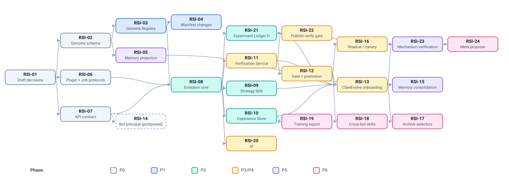

# Work items

> 中文版：[work-items.zh-CN.md](work-items.zh-CN.md)

> Status: DRAFT. Each item is sized for one follow-up session to take through
> SDD (spec → plan → tasks → implement) or, for design-only items, to a
> reviewed contract document. Start each with the documents listed under
> *Read first*. Implementation specs go in the owning module's specs
> directory (`apps/backend/specs/YYYY-MM-DD-<topic>/`,
> `engine/adapter/specs/…`); design-level additions extend this directory.

## Dependency graph

Critical path to a first useful outcome: **RSI-01 → RSI-02 → RSI-03 → RSI-04**
(versioned bots that can go back to any earlier revision). Critical path to "ClawEvolve on the
platform": add RSI-06 → RSI-08 → RSI-09/10/11/12 → RSI-13. Level 3
(RSI-23 → RSI-24) is out of the first iteration, which focuses on level 2;
RSI-21 still records experiments from the start.
RSI-11 → RSI-22 gives service bots an automated verify gate independently of
the rest.

---

## P0 — Contracts and decisions

### RSI-01 Accept or revise the three draft decisions
- **Status**: done (2026-10-16). DR-1 →
  [ADR 0019](../../../../docs/adr/0019-bot-genome-is-the-unit-of-evolution.md), DR-2 →
  [ADR 0020](../../../../docs/adr/0020-promotion-is-platform-owned.md), D-1 option A →
  [ADR 0021](../../../../docs/adr/0021-evolution-control-plane-in-apps-evolution.md); all owned and signed off
  by @totalfrank, including the engine-owner sign-off on DR-1's memory
  consequence. DR-3 stays postponed.
- **Module**: arch
- **Goal**: Owners decide DR-1 (genome = unit of evolution, built on
  Manifest) and DR-2 (promotion is platform-owned). DR-3 (bot principal for
  the evolution surface) is postponed until the way bots talk to the
  platform is decided. Also decide open decision D-1 (control-plane module
  placement) from [design.md](design.md#6-ownership-and-module-placement).
- **Read first**: [design.md](design.md), [01-genome.md](01-genome.md),
  [design.md](design.md#5-guarantees-governance-summary), [decisions/0003-bot-principal-for-evolution-surface.md](decisions/0003-bot-principal-for-evolution-surface.md).
- **Deliverable**: DR-1 and DR-2 accepted (promoted to `docs/adr/` with the next
  free numbers) or revised; D-1 recorded.
- **Done when**: each ADR has an owner, and the engine owners have
  explicitly signed off on the memory consequence in DR-1.

### RSI-02 Genome schema and patch format
- **Status**: done (2026-10-18). Contract:
  [`apps/backend/api-contracts/genome/v1/`](../../api-contracts/genome/v1/README.md); spec:
  `apps/backend/specs/2026-10-18-bot-genome-schema/`. Owner and engine-review
  sign-off: @totalfrank. Closed G-1, G-2, G-3, G-7, G-10. Follow-ups opened:
  #2858 (`engine_config`), #2859 (effective MCP config), #2860 (MCP header
  credentials), #2862 (`script: null`); depends on #2162 (resource removal)
  through RSI-04.
- **Module**: backend (contract), engine (review)
- **Goal**: Normative JSON Schema for Genome Revision (`spec`, `policy`,
  `revision` metadata) and Genome Patch (ops, risk-tier mapping, rewrite
  threshold), canonicalisation rules for the content hash (RFC 8785 canonical JSON, see
  [01-genome.md](01-genome.md)), and the mapping to
  and from Manifest schema v1.
- **Read first**: [01-genome.md](01-genome.md); `manifest-schema.zh-CN.md`;
  `schema/validator.py`.
- **Deliverable**: `apps/backend/specs/<date>-bot-genome-schema/` with schema files,
  examples, and a compatibility table against Manifest v1.
- **Done when**: every Manifest v1 example round-trips into a revision;
  every patch op has a defined risk tier; reviewers agree on the policy
  defaults (`mutable_genes`, `pins`).

### RSI-06 Strategy port, capability catalog, and Job Protocol
- **Module**: evolution (new), arch
- **Goal**: Define the strategy port (`run(ctx)`), `StrategyContext`,
  Candidate / Verdict (submission returns a candidate id; verdicts are
  looked up by id), the registration record schema, the
  first capability catalog (always granted: `candidates@1`, `models@1`;
  declared: `experience.sessions@1`, `experience.feedback@1`, `agents@1`,
  `evaluation.train@1`) with per-engine
  provider contracts (for `agents@1`, the per-engine agent definition
  contract and the upload and loading of definitions, see 03-strategy.md), the bindings schema and binding
  checks, run lifecycle and failure semantics (R11): idempotent run
  submission returning a run id, leased jobs re-dispatched after a crash
  with the same run id, strategy-owned progress persistence (no platform
  checkpoint API); long-running operations for agent sessions and train
  evaluations (start returns an operation id, idempotent per key; status
  looked up by id; no request held open while work runs); isolation (R13);
  and the Job Protocol mapping of every `ctx` call.
- **Read first**: [03-strategy.md](03-strategy.md),
  [06-evolution-run.md](06-evolution-run.md); ClawEvolve
  `official-stage-catalog.json`, `routes/internal/evolve.ts`;
  `docs/arch/protocol-contract-tests.md`.
- **Deliverable**: contract docs + JSON Schema files.
- **Done when**: ClawEvolve's round loop can be written against the context
  without reaching around it (checked with the ClawEvolve sketch in
  04-default-strategies.md), and a non-ClawEvolve strategy (memory consolidation) fits
  with a different capability set.

### RSI-07 Evolution API contract
- **Module**: evolution, backend, gateway
- **Goal**: OpenAPI documents for the Genome and Evolution resources (async
  pattern, idempotency, ETags, error envelope consistent with OpenAPI v1),
  the gateway routing, and shared conformance tests for the conventions.
- **Read first**: [09-evolution-api.md](09-evolution-api.md);
  `apps/backend/docs/openapi-v1/README.md`;
  `apps/gateway/configs/schemas/README.md`.
- **Deliverable**: OpenAPI drafts (`bots.openapi.json` additions,
  `evolution.openapi.json`) and the gateway domain entries.
- **Done when**: every caller flow in 09-evolution-api.md §13 is executable
  on paper with the listed endpoints.

## P1 — Versioned bots (useful independently of RSI)

### RSI-03 Genome Registry in Backend — done
- **Module**: backend
- **Goal**: Revisions table, refs with CAS, patch apply/validate, diff,
  captured and produced content in the content store, lineage queries.
  Promotion API that moves `active` by CAS, records the compiled document
  and its digest, and hands the revision to a `RevisionApplier` seam. The
  applied → revision mapping and the drift check
  ([01-genome.md](01-genome.md) §5.5).
- **Depends on**: RSI-02.
- **Read first**: [01-genome.md](01-genome.md); `core/bot_config_manifest/`.
- **Shipped** (`apps/backend/specs/2026-10-19-bot-genome-registry/`):
  `core/bot_genome/` with the five tables, capture of a bot's current state
  (`POST …/genome/revisions:capture`), patches applied to their own base
  (`POST …/genome/revisions`), the policy operation (`PUT …/genome/policy`),
  diff, `draft` by CAS, content read/upload, promotions, and the
  `/openapi/v1/bots/{bot_id}/genome` surface; conformance, repository,
  wiring and route tests. Promotion's only applier refuses every delivery as
  `not_appliable` naming RSI-04, before any ref moves, so the singlebox
  story stops at the refusal.
- **Left to RSI-04**: delivery itself (personal bots), service-bot publish,
  pinning the commit of a shared-repository skill (`origin: repo` records
  the path only), and the apply report carrying `document_digest`. Until
  then `applied_revision` joins the bot's last Manifest apply to the
  promotion that started it by apply id.
- **Follow-up**: capture refuses a platform-managed teclaw bot (teclaw
  delivery mode `platform`, `CaptureRefused`): it has no device to read, so
  capturing it means composing its state from the platform's own rows, the
  way that delivery mode does.

### RSI-04 Direct delivery of a compiled revision (Stage 2)
- **Module**: backend
- **Goal**: Deliver a compiled revision to the bot runtime through the
  existing apply engine with no Manifest document in between. New
  components take the compiled revision (every category present, file
  entries by content-store digest, Center skills by pinned version,
  shared-repository skills by path) and feed the apply engine's
  materialisers directly, reading bytes from the content store and
  resolving Center and repo skills; they plug into the `RevisionApplier`
  seam RSI-03 leaves. The Manifest grammar gains no new source kinds. The
  apply report records the digest of the compiled document it applied
  ([01-genome.md](01-genome.md) §8 item 5); for service bots the publish
  record records the digest of the published document. A compiled revision
  must also remove what the revision omits, so this item includes the two
  totality fixes: resource removal
  ([#2162](https://github.com/inclusionAI/Avernet/issues/2162)) and
  `script: null` ([#2862](https://github.com/inclusionAI/Avernet/issues/2862)).
  Still Manifest work, landing with their own items: `engine_config`
  (open decision G-4, [#2858](https://github.com/inclusionAI/Avernet/issues/2858))
  and the `memory` category (after RSI-05). No revision table, refs, or
  `revision_id` in the Manifest; the `/config-manifest` endpoints are
  unchanged. The existing service-bot rollback feature is not changed.
- **Depends on**: RSI-03 (the seam and the compiled document), #2162, #2862.
- **Done when**: all existing manifest tests pass unchanged; promoting a
  revision in singlebox delivers it to a personal bot with no fetch and no
  Manifest write, the apply report carries the compiled document's digest
  and `GenomeRegistry.applied_revision` maps it back; going back two
  revisions by promoting an earlier one restores the bot, removed
  resources and script included.

## P2 — Evolution core

### RSI-08 Evolution service skeleton
- **Module**: evolution (new `apps/evolution`, per D-1)
- **Goal**: Service scaffold following Backend DI/plugin conventions; Run
  Orchestrator state machine with budgets, idempotent run submission
  (idempotency key → run id), and job leases with re-dispatch on expiry; Strategy Registry; Job Protocol
  endpoints; bindings with binding checks and triggers;
  local profile (SQLite, in-process strategies) for singlebox; a reference
  strategy `platform/manual-patch` (submits a supplied patch; verified with
  deterministic checks) to exercise the loop end-to-end.
- **Depends on**: RSI-06, RSI-07, RSI-03.
- **Done when**: singlebox story: start run with reference strategy →
  candidate recorded → gate → promoted → bot updated → going back to the
  previous revision; repeating
  the start with the same idempotency key returns the same run id; killing
  the worker mid-run leads to re-dispatch under the same run id, which
  re-attaches to its running operations instead of starting them again.

### RSI-09 Strategy SDK and conformance kit
- **Module**: evolution
- **Goal**: Python strategy SDK: `EvolutionStrategy` base, typed models,
  in-process and Job-Protocol `StrategyContext` implementations,
  `WorkspaceFactory` (materialise / `to_patch`), `AgentRunner` with an
  OpenClaw provider, local harness with a fake platform (able to kill and
  re-dispatch a run, to test a strategy's own recovery), strategy
  conformance kit as test helpers. Registration is the
  `POST /evolution/strategies` endpoint, not part of the package.
- **Depends on**: RSI-06, RSI-08.
- **Done when**: an example third-party strategy (e.g. OPRO-style persona
  optimizer) is written by someone outside the platform team using only the
  Strategy SDK docs, and passes conformance.

### RSI-10 Experience Store and session export v2
- **Module**: evolution + engine adapter
- **Goal**: Episode/feedback/eval-trace model tagged with revision id;
  ingest pipeline; engine `session-export/v2` contract (generalising
  ClawEvolve `session-export/v1`) with OpenClaw implementation first;
  retention and redaction.
- **Depends on**: RSI-08; engine owners.
- **Done when**: episodes from an OpenClaw bot are queryable by revision;
  ClawEvolve diagnose can read from the store.

## P3/P4 — Evaluation, governance, default strategy

### RSI-11 Verification Service (bot verification)
- **Module**: evolution, backend (`eval_publish`, `eval_env`)
- **Goal**: Implement [07-verification.md](07-verification.md):
  suite registry seeded from the ClawWeb Bench model and ClawBench case
  format; platform-assigned splits incl. sealed holdout and must-pass
  regression/safety; `platform/clawbench` grader extracted from
  `lib_grading`; local-sandbox and deployed-sandbox (eval env) executors;
  paired comparator with repeated seeds and confidence intervals; judge
  ensembles; verdict policy with ClawEvolve's `full_opt_gate` /
  `candidate_opt_gate` made blocking; verification profiles.
- **Read first**: [07-verification.md](07-verification.md) (§2 lists the existing
  code to reuse); [08-promotion.md](08-promotion.md).
- **Done when**: a candidate is verified in a sandbox with paired baseline and
  per-split verdict; strategy job inputs provably exclude holdout,
  regression, and safety; the same case files run unchanged under ClawBench
  and the platform grader.

### RSI-12 Gate, review queue, promotion
- **Module**: backend (gate floor, promotion), evolution (bindings)
- **Goal**: Platform floor checks, risk-tier assignment, gate on the
  verification verdict under the binding's profile, review queue with diff +
  verification report, approvals, the bot's bindings (including the auto-promote
  ceiling), audit events, kill switches.
- **Done when**: T1 auto-promotes under the auto-promote ceiling; T2 waits for approval; T3
  rejected while locked; all decisions audited.

### RSI-13 Onboard ClawEvolve as default strategy
- **Module**: evolverun, evolution
- **Goal**: Strangler steps 1–3 from
  [04-default-strategies.md](04-default-strategies.md):
  shadow-record revisions → black-box adapter strategy → native strategy.
  Tune works on a sandbox from `ctx.workspace`; its accept rule becomes an
  internal submission filter while acceptance moves to platform
  verification; pack/restore removed from the flow; ClawEvolve persists
  its round state in its own store keyed by run id (today's `ce_tasks` /
  `ce_steps` can serve) so a re-dispatched run continues; decide DS-1 and DS-2.
- **Depends on**: RSI-09, RSI-10, RSI-11, RSI-12.
- **Done when**: `clawevolve/bot-evolution` produces the same or better
  results as legacy AgentEvolve on its own bench, through the platform, without
  touching the live workspace.

### RSI-16 Rollout: shadow, canary, auto-rollback
- **Module**: backend, baas
- **Goal**: `canary` ref for multi-instance bots; online metric comparison;
  optional auto-rollback; mapping to service-bot verify stage.
- **Depends on**: RSI-12.

### RSI-21 Experiment Ledger (H)
- **Module**: evolution
- **Goal**: Record every level-2 experiment with the schema in
  [05-experiment-ledger.md](05-experiment-ledger.md) (including rejected
  candidates and later online outcomes); derived mechanism metrics; filesystem
  export for strategies; verifier-version tagging.
- **Depends on**: RSI-08. In the first iteration this is the level-2
  archive and audit trail; deriving mechanism metrics for level 3 can wait,
  but recording should start early because level 3 is only as good as the
  history it learns from.

### RSI-22 Verification gate on service-bot publish and Quality Task
- **Module**: backend
- **Goal**: Optional automated verification gate on the service-bot
  `VALIDATING → ONLINE_PUB` transition, using the Verification Service; point
  the Quality Task at an in-repo grader plugin (alongside the external MASA
  one) so the open-source build has a working bot-quality check.
- **Depends on**: RSI-11.
- **Done when**: a service bot whose verify-stage candidate fails a must-pass
  case cannot be published without an explicit override, and the override is
  audited.

### RSI-23 Mechanism verification and offline replay (later, level 3)
- **Module**: evolution
- **Goal**: (a) Offline replay tool over H for changes to verification profiles and submission filters,
  generalising `calibrate_evolution_gates.py` / `replay_candidate_gate.py`;
  (b) improvement-problem benchmark frozen from H and the mechanism
  verification protocol of [10-meta-evolution.md](10-meta-evolution.md),
  used first for **human-authored** strategy changes.
- **Depends on**: RSI-11, RSI-13, RSI-21.
- **Done when**: a change to the ClawEvolve tune prompt is accepted or
  rejected by comparing verified improvement yield against the current
  mechanism on held-out problems.

### RSI-24 Automated meta-strategy (later, level 3)
- **Module**: evolution
- **Goal**: A meta-strategy that reads H and proposes mechanism patches
  (thresholds, prompts, operators, step order), adopted only through RSI-23
  and human approval; bounds of [10-meta-evolution.md](10-meta-evolution.md)
  enforced by static checks.
- **Depends on**: RSI-23.

### RSI-20 UI for runs, review queue, lineage
- **Module**: frontend-nextgen (or AgentEvolve interim)
- **Goal**: Run list/detail, candidate report (diff + per-split eval), review
  actions, genome lineage tree, going back.
- **Depends on**: RSI-08, RSI-12.

## P5 — Bot-driven evolution

### RSI-14 Bot principal scopes and bot skill *(postponed)*
- **Status**: postponed with DR-3 until the way bots talk to the platform
  is decided. Do not pick up.
- **Module**: gateway, backend, evolution, (bcs-cli conventions)
- **Goal**: Implement DR-3: bot principal admission for evolution
  endpoints only, scopes designed separately (the earlier scope sketch was
  dropped) and enforced via the authorization hook; a bot-facing tool over
  the public API, delivered via Manifest `cli_tools`; subject-bot and
  runner-bot `SKILL.md`; inbox and observation endpoints with rate limits.
- **Done when**: a singlebox bot records an observation and submits an inbox
  patch through that tool; attempts to promote or touch another bot are denied
  and audited; leaf-command coverage gate like `bcs-cli`.

### RSI-05 Engine memory projection contract
- **Module**: engine adapter (owner), backend (consumer)
- **Goal**: `export_memory` / `project_memory(mode)` contract, capability
  matrix entries, OpenClaw implementation, teclaw artifact field proposal;
  amend reserved-file rule accordingly.
- **Depends on**: RSI-02, DR-1 accepted.
- **Interim**: until done, memory evolution uses a platform-managed persona
  file, an existing identity type such as `KNOWLEDGE.md` (`LESSONS.md` is not
  a Manifest identity type; [01-genome.md](01-genome.md) §7).

### RSI-15 Memory consolidation strategy
- **Module**: evolution
- **Goal**: `platform/consolidate-memory` per
  [04-default-strategies.md](04-default-strategies.md)
  — second, non-ClawEvolve default proving pluggability (R19).
- **Depends on**: RSI-05 (or interim), RSI-13. Observations recorded by
  bots wait for RSI-14 (postponed); until then the strategy uses feedback
  and episodes.

## P6 — Open-ended

### RSI-17 Archive selectors
- Pareto-per-case (GEPA), MAP-Elites niches, clade metaproductivity (HGM)
  as options of a binding's `parent` field; Archive read model exports for
  strategies.

### RSI-18 Cross-bot skill transfer
- Promoted skills offered to Skill Center under existing governance (ADR
  0010); re-evaluated per consuming bot before adoption.

### RSI-19 Training-data export
- Redacted export of `(input, revision, output, scores, critiques)` and
  accepted/rejected pairs, tenant opt-in only.

## Cross-cutting open decisions (tracked here)

Each doc also lists its own open decisions with a doc prefix: `G-` genome,
`X-` experience, `S-` strategy, `DS-` default strategies, `L-` ledger, `ER-`
evolution run, `V-` verification, `P-` promotion, `A-` API, `O-` meta-evolution.

| ID | Decision | Where |
| --- | --- | --- |
| D-1 | Control-plane module placement | Decided: `apps/evolution` ([ADR 0021](../../../../docs/adr/0021-evolution-control-plane-in-apps-evolution.md)) |
| DS-1 (was D-2) | Long-term host of default strategy runners (TS vs Python) | 04-default-strategies.md → RSI-13 |
| DS-2 (was D-3) | ClawBench as platform default grader | 04-default-strategies.md → RSI-11 |
| DS-3 (was D-4) | Workflow YAML as gene or separate artifact | 04-default-strategies.md |
| DS-4 (was D-5) | ClawMind analyzer contract; dormant analyzers wire-or-remove | 04-default-strategies.md |
| D-6 | Genome storage: DB + content store vs git repo per bot | **Closed (RSI-03):** DB + content store; 01-genome.md §9.2 |
| A-n | Evolution API open decisions (event delivery; bot run requests postponed) | 09-evolution-api.md |
