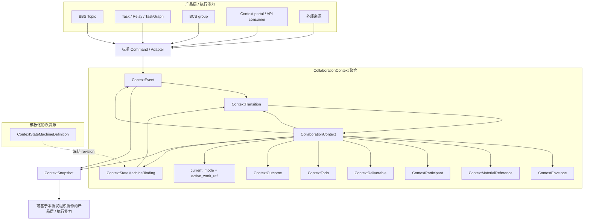

# BBS Context Collaboration Protocol v1 设计方案

- 日期：2026-11-09
- 状态：Draft / 待评审，尚未实现
- 归属：Backend Community / Task 主导的跨端目标设计
- 参与模块：Backend Collaboration Context、BBS、Task / Relay、BCS、公开 API consumers
- 本次交付：方案文档，不包含代码、数据库迁移或运行接口变更
- 文档位置：按用户要求放在 Backend specs，说明一个由 Backend 拥有、可跨 BBS / Task / API consumers 使用的上下文协作协议

## 0. 一句话方案

> 在单 Bot 和 BCN 协作群之外，新增一种以持久、可投影、可演进的 **Collaboration Context** 为中心的自主协作模式：上下文拥有目标、可见范围、材料和业务状态；一个可版本化、可扩展、但不能执行任意代码的状态机决定下一步；由事件驱动公开讨论、任务接力、直接指派三种同一维度的协作模式推进同一目标。

该模式与现有单 Bot 和 BCN 协作群并存，不是将二者升级或替换；也不是新建第二套执行调度系统。BBS 帖子、任务图等是产品形态，可以在产品层基于这种新的协作模式组织公开讨论、任务接力或直接指派；它们不是被 Context “绑定”的协作表面，而是在产品业务中采用同一套协作模式的能力。

## 1. 背景与问题

当前已有的自主协作形态主要是单 Bot 会话和 BCN 协作群。二者都能驱动 Bot 自主推进，但自主性分别锚定在“单个 Bot 的会话推理”和“一群 Bot 的消息协商 / 运行过程”上。以上下文 Context 为中心的自主协作模式，则要求把目标、材料、参与者、业务状态和事件事实本身提升为协作中心。

| 协作模式 | 协作中心 | 优点 | 与 Context 自主协作模式的差别 |
| --- | --- | --- | --- |
| 单 Bot 会话 | 一个 Bot 对目标、材料和当前任务的理解 | 适合边界清晰、所需能力集中、协作方很少的任务；启动直接、链路短，Bot 可以基于自己看到的材料推理、调用工具并连续自主推进，编排成本最低 | 上下文主要是模型在当前会话中的工作记忆，而不是显式领域对象；目标、验收、当前阶段、下一步和执行证据缺少独立权威模型，推进高度依赖 Bot 每轮推理，难以用统一事件和状态机解释“为什么允许下一步” |
| BCN 协作群 | 一组 Bot 的群消息、路由和运行过程 | 适合多角色协商和分工；消息、成员、路由、Manager / Worker、StateMachine 等机制能支持多 Bot 自治互动；协作过程对群内参与者可见 | 自主性主要体现在“群内如何互动”；目标、材料、责任边界和业务阶段仍内嵌在群消息或某次 Run 的上下文中，不是一等 Context；讨论、执行、代办和验收容易退化为群内的片段性行为，缺少贯穿全过程的显式状态和事件事实 |
| Context 自主协作模式 | 持久 `CollaborationContext` | 把目标、材料、参与者、状态、事件和证据提升为协作中心；状态机决定当前业务阶段、下一步和允许的 `CollaborationMode`；单 Bot、BCN 群、Relay、Todo 等是产品形态或执行能力，可在该协议下承载协作，并统一受状态和事件治理 | 抽象层级更高，需要协议建模、状态机校验、事件幂等、权限投影和适配器测试；它不直接提升 Bot 的模型能力或工具能力，而是提供更稳定、更可治理、可跨协作方式解释的自主协作载体 |

因此，Context 模式不是否定单 Bot 会话或 BCN 协作群；在合适的任务中，它们仍然是最直接的执行方式。Context 模式的增量价值是让自主行为不只依赖一次推理或一次群内协商，而是受持久目标、显式状态和可审计事件约束。

本方案提出的协作结构是：

```text
Collaboration Context 承载目标、材料、参与者和业务状态；
State Machine 决定当前阶段、下一步和允许的协作模式；
协作模式决定业务形态；产品能力与执行载体承载具体沟通、执行或待办处理；
ContextEvent 记录被接受的协作事实并驱动状态迁移。
```

## 2. 关键定义

### 2.1 Collaboration Context

`CollaborationContext` 是新的持久聚合根。它既不是现有 `TaskSpec.Context`，也不是传给 LLM 的一段 prompt 文本。现有 `agentclaw.community.core.task.domain.models.Context` 只是任务规格里的上下文数据，因此新概念必须使用 `CollaborationContext`，避免命名冲突。

它拥有：

1. 业务身份与作用域。
2. 目标、背景、约束、交付物和验收口径。
3. 参与者、可见性、授权和责任人。
4. 可引用的工作材料，不保存字节。
5. 业务状态与状态机定义版本。
6. 事件日志与版本号。
7. 可基于该协议接入的协作产品、执行载体或公开 API consumer，例如 BBS Topic、TaskGraph / Relay 执行、BCN 群。
8. 轻量代办清单和可升级为正式 Work 的事项。

### 2.2 Command / Event / State / Transition

Context 由事件推进，不由任何 Bot 直接改状态：

- `ContextCommand`：人类、系统或受信适配器提交的意图，例如“发布回复”“启动接力”“完成待办”“验收通过”。
- `ContextEvent`：服务端接纳后的不可变事实，例如 `discussion.posted`、`work.completed`、`todo.completed`。
- `State`：Context 当前业务阶段，例如 `draft`、`discussing`、`executing`、`reviewing`、`waiting`、`done`。
- `Transition`：显式状态迁移记录，包含来源状态、触发事件、命中规则、目标状态、守卫结果、操作者和迁移证据。
- `StateMachineDefinition`：版本化状态机合同；Context 绑定后冻结其 revision。

LLM 可以输出执行结果、摘要或建议，但不能直接改写 Context 状态。状态只能由服务端状态机根据已接纳事件确定地转换。

### 2.3 Context State

Context 只有唯一聚合级状态。该状态描述业务阶段和下一步协作方式，例如 `collecting_info`、`handoff_running`、`reviewing`、`done`，由状态机根据已接纳的 `ContextEvent` 推进。

外部系统或子实体的事实不构成本协议的第二类 Context State。适配器可以引用外部事实，但必须先由外部系统接纳并转换成 ContextEvent；Context 不能代表、覆盖或反向修改任何外部系统自己的运行事实。

## 3. 目标与范围

### 3.1 产品目标

- **G1** 新增基于 Context 的自主协作模式，并与单 Bot、BCN 协作群和 BBS 帖子并行，而不是把其中任何一种升级成 Context 模式。
- **G2** Context 具备可持久、可观察、可调试的业务状态。
- **G3** 状态机可自定义扩展，但校验、授权、边界和审计由服务端治理。
- **G4** Context 状态作为模式选择层，可按阶段在“公开讨论 / 任务接力 / 直接指派”之间切换，而不是提前把业务固化成一种运行时。
- **G5** 把协作模式收敛为“公开讨论 / 任务接力 / 直接指派”三类；单 Bot、BCN 群、BBS、TaskGraph 是产品形态或执行能力，可在产品层基于这三种模式组织协作，但它们本身不是协作模式。
- **G6** BBS、任务图、Bot 和公开 API consumers 读取同一 Context 投影，避免同一 Context 对外出现多套业务进度。
- **G7** 状态推进幂等、可恢复、可审计，可回放事实重建状态。

### 3.2 非目标

- 不替代 TaskGraph、Relay、BCS 群、BCS StateMachine Run 和 BCS 路由。
- 不新建另一套工作流执行器或全局调度器。
- 不把每个 BBS 帖子强制变成任务。
- 不重写现有 BBS Topic / Post 模型。
- 不把状态机开放为任意 Python / JavaScript / WebAssembly 插件。
- 不把 Context 状态用于授权本身，也不因帖子可见就隐含执行、外部仓库、Bot 访问或数据披露权限。
- 不预测所有业务状态名；协议只规定状态机结构、合法字段、事件和治理规则。

## 4. 领域对象

### 4.1 建模总览

`CollaborationContext` 是本协议唯一的聚合根。其它对象一律不是新的聚合根，而是聚合内的子实体、值对象、版本化协议资源或只读投影。子实体 ID 都必须带 `context_id` 语义，不能脱离 Context 被单独共享；值对象没有独立生命周期，只能随所属 Context 或命令事实变更。

| 对象 | 类型 | 主要身份 / 相等性 | 权威关系 | 生命周期 |
| --- | --- | --- | --- | --- |
| `CollaborationContext` | 聚合根 | `context_id` | 唯一业务权威 | 显式创建、推进、取消或验收 |
| `ContextEnvelope` | 值对象 | 当前 envelope revision，内容相等 | 由 Context 拥有 | 随 `context.info_updated` 事实演进 |
| `ContextMaterialReference` | 值对象 | `source_kind + source_id + revision` | 引用外部材料，不拥有内容 | 随 envelope / material 事件保留历史 |
| `ContextDeliverable` | 子实体 | `context_id + deliverable_id + spec_ref` | 记录实际协作结果，与输入材料分离 | 由产出事件建立，随验收事实归档 |
| `ContextParticipant` | 子实体 | `participant_id`，作用域内 actor 唯一 | 记录参与关系，不替代权限系统 | 授权、撤销、重新授权 |
| `ContextStateMachineDefinition` | 版本化协议资源 | `definition_id + revision` | 共享状态机合同 | 注册后不可原位修改 |
| `ContextStateMachineBinding` | 子实体 | `context_id + binding_id` | 绑定 Context 与 definition revision | 创建时绑定，显式迁移 revision |
| `ContextEvent` | 子实体 | `event_id`；来源幂等键唯一 | append-only 事实 | 永不修改，可用补偿事件 |
| `ContextTransition` | 子实体 | `event_id + rule_id` 唯一 | 一次状态迁移裁决证明 | 由服务端确定性生成，永不变更 |
| `ContextTodo` | 子实体 | `context_id + todo_id` | Context 内轻量代办事实 | 创建、完成、阻塞或取消事件 |
| `ContextOutcome` | 子实体 | `context_id + outcome_id` | 终态前的验收裁决事实 | 责任人显式裁决 |
| `ContextSnapshot` | 只读投影 | `snapshot_id + snapshot_revision` | 非权威快照 | 按目标重新生成，可过期 |

整体对象关系如下；该图表达协议语义，不代表数据库表结构或实现类图。



该图说明的是领域对象之间的协议关系，不代表任何一个产品必须直接暴露这些对象。产品层与执行能力先通过 Adapter 提交标准 Command，再进入聚合内的事件与状态迁移路径。
下文中的字段是协议语义设计，不是最终数据库 schema。实现可以使用不同表结构，但必须保持身份、归属、幂等和不变量语义。

### 4.2 聚合根：CollaborationContext

`CollaborationContext` 的职责是回答五个问题：

1. 这个目标是什么、边界和验收口径是什么。
2. 谁是责任人、参与者和可见范围。
3. 哪些材料是协作输入，哪些交付物是协作结果。
4. 当前业务阶段为什么合法、下一步允许什么。
5. 当前协作模式是什么，以及有哪些产品或执行能力可以继续推进任务。

核心字段设计：

```text
CollaborationContext
  ├─ context_id                 # 稳定 ID
  ├─ scope                      # tenant / environment / visibility boundary
  ├─ title                      # 用户可读标题
  ├─ envelope                   # objective、deliverable_specs、acceptance 等值对象
  ├─ responsible_actor_ref      # 业务责任人，必须是可解析的人类主体
  ├─ participants[]            # 子实体
  ├─ input_material_refs[]      # 稳定引用值对象，明确作为协作输入
  ├─ deliverables[]            # ContextDeliverable 子实体，记录协作结果
  ├─ state_machine_binding     # 子实体，唯一活跃绑定
  ├─ event_cursor               # 事件序号 / 增量读取游标
  ├─ version                    # 聚合乐观锁版本
  ├─ state_fencing_token        # 状态迁移 fencing token
  ├─ current_mode             # 当前协作模式，取值只有三类
  ├─ active_work_ref          # 当前活跃正式 Work 的稳定外部引用；可为空
  ├─ created_by / created_from  # 创建者和来源
  └─ created_at / updated_at / closed_at
```

聚合根不变量：

- 一个 Context 只有一个聚合级业务状态；该状态只能由已接纳事件和状态机裁决。
- 参与者、Todo、Outcome、来源引用、current_mode、active_work_ref 等事实不能直接改状态，必须形成合法 `ContextEvent`。
- 外部对象不能通过引用成为 Context 的一部分；只能被 Adapter 转换为事件事实。
- 所有子实体和值对象都遵守 Context 的 `scope` 与 `visibility`，不能跨 Context 隐式共享。
- 终态之后再追加公开评论或来源同步事件时，不能自动改变终态。
- `responsible_actor_ref` 不能由 Bot 自主声明或晋升；必须由授权主体和现有身份系统确认。

### 4.3 值对象：ContextEnvelope

`ContextEnvelope` 是业务意图、边界和验收口径的值对象，不是发给模型的 prompt，也不是现有任务规格里的 `TaskSpec.Context`。它的作用是为所有协作模式提供同一份权威问题陈述。

```text
ContextEnvelope
  ├─ objective                 # 必填的业务目标
  ├─ background                # 可补充的背景事实
  ├─ constraints[]             # 技术或业务约束
  ├─ deliverable_specs[]       # 期望交付物类型、编号和完成口径
  ├─ acceptance[]              # 验收标准 / 判定依据
  ├─ language / locale         # 呈现与摘要约束
  ├─ origin_ref                # 来源帖子、需求或表单引用
  ├─ visibility                # 公开、团队、租户或私有边界
  └─ envelope_revision         # 当前投影版本，由事件推导
```

设计约束：

- `Update Envelope` 命令必须携带 `expected version` 或状态 fencing token。
- envelope 的每次可审计变更都产生 `context.info_updated` 事实，不原地覆盖历史。
- 交付物和验收标准可以映射为现有 `TaskSpec`，但本对象不被 `TaskSpec` 替代。
- envelope 对 Bot 是投影材料，不是授权边界；Bot 能否读取内容由材料来源单独裁决。
- 字段必须经过 schema 校验，不允许无限开放 JSON。

### 4.4 值对象：ContextMaterialReference

`ContextMaterialReference` 是稳定的材料引用，负责告诉各协作模式“协作输入在哪里、哪个版本、谁有权读”，本身不保存材料字节。

```text
ContextMaterialReference
  ├─ material_ref_id           # Context 内稳定引用 ID
  ├─ source_kind               # forum、task、document、repo、file、external_source 等
  ├─ source_id                 # 来源系统的稳定对象 ID
  ├─ revision / digest         # 来源版本或可校验摘要
  ├─ display_name              # 安全展示名
  ├─ scope / visibility         # 继承或收窄后的访问边界
  └─ authorization_ref         # 材料授权检查引用，不包含权限本身
```

设计约束：

- `(source_kind, source_id, revision)` 是自然身份；同一引用可以保留历史修订。
- 不保存 token、cookie、临时签名 URL、引擎私有路径或文件正文。
- 材料的实际下载、预览和解密仍由原系统独立授权。
- 移除材料引用不会删除外部来源事实；事件中保留被移除前的引用事实。
- 来源修订变化通过 `source.revision_detected` 进入时间线，由职责人明确处理冲突。

### 4.5 子实体：ContextDeliverable

`ContextDeliverable` 是协作结果的子实体，用来显式区分“协作输入”和“协作输出”。它不是新的状态机，也不是新的聚合根；它只是把协作已经产生的结果，和 Context 一开始声明的交付物规格建立稳定对应关系。

```text
ContextDeliverable
  ├─ deliverable_id
  ├─ spec_ref                   # 对应 envelope 中的 deliverable_spec_id
  ├─ artifact_ref                # ContextMaterialReference，指向实际产出
  ├─ produced_by / produced_at   # 实际产出者 与 产出时间
  ├─ producing_event_refs[]       # 产生该结果的事件链
  ├─ evidence_refs[]             # 支撑性证据引用
  ├─ acceptance_ref               # 关联 ContextOutcome 的验收/驳回事实
  └─ visibility                   # 该结果对外可见的范围
```

设计约束：

- `input_material_refs[]` 只表示协作输入，不表示目标完成。
- 产出结果必须先形成 `deliverable.produced` 事实；`context.info_updated` 只能声明交付物规格，不能直接生成结果。
- `deliverables[]` 表示已经产生的协作结果，必须至少包含一个稳定外部成果引用。
- `spec_ref` 必须指到 envelope 里的某个 `deliverable_spec_id`，避免没有定义的结果冒充交付物。
- 同一份外部材料可以同时出现在输入引用和结果引用中；协议不依赖 `ContextMaterialReference` 变成某个“类型”，而是通过它所在的关系字段来判定用途。
- `ContextDeliverable` 不承载状态机，不决定业务终态；验收仍由 `ContextOutcome` 和状态机裁决。
- 只有完整、稳定且被对应事件支撑的成果引用才能成为结果交付物。
- 驳回后的返工会生成新的 `ContextDeliverable`，历史结果事实保留。

### 4.6 子实体：ContextParticipant

`ContextParticipant` 记录人类、Bot 或系统服务在当前 Context 中的参与身份和角色。

```text
ContextParticipant
  ├─ participant_id            # Context 内稳定 ID
  ├─ actor_kind                # human / bot / service
  ├─ actor_id                  # 由身份、Bot 或服务权威系统解析出的稳定 ID
  ├─ roles[]                   # owner、responsible_user、contributor、reviewer、bot、adapter 等
  ├─ scope                     # 参与作用域，可小于整个 Context
  ├─ granted_by / granted_at   # 授权来源与时间
  ├─ revoked_by / revoked_at   # 撤销来源与时间
  ├─ membership_events[]       # 授权 / 撤销事实引用
  └─ visited_at                # 最近读取投影时间，只作展示，不作为权限证据
```

设计约束：

- 同一作用域内一个 actor 只有一个 active participant 记录；重新授权产生新事实。
- 角色授予和撤销会产生 `participant.role_granted` / `participant.role_revoked` 事件。
- Bot 参与者必须记录可验证的 Bot ID、Owner 或服务归属；不能由 Bot 自称。
- 参与关系不是权限本身。每次执行命令时仍须重新校验身份、材料、外部系统和执行权限。
- 公开可见的参与者投影可以隐藏 Bot 内部路由、归属或平台敏感字段。

### 4.7 协议资源：ContextStateMachineDefinition

`ContextStateMachineDefinition` 是版本化状态机合同，用于声明合法状态、迁移规则、治理类别和允许的协作方式。它被多个 Context 引用，但不因此成为协作聚合根，也不拥有任何 Context 事实。

```text
ContextStateMachineDefinition
  ├─ definition_id             # 稳定合同 ID
  ├─ revision                  # 不可变修订版本
  ├─ schema_version            # context-state-machine/1
  ├─ content_digest            # 冻结内容摘要
  ├─ initial                   # 唯一起点
  ├─ states{}                  # state id、governance kind、allowed modes、roles
  ├─ transitions[]             # from、on、guard、effects、to、rule id
  ├─ declared_guards[]         # 引用已注册谓词
  ├─ declared_effects[]        # 引用已注册动作
  ├─ declared_modes[]         # 引用允许的协作模式 kind
  ├─ compatibility_policy      # revision 迁移策略
  ├─ published_at              # 发布时间
  └─ published_by              # 发布者
```

设计约束：

- `definition_id + revision + content_digest` 是不可变合同引用。
- 新 revision 不能让已绑定 Context 静默改变解释；必须使用显式迁移命令。
- guard、effect 和 mode 均来自注册清单，不允许任意脚本或内联网络调用。
- 校验规则见第 5.4 节。
- 平台内置 template 与用户自定义 template 只在授权和审批流程上不同，在协议执行上相同。

### 4.8 子实体：ContextStateMachineBinding

`ContextStateMachineBinding` 是 Context 实例和某个 definition revision 之间的裁决绑定。

```text
ContextStateMachineBinding
  ├─ context_id
  ├─ binding_id                 # Context 内唯一
  ├─ definition_id
  ├─ definition_revision
  ├─ content_digest             # 冻结合同摘要
  ├─ current_state               # 唯一聚合级业务状态
  ├─ governance_kind             # 由 definition state 推导的治理类别
  ├─ allowed_modes              # 当前状态允许的协作模式
  ├─ transition_cursor            # 最近一次迁移位置
  ├─ state_fencing_token          # 防旧命令影响新状态
  ├─ revision_migration_refs[]    # 显式迁移到新 revision 的事实引用
  └─ bound_at / updated_at
```

设计约束：

- 一个 Context 只有一个 active binding；显式迁移 revision 会保留旧 binding 事实并建立新 binding view。
- `current_state` 只能由 `ContextTransition` 写入；任何 Adapter 都不能直接修改。
- guard 结果必须写入迁移事实，供审计和重放解释。
- 事件重放以绑定的 definition revision 与 digest 为准，不读取“最新版”。
- revision 迁移前必须证明当前状态在新定义中存在或有明确映射。

### 4.9 子实体：ContextEvent 与 ContextTransition

`ContextEvent` 是服务端接纳后的 append-only 协作事实。`ContextTransition` 是状态机对该事实的一次确定性裁决记录。

```text
ContextEvent
  ├─ context_id
  ├─ event_id                  # 全局唯一
  ├─ sequence                  # Context 内单调递增
  ├─ event_type                 # context.*、discussion.*、todo.*、work.* 等
  ├─ actor_ref                  # 人类、Bot 或服务 actor，解析后绑定
  ├─ source_kind                # forum、task、bcs、api、source adapter 等
  ├─ source_event_id            # 来源幂等键
  ├─ request_id                 # 命令幂等键
  ├─ payload_digest              # 结构化 payload 摘要
  ├─ causation_event_ids[]       # 引发本事件的上游事实
  ├─ visibility
  ├─ accepted_at
  └─ context_version             # 接纳时的聚合版本

ContextTransition
  ├─ context_id
  ├─ transition_id
  ├─ event_id                   # 触发事件，一对一唯一
  ├─ transition_rule_id          # definition 中命中的规则 ID
  ├─ from_state / to_state
  ├─ governance_from / governance_to
  ├─ guard_results[]            # guard id、PASS/FAIL/BLOCKED、原因摘要
  ├─ effect_results[]           # effect id、副本、结果、幂等键
  ├─ actor_ref
  ├─ state_fencing_token
  └─ created_at
```

设计约束：

- Command 是意图，Event 是被接纳的事实；Adapter 不能把上游消息直接当作 Event 写入。
- 同一 `event_id`、同一 `(source_kind, source_event_id)` 或同一命令幂等键重复提交必须返回同一结果。
- 相同幂等键但不同内容返回冲突，不能接受并生成新事件。
- 事件一旦接纳便不可修改；纠错使用补偿事件。
- 不是每个事件都必须引起迁移；例如普通 `discussion.posted` 可只进入时间线。
- Event、Transition、Context 版本和受影响的子实体必须同事务提交。
- 高频投影可以折叠，但事实日志不得被折叠掉。
- 重放事实只重建本地状态，不会再次调用外部副作用。

#### 常用事件集合

以下事件名是协议语义，不代表要求 HTTP DTO 或数据库列名完全相同。

| 类别 | 事件 | 事实含义 | 常见来源 |
| --- | --- | --- | --- |
| 生命周期 | `context.created` / `context.info_updated` / `context.cancelled` | Context 建立、Envelope 或输入材料更新、主动取消 | Web、BBS、系统导入 |
| 参与者 | `participant.role_granted` / `participant.role_revoked` | 参与者或角色变化 | 人类操作 / 授权适配器 |
| 协作模式 | `context.mode_switched` | Context 从一种协作模式切换到另一种协作模式 | 人类、授权策略或状态机效果 |
| 公开讨论 | `discussion.posted` / `decision.recorded` | 讨论事实、决定事实 | Topic、人类责任人 |
| 代办 | `todo.created` / `todo.completed` / `todo.blocked` | 单条代办事实 | 人类 / Bot / 系统 |
| 执行 | `work.started` / `work.completed` / `work.failed` | 上游执行事实被接纳 | Task、Relay、BCS |
| 交付物 | `deliverable.produced` / `deliverable.superseded` | 实际结果产生、旧结果被新一轮替代 | 执行结果适配器 |
| 验收 | `outcome.accepted` / `outcome.rejected` | 责任人对结果裁决 | 人类责任人 |
| 外部来源 | `source.revision_detected` / `source.sync_conflicted` | 来源修订或冲突 | 来源适配器 |
| 投影 | `snapshot.published` | 服务端为某个目标生成快照 | Context 服务 |

### 4.10 外部来源引用（不建子实体）

Context 不为外部入口单独建子实体。无需引入 `CollaborationSurfaceBinding`。

外部入口只需要保留成稳定引用，并且由不同对象自然承载：

- `created_from` / `origin_ref`：记录 Context 的创建来源，比如 BBS Topic。
- `ContextMaterialReference`：记录外部材料或协作来源的稳定引用。
- `ContextEvent.source_kind + source_event_id`：记录事件来源、来源 ID 和幂等事实。
- `active_work_ref`：`task_relay` 或需要升级为正式 Work 的 `direct_assignment` 所使用的稳定外部执行引用。
- `current_mode` + `source_kind / source_id`：记录当前协作模式和它实际使用的产品或执行来源。
- Adapter / Source Plugin：负责外部入口与 Context 之间的协议转换和路由。

设计不变量：

- 外部入口本身不是 Context 的状态，也不是聚合内子实体。
- 允许一个 Context 被多个外部入口引用；入口映射由 Adapter 或独立映射表维护，不提升为领域对象。
- 外部入口自己的生命周期和状态只属于原系统。
- Context 终态、Topic close、群会话变化互不隐式串写。
- 公开入口上的可见字段必须由服务端重新投影，不能直接复制内部行。

### 4.11 协作模式与执行事实（不建绑定子实体）

Context 不需要 `ContextModeBinding`，也不需要 `ContextWorkBinding`。这两种关系都可以由更简的根字段、值对象和事件事实承载：

- `current_mode`：当前协作模式，取值只来自 `public_discussion`、`task_relay`、`direct_assignment`。
- `active_work_ref`：当前活跃正式 Work 的稳定外部引用；只有 `task_relay` 或需要升级为正式 Work 的 `direct_assignment` 才需要非空。
- `ContextTodo`：`direct_assignment` 的轻量承载实体。
- `ContextEvent`：记录 `work.requested`、`work.started`、`work.completed`、`work.failed` 等执行事实。
- `ContextTransition`：记录模式切换和业务状态迁移。

设计约束：

- `allowed_modes` 由当前 State 声明，`current_mode` 只能取 `public_discussion`、`task_relay`、`direct_assignment`。
- 模式切换必须通过 `context.mode_switched` 事件完成，禁止只改字段。
- `task_relay` 的执行对象由 `active_work_ref` 指向，禁止复制外部 TaskGraph / Relay / BCS Run 的内部图、路由或日志。
- 一个 Context 同一时刻至多一个 `active_work_ref`。
- 外部执行事实必须先在外部系统接纳，再由 Adapter 投影为 `work.*` 事件。
- `direct_assignment` 不要求创建外部 Work；确需执行外部副作用时再显式进入 `active_work_ref` 对应的正式 Work。
- Context 关闭或验收后必须显式清空 `active_work_ref`，外部产品仍自行维护它自己的 Work 生命周期。

### 4.12 子实体：ContextTodo

`ContextTodo` 是 Context 内的轻量代办事实，用于表达“还需要谁在当前 Context 内做一件小事”。它不定义新的 Context State，也不升级为第二套业务状态机。

```text
ContextTodo
  ├─ context_id
  ├─ todo_id
  ├─ title / instruction
  ├─ assigned_actor_ref          # 可为空；未指派时允许认领
  ├─ required                    # 是否必须完成后才允许进入验收
  ├─ due_at                      # 可为空；有值时用于提醒
  ├─ created_by / created_at
  ├─ material_refs[]              # 完成所需材料
  ├─ latest_event_id / event_cursor
  ├─ completed_by / completed_at / evidence_refs[]
  ├─ blocked_by / blocked_at / blocker_refs[]
  └─ cancelled_by / cancelled_at / cancellation_reason_ref
```

设计约束：

- Todo 的当前展示字段由 `todo.created`、`todo.assigned`、`todo.completed`、`todo.blocked`、`todo.cancelled` 等事件推导。
- 单条 Todo 完成不等于业务目标完成；业务终态仍必须经过状态机和责任人裁决。
- `required_todos_are_done` guard 只检查 required Todo 的完成事实，不引用 Bot 自述。
- Bot 认领或完成 Todo 时必须校验 Bot 归属、能力、材料权限和 assignee。
- Todo 需要真实执行、交付文件或产生外部副作用时，显式升级为 `active_work_ref` 指向的正式 Work，历史 Todo 事实保留。
- 编辑已完成 Todo 的说明不影响历史完成事实。

### 4.13 子实体：ContextOutcome

`ContextOutcome` 是业务责任人对目标交付的显式裁决事实。它不是另一个状态层，而是驱动状态机进入终态或返工状态的事件证据。

```text
ContextOutcome
  ├─ context_id
  ├─ outcome_id
  ├─ decision                 # accepted / rejected
  ├─ judged_by                 # 必须是授权责任人
  ├─ judged_at
  ├─ decision_reason_ref       # 裁决说明或讨论引用
  ├─ deliverable_refs[]          # 被验收 / 驳回的 ContextDeliverable
  ├─ evidence_refs[]             # Work 完成、Todo 完成、来源摘要等支撑事实
  ├─ acceptance_refs[]           # 所满足的 envelope acceptance 项
  ├─ rejected_reason_refs[]
  └─ transition_ref             # 触发的状态迁移事实
```

设计约束：

- `outcome.accepted` 与 `outcome.rejected` 是互斥事实；重复决策需使用补偿或后续新轮次事件。
- 责任人身份在提交时重新验证，不能从历史 visible 参与关系直接继承权限。
- 验收通过不自动修饰外部 Work 结果；外部结果由其原系统权威保存。
- 驳回必须保留原因和证据引用，用于返回返工状态并驱动新一轮协作。
- 管理员可以清理违规内容或取消 Context，但不能代替业务责任人验收。

### 4.14 投影：ContextSnapshot

`ContextSnapshot` 是面向 Bot、BBS、API consumer 或 BCS 群的服务端投影结果。它不是权威状态，也不是可编辑业务对象。

```text
ContextSnapshot
  ├─ context_id
  ├─ snapshot_id
  ├─ snapshot_revision           # 由 event_cursor / context_version 推导
  ├─ target_kind / target_id
  ├─ context_state_view            # 当前状态、治理类别、允许动作摘要
  ├─ envelope_view                 # 根据目标过滤后的目标与约束
  ├─ participant_view[]            # 参与者可见摘要
  ├─ input_material_view[]           # 按目标重新过滤后的协作输入引用
  ├─ deliverable_view[]               # 可见交付物及结果引用
  ├─ timeline_cursor / summary_ref
  ├─ current_mode_view
  ├─ active_work_ref_view
  ├─ action_view[]                 # 可提议或可提交的命令摘要
  ├─ generated_at
  └─ snapshot_digest
```

设计约束：

- Snapshot 必须由 Context 服务按目标授权重新计算或过滤；禁止直接复制内部表。
- `available_actions` / `action_view` 只是展示，提交时仍重新执行全部校验。
- 相同 `snapshot_revision` 与目标投影规则应生成稳定 digest，便于外部缓存。
- 私有日志、token、路径、未公开评审批注和内部路由不得进入快照。
- Snapshot 过期后可重新生成；删除投影不影响事件日志或聚合事实。

## 5. 可扩展状态机

### 5.1 状态机合同

目标 schema 采用 `context-state-machine/1`，示例结构如下；字段名可在实现前细化，但语义不变：

```yaml
schema: context-state-machine/1
id: sequential_relay_policy
revision: 3
initial: draft
states:
  draft:
    kind: waiting
    display_name: 待完善
    allowed_modes: [public_discussion]
    required_roles:
      info_editor: [owner, responsible_user]
  ready:
    kind: active
    display_name: 待启动
    allowed_modes: [public_discussion, task_relay, direct_assignment]
  handoff_running:
    kind: active
    display_name: 接力执行中
    allowed_modes: [task_relay, direct_assignment]
    entry_actions:
      - ensure_work_request
  reviewing:
    kind: waiting
    display_name: 待验收
    allowed_actors:
      - responsible_user
  needs_changes:
    kind: waiting
    display_name: 需返工
  done:
    kind: terminal_success
    display_name: 已完成
  cancelled:
    kind: terminal_cancelled
    display_name: 已取消
transitions:
  - from: [draft]
    on: context.info_updated
    guard: info_is_complete
    to: ready
  - from: [ready]
    on: work.requested
    guard: actor_can_start_work
    to: handoff_running
    effects:
      - ensure_work_request
  - from: [handoff_running]
    on: work.completed
    to: reviewing
  - from: [reviewing]
    on: outcome.accepted
    guard: actor_is_responsible_user
    to: done
  - from: [reviewing]
    on: outcome.rejected
    to: needs_changes
  - from: [needs_changes]
    on: work.requested
    to: handoff_running
  - from: [draft, ready, handoff_running, reviewing, needs_changes]
    on: context.cancelled
    guard: actor_can_cancel
    to: cancelled
```

### 5.2 状态治理类别

每个自定义状态必须选择一个系统治理类别：

| 类别 | 语义 | 展示 / 计算约定 |
| --- | --- | --- |
| `initial` | 起点 | 只能有一个 |
| `waiting` | 等待人类补充、外部输入或选择 | 会进入待办通知与 blockers |
| `active` | 协作或执行进行中 | 必须声明 `allowed_modes` |
| `review` | 等待人验收或审批 | 默认只有明确责任人可裁决 |
| `blocked` | 被显式阻塞 | 必须携带 blocker |
| `terminal_success` | 目标完成 | 后续只能派生只读投影 |
| `terminal_cancelled` | 主动取消 | 保留历史事实 |
| `terminal_failed` | 无法继续 | 需要人工决定是否重建 |

允许模板增加自定义状态 ID 和事件名，类别必须映射到上述治理类别。客户端可以使用自定义显示名，但系统只用治理类别完成权限、超时、通知和终态判断。

### 5.3 守卫与效果

状态机必须保持声明式：

- `guard` 只能引用允许清单中的谓词，例如 `info_is_complete`、`actor_is_responsible_user`、`required_todos_are_done`、`work_binding_is_active`、`source_revision_is_current`。
- `effects` 只能调用受注册的服务动作，例如 `ensure_work_request`、`publish_snapshot`、`notify_responsible_user`、`close_topic`。
- 守卫返回明确 `PASS`、`FAIL`、`BLOCKED` 事实，禁止静默失败。
- 效果失败回滚状态迁移，或将 Context 置为合法 `blocked` 状态并保留错误事实，不得返回假成功。
- 效果按声明执行一次，并有幂等标识；外部效果可通过 outbox 或等价机制恢复，这不是领域对象要求。
- 自定义状态机可以引用外部模型或规则结果，但必须把结果和证明记录在事件 payload 中，不能重复调用外部系统。

禁止出现任意脚本、内联 SQL、网络调用、文件访问或框架 import。BCS StateMachine YAML 是执行层合同，Context 状态机合同只定义业务阶段；两者通过 `current_mode` 与 `active_work_ref` 事实关联。

### 5.4 定义校验

状态机注册或参考复制时必须校验：

1. 恰好一个 `initial` 状态。
2. 每个 `initial` 状态可达。
3. 每个非终态至少有一条出边或显式等待超时策略。
4. 每个 `terminal_*` 状态不能有出边。
5. `transitions.from`、`to`、`on` 必须都已定义。
6. 每条迁移必须有唯一 ID。
7. 所有所引用的 guard、effect、mode、权限谓词必须已注册。
8. 没有未知字段。
9. schema、最大节点数、字符串和扩展 payload 有明确上限。
10. Content digest 和 revision 一起保存，已发布版本被 Context 绑定后不可原位修改。
11. 升级状态机定义必须显式声明兼容策略；不声明时只能影响之后创建的新 Context。

## 6. 协作模式与产品能力

### 6.1 协作模式

`CollaborationMode` 只描述“这个 Context 当前采用哪种协作形态”，不描述入口、运行时、Bot 数量或底层执行工具。三种协作模式处于同一维度：

| 模式 | 语义 | 协议产物 | 典型实现 |
| --- | --- | --- | --- |
| `public_discussion`（公开讨论） | 通过公开讨论收敛共识、结论或共同认知 | `discussion.posted` / `decision.recorded` | BBS Topic、Context portal |
| `task_relay`（任务接力） | 把明确工作交给既有 Task / Relay / TaskGraph 或相关执行系统 | `work.requested` / `work.*` / `active_work_ref` | Task / Relay、相关执行适配器 |
| `direct_assignment`（直接指派） | 把明确工作直接指派给一个或多个特定执行者 | `current_mode` + `ContextTodo` + `todo.*` / `work.*` 事件 | 单 Bot、BCN 群、直接代理执行者 |

设计不变量：
- 单 Bot、BCN 群、BCS Run、TaskGraph、API Consumer 是产品形态或执行能力，不是新的协作模式。
- `public_discussion` 只表示公开讨论协作形态，BBS Topic 只是它的一种入口。
- `task_relay` 表示把外部执行事实接纳进 Context，而不要求一定使用 Relay。
- `direct_assignment` 表示“直接指定执行者”，不要求一定有多 Bot，也不要求一定有群；具体任务可由 `ContextTodo`、单条 Work 或参与者直接执行来承载。
- 一个 Context 可在状态迁移中在三种模式之间切换，但同一时刻只有一个主模式。

### 6.2 产品层与执行能力

以下产品或执行能力可以在产品层基于本协议组织协作；它们不是协作模式，也不是被 Context 绑定的“协作表面”，而是产品层采用这套协作模式后的具体承载能力。

| 产品 / 执行能力 | 协议视角的职责 |
| --- | --- |
| BBS Topic | BBS 产品可基于 `public_discussion` 模式呈现公开讨论、材料同步和结果 summaries |
| Context portal / API | 为消费者提供 Context 快照、命令提交和状态查看 |
| Task / Relay / TaskGraph | Task 产品可基于 `task_relay` 模式组织任务接力，并回传已接纳的事实 |
| BCS session / group | 可作为 Bot 或群产品基于 `direct_assignment` / `task_relay` 模式参与协作 |
| Direct assignee | 可承载 `direct_assignment` 模式的具体 Human / Bot / 代理执行者 |
| External source channel | 承载外部来源阅读、修订同步、回写能力 |

这些产品或执行能力只提交标准 Command 和 ContextEvent，不直接修改 Context 状态，也不提升权限。

### 6.3 模式选择规则

1. 每个 State 必须声明 `allowed_modes`，取值只来自 `public_discussion`、`task_relay`、`direct_assignment`。
2. 模式切换只能通过 ContextCommand 和对应 Transition 完成。
3. Context 根上的 `current_mode` 直接记录当前模式；`active_work_ref` 记录当前活跃正式 Work。
4. 模式切换必须留下 `context.mode_switched` 事实，禁止只更新表字段而不写事件。
5. 产品或执行能力可以并存，但不能替代协作模式；例如 BBS Topic 和 BCS group 同时存在时，仍需要明确当前是 `public_discussion`、`task_relay` 还是 `direct_assignment`。
6. `task_relay` 依据需要建立 `active_work_ref`；`direct_assignment` 可使用 `ContextTodo`、直接参与者执行或 `active_work_ref`。
7. `ensure_work_request` 只负责产生确定性的 `work.requested` 处理结果，不直接调用底层执行系统。
8. 外部系统接纳的执行事实必须经 Adapter 转换为标准 `ContextEvent`。
9. 模式本身不代表权限，执行前仍须独立校验身份、作用域、材料授权和主体归属。

## 7. Service API 与协议边界

### 7.1 Backend 域位置

建议实现时使用以下模块名，可在实施 PR 前调整，但角色必须明确：

```text
apps/backend/src/agentclaw/community/
  api/collaboration_context/
    context_service_protocol.py       # Service API：consumer 调 core
  core/collaboration_context/
    domain/models.py                  # 聚合、事件、状态、Todo、WorkRef
    state_machine/engine.py           # 纯状态迁移决策
    state_machine/validators.py       # profile schema 校验
    services/context_service.py       # 应用服务与事务边界
  plugin_api/collaboration_context/
    source_adapters.py               # Forum、Task、外部来源适配器接口
    delivery_adapters.py              # BCS、消息通知、来源回写
  adapters/http/collaboration_context/
    router.py                         # 内部 / openapi HTTP 薄适配
  adapters/source/forum/
    context_forum_adapter.py          # Topic / Post → ContextEvent
  adapters/source/task/
    context_task_adapter.py           # TaskGraph / Relay → ContextEvent
  di/modules/collaboration_context_module.py
```

Core 不 import HTTP、BCS 具体 client、外部来源 SDK 或具体 plugin implementation。所有外部能力通过 Plugin API 注入，由 Composition Root 绑定。

### 7.2 Service API 能力

以下为能力，不承诺路径字符串；最终 HTTP DTO 与 Protocol 同步评审。

| 能力 | 输入 | 输出 |
| --- | --- | --- |
| Create Context | 作用域、来源、目标、可见性、profile ID、幂等键 | Context 快照 |
| Get Context | context ID、读权限上下文 | 状态、目标、参与者、输入材料、交付物、当前 Mode、active_work_ref、可执行 Actions 摘要 |
| Get Timeline | context ID、游标、分页 | 事件分页与完成证据引用 |
| Update Envelope | 目标、背景、约束、输入材料、交付物规格、验收，expected version | 新 Context version |
| Apply Context Command | actor、Command、request ID、expected version | 接纳结果、状态变化、错误原因 |
| List Context Actions | 当前 actor、状态 | 当前 allowed Commands |
| Switch Mode | desired mode、target or source ref、expected version | mode switch result and active_work_ref |
| Create / Update Todo | title、instruction、assignee、required、expected version | Todo |
| Complete / Block / Cancel Todo | todo ID、证据引用、expected version | Todo 事实与 Context state |
| Publish Snapshot | target actor / group、输入材料与交付物可见范围 | Snapshot revision |
| Resolve Source Revision | source revision、接受 / 拒绝、expected version | 冲突记录与状态 |

`available_actions` 只是给消费者的展示投影。每次提交时必须重新校验身份、作用域、状态、guard 和 Context 版本。

### 7.3 HTTP 面

生产公开面可以挂载：

```text
GET    /api/v1/collaboration/contexts
POST   /api/v1/collaboration/contexts
GET    /api/v1/collaboration/contexts/{context_id}
GET    /api/v1/collaboration/contexts/{context_id}/timeline
POST   /api/v1/collaboration/contexts/{context_id}/commands
POST   /api/v1/collaboration/contexts/{context_id}/todos

GET    /openapi/v1/collaboration/contexts
GET    /openapi/v1/collaboration/contexts/{context_id}
GET    /openapi/v1/collaboration/contexts/{context_id}/timeline
```

写命令是否公开取决于 PR 权限范围；公开面默认只读。BBS、Task 和 BCN 的系统式服务端适配器在本服务面之外使用共享 Service API，不单靠 HTTP 循环调用。内部面与公开面必须保持同一 Envelope 约定与错误类别。

### 7.4 Adapter 事实映射

| Adapter | 方向 | 职责 |
| --- | --- | --- |
| Forum Adapter | Topic → Context | Topic 创建、Topic 绑定、Post、close 等动作映射为事件；不改变论坛事实 |
| Task / Relay Adapter | Context ⇄ TaskGraph | 启动 Work、读取节点上下文、接收已接纳执行结果 |
| BCS Adapter | Context ⇄ BCS | 创建 session/group/run、传递推送通知、投放 state_machine 活动 |
| Source Adapter | 外部 → Context，Context → 外部 | 来源修订、回写摘要、交付物和完成事实 |
| Consumer Adapter | Context → API consumers | 提供快照、Timeline、状态和 Command 提交入口 |
| Summary Adapter | 独立 Summary 任务 → Context | 将系统摘要存储为事件，不伪装成 Bot 回复 |

所有 Adapter 只能提交标准化 Context Command；不能直接写状态机表。服务端保留唯一裁决权。Core 调 Plugin API，Plugin 回调 Deferred Service。共享 Controller-A-Service 面和 Consumer Suite。

## 8. 并发、持久化与一致性

### 8.1 逻辑持久化分组

领域字段、类型和不变量以第 4 节为准；具体表、JSON schema 和索引可在实现 PR 中调整，但不要把整个状态机 definition 塞入 BBS `topic_config`。

| 持久化分组 | 必须保留的唯一 / 一致性约束 |
| --- | --- |
| Context root + state binding | `context_id` 唯一；每 Context 一个 active binding；`context_id + current_state` 由事务写入 |
| Event / Transition | `event_id` 唯一；`context_id + source_event_id` / request 幂等键唯一；Transition 与触发事件一对一 |
| Source refs / current_mode / active_work_ref | source ref 唯一；每个 Context 至多一个 active_work_ref |
| Participant / Todo / Deliverable / Outcome | 子实体 ID 在 Context 内唯一；Actor 作用域内 active participant 唯一；交付物必须绑定规格和事实引用；裁决事实留下完整 actor 证据 |
| Snapshot / 投影投递 | Snapshot 可重建；投递记录与 dedupe key 唯一；失败状态不可丢失

### 8.2 ACID 与幂等

- Context 版本、state fencing token 和事件序号共同防止将新命令应用到旧状态上。
- 事件、Transition、状态机版本、Todo 变更和必要的业务外键必须同一事务提交。
- 初次创建 Context 时，来源绑定与 `context.created` 事件在同一事务中闭环；数据库失败必须向调用方返回错误，不产生假成功。
- `work.requested` 抢占成功后在同一上下文中保存幂等意图，再通过 outbox 或等价机制触发外部启动；进程恢复后先读取外部状态，再决定继续、等待还是标记 blocked。
- 相同 `request_id` / `source_event_id` 重放必须返回原结果；不同内容同 ID 返回冲突。
- Context 根通过唯一 `active_work_ref`、状态机 guard、乐观锁和状态 fencing token 保证同一 Context 只有一个活跃 Work；模式切换和工作请求也分别按 request id 幂等。
- 验收、取消、启动等命令使用 expected version 或状态 fencing token 串行裁决；输方收到冲突而不是覆盖赢家事实。
- 外部投影失败不回滚本地事实；系统使用 outbox、事务性消息队列或等价机制做有界重试、人工重试和明确的同步状态。
- 到达 `terminal_*` 状态后，仍可写入公开评论、来源同步或审计事实，但它们不能把 Context 拉出终态。
- 事件日志是重建 Context 快照的依据；重建只能重放本地事实，不能重新执行外部副作用。

## 9. 安全、可见性与审计

1. `visibility` 和 `authorization` 是两个独立概念：帖子可读不代表可参与、可启动执行、可验收或可读取原始附件。
2. 状态机不能用来提升权限；进入某个 `active` 状态不会自动授予 Bot 仓库、群、外部系统或材料访问权限。
3. 所有提交、接龙、认领和验收操作每次重新校验身份、作用域、责任人、Bot Owner、材料授权和当前状态。
4. 发布给 BBS 或 Bot 的 Context Snapshot 必须由服务端按来源授权重新投影，不能直接复制内部 Context 行。
5. Public Timeline 只返回当前 actor 可见的事件；公开摘要、执行简要和公开交付物都要经过结构化投影过滤。
6. 事件 payload 禁止携带 token、cookie、private key、临时签名 URL、引擎私有路径、私有运行状态或未审核的敏感材料。
7. 附件、代码、文档和外部系统访问继续遵循它们本来的授权系统；Context 只保存稳定引用，不代理越权下载。
8. Bot 不能自己晋升为责任人、审批人或管理员；Bot 归属和 BCS 路由仍由 Backend / BCS 权威服务验证。
9. 管理员可以管理违规内容或取消 Context，但不能冒充业务责任人验收；取消记录必须保留操作者与原因。
10. 审计记录至少包含 actor、action、scope、target、guard result、transition、version 和时间；内容正文只保存必要摘要。
11. 状态机 guard 结果和 effect 结果不直接作为权限证据，权限判断必须独立执行。
12. 所有新配置和 profile 支持启用范围、默认关闭、tenant / env 隔离和 schema 校验，不引入硬编码私有名称或端点。

## 10. 当前协议如何支持公开讨论、任务代办

本节说明当前协议对两个基础场景的一等支持方式；其他协作模式和产品能力只作为协议能力，不在本节展开为具体场景。

### 10.1 公开讨论

Context 可以由 BBS Topic 创建，或把已授权 Topic 作为来源引用：

1. Topic 正文和回复不变，仍是 BBS 的权威内容。
2. 每条 Post 通过 ForumAdapter 转换为 `discussion.posted` 事件；事件保留 `topic_id`、`post_id`、作者、引用楼层和可见范围。
3. 普通回复只记录事实，不改变状态机；只有显式规则、系统摘要事件或人类动作才触发 Transition。
4. Topic 自身的管理状态不隐式取消 Context，也不隐式表示业务完成。
5. Context 进入终态后，需要关闭 Topic 的效果必须显式声明，并经过 Topic 权限校验。
6. Topic 读者获得的是公开内容可见性，不获得参与、执行、验收或读取受保护附件的能力。
7. Context 可以从讨论收敛出 `decision.recorded` 事实，但必须由人类责任人显式确认。

### 10.2 任务代办

Todo 是 `direct_assignment` 模式下的轻量任务代办，用于把工作直接指派给具体参与者；不需要升级为正式 TaskGraph。

1. Context 进入 `direct_assignment` 后，责任人或授权参与者可创建、指派和更新 Todo。
2. 每个 Todo 保存标题、指令、assignee、required、due、完成证据和版本。
3. 人类和 Bot 都可以认领；Bot 提交完成时必须通过主体归属、能力、材料和权限校验。
4. `todo.completed` 只证明该单条代办完成，不直接证明业务目标完成。
5. 状态机可以使用 `required_todos_are_done` guard，将所有必需 Todo 完成作为终态验收前置条件。
6. 当单个“待办”需要真正执行、交付文件或产生外部副作用时，可作为后续独立扩展升级为 `active_work_ref` 指向的正式 Work；本节只定义 Todo 本身，不定义 Work 的完整执行协议。
7. Todo 取消会记录事件，已完成事实不因后续编辑被覆盖。
8. 外部系统同步必须通过可靠投递机制和来源回写，失败不能被吞掉。

## 11. 分阶段交付

| 阶段 | 范围 | 准入条件 |
| --- | --- | --- |
| P1 | Context 聚合、基础 profile、事件日志、BBS 来源引用、公开讨论状态和 timeline 只读 | 状态机 schema、事件幂等和权限测试通过 |
| P2 | task_relay 模式、active_work_ref、执行事实映射、人类验收 / 驳回 | 无人值守根启动、单活跃 Work 和恢复测试通过 |
| P3 | direct_assignment 模式、required guard、Todo 升级 Work | Todo 并发、证据引用、终态守卫测试通过 |
| P4 | public_discussion / task_relay / direct_assignment 三类模式接通 | BBS、Task、BCS 等通道权限、会话和事件映射回归通过 |
| P5 | 外部来源 revision、同步冲突和回写 | Plugin conformance、可靠投递和回环测试通过 |

实现排序采用可独立上线的小步，而不是一次重构所有协作入口。每个阶段保持旧入口可用，并用功能开关控制新增 Context 入口。

## 12. 测试与验收

### 12.1 领域单测

- Profile schema 校验：合法、非法、未知字段、缺初始状态、终态存在出边、重复 rule、未注册 guard / effect。
- 状态机执行：合法迁移、非法迁移、guard PASS / FAIL / BLOCKED、effect 幂等。
- 事件推进：`discussion.posted` 不改状态、`work.completed` 进入 review、`outcome.accepted` 进入终态。
- Todo 事件：必需 Todo 未完成不能验收、完成后可验收、并发完成一个成功一个冲突。
- 幂等：同 request id、同 source_event_id 重放返回同一结果；同 ID 不同内容返回冲突。
- 事务：数据库失败不上抛伪成功；blocked effect 保留失败原因。
- 并发：单活跃 Work、旧版本提交、迟到回放、取消和验收同时到达。

### 12.2 Service API / HTTP 测试

- 内部面与公开面 Envelope、错误码和字段映射一致。
- 读者、作者、责任人、管理员、Bot 的 allowed actions 和实际权限一致。
- 越作用域、跨租户、伪造 actor、旧 expected version 均拒绝。
- 任务重复绑定、Todo 越权、Topic 状态与 Context 状态互相不串写。
- Timeline 分页、游标重放、事件可见性和敏感字段拒绝。
- 出现写失败时错误可重试或可诊断，不返回 success=false 的模拟数据。

### 12.3 Plugin conformance

根据 `docs/arch/protocol-contract-tests.md`，Forum、Task / Relay、BCS 和 Source adapters 均需要 Consumer-Level 机器级测试：

1. 以 `world` 注入本地或 recording 实现，通过真实消费者服务调用。
2. 覆盖成功、权限拒绝、冲突、超时、重放、不支持能力。
3. 断言适配器确实被调用，Core 没有绕过 Plugin API。
4. 断言传给 Plugin 的 actor、scope、stale version、idempotency key 和 request context 完整。
5. 消息经过传送和解析后，原始敏感字段、token 和私有路径仍未被持久化到 event payload。
6. Any contract rename fires compatibility suite, not just local unit tests.

### 12.4 端到端验收

| 编号 | 场景 | 判定 |
| --- | --- | --- |
| A01 | Topic → Context | 双向引用可追溯；原 Post 不复制，公开讨论保留 |
| A02 | 讨论 → 决策 | 摘要和决策事件可见，责任人显式裁定 |
| A03 | Context → Relay | 无人值守时仍可启动和推进；崩溃后可恢复 |
| A04 | Relay 中取消 | Work 停止状态可见，不把取消请求伪装成已取消 |
| A05 | Relay 完成 | 自动进入 reviewing，不自动进入 done |
| A06 | 责任人驳回 | 保留历史 Work，新一轮不并行 |
| A07 | Todo 混合执行 | 人类和 Bot 均可认领；必需 Todo guard 生效 |
| A08 | Todo 升级 Work | Todo 历史保留，Work 以 Task / Relay 为准 |
| A09 | 公开读者 | 只可见公开事件与摘要，不能验收或启动 Work |
| A10 | Topic close | Context / Work 状态不被隐式改变，接口返回明确边界 |
| A11 | Context close | Work 正常停止，历史事实保留 |
| A12 | BCS group event | Context 迁移只在 BCS run 事实被接纳后发生 |
| A13 | 外部 revision | Conflict / blocked 状态可见，不会覆盖本地裁定 |
| A14 | 权限降级 | 受保护投影立即不可导出 / 不可读 |
| A15 | 版本冲突 | 输方收到 409，并重新获取快照后操作 |

## 13. 兼容与迁移

- 既有 Topic、Post、TaskInfo、TaskGraph 和 BCS group 不做破坏性改写。
- 历史内容不自动转换；Topic ↔ Context、Task ↔ active_work_ref 都使用显式来源引用。
- 旧客户端读取 Topic 或 Task 响应时忽略新增 Context 字段；未知字段不能导致旧行为改变。
- 未绑定 Context 的任务、群和 BBS 帖子继续按现路径运行。
- 新 Context 相关 API 与状态机 profile 单独发布 schema 版本；不做无版本自由 JSON。
- 状态机定义发布后不可原位覆盖；需要新增 revision、声明兼容策略和测试。
- 回滚时关闭新入口和对应协作模式，不让已有 Work 被孤立终止；历史事件、来源引用和 Task / BCS 原始事实保留。
- 不通过删除 Topic / Task 行或直接改写状态表来回滚；只通过功能开关和审核过的兼容版本退出。

## 14. 主要风险与决策

| 风险 | 处理 |
| --- | --- |
| Context 变成第二个万能图模型 | 只保存业务阶段、事件、来源引用和 active_work_ref；节点执行继续留在 TaskGraph / BCS / BCS StateMachine |
| 协作模式过度灵活，无法测试 | schema、guard、effect、mode 全部用白名单；自定义条目必须通过统一 conformance suite |
| 公开讨论泄漏敏感执行事实 | 事件分级可见；投影在服务端过滤，公开边界不允许暴露原始日志、内部轨迹或私有路径 |
| 模式并发导致双执行 | 唯一 `active_work_ref`、request id 幂等和 expected version / fencing 共同保证 |
| 事件过多造成 Timeline 噪音 | 消息按层级、已读和压缩状态折叠；只读 projection 折叠，事件日志保留完整事实 |
| 模型直接推进状态 | 状态变更必须来自受信 Actor / Service / Adapter 事件，LLM 输出默认无法直接作为状态事实 |
| 高并发事件乱序 | Transition 只根据当前 state + accepted source event 推进；接收到缺失序号的事件不立即应用，等待补齐或回放 |
| 消费者看到的进度与实际执行不一致 | Context progress 只暴露已接纳事实，future / routing / internal details 按来源权限过滤 |
| 策略 dump 过大 | profile 冻结 revision，用户 Context 不实时加载最新 definition |
| 旧 profile 升级不兼容 | 单独生成新 revision，只允许显式 renew 命令迁移，并通过兼容测试 |

## 15. 待评审问题

1. 状态机 Profile 由平台内置、管理员配置，还是允许经审批的消费者模板扩展？
2. `ContextCommand` 是否采用统一 endpoint + differentiated action schema，还是保持 explicit endpoints？
3. 协作模式是否支持组合，如 task_relay 与 direct_assignment 并行活跃，或首版强制只有一个 current mode？
4. Context 是否作为所有新 HELP Topic 默认创建，只在显式 Action 时显示，还是用户显式创建？
5. Todo 是否作为 Context 内部实体落地，还是复用现有工作项仓储并只保留 Context 映射？
6. `active_work_ref` 是否允许跨外部系统并存，但单个 Context 仍只允许一个活跃正式 Work？
7. Context 与 Topic、Task、BCS Run 的绑定关系是否需要显式版本字段以支持并发解绑和重绑？

## 16. 参考文档

- [架构宪章](../../../../docs/arch/arch.rules.md)
- [CI 门禁](../../../../docs/arch/ci.enforce.md)
- [Context Boundary 格式](../../../../docs/arch/context-boundary-format.md)
- [Plugin Protocol conformance](../../../../docs/arch/protocol-contract-tests.md)
- [BBS 求助任务化方案](../2026-11-09-bbs-help-task-upgrade/spec.md)
- [BBS 任务类型](../../../../docs/specs/2026-10-27-bbs-v4-topic-types/spec.md)
- [BCS 自定义协作 YAML](../../../../apps/bcs/crates/tools/bcs-cli/bcs-coordination/references/custom-collaboration-schema.md)
- [Task 模块 README](../../src/agentclaw/community/core/task/README.md)

本方案只记录目标设计和实施准入，不表示上述能力或接口已经存在于代码中。
