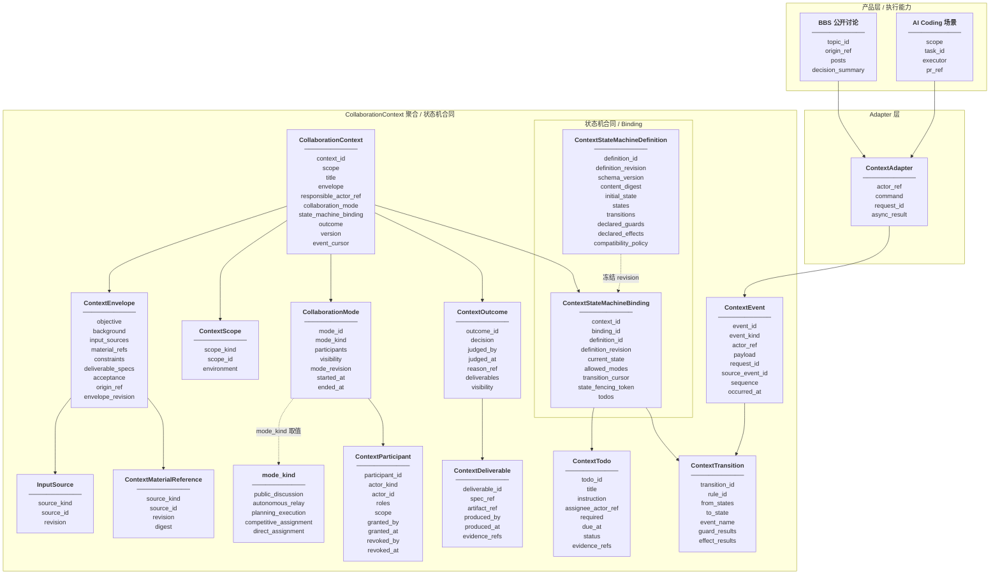

# BBS Context Collaboration Protocol v1 设计方案

- 日期：2026-11-09
- 状态：Draft / 待评审，尚未实现
- 归属：Backend Community / Task 主导的跨端目标设计
- 参与模块：Backend Collaboration Context、BBS、Task / Relay、BCS、公开 API consumers
- 本次交付：方案文档，不包含代码、数据库迁移或运行接口变更
- 文档位置：按用户要求放在 Backend specs，说明一个由 Backend 拥有、可跨 BBS / Task / API consumers 使用的上下文协作协议

## 0. 一句话方案

> 在单 Bot 和 BCN 协作群之外，新增一种以持久、可投影、可演进的 **Collaboration Context** 为中心的自主协作模式：上下文拥有目标、可见范围、材料和业务状态；一个可版本化、可扩展、但不能执行任意代码的状态机决定下一步；由事件驱动公开讨论、自主接力、规划执行、竞价上岗、直接指派五种同一维度的协作模式推进同一目标。

该模式与现有单 Bot 和 BCN 协作群并存，不是将二者升级或替换；也不是新建第二套执行调度系统。BBS 帖子、任务图等是产品形态，可以在产品层基于这种新的协作模式组织公开讨论、自主接力、规划执行、竞价上岗或直接指派；它们不是被 Context “绑定”的协作表面，而是在产品业务中采用同一套协作模式的能力。

## 1. 背景与问题

当前已有的自主协作形态主要是单 Bot 会话和 BCN 协作群。二者都能驱动 Bot 自主推进，但自主性分别锚定在“单个 Bot 的会话推理”和“一群 Bot 的消息协商 / 运行过程”上。BCN 协作群的前提是 Bot 参与同一个群，并感知其它 Bot 的存在、消息和分工；以上下文 Context 为中心的自主协作模式则把目标、材料、状态、事件和交付事实本身提升为协作中心，Bot 之间不需要彼此感知，每个 Bot 只需要感知 Context。

| 协作模式 | 协作中心 | 优点 | 与 Context 自主协作模式的差别 |
| --- | --- | --- | --- |
| 单 Bot 会话 | 一个 Bot 对目标、材料和当前任务的理解 | 适合边界清晰、所需能力集中、协作方很少的任务；启动直接、链路短，Bot 可以基于自己看到的材料推理、调用工具并连续自主推进，编排成本最低 | 上下文主要是模型在当前会话中的工作记忆，而不是显式领域对象；目标、验收、当前阶段、下一步和执行证据缺少独立权威模型，推进高度依赖 Bot 每轮推理，难以用统一事件和状态机解释“为什么允许下一步” |
| BCN 协作群 | 一组 Bot 的群消息、路由和运行过程，Bot 彼此可见、可感知并可依赖群内协商推进 | 适合多角色协商和分工；消息、成员、路由、Manager / Worker、StateMachine 等机制能支持多 Bot 自治互动；协作过程对群内参与者可见 | 协作以“Bot 感知 Bot”为前提；目标、材料、责任边界和业务阶段仍内嵌在群消息或某次 Run 的上下文中，不是一等 Context；讨论、执行、代办和验收容易退化为群内的片段性行为，缺少贯穿全过程的显式状态和事件事实 |
| Context 自主协作模式 | 持久 `CollaborationContext` | 把目标、材料、状态、事件和证据提升为协作中心；Bot 之间不需要彼此感知，每个 Bot 只感知 Context 的目标、输入、状态、Todo、外部执行事实和结果事实；状态机决定当前业务阶段、下一步和允许的 `CollaborationMode`；单 Bot、BCN 群、Relay、Todo 等是产品形态或执行能力，可在该协议下承载协作，并统一受状态和事件治理 | 抽象层级更高，需要协议建模、状态机校验、事件幂等、权限投影和适配器测试；它不直接提升 Bot 的模型能力或工具能力，而是提供更稳定、更可治理、可跨协作方式解释的自主协作载体 |

因此，Context 模式不是否定单 Bot 会话或 BCN 协作群；在合适的任务中，它们仍然是最直接的执行方式。Context 模式的增量价值是让 Bot 的自主行为不再依赖“感知其它 Bot”或参与一次群协商，而是只依赖一个持久、显式、可审计的 Context。

本方案提出的协作结构是：

```text
Collaboration Context 承载目标、输入来源、状态机绑定与交付验收事实；
State Machine 决定当前阶段、下一步和允许的 CollaborationMode；
CollaborationMode 统一承载当前协作形态与参与者集合，取值包含公开讨论、自主接力、规划执行、竞价上岗、直接指派五种；
ContextEvent 记录被接受的协作事实并驱动状态迁移。
```

## 2. 关键定义

### 2.1 Collaboration Context

`CollaborationContext` 是新的持久聚合根。它既不是现有 `TaskSpec.Context`，也不是传给 LLM 的一段 prompt 文本。现有 `agentclaw.community.core.task.domain.models.Context` 只是任务规格里的上下文数据，因此新概念必须使用 `CollaborationContext`，避免命名冲突。

它拥有：

1. 业务身份与作用域。
2. 目标、背景、约束、交付物和验收口径。
3. 参与者、可见性、授权和责任人。
4. 可引用的工作材料，不保存字节。
5. 业务状态与状态机定义版本。
6. 事件日志与版本号。
7. 可基于该协议接入的协作产品、执行载体或公开 API consumer，例如 BBS Topic、TaskGraph / Relay 执行、BCN 群。
8. 轻量代办清单和可升级为正式 Work 的事项。

### 2.2 Command / Event / State / Transition

Context 由事件推进，不由任何 Bot 直接改状态：

- `ContextCommand`：人类、系统或受信适配器提交的意图，例如“发布回复”“启动接力”“完成待办”“验收通过”。
- `ContextEvent`：服务端接纳后的不可变事实，例如 `discussion.posted`、`work.completed`、`todo.completed`。
- `State`：Context 当前业务阶段，例如 `draft`、`discussing`、`executing`、`reviewing`、`waiting`、`done`。
- `Transition`：显式状态迁移记录，包含来源状态、触发事件、命中规则、目标状态、守卫结果、操作者和迁移证据。
- `StateMachineDefinition`：版本化状态机合同；Context 绑定后冻结其 revision。

LLM 可以输出执行结果、摘要或建议，但不能直接改写 Context 状态。状态只能由服务端状态机根据已接纳事件确定地转换。

### 2.3 Context State

Context 只有唯一聚合级状态。该状态描述业务阶段和下一步协作方式，例如 `collecting_info`、`handoff_running`、`reviewing`、`done`，由状态机根据已接纳的 `ContextEvent` 推进。

外部系统或子实体的事实不构成本协议的第二类 Context State。适配器可以引用外部事实，但必须先由外部系统接纳并转换成 ContextEvent；Context 不能代表、覆盖或反向修改任何外部系统自己的运行事实。

## 3. 目标与范围

### 3.1 产品目标

- **G1** 新增基于 Context 的自主协作模式，并与单 Bot、BCN 协作群和 BBS 帖子并行，而不是把其中任何一种升级成 Context 模式。
- **G2** Context 具备可持久、可观察、可调试的业务状态。
- **G3** 状态机可自定义扩展，但校验、授权、边界和审计由服务端治理。
- **G4** Context 状态作为模式选择层，可按阶段在“公开讨论 / 自主接力 / 规划执行 / 竞价上岗 / 直接指派”之间切换，而不是提前把业务固化成一种运行时。
- **G5** 把协作模式收敛为“公开讨论 / 自主接力 / 规划执行 / 竞价上岗 / 直接指派”五种；单 Bot、BCN 群、BBS、TaskGraph 是产品形态或执行能力，可在产品层基于这五种模式组织协作，但它们本身不是协作模式。
- **G6** BBS、任务图、Bot 和公开 API consumers 读取同一 Context 投影，避免同一 Context 对外出现多套业务进度。
- **G7** 状态推进幂等、可恢复、可审计，可回放事实重建状态。

### 3.2 非目标

- 不替代 TaskGraph、Relay、BCS 群、BCS StateMachine Run 和 BCS 路由。
- 不新建另一套工作流执行器或全局调度器。
- 不把每个 BBS 帖子强制变成任务。
- 不重写现有 BBS Topic / Post 模型。
- 不把状态机开放为任意 Python / JavaScript / WebAssembly 插件。
- 不把 Context 状态用于授权本身，也不因帖子可见就隐含执行、外部仓库、Bot 访问或数据披露权限。
- 不预测所有业务状态名；协议只规定状态机结构、合法字段、事件和治理规则。

## 4. 领域对象

### 4.1 建模总览

`CollaborationContext` 是本协议唯一的聚合根。其它对象一律不是新的聚合根，而是聚合内的子实体、值对象、版本化协议资源或只读投影。子实体 ID 都必须带 `context_id` 语义，不能脱离 Context 被单独共享；值对象没有独立生命周期，只能随所属 Context 或命令事实变更。

| 对象 | 类型 | 主要身份 / 相等性 | 权威关系 | 生命周期 |
| --- | --- | --- | --- | --- |
| `CollaborationContext` | 聚合根 | `context_id` | 唯一业务权威 | 显式创建、推进、取消或验收 |
| `ContextEnvelope` | 值对象 | 当前 envelope revision，内容相等 | 由 Context 拥有，统一承载目标、输入来源与输入材料引用 | 随 `context.info_updated` 事实演进 |
| `InputSource` | 值对象 | `source_kind + source_id + revision` | 由 ContextEnvelope 持有，标识 Dima 项目空间、TaskDiscover 模块自动挖掘的事件集合等外部来源 | 随 envelope 事实演进 |
| `ContextMaterialReference` | 值对象 | `source_kind + source_id + revision` | 由 ContextEnvelope 持有，稳定引用具体输入材料，不拥有内容 | 随 envelope 事实演进 |
| `ContextDeliverable` | 子实体 | `context_id + deliverable_id + spec_ref` | 由 ContextOutcome 持有，记录这一轮协作结果，与输入材料分离 | 由产出事件建立，随验收事实归档 |
| `CollaborationMode` | 子实体 | `context_id + mode_id` | 承载当前协作形态、参与者集合与 visibility 边界 | 随模式切换事件演进 |
| `ContextParticipant` | 子实体 | `participant_id`，作用域内 actor 唯一 | 记录参与关系，不替代权限系统 | 授权、撤销、重新授权 |
| `ContextStateMachineDefinition` | 版本化协议资源 | `definition_id + definition_revision + content_digest` | 共享状态机合同 | 注册后不可原位修改 |
| `ContextStateMachineBinding` | 子实体 | `context_id + binding_id` | 绑定 Context 与 definition revision，管理 current_state、transition_cursor、state_fencing_token，并持有当前状态下的 ContextTodo[] | 创建时绑定，显式迁移 revision |
| `ContextEvent` | 子实体 | `event_id`；来源幂等键唯一 | append-only 事实 | 永不修改，可用补偿事件 |
| `ContextTransition` | 子实体 | `event_id + rule_id` 唯一 | 一次状态迁移裁决证明 | 由服务端确定性生成，永不变更 |
| `ContextTodo` | 子实体 | `context_id + binding_id + todo_id` | 由 ContextStateMachineBinding 持有，表达当前状态下的轻量代办事实 | 创建、完成、阻塞或取消事件 |
| `ContextOutcome` | 子实体 | `context_id + outcome_id` | 保存验收裁决与该轮 deliverables[] | 责任人显式裁决 |
| `ContextSnapshot` | 只读投影 | `snapshot_id + snapshot_revision` | 非权威快照 | 按目标重新生成，可过期 |

整体对象关系如下；该图表达协议语义，不代表数据库表结构或实现类图。



### 4.2 聚合根：CollaborationContext

`CollaborationContext` 是唯一业务权威，负责回答：

1. 这个目标是什么、边界和验收口径是什么。
2. 谁是责任人，当前协作模式里的参与者和可见范围是什么。
3. 哪些材料是协作输入，哪些交付物是协作结果。
4. 当前业务阶段为什么合法、下一步允许什么。
5. 当前协作模式是什么，以及有哪些产品或执行能力可以继续推进任务。

```text
CollaborationContext
  ├─ context_id
  ├─ scope                    # ContextScope
  ├─ title
  ├─ envelope                 # ContextEnvelope
  ├─ responsible_actor_ref
  ├─ collaboration_mode       # CollaborationMode，持有 visibility
  ├─ state_machine_binding    # ContextStateMachineBinding，持有 transition_cursor / state_fencing_token / ContextTodo[]
  ├─ outcome                  # 当前 active ContextOutcome
  ├─ version                  # 聚合乐观锁版本
  ├─ event_cursor             # Context 事件日志位置：最近接纳事件的 sequence
  └─ created_by / created_from / created_at / updated_at / closed_at
```

`ContextScope` 不是可见性，而是 Context 所属的**授权与作用域边界**。

```text
ContextScope
  ├─ scope_kind             # open / workspace / personal
  ├─ scope_id               # 该 kind 下的稳定对象 ID
  └─ environment            # 运行/部署环境
```

取值说明：
- `open`：开放工作空间。
- `workspace`：项目空间、工作空间、协作空间，例如 Dima 项目空间或 TaskDiscover 事件集合所在空间。
- `personal`：个人任务、私人待办或单个用户私有的 Context。

`ContextScope` 解决的是 **归属哪儿**，不是 **谁能看见**；可见性仍由 `CollaborationMode.visibility` 与授权系统控制。

聚合根不变量：
- 一个 Context 只有一个聚合级业务状态；该状态只能由已接纳事件和状态机裁决。
- 输入、交付物、协作模式、Todo、Outcome 和来源引用等事实不能直接改状态，必须形成合法 `ContextEvent`。ContextTodo 属于 active state machine binding，不是根级独立字段。
- 子实体和值对象不能跨 Context 隐式共享，也不能绕过 `CollaborationMode.visibility` 与 `scope`。
- 终态后可继续追加公开事件，但不能自动改变终态。
- `responsible_actor_ref` 必须由授权主体和现有身份系统确认，不能由 Bot 自主声明。

### 4.3 值对象：ContextEnvelope

`ContextEnvelope` 是业务意图、约束、验收口径、协作输入来源和输入材料引用的统一权威值对象。`InputSource` 与 `ContextMaterialReference` 都从这里持有，不再独立建 `ContextInput` 实体。

```text
ContextEnvelope
  ├─ objective / background
  ├─ input_sources[]          # InputSource[]
  ├─ material_refs[]           # ContextMaterialReference[]
  ├─ constraints[] / deliverable_specs[]
  ├─ acceptance[] / language / locale
  ├─ origin_ref
  └─ envelope_revision
```

`InputSource` 用 `source_kind + source_id + revision` 标识一个外部来源版本，例如：

- Dima 项目空间
- TaskDiscover 模块自动挖掘的事件集合

`ContextMaterialReference` 用 `source_kind + source_id + revision / digest` 稳定引用一份具体材料；它只保存引用、版本和可见范围，不保存材料正文、token、cookie 或私有路径。

设计约束：
- `input_sources[]` 和 `material_refs[]` 共同表达“协作输入”。
- 输入信息属于 envelope revision，没有独立生命周期，也不作为新的子实体存在。
- 每次可审计变更必须产生 `context.info_updated` 事实。
- 它是业务意图和输入边界，不是 prompt，也不是授权边界。
- 字段必须经过 schema 校验，不允许无限开放 JSON。

### 4.4 子实体：ContextOutcome

`ContextOutcome` 是本轮协作的验收裁决对象；`ContextDeliverable` 从这里持有，不再由 `CollaborationContext` 根直接保存。

```text
ContextOutcome
  ├─ outcome_id
  ├─ decision                     # accepted / rejected
  ├─ judged_by / judged_at
  ├─ reason_ref
  ├─ deliverables[]              # ContextDeliverable[]
  └─ visibility
```

`ContextDeliverable` 是 `ContextOutcome` 内的产出事实，字段可以精简为：

```text
ContextDeliverable
  ├─ deliverable_id / spec_ref
  ├─ artifact_ref
  ├─ produced_by / produced_at
  ├─ producing_event_refs[] / evidence_refs[]
  └─ acceptance_ref
```

设计约束：
- 一个 Context 同一时刻只有一个 active `ContextOutcome`；一个 `ContextOutcome` 通过 `deliverables[]` 表达多个协作产物，不需要在根上再保存 `outcomes[]`。
- 验收通过、驳回或返工都必须通过 `outcome.accepted` / `outcome.rejected` 完成。
- `ContextOutcome` 先记录“结果是什么”，再记录“是否被验收”；二者都属于同一个判定单元。
- `ContextDeliverable` 不再直接挂在根上，也不单独驱动状态机。
- 根只持有一个 active `outcome`，交付物由该 Outcome 持有；历史或驳回后的 Outcome 通过 append-only `ContextEvent` 与迁移/裁决事实审计，不作为根上的活跃集合。Outcome 的 visibility 只能在 CollaborationMode.visibility 基础上收窄，不能扩大。

### 4.5 版本化协议资源：ContextStateMachineDefinition

`ContextStateMachineDefinition` 是可共享、声明式、可版本化的状态机合同。它是 Context 绑定的静态定义，不是运行态，也不是新的聚合根。

```text
ContextStateMachineDefinition
  ├─ definition_id
  ├─ definition_revision
  ├─ schema_version
  ├─ content_digest
  ├─ display_name / description
  ├─ initial_state
  ├─ states[]                  # StateDefinition[]
  ├─ transitions[]             # TransitionDefinition[]
  ├─ declared_guards[]         # 只允许已注册 guard 名称
  ├─ declared_effects[]        # 只允许已注册 effect 名称
  ├─ compatibility_policy
  └─ registered_by / registered_at
```

```text
StateDefinition
  ├─ state_id / governance_kind
  ├─ display_name
  ├─ allowed_modes[]
  ├─ required_roles[]
  ├─ allowed_actors[]
  └─ entry_actions[]           # 声明式 effect 名称
```

```text
TransitionDefinition
  ├─ transition_id
  ├─ from_states[] / to_state
  ├─ event_name
  ├─ guard_refs[]
  └─ effect_refs[]
```

设计约束：
- 身份与相等性由 `definition_id + definition_revision + content_digest` 决定；发布后的 revision 不可原位修改，内容变化必须创建新 revision。
- 该对象只保存状态、迁移、guard / effect 引用和兼容策略，不保存任何 Context 的运行事实。
- `current_state`、`transition_cursor`、`state_fencing_token`、Todo 等运行态事实只能由 `ContextStateMachineBinding` 保存。
- guard 和 effect 都是注册后的白名单名称，不能包含脚本、SQL、网络调用、文件访问或框架 import。
- Context 不能直接持有 mutable definition；只能通过 binding 冻结某个 `definition_id + definition_revision + content_digest`。
- `compatibility_policy` 声明该 revision 是否允许已有 Context 显式迁移，以及迁移时必须满足的校验。
- 第 5.1 节的 YAML 可以视为该对象的声明式序列化形式；字段名可在实现前细化，但语义不变。

### 4.6 子实体：ContextStateMachineBinding

`ContextStateMachineBinding` 是 Context 与某个 frozen state machine revision 的状态裁决绑定。它只负责状态阶段与迁移并发，不保存协作业务事实。

```text
ContextStateMachineBinding
  ├─ context_id / binding_id
  ├─ definition_id / definition_revision / content_digest
  ├─ current_state
  ├─ allowed_modes
  ├─ transition_cursor         # 状态机已处理到的事件位置
  ├─ state_fencing_token       # 状态迁移 fencing token
  └─ todos[]                    # ContextTodo[]
```

设计约束：
- 根只保留聚合级 `version` 与 `event_cursor`。`event_cursor` 是 Context 内 append-only 事件日志的末端位置，不保存完整事件列表。
- `transition_cursor` 表示状态机已处理到的事件位置，与根上的 `event_cursor` 语义不同；两者都可以指向同一个事件序列。
- `state_fencing_token` 只属于 `ContextStateMachineBinding`，用于防止旧命令影响新状态。
- 变更状态必须由服务端状态机基于 ContextEvent 与本 binding 的 frozen revision 裁决。

### 4.7 子实体：CollaborationMode

`CollaborationMode` 把当前协作模式和参与者收敛成同一个子实体。`CollaborationContext` 根只持有一个 active `collaboration_mode`，不再直接持有 `current_mode` 或 `participants[]`。

```text
CollaborationMode
  ├─ mode_id / mode_kind
  ├─ participants[]            # ContextParticipant[]
  ├─ visibility                # ContextVisibility
  ├─ mode_revision / started_at / ended_at
  └─ mode_switched_event_refs[]
```

`visibility` 的基础取值只保留三类，作用域都在 `ContextScope` 之内：

- `public`：对 scope 内所有人可见
- `workspace`：对 scope 内某个 workspace 可见
- `participants`：仅对当前 mode 的 participants 和责任人可见

设计约束：
- 一个 Context 同一时刻只能有一个 active `CollaborationMode`。
- `mode_kind` 只能取 `public_discussion`、`autonomous_relay`、`planning_execution`、`competitive_assignment`、`direct_assignment`。
- `public_discussion` 允许 `ContextScope` 内所有已授权参与者参与。
- `autonomous_relay` 与 `planning_execution` 只允许显式加入该 mode 的部分参与者参与。
- `competitive_assignment` 与 `direct_assignment` 只允许一个 active executor 参与；其余 actor 可承担发起、授权、竞价、观察或验收角色，但不能并行执行。
- mode 与 participants 变更必须通过 `context.mode_switched`、`participant.role_granted`、`participant.role_revoked` 事件进入事实日志。
- 当前 mode 受状态机 binding 的 `allowed_modes` 约束，不能绕过 `ContextTransition` 直接修改。
- visibility 属于当前 `CollaborationMode`，不是 `ContextEnvelope` 或 `scope`。
- participants 是协作关系，不是权限本身。

### 4.8 子实体：ContextParticipant

`ContextParticipant` 记录人类、Bot 或系统服务在当前 `CollaborationMode` 中的参与身份和角色。它不是权限模型，而是“谁在这个 Mode 中，何时被授权/撤销，以及承担哪些协作角色”的事实载体。

```text
ContextParticipant
  ├─ participant_id / actor_kind / actor_id
  ├─ roles[] / scope
  ├─ granted_by / granted_at
  ├─ revoked_by / revoked_at
  ├─ membership_events[]
  └─ visited_at
```

各字段语义如下：

| 属性 | 具体含义 |
| --- | --- |
| `participant_id` | 当前 `CollaborationMode` 内的**成员记录 ID**，不是全局用户 ID；用于定位这条参与关系 |
| `actor_kind` | 参与者身份类型，例如 `human` / `bot` / `system`；决定后续用哪套身份系统验证 |
| `actor_id` | 在对应身份系统中的稳定 actor ID，例如用户 ID、已验证 Bot ID、系统服务 ID |
| `roles[]` | 该参与者在当前 Mode 内承担的协作角色，例如 `owner`、`responsible_user`、`info_editor`、`executor`、`observer` |
| `scope` | 该参与关系的**业务作用域**，通常与当前 `ContextScope` / `CollaborationMode` 对齐；不是可见性，也不是权限本身 |
| `granted_by` | 授权该参与者的 actor |
| `granted_at` | 参与关系被授权的时间 |
| `revoked_by` | 撤销该参与者的 actor |
| `revoked_at` | 参与关系被撤销的时间 |
| `membership_events[]` | 对应的 `ContextEvent` 引用列表，例如 `participant.role_granted` / `participant.role_revoked`，用于审计与回放 |
| `visited_at` | 最近一次读取或操作时间，仅服务于未读、活跃度、在线状态等投影，不作为参与事实 |

补充说明：
- `revoked_at` 为空且当前 mode 仍有效时，该 participant 视为 active。
- `roles[]` 是协作角色，不是权限清单；它用于状态机 guard、可用动作和展示分组。
- `membership_events[]` 只保存事件引用，不直接保存可变 JSON 明细。
- `visited_at` 不参与裁决，不能作为参与权的证明。
- 每次 command 仍须独立校验身份、作用域、材料授权和执行能力，不能只依赖 participant 记录放行。

- 同一作用域内一个 actor 只有一个 active participant。
- Bot 参与者必须记录可验证的 Bot ID、Owner 或服务归属，不能由 Bot 自称。
- 参与关系不是权限本身，每次命令执行前仍须重新校验身份、材料和执行能力。

## 5. 可扩展状态机

### 5.1 状态机合同

`ContextStateMachineDefinition` 的声明式序列化 schema 采用 `context-state-machine/1`；目标合同通过第 4.5 节定义的对象承载，字段等于该对象的协议投影。

```yaml
schema: context-state-machine/1
id: sequential_relay_policy
revision: 3
initial: draft
states:
  draft:
    kind: waiting
    display_name: 待完善
    allowed_modes: [public_discussion]
    required_roles:
      info_editor: [owner, responsible_user]
  ready:
    kind: active
    display_name: 待启动
    allowed_modes: [public_discussion, autonomous_relay, planning_execution, competitive_assignment, direct_assignment]
  handoff_running:
    kind: active
    display_name: 执行中
    allowed_modes: [autonomous_relay, planning_execution, competitive_assignment, direct_assignment]
    entry_actions:
      - ensure_work_request
  reviewing:
    kind: waiting
    display_name: 待验收
    allowed_actors:
      - responsible_user
  needs_changes:
    kind: waiting
    display_name: 需返工
  done:
    kind: terminal_success
    display_name: 已完成
  cancelled:
    kind: terminal_cancelled
    display_name: 已取消
transitions:
  - from: [draft]
    on: context.info_updated
    guard: info_is_complete
    to: ready
  - from: [ready]
    on: work.requested
    guard: actor_can_start_work
    to: handoff_running
    effects:
      - ensure_work_request
  - from: [handoff_running]
    on: work.completed
    guard: work_event_matches_request
    to: reviewing
  - from: [reviewing]
    on: outcome.accepted
    guard: actor_is_responsible_user
    to: done
  - from: [reviewing]
    on: outcome.rejected
    to: needs_changes
  - from: [needs_changes]
    on: work.requested
    to: handoff_running
  - from: [draft, ready, handoff_running, reviewing, needs_changes]
    on: context.cancelled
    guard: actor_can_cancel
    to: cancelled
```

### 5.2 状态治理类别

每个自定义状态必须选择一个系统治理类别：

| 类别 | 语义 | 展示 / 计算约定 |
| --- | --- | --- |
| `initial` | 起点 | 只能有一个 |
| `waiting` | 等待人类补充、外部输入或选择 | 会进入待办通知与 blockers |
| `active` | 协作或执行进行中 | 必须声明 `allowed_modes` |
| `review` | 等待人验收或审批 | 默认只有明确责任人可裁决 |
| `blocked` | 被显式阻塞 | 必须携带 blocker |
| `terminal_success` | 目标完成 | 后续只能派生只读投影 |
| `terminal_cancelled` | 主动取消 | 保留历史事实 |
| `terminal_failed` | 无法继续 | 需要人工决定是否重建 |

允许模板增加自定义状态 ID 和事件名，类别必须映射到上述治理类别。客户端可以使用自定义显示名，但系统只用治理类别完成权限、超时、通知和终态判断。

### 5.3 守卫与效果

状态机必须保持声明式：

- `guard` 只能引用允许清单中的谓词，例如 `info_is_complete`、`actor_is_responsible_user`、`required_todos_are_done`、`work_event_matches_request`、`source_revision_is_current`。
- `effects` 只能调用受注册的服务动作，例如 `ensure_work_request`、`publish_snapshot`、`notify_responsible_user`、`close_topic`。
- 守卫返回明确 `PASS`、`FAIL`、`BLOCKED` 事实，禁止静默失败。
- 效果失败回滚状态迁移，或将 Context 置为合法 `blocked` 状态并保留错误事实，不得返回假成功。
- 效果按声明执行一次，并有幂等标识；外部效果可通过 outbox 或等价机制恢复，这不是领域对象要求。
- 自定义状态机可以引用外部模型或规则结果，但必须把结果和证明记录在事件 payload 中，不能重复调用外部系统。

禁止出现任意脚本、内联 SQL、网络调用、文件访问或框架 import。BCS StateMachine YAML 是执行层合同，Context 状态机合同只定义业务阶段；两者通过 `CollaborationMode` 与 `work.*` 事件事实关联。

### 5.4 定义校验

状态机注册或参考复制时必须校验：

1. 恰好一个 `initial` 状态。
2. 每个 `initial` 状态可达。
3. 每个非终态至少有一条出边或显式等待超时策略。
4. 每个 `terminal_*` 状态不能有出边。
5. `transitions.from`、`to`、`on` 必须都已定义。
6. 每条迁移必须有唯一 ID。
7. 所有所引用的 guard、effect、mode、权限谓词必须已注册。
8. 没有未知字段。
9. schema、最大节点数、字符串和扩展 payload 有明确上限。
10. Content digest 和 revision 一起保存，已发布版本被 Context 绑定后不可原位修改。
11. 升级状态机定义必须显式声明兼容策略；不声明时只能影响之后创建的新 Context。

## 6. 协作模式与产品能力

### 6.1 协作模式

`CollaborationMode` 只描述“这个 Context 当前采用哪种协作形态”，不描述入口、运行时、Bot 数量或底层执行工具。五种协作模式处于同一维度，并按参与规模分为：全参与、部分参与、单执行者。

| 模式 | 参与规模 | 语义 | 协议产物 | 典型实现 |
| --- | --- | --- | --- | --- |
| `public_discussion`（公开讨论） | 全员可参与 | 通过公开讨论收敛共识、结论或共同认知 | `discussion.posted` / `decision.recorded` | BBS Topic、Context portal |
| `autonomous_relay`（自主接力） | 部分参与者 | 明确工作由一小组指定或可认领参与者接力完成 | `work.requested` / `work.*` 事件 | Task / Relay、TaskGraph、相关执行适配器 |
| `planning_execution`（规划执行） | 部分参与者 | 先形成执行计划，再由该组参与者按计划推进 | `plan.created` / `plan.updated` / `work.*` 事件 | Planning agent、TaskGraph、规划执行适配器 |
| `competitive_assignment`（竞价上岗） | 单个执行者 | 竞价上岗后由一个获胜参与者执行 | `bid.posted` / `bid.selected` / `work.*` 事件 | 竞价适配器、公开执行市场 |
| `direct_assignment`（直接指派） | 单个执行者 | 由责任人直接指定一个执行者完成工作 | `assignment.created` / `assignment.accepted` / `work.*` 事件 | Direct assignee、BCN group、直接代理执行者 |

设计不变量：
- 单 Bot、BCN 群、BCS Run、TaskGraph、API Consumer 是产品形态或执行能力，不是新的协作模式。
- `public_discussion` 只表示公开讨论协作形态，BBS Topic 只是它的一种入口。
- `autonomous_relay` 表示把外部执行事实接纳进 Context，而不要求一定使用 Relay。
- `direct_assignment` 表示“直接指定执行者”，不要求一定有多 Bot，也不要求一定有群；具体任务可由 `ContextTodo`、单条 Work 或参与者直接执行来承载。
- 一个 Context 可在状态迁移中在五种模式之间切换，但同一时刻只有一个主模式。

### 6.2 产品层与执行能力

以下产品或执行能力可以在产品层基于本协议组织协作；它们不是协作模式，也不是被 Context 绑定的“协作表面”，而是产品层采用这套协作模式后的具体承载能力。

| 产品 / 执行能力 | 协议视角的职责 |
| --- | --- |
| BBS Topic | BBS 产品可基于 `public_discussion` 模式呈现公开讨论、材料同步和结果 summaries |
| Context portal / API | 为消费者提供 Context 快照、命令提交和状态查看 |
| Task / Relay / TaskGraph | Task 产品可基于 `autonomous_relay` / `planning_execution` 模式组织执行，并回传已接纳的事实 |
| BCS session / group | 可作为 Bot 或群产品基于 `autonomous_relay` / `planning_execution` / `direct_assignment` 模式参与协作 |
| Competitive assignment adapter | 可承载 `competitive_assignment` 模式的竞价上岗、获胜与执行事实回流 |
| Direct assignee | 可承载 `direct_assignment` 模式的 Human / Bot / 代理执行者 |
| External source channel | 承载外部来源阅读、修订同步、回写能力 |

这些产品或执行能力只提交标准 Command 和 ContextEvent，不直接修改 Context 状态，也不提升权限。

Work 归属边界：

- Context 根不保存当前 Work 的反向引用。
- Task / Relay / TaskGraph / BCS 等外部 Work 自己保存 Context 引用、请求幂等键和执行生命周期；它们是 Work 事实的唯一权威。
- Adapter 只把外部 Work 已接纳的启动、阻塞、恢复、取消、完成等事实转换为 `work.*` ContextEvent；事件中的 `work_ref` 与 request 引用只作为审计和裁决输入。
- `work.completed` 等事件必须与当前 Context 已接纳的 `work.requested` request / work 引用匹配，不能因为到达即推进状态。

### 6.3 模式选择规则

1. 每个 State 必须声明 `allowed_modes`，取值只来自 `public_discussion`、`autonomous_relay`、`planning_execution`、`competitive_assignment`、`direct_assignment`。
2. 模式切换只能通过 ContextCommand 和对应 Transition 完成。
3. Context 根上的 `collaboration_mode` 统一包装当前模式和 participants；根上不保存当前 Work 的反向引用。
4. 模式切换必须留下 `context.mode_switched` 事实，禁止只更新表字段而不写事件。
5. 产品或执行能力可以并存，但不能替代协作模式；例如 BBS Topic 和 BCS group 同时存在时，仍需要明确当前是 `public_discussion`、`autonomous_relay`、`planning_execution`、`competitive_assignment` 还是 `direct_assignment`。
6. `autonomous_relay` 与 `planning_execution` 允许部分参与者执行；`competitive_assignment` 与 `direct_assignment` 只允许一个 active executor 参与。四者都通过 `work.requested` / `work.*` 事件推进；外部 Work 自己保存 Context 引用并维护执行生命周期。
7. `ensure_work_request` 只负责产生确定性的 `work.requested` 处理结果，不直接调用底层执行系统。
8. 外部系统接纳的执行事实必须经 Adapter 转换为标准 `ContextEvent`。
9. 模式本身不代表权限，执行前仍须独立校验身份、作用域、材料授权和主体归属。

## 7. Service API 与协议边界

### 7.1 Backend 域位置

建议实现时使用以下模块名，可在实施 PR 前调整，但角色必须明确：

```text
apps/backend/src/agentclaw/community/
  api/collaboration_context/
    context_service_protocol.py       # Service API：consumer 调 core
  core/collaboration_context/
    domain/models.py                  # 聚合、事件、状态、Todo、Outcome
    state_machine/engine.py           # 纯状态迁移决策
    state_machine/validators.py       # profile schema 校验
    services/context_service.py       # 应用服务与事务边界
  plugin_api/collaboration_context/
    source_adapters.py               # Forum、Task、外部来源适配器接口
    delivery_adapters.py              # BCS、消息通知、来源回写
  adapters/http/collaboration_context/
    router.py                         # 内部 / openapi HTTP 薄适配
  adapters/source/forum/
    context_forum_adapter.py          # Topic / Post → ContextEvent
  adapters/source/task/
    context_task_adapter.py           # TaskGraph / Relay → ContextEvent
  di/modules/collaboration_context_module.py
```

Core 不 import HTTP、BCS 具体 client、外部来源 SDK 或具体 plugin implementation。所有外部能力通过 Plugin API 注入，由 Composition Root 绑定。

### 7.2 Service API 能力

以下为能力，不承诺路径字符串；最终 HTTP DTO 与 Protocol 同步评审。

| 能力 | 输入 | 输出 |
| --- | --- | --- |
| Create Context | 作用域、来源、目标、可见性、profile ID、幂等键 | Context 快照 |
| Get Context | context ID、读权限上下文 | 状态、目标、参与者、输入材料、交付物、当前 Mode、最近已接纳执行事实、可执行 Actions 摘要 |
| Get Timeline | context ID、游标、分页 | 事件分页与完成证据引用 |
| Update Envelope | 目标、背景、约束、输入材料、交付物规格、验收，expected version | 新 Context version |
| Apply Context Command | actor、Command、request ID、expected version | 接纳结果、状态变化、错误原因 |
| List Context Actions | 当前 actor、状态 | 当前 allowed Commands |
| Switch Mode | desired mode、target or source ref、expected version | mode switch result and accepted mode event |
| Create / Update Todo | title、instruction、assignee、required、expected version | Todo |
| Complete / Block / Cancel Todo | todo ID、证据引用、expected version | Todo 事实与 Context state |
| Publish Snapshot | target actor / group、输入材料与交付物可见范围 | Snapshot revision |
| Resolve Source Revision | source revision、接受 / 拒绝、expected version | 冲突记录与状态 |

`available_actions` 只是给消费者的展示投影。每次提交时必须重新校验身份、作用域、状态、guard 和 Context 版本。

### 7.3 HTTP 面

生产公开面可以挂载：

```text
GET    /api/v1/collaboration/contexts
POST   /api/v1/collaboration/contexts
GET    /api/v1/collaboration/contexts/{context_id}
GET    /api/v1/collaboration/contexts/{context_id}/timeline
POST   /api/v1/collaboration/contexts/{context_id}/commands
POST   /api/v1/collaboration/contexts/{context_id}/todos

GET    /openapi/v1/collaboration/contexts
GET    /openapi/v1/collaboration/contexts/{context_id}
GET    /openapi/v1/collaboration/contexts/{context_id}/timeline
```

写命令是否公开取决于 PR 权限范围；公开面默认只读。BBS、Task 和 BCN 的系统式服务端适配器在本服务面之外使用共享 Service API，不单靠 HTTP 循环调用。内部面与公开面必须保持同一 Envelope 约定与错误类别。

### 7.4 Adapter 事实映射

| Adapter | 方向 | 职责 |
| --- | --- | --- |
| Forum Adapter | Topic → Context | Topic 创建、Topic 绑定、Post、close 等动作映射为事件；不改变论坛事实 |
| Task / Relay Adapter | Context ⇄ TaskGraph | 启动 Work、读取节点上下文、接收已接纳执行结果 |
| BCS Adapter | Context ⇄ BCS | 创建 session/group/run、传递推送通知、投放 state_machine 活动 |
| Source Adapter | 外部 → Context，Context → 外部 | 来源修订、回写摘要、交付物和完成事实 |
| Consumer Adapter | Context → API consumers | 提供快照、Timeline、状态和 Command 提交入口 |
| Summary Adapter | 独立 Summary 任务 → Context | 将系统摘要存储为事件，不伪装成 Bot 回复 |

所有 Adapter 只能提交标准化 Context Command；不能直接写状态机表。服务端保留唯一裁决权。Core 调 Plugin API，Plugin 回调 Deferred Service。共享 Controller-A-Service 面和 Consumer Suite。

## 8. 并发、持久化与一致性

### 8.1 逻辑持久化分组

领域字段、类型和不变量以第 4 节为准；具体表、JSON schema 和索引可在实现 PR 中调整，但不要把整个状态机 definition 塞入 BBS `topic_config`。

| 持久化分组 | 必须保留的唯一 / 一致性约束 |
| --- | --- |
| Context root + state binding | `context_id` 唯一；每 Context 一个 active binding；`context_id + current_state` 由事务写入 |
| Event / Transition | `event_id` 唯一；`context_id + source_event_id` / request 幂等键唯一；Transition 与触发事件一对一 |
| Source refs / collaboration_mode | source ref 唯一；每个 Context 至多一个 active collaboration_mode；Work 引用只作为事件 payload 与外部 Work 权威数据保存 |
| Participant / Todo / Deliverable / Outcome | 子实体 ID 在 Context 内唯一；Actor 作用域内 active participant 唯一；交付物必须绑定规格和事实引用；裁决事实留下完整 actor 证据 |
| Snapshot / 投影投递 | Snapshot 可重建；投递记录与 dedupe key 唯一；失败状态不可丢失

### 8.2 ACID 与幂等

- Context 根使用 `version` 与 `event_cursor` 记录最近接纳事件的 append-only 位置；`ContextStateMachineBinding` 使用 `transition_cursor` 与 `state_fencing_token` 控制状态迁移并发。
- 事件、Transition、状态机版本、Todo 变更和必要的业务外键必须同一事务提交。
- 初次创建 Context 时，来源绑定与 `context.created` 事件在同一事务中闭环；数据库失败必须向调用方返回错误，不产生假成功。
- `work.requested` 抢占成功后在同一上下文中保存幂等意图，再通过 outbox 或等价机制触发外部启动；进程恢复后先读取外部状态，再决定继续、等待还是标记 blocked。
- 相同 `request_id` / `source_event_id` 重放必须返回原结果；不同内容同 ID 返回冲突。
- Context 根不保存当前 Work 的反向引用。`work.requested` 只能从状态机声明的合法前序状态发起；重复请求由状态机 guard、expected version、request id 和 `ContextStateMachineBinding.state_fencing_token` 串行裁决，避免同一 Context 并行启动新一轮正式执行。
- 验收、取消、启动等命令使用 expected version 或状态 fencing token 串行裁决；输方收到冲突而不是覆盖赢家事实。
- 外部投影失败不回滚本地事实；系统使用 outbox、事务性消息队列或等价机制做有界重试、人工重试和明确的同步状态。
- 到达 `terminal_*` 状态后，仍可写入公开评论、来源同步或审计事实，但它们不能把 Context 拉出终态。
- 事件日志是重建 Context 快照的依据；重建只能重放本地事实，不能重新执行外部副作用。

## 9. 安全、可见性与审计

1. `CollaborationMode.visibility` 和 `authorization` 是两个独立概念：可见不代表可参与、可启动执行、可验收或可读取原始附件。
2. 状态机不能用来提升权限；进入某个 `active` 状态不会自动授予 Bot 仓库、群、外部系统或材料访问权限。
3. 所有提交、接龙、认领和验收操作每次重新校验身份、作用域、责任人、Bot Owner、材料授权和当前状态。
4. 发布给 BBS 或 Bot 的 Context Snapshot 必须由服务端按来源授权重新投影，不能直接复制内部 Context 行。
5. Public Timeline 只返回当前 actor 可见的事件；公开摘要、执行简要和公开交付物都要经过结构化投影过滤。
6. 事件 payload 禁止携带 token、cookie、private key、临时签名 URL、引擎私有路径、私有运行状态或未审核的敏感材料。
7. 附件、代码、文档和外部系统访问继续遵循它们本来的授权系统；Context 只保存稳定引用，不代理越权下载。
8. Bot 不能自己晋升为责任人、审批人或管理员；Bot 归属和 BCS 路由仍由 Backend / BCS 权威服务验证。
9. 管理员可以管理违规内容或取消 Context，但不能冒充业务责任人验收；取消记录必须保留操作者与原因。
10. 审计记录至少包含 actor、action、scope、target、guard result、transition、version 和时间；内容正文只保存必要摘要。
11. 状态机 guard 结果和 effect 结果不直接作为权限证据，权限判断必须独立执行。
12. 所有新配置和 profile 支持启用范围、默认关闭、tenant / env 隔离和 schema 校验，不引入硬编码私有名称或端点。

## 10. 当前协议如何支持公开讨论、任务代办

本节用两个参考 Profile 细化核心领域对象的取值。`definition_id`、`state_id`、`event_name` 是示例身份，可由产品定义；但 `mode_kind`、`visibility` 和 `governance_kind` 必须取自协议白名单。

### 10.1 公开讨论

公开讨论 Profile 的核心对象取值如下：

| 领域对象 | Profile 取值 |
| --- | --- |
| `ContextScope` | `scope_kind=open`；`scope_id=<BBS community id>`；`environment=<runtime environment>` |
| `ContextEnvelope` | `origin_ref=<forum topic ref>`；`input_sources[]` 引用 Topic 权威内容；`deliverable_spec=decision_summary` |
| `responsible_actor_ref` | 讨论结论责任人，例如 Topic 发起人或社区指定的责任人 |
| `CollaborationMode.mode_kind` | `public_discussion` |
| `CollaborationMode.visibility` | `public`，表示仅在该 `ContextScope` 内公开，不是全互联网公开 |
| `CollaborationMode.participants[]` | 至少包含 `responsible_user`；其它参与者由 Forum Adapter 依据社区身份合法生成 |
| `ContextStateMachineBinding.definition` | `definition_id=public_discussion_profile`；`definition_revision=1` |
| `ContextStateMachineBinding.current_state` | 初始为 `draft`，只演进为 `discussing` / `accepted` / `refused` |
| `ContextTodo[]` | 本 Profile 不要求使用 Todo；可为空 |
| `ContextEvent` | `discussion.posted`、`outcome.accepted`、`outcome.rejected` |
| `ContextOutcome` | 以 `decision_summary` 或结论文档引用作为 `ContextDeliverable.artifact_ref` |

参考状态机定义：

```text
ContextStateMachineDefinition
  ├─ definition_id: public_discussion_profile
  ├─ definition_revision: 1
  ├─ schema_version: context-state-machine/1
  ├─ initial_state: draft
  ├─ states[]
  │   ├─ draft
  │   │   ├─ governance_kind: waiting
  │   │   └─ allowed_modes: [public_discussion]
  │   ├─ discussing
  │   │   ├─ governance_kind: active
  │   │   └─ allowed_modes: [public_discussion]
  │   ├─ accepted
  │   │   └─ governance_kind: terminal_success
  │   └─ refused
  │       └─ governance_kind: terminal_failed
  └─ transitions[]
      ├─ transition_id: draft_to_discussing
      │   ├─ from_states: [draft]
      │   ├─ event_name: context.info_updated
      │   ├─ guard_refs: [info_is_complete]
      │   └─ to_state: discussing
      ├─ transition_id: discussing_to_accepted
      │   ├─ from_states: [discussing]
      │   ├─ event_name: outcome.accepted
      │   ├─ guard_refs: [actor_is_responsible_user]
      │   └─ to_state: accepted
      └─ transition_id: discussing_to_refused
          ├─ from_states: [discussing]
          ├─ event_name: outcome.rejected
          ├─ guard_refs: [actor_is_responsible_user]
          └─ to_state: refused
```

执行语义：
1. `discussion.posted` 是普通讨论事实，不改变业务状态；它只进入 Timeline。
2. Context 信息完备后，`context.info_updated` 使状态从 `draft` 进入 `discussing`。
3. 责任人显式裁决通过时，`outcome.accepted` 使状态从 `discussing` 直接进入 `accepted` 终态。
4. 责任人显式裁决拒绝时，`outcome.rejected` 使状态从 `discussing` 直接进入 `refused` 终态。
5. 本 Profile 不引入 `reviewing` / `needs_changes` / `cancelled` 中间状态；如业务需要暂停或取消，应由状态机定义额外状态或另行扩展。
6. Topic 的关闭或管理动作不会直接改变 Context 状态；如需关闭 Topic，必须由状态机 effect 显式声明并通过 Topic 权限校验。

### 10.2 任务委托（AI Coding 场景）

本节将任务委托具体化为 AI Coding 场景下的一个 direct_assignment 状态机 Profile，不新增协作模式。该 Profile 与 `direct_assignment` 模式保持一致：本轮 Context 只允许一个 active executor；`ContextTodo[]` 只用来拆分这同一个执行者要完成的具体步骤。业务阶段固定为 design（方案设计）、coding（编码）、verification（验证）、pr（提交 PR）。

任务委托 Profile 的核心对象取值如下：

| 领域对象 | Profile 取值 |
| --- | --- |
| `ContextScope` | `scope_kind=open`；`scope_id=<workspace / repo id>`；`environment=<runtime environment>` |
| `ContextEnvelope` | `objective=完成一次 AI Coding 变更`；`deliverable=一段可评审的 PR` |
| `responsible_actor_ref` | 变更责任人，通常是 repo / workspace owner |
| `CollaborationMode.mode_kind` | `direct_assignment` |
| `CollaborationMode.visibility` | `workspace` 或 `participants` |
| `CollaborationMode.participants[]` | 包含 `responsible_user` 和全部 assignee；Bot assignee 必须通过 Bot Owner / 服务归属验证 |
| `ContextStateMachineBinding.definition` | `definition_id=ai_coding_assignment_profile`；`definition_revision=1` |
| `ContextStateMachineBinding.current_state` | 初始为 `design`，只演进为 `coding` / `verification` / `pr` |
| `ContextTodo[]` | 保存本次变更中的一至多条具体代办；`ContextTodo.status` 仍然使用 assigned / completed / blocked / cancelled，业务阶段由状态机承载 |
| `ContextEvent` | `repo.ticket.created`、`repo.design.completed`、`repo.code.started`、`repo.code.completed`、`repo.code.blocked`、`repo.verification.failed`、`repo.pr.submitted` |
| `ContextOutcome` | 以 `pr_ref` 作为 `ContextDeliverable.artifact_ref`，表示本次变更已产出可评审 PR |

参考状态机定义：

```text
ContextStateMachineDefinition
  ├─ definition_id: ai_coding_assignment_profile
  ├─ definition_revision: 1
  ├─ schema_version: context-state-machine/1
  ├─ initial_state: design
  ├─ states[]
  │   ├─ design
  │   │   ├─ governance_kind: active
  │   │   └─ allowed_modes: [direct_assignment]
  │   ├─ coding
  │   │   ├─ governance_kind: active
  │   │   └─ allowed_modes: [direct_assignment]
  │   ├─ verification
  │   │   ├─ governance_kind: review
  │   │   └─ allowed_modes: [direct_assignment]
  │   └─ pr
  │       └─ governance_kind: terminal_success
  └─ transitions[]
      ├─ transition_id: design_to_coding
      │   ├─ from_states: [design]
      │   ├─ event_name: repo.design.completed
      │   ├─ guard_refs: [info_is_complete]
      │   └─ to_state: coding
      ├─ transition_id: coding_to_verification
      │   ├─ from_states: [coding]
      │   ├─ event_name: repo.code.completed
      │   ├─ guard_refs: [required_todos_are_done]
      │   └─ to_state: verification
      ├─ transition_id: verification_to_coding
      │   ├─ from_states: [verification]
      │   ├─ event_name: repo.verification.failed
      │   ├─ guard_refs: [failed_tests_are_recorded]
      │   └─ to_state: coding
      └─ transition_id: verification_to_pr
          ├─ from_states: [verification]
          ├─ event_name: repo.pr.submitted
          ├─ guard_refs: [actor_is_responsible_user]
          └─ to_state: pr
```

执行语义：
1. Context 创建后直接进入 `design`，表示责任人或 Bot 正在确认问题、方案和影响面。
2. `repo.design.completed` 通过 `info_is_complete` 后从 `design` 进入 `coding`。
3. `repo.code.completed` 只有在全部必需 `ContextTodo.completed` 后，才允许从 `coding` 进入 `verification`。
4. `verification` 是自动或人工的验证评审阶段，不等同于 `pr`。
5. 验证通过并提交 PR 时，`repo.pr.submitted` 允许从 `verification` 进入 `pr`，并将 PR 引用写入 `ContextOutcome.deliverables[]`。
6. 验证失败时，`repo.verification.failed` 使状态回到 `coding`，必须记录失败证据后继续修改。
7. `pr` 是本 Profile 的终态，业务目标是“产出可评审 PR”；PR 被 external review 通过与否不反向改写 Context 状态，除非产品层另行约定。
8. `repo.code.started` / `repo.code.blocked` 是执行事实，不一定触发状态迁移；只有对应的 `ContextTransition` 才会改变 `current_state`。

## 11. 分阶段交付

| 阶段 | 范围 | 准入条件 |
| --- | --- | --- |
| P1 | Context 聚合、基础 profile、事件日志、BBS 来源引用、公开讨论状态和 timeline 只读 | 状态机 schema、事件幂等和权限测试通过 |
| P2 | autonomous_relay 模式、work 事件与外部 Work 事实映射、人类验收 / 驳回 | 无人值守根启动、单轮执行并发控制和恢复测试通过 |
| P3 | direct_assignment 模式、required guard、Todo 升级 Work | Todo 并发、证据引用、终态守卫测试通过 |
| P4 | public_discussion / autonomous_relay / planning_execution / competitive_assignment / direct_assignment 五种模式接通 | BBS、Task、BCS 等通道权限、会话和事件映射回归通过 |
| P5 | 外部来源 revision、同步冲突和回写 | Plugin conformance、可靠投递和回环测试通过 |

实现排序采用可独立上线的小步，而不是一次重构所有协作入口。每个阶段保持旧入口可用，并用功能开关控制新增 Context 入口。

## 12. 测试与验收

### 12.1 领域单测

- Profile schema 校验：合法、非法、未知字段、缺初始状态、终态存在出边、重复 rule、未注册 guard / effect。
- 状态机执行：合法迁移、非法迁移、guard PASS / FAIL / BLOCKED、effect 幂等。
- 事件推进：`discussion.posted` 不改状态、`work.completed` 进入 review、`outcome.accepted` 进入终态。
- Todo 事件：必需 Todo 未完成不能验收、完成后可验收、并发完成一个成功一个冲突。
- 幂等：同 request id、同 source_event_id 重放返回同一结果；同 ID 不同内容返回冲突。
- 事务：数据库失败不上抛伪成功；blocked effect 保留失败原因。
- 并发：执行态重复发起 Work、旧版本提交、迟到回放、取消和验收同时到达。

### 12.2 Service API / HTTP 测试

- 内部面与公开面 Envelope、错误码和字段映射一致。
- 读者、作者、责任人、管理员、Bot 的 allowed actions 和实际权限一致。
- 越作用域、跨租户、伪造 actor、旧 expected version 均拒绝。
- 任务重复绑定、Todo 越权、Topic 状态与 Context 状态互相不串写。
- Timeline 分页、游标重放、事件可见性和敏感字段拒绝。
- 出现写失败时错误可重试或可诊断，不返回 success=false 的模拟数据。

### 12.3 Plugin conformance

根据 `docs/arch/protocol-contract-tests.md`，Forum、Task / Relay、BCS 和 Source adapters 均需要 Consumer-Level 机器级测试：

1. 以 `world` 注入本地或 recording 实现，通过真实消费者服务调用。
2. 覆盖成功、权限拒绝、冲突、超时、重放、不支持能力。
3. 断言适配器确实被调用，Core 没有绕过 Plugin API。
4. 断言传给 Plugin 的 actor、scope、stale version、idempotency key 和 request context 完整。
5. 消息经过传送和解析后，原始敏感字段、token 和私有路径仍未被持久化到 event payload。
6. Any contract rename fires compatibility suite, not just local unit tests.

### 12.4 端到端验收

| 编号 | 场景 | 判定 |
| --- | --- | --- |
| A01 | Topic → Context | 双向引用可追溯；原 Post 不复制，公开讨论保留 |
| A02 | 讨论 → 决策 | 摘要和决策事件可见，责任人显式裁定 |
| A03 | Context → Relay | 无人值守时仍可启动和推进；崩溃后可恢复 |
| A04 | Relay 中取消 | Work 停止状态可见，不把取消请求伪装成已取消 |
| A05 | Relay 完成 | 自动进入 reviewing，不自动进入 done |
| A06 | 责任人驳回 | 保留历史 Work，新一轮不并行 |
| A07 | Todo 混合执行 | 人类和 Bot 均可认领；必需 Todo guard 生效 |
| A08 | Todo 升级 Work | Todo 历史保留，Work 以 Task / Relay 为准 |
| A09 | 公开读者 | 只可见公开事件与摘要，不能验收或启动 Work |
| A10 | Topic close | Context / Work 状态不被隐式改变，接口返回明确边界 |
| A11 | Context close | Work 正常停止，历史事实保留 |
| A12 | BCS group event | Context 迁移只在 BCS run 事实被接纳后发生 |
| A13 | 外部 revision | Conflict / blocked 状态可见，不会覆盖本地裁定 |
| A14 | 权限降级 | 受保护投影立即不可导出 / 不可读 |
| A15 | 版本冲突 | 输方收到 409，并重新获取快照后操作 |

## 13. 兼容与迁移

- 既有 Topic、Post、TaskInfo、TaskGraph 和 BCS group 不做破坏性改写。
- 历史内容不自动转换；Topic ↔ Context 使用显式来源引用，Task ↔ Context 由外部 Task / Work 自己保存并维护。
- 旧客户端读取 Topic 或 Task 响应时忽略新增 Context 字段；未知字段不能导致旧行为改变。
- 未绑定 Context 的任务、群和 BBS 帖子继续按现路径运行。
- 新 Context 相关 API 与状态机 profile 单独发布 schema 版本；不做无版本自由 JSON。
- 状态机定义发布后不可原位覆盖；需要新增 revision、声明兼容策略和测试。
- 回滚时关闭新入口和对应协作模式，不让已有 Work 被孤立终止；历史事件、来源引用和 Task / BCS 原始事实保留。
- 不通过删除 Topic / Task 行或直接改写状态表来回滚；只通过功能开关和审核过的兼容版本退出。

## 14. 主要风险与决策

| 风险 | 处理 |
| --- | --- |
| Context 变成第二个万能图模型 | 不保存 Work 节点或当前 Work 反向引用，只保存业务阶段、事件和来源引用；节点执行继续留在 TaskGraph / BCS / BCS StateMachine |
| 协作模式过度灵活，无法测试 | schema、guard、effect、mode 全部用白名单；自定义条目必须通过统一 conformance suite |
| 公开讨论泄漏敏感执行事实 | 事件分级可见；投影在服务端过滤，公开边界不允许暴露原始日志、内部轨迹或私有路径 |
| 模式并发导致双执行 | 状态机合法前序状态、request id 幂等和 expected version / fencing 共同保证；外部 Work 事实经事件回到 Context |
| 事件过多造成 Timeline 噪音 | 消息按层级、已读和压缩状态折叠；只读 projection 折叠，事件日志保留完整事实 |
| 模型直接推进状态 | 状态变更必须来自受信 Actor / Service / Adapter 事件，LLM 输出默认无法直接作为状态事实 |
| 高并发事件乱序 | Transition 只根据当前 state + accepted source event 推进；接收到缺失序号的事件不立即应用，等待补齐或回放 |
| 消费者看到的进度与实际执行不一致 | Context progress 只暴露已接纳事实，future / routing / internal details 按来源权限过滤 |
| 策略 dump 过大 | profile 冻结 revision，用户 Context 不实时加载最新 definition |
| 旧 profile 升级不兼容 | 单独生成新 revision，只允许显式 renew 命令迁移，并通过兼容测试 |

## 15. 待评审问题

1. 状态机 Profile 由平台内置、管理员配置，还是允许经审批的消费者模板扩展？
2. `ContextCommand` 是否采用统一 endpoint + differentiated action schema，还是保持 explicit endpoints？
3. 协作模式是否支持组合，如 `autonomous_relay` 与 `planning_execution` / `competitive_assignment` / `direct_assignment` 是否可并行活跃，或首版强制只有一个 current mode？
4. Context 是否作为所有新 HELP Topic 默认创建，只在显式 Action 时显示，还是用户显式创建？
5. Todo 是否作为 Context 内部实体落地，还是复用现有工作项仓储并只保留 Context 映射？
6. Context 与 Topic、Task、BCS Run 的引用关系是否需要显式版本字段以支持并发解绑和重绑？

## 16. 参考文档

- [架构宪章](../../../../docs/arch/arch.rules.md)
- [CI 门禁](../../../../docs/arch/ci.enforce.md)
- [Context Boundary 格式](../../../../docs/arch/context-boundary-format.md)
- [Plugin Protocol conformance](../../../../docs/arch/protocol-contract-tests.md)
- [BBS 求助任务化方案](../2026-11-09-bbs-help-task-upgrade/spec.md)
- [BBS 任务类型](../../../../docs/specs/2026-10-27-bbs-v4-topic-types/spec.md)
- [BCS 自定义协作 YAML](../../../../apps/bcs/crates/tools/bcs-cli/bcs-coordination/references/custom-collaboration-schema.md)
- [Task 模块 README](../../src/agentclaw/community/core/task/README.md)

本方案只记录目标设计和实施准入，不表示上述能力或接口已经存在于代码中。
