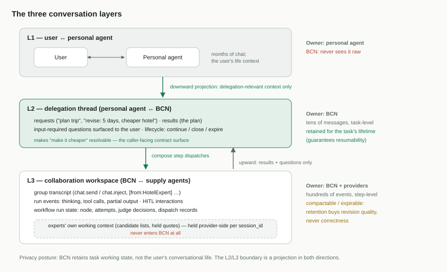
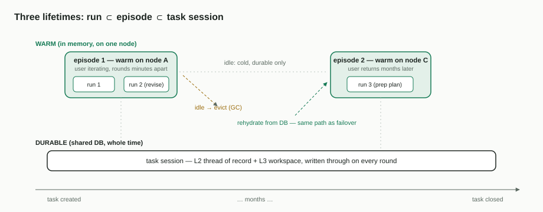

# 01 — 接口与状态模型

[English](01-interface-and-state-model.md)

- 上级文档:[面向个人智能体的 BCN 云端编排](README.zh-CN.md)
- 状态:团队评审草案

## 问题

对于一个可能横跨数月的任务,PA 与 BCN 之间的契约是什么?BCN 为它保存什么状态?两类风险
方向相反:

- 过于无状态,交互式改稿就会失效:用户在一次会话中反复迭代("改成 5 天,酒店再便宜点"),
  第 N+1 轮必须能解析对第 N 轮产出的指代,而供给侧 Agent 应当*修订自己之前的工作*
  (酒店专家手里的候选清单、保留的报价),而不是被冷启动地重新交代一遍。
- 过于有状态,云端就会积累数月的个人上下文 —— 这是对 Cloud 路线最有力的隐私反对 ——
  外加一个长达数月的热工作集,让 GC 和高可用都变复杂。

## 决策 1 —— BCN 是 PA 调用的服务端

以今天的构件,两种姿态都可行:

- **A —— 请求/响应**:PA(持有时钟)调用 BCN;结果异步取回。今天已以异步 chat + 运行
  查询和 OpenAPI V1 协作面存在。
- **B —— 对等 Bot**:PA 注册为一个 Bot,BCN 通过常驻 WebSocket 或 webhook 向它推送。

我们选择 **A**,与进行中的 A2A 迁移对齐:PA 以 **A2A 1.0(JSON-RPC over HTTP + SSE)**
与 BCN 通信。协议栈分工清晰,一层一责:

- **HTTP** 是传输:每次调用一个短生命周期的请求/响应;调用之间什么都不保留。
- **JSON-RPC 2.0** 是信封,落在单一 `POST` 端点上:
  `{"jsonrpc":"2.0","id":…,"method":"SendMessage","params":…}` —— 方法名走在请求体里,
  而不是分散在 REST 路由上。
- **SSE** 是响应*流式*到达的方式:对流式方法,HTTP 响应以 `text/event-stream` 保持打开,
  递送增量事件(状态变化、输出分片)。流断掉后用一个新请求重新接上,从最后看到的事件
  继续。
- **A2A** 提供承载在里面的词汇与对象模型:方法(`SendMessage`、`SubscribeToTask`、
  `GetTask`)与对象(Message;带生命周期状态的 Task;`contextId`)。

`SendMessage` 开启或延续一轮;`SubscribeToTask` 流式跟随它;`GetTask` 在任何中断后
重新接上。长达数月的*逻辑*会话由持久标识承载 —— 从不依赖连接:

| 标识 | 它命名什么 | 谁签发 |
| --- | --- | --- |
| **`session_id`** | BCN **任务会话** —— 一个 PA 任务的持久容器(1:1) | BCN 在首次委托时签发;PA 保存它,并在之后每一轮带上 |
| A2A `contextId` | **同一个值**,是它在 A2A 信封里的线上形态 | — |
| `run_id` | 会话内的一次工作流执行(一个委托轮次) | BCN,每轮一个 |
| A2A task id(文档 03 中的 `server_task_id`) | *供给侧 Agent* 为一个被派发步骤建立的工作单元 —— 与 PA 的"任务"无关 | 供给侧 Agent |

全部文档只用一个词:PA 的*任务*与其 BCN *任务会话* 1:1 对应,我们统一书写的标识是
**`session_id`**。

推论:

- BCN 的一轮本身可以运行数分钟到数小时,所以结果取回必须可续接(带最后序号重新订阅,
  或轮询)—— 绝不能依赖某一条连接活到最后。
- PA 不持有任何需要 BCN 跟踪的常驻 socket。客户端连通性退出高可用问题(文档 02);剩下
  唯一"连接形态"的客户端是供给侧 Agent,而它们本就有重连机制。
- 对 PA 的推送通知是可选的。A2A 允许客户端注册一个 webhook URL(push-notification
  config);服务端随后把任务状态更新 POST 到该 URL,而不是等着被询问。对我们而言这纯粹
  是延迟优化 —— 空闲的 PA 更早得知结果 —— 正确性从不依赖它:`GetTask` /
  `SubscribeToTask` 在下一次调用时能取回同样的信息。
- **TBD(时钟归属):** 若有用例要求 BCN 侧定时器(持续监控、无调用方的定时续跑),
  姿态 A 仍然成立,但必须补充持久定时器存储。在 PA 团队确认前不纳入范围。

### 本设计与 A2A 的耦合有多深?

刻意地浅。A2A 是一个开放协议(起源于 Google,随后捐赠给 Linux 基金会,以厂商中立方式
治理)—— 是线协议与对象模型,**不是框架**:我们不承担任何运行时依赖,只取动词面与对象,
而且组织层面已经通过 engine 协议迁移采纳了它。真正触及 A2A 的只有:动词
(`SendMessage`/`GetTask`/`SubscribeToTask`)、Task/`contextId` 映射,以及 profile 的
声明槽位(AgentCard 扩展 URI)。所有承重部分都是协议中立的:状态模型与生命周期、
放置/租约/隔离令牌、写前键、profile 的语义条款、能力分级。拉取式核账对载体协议只要求
三样东西 —— 持久的 task id、一个读任务状态的动词、一个 metadata 槽位 —— 这正是同一套
设计今天已经跑在非 A2A 帧通道上的原因(以注册标志代替 AgentCard,见文档 04)。按架构
规则,A2A 落在投递适配器里;service-api 契约保持协议中立,因此升级乃至替换 A2A 是一次
适配器变更,不是一次设计变更。

与 Agent *框架*(ADK、LangGraph、CrewAI 等)的耦合为**零**:本设计只约束线上可观测的
行为,从不触及参与者的内部实现。今天的机群就是证明 —— OpenClaw、经 bridge 的
Claude Code/Codex、DeepSeek Harness、外部平台;没有谁与谁共用框架。每个参与者
(包括 PA)都可以自选框架、日后更换而无人察觉:唯一的共同承诺是线上契约。

## 决策 2 —— 三层对话,边界即投影

| 层 | 对话 | 所有者 | BCN 可见? |
| --- | --- | --- | --- |
| **L1** | 用户 ↔ PA | PA | **原文永不可见** —— 由 PA 决定什么向下穿越 |
| **L2** | PA ↔ BCN:委托线程(请求、结果、HITL 转递、生命周期操作) | BCN,作为面向调用方的契约面 | 可见 —— 正是它让"把*它*改便宜点"可解析 |
| **L3** | BCN ↔ 供给侧 Agent:群转录、运行事件、协同流量;外加每位专家自己的工作上下文,按 `session_id` 由 **Provider 侧**持有 | BCN + Provider | BCN 部分可见;Provider 持有的部分永不进入 BCN |

L2/L3 边界是双向投影。向下:BCN *从* L2 请求组装步骤派发;用户的 L1 历史永不穿越。
向上:PA 收到结果和 `input-required` 问题 —— 而不是专家的原始事件流,后者包含其他
厂商的推理痕迹,不属于调用方可读的内容。

粒度与体量相差一个数量级:L2 是几十条任务级消息;L3 是每次运行成百上千条步骤/消息/
事件级记录。

谁实际持有什么:L3 的 BCN 侧 —— 群转录、运行事件、工作流运行状态 —— 存于**共享数据库**;
节点只在活跃期内持有一份热拷贝(决策 3)。专家自己的工作上下文是唯一存放在 BCN 之外的
部分,由 Provider/Agent 自己按 `session_id` 持有。

关于协议名的说明:图中的 `chat.send` / `chat.inject` 是*今天的* BCS 投递帧("请回应"
与"静默观察")。A2A 迁移会替换这一层的信封与传输;这些语义会以 A2A 消息的形式延续。
图中画今天的帧,因为那是现在真正在跑的东西。

### 一次步骤派发如何获得之前轮次的上下文

被派发的步骤 prompt **不**携带完整历史。三个机制叠加,按承担的分量排序:

1. **Agent 自己的会话(主力)。** 派发携带与之前每一轮相同的 `session_id`,Agent 的
   引擎在该键下恢复自己的会话 —— 它对之前轮次的记忆是本地的,就像一个被恢复的编码
   助手会话。这是契约性的:BCN 从不推送完整历史(Provider 集成契约要求 Provider 按
   `session_id` 自持上下文),而且在每一轮中,参与者也通过"只观察"投递实时积累了
   *整个群*的流量。这正是其留存能买到修订质量的那份状态(决策 4)。
2. **组装出的指令(L2→L3 向下投影)。** BCN 从持久状态构建步骤 prompt:新请求、与
   委托相关的增量、对上一份交付物的引用,加上群上下文头。体量小,因为大头由机制 1
   承担。
3. **按需拉取(兜底)。** 没有该会话的 Agent —— 新绑入任务、被换入、或已过留存期 ——
   由持久转录重新交代(今天是历史查询,A2A 下是会话记录读取);需要*融合*多个参与者
   视角的步骤则使用 fusion 调用。新专家被重新交代,正是决策 4 的优雅降级路径:更慢、
   正确、绝不是错误。

## 决策 3 —— 三种生命周期:运行、活跃期、任务会话

| 单元 | 生命周期 | 作用域 |
| --- | --- | --- |
| **运行(run)** | 分钟–小时 | 一次工作流执行:状态机位置、检查点、派发记录、恢复(文档 03) |
| **活跃期(episode)** | 分钟–小时 | 一段密集交互;状态唯一处于**热**态的时期 |
| **任务会话(task session)** | 任务生命周期 | 共享数据库中持久的 L2 线程 + L3 工作区 |

**热态**指任务所属节点上已水合的内存工作状态:组装好的会话上下文、编译好的工作流、
运行状态缓存。让它与高可用兼容的规则是:

> 节点本地状态是**可重建的缓存**,绝不是唯一副本。持久事实在确认前直写共享数据库
> (禁止对持久事实做写回缓冲 —— 那会把节点故障变成数据丢失)。亲和性换来的是读的节省,
> 不是写的节省。

因此,空闲活跃期的 GC、数月之后任务的恢复、节点死亡后的故障转移,是同一个操作 ——
从数据库再水合,然后继续。**故障转移就是一次缓存未命中。** 恢复路径在正常运行中被持续
演练,而不是只在紧急时刻才走。

活跃期内的缓存亲和正是放置哈希所优化的(文档 02):第 2 轮在数秒后落到第 1 轮仍然
热着的那个节点上。数月尺度上的亲和明确*不是*目标。

一个值得说透的边界:**活跃期不是一种会话**。它没有标识、没有 API 面 —— 没有任何东西
寻址一个活跃期。任务会话是*数据*(持久存在的行);活跃期是*缓存生命周期*(某节点让这些
数据保持水合的时段)。相对地,运行是可寻址的(`run_id`),大致对应一个委托轮次;多条
消息的 HITL 往返发生在一次运行*内部*,不是多次运行。

## 决策 4 —— 留存是策略旋钮,按层拆分

- **L2(存证线程)** 存活整个任务生命周期:问了什么、交付了什么、确认了什么 —— 即决策 2
  的委托线程,**不是**专家的执行痕迹(那是 L3)。它保证*可恢复性*。它由 **BCN** 持有,
  存于共享数据库 —— PA 可以自己留一份对话副本,但可恢复性不依赖它。
- **L3(工作状态)** 可按自己的时钟压缩/过期,包括通知 Provider 丢弃会话上下文。保留它
  买到的是*修订质量*:L3 还在,"换家酒店"就能续用专家手里的状态;L3 过期了,专家就从
  L2 记录重新交代 —— 质量上的优雅降级,绝不是正确性损失。

因此面向 PA 的 API 增加**会话生命周期控制**:continue(每轮默认)、close("任务完成 ——
丢弃工作状态")、expire 策略配置。"忘掉这个任务的工作数据"是一次 API 调用,不是一次
架构变更。

写给评审的隐私立场:BCN 保留的是**任务工作状态,不是用户的对话人生**。L1 永不进入
BCN;L2 只含 PA 选择发送的、与委托相关的上下文;L3 受上述留存策略约束。

## 需要新建什么(增量)

- BCN 上面向 PA 调用方的 A2A 服务端面(顺着既有 A2A 迁移方向;profile 扩展属文档 03
  的范围)。
- 任务会话模型:每个 PA 任务一个 `session_id`,绑定其拥有的 BCN 会话/群,L2 投影作为
  面向调用方的记录持久化。
- 会话生命周期 API(continue / close / expire 策略)。
- 活跃期的水合/驱逐由执行器平面管理(文档 02);不需要新存储 —— 持久形态都已在现有
  store 中。

## 被否决的替代方案

- **完全无状态的轮次**(每次委托自包含):破坏交互式改稿,丢弃专家工作状态;否决。
- **数月长的热会话**(任务整个生命周期钉在一个节点上):那个时间尺度上热态毫无价值,
  膨胀隐私面,并把 GC 变成正确性问题;否决,代之以"持久会话 + 活跃期热态"。
- **PA 作为对等 Bot(姿态 B)**:把常驻客户端连接重新引入高可用问题,并要求 PA 可寻址
  或持有 socket;作为主干否决(将来可作为可选推送通道回归)。
