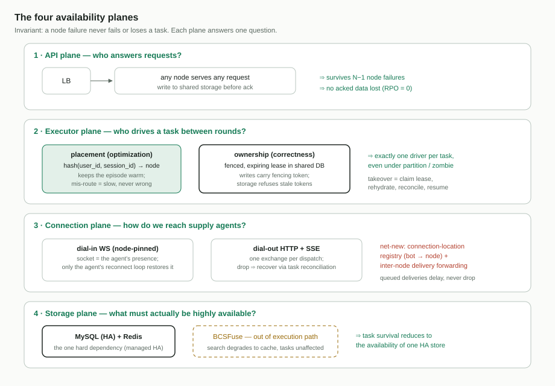
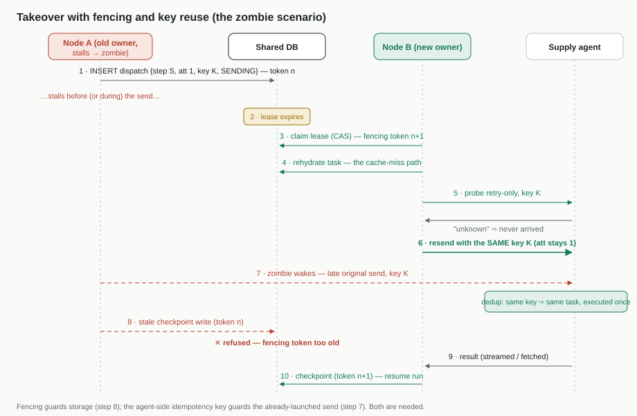

# 02 — 可用性架构

[English](02-availability-architecture.md)

- 上级文档:[面向个人智能体的 BCN 云端编排](README.zh-CN.md)
- 状态:团队评审草案

## 问题

云端编排把 BCN 放进了 PA 任务的关键路径。需求以不变量的形式陈述:

1. **服务器节点故障绝不使任务失败或丢失。** 任何任务都不会因为驱动它的节点死亡而被
   "提前失败";已确认的请求与已执行的副作用,绝不丢失、也绝不悄悄重复。
2. **服务可用性保持高位。** API 面在单节点故障、发布与扩缩容事件中持续可答。

今天 BCS 以单一逻辑实例部署。它的恢复机制(派发前落盘、启动事实、不可变运行快照,
`dispatch/judge/opening` 等恢复模块)是真实且久经考验的 —— 但其前提是*同一个逻辑节点
重启并重读自己的表*。"另一个节点检测故障、认领工作、隔离旧执行者"——这些全都不存在。
整个代码库里也没有任何节点身份、成员关系或任务到节点的指派。

## 设计:四个平面

### 平面 1 —— API(无状态请求处理)

任意节点服务任意请求。所有持久效果在确认前写入共享存储(这已是本地纪律)。PA 的调用
携带的是标识而不是连接状态(文档 01),因此负载均衡器可以自由分摊或切换请求。

- 可用性:负载均衡之后可承受 N−1 个节点故障。
- RPO(recovery point objective,恢复点目标 —— 一次故障允许丢失多少已确认数据):
  **构造上为 0** —— 请求在发出确认前就已落在共享存储里。

### 平面 2 —— 执行器(谁驱动任务)

在调用方轮次之间,BCN 并*不*被动:协作运行时随着供给侧 Agent 的应答推进工作流、触发
超时、派发重试。同一时刻必须恰好有一个节点驱动某个任务。

两个机制,刻意分离:

- **放置 —— `hash(user_id, session_id)`** 把同一任务会话的各轮路由到同一节点,让活跃期
  保持热态(文档 01)。这是延迟*和数据库负载*的双重优化:在我们必须支撑的 QPS 下,
  每轮都重新水合上下文会成倍放大对共享库的读;亲和性让重复轮次由内存服务,把数据库挡在
  每轮热路径之外。被错误路由的一轮(环抖动、扩缩容)无害但更慢:它只是多付一次再水合,
  仅此而已。
- **所有权 —— 共享数据库中带隔离令牌、可过期的租约。** 节点通过写入租约行
  (`session_id`、节点 id、隔离令牌 = 单调递增的代数、过期时间)来认领任务。驱动期间
  持续续租;其他节点只认领已过期的租约。驱动期间的每一次持久写都携带隔离令牌,存储拒绝
  携带过期令牌的写入 —— 这才是真正隔离僵尸的东西:被暂停/被分区的节点醒来后继续写,
  在数据层面就被拒绝,无论它自己怎么认为。
  具体地:租约行保存当前令牌,一个代数。认领是条件更新
  (`SET token = n+1 WHERE token = n AND expired`),所以恰好一个认领者胜出;此后每一次
  持久写同样是条件写(`… WHERE lease_token = my_token`)。过期后才醒来的旧持有者手里
  仍是令牌 *n*,而行里已是 *n+1* —— 它的写在数据库处失败,而数据库是两个节点保证相遇的
  唯一地点。这是标准的隔离令牌(fencing token)模式;其要点是:正确性从不依赖旧节点
  *知道*自己丢了租约。

为什么不能只用一致性哈希:在成员变更或分区时,两个节点可能短暂地同时认为自己拥有环上
某一段。哈希的正确性依赖所有人就成员关系达成一致 —— 这恰恰是难点 —— 而租约把正确性锚定
在所有节点本就共享的存储上。现有的 `session_activation_count`(恢复路径已经校验的激活
代数)正是这一隔离模式在代码库中的种子,此处将其一般化。

**接管流程**(新所有者,在租约过期后):

1. 以更高的隔离令牌认领租约(原子比较并交换)。
2. 从持久状态再水合任务 —— 与活跃期恢复同一条路径;"故障转移就是一次缓存未命中"。
3. 通过拉取协议核账在途派发(文档 03):对每条未达终态的派发记录,按幂等键探测供给侧
   Agent / `GetTask` —— 绝不盲目重发。
4. 从检查点恢复运行。

探测与去重的分工:**Agent 侧去重是安全不变量** —— 每当两次发送竞速(时序图第 7 步),
防止双重执行的就是它。探测不提供保护;它提供*信息*:找回随旧节点一起消失的 task id 与
结果,并且 —— 以 retry-only 形式 —— 在*不触发执行*的前提下给出可判定的答案。这在重发
不安全时至关重要(先前结果未知的副作用步骤,或落在去重窗口之外的探测)。面对一个不做
去重的 Agent,探测与小心重发都不是 100% 安全 —— 迟到的重复总能钻进来。这正是副作用
步骤在派发时按"已验证的 profile 合规"设门禁的原因(文档 04)。

故障检测:租约过期是基准事实;节点心跳(写数据库或成员视图)只是*加速*检测。拟定
起点、待调优:租约 TTL 15s,每 5s 续租,接管 RTO 目标 ≤ 30s(从节点死亡到恢复执行)
(**开放问题 #2**)。

### 平面 3 —— 连接(触达供给侧 Agent)

供给侧 Agent 的通道钉在节点上,是再水合唯一无法重建的东西 —— 另一端握在远端手里:

- **拨入 WebSocket Bot**(插件、bcs-bridge):socket 就是 Agent 的全部在线状态。恢复
  依靠 *Agent 自己*的重连循环重新拨入(现有的重连 + 准入限流机制),之后 socket 可能
  落在任意节点上。
- **拨出 webhook+SSE Provider**:每次派发是一次自包含的 HTTP 交换,其 SSE 响应只流式
  传输这一个步骤的事件 —— 它的"信息流"(生命周期、输出分片、工具事件),今天的逐流
  序号只用于*流内*去重。**今天流断掉不会续传**:Provider 2.0 明确不支持
  `Last-Event-ID`、自动重连或断点续传,而且当流在没有真正终态事件的情况下结束时,
  适配器会以合成的错误终态关闭这次运行。因此在本设计中,被打断的派发经由**文档 03 的
  任务状态核账**恢复(对 Agent 持久任务的探测/`GetTask`)—— 当节点存活而流死亡时,由
  **所有者节点自己**执行(不涉及接管;合成终态是通道之死,不是结果),接管时则由
  继任者执行:两种情况走同一条路径,无需任何流重放即正确;基于游标的持久流续传是
  *可选的*全新适配器+Provider 工作,只会改善部分输出的实时性,绝不影响正确性。
  Provider 的可达性(它的 URL)与节点无关。

全新部分:**连接位置注册表**(共享存储或 gossip),记录 bot → 当前持有其 socket 的
节点,外加节点间投递转发,使拥有会话的节点能够投递给 socket 在别处的 bot。注意这是
**常规路径,不只是故障转移**:没有任何机制把 Agent 的 socket 与它服务的会话放在同一
节点 —— socket 落在接受拨入的那个节点(或下次重连循环落到的地方),而会话所有权跟着
租约走。注册表查询加转发是普通投递的一部分。
投递本就持久排队,所以短暂断连的 Agent 只是*延迟*收到消息,而不是丢失。

### 平面 4 —— 存储

- MySQL 与 Redis 插件已存在;它们的高可用交给托管/集群化部署,是前提而非本设计的一部分。
- **BCSFuse 退出执行关键路径。** 背景:BCSFuse 是一个独立的 Python 服务 —— 带向量的
  供给侧 Agent 目录。BCS 把每个 bot 的公开能力元数据(技能、领域、简介)同步进去,并
  查询它做 Agent 搜索与推荐;"帮我找一个会订机票的专家"就是它回答的。在本设计中它只
  服务**发现**:结果在选择工作流时消费、可缓存,因此 BCSFuse 故障只降低搜索新鲜度,
  绝不影响运行中的任务(缓存策略见**开放问题 #4**)。

## 故障模式表

| 故障 | 检测 | 用户可见影响 | 恢复上界 |
| --- | --- | --- | --- |
| 节点崩溃,其上只有空闲任务 | 下一轮路由到别处 | 无 —— 冷启动 = 正常再水合 | 无需 |
| 节点崩溃,任务运行中 | 租约过期 | 该轮短暂停滞;不丢失、无重复副作用(文档 03) | 接管 RTO(目标 ≤ 30s)+ 核账 |
| 网络分区 / 暂停("僵尸")节点 | 存活侧租约过期;过期侧被隔离令牌拦截 | 同上;僵尸迟到的写被隔离令牌拒绝 | 同崩溃 |
| 滚动发布 / 扩缩容 | 租约移交或过期;环移动 | 部分轮次多付一次再水合 | 每任务数秒 |
| 供给侧 Agent 的 socket 丢失 | Agent 重连循环 | 在途步骤等待;排队投递延迟 | Agent 重连 + 注册表更新 |
| 共享数据库宕机 | 立即 | **控制面停摆**:新轮次被拒,在途运行暂停;已确认的内容零丢失;Agent 侧任务状态(文档 03)继续积累结果 | 数据库高可用切换(外部托管) |
| BCSFuse 宕机 | 健康检查 | 工作流搜索降级到缓存;执行不受影响 | 不适用 |
| 整个 BCN 控制面宕机 | 调用方侧 | Edge 路线(BCN CLI 基于共享存储)是降级路径 —— 共享契约依赖,由 Edge 路线设计 | 不适用 |

诚实的可用性结论:任务存活不变量把 BCN 的可用性依赖收敛到**一个高可用存储系统**。
BCN 节点是其上可替换的执行器;BCSFuse 在路径之外;客户端不持有连接。"整个存储层宕机"
是残余风险,与机群中每个有状态服务共担,并由同一套托管高可用实践缓解。

## 已有 vs. 全新(本文切片)

| 部件 | 状态 |
| --- | --- |
| 派发前落盘、运行快照、重启恢复 | 已有 |
| 持久投递队列、拥塞控制、重连准入 | 已有 |
| `LeaderElectionPort` 接缝(仅 standalone 实现) | 已有(接缝) |
| 隔离种子(`session_activation_count`) | 已有(模式) |
| 节点身份、成员关系、心跳 | **全新** |
| 基于哈希的放置 | **全新** |
| 带隔离令牌的任务租约 + 接管 + 存储侧令牌校验 | **全新** |
| 连接位置注册表 + 转发 | **全新** |
| Provider SSE 流续传(游标/重放) | **全新、可选** —— 正确性由文档 03 的核账覆盖;此项只改善部分输出的实时性 |
| BCSFuse 解耦/缓存 | **全新** |

## 被否决的替代方案

- **把一致性哈希当作正确性机制**:在分区与成员分歧下失效;仅保留用于放置。
- **以主备(active/standby)为终态**:满足不变量,但吞吐封顶于一个节点,且发布变成
  可用性事件;作为终点否决。(它可以作为上线里程碑出现 —— 租约设计在 N=2 时退化为它 ——
  但这里评审的架构是 N 活的那个。)
- **用负载均衡器的粘性会话代替放置哈希**:把放置耦合进 L7 基础设施,对执行器平面不可见,
  也无法服务同样需要亲和的后台(轮次之间)工作。
