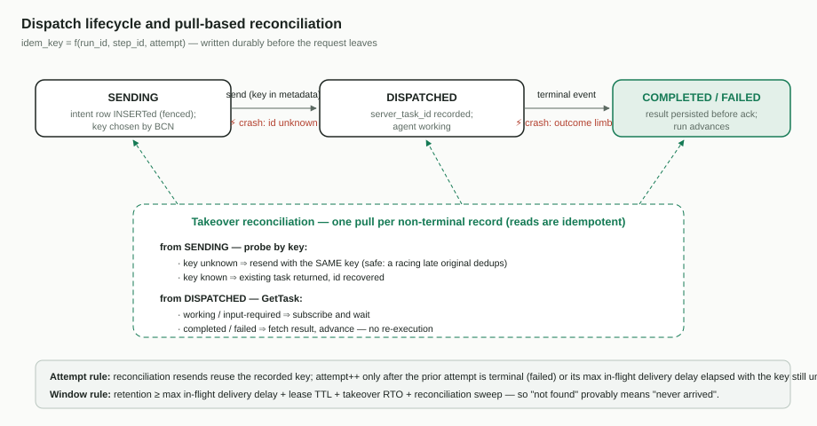

# 03 — 执行正确性

[English](03-execution-correctness.md)

- 上级文档:[面向个人智能体的 BCN 云端编排](README.zh-CN.md)
- 状态:团队评审草案

## 问题

工作流步骤有真实世界的副作用:订酒店、买机票、发消息。执行一旦分布式化,三个窗口立刻
威胁正确性:

1. **至少一次投递。** 每条通道都存在超时、重试与重复投递(Provider 2.0 协议自己就写明:
   ACK 丢失可能导致重复投递,只承诺尽力去重)。没有接收方去重,一次重试就是一次重复下单。
2. **丢失 id 的窗口。** 节点发出一次派发,还没来得及记录对方分配的 task id 就死了。新
   所有者无法对一个没人记下来的 id 执行 `GetTask` —— 而那次派发可能到达了,也可能没有。
3. **接管后的结果悬置。** 对任何未达终态的派发,新所有者必须区分"从未到达"/"进行中"/
   "已完成、结果在途丢失" —— 在推送模型下,这些信息有一部分随旧节点一起死了。

现状:engine A2A 迁移自己的评审已确认,**BCS 今天不传幂等键**(A2A chat 调用点上
`idempotency_key: None`),而那里设计的幂等窗口(`avernet.retryOnly`,D14)是**进程内**
注册表 —— 单节点正确,N 节点失效:落到另一个节点的重试(或故障转移后的探测)看起来像
全新请求。

## 设计

### 1. 写前派发意图,键由客户端生成

恢复所依赖的标识必须**由 BCN 选定,并在请求发出前持久记录**;*供给侧 Agent* 分配的
A2A task id(在 BCN→Agent 这一对中,Agent 是 A2A 服务端 —— 见文档 01 的标识表)只是
事后缓存的便利。

```
idem_key = f(run_id, step_id, attempt)           # 确定性;run_id 对每次工作流
                                                 # 运行全局唯一,因此同一任务
                                                 # 各次运行的键绝不碰撞

1. INSERT 派发记录 {run, step, attempt, idem_key, state=SENDING}
2. 发送 A2A 消息,idem_key 放在 metadata 中
3. 收到响应:UPDATE {server_task_id, state=DISPATCHED}
...
n. 收到终态事件:UPDATE {state=COMPLETED|FAILED}
```

**attempt 语义。** 核账重发**复用未决 attempt 已记录的 `idem_key`** —— 绝不换新键。
`attempt` 递增(签发新键)的前提是上一个 attempt **可证明地允许重试**:它以**声明了
无副作用**的 `failed` 终结,或者在该 attempt 的最大在途投递时延(见下方窗口定界)过去
之后键仍然未知。对 `external_side_effect` 步骤,一个裸的 `failed` 不是那个证明 ——
购买可能在后续子操作失败之前已经完成;effect 声明为 `occurred` 或 `unknown` 的
`failed` 走结果核账(上报调用方,或补偿),永远不会自动获得新键。理由:隔离令牌守护的
是存储写入,不是僵尸已经发出去的 HTTP 请求。如果旧所有者卡在 INSERT 与发送之间,而
继任者把 attempt 升到 `(t, S, 2)`,就会与僵尸迟到的 `(t, S, 1)` 竞速 —— 两个不同的键,
两次执行。复用键之后,僵尸迟到的首次投递会与继任者的重发互相去重(同一个键,从同一份
持久状态确定性再生的相同载荷)。

所有写入都携带执行器租约的隔离令牌(文档 02)。任何时点崩溃,都会留下继任者可依据的
持久记录。这把 BCS 既有的"先持久化、后派发"纪律向外延伸了一跳:恢复不依赖任何只存在于
死亡节点内存中的信息。



### 2. 拉取式核账:Agent 自持可查询状态

原则:**读是幂等的;推不是。** 供给侧 Agent(BCN→Agent 这一对中的 A2A 服务端)保留
Task 及其产物,可经 `GetTask` 查询。接管时,对每条未达终态的派发记录:

| 记录状态 | 探测结果 | 动作 |
| --- | --- | --- |
| `SENDING` | Agent 处键未知 | 首次投递从未到达 → **用同一个键**重发(安全 —— 竞速迟到的原始请求会与之去重) |
| `SENDING` | 键已知 → 返回既有任务 | id 找回;按下文继续 |
| `DISPATCHED` | 任务 `working` / `input-required` | 订阅并等待 |
| `DISPATCHED` | 任务 `completed` / `failed` | 取结果、推进 —— **不重复执行** |

这条拉取路径**不只在接管时运行**:每当派发通道在没有真正终态的情况下死亡 —— 例如
拨出 SSE 流在步骤中途断掉、适配器合成一个错误终态 —— *所有者节点*就运行同一套三分法。
合成终态报告的是*通道*之死,不是任务的结果:Agent 可能还在执行。把这样的 attempt 当作
`failed` 处理之前,所有者先探测/`GetTask` Agent 的持久任务 —— 用"读"来解决"流断了但
订单订成了",而不是把步骤卡成"结果未知待核实",也不是铸造新键。

本协议的适用范围:它预设一个 **profile 已验证的 Agent** —— 而派发门禁(文档 04)为每个
有副作用的步骤保证了这一点,因为这类步骤从不派发给未验证去重的 Agent。基础档的 Agent
只持有 `read_only`/幂等步骤,盲目重发无害,根本用不上这套机制。直白地说:**去重是安全;
探测提供信息**(找回的 task id 与结果),从不提供保护。

两种探测形态,profile 都要求:

- **幂等重发**:同一请求、同一键 —— Agent 要么认出这个键(返回既有任务),要么当作首次
  投递处理。用于去重窗口之内。
- **先探测("retry-only")**:一个标志,含义是*这是对你理应已知之事的重试 —— 绝不当作
  新请求执行*。键已知,Agent 返回既有任务的当前状态(可能已完成、在途或失败 ——
  "已知"意味着请求*到达过*,不意味着它完成了);键未知,Agent **拒绝而非执行**,这一
  拒绝就是未到达的证明。两个分支都不会执行任何新东西 —— 它是披着请求外形的查询。此即
  engine-A2A 设计的 D14 机制,原样采纳;它存在的原因是:窗口之外的裸重发与新请求无法
  区分。

拉取模型的三个推论:

- **BCN 内部不需要入站队列。** Agent 的任务存储就是缓冲;即使 BCN 宕机它也继续积累
  结果,死掉的 BCN 不会被投递重试轰炸。
- **BCN 入站侧先持久化、后确认。** 供给侧 Agent 交付结果时,BCN 先把它写入共享数据库,
  *再*向 Agent 回发收讫确认。那个确认才是允许 Agent 停止重试(并在留存窗口后遗忘)的
  信号。反过来的顺序是一个丢失窗口:确认、在持久化前崩溃,结果就没了 —— Agent 看到了
  确认,永远不会重发。
- **BCN 也对自己的入站流量去重。** 在线路上,一个异步交付的"响应"就是又一个入站请求
  (一个 POST、一个帧),而调用方和 Agent 在确认丢失时都会重发 —— 所以 BCN 维护自己的
  持久、共享的已见集合,对重复投递回以原始结果,而不是处理两次。

### 3. BCN A2A profile

基础 A2A 1.0 提供客户端生成的 `messageId`、带生命周期状态的服务端 Task、
`GetTask`/`SubscribeToTask`,以及开放的 `metadata` + 扩展 URI 机制。它**不**规定去重
语义、按键查询或留存。这些成为一个具名的扩展 profile —— 不是协议分叉;原生 A2A 流量
原样通行:

| 条款 | 内容 |
| --- | --- |
| 键约定 | `idem_key` 放在请求 metadata 中,由 `(run_id, step_id, attempt)` 派生 —— 以运行而非任务为作用域,因此同一任务后来的改稿轮次绝不会与先前运行的派发互相去重 |
| 去重 | 同键 ⇒ 同任务,在执行准入处原子检查;同键而载荷冲突 ⇒ 保留首个、标记错误 |
| 失败效果声明 | 有副作用任务的终态 `failed` 必须声明 `effect: none / occurred / unknown`;只有 `none` 允许换新键重试 —— `occurred` 与 `unknown` 走结果核账,绝不自动重试 |
| 探测语义 | 窗口内幂等重发;retry-only 标志以原子的已知/未知判定来兑现 |
| 留存下限 | 终态任务状态**与**键已见集合都保留 ≥ 约定窗口;窗口内,"task not found" 可证明地等于"从未到达" |
| 窗口定界 | ≥ 最坏情形(**单次 attempt 的最大在途投递时延** —— 派发超时 × 重试预算 + 最大网络/队列时延 —— + 租约 TTL + 接管 RTO + 核账扫描)并留余量;两种留存共用一个时钟。第一项正是让"not found ⇒ 从未到达"成立的东西:没有它,僵尸迟到的原始发送可能落在窗口关闭*之后*、已滑出已见集合,被当作"新"请求重复执行。因此发送方还必须为单次 attempt 的"发送+重试"总生命周期设上界,使该项在构造上有限 |
| 声明 | Agent 如何声称支持本 profile:在其 AgentCard 中列出 profile 的扩展 URI(A2A 公告可选能力的标准机制),或对今天帧通道上的 Agent 在注册时设置等价的能力标志;BCN 记录该声称,但只有通过一致性验证后才信任它(文档 04) |
| 逃生口 | 落在窗口**之外**的探测不可判定:有副作用的步骤不自动重发 —— 向调用方上报"结果未知,请核实",转入人工核账 |

范围说明:本 profile 是**本项目的交付物**。它建立在 engine A2A 迁移(方法面、
`retryOnly` 判定)之上,但补上了那个设计在单节点下不需要的部分:持久/共享的去重状态、
留存契约、跨节点探测正确性。

### 4. 副作用等级为负担划定范围

工作流 YAML 节点新增副作用等级:

- `read_only` / `idempotent`(搜索、查询、总结):盲目重发安全;**任何原生 A2A Agent
  都够格** —— 无需 profile。
- `external_side_effect`(下单、支付、发送):**只能**派发给 profile 合规已验证的
  Agent(文档 04 的分级),否则该步骤不运行。

这把对整个生态的一揽子要求,收敛为只针对"重复一次就是真金白银"的那些步骤的定向要求,
并给了派发引擎一条有原则的资格规则,而不是一个指望。

## 成本,如实陈述

- **正常路径运行时成本 ≈ 0**:键搭乘 metadata;写前记录只是扩展一次已有写入;探测只在
  恢复时运行。
- **BCN 侧**:几个列 + 一个恢复扫描;持久已见集合;共享的窗口状态。小。
- **Agent 侧**:每个适配器一份"持久已见集合 + 原子检查并执行" —— 工作量真实但有界,
  按类别列于文档 04。探测与在途首次投递的竞速确实微妙(engine-A2A 评审为此花了两轮);
  一致性测试套件必须覆盖它。
- **生态**:Agent 要先采纳 profile 才能承接有副作用的步骤(文档 04)。永不合规的 Agent
  的保底是上面的逃生口:以人工核账替代自主重试 —— 明码标价,而不是被假设掉。

## 被否决的替代方案

- **精确一次投递基础设施**(经 broker 向 Agent 做事务性发件箱):触达不了第三方 Agent,
  而且终点仍是接收方去重;profile 就是那份去重,只是去掉了 broker。
- **只用服务端生成的 id**:让丢失 id 的窗口在构造上无解。
- **盲目重发并指望"多数 Agent 大概是幂等的"**:否决;重复购买正是怀疑者有权一票否决的
  那一类失败。
- **不做 profile、永远人工核账**:作为不合规 Agent 的书面保底保留,但作为默认被否决 ——
  它恰好掐死了 Cloud 路线存在的意义:自主性。
