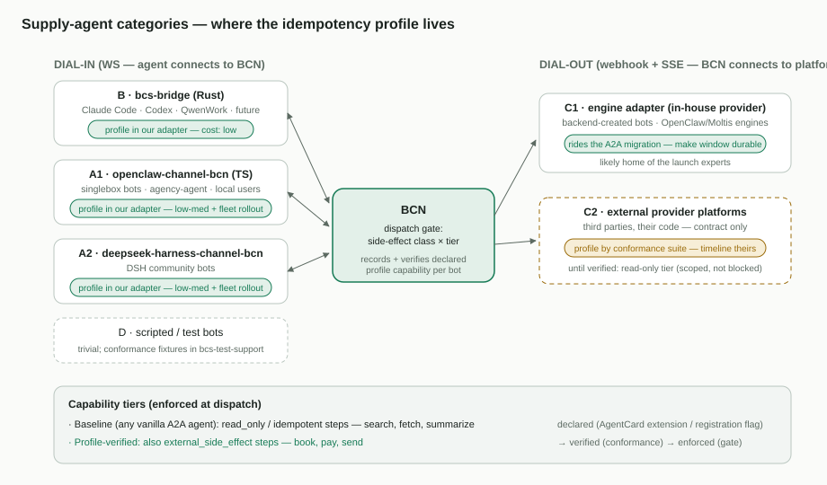

# 04 — 供给侧 Agent 合规

[English](04-supply-agent-compliance.md)

- 上级文档:[面向个人智能体的 BCN 云端编排](README.zh-CN.md)
- 状态:团队评审草案

## 问题

文档 03 的正确性保证,只在供给侧 Agent 实现了 BCN A2A profile(按幂等键的持久去重、
原子的检查并执行、留存下限、探测语义)的地方成立。机群是异构的 —— 四条自有集成路径,
外加我们无法控制的外部平台 —— 而且会长期混杂(用户机器上的插件版本升级缓慢;外部采纳
靠谈判)。我们**同时支持自有与外部 Provider**。

让问题可解的关键视角:对每个自有类别而言,"Agent" 实际上是*引擎 + 我们的适配器*,而
profile **完全落在适配器里**。引擎本身(OpenClaw、Claude Code、Codex、DeepSeek
Harness……)永远不需要改动。

## 类别

| # | 类别 | 成员 | 传输 | 适配器归属 | 现有持久存储 | 成本 |
| --- | --- | --- | --- | --- | --- | --- |
| A1 | OpenClaw 插件 bot | singlebox bot、agency-agent 团队、本地 OpenClaw 用户 | 拨入 WS | 我们 —— `plugins/openclaw-channel-bcn`(TS) | bot 数据目录下的 JSON 文件 | 低–中 |
| A2 | DeepSeek Harness bot | DSH 社区 bot | 拨入 WS | 我们 —— `plugins/deepseek-harness-channel-bcn`(Node) | 基于文件的会话身份 | 低–中 |
| B | Bridge 封装的 CLI 引擎 | Claude Code、Codex、QwenWork、未来引擎 | 拨入 WS / 网关 | 我们 —— `tools/bcs-bridge`(Rust) | **SQLite** 运行/会话、后台终结 | **低** |
| C1 | 自有平台 Provider | 托管后端创建 bot 的 engine adapter(OpenClaw/Moltis;DWS hosting) | 拨出 webhook+SSE | 我们 —— `engine/adapter`(Python) | hosting 状态 store、恢复 store、发件箱 | 低–中 |
| C2 | 外部 Provider 平台 | 按 `docs/bot-provider-integration.md` 接入的第三方 | 拨出 webhook+SSE | **他们** —— 只有契约 | 未知 | **契约性,时间线不可控** |
| D | 脚本/工具 bot | rule bot、演示/测试 bot、测试替身 | 各种 | 我们 | 不适用 | 微不足道 |

## 分类别计划

- **B —— bridge,先做。** 基座已备:持久 SQLite 运行存储,加"结果保留到送达为止"的
  终结路径。合规 = 一张键表 + 执行时原子认领 + 窗口 GC,在一个代码库里,覆盖现在与
  将来 bridge 身后的每个引擎。
- **C1 —— engine adapter,杠杆最大。** 它正是迁移 A2A 到一半的那个组件,那份设计里已
  有 `retryOnly` 判定 —— 只是建成了进程内的。这里的合规大体上是*落地进行中的设计,外加
  一处改动*:把窗口挪进它已有的持久 store。该适配器托管的平台创建 bot,最可能充当上线
  期的专家。
- **A1/A2 —— 两个渠道插件。** 同一个小功能做两遍(带原子认领的持久键存储 —— JSON 文件
  没有 check-and-set,所以用 SQLite 或锁文件纪律),代码都是我们的。真正的成本是**机群
  推广**:它们跑在用户的 OpenClaw/DSH 安装里,新旧版本会长期共存 —— 这正是下文的协商/
  强制为何是必选项而非可选项。
- **C2 —— 外部平台。** 我们这边不写代码;改为:发布 profile 规范、提供可运行的一致性
  套件、做能力分级(下一节)。采纳靠谈判、时间无上界 —— 唯一真正昂贵的类别,被圈住,
  而非被解决。
- **D** —— 微不足道;另外把共享的一致性测试夹具放进 `bcs-test-support`。

## 能力分级与强制(BCN 侧,必选)

混合机群是永久现实,所以 BCN 必须对每个 bot *知道*并*强制*:

1. **声明** —— Agent(适配器/平台)声明 profile 支持:在其 AgentCard 中列出 profile 的
   扩展 URI,或对非 A2A 通道在注册/握手时设置等价的能力标志。
2. **验证** —— 光声明只是声称。自有适配器由我们的 CI 对一致性套件覆盖;外部平台跑同一
   套件以获得"已验证"标记。套件必须覆盖那些难缠的竞态:探测对阵在途首次投递、窗口
   过期、同键不同载荷。
3. **强制** —— 派发引擎按"副作用等级 × 档位"设门:

| Agent 档位 | `read_only` / `idempotent` 步骤 | `external_side_effect` 步骤 |
| --- | --- | --- |
| 基础档(任何 A2A/原生 Agent) | ✅ 派发 | ❌ 拒绝 —— 步骤放置失败,上报给工作流 |
| profile 已验证 | ✅ | ✅ |

因此不合规的 Agent 是*被限定范围,而非被拒之门外* —— 它们完整参与搜索/总结/规划类
步骤,通过一致性验证后解锁交易类步骤。这也是对"我们控制不了的 Agent 怎么办"的诚实
回答:我们的工程无法让它们变安全,所以绝不把唯一可能不安全的单元派发给它们 —— 一个
副作用等级为 `external_side_effect` 的工作流**步骤**。这里"工作"的单位就是 BCN 工作流
步骤(一个 YAML 节点 → 一次派发),分级声明在节点自身上(文档 03 §4),随工作流一起
校验。

## 成本与风险

- 四个自有实现:B 低;C1 低–中(主要是落地已有设计);A1/A2 各低–中,外加漫长的推广
  尾巴。
- 一个 BCN 侧功能(声明/验证/强制)—— 列入 Cloud 路线自身预算,因为它正是让混合机群
  保持诚实的东西。
- 一份 profile 规范 + 一致性套件,由我们维护并版本化。
- **产品时间线风险**:若上线期的交易类专家(订票、支付)来自 C2 厂商,"经由外部 Agent
  的安全自主下单"就卡在*他们的*一致性采纳上,而不是我们的工程上。自有上线专家(C1/B)
  只是推迟这个风险,不是消除它。

## 被否决的替代方案

- **上线前要求全机群 profile 合规**:被最慢的外部厂商和插件升级尾巴卡死;否决,改用
  分级。
- **只在 BCN 侧实现去重**:行不通 —— 真正要紧的窗口在副作用的*执行者*那里;BCN 侧去重
  只覆盖 BCN 自己的入站流量(文档 03)。
- **信声明、不验证**:一个错误声明的 Agent 会把一次故障转移变成一次双重购买;验证是
  便宜的保险。
