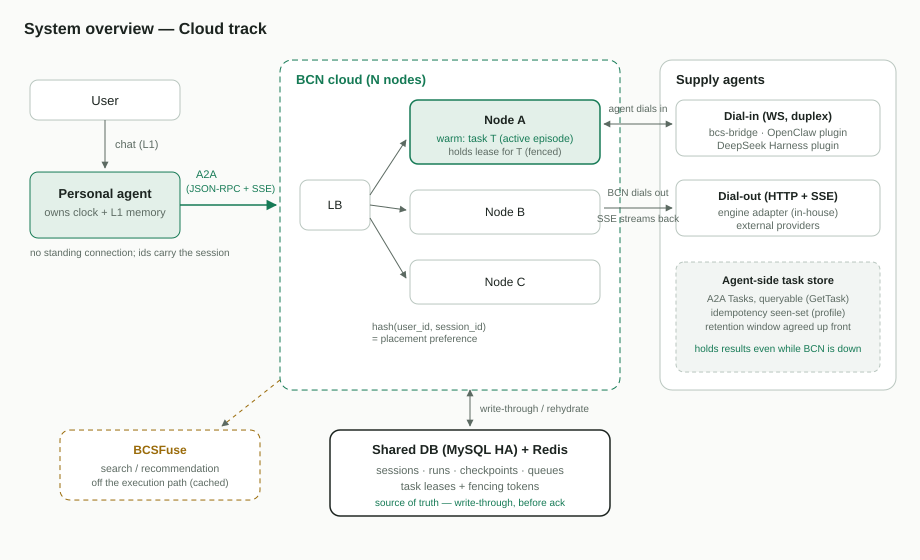

# 面向个人智能体的 BCN 云端编排

[English](README.md)

- 日期:2026-10-31
- 状态:**团队评审草案**
- 范围:BCN ↔ 个人智能体(Personal Agent,下称 PA)集成的 **Cloud 路线** —— BCN 在服务端代表
  PA 运行多智能体工作流,并提供高可用。姊妹路线 **Edge**(BCN CLI 基于共享存储在本地执行
  工作流 YAML)只在两条路线共享契约的地方被引用,本文不对其做设计。
- 读者:本文是 10 分钟上手导读。每个难题都有专门的深入文档:
  - [01 — 接口与状态模型](01-interface-and-state-model.zh-CN.md)
  - [02 — 可用性架构](02-availability-architecture.zh-CN.md)
  - [03 — 执行正确性](03-execution-correctness.zh-CN.md)
  - [04 — 供给侧 Agent 合规](04-supply-agent-compliance.zh-CN.md)

> 说明:架构图(`assets/*.svg`)暂为英文版,与两种语言的文档共用。

## 1. 背景

PA 接受用户的长周期请求("今年帮我安排 3 次旅行,每次出发前 2 个月把计划发给我"),并把
其中需要多位专家协作的部分委托给 BCN:寻找供给侧 Agent(订机票、订酒店、买门票),选择或
创建工作流,并把它驱动到完成。

这里的**任务(task)**指 PA 的长周期工作单元。在 BCN 侧,每个任务 1:1 映射到一个持久的
**任务会话(task session)**,由 `session_id` 标识 —— 全部文档统一使用这一个标识
(文档 01 定义了完整的标识映射)。在任务的生命周期内(可能长达数月),PA 会为同一个任务
多次回到 BCN —— 包括用户在线时的快速多轮改稿("改成 5 天,酒店再便宜一点")。

工作假设(**TBD,待与 PA 团队确认**):**时钟归 PA 所有**。BCN 被调用才行动,永远不需要
数月后自行唤醒。如果有用例要求 BCN 侧定时器或持续自治工作(例如"全年盯价、分钟级出手"),
就必须补充持久定时器设计;下文不排斥这种扩展,但在确认前刻意不纳入范围。

## 2. 问题 —— 以最强形式陈述

Cloud 路线存在争议,而且反对理由是成立的。设计必须正面回答以下每一条,而不是绕开它们:

1. **可用性耦合。** 云端执行把 BCN 节点、共享数据库、以及(今天的)BCSFuse 放进了 PA 任务
   的关键路径。服务器节点故障导致任务失败或丢失的设计不可接受;对已经产生副作用的任务,
   "从头重试"同样不可接受。
2. **不可幂等的副作用。** 供给侧 Agent 会订酒店、买机票。任何重试、故障转移或重复投递都
   可能把一次购买执行两次,除非端到端地工程化幂等 —— 而当前的 A2A 调用路径还没有携带
   幂等键。
3. **隐私与留存。** 服务端执行会持久化任务内容和中间结果。对*个人*智能体而言这是产品级
   问题:云端保存什么、保存多久、谁来控制?
4. **运维成本。** 多节点 BCS + 高可用存储 + 故障检测,而负载本身低频、且天然按用户分区。
   Edge 路线的反方论点 —— "客户端本来就是一个持久执行器" —— 值得正面回答。
5. **异构的供给侧 Agent。** 我们对供给侧 Agent 的任何正确性契约,都要落到四条自有集成
   路径,外加一个我们无法控制的外部 Provider 开放生态。

那为什么还要 Cloud:(a) 任务要活得比"设备在线"更久 —— 长工作流、A2A 回调、跨设备共享的
工作;(b) 一份恢复实现,而不是每个客户端平台各一份;(c) 服务端强制(好友/可见性、出站 URL
策略、拥塞控制)是纯本地执行器可以绕过的。当云端控制面不可达时,Edge 路线仍是降级路径。

## 3. 方案 —— 一页纸

**接口。** BCN 是 PA 调用的服务端(A2A 1.0 JSON-RPC + SSE,可续接的 Task)。长达数月的
*逻辑*会话由持久标识承载,从不依赖连接。不存在常驻的客户端连接,因此客户端连通性完全不在
高可用问题之内。→ [文档 01](01-interface-and-state-model.zh-CN.md)

**状态模型 —— 三种生命周期。**

| 单元 | 生命周期 | 作用域 |
| --- | --- | --- |
| **运行(run)** | 分钟–小时 | 一次工作流执行:检查点、派发、恢复 |
| **活跃期(episode)** | 分钟–小时 | 一段密集交互;状态唯一处于*热*态(在某个节点内存中水合)的时期 |
| **任务会话(task session)** | 任务生命周期 | 持久的对话记录与协作工作区,存于共享数据库 |

每一轮的持久状态都直写共享数据库(先落盘、后确认);节点本地状态严格只是可重建的缓存。
空闲活跃期的 GC 与节点故障后的接管是同一个操作:**故障转移就是一次缓存未命中。**
→ [文档 01](01-interface-and-state-model.zh-CN.md)

**放置与所有权。** `hash(user_id, session_id)` 把同一任务会话的各轮路由到同一节点,获得
活跃期内的缓存亲和(这是延迟*和数据库负载*的双重优化:重复轮次由内存服务,而不是在全量
QPS 下反复从共享库重读上下文)。正确性 —— 同一时刻恰好一个节点驱动一个任务 —— 来自
**共享数据库中带隔离令牌、可过期的租约**,而不是来自环成员一致。哈希 = 放置;租约 =
所有权。→ [文档 02](02-availability-architecture.zh-CN.md)

**执行正确性。** 每个出站派发在请求发出前,先以客户端生成的幂等键
`(run_id, step_id, attempt)` 写前落盘。恢复是拉取式的:供给侧 Agent 自持可查询的 Task
状态(A2A `GetTask`),接管节点用"读"而不是"重发"来解决"已派发、结果未知"。这些保证落在
一个具名的 **BCN A2A profile**(幂等键、去重、探测语义、留存下限)上,构建于 A2A 的扩展
机制之上。该扩展工作**在本项目范围内**(它建立在进行中的 engine A2A 迁移之上,但不由
后者交付)。→ [文档 03](03-execution-correctness.zh-CN.md)

**供给侧 Agent。** 四个自有适配器实现覆盖全部自有 Agent(bcs-bridge;OpenClaw 与
DeepSeek Harness 两个渠道插件;engine adapter)。外部 Provider 通过**能力分级**接入:
未达标的 Agent 仍可承接只读/幂等步骤;有副作用的步骤要求通过验证的 profile 合规。BCN 在
派发时记录、验证并强制执行分级。上线时自有与外部 Provider 都支持。
→ [文档 04](04-supply-agent-compliance.zh-CN.md)

**可用性。** 四个平面 —— API(任意节点服务任意请求)、执行器(租约 + 接管)、连接
(钉在节点上的 Agent socket + 连接位置注册表)、存储(托管的 MySQL/Redis 高可用;
**BCSFuse** —— 持有供给侧 Agent 目录的独立搜索/推荐服务,用于*发现* Agent 与工作流 ——
保持在执行关键路径之外,它的故障只会降低发现的新鲜度,绝不影响运行中的任务)。
头条不变量:**节点故障绝不使任务失败或丢失。**
→ [文档 02](02-availability-architecture.zh-CN.md)

## 4. 已有 vs. 全新

BCS 在单节点上已久经考验地提供:派发前落盘的持久运行状态、每次运行不可变的工作流快照、
重启恢复、带按会话 FIFO 与拥塞控制的持久投递队列、MySQL/Redis 插件、以及
`LeaderElectionPort` 接缝。

本项目的全新部分:

- **节点身份、成员关系与故障检测** —— 今天 BCN 节点互不知晓;新增集群名册加心跳,让同伴
  知道存在哪些服务器、哪些还活着;
- 任务会话到节点的**基于哈希的放置**;
- **带隔离令牌的任务租约与接管**(文档 02);
- **连接位置注册表** —— 一张共享映射,记录每个供给侧 Agent 的活动 socket 当前在哪个
  节点,使任意节点都能把投递路由过去;
- **持久化(而非进程内)的幂等/去重状态**;
- **BCN A2A profile** 及其一致性测试套件(文档 03/04);
- **能力分级与派发门禁** —— 工作流引擎拒绝把有副作用的步骤发给 profile 合规未经验证的
  Agent;
- 面向 PA 的 API 上的**会话生命周期控制** —— continue / close / expire 一个任务会话:
  PA 的留存控制开关。

## 5. 开放问题

| # | 问题 | 状态 |
| --- | --- | --- |
| 1 | 时钟归属:所有定时器都归 PA 吗? | **TBD** —— 假设是;负责人:与 PA 团队对齐 |
| 2 | 接管 RTO 目标(决定心跳/租约参数) | 开放 —— 提案见文档 02 |
| 3 | 任务会话的默认留存(L2 与 L3 两个时钟) | 开放 —— 提案见文档 01 |
| 4 | 工作流搜索路径:BCSFuse 结果能否缓存,使其永不阻塞执行? | 开放 |
