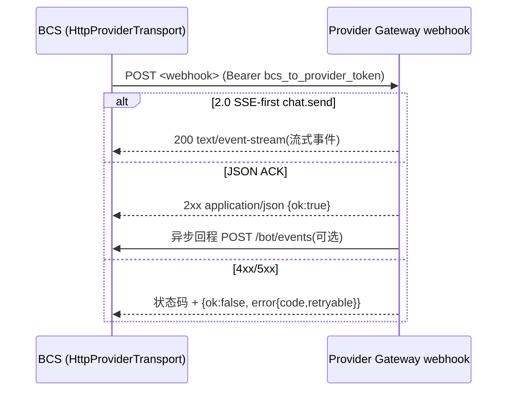

# BCS Provider 下行协议接口(全量)

本文档基于最新代码(`crates/adapters/http/bcs-provider-http`,协议契约位于
`crates/contracts/bcs-protocol`)梳理 BCS → Provider Gateway 的全部下行
HTTP 接口:统一信封、鉴权、每个 method 的请求/响应 wire 格式、错误语义
与超时/大小限制。

范围内:BCS 作为 HTTP 客户端发出的所有 Provider webhook 请求。
范围外(另行成文,文末互链):

- SSE 事件流帧格式(`agent` / `chat` / `ping` / `interaction`)
  → `docs/bcs-provider-2.0-sse-protocol.md`
- Provider → BCS 回程(`/bot/events` 上行回调)与接入流程
  → `docs/bot-provider-integration.md`
- Caller 容器网关的设计背景与冻结边界 → `docs/caller-container-gateway.md`、
  `docs/caller-identity-configuration.md`

## 1. 传输概述

Provider Gateway Bot 不与 BCS 保持长连接,BCS 通过向 Provider 的 webhook
地址发起 HTTP `POST` 完成所有下行投递(协议版本 1.0 与 2.0 共用同一信封;
2.0 额外有传输协商,见 §3.1)。



### 1.1 下行地址选择

先取 Bot 绑定的 `webhook_url`,未配置时继承 Provider 默认地址。接收端
失败不触发地址回退;地址选择不改变 1.0/2.0 报文与认证语义。

### 1.2 出网安全策略(OutboundUrlGuard)

所有下行请求统一经过 `OutboundUrlGuard`(`crates/services/bcs-route-security`):

- 禁止跟随重定向;URL 先过出网策略预检,违规按
  `provider_url_preflight_failed`(DNS 解析失败可重试)处理。
- DNS pinning:解析后使用 pin 定 IP 的客户端发送。
- 内网地址默认阻断(测试可用显式放宽的 guard)。

### 1.3 通用 HTTP 头

```http
POST <resolved_webhook_url>
Authorization: Bearer <bcs_to_provider_token>
Content-Type: application/json; charset=utf-8
Accept: application/json            ; chat.send 2.0 SSE-first 时:
                                   ; Accept: text/event-stream, application/json
X-BCN-Protocol-Version: 1.0 | 2.0
X-BCN-Message-Id: <每次请求新生成的 UUID>
X-BCN-Timestamp: <毫秒时间戳>
X-BCN-Transport: sse | callback     ; 仅 protocol 2.0 携带
```

- `Authorization` 固定使用 Provider 注册时的 `bcs_to_provider_token`
  (服务级凭据;caller 相关方法也复用它,caller 身份材料只走 body,
  见 §3.2/§3.3/§3.7)。
- 透传头白名单(`provider_bypass_headers`):BCS 禁止透传
  `authorization` / `cookie` / `host` / `content-length` / `content-type` /
  `x-bcs-bot-token` / `x-bcs-service-key`,以及一切 `bcn*` / `x-bcn*`
  头(协议自有头不可被外来的值覆盖)。
- 请求会附带 W3C trace parent 头用于链路追踪。

## 2. 统一信封(ProviderWebhookRequest)

所有下行方法共用一个 JSON 信封(契约:`bcs_protocol::http::ProviderWebhookRequest`,
`crates/contracts/bcs-protocol/src/http/provider.rs:306`):

```json
{
  "type": "req",
  "id": "<frame id:请求幂等键>",
  "method": "chat.send | chat.inject | chat.abort | chat.history | interaction.resolve | caller.container.ensure",
  "params": null,
  "session_id": "<解析后的会话 id,见下>",
  "bcn_group_id": "<BCS 群组 id,非群消息为空串>",
  "to_bot": {
    "provider_id": "<Provider id>",
    "provider_bot_ref": "<Provider 侧 bot 运行时引用>",
    "tags": ["<路由标签,可选>"]
  },
  "from": { "kind": "bot", "name": "<发送方名>", "actor_id": "<发送方 bot id,可选>" },
  "message": { },
  "attachments": [],
  "before": null,
  "after": null,
  "limit": null,
  "timeout_ms": 3600000,
  "extensions": { }
}
```

关键规则:

| 字段 | 说明 |
| --- | --- |
| `id` | 每个 method 的幂等键;`chat.send` 时等于 BCS `run_id`(见 §3.1) |
| `params` | 帧架构方法(chat.send/inject/history/abort/ensure)经 `provider_request_from_frame` 翻译后为 null——帧 params 被映射进信封各字段,未被映射识别的 params 一律**丢弃**;`interaction.resolve` 例外,resolution 直接放在 `params` 对象里 |
| `session_id` | 解析顺序:`bcs_session_id` → `session_id` → 非 `group:` 前缀的 `session_key` → 回落 `bcn_group_id` |
| `from` | 仅当请求帧携带 `channel` 时生成;`kind` 固定 `bot`,`name` 取 `actor_name`(缺省退 `actor_id`) |
| `message` | 详细结构见 §3.1;`channel.identity_forwarding=true` 时会在 message 文本前部前置 `{"sender":{"id","name"}}` JSON 行(仅 `chat.send`/`chat.inject`,进行 COSEC 防注入序列化) |
| `attachments[]` | `{attachment_id, type, file_name, mime_type?, size?, sha256?, url, expires_at?}` |
| `before`/`after`/`limit` | 仅供 `chat.history` 分页使用,其余 method 为 null |
| `timeout_ms` | `chat.send` 取 `params.timeout_ms`(默认 3h);其余 method 固定 60min |
| `extensions` | 运行期专用扩展区:仅承载 method 自身的扩展字段,不进普通日志/DB/模型输入;caller 身份材料全部走这里(§3.2/§3.3/§3.7) |

未识别 method 的信封同样会被 Provider 拒绝(下行侧不发送未定义 method)。

## 3. 方法目录

### 3.1 `chat.send` — 执行投递(响应生产)

发送一条要求 Bot 执行并产出回复的消息,是唯一的响应生产型方法。

**请求**(信封之外的映射字段,来源 `ChatSendParams`,
`crates/contracts/bcs-protocol/src/ws/protocol.rs:600`):

```json
{
  "session_key": "<会话 key>",
  "bcs_group_id": "<群组 id>",
  "bcs_session_id": "<BCS 会话层 id,v3+ 必带>",
  "message": { "role": "user", "content": [{"type": "text", "text": "..."}], "timestamp": 1710960000 },
  "channel": { "source": "api|web_ui|ding_talk", "user_id": "...", "actor_id": "...", "actor_name": "...", "identity_forwarding": true },
  "session_context": {
    "session_id": "...", "participants": ["bot-uuid..."], "recipient": "...",
    "recipient_role": "driver|worker|...", "delivery_type": "send|inject",
    "originator": "...", "from": "...", "from_bot_id": "...", "from_bot_owner": "...",
    "you_are_mentioned": false, "is_sender": false, "mentions": ["..."],
    "response_directive": "...", "message": "...", "routing_mode": "structured|mention|hybrid", "group_type": "task"
  },
  "timeout_ms": 3600000,
  "idempotency_key": null,
  "tags": [],
  "attachments": []
}
```

wire 上 **`params` 为 null,`session_context` 与 `channel` 不直接出现在
请求体内**:帧参数经 §2 的信封映射后,只以 `from`(来自 `channel`)、
`message`、`attachments`、`to_bot.tags`、`session_id`、`bcn_group_id`、
`timeout_ms`、`extensions` 等信封字段的形式到达 Provider;`session_context`
等其余帧参数不落 wire。

**`id` 约束**:`chat.send` 的信封 `id` 必须等于 BCS `run_id`(队列帧的
逐次请求 id 会在发送前归一化为 canonical run id)。Provider 以 `id` 幂等,
并以此关联后续回程事件(SSE 帧或 `/bot/events`)。

**传输协商(protocol 2.0)**:

1. `Accept: text/event-stream, application/json`,`X-BCN-Transport: sse`:
   - 响应 `Content-Type: text/event-stream` → run 绑定 SSE,同一连接
     流式返回 `agent`/`chat`/`ping`/`interaction` 帧直到终态(帧规范见
     `docs/bcs-provider-2.0-sse-protocol.md`);此后该 run 的 `/bot/events`
     回调返回 409 `transport_conflict`。
   - 响应 JSON ACK `{"ok": true}` → run 绑定 callback 传输,事件改经
     `/bot/events` 上行;不做第二次 POST。
2. `Accept: application/json`(1.0 全部、2.0 非响应生产路径、及
   `bcs-cli chat` 直聊的临时兼容行为):普通 JSON ACK。

**超时与限制**:

| 项 | 值 |
| --- | --- |
| 响应头超时(SSE/JSON 均) | 125 s(超时判失败) |
| JSON ACK body 读取 | 125 s |
| JSON(非 SSE)总超时 | 65 s(适用非 chat.send 的 ACK 请求) |
| SSE 空闲超时(无任何字节) | 15 min → 合成错误终态 |
| 单 SSE 帧/缓冲上限 | 8 MiB |
| `timeout_ms`(执行预算) | 默认 3 h;A2A 下游执行 2 h;发送帧可显式覆盖 |

**响应 JSON ACK**(SSE 协商回退/1.0):

```json
{ "ok": true }
```

非 2xx:BCS 视为该次投递的确定性拒绝(delivered=false),不重发;由调用方
决定失败语义。SSE 绑定成功时 ACK 为流本身,详见 SSE 文档。

### 3.2 `chat.send` 受保护 caller 执行(root-H2A,本次新增)

方法名仍是 `chat.send`,但以 `extensions` 扩展区承载 caller 执行证明与
身份材料(`crates/adapters/http/bcs-provider-http/src/caller_send.rs`,
spec §10.9):

```json
{
  "bcs_session_id": "<session>",
  "bcn_group_id": "",
  "message": {                           // DownlinkMessage 契约: role+content
    "role": "user",
    "content": [ { "type": "text", "text": "<要执行的消息文本>" } ]
  },
  "timeout_ms": 3000,
  "channel": {                           // 信封 from 的派生来源,必带
    "source": "api",
    "actor_id": "<原始消息的普通发送者 actor id>",
    "actor_name": "<原始消息的安全显示名>",
    "thread_id": "<session>"
  },
  "extensions": {
    "execution": {
      "not_after_ms": 1786260280000,
      "history": {                       // 可选:继承的共享历史边界
        "history_snapshot_id": "...",
        "history_cutoff_seq": 42,
        "projection_version": 1,
        "manifest_digest": "sha256:..."
      }
    },
    "caller_context": {                   // caller 身份(仅运行期)
      "subject": { "kind": "human", "ref": "<不透明 caller 引用>" },
      "expires_at_ms": 1786260300000
    },
    "caller_execution_token": {          // 一次一用的执行证明
      "version": "1.0",
      "format": "jwt", "type": "jwt",
      "token": "<Gateway 签发的执行令牌>",
      "expires_at_ms": 1786260285000    // 证明自身寿命 ≤ caller_context 窗口
    }
  }
}
```

`channel` 只承载原始消息已有的普通发送者元数据(可信生产方 —— caller
admission / 任务委派 seam —— 随 `caller_required` 一并写入行内
`caller_channel` 事实,请求体不可注入):`actor_id` 是原始消息的"普通"
actor id(人类消息 = canonical sender;任务委派 = 委派 Bot),`actor_name`
是安全显示名(可空,信封 name 回退 actor_id)。受保护的 caller subject
与凭证仍"只"走 `caller_context`/`caller_execution_token` 扩展区,绝不因
补齐 `from` 进入普通日志、历史或模型输入。缺 `caller_channel` 或
`actor_id` 为空时行直接 fail-closed(发送前拒绝),不会以 `from: null`
撞 Provider 的必填校验 400。`message` 必须满足 DownlinkMessage 契约
(`role` + `content` 块列表或字符串;裸 `{text}` 同样是必填字段 400)。
`identity_forwarding` 保持关闭,发送方身份不会前置进消息正文。

发送前 BCS 侧硬校验(不满足即拒绝发送):`attempt≥1`、run/session/
dispatch/environment/target 非空、caller subject 非空、文本非空、
`request_digest` 形如 `sha256:` + 64 hex、`not_after_ms` 与执行令牌到期
时间均未过期(发送时刻以 BCS 系统时钟为准)。

**响应 ACK 契约**(响应体上限 64 KiB;2xx 后读取/解析失败一律按
`OutcomeUnknown`——受理不可证伪):

```json
{ "ok": true, "state": "accepted" }
```

- `state` 缺省视为 `accepted`;`"unknown"` → 结果未知,由 BCS 决定重试策略。
- `ok:true` 且 state 之外的回显字段(旧 Provider)不作权威,BCS 只信任
  自己保存的 control_revision/digest。
- 被拒:`{"ok": false, "error": {"code": "...", "retryable": false}}`。
- 传输超时/出错:请求已离栈的一律记 `OutcomeUnknown`,绝不伪造"确定拒绝"。
- 非 2xx 的失败分类:4xx(确定性"未被受理")按 `DefinitelyNotSent{retry:false}`
  判死——行立即收敛 Failed、释放 lane,不等待终态回执;5xx 可能来自受理后的
  中间层,与超时/中断一样保守记 `OutcomeUnknown`,收敛仍走取消仲裁。

### 3.3 `chat.inject` — 旁路投递(不触发执行)

两种子形态共用 `chat.inject`,由 `extensions.kind` / `execution.mode` 区分。

**a) observe_only 共享上下文**(spec §10.10,`caller_observe.rs`):

```json
{
  "bcs_session_id": "<session>",
  "message": { "text": "..." },
  "extensions": {
    "contract_version": 1,
    "caller_context": { "subject": { "kind": "human", "ref": "<目的主体>" } },
    "execution": { "mode": "observe_only" },
    "message_dedup_key": "<消息 id,重发同一 id>",
    "runtime_target": {                 // 可选:ensure 授予的观察路由引用
      "caller_ref": "...", "target_epoch": "...", "purpose": "observe_only"
    }
  }
}
```

不带执行令牌;`caller_context` 只含目的 subject。ACK 为普通
`{"ok": true, "retryable?}`;失败映射 `Unavailable{retryable}`,**重发时
帧 id 重新生成但 `message_dedup_key` 不变**。总超时 10 s,响应 64 KiB。

**b) `history_complete` 快照确认**(`caller_history.rs`):

```json
{
  "bcs_session_id": "<session>",
  "extensions": {
    "contract_version": 1,
    "kind": "history_complete",
    "caller_context": { "subject": { "kind": "human", "ref": "..." } },
    "execution": { "mode": "history_complete" },
    "history": {
      "history_snapshot_id": "...",
      "history_cutoff_seq": 42,
      "projection_version": 1,
      "message_ids": ["msg-1", "msg-2"],
      "manifest_digest": "sha256:..."
    },
    "message_dedup_key": "history_complete:<history_snapshot_id>"
  }
}
```

空快照也必须确认。**ACK 必须回显精确快照与摘要**(普通 `ok:true` 不够):

```json
{
  "ok": true,
  "history_ready": { "history_snapshot_id": "...", "manifest_digest": "sha256:..." }
}
```

不匹配或不完整按不可重试失败处理。总超时 10 s,响应 64 KiB。

群消息常规旁路(非 caller 路径)`chat.inject` 同样走本方法但不带上述
extensions,责任:写上下文、不触发推理、不回 `/bot/events`。

### 3.4 `chat.history` — 历史读取

```json
{
  "session_key": "<群 id 或会话 key>",
  "bcs_group_id": "<群 id>",
  "bcs_session_id": "<会话 id,v3+ 形态>",
  "limit": 200,
  "before": 1786260000000
}
```

- 参数映射:仅 `before`/`limit` 进入信封顶层,其余作为会话解析依据。
- `limit` 由 BCS 落盘策略,单调封顶(实现内 `BOT_HISTORY_LIMIT_CAP`,
  向下兼容回落)。

**响应**(`ProviderHistoryResponse`):

```json
{
  "ok": true,
  "session_id": "<Provider 侧会话 id>",
  "messages": [ { "role": "...", "content": [], "timestamp": 0 } ],
  "has_more": true,
  "next_before": 1786260000000,
  "next_after": 1786250000000
}
```

非 ok 视为该次历史请求失败。`message` 元素结构由历史协议文档约定
(`docs/message-delivery-service-api.md` 相关章节;对象原样透传为
`Vec<Value>`)。

### 3.5 `chat.abort` — 取消执行

只按 Bot/Session 作用域取消(不允许 run 定向):

```json
{
  "session_id": "<BCS 会话 id>",
  "bcn_group_id": "<群 id>",
  "timeout_ms": 10000
}
```

`params` 为空、无 message/attachments。**idempotency key 为信封 `id`**。

**响应矩阵**(`ProviderAbortResponse`):

| 会话状态 | HTTP | body |
| --- | --- | --- |
| 有 RUNNING run | 200 | `{"ok": true, "aborted": true, "aborted_run_ids": ["..."]}` |
| 仅终态 run 记录 | 410 | `{"ok": false, "error": {"code": "run_terminated", "retryable": false}}` |
| 无可取消 run(PENDING/无记录) | 200 | `{"ok": true, "aborted": false, "aborted_run_ids": []}` |

仅 410 + `run_terminated` 是 BCS 认可的 410 语义,其他 410 响应报错。

### 3.6 `interaction.resolve` — HITL 交互裁决回传(2.0 only)

面向具体 run 的交互裁决结果,仅 Provider protocol 2.0 支持。params 映射为:

```json
{
  "bcsRunId": "<BCS run id>",
  "runId": "<Provider run id>",
  "interactionId": "<交互 id>",
  "kind": "<交互类型 slug>",
  "idempotencyKey": "<幂等键>",
  "<resolution 由裁决数据展开的其余字段>"
}
```

**响应**:ACK `{"ok": true, "retryable?}/{"ok": false, "error"...}`,
结构 `ProviderAckResponse`。失败可重试属性由 `retryable` 决定,详尽 HITL
状态机见 `docs/bcs-provider-2.0-sse-protocol.md` §相关章节。

### 3.7 `caller.container.ensure` — Caller 容器准备(本次新增)

BCS 以服务身份(Provider 自有凭据)请求目标 Bot 的 Provider 确保一个
"caller × Bot × session" 作用域的可路由容器存在。**每次调用只发起一次
网络尝试,不重定向、不自动重试**,重试必须复用 `idempotency_key`
(spec §10.8;`docs/caller-container-gateway.md` 为冻结的完整 wire 契约):

```json
{
  "bcs_session_id": "<session>",
  "extensions": {
    "contract_version": 1,
    "bot_id": "<目标 bot>",
    "caller_subject": { "kind": "human", "ref": "<运行期不透明 caller 引用>" },
    "environment": "<环境标签>",
    "run": {
      "run_id": "...", "root_run_id": "...", "parent_run_id": null,
      "message_turn_id": "..."
    },
    "policy": {
      "minimum_isolation": "caller_container",
      "create_mode": "lazy | warmup | must_exist",
      "ttl_ms": 300000
    },
    "idempotency_key": "<稳定重试键>"
  }
}
```

**响应**(≤ 64 KiB,总超时 10 s):

```json
{
  "ok": true,
  "sandbox_container_id": "<可选容器技术引用>",
  "isolation": {
    "level": "container_bound",
    "binding_ref": "<可选,缺省不代表隔离被削弱>",
    "generation": 7,
    "expires_at_ms": 1786260300
  },
  "observe_target": {                    // 可选:群同步观察路由
    "caller_ref": "...", "bot_id": "...", "session_id": "...",
    "target_epoch": "...", "expires_at_ms": 1786260300
  }
}
```

- `isolation.level` 必须为 `container_bound`,否则按确定拒绝。
- `expires_at_ms` 由 BCS 取 `min(容器到期, 身份/请求/容器策略 deadline)`
  ——容器寿命永不延长身份有效期。
- 拒绝形态:`{"ok": false, "error": {"retryable": false}}`;非 5xx 状态
  (`GatewayRejected` 中 retryable=false)、5xx/超时/传输失败统一为
  `ProviderUnavailable{retryable}`——**失败/超时绝不证明容器未创建**。

### 3.8 Caller P0 配置面(Provider → BCS,上行控制面,本次新增)

Provider 通过 BCS HTTP 路由管理 Bot 的 caller 能力配置(启用开关与最小
隔离要求),即 Provider 注册/更新接口上的 `caller_capabilities` 子对象。
该配置面跨信任边界,BCS 侧做严格校验:未知字段、凭据走私字段
(`cookie`/`authorization`/`token`/…)与类型错误一律拒绝,`enabled` 必填。
契约 DTO 位于 `crates/contracts/bcs-protocol`(`Provider caller configuration
sub-resource DTOs, spec §10.7.2`),路由与契约测试见
`bcs-http/tests/provider_caller_config_routes_contract.rs` 与
`bcs-http/tests/provider_routes_contract.rs`。

## 4. 通用错误结构与幂等

Provider 无法接收时,应答:

```json
{
  "ok": false,
  "error": {
    "code": "bot_not_found",
    "message": "...",
    "retryable": false,
    "retry_after_ms": 2000
  }
}
```

错误码表(`invalid_request`/`unauthorized`/`provider_id_mismatch`/
`bot_not_found`/`conflict`/`run_terminated`/`rate_limited`/
`unsupported_method`/`unavailable`/`timeout`)与幂等键约定
(`chat.send`=`id`=`run_id`、`chat.inject`=`id`、
`chat.abort`=`id`、observed/complete 增量见 §3.3,
回程事件=`X-BCN-Event-Id`)见 `docs/bot-provider-integration.md`
的 Error responses / Idempotency 章节,不再重复。

## 5. 超时与大小限量汇总

| 路径 | 限量 |
| --- | --- |
| chat.send: 响应头 | 125 s |
| chat.send(JSON 回退): body | 125 s |
| chat.send(SSE): 空闲 | 15 min |
| chat.send(SSE): 单帧 | 8 MiB |
| 非 chat.send 方法请求预算 | 60 min |
| chat.send 默认执行预算 | 3 h(帧可覆盖,A2A 下游 2 h) |
| caller.container.ensure | 1 次尝试 / 10 s / 64 KiB 响应 |
| caller 受保护 send ACK | 64 KiB 响应,超时同 `callback_timeout_ms` |
| chat.inject(observe/complete) | 10 s / 64 KiB ACK |

## 6. 变更速记(与 caller 身份相关)

本次合并的 caller 身份功能在下行协议上新增了 3 个接口形态并扩展信封
`extensions` 区:

1. `caller.container.ensure`(§3.7)——新方法。
2. 受保护 `chat.send`(§3.2)——既有方法的受保护形态,`extensions`
   携带 `caller_context` / `caller_execution_token` / `execution`。
3. `chat.inject` 的 `observe_only` 与 `history_complete` 两类扩展
   (§3.3)。
4. Provider 注册/更新接口新增 `caller_capabilities` 配置子对象(§3.8,
   上行控制面)。

详见基线规范 `src/bcs/specs/2026-09-16-caller-identity-session-container/`。

## 7. 相关文档

- `docs/bcs-provider-2.0-sse-protocol.md` — SSE 事件流、HITL interaction 全流程
- `docs/bot-provider-integration.md` — Provider 接入流程、回程协议、错误码、幂等
- `docs/caller-container-gateway.md` — caller 容器网关完整 wire 契约(冻结)
- `docs/caller-identity-configuration.md` — caller 身份相关配置
- `docs/caller-p0-contracts.md` — P0 契约文本
- `src/bcs/specs/2026-09-16-caller-identity-session-container/` — caller 身份设计基线