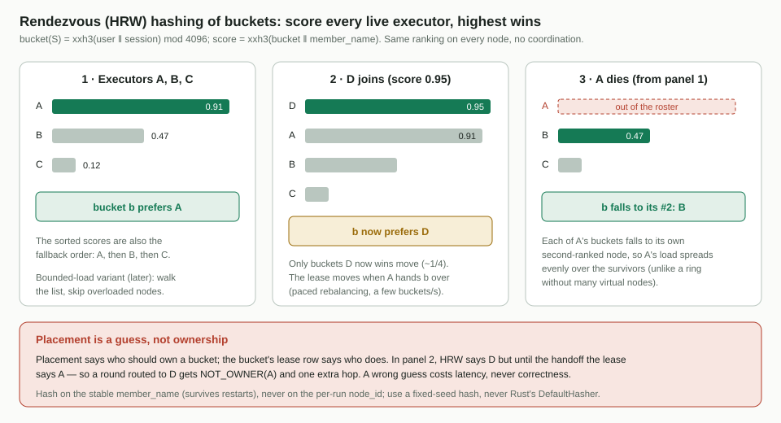
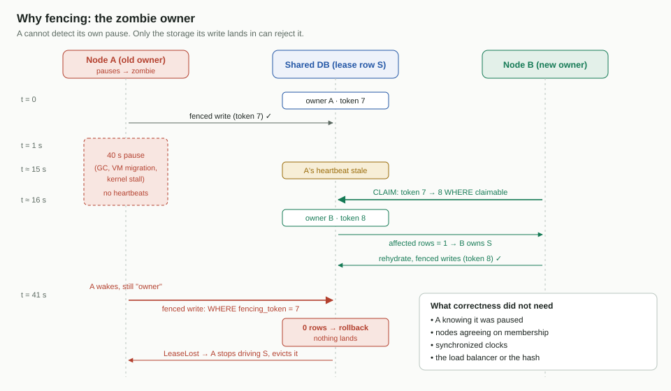

# Cluster Executor Plane — Design

[简体中文](design.zh-CN.md)

- Date: 2026-11-04 · Revised 2026-11-05 (gateway tier; fan-out over pub/sub) · Status: design
  agreed; input to the SDD spec
- Scope: item 1 of BCN cloud orchestration — how N BCN nodes share the work
  of driving task sessions, survive crashes and deploys, and never let two
  nodes drive the same session at once. The gateway tier (§7) is where item 2
  lives; it is described here because the executor plane depends on its
  contract.
- Companion docs: [storage.md](storage.md) (why OceanBase),
  [capacity.md](capacity.md) (cost model),
  [cross-item-notes.md](cross-item-notes.md) (what items 2–5 must provide).

---

## 1. The problem

BCN runs as a cluster behind a load balancer, sharing one highly available
database. Each personal-agent task is a **task session** that runs for
minutes to months. We need:

1. **Exactly one node drives a session at a time** (single writer).
2. **A node failure never loses or fails a task.** Another node takes over.
3. **Low latency.** A new round must reach the node that has the session warm
   in memory, without waiting for a poll.
4. **Painless deploys.** Restarting a group of nodes must not hurt
   time-to-first-token (TTFT).
5. **Streams survive the executor.** A crash or deploy of the node driving a
   session may pause the token stream the personal agent is reading, but must
   not close it or lose a state change.

The whole design rests on one sentence:

> **Hash = fast guess. Lease = truth. Fencing token checked by storage = safety.**

Nothing about correctness depends on nodes agreeing on membership, on clocks,
or on the load balancer.

---

## 2. The big picture

![Overview: the PA reaches a gateway through the load balancer; gateways hold every long-lived connection (PA streams and dial-out streams to supply agents); they send rounds and control events to the session's owner executor over a direct control channel and publish deltas on the message queue, where the owner subscribes to its buckets' delta channels; the owner applies BCN's fan-out logic and appends to the session's stream, which gateways read; executors hold leases and write the shared database.](assets/overview.svg)

BCN has **two tiers**, which can ship as two deployments of one codebase:

| Tier | Holds | Does | Durable state |
| --- | --- | --- | --- |
| **Gateway** | Every long-lived connection: PA streams and streams to supply agents | Terminates connections, runs dispatches, sends their output to the owner, relays the owner's fan-out to clients | None |
| **Executor** | No long-lived connections | Owns sessions through leases, drives runs and orchestration, decides and performs fan-out, writes the database | Everything, through fenced writes |

Connections live on gateways, so an executor crash or deploy never closes a
PA's stream or a supply agent's stream: output pauses until a new owner
takes over, then continues (requirement 5). Fan-out stays BCN's logic, on
the owner, and reaches gateways through a non-durable pub/sub (§7.4). The
split also turns an executor deploy into moving leases (§8).

| Mechanism | Answers | Wrong answer costs |
| --- | --- | --- |
| **Roster** — one row per node, with a heartbeat | Which gateways and executors are alive? | Latency only |
| **Placement** — rendezvous hashing of 4,096 buckets over the executors | Which executor *should* own S's bucket? | One extra hop or one rehydration |
| **Lease + fencing token** — one row per bucket | Which executor *does* own S's bucket, and so drive S? | — this is the correctness mechanism |
| **Routing** — forward to the owner, redirect on mismatch | How does a round reach the owner fast? | Falls back to a durable write |
| **Task record + session stream** | How does every stream see every state change and every token, across owner changes? | Milliseconds on a planned handoff; up to the takeover time (~6–8 s) after an owner crash; never a lost state change |

Three kinds of traffic:

- **PA → load balancer → gateway**: the PA's own connection (SSE, WebSocket
  or gRPC stream). The load balancer only spreads connections over ready
  gateways.
- **Gateway ↔ executor**: one long-lived, multiplexed control channel per
  pair, straight to the peer's advertised address (no load balancer). It
  carries rounds, dispatch commands, and the control events and results of
  running dispatches.
- **Dispatch gateway → delta channels → owner**: a dispatch gateway publishes
  a running dispatch's deltas on the **message queue**, on the channel of the
  session's bucket; the owner subscribes to the delta channels of the buckets
  it owns.
- **Executor → session channels → gateways**: the owner appends each
  session's events and deltas to that session's Redis Stream; every gateway
  serving the session reads it. This is BCN's fan-out.
- **Gateway → supply agents**: outbound A2A streams. Every supply agent is
  an A2A agent that BCN dials out to; BCN accepts no inbound agent
  connections.

Executors never coordinate with each other directly to decide anything. The
shared database is the only place they meet.

### Vocabulary

| Term | Meaning |
| --- | --- |
| `member_name` | Stable identity of a node slot (e.g. host name); survives restarts. Used for placement |
| `node_id` | Identity of one process run (`member_name` + a fresh ULID). Used for ownership |
| `advertise_addr` | Internal `host:port` peers use to reach this node |
| Bucket | `xxh3(session_id) mod 4096`: the unit of ownership (§4) |
| Owner | The executor whose `node_id` is on the lease row of S's bucket and whose heartbeat is fresh |
| Entry gateway | The gateway that accepted the PA's connection for a request |
| Dispatch gateway | The gateway running one dispatch: it holds the stream to the supply agent |
| Delta channel | Bucket b's topic on the message queue: dispatch gateways publish deltas of b's sessions, b's owner subscribes (§7.2) |
| Session channel | `session:{S}`, a Redis Stream: the owner appends, gateways read from their last entry id (§7.4) |
| Subscriber | A gateway reading S's stream, relaying to a client stream |
| Delta | A piece of output text or artifact (a "token" chunk); goes to the owner, is fanned out, never stored |
| Control event | Anything that changes what should happen next; recorded by the owner (§7.3) |
| Claim / Transfer | Take a bucket nobody holds / hand one to a chosen successor |
| Episode | The period an executor keeps S loaded in memory (a cache lifetime, not data) |

---

## 3. Membership: who is alive?

Each node keeps one row in `bcs_node_roster` and refreshes `last_heartbeat_at`
every second. The row's `role` is `executor` or `gateway`; only executors
take part in placement and leases, while gateways are listed so executors can
reach them and notice when one dies. States are `active` and `draining`.
**"Dead" is never written** — a crashed node can't write anything — it is
derived: the heartbeat is too old.

**Why a table in the shared database** (not etcd, ZooKeeper or gossip):
membership here is only a hint. The one fact that must be linearizable — who
owns a session — already lives in the database next to the data. A separate
coordination service would add infrastructure and a second source of truth
for no gain. Cost: one tiny write per node per second.

**Two identities.** `node_id` changes on every process start: a restarted
process has none of the old memory, so it is a *different owner*, and "is
this my lease?" becomes a simple equality check. `member_name` stays the
same, so placement (§4) gives a restarted executor the same buckets as
before.

**Restart at the same address.** When a node registers, it marks every other
roster row with the same `advertise_addr` as no longer fresh (heartbeat set
to NULL). Two processes cannot listen on one address, so that row belongs to
a dead run, and its leases become claimable at once instead of after a
timeout. The row itself is kept so survivors can still find its buckets.

**One clock.** All time comparisons use the database's `NOW()`, never node
clocks, so clock skew between nodes cannot make a live node look dead.

**Relative staleness.** A node is stale when it is behind *the rest of the
cluster*, not behind the wall clock:

```
stale(D) = max(last_heartbeat_at over all rows) − last_heartbeat_at(D)
```

After a short storage hiccup everyone missed heartbeats together, so nobody
looks dead — no takeover storm.

**Recovery grace.** After a *long* outage, the first node to heartbeat again
moves the maximum forward while healthy peers still look old. So an observer
must be healthy itself: each node tracks `healthy_since` (its first
successful heartbeat after its last failure, or after start) and treats a
peer as dead only once `now − healthy_since ≥ claim threshold`. During that
window every healthy peer heartbeats several times; only truly dead nodes
stay stale. (Chubby gives clients the same kind of grace after its own
master fails over.)

Two thresholds on the same heartbeat: an executor leaves **placement** after
3 s (cheap to be wrong) and its leases become **claimable** after 5 s — five
missed heartbeats (costlier to be wrong). A gateway counts as dead after the
same 5 s; that is when its dispatches are moved (§7.6).

---

## 4. Placement: rendezvous hashing of buckets



Sessions are grouped into a fixed set of **buckets**, and buckets — not
sessions — are what executors own:

```
bucket(S)    = xxh3(session_id) mod 4096                -- fixed seed and count; stored on the session row
score(b, E)  = xxh3(b ‖ E.member_name)
preferred(b) = the active executor with the highest score
```

Session ids are globally unique, so the session id alone decides the
bucket. Every node — gateways included — computes the same ranking in microseconds
with no coordination. 4,096 buckets ≫ executors, so each of N executors
holds about 4096/N buckets and load stays balanced (about 200 each at 20
executors, still about 10 at 400). When an executor joins or leaves, only
the buckets whose winner changed move — the minimum possible (1/N) — and a
departed executor's buckets spread evenly, each to its own second-ranked
executor. The sorted scores double as a fallback order. A bounded-load
variant (skip overloaded executors while walking the list) can be swapped in
later.

The bucket count is fixed for the life of the system: it is stored on every
session row, and changing it would remap every session. Choose it once,
before launch (§14).

Why rendezvous rather than alternatives: `hash % N` reshuffles everything on
every change; a ring needs ~100+ virtual nodes per node to balance; jump hash
cannot remove a node from the middle (a crash); a fixed slot map needs a
coordinator.

**Placement is not ownership.** Placement says who *should* own a bucket;
the lease (§5) says who *does*. After an executor joins, the hash may say D
while the lease still says A, until A hands the bucket over (§10). So the
hash is a guess that the target executor checks (§6).

---

## 5. Ownership: fenced leases

### 5.1 Why a lock alone is not enough



A node can pause (GC, VM migration, kernel stall) or be cut off, then wake up
believing it still owns bucket b. Any "am I still the owner?" check can be followed
by another pause before its write lands. **Only the storage the write lands
in can reject it.** So every ownership change increments a **fencing token**,
every owner write carries its token, and the database refuses a stale one.

### 5.2 The lease row

`bcs_task_leases` has **one row per bucket** — 4,096 rows, created once and
never deleted: `bucket`, `node_id` (owner, or `''` before anyone has claimed
it), `fencing_token` (only ever increases) and `adopted` (has the owner
started driving it? §8.2). A session has no lease of its own: **S is owned by
whoever owns bucket(S), under that bucket's token.**

The per-session state this design needs lives on the session's own row:
`bucket`, `has_pending_work` + `pending_seq` (§5.4) and `write_seq` (§5.5).

**A lease is claimable** when nobody has claimed it yet, or its owner's
heartbeat is stale (with the recovery grace above), or its owner's run is
known dead (same-address restart). There is no per-lease renewal: one
executor heartbeat keeps all of its buckets alive.

**Why buckets, not one lease per session.** Every ownership operation is per
bucket, so it costs O(buckets), never O(sessions): a cold session needs no
claim (its bucket already has an owner), a failover claims about 4096/N rows
instead of one per session, a drain transfers a few hundred rows, and the
whole bucket → owner map is small enough for every gateway to keep (§6).

### 5.3 Operations

**Claim** — take a bucket nobody holds (failover, first start). One
transaction, no prior knowledge of the token needed:

```sql
UPDATE bcs_task_leases
   SET fencing_token = 1 + fencing_token, node_id = :me, adopted = TRUE
 WHERE bucket = :b AND <lease is claimable>;
SELECT node_id, fencing_token FROM bcs_task_leases WHERE bucket = :b;
```

If the read-back shows `node_id = me`, I own b — and every session in it —
with that token; otherwise it names the current owner. Exactly one claimant
wins: the update takes the row lock, and a racing claimant then sees a fresh
owner and changes nothing. The same read-back also tells a successor it
already owns b if a handoff notice was lost.

**Transfer** — hand b directly to a chosen successor with token + 1 and
`adopted = FALSE` (only the current holder can do this; used by drain and
rebalancing, §8 and §10). There is no release: while any executor is alive,
every bucket has an owner.

Rules:

- **Tokens never go backwards.** Lease rows are never deleted or
  re-created, so an old zombie token can never match again.
- **Expiry decides who may claim; the token decides who may write.** A late
  owner whose lease nobody has claimed can still write safely.
- **Moving a bucket moves all of its sessions at once.** After a claim or
  transfer, every in-flight write of the old owner, for any session in b,
  fails.

### 5.4 The pending-work flag

`has_pending_work`, on the session row, says "this session needs a driver
now": a run in progress, queued deliveries, a timer, or input nobody has
processed. It is how a new owner finds which sessions of a bucket it just
took need driving (§9), and how input recorded while the owner was
unreachable gets picked up (§6). Every write that **sets** it also
increments `pending_seq`. Every **clear** only succeeds if `pending_seq`
still equals the value the owner saw when it confirmed it had processed
everything. So input that arrives at the last moment can never be erased:
the clear simply fails and the owner processes the input.

### 5.5 Fenced writes


Every durable write an owner makes is one transaction whose first step locks
S's bucket row and checks the token:

```sql
UPDATE bcs_task_leases SET fence_seq = fence_seq + 1
 WHERE bucket = :b AND fencing_token = :mine;   -- must change exactly 1 row
```

It is a checked step (`ExecuteChecked`, expecting one row): the database
API sends a transaction's steps in one call, so a step cannot read a value
and branch on it; a changing conditional UPDATE both checks the token and
takes the row lock, like `SELECT … FOR UPDATE`.

followed by the real writes for S (run state, checkpoints, dispatch records,
the Task record, `last_event_seq` and `unpublished` (§7.4), and
`write_seq = write_seq + 1` on S's row). If the token is not mine, the
transaction rolls back and the caller gets **LeaseLost**: stop driving the
bucket's sessions, drop them from memory, never retry. A claim or transfer
updates the same row, so it waits until the in-flight fenced write has
committed, and fenced writes that start after it see the new token. So there
is no gap between "check" and "write" for a pause to fall into.
(`write_seq` lets a handoff successor see what changed for each session.)

**Why an exclusive lock is enough.** The fence step runs a bucket's fenced
writes one at a time, so what matters is how busy one bucket row gets:
sessions per bucket, not the total. With 100,000 open sessions over 4,096
buckets, a bucket holds about 25 sessions. At 10 k rounds/s × ~5 fenced
writes ≈ 50 k writes/s, that is about 12 per bucket per second, each holding
the lock a few milliseconds: a bucket row is busy about 5 % of the time.
A shared lock would let a bucket's sessions write in parallel, but the
checked-step API can't express it; it isn't needed at this ratio. A hot bucket
(one very busy group session, or skew) is what to measure (§14); if buckets
ever get hot, the fallback is a per-session fence (§15).

Rules: the check and the writes are in **one transaction**, in the **same
database**, for **one session** behind its bucket's check. If a commit's
outcome is unknown (an error during a storage leader switch), **read back** —
never blindly repeat.

**Not fenced:** recording an inbound round as *input* (any executor may do
this), reads, and the lease operations themselves.

**What fencing cannot do:** recall a network request a zombie already sent.
That is covered by write-ahead dispatch records with reused idempotency keys
and dedup at the receiving agent (item 3).

**Self-fencing** is a courtesy on top: a node that can't heartbeat in time
stops driving and fails its readiness probe, shrinking the zombie window.

---

## 6. Routing a round to its owner

Personal-agent rounds are latency-sensitive, so a round must not sit in the
database waiting for the owner's next poll. The entry gateway guesses in
memory and forwards; the target executor checks against what it knows.


```
ENTRY GATEWAY
  b = bucket(S); target = bucket_map[b] or HRW(b)  -- microseconds, no database
  send Submit(round) to target
  on NOT_OWNER(X): remember X, send to X           -- at most 2 hops
  on unreachable: try the next-ranked executor; if no executor answers at
                  all → retryable error to the PA

TARGET EXECUTOR
  do I own bucket(S)?  (in memory) → serve: dedup, persist the round (fenced), reply with the Task
  otherwise → b claimable: claim b   → I own b and all its sessions now: serve
            → owned by X, reachable  → reply NOT_OWNER(X)
            → owner dead, not yet claimable → durable fallback
```

| Case | What happens | Cost |
| --- | --- | --- |
| Stable cluster | The guess is the owner | One hop, ~2–7 ms added to TTFT |
| While a bucket is being handed over | Map says A, lease says B → `NOT_OWNER(B)` → remembered | One extra hop, once |
| Cold session | The bucket's owner loads it from the database | One read, no claim |
| Owner crashed | Next-ranked executor claims the bucket if possible, else durable fallback | TTFT ≤ takeover time |
| Forward timed out but the owner did process it | Two copies of one round | Deduplicated on `(caller, session, messageId)` |

Every gateway keeps the whole **bucket → owner map** (4,096 entries). It is
corrected by every `NOT_OWNER` and refreshed in full every 10 s from any
executor (`BucketMap`), so the guess is almost always right.

**Durable fallback**, run by whichever executor received the round: if S's
bucket is claimable, that executor claims it and serves (placement is only a
preference). Otherwise, in one transaction that holds the bucket row's
lock, it records the round as input on S, sets S's pending-work flag,
and acknowledges. Because of that lock, the fallback commits either before a
claim of the bucket — so the new owner's scan of its new bucket (§9) finds
the input — or after it, when it sees the new owner and forwards instead. An
owner that is alive but unreachable from the gateway finds such input with
its per-tick pickup (one indexed query over its buckets). Gateways never
touch leases.

The entry gateway starts reading S's session channel (§7.4) from its
current end **before** it sends `Submit`, so nothing the owner appends for
this round can be missed, and relays it to the PA. For a brand-new session,
whose id only exists once the round is accepted, it reads the new stream
from its first entry as soon as `Accepted` names S. Nothing here
depends on the load balancer: it needs only unique node ids, the shared
database, direct peer addresses, and the same hash on every node. A balancer
that hashes on a session header just makes forwarding rarer.

---

## 7. The gateway tier and fan-out

### 7.1 Connections


| Leg | Protocol | Notes |
| --- | --- | --- |
| PA → load balancer → gateway | The PA's SSE, WebSocket or gRPC stream | An L4 balancer passes the connection through. An L7 balancer must not buffer responses and must allow idle gaps longer than the gateway's SSE heartbeat (`: ping` every 15–30 s) |
| Gateway ↔ executor | One long-lived, multiplexed, bidirectional channel per pair (e.g. gRPC over HTTP/2) | Carries rounds, control events and results from dispatches, and dispatch commands; keepalive pings detect a dead peer in seconds |
| Dispatch gateway → owner | **Delta channels** on the message queue, one per bucket | The dispatch gateway publishes each in-flight dispatch's deltas to `deltas:{bucket(S)}`; the owner subscribes to the delta channels of the buckets it owns, so nobody looks an owner up for a delta (§7.2) |
| Executor → gateways | **Session channels**: one Redis Stream per session | BCN's fan-out: the owner appends each session's events and deltas; every gateway serving that session reads it (§7.4) |
| Gateway → supply agent | A2A `SendStreamingMessage` / `SubscribeToTask` | One per dispatch, opened by the dispatch gateway |

### 7.2 Dispatch placement and results

When the owner starts a step, it places the dispatch on **any healthy
gateway**, the least loaded. An A2A agent is reached by an outbound call, so
nothing ties a dispatch to a particular gateway, and its deltas reach the
owner through the delta channel wherever it runs.

The owner records **which gateway runs the dispatch** in the dispatch record,
inside its fenced write (item 3 owns the record). If gateways sit behind an
internal load balancer, the gateway that accepts `StartDispatch` reports its
own id and the owner records that. The fact must be durable: a new owner
needs it to supervise, cancel or collect the dispatch after a takeover.
Per-agent limits (rate, concurrency) are no longer local to one gateway:
they become shared, for example a counter in Redis.

The dispatch gateway sends everything the agent produces to S's current
owner, never to a fixed node:

- **Deltas** in batches (every 200 ms), numbered by `chunk_seq`, published
  on the message queue to the delta channel of S's bucket. Whoever owns the
  bucket is subscribed, so an owner change needs nothing from the gateway.
  Deltas are soft: not acknowledged and not stored; one that reaches no
  subscriber is recovered from the agent (§8.1, step 6).
- **Control events and the final result** go over the control channel to
  the owner, looked up per message (hint cache + `NOT_OWNER`). Each carries
  a per-dispatch sequence number and is **retried until the owner
  acknowledges** — an acknowledgement means
  the owner recorded it fenced. The owner drops repeats by `(dispatch, seq)`.
- **Progress counts** every few seconds, for the stuck-dispatch watchdog.

The dispatch gateway also **keeps the step's output so far** until the owner
acknowledges the result (it needs it to assemble the result anyway). A new
owner asks for it with `FetchBuffer(D)`, and the gateway answers from that
buffer or, if it has none, by querying the agent's task (`GetTask` or a
`SubscribeToTask` snapshot), so an owner change loses no output. If the dispatch gateway dies first, the owner moves the dispatch
(§7.6); the output is recovered from the agent's task, or the step is
re-run.

### 7.3 What a stream carries

An A2A stream carries four kinds of event: `Task` (the agent created a task
and names its id), `TaskStatusUpdateEvent` (the state changed:
`working`, `input-required`, `completed`…), `TaskArtifactUpdateEvent`
(a chunk of output, `append: true`) and `Message` (agents that reply without
a task). All of them go to the owner; what differs is whether they are
durable:

| Event | Example | Durable? | What the owner does |
| --- | --- | --- | --- |
| Agent's `Task` | `taskId: ta-77` | **Yes** | Records it on the dispatch, so the task can be found again after any crash |
| Artifact chunks (deltas) | "I found two options: …" | No | Adds them to its step buffer and fans them out |
| `working` + progress text | "Searching flights…" | No | Fans it out; counts as liveness |
| `input-required` / `auth-required` | "Which one should I book?" | **Yes** | Changes the Task's state, starts the human-wait timer, routes the PA's answer back to `ta-77` |
| `completed` / `failed` | `final: true` | **Yes**, with the assembled output | Records the step result and decides what happens next |

**Fan-out is BCN's logic, and it runs on the owner.** For every event the
owner decides who sees it and in what form: the caller's stream, other
viewers allowed to watch the session, a group's watchers; only the main
speaker's stream or every member's; tags such as `[from:botName]`. Two kinds
of recipient are handled differently:

- **People's streams** (the PA, viewers, the workbench) get the event on the
  session's channel (§7.4).
- **Other agents in a group** get a **delivery**: the owner dispatches the
  member's complete message to them as a durable record under the fence,
  never as a token stream. Mentions are parsed on the complete message.

The PA sees **the owner's Task**, not the agent's. A downstream `completed`
ends one *step*: for a single agent the owner then completes its own Task,
but in a group session it starts the next member's turn and the PA's Task
stays `working`. The owner publishes a step's last delta before the event
that ends the step, and it is the only publisher on the channel, so the PA
never sees "completed" before the text.

### 7.4 Fan-out: session channels


Every session S has a **session channel**: a Redis Stream named
`session:{S}`. The owner is its only writer; every gateway with a stream for
S reads it from the last entry id it has seen. Gateways follow the session,
not its owner, so an owner change is invisible to them: they keep reading
the same stream, and whichever executor owns S appends to it.

**A channel is just a name.** Nothing is created per session in advance:
the first append creates the stream, and a gateway reading it costs one
entry in the server's list of readers. One stream per session is therefore
cheap, and finished sessions' streams are trimmed (below).

**Three independent mappings.** Session S → bucket → owner executor is
decided by the hash and the lease table (§4–§5). The name `session:{S}` →
the Redis node that stores it is decided inside Redis Cluster, by hashing
the name into one of 16,384 slots spread over its nodes: that is what
"sharded" means, and only the Redis client libraries use it. S's PA stream →
the gateway that holds it is wherever the load balancer sent the PA, and it
exists only as that gateway's read position. None of them needs to line up
with the others.

Entries are written with **explicit ids**:

| Entry | Id | Content |
| --- | --- | --- |
| Event | `<event_seq>-0` | A state change the PA must see: status, interrupt, a step's final output |
| Delta | `<event_seq>-<chunk_seq>` | Output text, between the event it follows and the next one |
| Snapshot | `<event_seq>-0` (replaces that event) | The whole Task as of that event: status, history, artifacts as an `append: false` replacement |
| `Owner(token)` | the next free id | Written first by every new owner |

Redis rejects an id that is not greater than the stream's last one, so
pushing the same entry twice is harmless: **republishing is idempotent by
construction**.

**Committed, then pushed.** An event first goes into the owner's fenced
commit: the Task record changes, `last_event_seq` on the session row moves
to the event's number, and the event joins `unpublished`, a small outbox on
the session row. After the commit, the owner appends it to the stream and
clears it from `unpublished` lazily, in its next commit. An owner that
crashes between commit and append leaves the event in `unpublished`.

**Fencing tokens.** Every entry carries the writer's fencing token, and a
gateway drops any entry whose token is lower than the highest it has seen. A
stale owner can't commit new events (its fenced commit fails), but it could
still append deltas; the `Owner(token)` marker tells readers the new token
at once. A stale delta that slips in before the marker is overwritten by the
new owner's `append: false` replacement.

**Takeover.** For each session with an unfinished Task in a bucket it
claimed or received, the new owner appends the `Owner(token)` marker, then
the session's `unpublished` entries (any already in the stream are rejected
by id), then the in-flight step's output from `FetchBuffer` (§7.2) as an
`append: false` replacement.

**Retention.** The owner appends a snapshot entry at least at each step end
and may trim everything before the latest snapshot. A stream is deleted
after its Task ends plus a retention period, so memory stays bounded even
for long Tasks (capacity.md).

**Requirements on the stream provider:**

- **Quorum durability:** an acknowledged append must survive a failover. If
  Redis could lose acknowledged entries, committed events would vanish from
  delivery. This is a requirement, to be verified with a failover test
  (§14).
- **Reads at scale:** one blocking read (`XREAD BLOCK`) can only cover
  streams in one hash slot, so a gateway with sessions spread over many
  slots needs many blocking reads. The fallback is a light pub/sub
  notification ("new entry on S") followed by a non-blocking range read
  (`XRANGE`). Measure before choosing (§14).

> **Guarantee:** every committed event reaches every gateway reading S's
> stream, in order and at least once, however often ownership changes;
> duplicates are rejected by id. Deltas may pause or be replaced after a
> failure; the final result is exact.

Single-node mode uses an in-process stream.

### 7.5 Reconnecting clients

A2A does not ask for frame-by-frame replay: a client that reconnects calls
`SubscribeToTask` and must get **one snapshot** — the current Task with its
status, history and every artifact so far — then live events.

The snapshot is built **from the stream only.** The reconnect may land on
any gateway (GW2): GW2 reads `session:{S}` from its latest snapshot entry,
applies the events and deltas after it, sends the PA the result as one
snapshot, and keeps reading live from there. No call to the owner or the
database is needed. If the step ends meanwhile, nothing is lost: the step's
final event carries the full assembled artifact as an `append: false`
replacement.

**If the stream can't provide a snapshot** (trimmed past what is needed, or
lost), this iteration does not rebuild one from the database; that is
deferred to the next iteration (§14).

**If the owner changed,** the new owner already appended the step's output
from the dispatch gateway (`FetchBuffer`, §7.2). **If the dispatch gateway
died too,** the partial output survives at the supply agent: the dispatch's
new gateway re-subscribes to the agent's task, whose snapshot includes the
artifact so far, and the PA gets an `append: false` replacement. An agent
that can't be re-subscribed has the step re-run, and the PA sees the
partial text reset — the boundary we accept: the final result is exact;
intermediate output may reset.

Exact replay by `Last-Event-ID` comes almost for free: stream ids are
natural SSE ids (`id: <event_seq>-<chunk_seq>`). It is an optional BCN
extension.

### 7.6 Gateway failure and drain

**A gateway crash** breaks the connections on it; the design keeps the damage
there:

- **PA streams** break; the PA reconnects through the load balancer and gets
  a snapshot (§7.5).
- **Dispatches running on it**: the owner sees the gateway dead in the roster
  (5 s) and moves each dispatch to another gateway, which runs item 3's
  reconciliation: read or re-subscribe to the agent's task by its recorded
  id, never blindly resend. A step with no queryable task is re-run, which is
  safe because side-effecting steps are dispatched only to agents with
  durable, queryable tasks (items 3 and 6).

**A message-queue outage** stalls tokens but loses no state change:
committed events wait in `unpublished`, and gateways resume reading each
stream from their last id when it recovers (§7.4).

**Draining a gateway** (deploys of this tier are rare):

1. Readiness fails, so the load balancer sends no new connections; the
   roster says `draining`, so owners place no new dispatches here.
2. In-flight dispatches finish. A PA stream whose step has ended is asked to
   reconnect (HTTP/2 `GOAWAY` / `Connection: close`) and resumes on another
   gateway with a snapshot.
3. At the deadline, the gateway tells each owner that its remaining
   dispatches are abandoned, and the owners move them as after a crash.

---

## 8. Planned drain and deploy of executors

Deploy model: a group G of executors is restarted in place, one group at a
time. Executors hold no streams, so **draining one only moves leases**.

**Principle: move ownership before the process stops, and keep serving until
the move.** Draining never means refusing work.


### 8.1 The sequence

Executor A belongs to the group G being deployed. It hands each of its
buckets b (about 4096/N of them, the busiest first, several at a time) to
b's successor B, which is outside G:

1. **Stop claiming.** Roster `state = draining`: gateways and peers stop
   placing work on A, and A claims no new buckets. A keeps serving every
   session it still owns.
2. **PREPARE.** A asks B to load the state of b's warm sessions into memory.
   B is not the owner yet; until the transfer, A keeps processing the deltas
   it receives and forwarding them on the sessions' channels.
3. **Stop b's deltas.** A unsubscribes from b's delta channel and finishes
   processing the deltas it already received.
4. **Transfer ownership.** A updates the lease table — owner of b = B,
   token + 1 — then tells B: you own b now, start driving it (COMMIT).
5. **Deadline.** When the drain deadline passes (set below the deploy
   platform's stop-hook timeout), A transfers whatever buckets are left
   straight away, without waiting for steps 2–3. B recovers the deltas this
   loses in step 6.
6. **B catches up.** B re-reads only what changed between PREPARE and COMMIT
   (by each session's `write_seq`), subscribes to b's delta channel, and for
   each in-flight dispatch asks the supply agent, through its dispatch
   gateway, for the output it may have missed (`FetchBuffer`, §7.2). It
   republishes each step's output as an `append: false` replacement, so the
   PA's text has no gap and no duplicate (§7.4).
7. **A's stop hook completes.** A deletes its roster row and exits. On
   restart: same address and `member_name`, new `node_id` → leftover buckets
   are claimable at once and the executor gets its old buckets back.

Successors must be outside G, or a bucket would move twice: a draining node
refuses a PREPARE and the next-ranked node is tried. If the deploy platform
can mark a whole group draining at once, double moves disappear entirely.

### 8.2 What the handoff guarantees


- **Nothing durable is lost.** Rounds and control events go over the control
  channel and are retried until acknowledged; after step 4 they get
  `NOT_OWNER(B)` and go to B.
- **Deltas can only go missing from the live view**, between A unsubscribing
  (step 3) and B subscribing (step 6). B fills that gap from the agent, and
  the final result is exact either way.
- **The gap for b is short.** Steps 3–4 are one database write plus one
  round trip; at the deadline (step 5) it is the time B takes to catch up.
  Clients stay connected to their gateways throughout: they are on the
  sessions' channels, not on A.
- **Failures:** B dies → ordinary takeover. The COMMIT is lost → B finds b
  anyway (below). A writes after the transfer → fenced out. A publishes after
  the transfer → subscribers drop its lower token.

How B finds it: a transfer sets `adopted = FALSE` on the lease row; a claim
sets it `TRUE` in the same transaction; a new owner sets it `TRUE` when it
starts driving. Every executor reads, each heartbeat, its buckets that are
not yet adopted (`WHERE node_id = :me AND adopted = FALSE`, indexed, at most
a few hundred rows, usually none). There is no timestamp or cursor, so a
transfer that commits late can't be skipped: an unadopted row stays visible
until it is adopted. The same read covers transfers made at the deadline and
by the watchdog.

### 8.3 When is it safe to move a run mid-flight?

A bucket can move between any two durable writes of its sessions, because
each run's whole position is in the database and its connections are on
gateways:

| The run is… | Move now? |
| --- | --- |
| Between steps | ✓ |
| Waiting on a dispatch (any kind of stream) | ✓ — the dispatch gateway sends its deltas and result to whoever owns S |
| In the middle of a durable write or of starting a dispatch | Finish it first (milliseconds) |
| Waiting on a timer | ✓ — provided timer deadlines are stored durably |

### 8.4 Rolling out safely

- **Probes:** liveness ("is the process stuck?") stays green while draining;
  readiness is red while draining, self-fenced or starting.
- **Pacing:** add one new executor before removing one old one, wait ~30 s
  between steps so rehydration waves don't stack, and keep groups to ≤ 25 %
  of the cluster.
- **Mixed versions:** old and new executors take over each other's sessions,
  and gateways talk to both, so schema and protocol changes go expand →
  migrate → contract across releases; new durable formats ship the reader
  first and the writer later; a node that meets a format it can't read hands
  the bucket back instead of guessing. The lease protocol and the placement
  hash are frozen across versions.

---

## 9. Failover: when an executor crashes

There is no handoff message after a crash. Survivors take the dead
executor's buckets without talking to each other, then resume the sessions
in them that need driving. Meanwhile client streams stay open on their
gateways; output pauses until the takeover, then continues.


1. **Claim the dead executor's buckets.** Every heartbeat each executor
   already reads the roster. Once D's leases are claimable, each survivor
   reads D's buckets — `SELECT bucket FROM bcs_task_leases WHERE node_id = :D`
   (indexed, about 4096/N rows) — and claims those it ranks first for without
   D. A bucket whose first choice is also down is claimed after a 1 s grace
   by the next-ranked survivor. That is a handful of claims per survivor
   (about 10 each when 19 survivors split 200 buckets), done in
   milliseconds. Once they are claimed, D's `node_id` is on no lease row, so
   there is nothing left to watch.
2. **Resume pending sessions.** For each claimed bucket the new owner reads
   the sessions that need a driver —
   `… WHERE bucket = :b AND has_pending_work LIMIT 2000` on the session rows
   (indexed), batch after batch, those with unprocessed input first — and
   resumes them. Idle sessions are not touched at all: they belong to the new
   owner, which loads them on their next round. State is reloaded lazily, so
   300 k pending sessions spread over 19 survivors resume in under 10 s.
3. **Safety-net sweep** every 30–60 s: buckets whose owner is stale, and
   sessions whose pending flag is set but which nobody is driving.

For each resumed session: reload state from the database (exactly like
resuming a cold session — *failover is a cache miss*), subscribe to the bucket's
delta channel, check each in-flight dispatch's gateway in the roster (a live
one hands over the step's output with `FetchBuffer`; a dead one means the
dispatch is moved, §7.6), append the `Owner(token)` marker, the
session's `unpublished` entries and the step's output as an `append: false`
replacement (§7.4), and resume.

**Taking over earlier on evidence.** Because fencing makes a wrong guess
safe, evidence can replace waiting: a restart at the same address frees the
old run's buckets at once; a process that panics marks its own roster row
dead on the way out (heartbeat set to NULL), so survivors claim its buckets
through step 1 at once. A node that is alive but silently unreachable gives
no evidence — for it, wait the claim threshold.

| Situation | PA's stream | Sessions resume after |
| --- | --- | --- |
| Executor restart in place | Pauses, then continues | restart time + ≤ 1 s |
| Executor crash, preferred survivor claims | Pauses, then continues; no output lost | ~6–7 s (5 s claim threshold + ≤ 1 s roster poll + lazy reload) |
| Executor crash, worst case (second choice claims) | Pauses, then continues | ~8 s (adds the 1 s non-preferred grace), assuming survivors are past their own recovery grace |
| Gateway crash | Breaks; the PA reconnects and gets a snapshot | Dispatches moved after 5 s, then reconciled (§7.6) |

These come from a 1 s heartbeat and a 5 s claim threshold. Going lower is
possible and still safe (fencing makes a wrong takeover harmless), but each
false takeover of a node that merely stalled for a few seconds costs a
rehydration. Cluster-wide stalls are already absorbed by relative staleness
and the recovery grace.

---

## 10. Episodes: warm state is only a cache

- An episode starts when an executor loads S (on a round, a resume or a
  handoff, lazily) and ends when S's bucket moves away, on lease loss, or
  after 10 minutes idle.
- **Write-through only.** Every durable fact is written before it is
  acknowledged; memory never holds the only copy. That is why idle eviction,
  resuming a months-old task, and crash failover are the same operation:
  reload from the database. (Step buffers are the one exception: soft, and
  backed by the dispatch gateway's copy and the agent's own task, §7.5.)
- **Rebalancing moves buckets** when an executor joins (§10.1).
- A **stuck-session watchdog** (~5 min without progress) drops a wedged
  driver and reloads the session on the same owner; a session that keeps
  wedging is failed and reported; a stuck-dispatch
  watchdog (no progress count from the gateway) moves a wedged dispatch.

### 10.1 Rebalancing when an executor joins

Every bucket already has a live owner, so a new executor would sit idle
unless buckets are handed to it:

1. The newcomer registers as `active` and heartbeats. Owners wait until it
   has been healthy for a **settling delay** (30 s), so a node that starts
   and crashes repeatedly doesn't pull buckets back and forth.
2. Each owner recomputes the ranking with the newcomer included. Only the
   buckets the newcomer now ranks first for move — about 1/(N+1) of each
   owner's buckets.
3. Each owner hands those buckets over with the §8 handoff, **5 buckets/s
   per owner**, idlest first, so the newcomer's session loads never spike.
4. Gateways follow through their bucket-map refresh and `NOT_OWNER`.

Example: going from 20 to 21 executors, the newcomer gets about 195
buckets, about 10 from each owner; at 5 buckets/s per owner the rebalance
takes a few seconds.

| Case | What moves buckets |
| --- | --- |
| An executor joins | Rebalancing, after the settling delay |
| An executor restarts in place (same address and `member_name`) | Its old buckets are claimable at once; it claims them back (§3) |
| An executor drains (deploy, scale-down) | The drain hands its buckets to successors (§8) |
| An executor crashes | Survivors claim its buckets (§9) |

---

## 11. Parameters

All configurable; defaults sized for a crash takeover in under ~10 s.

| Parameter | Default |
| --- | --- |
| Heartbeat interval, every node (also keeps leases alive) | 1 s |
| Placement-stale threshold | 3 s |
| Claim threshold; a gateway counts as dead after | 5 s |
| Observer recovery grace | 5 s (= claim threshold) |
| Self-fence margin | 1 s |
| Claim grace for non-preferred nodes | 1 s |
| Buckets (fixed before launch) | 4,096 |
| Pending sessions read per query when resuming a bucket | 2,000 |
| Rebalance after an executor joins: settling delay / pace | 30 s / 5 buckets/s per owner |
| Bucket map refresh at gateways | 10 s |
| Safety-net sweep | 30–60 s |
| Executor drain deadline | below the platform's stop-hook timeout (e.g. 25 s) |
| Gateway–executor channel keepalive / dead after | 1 s / 3 s |
| Delta batch interval (dispatch gateway → delta channel) | 200 ms |
| Snapshot entry in a session stream | at least at each step end |
| Session stream kept after its Task ends | retention period (e.g. 24 h) |
| Dispatch progress count | every 5 s |
| Gateway drain deadline | sized to the platform's stop timeout (e.g. 60 s) |
| Episode idle eviction | 10 min |
| Stuck-session watchdog | ~5 min |

---

## 12. Contracts

**Tables** (names pinned for sibling items):

- `bcs_node_roster`: `node_id`, `member_name`, `role` (`executor` |
  `gateway`), `state`, `started_at`, `last_heartbeat_at`, `advertise_addr`,
  `build_version`.
- `bcs_task_leases`: one row per bucket — `bucket` (primary key, 0–4095),
  `node_id`, `fencing_token`, `fence_seq`, `adopted`; 4,096 rows created once. Index:
  `(node_id, adopted)`, for a dead executor's buckets and for buckets
  transferred but not yet adopted.
- **Session row** (columns this design needs on the session record):
  `bucket`, `has_pending_work`, `pending_seq`, `write_seq`,
  `last_event_seq`, `unpublished` (the outbox of events committed but not
  yet appended, §7.4). Index: `(bucket, has_pending_work)`, for resuming a
  bucket's pending sessions.
- **Task record**: status, history (including interrupt messages) and the
  artifacts of finished steps, written fenced; what GetTask and ListTasks
  read.
- **Dispatch location**: the dispatch record (item 3) names the gateway that
  runs it, written fenced.

**Interfaces** (protocol-neutral, each with a database implementation, a
single-node implementation and a no-op one):

- **Roster** — register, heartbeat, set draining, read the live roster.
- **Placement policy** — rank executors for a bucket (rendezvous by
  default); choose a gateway for a dispatch (any healthy one, the least
  loaded).
- **Task leases** — claim, transfer, list owned buckets, and a **fence
  step** (a checked UPDATE of the session's bucket row: token must match, one row changed)
  that other components put first in their transactions (item 3's dispatch
  records use it).
- **Gateway–executor protocol**:
  - gateway → executor: `Submit(round)`, `BucketMap()`,
    `DispatchEvent(D, seq, event)`,
    `DispatchResult(D, seq, output)`, `Progress(D)`, `Abandoned(D)`;
  - executor → gateway: `Accepted(Task)`, `NOT_OWNER(X)`,
    `StartDispatch(D, target, request)`, `CancelDispatch(D)`, `Ack(D, seq)`,
    `FetchBuffer(D)`.
- **Delta channel** (dispatch gateway → owner, on the message queue):
  `Delta(D, chunk_seq, chunk)` on `deltas:{bucket}`.
- **Session channel** (owner → gateways, the Redis Stream `session:{S}`):
  entries with explicit ids — events and snapshots `<event_seq>-0`, deltas
  `<event_seq>-<chunk_seq>` — each carrying the fencing token, plus
  `Owner(token)` markers; with a Redis implementation, an in-process one for
  single-node mode and a no-op.

Single-node mode runs both tiers in one process and the same lease logic on
its local database, so the takeover path is exercised everywhere.

---

## 13. Deviations from Doc 02

| # | Doc 02 says | This design | Why |
| --- | --- | --- | --- |
| D1 | Each write carries `WHERE lease_token = my_token` | The first step of each transaction locks and checks the lease row of the session's bucket | Stronger: protects every write from the moment of a claim, with no extra column on every table |
| D2 | — | Recovery and dispatch run per lease, not on a single leader | Required for N > 1 nodes |
| D3 | "node id" | `node_id` is per process run | Makes restarts and renewal simple |
| D4 | "consistent hashing" of `(user_id, session_id)` | Rendezvous hashing of buckets, with `bucket = xxh3(session_id)` | Same family, no tuning; session ids are globally unique, so the user id adds nothing |
| D5 | Each lease expires and is renewed | Lease liveness = the owner's heartbeat | O(nodes) writes instead of O(sessions) |
| D6 | Rounds are written and picked up | Rounds are forwarded to the owner; the write is the fallback | Milliseconds instead of up to 1 s |
| D7 | — | Stable `member_name` for placement | Placement survives restarts |
| D8 | Any node serves any request; the owning node runs its own dial-out streams; dial-in sockets land on any node (planes 1 and 3) | A gateway tier holds every long-lived connection; executors hold none; every supply agent is dial-out | An executor crash or deploy pauses streams instead of closing them, and executor drain becomes moving leases |
| D9 | — | The owner fans out on a per-session Redis Stream with explicit ids; the committed Task record plus an outbox on the session row make delivery survive a crash | Fan-out stays BCN's logic; owner changes are invisible to readers; republishing is idempotent |
| D10 | A lease per task session | One lease per bucket (4,096 fixed buckets); sessions inherit their bucket's owner and token | Ownership work is O(buckets): no claim per cold session, a failover claims ~4096/N rows, a drain transfers a few hundred, and the whole owner map fits in every gateway |

---

## 14. Open decisions

| # | Decision | Recommendation |
| --- | --- | --- |
| 1 | Who builds the gateway–executor channel and the gateway tier (here and in item 2) | Item 1 builds the channel and the executor side; item 2 builds the gateway |
| 2 | TTFT budget BCN may add at p99 | Decides whether load-balancer header hashing is needed early |
| 3 | Node-to-node authentication | mTLS if available; else a shared secret on an internal-only port |
| 4 | Deploy platform: stop timeout; group-level pre-stop hook? | Sizes both drain deadlines; avoids double moves |
| 5 | Timer durability | Every run timer must be stored durably |
| 6 | Reconnect snapshot when the stream can't provide one | Deferred to the next iteration: rebuild it from the Task record |
| 7 | Gateway and executor as separate deployments, or roles of one | Separate deployments from one codebase: gateways deploy rarely, executors often |
| 8 | Exact replay by `Last-Event-ID` | Stream ids are natural SSE ids; offer it as a BCN extension. Snapshots are enough for A2A |
| 9 | Message queue products | Delta channels: a non-durable, sharded pub/sub (Redis 7+ sharded pub/sub or NATS core). Session channels: Redis Streams with **quorum durability** (no acknowledged entry lost on failover) — a requirement, verified with a failover test |
| 10 | Delta channel granularity | One channel per bucket (an owner subscribes to ~4096/N channels); per-session channels only if one bucket's delta rate is too high for one subscriber |
| 11 | Hot buckets | Exclusive lock via the checked fence step; measure per-bucket write rates |
| 12 | Bucket count | 4,096, fixed before launch |
| 13 | Reading many session streams | One blocking read covers one hash slot; measure, and fall back to a pub/sub notification plus `XRANGE` |

---

## 15. Alternatives we rejected

| Alternative | Why not |
| --- | --- |
| Consistent hashing as the correctness mechanism | Breaks when nodes disagree on membership |
| Active/standby | Caps throughput at one node; deploys become outages |
| Sticky sessions at the load balancer | Ties placement to infrastructure; useless for background work |
| etcd / ZooKeeper / gossip for membership | Not needed; the lease already lives next to the data |
| A lock service (etcd, ZooKeeper, Redlock) for ownership | The fencing check must run in the same transaction as the data it protects; Redlock has no fencing token at all |
| The owning executor holds its own streams (one node type) | Every executor crash or deploy cuts streams; drain must wait for non-resumable steps |
| Fan-out decided or performed in the gateway | Fan-out is BCN's logic: group membership, mentions, visibility, which member's stream is shown |
| The owner tracks its subscribers itself (owner as broker) | Subscribers would have to follow every owner change; a stream per session makes owner changes invisible, and is a high-throughput fan-out we need not build |
| A disk-based durable queue (Kafka, RocketMQ) for fan-out | A replicated disk write per token chunk and heavyweight per-session topics; Redis Streams keep entries in memory, one cheap stream per session |
| A message queue on the request path (e.g. a consistent-hash exchange) | A third membership view, lost ordering on rebalance, a second lease mechanism, and it cannot join the lease-row transaction the durable fallback relies on |
| Every input and token through a cache's streams (queue-centric executor) | Storage operations grow with tokens, a queue hop before every round, and acknowledged-message durability rests on the cache's failover |
| Redis as the system of record | Asynchronous replication can lose acknowledged writes and reissue a token |
| Per-session fencing (`owner_token` on the session row) | Not needed at ~25 sessions per bucket; the fallback if buckets get hot |
| One lease per session | O(sessions) claims for cold starts and failover, and failure discovery over millions of lease rows; buckets give the same safety with ~4096/N lease operations per failover |
| Per-lease renewal | O(leases) writes per tick |
| Polling for new rounds | Adds up to 1 s to TTFT |

On the hot path the message queue carries the delta channels (non-durable
pub/sub) and the session channels (Redis Streams, §7.4). A disk-based durable
queue still fits **off** the hot path: outbound webhook push to
PAs (long retries, dead letters) and feeds for audit or analytics,
preferably as a change stream from the database.

---

## 16. References

- M. Kleppmann, "How to do distributed locking" (2016) — fencing tokens
- M. Burrows, "The Chubby lock service" (OSDI 2006) — sessions, grace periods
- D. Thaler, C. Ravishankar, "Using name-based mappings to increase hit rates" (1998) — rendezvous hashing
- V. Mirrokni et al., "Consistent Hashing with Bounded Loads" (2017)
- J. Saltzer, D. Reed, D. Clark, "End-to-end arguments in system design" (1984)
- A2A specification — <https://github.com/a2aproject/A2A>
