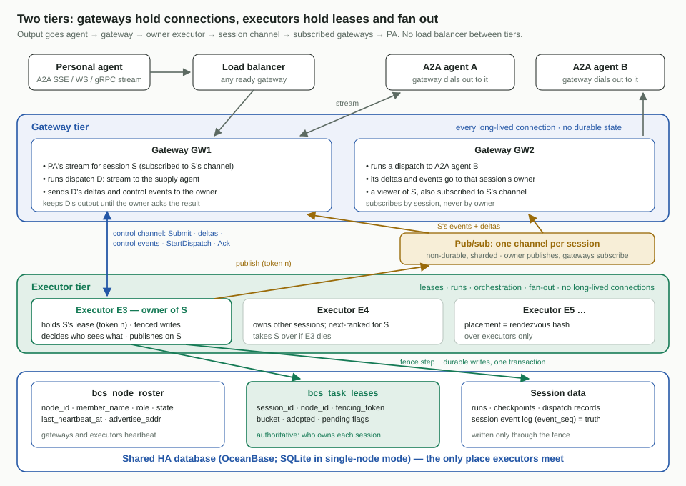
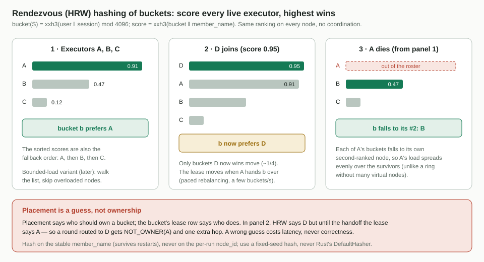
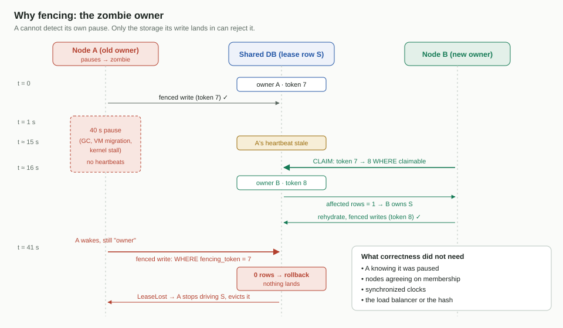
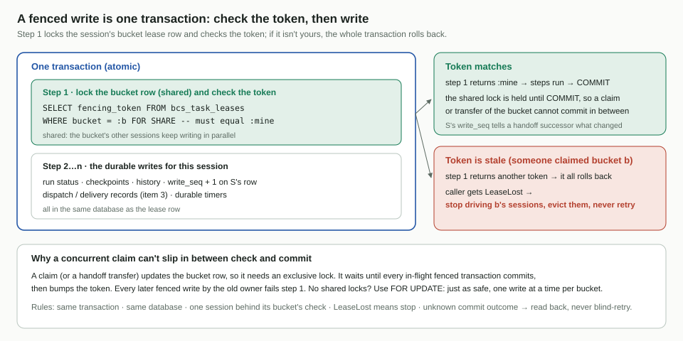
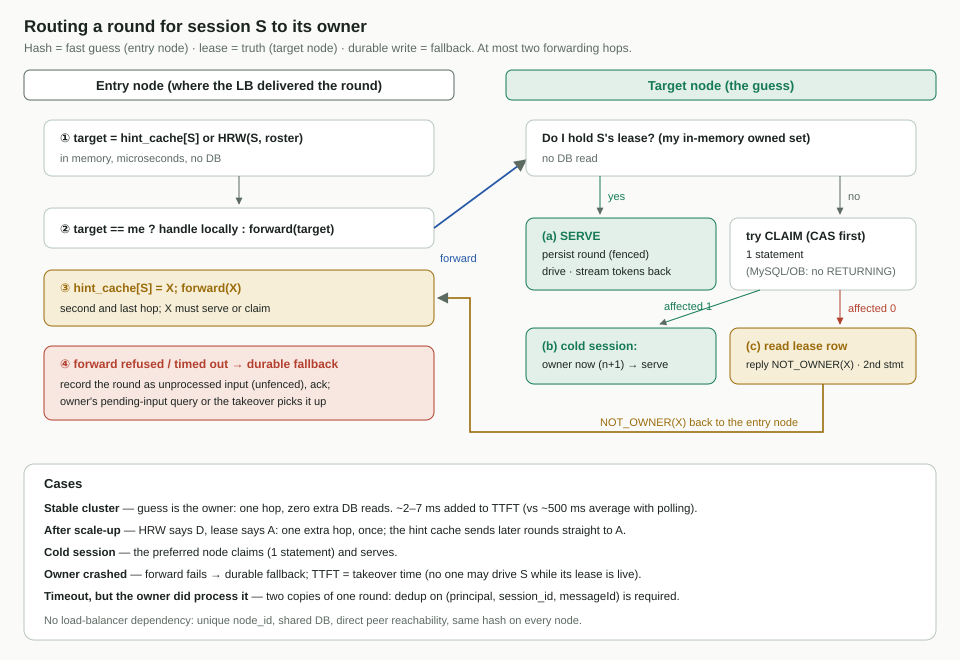
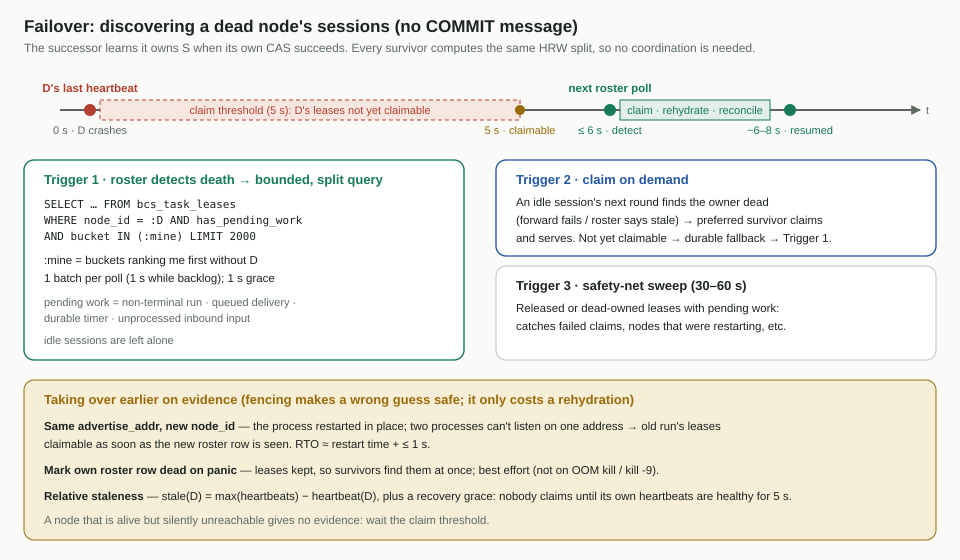
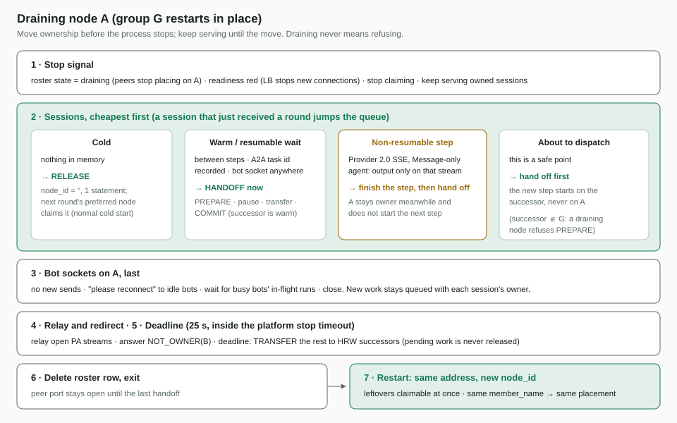
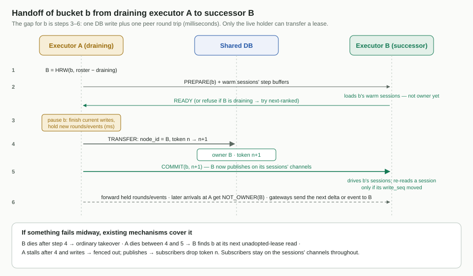
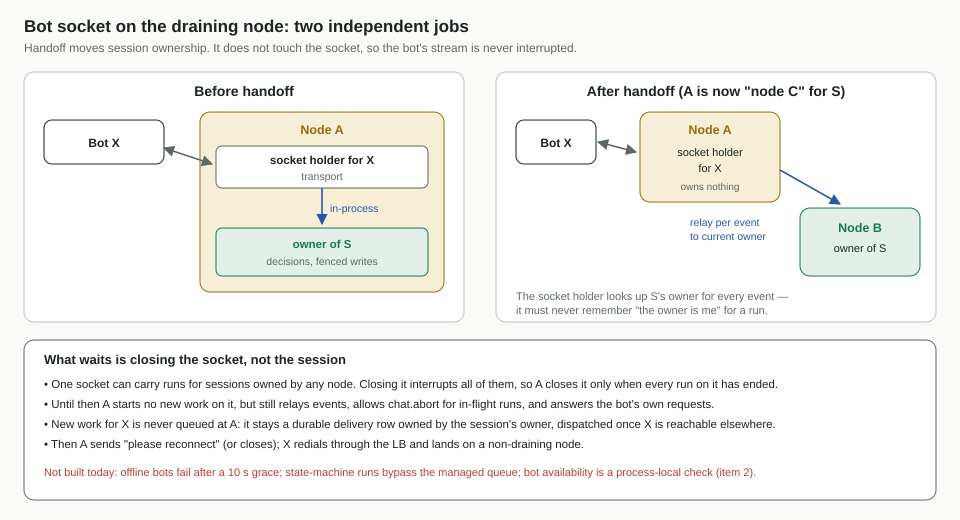

# 集群执行器平面 —— 设计

[English](design.md)

- 日期:2026-11-04
- 状态:**设计已在讨论中达成一致;作为 SDD 规格的输入**(`spec.md` /
  `plan.md` / `tasks.md` 将按仓库的 specify → plan → tasks 流程陆续加入本目录)
- 范围:**BCN 云端编排的第 1 项 —— 集群核心**:节点身份与成员关系、放置、
  带围栏的任务租约、把请求路由到所有者、故障转移、优雅排空与发布、活跃期
  (episode)生命周期。
- 上级设计:*面向个人智能体的 BCN 云端编排*,文档 02"可用性架构"(平面 2 ——
  执行器)。该文档集在
  [inclusionAI/Avernet#3387](https://github.com/inclusionAI/Avernet/pull/3387)
  中提出(已关闭,分支已删除)。本文细化平面 2,并在 [§17](#17-与文档-02-的偏差) 中记录每一处偏差。
- 读者:实现第 1–5 项的 BCS 工程师;初次接触分布式协调的评审者。每个机制都列出
  考虑过的备选方案及其被否决的原因。

## 目录

1. [摘要](#1-摘要)
2. [问题与现状](#2-问题与现状)
3. [目标、不变量与非目标](#3-目标不变量与非目标)
4. [术语](#4-术语)
5. [总览](#5-总览)
6. [成员关系与故障检测](#6-成员关系与故障检测)
7. [放置:会合哈希](#7-放置会合哈希)
8. [所有权:带围栏的任务租约](#8-所有权带围栏的任务租约)
9. [把一轮请求路由到其所有者](#9-把一轮请求路由到其所有者d6)
10. [故障转移](#10-故障转移)
11. [优雅排空与发布](#11-优雅排空与发布)
12. [活跃期:热态生命周期](#12-活跃期热态生命周期)
13. [存储](#13-存储)
14. [容量与成本模型](#14-容量与成本模型)
15. [参数](#15-参数)
16. [表结构与端口](#16-表结构与端口)
17. [与文档 02 的偏差](#17-与文档-02-的偏差)
18. [给兄弟项的备注](#18-给兄弟项的备注)
19. [待决事项](#19-待决事项)
20. [交付计划](#20-交付计划)
21. [已否决的备选方案](#21-已否决的备选方案)
22. [参考资料](#22-参考资料)

---

## 1. 摘要

BCN 必须以 N 个活跃节点运行在同一个共享的高可用数据库之上,使得节点故障绝不会让
个人智能体(PA)的任务失败或丢失。四个机制,各司其职:

| 机制 | 回答的问题 | 在正确性中的角色 |
| --- | --- | --- |
| **花名册**(roster,数据库表 + 心跳) | 哪些节点存在且存活? | 无 —— 仅作参考;驱动放置、加速检测 |
| **放置**(placement,会合哈希) | 会话 S *应当*由哪个节点驱动? | 无 —— 答错只多一跳或一次再水合 |
| **租约 + 围栏令牌**(每会话一行) | 会话 S *实际*由哪个节点驱动? | **全部。** 存储拒绝携带过期令牌的写入 |
| **路由**(转发给所有者,不匹配时重定向) | 一轮请求如何快速到达所有者? | 无 —— 任何失败都回落到一次持久写 |

一句话版本:**哈希 = 快速猜测,租约 = 事实,存储侧令牌校验 = 安全。**
正确性不依赖节点对成员关系达成一致,不依赖时钟,也不依赖负载均衡器。

---

## 2. 问题与现状

今天 BCS 以单一逻辑实例部署。它的恢复机制(派发前落盘、不可变运行快照、重启恢复)
假设*同一个节点重启并重读自己的表*。没有任何机制能让另一个节点检测故障、认领
工作并隔离旧执行者。

阅读代码发现三个按设计就是单实例的组件:

| 组件 | 位置 | 单实例假设 |
| --- | --- | --- |
| 推进恢复扫描器 | `crates/bootstrap/bcs/src/state_machine_progression_scanner.rs` | 每 1 s 扫描**全部**运行,以 `LeaderElectionPort::is_leader()` 为闸门 |
| 受管投递调度器 | `crates/services/bcs-message-flow/src/delivery_runtime.rs`、`docs/message-delivery-service-api.md` | "同一 DB 只能有一个 BCS 调度实例";容量与顺序由**进程内**锁保护;Bot 是否可用是**进程本地**检查;超过 10 s 宽限仍离线的 Bot,其投递被标记为**失败** |
| 选主 | `crates/services/bcs-leader-election` | 只有 `StandaloneLeaderElection` —— 永远回答"我是主" |

**既有隐患。** `docker/kube-deploy.sh` 默认以 **2 个副本**部署 BCS。两者都运行
单机选主,因此都认为自己是主,都对同一个数据库运行扫描器(以及在启用时运行投递
调度器)。第 1 项通过把这些组件全部改为按租约作用域来消除该隐患;在它落地之前,
生产环境应每个数据库只运行一个 BCS 副本,或确认现有 CAS 保护已足够。

本设计所推广的仓库内种子:

- `session_activation_count` —— 业务状态上的 CAS 代数,协作存储在 `WHERE` 子句中
  校验它。它与我们的令牌正交(它标识*哪一次激活*,我们的令牌标识*哪个所有者*),
  两者都保留。
- `bcs_session_speaking_leases`(迁移 037)—— 租约 + 单调 `epoch` + 过期,
  "过期租约绝不复活"。我们的表沿用它的约定。
- `bcs-db-api` 的脚本化事务及 `ExecuteChecked { expected_affected_rows }` ——
  正是围栏写所需要的([§8.4](#84-围栏写d1))。

---

## 3. 目标、不变量与非目标

**不变量**

1. **每会话单写者。** 任意时刻,一个任务会话最多只有一个节点的持久写会被接受。
   会话是不可分割的放置单元。
2. **节点故障绝不使任务失败或丢失。** 已确认的轮次在确认前已持久化
   (构造上 RPO = 0)。
3. **正确性绝不依赖**哈希、成员关系一致、时钟、负载均衡器,或节点知道自己失去了
   租约 —— 只依赖存储侧的令牌校验。
4. **节点本地状态是可重建的缓存。** 只允许直写(write-through);禁止对持久事实
   做回写(write-back)。

**目标**

- 崩溃后的接管 RTO ≤ 30 s;计划内重启后立即接管。
- 发布不会给个人智能体的轮次带来可感知的首 token 时延(TTFT)增加。
- 单节点模式(singlebox)在 SQLite 上运行同一套租约代码路径。

**非目标(由兄弟项负责)**

连接位置注册表与投递转发(第 2 项);派发意图记录、幂等键、对账(第 3 项 —— 本项
只为接管钩子打桩并提供围栏契约);BCN A2A profile(第 4 项);面向 PA 的 A2A 接口
(第 5 项);派发门控(第 6 项);BCSFuse 缓存(第 7 项)。

---

## 4. 术语

| 术语 | 含义 |
| --- | --- |
| **节点**(node) | 一个运行中的 BCS 进程 |
| `member_name` | 节点槽位的**稳定**身份(如主机名);跨重启不变。用于放置 |
| `node_id` | **每次进程运行**的身份(`member_name` + 启动时生成的 ULID)。用于租约所有权 |
| `advertise_addr` | 对等节点直连本节点所用的内部 `host:port`(从不经过负载均衡器) |
| **花名册**(roster) | 表 `bcs_node_roster`:每个存活节点一行,带心跳 |
| **租约**(lease) | `bcs_task_leases` 中的一行:谁拥有会话 S,以及围栏令牌 |
| **围栏令牌**(fencing token) | 每会话单调递增的代数;每次所有权变化都递增 |
| **所有者**(owner) | 其 `node_id` 写在 S 的租约行上、且心跳新鲜的节点 |
| **首选节点**(preferred node) | 在存活且 active 的节点中,会合哈希为 S 排第一的节点 |
| **入口节点**(entry node) | 负载均衡器把请求投递到的节点 |
| **socket 持有者**(socket holder) | 拨入 Bot 的 WebSocket 恰好连接到的节点 |
| **认领**(claim) | 拿下无主或所有者已死的租约(CAS,令牌 n → n+1) |
| **释放**(release) | 放弃租约但不指定继任者(`node_id = ''`) |
| **交接**(handoff) | 把仍有效的租约直接转给选定的继任者([§11.4](#114-交接协议)) |
| **活跃期**(episode) | 节点在内存中保持 S 已水合的时间段;是缓存生命周期,不是数据 |
| **安全点**(safe point) | 运行中可以移动所有权而不丢失任何东西的时刻([§11.3](#113-安全点)) |

---

## 5. 总览



流量分为两个方向:

- **南北向**(客户端 → 集群)经过负载均衡器,它只需把请求分摊到就绪节点上。
- **东西向**(节点 → 节点)直接发往对等节点的 `advertise_addr`:把一轮请求转发给
  所有者、交接消息,以及(第 2 项的)Bot 流量中继。花名册就是服务发现目录。

节点之间无需就任何事情达成一致。共享数据库是它们唯一的交汇点,租约行是对正确性
唯一重要的事实。

## 6. 成员关系与故障检测

### 6.1 选择:共享数据库中的花名册表

| 选项 | 一致性 | 检测速度 | 新增基础设施 | 结论 |
| --- | --- | --- | --- | --- |
| **数据库花名册 + 心跳** | 行是线性一致的;各节点轮询 | ~心跳 × k | **无** —— BCS 本已依赖高可用存储 | **采用** |
| etcd / ZooKeeper 会话 | 线性一致,可 watch | 会话 TTL | 需要运维一个仲裁集群 | 否决:它买到的是线性一致的*成员关系*,而我们并不需要 —— 唯一要紧的线性一致事实(租约)已经与数据放在一起 |
| Gossip / SWIM | 最终一致 | 亚秒级 | 对等 UDP/TCP 端口 | 否决:它解决的是数千节点规模与脱离数据库运行;而没有数据库的 BCN 节点本来就无用 |

成本:20 个节点 × 每 5 s 一次心跳 = 每秒 4 次写。

### 6.2 行与状态

每个节点在启动时 upsert 自己的行,并在每次心跳刷新 `last_heartbeat_at`。状态:
`active`、`draining`。**"已死"是推导出来的,从不存储**:崩溃的节点什么也写不了,
所以"死亡"就是"心跳太旧"。

身份被刻意拆成两个([D3](#17-与文档-02-的偏差)、[D7](#17-与文档-02-的偏差)):

- `node_id` 按进程运行区分。重启后的进程没有旧的热态,所以它是不同的所有者;于是
  对 `node_id` 做相等比较就能回答"这是我的租约吗?",并使一条语句完成租约续期
  成为可能([§8.3](#83-租约操作))。
- `member_name` 是稳定的。放置对它做哈希,所以重启后的节点仍被首选给它之前被
  首选的那些会话。

`advertise_addr` 默认取自配置或环境变量(例如通过 Kubernetes downward API 取得的
pod IP),回退到现有的 `get_local_ip()`。在容器里单靠枚举网卡并不可靠。

**取代同一地址上的上一次运行。** 节点注册时,在写入自身行的同一个事务里,把所有
`(env, advertise_addr)` 相同的其他花名册行的 `last_heartbeat_at` 置为 NULL。两个进程
不可能监听同一个地址,所以这样的行属于已死的运行。该行会被保留,幸存者仍能用旧的
`node_id` 执行发现查询(§10.1);它只是不再新鲜,于是认领谓词(§8.3)立刻把它的租约
视为可认领,相对陈旧度(§6.3)也会忽略它。§10.4 的提前接管就是这样表达的,无需修改
认领语句。前提是 `advertise_addr` 对每个存活进程唯一(不能共用 NAT 地址);陈旧的行
大约一小时后被回收。

### 6.3 只用一个时钟,并采用相对陈旧度

所有时间比较都使用数据库的 `NOW()`,从不使用节点时钟,因此跨节点时钟偏差不会让
存活节点看起来已死。(在 OceanBase 上,`NOW()` 来自执行该语句的服务器;OceanBase
要求其服务器时钟保持紧密同步,相对 10–15 s 的阈值可以忽略。)

陈旧度**相对于集群**来衡量,而不是相对于墙钟:

```
stale(D) = max(last_heartbeat_at over all roster rows) − last_heartbeat_at(D)
```

原因:一次集群范围的存储抖动之后,每个节点都在同一时间漏掉了心跳;若按墙钟计算,
每个节点在其他节点眼里都像死了,会触发接管风暴。相对陈旧度看到的是所有人同样落后。

但当中断**长于**认领阈值时,仅此不够:第一个恢复心跳的节点会把最大值推到当前时间,
而健康的对等节点仍带着中断前的时间戳。因此观察者自身也必须是健康的(**恢复宽限期**,
即 Chubby 在自身 master 故障转移后给客户端宽限期的思路)。每个节点记录
`healthy_since`:在其最近一次心跳失败之后(或启动之后)第一次成功心跳的时间。只有当
`now − healthy_since ≥ 认领阈值` 时,它才把 `stale(D) > 阈值` 视为死亡并据此认领。
一次中断之后,每个节点的 `healthy_since` 都会重置,所以在一个认领阈值内没有人认领
对等节点的租约;在此期间每个健康节点都会心跳数次,只有真正死掉的节点仍然陈旧。
正面证据(§10.4)和认领已释放的租约不需要宽限期。

### 6.4 同一心跳上的两个阈值

| 阈值 | 默认值 | 效果 | 判断错误的代价 |
| --- | --- | --- | --- |
| 放置陈旧 | 10 s | 节点退出所有人的放置排名 | 多一跳 / 一次再水合(便宜) |
| 认领 | 15 s | 该节点的租约变为可认领 | 一次误接管:安全,但会停顿并再水合 |

---

## 7. 放置:会合哈希



### 7.1 算法

```
key            = user_id ‖ 0x00 ‖ session_id
score(member)  = xxh3_64(key ‖ member_name, seed = fixed)
preferred(S)   = argmax over roster rows with state = active and fresh heartbeat
ranked(S)      = all candidates sorted by score (fallback order)
```

性质:每个节点无需协调、在微秒级得出相同结果;成员变化时,只有理论最小比例
(1/N)的会话改变首选,离开节点的会话均匀分散到幸存者上。

哈希必须**跨进程、跨版本稳定**:使用固定种子的 xxh3(`twox-hash` 已在 `Cargo.lock`
中);绝不使用 Rust 的 `DefaultHasher`。哈希函数与键像租约协议一样被视为冻结:
滚动发布中途更改只会造成额外跳数,但仍应避免。

### 7.2 为什么选会合哈希(rendezvous hashing, HRW)

| 方案 | N 变化时移动的键 | 适配度 |
| --- | --- | --- |
| `hash % N` | ~全部 | ✗ 每次发布都丢光热态 |
| 环 + 虚拟节点 | ~1/N | ✓ 可行;每节点需 ~100–200 个虚拟节点才能均衡 |
| **会合哈希(HRW)** | 恰好 1/N;O(N) 查找 | ✓✓ 无需调参;顺带得到排序后的回退列表 |
| Jump hash | 1/N | ✗ 无法从中间移除节点(崩溃就是这种情况) |
| 固定槽位表 | 由分配者决定 | ✗ 需要一个协调者 |

**有界负载**变体(沿排序列表前进时跳过负载超过 `c × 平均值` 的节点)是之后可在
`PlacementPolicy` trait 背后替换的升级。

### 7.3 放置不等于所有权

放置只决定**谁来认领**无主会话。所有权是租约。两者会在成员变化后(新加入的节点
被首选,但现有租约不移动)以及接管之后出现分歧。因此路由([§9](#9-把一轮请求路由到其所有者d6))把哈希当作
由目标节点核验的猜测。

---

## 8. 所有权:带围栏的任务租约

### 8.1 为什么只有锁不够



一个暂停的(GC、虚拟机迁移、内核卡顿)或被网络分区的节点,醒来时可能仍认为自己
拥有 S。它做的任何检查("我还是所有者吗?")之后都可能再次暂停,然后写入才落地。
**只有写入落地的那个存储能拒绝它。** 每次所有权变化都递增围栏令牌;所有者的每次
写都携带自己的令牌;存储拒绝过期的令牌。

### 8.2 租约存活:看所有者的心跳([D5](#17-与文档-02-的偏差))

在以下情况下,租约**可被认领**:其所有者在花名册中的心跳陈旧超过认领阈值,**或**
租约已被释放(`node_id = ''`),**或**有证据表明所有者的这次进程运行已死
([§10.4](#104-凭证据提前接管))。没有逐行续期:节点心跳一次性续期该节点的全部租约。

原因:逐行续期的成本是每个租约每个周期写一行。在 60 万在途会话时,仅为说一句
"我还活着"就要 ~12 万行写/秒;节点级存活每周期每节点只需一次写(与 Chubby 会话、
以及挂载多个键的 etcd 租约是同一模型)。

`expires_at` 保留其约定名称但含义改变:**持有期间为 NULL**;在释放或交接时设置。

### 8.3 租约操作

所有比较使用数据库时钟。租约行在任务会话创建时即以**已释放**状态创建,因此认领
路径永远是单条 `UPDATE`。

```sql
-- CLAIM (CAS first; 1 statement in the common cold case)
-- Dialect-neutral sketch: SET columns are unqualified (SQLite rejects
-- qualified SET targets); the SQL store renders the statement per flavor.
UPDATE bcs_task_leases
   SET fencing_token = :n + 1, node_id = :me, expires_at = NULL
 WHERE env = :env AND session_id = :s AND fencing_token = :n
   AND ( node_id = ''
         OR NOT EXISTS (SELECT 1 FROM bcs_node_roster r
                         WHERE r.node_id = bcs_task_leases.node_id
                           AND <r is fresh>) )
-- affected = 1 → owner with token n+1;  affected = 0 → read the row to learn who owns it

-- RELEASE (no successor; next claimer bumps the token)
UPDATE bcs_task_leases SET node_id = '', expires_at = NOW()
 WHERE env = :env AND session_id = :s AND node_id = :me AND fencing_token = :mine

-- TRANSFER (handoff to a chosen successor; only the live holder can do this)
UPDATE bcs_task_leases SET node_id = :successor, fencing_token = :mine + 1
 WHERE env = :env AND session_id = :s AND node_id = :me AND fencing_token = :mine
```

规则:

- **令牌绝不倒退。** 只要会话仍可能被写,租约行就绝不删除;释放只清空 `node_id`,
  不删行。否则重新创建的行会从 1 开始,旧僵尸的令牌又会匹配上(ABA 问题)。
- **过期决定谁可以认领;令牌决定谁可以写。** 心跳迟到但租约尚未被认领的所有者
  仍可安全地写 —— 没有别人在写。
- **恰好一个认领者胜出。** CAS 会取得行锁;竞争的认领者重新求值,发现令牌已被
  递增,影响 0 行。
- **有待处理工作的租约绝不释放,只能转移。** 释放(`node_id = ''`)只用于没有待处理
  工作的会话(冷、空闲)。已释放的租约在死亡节点查询(§10.1)中不可见,所以释放一个
  仍需驱动者的会话,会让它只能等兜底扫描。凡是节点必须在没有完整交接的情况下放弃
  这类会话(排空截止时间、卡住会话看门狗),都把租约**转移**(TRANSFER)给该会话的
  HRW 后继节点,并发送尽力而为的 `COMMIT` 通知;若通知丢失,后继节点会在下一次心跳
  回读自己持有的会话集合时(≤ 5 s)发现它。

**自我围栏**(self-fencing,是一种存活性上的礼让,不是安全机制):节点若无法按本地
单调时钟在 `send_time + claim_threshold − margin` 之前完成一次心跳,就停止驱动所有
会话并让就绪探针失败。从心跳*发出*时开始计时。即使自我围栏本身也被暂停,围栏
令牌依然兜底。

### 8.4 围栏写([D1](#17-与文档-02-的偏差))



```
DbTransaction [
  ExecuteChecked(expected = 1):
     UPDATE bcs_task_leases SET write_seq = write_seq + 1
      WHERE env = ? AND session_id = ? AND fencing_token = :mine
  Execute: <durable writes for this session>
]   -- stale token → step 1 touches 0 rows → whole transaction rolls back → LeaseLost
```

为什么是这个形状:

- 校验与写入**原子提交**;租约行锁让这次写与并发的认领或转移**串行化**。
- `write_seq = write_seq + 1` 总会改变行,因此受影响行数为 1。空操作 `SET x = x`
  在没有 `CLIENT_FOUND_ROWS` 时报告 0 —— 经典陷阱。`write_seq` 还让交接继任者能
  检测自预加载以来发生了什么变化([§11.4](#114-交接协议))。
- 它直接映射到现有的 `ExecuteChecked` 步骤;不需要 db-api 增加新能力。

规则:

1. 围栏步骤与写入**在同一个事务中**执行。
2. 租约表与被保护的表**在同一个数据库中**。
3. 遇到 `LeaseLost`,**停止驱动该会话并将其逐出。绝不重试。**
4. 一个事务只为**一个会话**加围栏(两个会话需按固定顺序加两道围栏;预计不存在;
   审计会检查)。
5. 提交结果未知(存储切主期间的错误或超时)时,通过**回读**(`write_seq`、该行或
   租约所有者)判定 —— 绝不盲目重复一次非幂等写。

**需要加围栏的:** 所有者驱动期间的每一次持久写 —— 运行状态、节点运行推进、运行
追加的检查点与历史、派发与投递记录(第 3 项使用同一围栏)、持久定时器,以及所有者
在服务一轮请求时持久化该轮。

**不加围栏的:** 非所有者节点把入站的一轮请求作为*输入*持久记录(回退路径,
[§9.4](#94-持久回退));读操作;租约操作本身。

**围栏的边界:** 它保护的是*存储*;它无法撤回僵尸已经发出的 HTTP 请求。这种情况由
第 3 项的先写派发意图、复用幂等键,以及 Agent 侧去重来覆盖。

### 8.5 考虑过的租约备选方案

| 选项 | 有围栏令牌? | 在数据所在处校验? | 结论 |
| --- | --- | --- | --- |
| **数据库条件更新租约** | ✓ | ✓ 同一事务 | **采用** |
| etcd 租约 + revision | ✓ | ✗ 令牌在 etcd、数据在数据库 —— 数据库仍需要一行租约 | 否决 |
| ZooKeeper 临时节点 + `czxid` | ✓ | ✗ 同上 | 否决 |
| Redis 锁 / Redlock | ✗ | ✗ | 否决(Kleppmann 的批评:安全性依赖于有界暂停与时钟) |
| MySQL `GET_LOCK()` | ✗ | 部分;绑定在连接池中的某个连接上 | 否决 |

要记住的规则:**把锁放在它所保护的数据所在的同一个存储里。**

---

## 9. 把一轮请求路由到其所有者([D6](#17-与文档-02-的偏差))

个人智能体的轮次对时延敏感(TTFT)。把一轮请求写进数据库再等所有者下一次轮询
(≤ 1 s,平均 ~500 ms)是不可接受的。取而代之,入口节点在内存中算出一个猜测并
转发;目标节点用它本就持有的事实来核验。



### 9.1 算法

```
ENTRY NODE, on a round for S:
    target = hint_cache.get(S) or HRW(S, live roster)          # µs, no DB
    if target == me: handle(S) else: forward(target, round)
    on NOT_OWNER(X): hint_cache.put(S, X); forward(X, round)    # hop limit = 2
    on forward failure (refused / timeout): drop that node from my roster view and
        forward to the next-ranked node, which claims S if it is claimable;
        only if nobody can serve or claim S yet: durable fallback (§9.4)

TARGET NODE, handle(S):
    if I hold S's lease (in-memory set)        → serve: persist round (fenced), drive, stream back
    else try CLAIM (CAS)                       → affected 1: serve
                                               → affected 0: read lease row, reply NOT_OWNER(owner)
```

- 每个节点都在内存中知道**自己的**租约;常见路径除了持久化该轮本身,不需要任何
  数据库读。
- 目标节点**先做 CAS**:冷会话(非所有者收到请求的常见情况)只需 1 条语句;不匹配
  需要 2 条(失败的 CAS + 一次读)。MySQL 和 OceanBase 没有 `UPDATE … RETURNING`,
  所以一条语句无法既认领又报告当前所有者。
- **提示缓存**(hint cache)从 `NOT_OWNER` 回复中学习;扩容后第一次被误路由的轮次
  多付一跳,之后的轮次直达。
- 来自排空中节点的 `NOT_OWNER` 回复还会附带"我在排空",入口节点据此立即更新自己的
  花名册视图。
- **流式:** 入口节点把所有者的 SSE/gRPC 流代理回 PA。PA 只与负载均衡器地址通信。

### 9.2 逐例说明

| 情况 | 发生什么 | 目标处的数据库语句数 | 额外跳数 |
| --- | --- | --- | --- |
| 集群稳定 | 入口 → HRW → 所有者服务 | 0(另加持久化该轮) | 0 |
| 刚扩容(所有者 ≠ 首选) | 首选节点回复 `NOT_OWNER(A)`;入口缓存并转发给 A | 2 | 1,仅一次 |
| 冷会话 | 首选节点认领并服务 | 1 | 0 |
| 所有者崩溃,尚不可认领 | 转发失败 → 持久回退;接管时被拾取 | — | — |
| 转发超时但所有者其实已处理 | 入口也走了回退 → 同一轮出现两份 | — | 需要去重([§9.3](#93-去重是必需的不是可选的)) |

### 9.3 去重是必需的,不是可选的

转发为同一轮请求制造了第二条路径(一次超时的转发 + 回退)。两者写入同一个键
`(caller principal, session_id, A2A messageId)`;唯一键让其中一个胜出。这依赖于
PA 在重试时复用 `messageId`([跨项备注](cross-item-notes.zh-CN.md))。

### 9.4 持久回退

若所有者不可达,入口节点把该轮作为未处理的输入持久记录(不加围栏 —— 它是会话的
输入,不是所有者的推进)并确认。该轮会被所有者的待处理输入查询拾取;若所有者已死,则由每次花名册轮询都会重复的
死亡节点查询拾取(§10.1)。
此时首 token 时延等于接管时间;没有办法做得更好,因为在 S 的租约仍有效时,其他
节点不得驱动 S。

### 9.5 成本与负载均衡器

- 集群稳定时给 TTFT 增加的时延:~2–7 ms(一次机房内跳转 + 所有者的持久写),
  而轮询方式平均 ~500 ms。
- 负载均衡器随机分发时,约 (N−1)/N 的轮次会被转发;入口节点承担的工作很轻(解析、
  哈希、代理)。
- **不依赖负载均衡器。** 要求:每次运行唯一的 `node_id`、共享数据库、对等节点可通过
  `advertise_addr` 直连、所有节点使用相同的哈希函数。能按 `session_id` 头做哈希的
  负载均衡器可以减少转发,但不是必需的;最终仍由我们的 HRW 决定。

### 9.6 为什么不在请求路径上用消息队列

考虑过并否决了 RabbitMQ 一致性哈希交换机(或类似方案):它的环是第三份成员视图,
会与租约不一致(仍需核验并重定向);环变化时同一会话的消息会分散到不同队列;死亡
节点的队列需要第二套类似租约的故障转移机制;返回入口节点的 token 流仍需节点间
寻址;而且 broker 会成为第二个持久存储和第二个可用性依赖。见 [§21](#21-已否决的备选方案)。

---

## 10. 故障转移

崩溃不会发出 `COMMIT` 消息。幸存者必须**发现**死亡节点的哪些会话需要新所有者,
并在不相互协调的情况下把它们分掉。



### 10.1 触发 1 —— 花名册检测到死亡,随后一次定向查询

```
roster poll (already happening every heartbeat):  D is stale beyond the claim threshold
  → each survivor, at every roster poll while D stays dead:
                          SELECT session_id, fencing_token FROM bcs_task_leases
                          WHERE env = ? AND node_id = :D AND has_pending_work   -- indexed, paginated
  → for each row: if HRW(S, live nodes minus D) == me → claim now
                  else → claim after the grace period (in case the preferred node is also down)
  → claimed: rehydrate → reconciliation hook (item 3) → resume
```

每个幸存者算出同样的排名,所以各自只认领自己那份,接管负载均匀分摊;任何竞争都由
CAS 裁决。只要 D 仍是死的,该查询**在每次花名册轮询时重复执行**(通常是一次返回为空的
索引探测),所以在首次扫描之后才变为待处理的工作 —— 例如走了持久回退的一轮请求 ——
会在一次轮询内被发现。

**待处理工作**(pending work)把查询限制在此刻需要驱动者的会话上:未终结的运行、
排队中的投递、持久定时器,或未处理的入站输入(包括故障期间走了持久回退的轮次)。
空闲会话不受影响。

### 10.2 触发 2 —— 按需认领

空闲会话由它的下一轮请求发现:入口节点转发失败,或花名册显示所有者已死;首选
幸存者在可认领时认领并服务 —— 就是一次普通的冷启动。若尚不可认领,该轮走持久回退,
由触发 1 的重复查询在租约变为可认领后的一次花名册轮询内拾取。

### 10.3 触发 3 —— 兜底扫描

每 30–60 s,每个节点执行一次带索引、分页的查询,查找已释放或所有者已死、且有待处理
工作的租约。它兜住失败的认领,以及另一节点死亡时恰好正在重启的节点。由于待处理
工作只转移、从不释放(§8.3),计划内停机不依赖这次扫描。

### 10.4 凭证据提前接管

围栏让提前接管变得**安全**:如果旧所有者其实还活着,它的写会失败并把会话逐出。
因此速度纯粹是性能权衡,可以用证据代替等待:

| 证据 | 接管时机 | 状态 |
| --- | --- | --- |
| **相同 `advertise_addr`、新的 `node_id`** —— 进程原地重启;两个进程不可能监听同一地址 | 一看到新运行的花名册行就立即接管 | **纳入**:新运行在注册时把旧行的心跳置为 NULL(§6.2);同时消除 singlebox 崩溃后的延迟 |
| panic / 关停钩子中释放 | 立即 | **纳入**,尽力而为(对 OOM kill 或 `kill -9` 无效) |
| 更短的阈值 | 如 1 s / 3 s → RTO ~5 s | 可调;相对陈旧度([§6.3](#63-只用一个时钟并采用相对陈旧度))以及观察者恢复宽限期,使其能抵御存储抖动与更长的中断 |
| 基础设施信号(pod 删除事件) | 快 | 以后作为可选插件,放在带 Noop 默认实现的端口之后 |

一个仍存活但悄无声息地不可达的节点不会给出任何证据;对它只能等满认领阈值。

### 10.5 恢复时间

| 死亡证据 | 何时可认领 | RTO(约) |
| --- | --- | --- |
| 原地重启 | 看到新运行的花名册行(重启后 ≤ 5 s) | 重启 + ≤ 5 s + 再水合 |
| 心跳停止 | 最后一次心跳后 15 s,在下一次花名册轮询时发现 | ~15–20 s + 再水合 + 对账(**≤ 30 s 目标**) |

### 10.6 接管流程

1. 以更高的令牌认领(CAS)。
2. 从持久状态再水合 —— 与恢复一个冷会话走同一路径("故障转移就是一次缓存未命中")。
3. 调用**对账钩子**(第 1 项中为桩;第 3 项实现:对每个未完成的派发,按键探测或
   `GetTask`,绝不盲目重发)。
4. 从检查点继续。

### 10.7 恢复组件改为按租约作用域([D2](#17-与文档-02-的偏差))

推进恢复扫描器与受管投递调度器不再以选主为闸门。每个节点**只为自己拥有的会话**
做恢复和派发,外加上述发现触发器。单机模式下"我"拥有一切,因此行为与今天相同。

---

## 11. 优雅排空与发布

这里假设的发布模型:一组节点 G 原地重启(停止进程,在同一台机器、同一地址上再次
启动)。目标:G 中节点拥有的会话,其轮次保持正常的 TTFT。

**原则:在进程停止之前移走所有权,并在移走之前一直服务。** 排空从不意味着拒绝:
排空中的节点继续服务它仍拥有的每一个会话。

### 11.1 节点 A ∈ G 的排空序列



```
STOP SIGNAL
 1. roster: draining; readiness: fail; stop claiming. Keep serving owned sessions.
 2. Sessions, cheapest first (a session that just received a round jumps the queue):
      cold                                 → release
      warm, or waiting on
        an A2A task with recorded task id  → hand off now
        a bot socket (on another node or A) → hand off now
        a non-resumable stream             → finish that step, then hand off
      about to dispatch a new step         → hand off first; the step starts on the successor
 3. Bot sockets on A: no new sends; "please reconnect" to idle bots; wait for busy
    bots' in-flight runs; close. Their deliveries stay queued with each session's owner.
 4. Keep relaying open PA streams; keep answering NOT_OWNER redirects (peer port stays open).
 5. Drain deadline: TRANSFER the rest to their HRW successors + COMMIT notice (no PREPARE);
    successor rehydrates (read-only steps: cancel and redo; side-effecting: reconcile).
 6. Delete roster row, exit.
RESTART
 7. Same address, new node_id → leftovers claimable at once;
    same member_name → same placement; cold sessions drift back.
```

### 11.2 在组外选择继任者

继任者必须在 G 之外,否则会话会被移动两次。自身也在排空的节点会**拒绝 `PREPARE`**,
排空方随即尝试排名下一位的节点。不使用固定的等待期。若发布平台能在停止一组节点前
运行钩子,应一次性把整组标记为 draining(例如 `bcs-admin cluster drain --members …`),
这样可以彻底消除二次移动。

### 11.3 安全点

运行可以在中途移动,因为每次写之后它的位置完全存在于持久状态中。**安全点**是指:
没有打开的围栏事务、没有做到一半的派发序列、没有在途的不可恢复流。

| 运行正在做什么 | 现在就交接? | 原因 |
| --- | --- | --- |
| 两步之间 | ✓ | 继任者启动下一步 |
| 等待一个 A2A task,**task id 已记录** | ✓ | 继任者使用 `GetTask`(核心操作)或 `SubscribeToTask`(可选,实时 token) |
| 等待拨入 Bot(socket 在任何节点) | ✓ | socket 持有者把事件中继给当前所有者([§11.6](#116-bot-socket一个节点上的两份职责)) |
| 派发中途(已写 `SENDING`,尚未 `DISPATCHED`) | 先完成该序列(毫秒级) | 在此暂停也正确,但会迫使一次探测 |
| 等待**不可恢复**的流(Provider 2.0 SSE;只回 Message 的 Agent) | **等该步骤的终态事件** | 输出只存在于那条流上;Provider 2.0 既不能续传也没有状态查询 |
| BCN 内部工作(judge、LLM 调用) | 完成,或让继任者重做 | 其结果只在提交后才算数 |
| 等待定时器 | 若截止时间已持久化则 ✓ | **需要审计** —— 仅在内存中的定时器会丢失 |

在等待不可恢复的步骤期间,A 仍是所有者,并做该步骤所需的一切:持久化其事件与结果、
处理步骤中途的输入(如发送 `interaction.resolve`)、处理中止。该步骤结束时,
**A 不启动下一步**;它进行交接。

### 11.4 交接协议



```
1. A picks B = HRW(S, roster minus draining nodes)
2. A → B  PREPARE(S)        B loads S (reads only); replies READY — or refuses if draining/overloaded
3. A pauses S               finishes the write in progress, starts no new ones; rounds/events for S wait in memory (ms)
4. A, in the DB:            TRANSFER: node_id = B, token n → n+1   (one statement)
5. A → B  COMMIT(S, n+1)    B drives S; if write_seq moved since PREPARE, B re-reads only the change
6. A forwards held items to B; later arrivals get NOT_OWNER(B)
```

S 的空档是第 3–6 步:一次数据库写加一次对等往返。失败情况:B 在第 4 步后死亡 →
普通接管;A 在第 4 与第 5 步之间死亡 → B 在下一次回读自己的租约集合时发现 S;A 在
第 4 步后卡住并写入 → 被围栏挡住。不带 `PREPARE`/`COMMIT` 的单纯 `UPDATE` 也是
正确的,但会让 B 在最长一个心跳周期内处于冷态且不知情。

暂停是按会话进行的,只为让交接干净:没有它,A 在转移后的写会被围栏拒绝(安全但
嘈杂),而 `PREPARE` 之后落地的写则需要重新读取。

### 11.5 排空期间到达的新轮次

| S 在 A 上的状态 | 发生什么 |
| --- | --- |
| 已交接 | 轮次只会因陈旧的猜测到达 A;A 回复 `NOT_OWNER(B)` |
| 尚未交接,没有阻塞 | 立即交接,然后转发该轮 |
| 正在等待不可恢复的步骤 | 租约暂时不能移动;A 持久记录该轮,它随交接一起移交。若该轮*本身*就是该步骤的输入,则由 A 处理 |

一轮请求在运行进行中到达时,是作为该运行的输入、排队,还是以"忙"拒绝,是第 5 项
的产品规则([跨项备注](cross-item-notes.zh-CN.md))。今天的状态机运行创建只允许
每个会话有一个活跃运行(`create_run_if_session_idle`)。

### 11.6 Bot socket:一个节点上的两份职责

持有拨入 Bot socket 的节点,是任意节点所拥有会话的运行的**传输层**。这份职责与
会话所有权相互独立。



- **socket 在另一节点 C 上:** 把 S 从 A 交接给 B,只改变 C 中继下一个事件的去向。
  C 必须**逐事件**查找 S 的当前所有者(提示缓存 + `NOT_OWNER` 重定向),绝不记住
  派发者。
- **socket 就在 A 上:** S 立即交接(A 成为 S 的中继)。需要等待的是**关闭 socket**,
  因为它会中断其上的每个运行,包括其他节点所拥有会话的运行。A 不再通过自己的 socket
  发送新工作,但仍中继事件、允许对在途运行发送 `chat.abort`、并应答 Bot 自己的
  请求。当某 socket 上的每个运行都已结束(或到达截止时间),A 请 Bot 重连或直接
  关闭;Bot 经负载均衡器重新拨入。
- **发给 socket 正在排空的 Bot 的新工作,绝不在 A 上排队。** 它始终是会话所有者
  名下的一行持久投递记录,由所有者在 Bot 可经其他节点到达后派发。*这种等待行为
  今天并不存在*(离线 Bot 在宽限期后失败;状态机运行绕过受管队列)—— 见
  [跨项备注](cross-item-notes.zh-CN.md)。

### 11.7 截止时间、平台要求与滚动发布

**截止时间。** `drain_timeout`(默认 25 s)必须小于平台的停止超时。到达截止时间时:
所有仍有待处理工作的会话都**转移**(而非释放)给各自的 HRW 后继节点并附 `COMMIT`
通知(§8.3):只读步骤在后继节点上取消后重做;有副作用的步骤在后继节点上对账。Kubernetes 示例:`preStop` 休眠
5 s(覆盖 SIGTERM 与负载均衡器摘除 endpoint 之间的竞态)+ 排空 25 s + 余量 →
`terminationGracePeriodSeconds: 40`。

**探针。** 存活探针(`/livez`:进程是否卡死?)在排空期间保持绿色。就绪探针
(`/readyz`:可以给我派活吗?)在排空期间、自我围栏期间以及启动完成之前为红色。
两者必须是不同的端点;今天的模板两者共用一个路径。

**启动就绪闸门。** 数据库可达;表结构版本可识别(只检查,绝不从 pod 内迁移
MySQL/OceanBase);花名册行已写入且首次心跳已提交;后台循环已在运行。

**滚动发布节奏。** `maxUnavailable: 0`、`maxSurge: 1`、`minReadySeconds` ≈ 30 s,
使接管/再水合的波峰不叠加;一个 PodDisruptionBudget;并限制组大小(建议 ≤ 集群的
25 %)。Bot 重连风暴由现有的 `[bot_ws_admission]` 令牌桶限速。

**混合版本。** 滚动发布期间,新旧代码会互相接管对方的会话:

- 表结构:扩展 → 迁移(滚动前的独立步骤)→ 在后续版本中收缩。绝不在同一版本里
  同时做两者。
- 持久格式(检查点、运行状态、派发记录):双向可读。先发布读取方;滚动完成后再用
  开关启用新的写入方。再水合**失败即关闭**(fail closed):遇到未知格式版本时释放
  租约(带退避并计入指标),而不是猜测。
- 租约协议(认领 CAS、围栏步骤、释放、转移)与放置哈希是版本之间的线协议:冻结。
- 时序参数:自我围栏截止时间必须短于同时生效的任何配置中最小的认领阈值;分两步
  修改时序(先放宽、滚动、再收紧)。

**一次干净发布的信号:** 接管几乎全部来自释放/交接(而非过期);`LeaseLost` ≈ 0;
排空时间远低于截止时间;再水合只出现短暂波峰;负载均衡器无 5xx。

---

## 12. 活跃期:热态生命周期

- **活跃期 = 租约在某节点上的生命周期。** 认领或交接 → 惰性水合(首次使用时,
  或在 `PREPARE` 时提前水合);释放、租约丢失,或空闲 10 分钟 → 逐出。
- **只允许直写。** 活跃期钩子不提供任何在内存中缓冲持久事实的方式。空闲活跃期的
  GC、数月前任务的恢复、故障转移是同一个操作:从数据库再水合。
- **协作式再平衡只动冷会话。** 当所有者对某个活跃期已被逐出的空闲会话不再是 HRW
  首选时,它释放租约;首选节点在下一轮请求时认领。移动冷会话没有成本,所以再平衡
  永远不会增加 TTFT。
- **卡住会话看门狗**(默认约 5 分钟无进展,按运行类型设置)会把驱动者在存活节点
  上卡死的会话转移给排名下一位的节点(是转移而非释放 —— 见 §8.3)—— 这正是逐行
  续期本可以捕获的情况。

---

## 13. 存储

决定:**OceanBase 作为记录系统;Redis 只用于可以丢失并重建的状态。** 任何携带
围栏令牌或已被确认的内容,都必须放在"只有多数派副本拥有该写入后才确认"的存储上。
完整对比、存储故障转移对围栏令牌造成的影响,以及 OceanBase 特有的规则(同分区、
表组、提交结果未知)见 **[storage.zh-CN.md](storage.zh-CN.md)**。

---

## 14. 容量与成本模型

每类租约/路由操作的语句数(续期为每节点每个周期一次写;所有者拾取为每节点每个周期一次带索引查询,绝不按会话)、10 k QPS 与 10 万轮/秒两种场景,以及如何用实测替换估算,见 **[capacity.zh-CN.md](capacity.zh-CN.md)**。

---

## 15. 参数

全部可配置;默认值按 RTO ≤ 30 s 选取。

| 参数 | 默认值 | 说明 |
| --- | --- | --- |
| 心跳间隔 | 5 s | 同时续期租约(节点级存活) |
| 放置陈旧阈值 | 10 s | 相对陈旧度 |
| 观察者恢复宽限期 | = 认领阈值(15 s) | 观察者自身心跳持续健康满这么久之前,不宣告任何对等节点死亡(§6.3) |
| 认领阈值 | 15 s | 实际的租约 TTL |
| 自我围栏余量 | 2 s | 截止时间从心跳发出时刻计算 |
| 非首选认领宽限期 | 3 s | |
| 兜底扫描 | 30–60 s | |
| 排空超时 | 25 s | 必须小于平台停止超时 |
| 活跃期空闲逐出 | 10 分钟 | |
| 卡住会话看门狗 | ~5 分钟 | 按运行类型 |
| 提示缓存 | 有界 LRU | 花名册变化或重定向时丢弃条目 |

崩溃 RTO ≈ 认领阈值(15)+ 花名册轮询(≤ 5)+ 宽限期(首选节点为 0,其余为 3)
+ 再水合(1–3):首选节点认领时通常 ≈ 18–23 s;非首选节点认领时最坏 ≈ 26 s
(15 + 5 + 3 + 3)—— 仍在 30 s 目标之内,余量约 4 s。该上界假设每个幸存的观察者
都已健康至少一个认领阈值(§6.3)。若某对等节点死亡时幸存者仍处于恢复宽限期内(它们刚
重启,或存储刚恢复),最早的认领时间会推迟至多剩余的宽限期,该上界对这一序列不成立。

---

## 16. 表结构与端口

### 16.1 表(约定名称;兄弟会话以此为准构建)

`bcs_node_roster` —— 约定列:`node_id`、`state`(`active`|`draining`)、
`started_at`、`last_heartbeat_at`。本设计新增并给出理由的列:`env`、`member_name`
(稳定的放置身份)、`advertise_addr`(东西向地址)、`build_version`(滚动发布与
诊断)。注册中的节点会把与自身 `(env, advertise_addr)` 相同的行的
`last_heartbeat_at` 置为 NULL(§6.2),因此需要 `(env, advertise_addr)` 上的索引。

`bcs_task_leases` —— 约定列:`session_id`(键)、`node_id`、`fencing_token`
(单调递增的 BIGINT)、`expires_at`。含义变化:`expires_at` 持有期间为 NULL,在
释放/交接时设置(D5)。新增:`env`、`write_seq`(围栏步骤与交接时的增量检测)。
"有待处理工作"信号([§10.1](#101-触发-1--花名册检测到死亡随后一次定向查询))要么是这里的一列,要么从运行表/队列表推导
—— 在计划阶段权衡它与围栏步骤之间的锁竞争后决定。

为 MySQL、SQLite 和 OceanBase(带分区子句和表组)新增编号迁移;已提交的迁移
绝不修改。这里**不**创建 `bcs_dispatch_records`(第 3 项)。

### 16.2 端口与装配

契约放在 `bcs-service-api` 中(以 `LeaderElectionPort` 为先例);实现位于
`services/*`;持久化经由 `bcs-db-api`:

- `NodeRosterPort` —— 注册、心跳、设置 draining、读取存活花名册。
- `PlacementPolicy` —— `rank(key, roster) → ordered members`;默认 HRW。
- `TaskLeasePort` —— 认领、释放、转移、自有租约集合,以及一个
  `fence(session_id, token) → DbTransactionStep` 构造器,供其他存储预置到其事务
  脚本开头(第 3 项的派发记录使用它)。

每个端口都有 SQL(MySQL/OceanBase/SQLite)、单机与 Noop/Mock 实现,并按仓库的
契约测试约定配有一致性测试。由配置驱动装配(没有散落的 `is_local`)。**Singlebox
在 SQLite 上运行真实的 SQL 租约**,因此接管路径在本地也会被执行。SQLite 在整个
数据库范围内串行化写者;围栏依然正确,只是粒度更粗。

---

## 17. 与文档 02 的偏差

本工作不修改文档 02;更正由其负责人决定如何落地。

| # | 文档 02 的说法 | 本设计 | 保证相同吗? |
| --- | --- | --- | --- |
| **D1** | 每次持久写都是 `… WHERE lease_token = my_token` | 在同一事务的第一步对租约行做带令牌校验的更新([§8.4](#84-围栏写d1)) | **更强。** 逐行令牌只保护新所有者已改写过的行;集中校验从认领那一刻起保护每一次写。无需修改每张表的结构 |
| D2 | (未提及) | 恢复扫描器与投递调度器从以选主为闸门改为按租约作用域([§10.7](#107-恢复组件改为按租约作用域d2)) | N > 1 时必需 |
| D3 | "节点 id" | `node_id` 每次进程运行唯一 | 澄清;使批量续期与安全重启成为可能 |
| D4 | "先用普通一致性哈希" | 会合哈希 | 同一家族 |
| **D5** | 每租约独立过期,驱动期间续期 | 租约存活 = 所有者心跳;持有期间 `expires_at` 为 NULL | 安全性相同;续期成本从 O(会话) 降为 O(节点) |
| **D6** | (隐含:写入轮次,所有者拾取) | 入口节点转发给所有者;持久写 + 拾取作为回退([§9](#9-把一轮请求路由到其所有者d6)) | 正确性相同;TTFT 为毫秒级而非 ≤ 1 s |
| **D7** | (未提及) | 用稳定的 `member_name` 做放置,与每次运行的 `node_id` 分开 | 放置跨重启保持 |

---

## 18. 给兄弟项的备注

本设计中需要第 2–5 项采取行动的发现(逐事件转发、socket 排空、
`bcs_message_deliveries` 与文档 03 派发记录之间的重叠、有副作用步骤只接受 Task、
稳定的 `messageId`、跨传输协议的幂等、"恰好一次"的措辞)汇总在
**[cross-item-notes.zh-CN.md](cross-item-notes.zh-CN.md)**。

---

## 19. 待决事项

| # | 决定 | 建议 |
| --- | --- | --- |
| 1 | 谁来构建节点间对等通道(第 1 项转发和第 2 项都需要) | 第 1 项构建共享层;第 2 项复用 |
| 2 | BCN 在 p99 上可以给 TTFT 增加多少 | 决定是否从第一天起就需要负载均衡器按请求头哈希 |
| 3 | 对等认证 | 若基础设施提供证书则用 mTLS;否则在仅内网可达的端口上使用共享密钥 |
| 4 | 发布平台:默认停止超时是多少;能否按组运行停止前钩子? | 用于确定排空时长并避免二次移动 |
| 5 | 生产环境今天是否在一个数据库上运行 2 个 BCS 副本? | 若是,在第 1 项落地前固定为 1 个,或确认 CAS 保护足够 |
| 6 | 多个节点参与调度后,Bot 的 `max_running` 上限在哪里强制 | 在数据库中(条件插入 / CAS 下计数),放在第 1 项 |
| 7 | "有待处理工作"信号的形态 | 在计划阶段决定 |
| 8 | 定时器持久性审计 | 在计划阶段;任何仅在内存中的定时器都是缺口 |

---

## 20. 交付计划

在同一分支上一次一个 PR,每个都以 `totalfrank` 为目标:

| PR | 内容 |
| --- | --- |
| PR0 | 本设计;随后是 `spec.md`、`plan.md`、`tasks.md`(其中的交付表由之后每个 PR 更新) |
| PR1 | 端口、迁移、SQL/单机/Noop 实现、一致性测试 —— 兄弟第 3 项可在此之后开始 |
| PR2 | 节点生命周期:身份、心跳、花名册、就绪/存活探针、排空、配置装配 |
| PR3 | 执行器:按租约作用域的恢复与调度、故障发现、带对账桩的接管、活跃期 |
| PR4 | 对等通道、转发、提示缓存、持久回退、交接协议 |
| PR5…n | 为现有的所有者写加围栏,每个 PR 一组(先做运行状态与节点推进) |

---

## 21. 已否决的备选方案

| 备选方案 | 否决原因 |
| --- | --- |
| 以一致性哈希作为正确性机制 | 在分区和成员关系不一致时失效;只保留作放置 |
| 以主备作为最终形态 | 吞吐上限为单节点;发布成为可用性事件(可作为发布里程碑出现:租约设计在 N = 2 时退化为主备) |
| 负载均衡器上的粘性会话 | 把放置耦合到 L7 基础设施;执行器看不见;对轮次之间的工作无用 |
| 用 etcd / ZooKeeper / gossip 做成员关系 | 不需要线性一致的成员关系;租约已与数据放在一起;新增基础设施 |
| 逐行过期、逐个租约续期 | 每周期 O(会话) 次写(60 万会话时约 12 万次/秒) |
| 在每张表上加逐行 `lease_token` 列 | 只保护新所有者已改写过的行;需要改动许多存储的表结构 |
| 仅靠轮询拾取轮次 | 给 TTFT 增加 ≤ 1 s |
| 在请求路径上使用消息队列(如 RabbitMQ 一致性哈希交换机) | 第三份成员视图;环变化时丢失顺序;第二套租约机制;返回流仍需对等寻址;第二个持久存储与可用性依赖 |
| 基于日志的设计(Kafka 分区作放置,消费者组作所有权) | 自洽,但会话以分区为单位成组移动,再平衡会打断消费者,仍需数据库围栏 —— 属于架构变更 |
| 以 Redis 作为记录系统 | 异步复制可能丢失已确认的写并重复发放围栏令牌;PB 级规模全放在内存里 |
| Redlock / `GET_LOCK()` | 没有围栏令牌 |

---

## 22. 参考资料

- A2A 规范(§3.1.1 Send Message、§3.1.6 Subscribe to Task、§3.3.1 Idempotency、
  §3.3.4 能力校验)及 `specification/a2a.proto` ——
  <https://github.com/a2aproject/A2A>
- M. Kleppmann,"How to do distributed locking"(2016)—— 围栏令牌与对 Redlock 的
  批评
- M. Burrows,"The Chubby lock service for loosely-coupled distributed systems"
  (OSDI 2006)—— 会话,以及 master 故障转移后的宽限期
- D. Thaler、C. Ravishankar,"Using name-based mappings to increase hit rates"
  (1998)—— 会合哈希
- V. Mirrokni、M. Thorup、M. Zadimoghaddam,"Consistent Hashing with Bounded Loads"
  (2017)
- J. Saltzer、D. Reed、D. Clark,"End-to-end arguments in system design"(1984)
- 仓库内:`apps/bcs/docs/bcs-provider-2.0-sse-protocol.md`、
  `apps/bcs/docs/message-delivery-service-api.md`、
  `apps/bcs/specs/2026-09-21-nested-fixed-loops/capacity.md`、
  `docs/arch/arch.rules.md`
