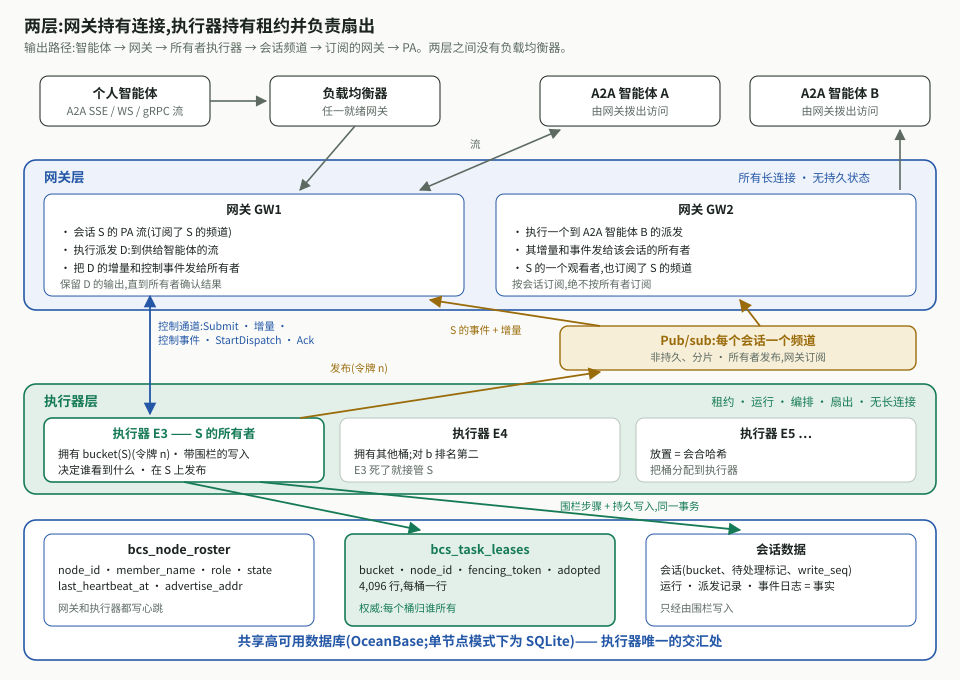
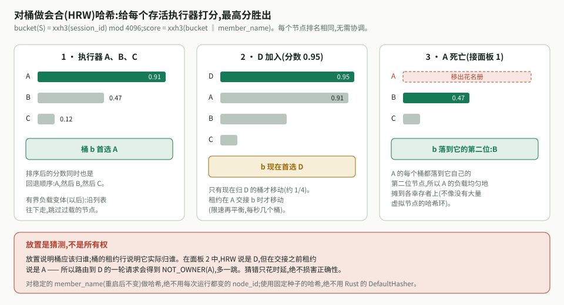
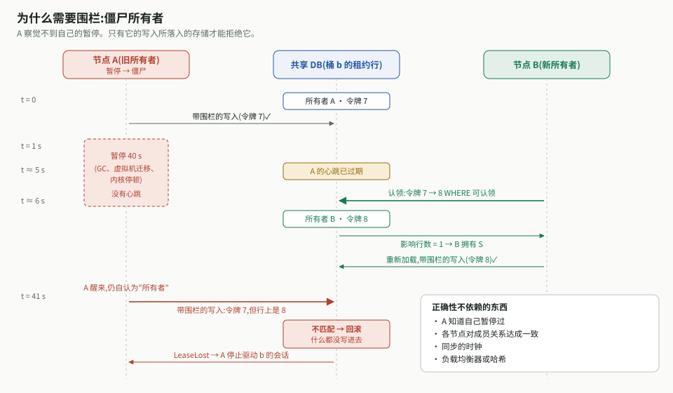
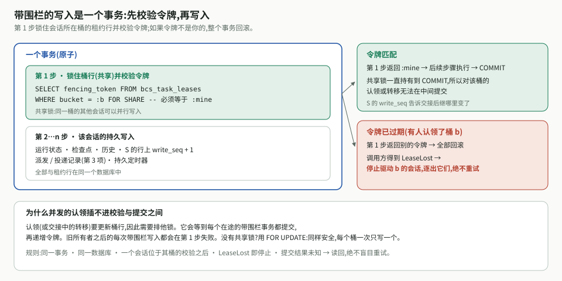
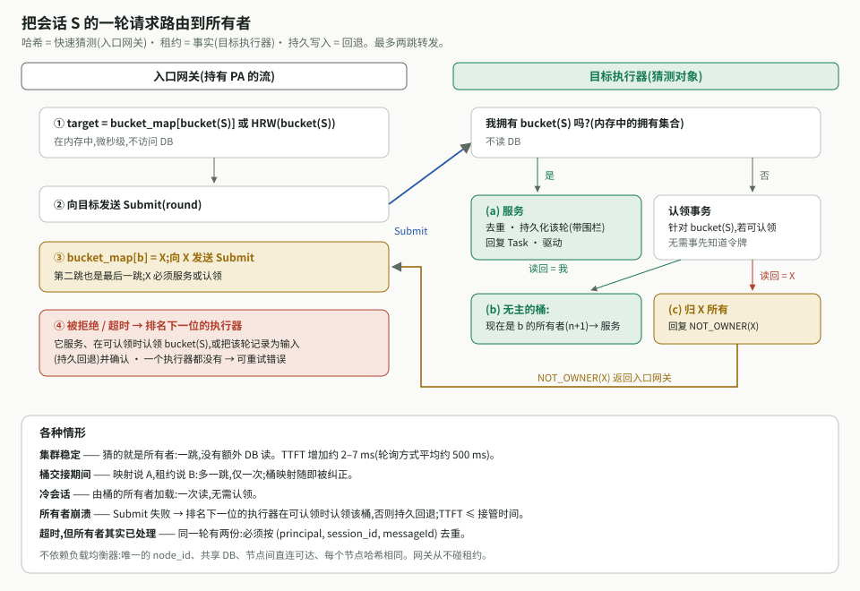
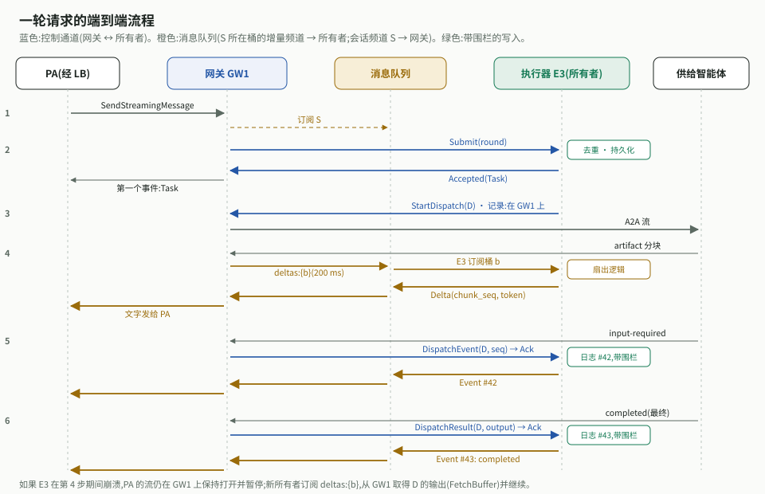
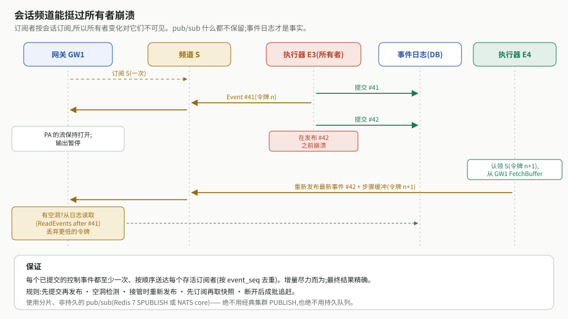
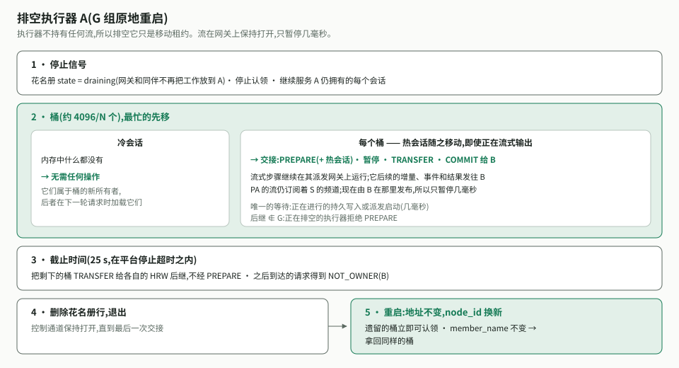
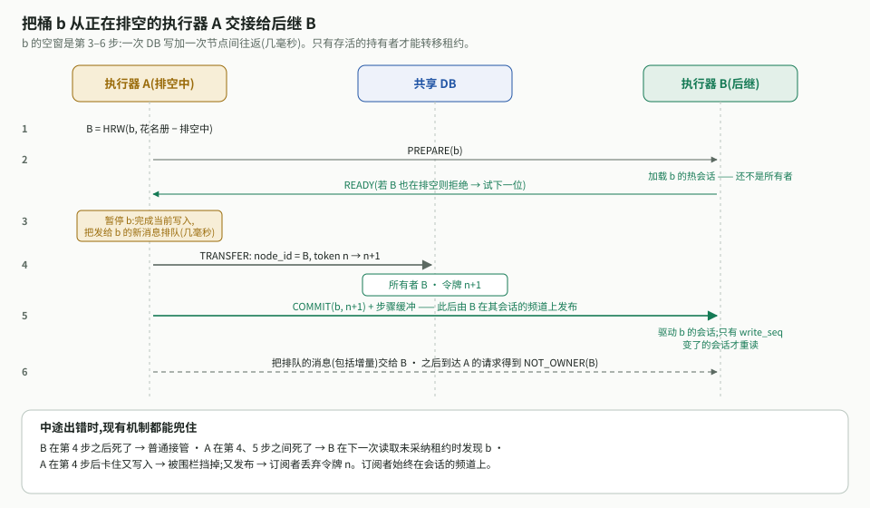
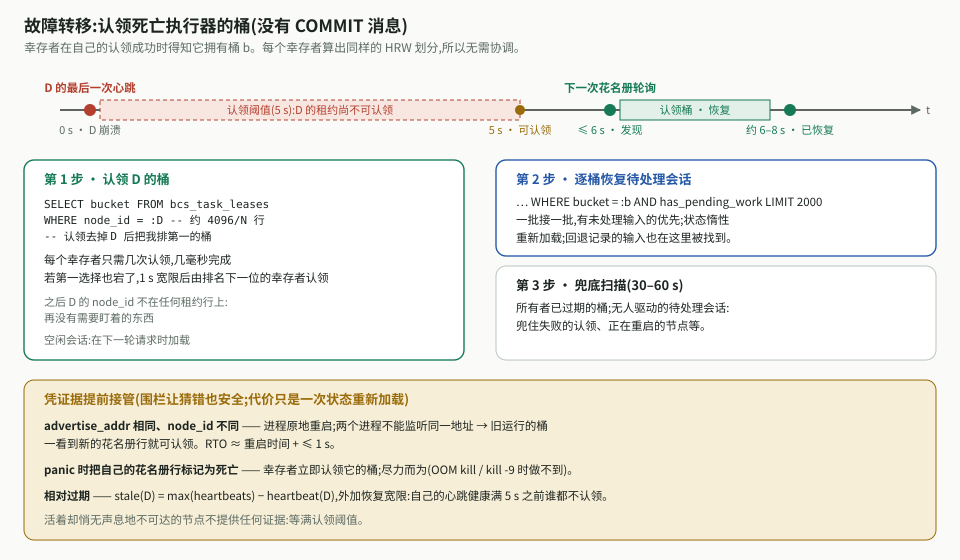

# 集群执行器平面 —— 设计

[English](design.md)

- 日期:2026-11-04 · 修订:2026-11-05(网关层;经 pub/sub 扇出)· 状态:设计已达成一致;作为 SDD 规格的输入
- 范围:BCN 云端编排的第 1 项 —— N 个 BCN 节点如何分担驱动任务会话的工作、
  如何扛过崩溃与发布,以及如何保证绝不会有两个节点同时驱动同一个会话。网关层(§7)
  属于第 2 项;之所以在这里描述,是因为执行器平面依赖它的契约。
- 配套文档:[storage.zh-CN.md](storage.zh-CN.md)(为什么选 OceanBase)、
  [capacity.zh-CN.md](capacity.zh-CN.md)(成本模型)、
  [cross-item-notes.zh-CN.md](cross-item-notes.zh-CN.md)(第 2–5 项必须提供什么)。

---

## 1. 问题

BCN 以集群形式运行在负载均衡器之后,共享同一个高可用数据库。每个个人智能体(PA)
任务都是一个**任务会话**,持续几分钟到几个月。我们需要:

1. **同一时刻恰好一个节点驱动一个会话**(单写者)。
2. **节点故障绝不让任务丢失或失败。** 由另一个节点接管。
3. **低时延。** 新的一轮请求必须到达在内存中已"热"着该会话的节点,而不是等待轮询。
4. **发布无痛。** 重启一组节点不能拖累首 token 时延(TTFT)。
5. **流比执行器活得久。** 驱动会话的节点崩溃或发布时,PA 正在读取的 token 流可以暂停,
   但不能被关闭,也不能丢失任何状态变化。

整个设计建立在一句话之上:

> **哈希 = 快速猜测。租约 = 事实。由存储校验的围栏令牌 = 安全。**

正确性不依赖节点对成员关系达成一致,不依赖时钟,也不依赖负载均衡器。

---

## 2. 全景



BCN 分为**两层**,可以作为同一份代码的两个部署发布:

| 层 | 持有 | 职责 | 持久状态 |
| --- | --- | --- | --- |
| **网关** | 所有长连接:PA 的流与到供给智能体的流 | 终结连接、执行派发、把派发的输出发给所有者、把所有者的扇出中继给客户端 | 无 |
| **执行器** | 不持有长连接 | 通过租约拥有会话,驱动运行与编排,决定并执行扇出,写数据库 | 全部,经由带围栏的写入 |

连接都在网关上,所以执行器崩溃或发布从不会关闭 PA 的流或供给智能体的流:输出暂停,直到
新所有者接管,然后继续(需求 5)。扇出仍是 BCN 自己的逻辑,在所有者上执行,并经一个非持久的
pub/sub 到达网关(§7.4)。这种拆分还把执行器的发布变成了移动租约(§8)。

| 机制 | 回答的问题 | 答错的代价 |
| --- | --- | --- |
| **花名册**(roster)—— 每个节点一行,带心跳 | 哪些网关和执行器活着? | 仅时延 |
| **放置**(placement)—— 把 4,096 个桶在执行器上做会合哈希 | S 的桶*应当*由哪个执行器拥有? | 多一跳或一次再水合 |
| **租约 + 围栏令牌**(lease + fencing token)—— 每个桶一行 | S 的桶*实际*由哪个执行器拥有,从而由谁驱动 S? | —— 这就是正确性机制 |
| **路由**(routing)—— 转发给所有者,不匹配时重定向 | 一轮请求如何快速到达所有者? | 回落到一次持久写 |
| **Task 记录 + 会话 Stream** | 跨所有者变化,每条流如何看到每一次状态变化和每一个 token? | 计划内交接只需几毫秒;所有者崩溃后最多等到接管完成(约 6–8 s);绝不丢状态变化 |

三类流量:

- **PA → 负载均衡器 → 网关**:PA 自己的连接(SSE、WebSocket 或 gRPC 流)。负载均衡器
  只负责把连接分摊到就绪的网关上。
- **网关 ↔ 执行器**:每一对之间一条长连接、多路复用的控制通道,直接发往对端公布的地址
  (不经过负载均衡器)。它承载轮次、派发指令,以及运行中派发的控制事件和结果。
- **派发网关 → 增量频道 → 所有者**:派发网关把运行中派发的增量发布到**消息队列**上、该会话
  所在桶的频道里;所有者订阅自己持有的各个桶的增量频道。
- **执行器 → 会话频道 → 网关**:所有者把每个会话的事件和增量追加到该会话的 Redis Stream;服务该
  会话的每个网关都读它。这就是 BCN 的扇出。
- **网关 → 供给智能体**:出站的 A2A 流。每个供给智能体都是 BCN 拨出访问的 A2A 智能体;BCN 不接受
  任何入站的智能体连接。

执行器之间从不直接协商来决定任何事情。共享数据库是它们唯一的交汇点。

### 术语

| 术语 | 含义 |
| --- | --- |
| `member_name` | 节点槽位的稳定身份(如主机名);跨重启不变。用于放置 |
| `node_id` | 一次进程运行的身份(`member_name` + 新的 ULID)。用于所有权 |
| `advertise_addr` | 对等节点访问本节点所用的内部 `host:port` |
| 桶(bucket) | `xxh3(session_id) mod 4096`:所有权的单位(§4) |
| 所有者(owner) | 其 `node_id` 写在 S 所在桶的租约行上、且心跳新鲜的执行器 |
| 入口网关(entry gateway) | 为某个请求接受了 PA 连接的网关 |
| 派发网关(dispatch gateway) | 执行某次派发的网关:它持有到供给智能体的流 |
| 增量频道(delta channel) | 桶 b 在消息队列上的主题:派发网关发布 b 中各会话的增量,b 的所有者订阅(§7.2) |
| 会话频道(session channel) | `session:{S}`,一个 Redis Stream:所有者追加,网关从自己最后的条目 id 读起(§7.4) |
| 订阅者(subscriber) | 正在读 S 的 Stream、把内容中继到某条客户端流上的网关 |
| 增量(delta) | 一段输出文本或 artifact(一个 "token" 块);发给所有者,被扇出,从不存储 |
| 控制事件(control event) | 任何会改变下一步该做什么的事件;由所有者记录(§7.3) |
| 认领 / 转移 | 拿下一个无人持有的桶 / 把桶交给选定的后继 |
| 活跃期(episode) | 执行器把 S 保留在内存中的那段时间(是缓存寿命,不是数据) |

---

## 3. 成员关系:谁还活着?

每个节点在 `bcs_node_roster` 中保有一行,每秒刷新一次 `last_heartbeat_at`。该行的
`role` 为 `executor` 或 `gateway`;只有执行器参与放置和租约,网关之所以登记在册,是为了
让执行器能找到它们并发现它们何时死亡。状态为 `active` 与 `draining`。**"死亡"从不写入**
—— 崩溃的节点什么都写不了 —— 它是推导出来的:心跳太旧了。

**为什么用共享数据库里的一张表**(而不是 etcd、ZooKeeper 或 gossip):这里的成员
关系只是一个提示。唯一必须线性一致的事实 —— 谁拥有一个会话 —— 本来就和数据一起
存在数据库里。单独的协调服务只会增加基础设施和第二个事实来源,毫无收益。成本:
每个节点每秒一次很小的写。

**两种身份。** `node_id` 在每次进程启动时都会变:重启后的进程没有任何旧内存,所以
它是一个*不同的所有者*,"这是我的租约吗?"就变成简单的相等判断。`member_name`
保持不变,所以放置(§4)会把重启前的那些桶还给重启后的执行器。

**在同一地址上重启。** 节点注册时,把所有 `advertise_addr` 相同的其他花名册行标记为
不再新鲜(心跳置为 NULL)。两个进程不可能监听同一个地址,所以那一行属于已死的运行,
它的租约立刻变为可认领,而不必等待超时。该行本身会被保留,以便幸存者仍能找到它的
桶。

**只用一个时钟。** 所有时间比较都用数据库的 `NOW()`,从不用节点时钟,因此节点之间
的时钟偏差不可能让存活节点看起来已死。

**相对陈旧度。** 一个节点陈旧,是指它落后于*集群其余节点*,而不是落后于墙钟:

```
stale(D) = max(last_heartbeat_at over all rows) − last_heartbeat_at(D)
```

一次短暂的存储抖动之后,所有人同时漏掉了心跳,所以没有人看起来死了 —— 不会出现
接管风暴。

**恢复宽限期。** 一次*长时间*中断之后,第一个恢复心跳的节点会把最大值推前,而健康
的对等节点看起来仍然很旧。所以观察者自己必须是健康的:每个节点记录 `healthy_since`
(最近一次失败之后、或启动之后的第一次成功心跳),只有在
`now − healthy_since ≥ 认领阈值` 时才把对等节点视为死亡。在这段时间里每个健康节点都会
心跳数次,只有真正死掉的节点仍然陈旧。(Chubby 在自身 master 故障转移后给客户端
的宽限期也是同一思路。)

同一心跳上的两个阈值:执行器在 3 s 后离开**放置**(判断错了代价小),5 s 后 —— 即连续
5 次心跳缺失 —— 其租约变为**可认领**(判断错了代价更大)。网关在同样的 5 s 后被视为死亡;
那时它上面的派发会被移走(§7.6)。

---

## 4. 放置:对桶做会合哈希



会话被归入一组固定的**桶**(bucket),执行器拥有的是桶,而不是会话:

```
bucket(S)    = xxh3(session_id) mod 4096                -- fixed seed and count; stored on the session row
score(b, E)  = xxh3(b ‖ E.member_name)
preferred(b) = the active executor with the highest score
```

会话 id 全局唯一,所以仅凭会话 id 就能决定桶。每个节点 —— 包括网关 —— 都能在微秒级算出同样的排名,无需协调。4,096 个桶远多于执行器数,
所以 N 个执行器各持有约 4096/N 个桶,负载保持均衡(20 个执行器时每个约 200 个,400 个执行器时
仍有约 10 个)。执行器加入或离开时,只有胜者发生变化的桶会移动 —— 这是最小可能的比例(1/N)——
离开的执行器的桶会均匀分散,各自去往自己排名第二的执行器。排序后的分数还兼作回退顺序。之后
可以换成有界负载变体(沿列表遍历时跳过过载的执行器)。

桶的数量在系统的整个生命周期内固定不变:它存储在每个会话行上,改变它会重新映射每一个会话。
在上线之前一次性选定(§14)。

为什么用会合哈希而不是其他方案:`hash % N` 每次变化都会全部重排;哈希环需要每个
节点约 100 个以上虚拟节点才能均衡;跳跃哈希无法从中间删除一个节点(也就是崩溃);
固定槽位表需要一个协调者。

**放置不等于所有权。** 放置说明谁*应当*拥有一个桶;租约(§5)说明谁*实际*拥有。执行器加入后,
哈希可能指向 D,而租约仍写着 A,直到 A 把桶交接出去(§10)。所以哈希只是一个由目标执行器核实
的猜测(§6)。

---

## 5. 所有权:带围栏的租约

### 5.1 为什么单靠锁不够



一个节点可能暂停(GC、虚拟机迁移、内核卡顿)或被隔离,醒来后仍以为自己拥有桶 b。
任何"我还是所有者吗?"的检查之后,都可能在写入落地前再暂停一次。**只有写入落地的
那个存储才能拒绝它。** 所以每次所有权变化都会递增一个**围栏令牌**,所有者的每次写入
都携带它的令牌,数据库拒绝过期的令牌。

### 5.2 租约行

`bcs_task_leases` **每个桶一行** —— 共 4,096 行,一次性创建,从不删除:`bucket`、`node_id`
(所有者;尚无人认领时为 `''`)、`fencing_token`(只增不减)和 `adopted`(所有者是否已开始驱动它?
§8.2)。会话没有自己的租约:**S 由 bucket(S) 的所有者拥有,使用该桶的令牌。**

本设计需要的按会话状态存放在会话自己的行上:`bucket`、`has_pending_work` + `pending_seq`(§5.4)
以及 `write_seq`(§5.5)。

**租约可认领**的条件是:尚无人认领它,或其所有者的心跳陈旧(并满足上面的恢复宽限期),或已知
其所有者的运行已死(同一地址重启)。没有逐租约续期:一次执行器心跳就让它的所有桶保持存活。

**为什么用桶,而不是每个会话一个租约。** 每个所有权操作都是按桶进行的,所以代价是 O(桶),
绝不是 O(会话):冷会话无需认领(它的桶早已有所有者),一次故障转移认领约 4096/N 行而不是每个
会话一行,一次排空只转移几百行,而整个 桶 → 所有者 映射小到每个网关都能保存一份(§6)。

### 5.3 操作

**认领** —— 拿下一个无人持有的桶(故障转移、首次启动)。一个事务,无需事先知道令牌:

```sql
UPDATE bcs_task_leases
   SET fencing_token = 1 + fencing_token, node_id = :me, adopted = TRUE
 WHERE bucket = :b AND <lease is claimable>;
SELECT node_id, fencing_token FROM bcs_task_leases WHERE bucket = :b;
```

若回读显示 `node_id = me`,我就以这个令牌拥有 b —— 以及其中的每一个会话;否则它给出当前所有者。
恰好一个认领者胜出:更新会取得行锁,竞争的认领者随后看到一个新鲜的所有者,什么也不改。如果
交接通知丢失,同样的回读也会告诉后继它已经拥有 b。

**转移** —— 把 b 直接交给选定的后继,令牌 + 1 并置 `adopted = FALSE`(只有当前持有者能这样做;
由排空和再平衡使用,§8 与 §10)。没有释放:只要还有执行器存活,每个桶都有所有者。

规则:

- **令牌绝不倒退。** 租约行从不删除、也从不重建,所以旧僵尸的令牌绝不会再次匹配。
- **过期决定谁可以认领;令牌决定谁可以写。** 迟到但租约无人认领的所有者仍可安全写入。
- **移动一个桶会一次移动它的全部会话。** 认领或转移之后,旧所有者对 b 中任何会话的每一次在途
  写入都会失败。

### 5.4 待处理工作标记

会话行上的 `has_pending_work` 表示"这个会话此刻需要驱动者":有运行在进行、有排队的投递、有
定时器,或有无人处理的输入。新所有者靠它找出刚接手的桶里哪些会话需要驱动(§9),所有者不可达
期间记录下的输入也靠它被拾起(§6)。每次**置位**它的写入都会递增 `pending_seq`。每次**清除**只有
在 `pending_seq` 仍等于所有者确认自己已处理完一切时看到的值时才会成功。因此最后一刻到达的输入
绝不会被抹掉:清除只会失败,所有者会去处理这条输入。

### 5.5 带围栏的写入



所有者的每次持久写入都是一个事务,它的第一步锁住 S 所在桶的行并校验令牌:

```sql
SELECT fencing_token FROM bcs_task_leases
 WHERE bucket = :b FOR UPDATE;           -- must equal :mine, else LeaseLost
```

随后才是对 S 的真正写入(运行状态、检查点、派发记录、Task 记录、`last_event_seq` 与 `unpublished`
(§7.4),以及 S 的行上的 `write_seq = write_seq + 1`)。若令牌不是我的,事务回滚,调用方得到
**LeaseLost**:停止驱动该桶的会话,把它们从内存中丢弃,绝不重试。认领或转移会更新同一行,所以它要
等到在途的带围栏写入提交之后才进行;在它之后开始的带围栏写入会看到新令牌。所以"检查"和"写入"
之间没有可供暂停插入的缝隙。(`write_seq` 让交接后继看出每个会话有哪些内容变了。)

**为什么排他锁就够了。** `FOR UPDATE` 让一个桶的带围栏写入逐个执行,所以关键在于一个桶行有多忙:
看的是每个桶的会话数,而不是总数。10 万个打开的会话分布在 4,096 个桶上,每个桶约 25 个会话。按
每秒 1 万轮 × 每轮约 5 次带围栏写入 ≈ 每秒 5 万次写入,每个桶每秒约 12 次,每次持锁几毫秒:一个桶行
大约只有 5% 的时间处于忙碌状态。`FOR SHARE` 能让一个桶的会话并行写入;若 OceanBase 支持共享行锁,
它是一个可选优化。需要测量的是热点桶(一个非常繁忙的群会话,或分布倾斜)(§14);如果桶真的变热,
退路是按会话的围栏(§15)。

规则:检查与写入在**同一个事务**里、在**同一个数据库**里、针对**一个会话**并置于其桶的检查之后。
若一次提交的结果未知(存储切主期间报错),**回读** —— 绝不盲目重复。

**不加围栏的:** 把入站轮次记录为*输入*(任何执行器都可以做)、读取,以及租约操作本身。

**围栏做不到的:** 撤回僵尸已经发出的网络请求。这由预写派发记录(复用幂等键)以及
接收方智能体的去重来覆盖(第 3 项)。

**自我围栏**是锦上添花:无法按时心跳的节点停止驱动并让就绪探针失败,缩短僵尸窗口。

---

## 6. 把一轮请求路由到所有者

个人智能体的轮次对时延敏感,所以一轮请求不能停在数据库里等所有者下一次轮询。入口
网关在内存中猜测并转发;目标执行器用自己已知的信息核实。



```
ENTRY GATEWAY
  b = bucket(S); target = bucket_map[b] or HRW(b)  -- microseconds, no database
  send Submit(round) to target
  on NOT_OWNER(X): remember X, send to X           -- at most 2 hops
  on unreachable: try the next-ranked executor; if no executor answers at
                  all → retryable error to the PA

TARGET EXECUTOR
  do I own bucket(S)?  (in memory) → serve: dedup, persist the round (fenced), reply with the Task
  otherwise → b claimable: claim b   → I own b and all its sessions now: serve
            → owned by X, reachable  → reply NOT_OWNER(X)
            → owner dead, not yet claimable → durable fallback
```

| 情况 | 发生什么 | 代价 |
| --- | --- | --- |
| 集群稳定 | 猜测即所有者 | 一跳,TTFT 增加约 2–7 ms |
| 某个桶正在交接时 | 映射写着 A,租约写着 B → `NOT_OWNER(B)` → 记住 | 多一跳,仅一次 |
| 冷会话 | 桶的所有者从数据库加载它 | 一次读取,无需认领 |
| 所有者崩溃 | 排名下一位的执行器能认领该桶就认领,否则持久回退 | TTFT ≤ 接管时间 |
| 转发超时但所有者其实处理了 | 一轮出现两份 | 按 `(caller, session, messageId)` 去重 |

每个网关都保存完整的 **桶 → 所有者 映射**(4,096 项)。每个 `NOT_OWNER` 都会纠正它,并且每 10 s
从任一执行器(`BucketMap`)完整刷新一次,所以猜测几乎总是对的。

**持久回退**,由收到该轮的执行器执行:若 S 的桶可认领,该执行器认领它并服务(放置只是一种偏好)。
否则,在一个持有该桶行锁的事务中,它把该轮记为 S 的输入、置位 S 的待处理工作标记并确认。
由于这把锁,回退要么在该桶被认领之前提交 —— 于是新所有者对新桶的扫描(§9)会找到这条输入 ——
要么在认领之后提交,这时它会看到新所有者并改为转发。所有者存活但网关访问不到时,所有者会通过
每个周期的拾取(在它的桶上做一次带索引的查询)找到这类输入。网关从不碰租约。

入口网关在发送 `Submit` **之前**就从 S 的会话频道(§7.4)当前末尾开始读,所以所有者为这一轮追加的任何内容都不会漏掉,并把它们中继给 PA。对于会话 id 要等该轮被接受后才存在的全新会话,网关在 `Accepted` 给出 S 后,立刻从这个新 Stream 的第一个条目开始读。
这里没有任何东西依赖负载均衡器:只需要唯一的节点 id、共享数据库、可直达的对等地址,
以及每个节点用同一个哈希。能按会话 header 做哈希的负载均衡器只会让转发更少见。

---

## 7. 网关层与扇出

### 7.1 连接



| 链路 | 协议 | 说明 |
| --- | --- | --- |
| PA → 负载均衡器 → 网关 | PA 的 SSE、WebSocket 或 gRPC 流 | L4 负载均衡器直接透传连接。L7 负载均衡器不能缓冲响应,且空闲超时必须长于网关的 SSE 心跳(每 15–30 s 一次 `: ping`) |
| 网关 ↔ 执行器 | 每一对之间一条长连接、多路复用的双向通道(如基于 HTTP/2 的 gRPC) | 承载轮次、来自派发的控制事件和结果,以及派发指令;keepalive ping 能在几秒内发现对端死亡 |
| 派发网关 → 所有者 | 消息队列上的**增量频道**,每个桶一个 | 派发网关把每个在途派发的增量发布到 `deltas:{bucket(S)}`;所有者订阅自己持有的各个桶的增量频道,所以发增量时无需查找所有者(§7.2) |
| 执行器 → 网关 | **会话频道**:每个会话一个 Redis Stream | BCN 的扇出:所有者追加每个会话的事件和增量;服务该会话的每个网关都读它(§7.4) |
| 网关 → 供给智能体 | A2A `SendStreamingMessage` / `SubscribeToTask` | 每次派发一条,由派发网关建立 |

### 7.2 派发放置与结果

所有者开始一个步骤时,把派发放在**任意健康网关**上,选负载最低的。A2A 智能体是通过出站调用访问的,
所以没有什么把派发绑在某个特定网关上;无论派发在哪里执行,它的增量都经增量频道到达所有者。

所有者在派发记录里记下**由哪个网关执行该派发**,写在它带围栏的写入中(该记录归第 3 项)。如果网关
位于内部负载均衡器之后,就由接受 `StartDispatch` 的网关报告自己的 id,所有者记下它。这一事实必须
持久:接管后的新所有者需要它来监督、取消或收取该派发。按智能体的限制(速率、并发)不再是某个网关
本地的事:它们变成共享的,例如放在 Redis 里的计数器。

派发网关把智能体产出的一切发给 S 的当前所有者,从不发给某个固定节点:

- **增量**按批发送(每 200 ms 一批),按 `chunk_seq` 编号,发布到消息队列上 S 所在桶的增量频道。
  谁持有这个桶谁就订阅了它,所以所有者变化时网关什么都不用做。增量是软状态:不需要确认,也不
  存储;没有被任何订阅者收到的增量由智能体找回(§8.1 第 6 步)。
- **控制事件和最终结果**经控制通道发给所有者,逐条查找(提示缓存 + `NOT_OWNER`)。每条带一个
  按派发计的序号,并**重试直到所有者确认** —— 确认意味着
  所有者已在围栏下记录了它。所有者按 `(dispatch, seq)` 丢弃重复。
- **进度计数**每隔几秒发一次,供卡住派发看门狗使用。

派发网关还会**保留该步骤到目前为止的输出**,直到所有者确认结果为止(它本来就需要这份输出来
拼装结果)。新所有者用 `FetchBuffer(D)` 索取它,网关从这份缓冲作答;若没有缓冲,就去查询智能体的任务(`GetTask` 或 `SubscribeToTask` 快照)来作答,所以所有者变化不会丢失任何输出。若派发网关
先死,所有者会移走该派发(§7.6);输出从智能体的任务中找回,或重新执行该步骤。

### 7.3 一条流里有什么

A2A 流承载四类事件:`Task`(智能体创建了任务并给出其 id)、`TaskStatusUpdateEvent`
(状态变了:`working`、`input-required`、`completed`……)、`TaskArtifactUpdateEvent`
(一块输出,`append: true`)以及 `Message`(不建任务、直接回复的智能体)。它们全部发给
所有者;区别在于是否持久:

| 事件 | 例子 | 持久? | 所有者做什么 |
| --- | --- | --- | --- |
| 智能体的 `Task` | `taskId: ta-77` | **是** | 记录在派发上,以便任何崩溃之后都能再找到该任务 |
| artifact 分块(增量) | "我找到两个选项:……" | 否 | 加入它的步骤缓冲并扇出 |
| `working` + 进度文字 | "正在搜索航班……" | 否 | 扇出;计为存活信号 |
| `input-required` / `auth-required` | "要订哪一个?" | **是** | 改变 Task 状态,启动等待人工的定时器,把 PA 的回答路由回 `ta-77` |
| `completed` / `failed` | `final: true` | **是**,附拼好的输出 | 记录步骤结果,决定下一步 |

**扇出是 BCN 自己的逻辑,在所有者上运行。** 对每个事件,所有者决定谁能看到、以什么形式看到:
调用方的流、被允许观看该会话的其他观看者、群的观看者;只显示主发言者的流还是每个成员的流;
`[from:botName]` 这类标签。两类接收方的处理方式不同:

- **人的流**(PA、观看者、工作台)在会话的频道上收到事件(§7.4)。
- **群里的其他智能体** 收到一次**投递**:所有者把该成员的完整消息作为围栏下的持久记录派发给
  它们,绝不作为 token 流。提及(mention)在完整消息上解析。

PA 看到的是**所有者的 Task**,而不是智能体的。下游的 `completed` 只结束一个*步骤*:
对单个智能体,所有者随后完成自己的 Task;但在群会话中,它会开启下一个成员的回合,PA 的
Task 仍为 `working`。所有者先发布某步骤的最后一个增量,再发布结束该步骤的事件,而且它是
频道上唯一的发布者,所以 PA 绝不会在文字之前看到"completed"。

### 7.4 扇出:会话频道



每个会话 S 都有一个**会话频道**:名为 `session:{S}` 的 Redis Stream。所有者是唯一的写入者;
每个持有 S 的流的网关都从自己最后见过的条目 id 开始读它。网关跟随的是会话,而不是所有者,所以
所有者变化对它们不可见:它们继续读同一个 Stream,而无论哪个执行器拥有 S,都往里追加。

**频道只是一个名字。** 不需要提前为每个会话创建任何东西:第一次追加就会创建这个 Stream,一个
网关读它只占服务器读者列表里的一项。所以每个会话一个 Stream 很便宜,已结束会话的 Stream 会被
裁剪(见下文)。

**三个相互独立的映射。** 会话 S → 桶 → 所有者执行器,由哈希和租约表决定(§4–§5)。名字
`session:{S}` → 存储它的 Redis 节点,由 Redis Cluster 内部决定:把名字哈希到分布在各节点上的
16,384 个槽之一 —— 这就是"分片"的含义,只有 Redis 客户端库会用到它。S 的 PA 流 → 持有它的网关,
取决于负载均衡器把 PA 送到了哪里,它只以那个网关的读取位置的形式存在。三者都不需要彼此对齐。

条目用**显式 id** 写入:

| 条目 | id | 内容 |
| --- | --- | --- |
| 事件 | `<event_seq>-0` | PA 必须看到的状态变化:状态、中断、某个步骤的最终输出 |
| 增量 | `<event_seq>-<chunk_seq>` | 输出文字,位于它所跟随的事件和下一个事件之间 |
| 快照 | `<event_seq>-0`(替代该事件) | 截至该事件的整个 Task:状态、历史,以及作为 `append: false` 整体替换的 artifact |
| `Owner(token)` | 下一个可用 id | 每个新所有者最先写入 |

Redis 会拒绝不大于 Stream 最后一个 id 的 id,所以同一条目推两次是无害的:**重新发布天然幂等**。

**先提交,再推送。** 事件先进入所有者带围栏的提交:Task 记录改变,会话行上的 `last_event_seq`
前进到该事件的编号,事件加入 `unpublished` —— 会话行上的一个小发件箱。提交之后,所有者把它追加
到 Stream,并在下一次提交中顺带把它从 `unpublished` 里清除。在提交与追加之间崩溃的所有者,会把
该事件留在 `unpublished` 里。

**围栏令牌。** 每个条目都带着写入者的围栏令牌,网关丢弃令牌低于它见过的最高令牌的任何条目。过期
的所有者无法提交新事件(它带围栏的提交会失败),但它仍可能追加增量;`Owner(token)` 标记让读者立刻
知道新令牌。在标记之前溜进来的过期增量,会被新所有者的 `append: false` 整体替换覆盖。

**接管。** 对于它认领或接收的桶中每个 Task 未结束的会话,新所有者先追加 `Owner(token)` 标记,再追加
该会话 `unpublished` 里的条目(已在 Stream 里的会因 id 被拒绝),然后把在途步骤从 `FetchBuffer`(§7.2)
得到的输出作为 `append: false` 整体替换追加。

**保留。** 所有者至少在每个步骤结束时追加一个快照条目,并可以裁掉最新快照之前的所有条目。Task 结束
并经过一个保留期后删除整个 Stream,这样即使是长 Task,内存也有上限(capacity.zh-CN.md)。

**对 Stream 提供方的要求:**

- **法定多数持久性:** 已确认的追加必须在故障切换后依然存在。如果 Redis 可能丢失已确认的条目,
  已提交的事件就会从投递中消失。这是一项要求,需用故障切换测试验证(§14)。
- **大规模读取:** 一次阻塞读(`XREAD BLOCK`)只能覆盖同一个哈希槽里的 Stream,所以会话分散在
  许多槽上的网关需要很多阻塞读。退路是一个轻量的 pub/sub 通知("S 上有新条目"),再做一次非阻塞
  的范围读(`XRANGE`)。选择之前先测量(§14)。

> **保证:** 每个已提交的事件都会按顺序、至少一次送达每个正在读 S 的 Stream 的网关,无论所有权变化
> 多少次;重复的条目会因 id 被拒绝。增量在故障后可能暂停或被替换;最终结果精确。

单节点模式使用进程内的 Stream。

### 7.5 客户端重连

A2A 不要求逐帧重放:重连的客户端调用 `SubscribeToTask`,必须先得到**一个快照** —— 当前的 Task,
含状态、历史和到目前为止的每个 artifact —— 然后是实时事件。

快照**只从 Stream 构建。** 重连可能落在任何网关上(GW2):GW2 从 `session:{S}` 的最新快照条目开始读,
应用它之后的事件和增量,把结果作为一个快照发给 PA,然后从那里继续实时读取。不需要调用所有者或
数据库。如果步骤恰好在此期间结束,也不会丢失任何内容:该步骤的最终事件带着完整拼装好的 artifact,
作为 `append: false` 整体替换。

**如果 Stream 无法提供快照**(已裁剪超过所需的位置,或已丢失),本次迭代不从数据库重建快照;
这留到下一次迭代(§14)。

**如果所有者变了,** 新所有者已经追加了从派发网关取得的步骤输出(`FetchBuffer`,§7.2)。**如果派发
网关也死了,** 部分输出仍保存在供给智能体那里:该派发的新网关重新订阅智能体的任务,其快照包含
到目前为止的 artifact,PA 收到一个 `append: false` 的整体替换。无法重新订阅的智能体则重新
执行该步骤,PA 会看到部分文字被重置 —— 这是我们接受的边界:最终结果精确;中间输出可能重置。

按 `Last-Event-ID` 精确重放几乎是免费的:Stream 的 id 本身就是天然的 SSE id
(`id: <event_seq>-<chunk_seq>`)。它是一个可选的 BCN 扩展。

### 7.6 网关故障与排空

**网关崩溃**会断开它上面的连接;设计把损害限制在那里:

- **PA 的流**断开;PA 经负载均衡器重连并得到一个快照(§7.5)。
- **在它上面执行的派发**:所有者在花名册中看到该网关已死(5 s),把每个派发移到另一个网关,
  由后者执行第 3 项的对账:按记录的 id 读取或重新订阅智能体的任务,绝不盲目重发。没有可查询
  任务的步骤会被重新执行,这是安全的,因为有副作用的步骤只会派发给拥有持久、可查询任务的
  智能体(第 3 项与第 6 项)。

**消息队列故障**会让 token 停住,但不会丢失任何状态变化:已提交的事件留在 `unpublished` 里,
恢复后网关从自己最后的 id 继续读每个 Stream(§7.4)。

**排空一个网关**(这一层很少发布):

1. 就绪探针失败,负载均衡器不再发来新连接;花名册显示 `draining`,所有者不再在这里放置新派发。
2. 在途派发完成。步骤已结束的 PA 流会被要求重连(HTTP/2 `GOAWAY` / `Connection: close`),
   在另一个网关上凭快照继续。
3. 到截止时间,网关告诉每个所有者其剩余派发已被放弃,所有者像崩溃后那样移走它们。

---

## 8. 执行器的计划内排空与发布

发布模型:一组执行器 G 原地重启,一次一组。执行器不持有任何流,所以**排空一个执行器只需移动租约**。

**原则:在进程停止之前移走所有权,并在移走之前持续服务。** 排空从来不意味着拒绝工作。



### 8.1 流程

执行器 A 属于正在发布的组 G。它把自己的每个桶 b(约 4096/N 个,最忙的先移,几个同时进行)
转交给 b 的后继 B,B 不属于 G:

1. **不再认领。** 花名册 `state = draining`:网关和其他节点不再把工作放到 A 上,A 也不再认领新的
   桶。A 继续服务它仍持有的每个会话。
2. **PREPARE。** A 通知后继节点 B 进行 PREPARE:把 b 中热会话的状态加载进内存。B 此时还不是
   所有者;在转交之前,A 继续处理收到的增量,并把它们转发到各会话频道上。
3. **停止 b 的增量。** A 停止订阅 b 的增量频道,处理完已经收到的增量。
4. **Ownership 转交。** A 更新租约表 —— b 的所有者 = B,令牌 + 1 —— 然后通知 B:你现在是 b 的
   所有者,请开始处理(COMMIT)。
5. **超时。** 超时时间(需要低于发布平台 stop hook 的 timeout)到了之后,A 直接转交剩下的桶,不再
   等待第 2–3 步。由此丢失的增量由 B 在第 6 步自己查询。
6. **B 追上。** B 再加载一次状态(仅 PREPARE 到 COMMIT 之间的增量,按每个会话的 `write_seq`),订阅
   b 的增量频道,并为每个在途派发通过其派发网关向供给智能体查询可能丢失的输出(`FetchBuffer`,
   §7.2)。它把每个步骤的输出作为 `append: false` 的整体替换重新发布,所以 PA 的文字既无空缺也
   无重复(§7.4)。
7. **A 的 stop hook 完成并下线。** A 删除自己的花名册行并退出。重启时:同一地址、同一
   `member_name`、新的 `node_id` → 剩下的桶立即可认领,该执行器拿回原来的桶。

后继必须在 G 之外,否则一个桶会被移动两次:正在排空的节点会拒绝 PREPARE,于是尝试排名下一位
的节点。如果发布平台能一次把整组标记为排空,双重移动就完全消失。

### 8.2 交接保证什么



- **持久的东西一样都不丢。** 轮次和控制事件走控制通道,重试直到被确认;第 4 步之后它们会收到
  `NOT_OWNER(B)`,转而发往 B。
- **增量只可能从实时画面中缺失**,即 A 停止订阅(第 3 步)与 B 订阅(第 6 步)之间。B 从智能体
  那里补上这段空缺,无论如何最终结果都是精确的。
- **b 的空窗很短。** 第 3–4 步是一次数据库写加一次往返;到了超时(第 5 步),空窗就是 B 追上所需
  的时间。客户端始终连在自己的网关上:它们在这些会话的频道上,而不是在 A 上。
- **失败情形:** B 死了 → 普通接管。COMMIT 丢了 → B 仍会发现 b(见下文)。A 在转交之后写入 →
  被围栏挡掉。A 在转交之后发布 → 订阅者丢弃它更低的令牌。

B 如何发现:转移会在租约行上置 `adopted = FALSE`;认领在同一事务里把它置为 `TRUE`;新所有者
开始驱动时把它置为 `TRUE`。每个执行器每次心跳都会读取自己尚未采纳的桶
(`WHERE node_id = :me AND adopted = FALSE`,有索引,最多几百行,通常没有)。这里没有时间戳或
游标,所以晚提交的转移不会被跳过:未采纳的行会一直可见,直到被采纳。同一次读取也覆盖了在超时时
做出的转移和看门狗做出的转移。

### 8.3 什么时候可以在运行中途移动它?

一个桶可以在其会话的任意两次持久写之间移动,因为每个运行的完整位置都在数据库里,而它的连接在网关上:

| 运行正在…… | 现在移动? |
| --- | --- |
| 两步之间 | ✓ |
| 等待一次派发(任何类型的流) | ✓ —— 派发网关把增量和结果发给 S 当前的所有者 |
| 正在进行一次持久写或启动一次派发 | 先把它做完(几毫秒) |
| 等待一个定时器 | ✓ —— 前提是定时器截止时间已持久化 |

### 8.4 安全地滚动发布

- **探针:** 存活探针("进程卡住了吗?")在排空期间保持绿色;就绪探针在排空、自我围栏
  或启动期间为红色。
- **节奏:** 先加一个新执行器再撤一个旧执行器,两步之间等约 30 s,让再水合波峰不叠加,
  每组不超过集群的 25 %。
- **混合版本:** 新旧执行器会互相接管对方的会话,网关也同时与两者通信,所以 schema 与
  协议变更跨版本按 扩展 → 迁移 → 收缩 进行;新的持久格式先发布读取方、后发布写入方;遇到
  读不懂的格式的节点会把桶交还,而不是去猜。租约协议与放置哈希跨版本冻结。

---

## 9. 故障转移:执行器崩溃时

崩溃之后不会有交接消息。幸存者在彼此不沟通的情况下拿下死亡执行器的桶,然后恢复其中需要驱动
的会话。与此同时,客户端的流在各自网关上保持打开;输出暂停到接管完成,然后继续。



1. **认领死亡执行器的桶。** 每次心跳时每个执行器本来就会读花名册。一旦 D 的租约可认领,每个
   幸存者就读取 D 的桶 —— `SELECT bucket FROM bcs_task_leases WHERE node_id = :D`(有索引,
   约 4096/N 行)—— 并认领去掉 D 后把自己排在第一的那些。首选执行器也宕掉的桶,会在 1 s 宽限期
   后由排名下一位的幸存者认领。每个幸存者只需认领少数几个桶(19 个幸存者分 200 个桶时每个约
   10 个),几毫秒内完成。认领完成后,D 的 `node_id` 不再出现在任何租约行上,也就没有什么需要
   继续盯着的了。
2. **恢复待处理会话。** 对每个认领到的桶,新所有者读取需要驱动者的会话 ——
   在会话行上 `… WHERE bucket = :b AND has_pending_work LIMIT 2000`(有索引),一批接一批,
   有未处理输入的优先 —— 并恢复它们。空闲会话根本不碰:它们属于新所有者,会在下一轮请求时加载。
   状态是惰性重新加载的,所以分摊到 19 个幸存者的 30 万个待处理会话不到 10 s 即可恢复。
3. **兜底扫描**,每 30–60 s 一次:所有者陈旧的桶,以及待处理标记已置位却无人驱动的会话。

对每个恢复的会话:从数据库重新加载状态(与恢复一个冷会话完全相同 —— *故障转移就是一次缓存
未命中*),订阅该桶的增量频道,在花名册中检查每个在途派发所在的网关(活着的网关用 `FetchBuffer` 交出该步骤
的输出;死掉的则意味着要移走该派发,§7.6),重新发布该会话的最新事件和步骤
缓冲(§7.4,规则 2),然后继续。

**凭证据提前接管。** 由于围栏让猜错也是安全的,证据可以代替等待:在同一地址重启会立即释放旧运行
的桶;进程 panic 时会在退出途中把自己的花名册行标记为已死(心跳置为 NULL),于是幸存者通过第 1 步
立即认领它的桶。存活但悄无声息地不可达的节点不提供任何证据 —— 对它只能等待认领阈值。

| 情况 | PA 的流 | 会话在多久后恢复 |
| --- | --- | --- |
| 执行器原地重启 | 暂停,然后继续 | 重启时间 + ≤ 1 s |
| 执行器崩溃,首选幸存者认领 | 暂停,然后继续;不丢输出 | ~6–7 s(5 s 认领阈值 + ≤ 1 s 花名册轮询 + 惰性重新加载) |
| 执行器崩溃,最坏情况(第二选择认领) | 暂停,然后继续 | ~8 s(再加 1 s 非首选宽限期),前提是幸存者已过了自己的恢复宽限期 |
| 网关崩溃 | 断开;PA 重连并得到快照 | 派发在 5 s 后被移走,然后对账(§7.6) |

这些数字来自 1 s 心跳和 5 s 认领阈值。再调低也可以,而且依然安全(围栏让错误的接管无害),
但每一次对"只是停顿了几秒"的节点的误接管都要付出一次再水合的代价。集群范围的停顿已经由
相对陈旧度和恢复宽限期吸收。

---

## 10. 活跃期:热状态只是缓存

- 活跃期在执行器加载 S 时开始(一轮请求、一次恢复或一次交接时,惰性加载),在 S 的桶被移走、失去
  租约或空闲 10 分钟后结束。
- **只写穿透。** 每个持久事实在确认之前就已写入;内存从不持有唯一副本。这就是为什么
  空闲驱逐、恢复一个数月前的任务和崩溃故障转移是同一个操作:从数据库重新加载。(步骤缓冲
  是唯一的例外:它是软状态,由派发网关的副本和智能体自己的任务兜底,§7.5。)
- **再平衡移动的是桶**,在执行器加入时进行(§10.1)。
- **卡住会话看门狗**(约 5 分钟无进展)会丢弃卡死的驱动者,并在同一个所有者上重新加载该会话;
  反复卡死的会话会被判为失败并上报;
  卡住派发看门狗(网关不再发来进度计数)会移走卡死的派发。

### 10.1 执行器加入时的再平衡

每个桶都已有存活的所有者,所以除非把桶交给新执行器,它就会一直闲着:

1. 新执行器以 `active` 注册并发心跳。所有者要等它健康持续一个**稳定延迟**(30 s)之后才开始,
   这样反复启动又崩溃的节点不会让桶来回搬动。
2. 每个所有者把新执行器算进去重新排名。只有新执行器现在排第一的桶才会移动 —— 约占每个所有者的
   1/(N+1)。
3. 每个所有者用 §8 的交接把这些桶交出去,**每个所有者每秒 5 个桶**,最空闲的先走,这样新执行器加载
   会话时不会出现尖峰。
4. 网关通过桶映射刷新和 `NOT_OWNER` 跟上。

例子:从 20 个执行器扩到 21 个,新执行器得到约 195 个桶,每个所有者交出约 10 个;按每个所有者每秒
5 个桶,再平衡几秒内完成。

| 情况 | 由什么移动桶 |
| --- | --- |
| 执行器加入 | 再平衡,在稳定延迟之后 |
| 执行器原地重启(同一地址和 `member_name`) | 它原来的桶立即可认领;它把它们认领回来(§3) |
| 执行器排空(发布、缩容) | 排空把它的桶交给后继(§8) |
| 执行器崩溃 | 幸存者认领它的桶(§9) |

---

## 11. 参数

全部可配置;默认值按崩溃后 ~10 s 以内完成接管来设定。

| 参数 | 默认值 |
| --- | --- |
| 心跳间隔,所有节点(同时让租约保持存活) | 1 s |
| 放置陈旧阈值 | 3 s |
| 认领阈值;网关被视为死亡的时间 | 5 s |
| 观察者恢复宽限期 | 5 s(= 认领阈值) |
| 自我围栏余量 | 1 s |
| 非首选节点的认领宽限期 | 1 s |
| 桶数(上线前固定) | 4,096 |
| 恢复一个桶时每次查询读取的待处理会话数 | 2,000 |
| 执行器加入后的再平衡:稳定延迟 / 节奏 | 30 s / 每个所有者每秒 5 个桶 |
| 网关的桶映射刷新 | 10 s |
| 兜底扫描 | 30–60 s |
| 执行器排空截止时间 | 低于平台的 stop hook 超时(例如 25 s) |
| 网关–执行器通道 keepalive / 判定死亡 | 1 s / 3 s |
| 增量批间隔(派发网关 → 增量频道) | 200 ms |
| 会话 Stream 中的快照条目 | 至少每个步骤结束时一个 |
| Task 结束后会话 Stream 的保留 | 一个保留期(如 24 h) |
| 派发进度计数 | 每 5 s |
| 网关排空截止时间 | 按平台停止超时设定(如 60 s) |
| 活跃期空闲驱逐 | 10 分钟 |
| 卡住会话看门狗 | ~5 分钟 |

---

## 12. 契约

**表**(名称已为兄弟项目固定):

- `bcs_node_roster`:`node_id`、`member_name`、`role`(`executor` | `gateway`)、`state`、
  `started_at`、`last_heartbeat_at`、`advertise_addr`、`build_version`。
- `bcs_task_leases`:每个桶一行 —— `bucket`(主键,0–4095)、`node_id`、`fencing_token`、
  `adopted`;一次性创建 4,096 行。索引:`(node_id, adopted)`,用于查找死亡执行器的桶以及已转移
  但尚未采纳的桶。
- **会话行**(本设计在会话记录上需要的列):`bucket`、`has_pending_work`、`pending_seq`、
  `write_seq`、`last_event_seq`、`unpublished`(已提交但尚未追加的事件的发件箱,§7.4)。索引:
  `(bucket, has_pending_work)`,用于恢复一个桶的待处理会话。
- **Task 记录**:状态、历史(含中断消息)以及已完成步骤的 artifact,在围栏下写入;GetTask 和
  ListTasks 读的就是它。
- **派发位置**:派发记录(第 3 项)写明执行它的网关,在围栏下写入。

**接口**(与协议无关,每个都有数据库实现、单节点实现和 no-op 实现):

- **花名册** —— 注册、心跳、置为 draining、读取存活花名册。
- **放置策略** —— 为桶给执行器排名(默认会合哈希);为派发选择网关(任意健康网关,
  选负载最低的)。
- **任务租约** —— 认领、转移、列出自己持有的桶,以及一个其他组件放在自己事务第一步的
  **围栏步骤**(以 `FOR UPDATE` 锁住该会话所在桶的行并校验令牌;第 3 项的派发记录使用它)。
- **网关–执行器协议**:
  - 网关 → 执行器:`Submit(round)`、`BucketMap()`、`DispatchEvent(D, seq, event)`、
    `DispatchResult(D, seq, output)`、`Progress(D)`、`Abandoned(D)`;
  - 执行器 → 网关:`Accepted(Task)`、`NOT_OWNER(X)`、`StartDispatch(D, target, request)`、
    `CancelDispatch(D)`、`Ack(D, seq)`、`FetchBuffer(D)`。
- **增量频道**(派发网关 → 所有者,在消息队列上):`deltas:{bucket}` 上的 `Delta(D, chunk_seq, chunk)`。
- **会话频道**(所有者 → 网关,Redis Stream `session:{S}`):带显式 id 的条目 —— 事件和快照为
  `<event_seq>-0`,增量为 `<event_seq>-<chunk_seq>` —— 每个都带着围栏令牌,另有 `Owner(token)` 标记;
  有 Redis 实现、单节点模式用的进程内实现和 no-op 实现。

单节点模式在一个进程中运行两层,并在本地数据库上运行同样的租约逻辑,所以接管路径在任何
环境下都会被走到。

---

## 13. 与文档 02 的偏差

| # | 文档 02 的说法 | 本设计 | 原因 |
| --- | --- | --- | --- |
| D1 | 每次写入都带 `WHERE lease_token = my_token` | 每个事务的第一步锁住并校验该会话所在桶的租约行 | 更强:从认领那一刻起保护每一次写入,且不必在每张表上加列 |
| D2 | —— | 恢复与派发按租约运行,而不是依赖单个 leader | N > 1 个节点的必要条件 |
| D3 | "节点 id" | `node_id` 按进程运行分配 | 让重启与续期都变简单 |
| D4 | 对 `(user_id, session_id)` 做"一致性哈希" | 对桶做会合哈希,`bucket = xxh3(session_id)` | 同一家族,无需调参;会话 id 全局唯一,所以用户 id 没有额外作用 |
| D5 | 每个租约各自过期、各自续期 | 租约存活 = 所有者的心跳 | 写入量为 O(节点) 而非 O(会话) |
| D6 | 轮次先写入、再被拾取 | 轮次转发给所有者;写入是回退 | 毫秒级,而不是最多 1 s |
| D7 | —— | 用稳定的 `member_name` 做放置 | 放置跨重启保持 |
| D8 | 任意节点服务任意请求;拥有会话的节点自己执行拨出流;拨入 socket 落在任意节点(平面 1 与 3) | 由网关层持有所有长连接;执行器不持有任何长连接;所有供给智能体都是拨出的 | 执行器崩溃或发布只会让流暂停而不是关闭,执行器排空变成移动租约 |
| D9 | —— | 所有者在带显式 id 的按会话 Redis Stream 上扇出;已提交的 Task 记录加上会话行上的发件箱,让投递在崩溃后依然完整 | 扇出仍是 BCN 自己的逻辑;所有者变化对读者不可见;重新发布天然幂等 |
| D10 | 每个任务会话一个租约 | 每个桶一个租约(固定 4,096 个桶);会话继承其桶的所有者和令牌 | 所有权工作是 O(桶):冷会话无需认领,一次故障转移认领约 4096/N 行,一次排空转移几百行,而整个所有者映射能放进每个网关 |

---

## 14. 待定决策

| # | 决策 | 建议 |
| --- | --- | --- |
| 1 | 谁来建网关–执行器通道和网关层(这里和第 2 项) | 第 1 项建通道和执行器一侧;第 2 项建网关 |
| 2 | BCN 在 p99 下可增加的 TTFT 预算 | 决定是否需要尽早做负载均衡器 header 哈希 |
| 3 | 节点间认证 | 有条件就用 mTLS;否则在仅内网端口上用共享密钥 |
| 4 | 发布平台:停止超时;是否有组级 pre-stop 钩子? | 决定两个排空截止时间;避免两次移动 |
| 5 | 定时器持久性 | 每个运行定时器都必须持久化 |
| 6 | Stream 无法提供快照时的重连快照 | 留到下一次迭代:从 Task 记录重建 |
| 7 | 网关与执行器分开部署,还是同一部署的两个角色 | 同一代码库、分开部署:网关很少发布,执行器经常发布 |
| 8 | 按 `Last-Event-ID` 精确重放 | Stream 的 id 就是天然的 SSE id;作为 BCN 扩展提供。对 A2A 来说快照就够了 |
| 9 | 消息队列产品 | 增量频道:非持久、分片的 pub/sub(Redis 7+ 分片 pub/sub 或 NATS core)。会话频道:具备**法定多数持久性**的 Redis Streams(故障切换不丢失已确认的条目)—— 这是一项要求,需用故障切换测试验证 |
| 10 | 增量频道的粒度 | 每个桶一个频道(一个所有者订阅约 4096/N 个频道);只有当某个桶的增量速率高到一个订阅者处理不了时,才改为每个会话一个频道 |
| 11 | 热点桶 | 默认 `FOR UPDATE`;测量按桶写入速率;若 OceanBase 支持就用 `FOR SHARE` |
| 12 | 桶数 | 4,096,上线前固定 |
| 13 | 读取大量会话 Stream | 一次阻塞读只覆盖一个哈希槽;先测量,退路是 pub/sub 通知加 `XRANGE` |

---

## 15. 我们否决的方案

| 方案 | 为什么不 |
| --- | --- |
| 用一致性哈希作为正确性机制 | 节点对成员关系看法不一时就失效 |
| 主备 | 吞吐上限是一个节点;发布变成停机 |
| 负载均衡器粘性会话 | 把放置绑死在基础设施上;对后台工作无用 |
| 用 etcd / ZooKeeper / gossip 做成员关系 | 没必要;租约本来就和数据在一起 |
| 用锁服务(etcd、ZooKeeper、Redlock)管理所有权 | 围栏校验必须与它所保护的数据在同一事务中执行;Redlock 根本没有围栏令牌 |
| 由拥有会话的执行器自己持有流(只有一种节点) | 每次执行器崩溃或发布都会切断流;排空必须等待不可恢复的步骤 |
| 在网关里决定或执行扇出 | 扇出是 BCN 自己的逻辑:群成员关系、提及、可见性、显示哪个成员的流 |
| 由所有者自己跟踪订阅者(所有者充当 broker) | 订阅者将不得不跟随每一次所有者变化;每个会话一个 Stream 让所有者变化不可见,而且它本身就是一个我们无需自建的高吞吐扇出系统 |
| 用基于磁盘的持久队列(Kafka、RocketMQ)做扇出 | 每个 token 块一次带复制的磁盘写入,按会话的主题很重;Redis Streams 把条目放在内存里,每个会话一个廉价的 Stream |
| 在请求路径上放消息队列(如一致性哈希交换机) | 第三种成员视图、再平衡时丢失顺序、第二套租约机制,而且它无法加入持久回退所依赖的租约行事务 |
| 每个输入和 token 都经过缓存的 Stream(以队列为中心的执行器) | 存储操作随 token 增长,每一轮之前多一跳队列,已确认消息的持久性取决于缓存的故障切换 |
| 用 Redis 作为事实来源 | 异步复制可能丢失已确认的写入并重复发放令牌 |
| 按会话的围栏(会话行上的 `owner_token`) | 每个桶约 25 个会话时不需要;是桶变热时的退路 |
| 每个会话一个租约 | 冷启动和故障转移需要 O(会话) 次认领,故障发现要扫描数百万租约行;桶能以每次故障转移约 4096/N 次租约操作提供同样的安全性 |
| 逐租约续期 | 每个周期 O(租约) 次写 |
| 轮询新轮次 | TTFT 增加最多 1 s |

在热路径上,消息队列承载增量频道(非持久 pub/sub)和会话频道(Redis Streams,§7.4)。基于磁盘的持久队列仍适合放在热路径**之外**:
向 PA 的出站 webhook 推送(长时间重试、死信),以及审计或分析的数据流,后者最好用数据库的
变更流。

---

## 16. 参考资料

- M. Kleppmann, "How to do distributed locking" (2016) —— 围栏令牌
- M. Burrows, "The Chubby lock service" (OSDI 2006) —— 会话、宽限期
- D. Thaler, C. Ravishankar, "Using name-based mappings to increase hit rates" (1998) —— 会合哈希
- V. Mirrokni et al., "Consistent Hashing with Bounded Loads" (2017)
- J. Saltzer, D. Reed, D. Clark, "End-to-end arguments in system design" (1984)
- A2A 规范 —— <https://github.com/a2aproject/A2A>
