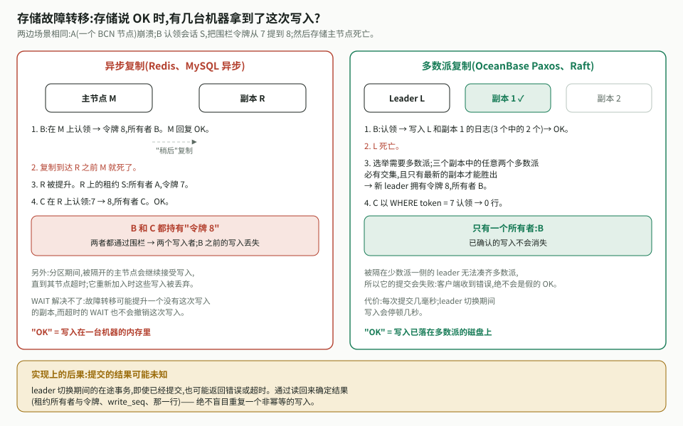

# 集群执行器平面 —— 存储选型

[English](storage.md) · 属于[集群执行器平面设计](design.zh-CN.md)

## 1. 建议:以 OceanBase 作为记录系统

规则:**任何携带围栏令牌(fencing token)或已被确认的内容都放在 OceanBase;
Redis 只用于可以丢失并重建的状态。**

| 要求 | Redis Cluster | OceanBase |
| --- | --- | --- |
| 确认前已持久化 | ✗ 异步复制可能丢失已确认的写 | ✓ Paxos 多数派提交 |
| 令牌绝不倒退 | ✗ 跨故障转移无法保证(见下) | ✓ |
| 原子的校验并写入 | 单个 hash slot 内的 Lua | 事务(保持在单分区内) |
| 带索引的查询 | 需自行构建 | SQL |
| 数月的数据 | 只能放在内存 | 磁盘(LSM,压缩) |
| 写扩展 | 线性扩展,亚毫秒 | 按分区扩展;每次提交几毫秒 |

**Redis 适合用于:** 软性限流、
很少变化内容的读缓存、尽力而为的唤醒、非持久的增量频道(分片 pub/sub),以及 —— 仅在具备法定多数
持久性时 —— 会话 Stream(设计 §7.4)。

## 2. 存储故障转移会发生什么

存储会保存多份副本;主节点死亡时会提升一个副本。在**异步**复制下(Redis;MySQL
异步复制),主节点在副本拿到写入之前就确认,所以一次故障转移可能丢掉一个已确认的
认领。随后第二个认领者会拿到*相同*的令牌号,围栏再也无法区分这两个所有者。被分区
隔离的旧主节点还可能在超时前继续接受写入(脑裂),这些写在它重新加入时被丢弃。
`WAIT` 并不能让 Redis 变成强一致。

在**多数派**复制下(OceanBase 的 Paxos;Raft),一次提交只有在落到多数派上之后才
确认,任意两个多数派必有交集,而且只有数据最新的副本才能成为 leader —— 因此不会
丢失任何已确认的写,处于少数派一侧的 leader 根本无法提交。代价是:每次提交几毫秒,
以及切主期间几秒钟的写停顿。

对任何存储都该问的问题:**"它说 OK 的时候,有几台机器已经把这次写落盘?"** 对
令牌和已确认的轮次而言,答案必须是"多数派"。(因此 MySQL 需要无损半同步复制。)

## 3. OceanBase 的具体要求

- **按桶同分区。** 一个围栏事务会触碰桶的租约行和会话的各行,所以把 `bcs_task_leases` 和每张
  按会话组织的表都按 `bucket` 分区,分区数相同,并放在同一个**表组**(table group)中。这样
  事务停留在一个分区内。否则每次围栏写都会变成分布式(两阶段)事务。
- 按会话的表在主键中包含 `bucket`(例如 `(bucket, session_id)`),因为分区键必须是主键的
  一部分。
- 默认隔离级别是 READ COMMITTED;本设计只依赖行锁 —— 围栏步骤以及认领或转移的 `FOR UPDATE`
  锁 —— 其行为相同。
- 避免热点行(任何每个请求都会触碰的全集群计数器)。一个桶行会被其所有会话的每次围栏写锁住,
  所以关键在于每个桶的会话数:约 25 个时,一个桶行大约只有 5% 的时间处于忙碌状态(设计 §5.5)。
- 切主期间提交结果未知时,通过回读来判定
  ([设计 §5.5](design.zh-CN.md#55-带围栏的写入))。
