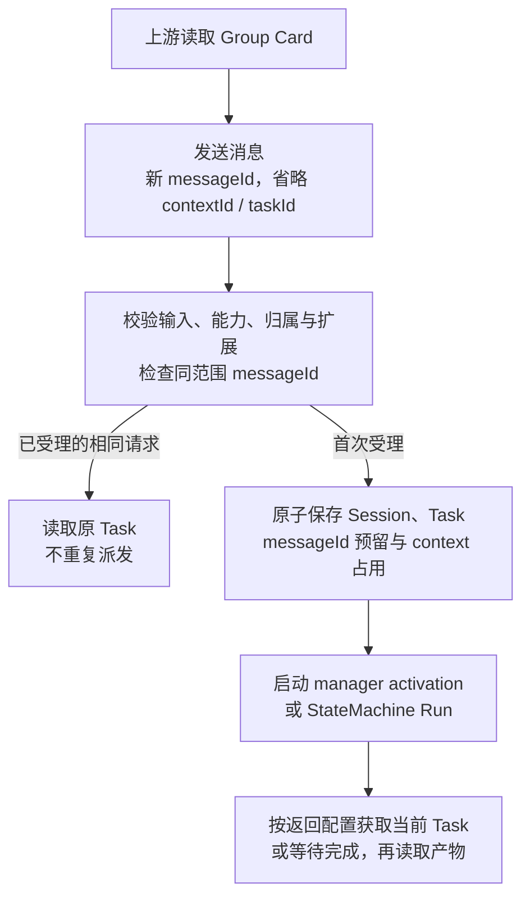
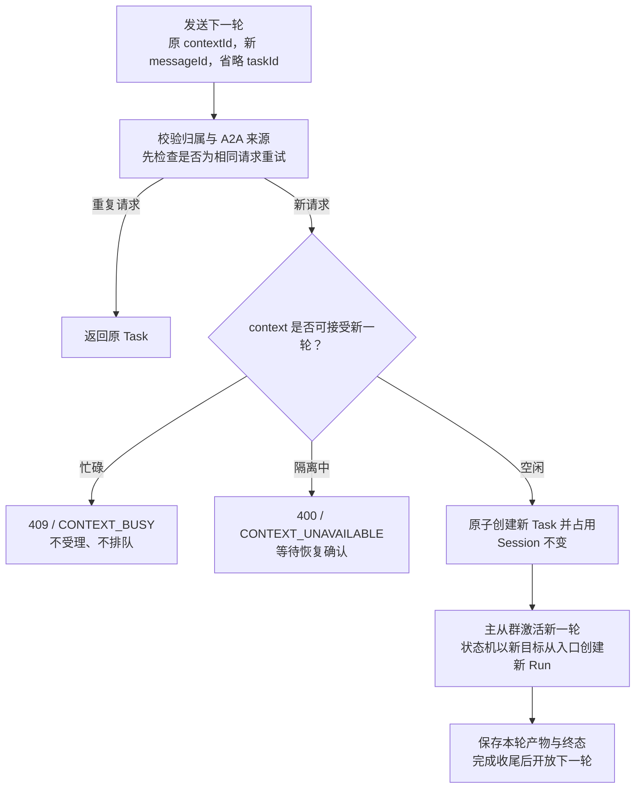
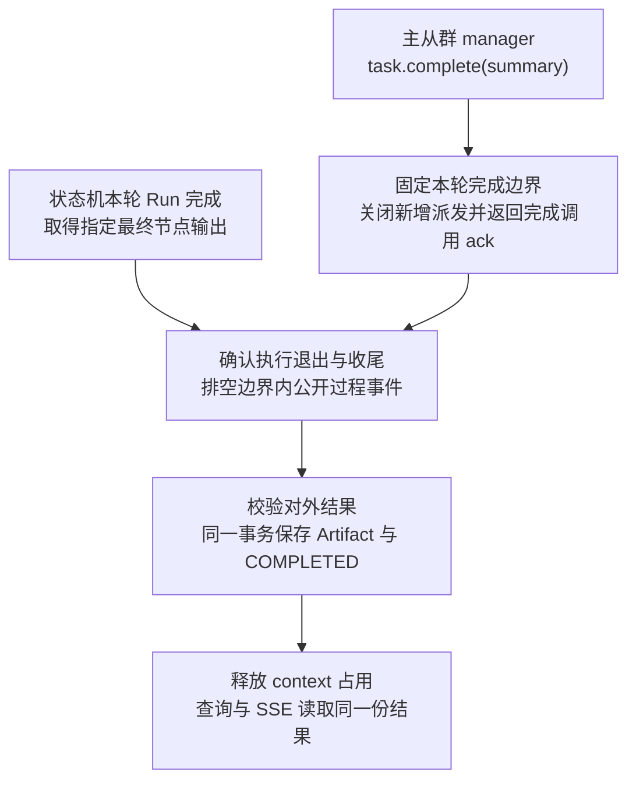

# BCN Group A2A 方案简版

更新：2026-11-12。方案依据：[方案评审](design-review.html) · [Spec](spec.md)。

配套资料：[完整请求示例](examples.md) · [内部讨论页](discussion.html) · [HTML Keynote](keynote.html) · [下次讨论稿](next-discussion.html)。

这个方案让外部 Agent 像调用一个 Agent 一样调用 BCN 协作群。调用方发消息、看进度、拿结果；群内由 manager 协调成员，或由状态机执行既定流程。

**Group 定义能力，context 承接连续对话，Task 记录一轮执行，Artifact 保存这一轮的交付结果。** 本期支持已有主从群和自定义协作群。自然语言建群暂不考虑。

## 调用一次，再接着聊

客户端按 Group Card 选择 HTTP+JSON 接口。首次不带 contextId，BCN 创建 Session；下一轮带回 contextId，使用新的 messageId，省略 taskId。

| 调用方怎么做 | BCN 怎么处理 |
| --- | --- |
| 首次省略 contextId / taskId | 创建 Session 和本轮 Task，返回两个 ID |
| 前轮完成后，带 contextId 和新 messageId | 在同一 Session 创建新 Task，保留前轮产物 |
| context 仍有活动执行 | 返回 409 / CONTEXT_BUSY，不创建 Task、不排队、不预留新 messageId |
| 向 working Task 追加消息 | 返回 UnsupportedOperationError；本期不支持轮内追加 |
| 查询或订阅 taskId | 获取该轮已持久化的状态、公开历史与产物 |

`contextId = Session.id`，Task 绑定一次 Session activation 或一个 StateMachine Run。每轮采用 Task-generating 是本期的实现选择，A2A 也允许直接返回 Message。

### Group 新会话

### Group 旧会话续聊

忙碌是 BCN 的调度约定；协议本身不规定同 context 必须排队。相同 messageId 重试先查重，不会因为原 Task 正在执行而误报忙碌。

## 什么时候返回，什么时候完成

| 方式 | 返回时机 |
| --- | --- |
| returnImmediately=false（默认） | 等执行到终态或中断态后返回 Task；需要新增服务端等待能力 |
| returnImmediately=true | 受理持久化后返回当前 Task，后续查询或订阅 |
| message:stream | 建立 SSE，先返回 Task 快照，再返回更新 |

本期没有 input_required。单次 HTTP 等待建议上限 60 秒，到期返回 504 / SEND_WAIT_TIMEOUT，后台 Task 继续执行。长任务采用立即返回或 SSE；网络断开不取消任务。

### 完成与产物提交

主从群必须由 manager 显式提交最终 summary，并确认本轮执行已退出。普通聊天的最后一条消息、Worker 完成或一段时间没消息都不会自动触发成功。manager 已完全空闲但未提交结果时，建议 60 秒后提醒一次，再给 120 秒宽限，仍未完成则失败收尾。

自定义协作每轮创建新 Run，带入最初目标、本轮请求和上一轮结果。解释、重新计算、业务写入由流程显式区分；业务系统继续用业务单号处理跨消息的重复写入。

Artifact 使用独立数据表，保存 task_id、artifact_id、Parts、顺序及描述等信息。文本和 JSON 直接保存；存储结构也能表达文件等非文本产物。当前对外输出仍由 Card 限定为文本或 JSON。成功终态与产物一起可见；FAILED、CANCELED 可以没有产物。

## 出错、断线和取消

| 情形 | 处理 |
| --- | --- |
| HTTP / SSE 断线 | Task 继续；已知 taskId 时查询，尚未终态可重订阅 |
| 相同 messageId、相同语义请求 | 内部去重返回原 Task；指纹包含全部 configuration、metadata 和激活扩展集合 |
| 相同 messageId、不同语义请求 | MESSAGE_ID_CONFLICT；不能改 returnImmediately 后当成同一次重试 |
| 原结果已实际清理 | MESSAGE_RESULT_EXPIRED；ID 墓碑仍防止重新执行 |
| 取消执行 | 保存取消意图，停止整轮工作；确认停止后才提交 CANCELED |
| 执行或停止结果无法确认 | 有界收尾后提交 FAILED，并隔离 context；查询仍可用，新轮次暂不受理 |
| 后台恢复确认全部停止 | 解除隔离，context 可接受新 Task；原 Task 保持 FAILED |

执行期限建议 30 分钟，收尾期限建议 60 秒；结果与 Artifact 保留建议 7 天，具体值待评审。隔离不是永久占用 working Task：旧 Task 已结束，但 context 要等恢复流程确认安全后才能继续。

Group 本期不发布已有的 message-dedup/v1 扩展。BCS 出站客户端只有协商该扩展后才自动重试发送；内部去重不能替代客户端的协商规则。

## 过程消息与来源

`metadata.includeProgress` 默认 false，通过 Card 声明的可选扩展激活。启用后返回整理过的阶段进展，状态、错误和最终结果始终可获取。内部成员身份、提示、工具原始输出等不直接进入公开历史或 SSE。

caller/user 只是来源字段的暂定名称，内部结构及凭据传递方式还要与认证机制一起确认。当前示例和 Schema 仅固定 includeProgress；资源归属继续复用已有 caller_principal。

扩展规范和 Schema 使用 GitHub 仓库中的版本化地址。扩展 URI 与激活头一致；Schema.$id 对应 Schema 自身地址。候选路径及发布待定项见 [Spec §4](spec.md#4-metadata来源与资源归属)。

## 已有能力与需要补齐的部分

| 领域 | 已有能力 | 本期补齐 |
| --- | --- | --- |
| BCN 单 Bot | Card 管理、单 Bot 聊天、A2A 出站 | 标准 A2A 入站另行排期，目标使用 bot_id |
| 群与会话 | 群定义、ServiceInvocation、activation、caller_principal | Group Card 发布、A2A 来源和原子占用 |
| 主从群 | task.complete、summary、Worker 回送检查 | 精确关联本轮、完成 ack 与退出分离、整轮取消 |
| 状态机 | Run 输入输出、启动、失败 rerun、底层 abort | 下一轮新输入、整轮停止确认与恢复 |
| 状态与事件 | Session / Run 状态、bcs_events | A2A Task 投影、查询、SSE、等待与错误映射 |
| 结果存储 | Session.output、Run.output | 独立 artifacts 表，每轮结果不可覆盖 |

BCN 单 Agent 入站设想中，路径目标参数只需要 bot_id；请求仍包含标准 message 等字段，运行配置由 BCN 解析。它与已有 agent-card 管理接口分开，详见 [Spec §2](spec.md#2-协议绑定与对外接口)。

## 后续讨论与验收

自由聊天群后续考虑群级设置两种模式：直接返回聊天 Message（没有 Task 和 Artifact），或交给 LLM 总结，形成 Task 和 Artifact。何时结束、收集哪些消息、总结失败如何处理还需设计。

先打通本期两类群的受理、完成、产物持久化，再验证取消、重启恢复、SSE 顺序与客户端接入。验收重点是：不提前完成、不重复执行、旧产物可查询、忙碌时不生成第二轮、停止未知时有界失败并隔离、恢复确认后才开放下一轮。具体分工和验收见 [Spec](spec.md)。
