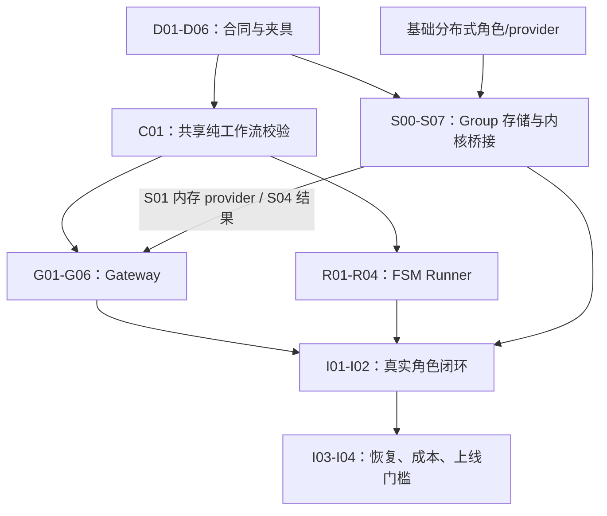

# Distributed Group as Agent Implementation Plan

> **For agentic workers:** REQUIRED SUB-SKILL: Use superpowers:subagent-driven-development (recommended) or superpowers:executing-plans to implement this plan task-by-task. Steps use checkbox (`- [ ]`) syntax for tracking.

**Goal:** 在 BCS 分布式 Gateway 发布自定义协作群的 A2A HTTP+JSON 接口，通过纯 FSM Runner 完成一轮执行、结果查询、流式进度、取消与同 context 多轮调用。

**Architecture:** 保留 Gateway → application → core/repo 和 Worker → Runner/ports 的边界。先交付 D0 增量合同、共享夹具和消费者测试，再并行实现 Gateway、Runner、结果存储和内核桥接；不在 adapter 中另建执行器。请求许可与待调度义务原子保存，结果先归档再发布，旧操作按精确身份回放。

**Tech Stack:** Rust 1.94.0、Cargo workspace、async-trait、serde、Tokio、Axum、仓库固定版本 A2A 模型、现有 DbPlugin/bcs-store-api 和分布式 repo ports。

---

## 1. 执行基线与边界

- 输入是本轮审阅修订后的 [spec.md](spec.md)，SHA-256：`c1229e5fe1cdf11d8b672fa20854ba5cac7c23915755dc26a3d8fe1edcef7020`。执行前复核；文件继续变更时重做差异检查，不覆盖用户修改。
- 当前代码 HEAD：`816e1f849e`。截至计划编写，工作区 spec、research 和 plans 均以当前工作区内容为准；spec 本轮会随审阅一起修订，计划不覆盖用户未相关的 `apps/bcs/specs/2026-11-15-distributed-contracts/tasks.md`。
- [research.md §5](research.md#5-2026-11-18-评审修订) 的两项修订是必须交付的行为：按保存的规范化依据重试；Accepted 许可的可靠重调度、Start 消费屏障及消费证明。
- 本次只写计划，未实现代码、创建 crate 或执行计划中的测试。文中 Create 均表示未来文件，不能拿未创建测试命令的结果作为已验证证据。
- 各任务先读根/BCS AGENTS、CLAUDE、开发规则和受影响 CONTEXT。使用已有隔离工作区；执行者遵守 using-git-worktrees，不擅自覆盖其他开发者变更。禁止全局 cargo fmt。
- 提交示例是执行阶段的检查点；只有对应任务的授权工作和检查完成后才提交明确文件，不执行 `git add .`。Issue/PR 遵守仓库规范；本计划不创建外部 Issue 或发送消息。

## 2. 分拆与依赖

这是一个集成目标，按可独立验证的组件拆为子计划；没有独立部署价值的接口声明也必须可编译、序列化并有消费者测试。

| 子计划 | 任务 | 输出与独立验证 |
| --- | --- | --- |
| [plan-0-contracts.md](plan-0-contracts.md) | D01～D06、C01 | typed 输入/结果、共享 validator、abandon/丢弃、Blob 生命周期、checkpoint 压缩、归属/占用/许可/调度、共享夹具和兼容迁移；现有 workspace 可编译 |
| [plan-1-gateway.md](plan-1-gateway.md) | G01～G06 | 规范化与受理应用、读取/取消、Card 和 HTTP/SSE adapter；用记录调用的真实 application 替身及内存 repo 验证 |
| [plan-2-runner.md](plan-2-runner.md) | R01～R04 | BotTask 无环图、分支/汇合、超时重试、取消及最终节点；不依赖存储或 HTTP |
| [plan-3-storage-runtime.md](plan-3-storage-runtime.md) | S00～S07 | 请求/占用参考 provider、重调度与消费屏障、结果事务/完成桥接、清理；独立跑 conformance 与重启测试 |
| [plan-4-integration.md](plan-4-integration.md) | I01～I04 | 真实角色装配、HTTP 用户故事、跨进程故障、访问成本和交付证据 |



**并行规则：** D01→D02→D03→D04→D06→D05 按依赖合入；D0 后 C01 交付共享校验实现，G01/R01 共同依赖 C01；独立 HTTP 协议、存储和模型测试可先并行。D0/C01 文件由一位合同负责人改动，各分支通过同一合同基线同步；不能分别添加不同方法形状。G02 需要 S01 的内存轮次 provider，放弃封口的真实联测另依赖 S02；G03 需要 TaskFeed/结果的内存夹具。S04 交付 Blob provider/lifecycle，S06/I01 消费它；S02 需要基础调度/Inbox provider，负责 Start 封口和无输入确认，S03 需要 Worker 处理有输入的 Drop；这些依赖不会阻塞 HTTP 协议测试或纯 Runner 单测。

**分布式基础依赖：** 当前仓库尚无完整 Gateway Core/Worker/Connector/SessionStore/TaskFeed/DispatchBoard 实现。基础 provider 由 [原分布式计划](../2026-11-15-distributed-contracts/tasks.md) 的 S2/S3 提供，Worker 由 W1/W2/W4～W7、Connector 由 C1～C6 提供；原 W3 的本期 FSM 子集由 R01～R03（Judge 可选 R04）交付。Gateway application/Core/adapter 全部由本计划 G01～G06 交付，原 G2/G3 不再作为另一个前置实现。本计划在 S02/S03/S05/I01 指定接口、文件和验收门槛，不假设它们已完成，也不以 Script 或 Noop 替代后宣布 I1。执行到依赖缺失时，可继续独立任务；集成项保持未完成。

### Gateway 任务接管与唯一责任

下表在实施开始前生效，范围仅为本期 Group A2A 路径；旧计划的 FIFO、HumanInput 等更广范围继续保留为后续工作，不因任务接管宣称已实现。旧任务不是另一条并行开发线。

| 原计划任务 | 本期接管任务 | 唯一修改责任 |
| --- | --- | --- |
| G1 身份/路由 | G01、G02 | Gateway 负责人维护 application identity/directory/normalize |
| G2 受理 | G02 | 同一负责人维护 application submit/recovery 和 Core admission |
| G3 查询 | G03 | 同一负责人维护 application/Core query；TaskFeed provider 属于基础 S2/S3 |
| G4 订阅 | G03、G06 | 同一负责人维护 application subscription/observe 与 SSE adapter |
| G5 取消 | G03 | 同一负责人维护 application/Core cancel |
| G6 HTTP adapter | G04～G06 | 同一负责人维护唯一 bcs-dist-gateway-http crate |

本期 Core 唯一位置为 `crates/services/bcs-dist-gateway/`，接管旧 G2/G3 拟定的 `bcs-dist-kernel/src/gateway/` 职责；不创建两套 Core。启动前检查相关文件是否已有并行提交：已有实现则在同一负责人下迁移/增量修改并更新引用，不覆盖已有文件。D0 负责两份计划的合同同步，Gateway 文件不分派给基础内核负责人。旧计划已追加本映射的范围指引，I04 只补实际交付证据。

## 3. 文件布局与共享文件责任

全部代码路径相对仓库根；子计划命令默认 `cd apps/bcs` 后执行。

| 路径 | 职责 | 创建/修改负责人 |
| --- | --- | --- |
| `apps/bcs/crates/contracts/bcs-dist-model/src/group_call/{mod,request,public_task,admission}.rs` | 无 SDK 的输入、公开视图、规范化依据和轮次记录 | D0 |
| `apps/bcs/crates/service-api/bcs-service-api/src/{application,core}/dist_gateway.rs` | 群范围、有效返回配置、typed 查询及内部观察合同 | D0 |
| `apps/bcs/crates/service-api/bcs-service-api/src/application/dist_group_card.rs` | 纯读取 Card application 合同 | D0 |
| `apps/bcs/crates/service-api/bcs-service-api/src/port/repo/distributed/group_invocation.rs` | 预留、背景依据/条件刷新、拒绝清理、claim、许可、待调度、释放/隔离 | D0 |
| `apps/bcs/crates/service-api/bcs-service-api/src/port/repo/distributed/{inbox,session,result,task_feed}.rs` | 逐输入消费边界、reschedule、Start 封口/不存在/消费证明、最终归档和完整分页返回 | D0 |
| `apps/bcs/crates/test-support/bcs-test-support/src/contract/distributed/group_call/` | 共享合同场景和可记录失败的 wrapper | D0 |
| `apps/bcs/crates/application/bcs-app-dist-gateway/src/` | 受理/规范化/授权/公开查询/取消/Card orchestration | Gateway |
| `apps/bcs/crates/services/bcs-dist-gateway/src/` | 唯一 Gateway Core 规则与 repo 编排，接管旧 G2/G3 核心职责，保持独立于 HTTP | Gateway |
| `apps/bcs/crates/adapters/http/bcs-dist-gateway-http/src/` | A2A DTO、路由、错误、等待、SSE | Gateway |
| `apps/bcs/crates/services/bcs-dist-runner-fsm/src/` | compile、state、reduce、progression、failure、projection | Runner |
| `apps/bcs/crates/services/bcs-dist-store/src/group_invocation/` | 原子轮次存储、内存实现和持久参考实现 | 存储 |
| `apps/bcs/crates/services/bcs-dist-store/src/group_results/` | 最终归档、Artifact/history、批量查询、清理 | 存储 |
| `apps/bcs/crates/services/bcs-dist-worker/src/group_call/` | Start gate、许可恢复/确认、完成发布 | 存储/内核桥接 |
| `apps/bcs/crates/services/bcs-dist-connector/` | 下游角色的真实实现，由基础分布式项目交付 | 基础内核 |
| `apps/bcs/crates/bootstrap/bcs/src/{dist_group_wiring,config/dist_group}.rs` | Gateway/Worker/Connector 配置、生命周期和路由装配 | 集成 |
| `apps/bcs/crates/bootstrap/bcs/tests/dist_group_*.rs` | 真实角色用户故事、故障与进程测试 | 集成 |

每个新 crate 同时添加 Cargo.toml、src/lib.rs、CONTEXT.md 和 consumer conformance 入口；在首次创建任务登记 workspace member/path dependency。同一文件不能由两条并行线同时改动；根 Cargo.toml、Service API 导出与 CI map 的增量由 D0/集成人员串行应用。

不拆改已有大文件以外的无关代码；新源文件保持小于 1,000 行，超限按责任拆文件。不复制旧 Runtime 的长函数和输入/存储副作用。

## 4. 首期交付与明确扩展

第一条完整执行链为 BotTask 无环图：串行、扇出/汇合、超时、有界重试、指定最终节点、文本/JSON 结果。必须支持全部 §5 HTTP 操作；不能把 cancel/SSE 默默降为后续功能。

Judge 是显式可选工作包 R04，需要 D04 的 Judge 合同和真实评估执行器后才能发布含 Judge 的群。不包含 GroupChat/ToolAction/SubStateMachine/Loop/HumanInput。Card/能力校验须拒绝本部署未实现的节点；直接声明“支持自定义协作”不能绕过能力校验。

生产执行状态走可替换共享运行态 repo；SQLite 仅为公共持久化参考和最终结果验证，不把 Group 热控制迁回生产 OB。宿主的生产 provider 必须独立通过相同 suite；缺少 provider 时 I03/生产放量保持关闭。

## 5. 统一验证规则

每个任务按 RED → 最小实现 → GREEN → 精确 diff/合同检查 → 提交执行。RED 必须因目标行为失败；Cargo 路径不存在或编译器未安装是环境失败，不当作 RED 证据。新 crate 先注册空模块/测试入口，再运行行为断言；生产方法不可返回伪造成功。

任务内给出的测试函数名为必须创建的入口，示例代码中的 fixture 由 D05 定义；子计划不得各建语义不同的同名夹具。示例是需要写入的核心测试/算法，实际文件还须包含明确 imports、错误转换和 fixture wiring，不复制省略号或空函数。

每次 GREEN 必须确认运行到至少一项对应测试，避免 filter 拼错导致零测试。新增迁移编号从实施时最大版本计算，见 S01；已经提交/记录到数据库的迁移不得重写。

每阶段按风险跑：

```bash
cargo test -p bcs-dist-model -p bcs-service-api -p bcs-dist-store
cargo test -p bcs-test-support --test distributed_harness
bash scripts/ci/check-port-purity.sh
bash scripts/ci/check-store-boundaries.sh
bash scripts/ci/check-conformance-entries.sh
```

完成集成后再执行 `bash scripts/ci/arch-check.sh` 及受影响模块全量测试；不因已有 baseline 失败放松 gate，分别记录原有/新增失败和跳过项。`cargo fmt --all` 禁止。

## 6. Spec 验收映射

| Spec 章节/场景 | 计划任务 |
| --- | --- |
| §1～§3 首期范围、角色分层 | D01、D03、G04、R01、I01 |
| §4 新 canonical Sid、固定 workflow、多轮背景 | D01、C01、G01、G03、R01、I02 |
| §5 Card、全部路由、媒体/扩展、typed 查询、有效返回配置、等待及完成竞态、错误 | D02、G01～G06、I02 |
| §6 增量 Rust 合同及迁移 | D01～D06 |
| §7.1 保存规范化版本/默认值、竞态获胜依据 | D01、G01～G02、S01、I02 |
| §7.2 prepare/claim/Inbox/Accepted/abandon | D02、G02、S01、I03 |
| §7.3 未许可消费屏障、reschedule/settle 两种交错、Start 证明 | D03、S02～S03、I03 |
| §7.4～§7.5 Busy 统一拒绝、Lost 背景刷新、abandon 封口及无输入/丢弃证明 | D01～D03、G02、S01～S03/S06、I03 |
| §8 纯归约、typed Start/Finish、稳定提交/效果、归档后发布和释放 | D01/D04、R01～R03、S04～S05、I03 |
| §9 同一公开投影、SSE/Gap、禁止内部信息 | D01、G03、G06、R03、S04 |
| §10 取消/超时/未知停止/删除边界（首期删除禁止） | D02/D06、G03、R03、S05～S06、I02～I03 |
| §11 公共 provider、Blob 生命周期、checkpoint 压缩、访问成本、背压、分流 | D06、S01～S07、I01、I03～I04 |
| §12 并行与集成门槛 | 本文 §2、I01～I04 |
| §13 全部验收场景 | I02/I03 场景矩阵，并由各子任务局部覆盖 |
| §14 评审/发布门槛与知识 | D04、G04、I04 |

## 7. 执行交接和验证边界

本计划已吸收用户评审修订；执行阶段无需重新讨论“是否采用 Gateway 架构”。D0 的具体 Rust 形状按子计划提交评审；在 D0 复审前，不开始并行实现，修改已冻结语义必须回到 spec 兼容性评审，不能各分支自行改合同。

初始计划产出阶段记录（历史）：当时检查了文档相对链接、表格列数、代码围栏、任务 ID 唯一性及依赖、自审覆盖、无空白占位任务、尾随空白；`git diff --check` 通过。复核 spec SHA-256 与本轮审阅修订稿一致；research/plan 需同步记录本轮修改，不能声称 spec 未修改。没有运行未来 crate 的测试，没有宣布 I1/I2 已完成。spec 状态仍为审阅修订中，D0 未冻结。

执行可选择逐任务在当前会话推进，或按互不重叠的工作包交给独立执行者；并行实现前先完成 D0。下一步是复审本修订版并确认 D0/C01 进入实现；在此之前不直接搭 HTTP handler 或并行修改 Runner/存储。

### 2026-11-18 计划评审修订

- D02/G03/G05/G06 区分内部 observe_task 和公开 subscribe，补齐观察建立前后完成的 barrier 用例。
- D02/G02/G05 通过 GroupSubmitResult 返回原有效配置，配置变化后的重试在 HTTP 层验证等待与历史裁剪。
- D02/G03/G04/S04/I02 补齐 Get/List 查询参数、store 筛选/读取投影及默认不读取产物的断言。
- 本文 §2 与原计划明确 Gateway G1～G6 的接管关系和唯一 Core 路径；S00 不再把原 G3 当成待交付的第二个 Gateway。

此前计划评审轮次的记录：当轮只修订计划和旧计划范围导航；本次阻塞修订另见 research §6，不覆盖当时结果。上述新增测试仍待实施，不将文档检查作为运行时行为验证。

本轮实际验证：检查 6 份当前计划及旧任务表，18 个相对链接（含 3 个标题锚点）、12 个表格、当时 26 个任务 ID、代码围栏、尾随空白和末尾换行均通过；`git diff --check` 通过。当轮 spec SHA-256 与当时基线一致；当前 hash 已随本次 spec 修订更新。未跟踪计划已直接读取检查；未运行 Cargo 或计划中的行为测试。


### 本次阻塞审阅后的执行门槛

本次同步修订 spec/research/6 份计划；新增 D06、C01、S07，合计 29 个任务/依赖条目。D0/C01 依赖、Blob owner、SQL 分表约束和删除禁用边界已对齐；不授权开始实现。文档检查结果记录在 research §6；Cargo、R25/API gate、真实 provider 与故障测试仍未执行。

### 本次完整复审的六项修订

本轮只修订文档，不执行本计划，任务集合仍为 29 项：

1. D02/G02/S01 将 Lost→Busy 与直接 Busy 合并为持久拒绝路径；不可复用的 preparation revision 防止旧恢复者在清理后重新受理。
2. D01/D02/G02/S01 绑定 context generation 与成功背景，条件刷新派生输入，成功 release 原子更新背景指针；请求指纹、稳定 ID 和 deadline 不变。
3. D03/S02/S03/S06 定义 Start 写入封口、ClosedAbsent/ClosedPresent 与独立确认；没有输入也能结束主动调度，不伪造 checkpoint，迟到写者受栅栏约束。
4. D02/G03/G04/S04 补齐 page_size/total_size、热归档去重计数、同 cut 返回与 checked wire 转换。
5. D01/G01/G04/R03/S04 保留逐 Part 属性并区分公开策略，不再把 Part metadata 丢弃或混入顶层。
6. S05/I02/I03 用 before_release_round barrier 分别验证终态可见、Busy 和持久释放后重试，不把 wait_terminal 当作解锁条件。

本轮证据与未验证边界追加到 [research.md §8](research.md#8-2026-11-18-完整复审六项修订)，执行基线 hash 同步更新；D0 仍待复审，不表示新增 Rust API 或 provider 能力已存在。
