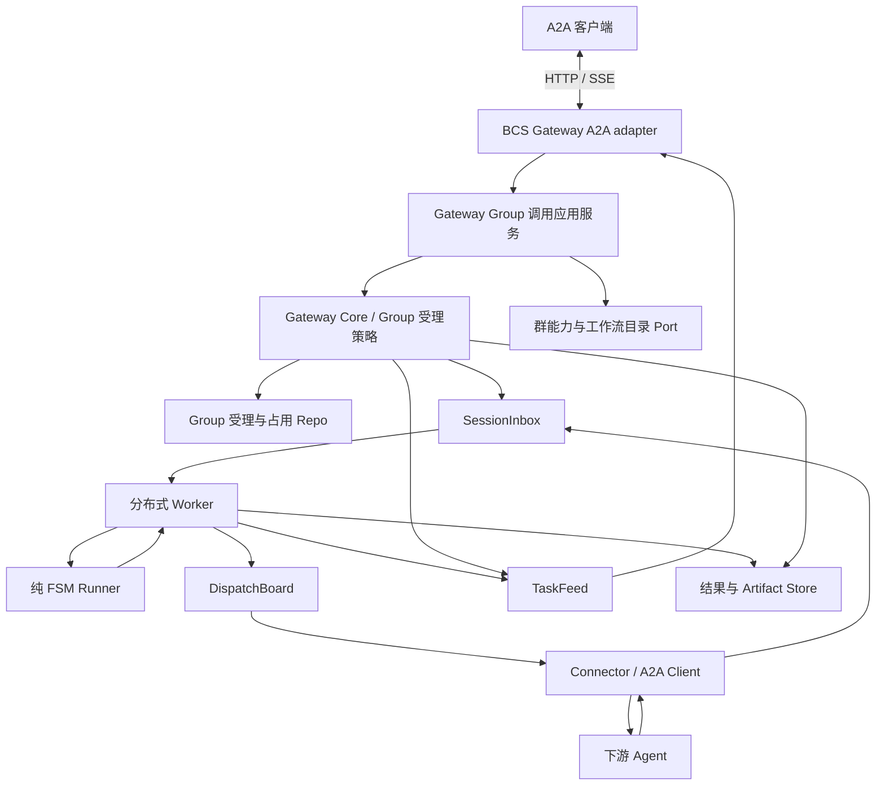

# 分布式 Group as Agent：Gateway A2A Server 与自定义协作群

- 状态：审阅修订稿，待复审；总体目标已确认，本轮按阻塞意见修订，D0 尚未冻结，未授权开始并行实现。本次仅修改设计和计划，不表示接口或运行时已实现。
- 日期：2026-11-18。
- 所属模块：BCS Gateway、Group 调用应用服务、分布式 FSM Runner。
- 代码基线：当前工作区 HEAD `816e1f849e`；现状和资料取舍见 [research.md](research.md)。
- 目标：在 BCS 分布式架构中，将已有自定义协作群作为 A2A Agent 发布，允许协议、群调用、Runner 和分布式基础设施按合同并行开发。
- 前置规范：[Group A2A 草案](../2026-11-05-group-as-agent/spec.md)、[分布式合同](../2026-11-15-distributed-contracts/spec.md)和[仓库边界合同](../../crates/service-api/bcs-service-api/src/port/repo/distributed/README.md)。
- 架构约束：[BCS 分层](../../CLAUDE.md)、[架构章程](../../../../docs/arch/arch.rules.md)、[CI 约束](../../../../docs/arch/ci.enforce.md)。当前未发现需要替换的已接受 BCS 专项 ADR；草案获采纳后，持久化身份及完成发布协议的长期决定应按 [ADR 导航](../../docs/adr/README.md)登记。

## 1. 问题与范围

既有 Group A2A 草案定义了群的对外行为，分布式合同定义了 Gateway、Worker、Connector 的可替换边界。两者尚未统一为可并行实现的合同：请求缺少完整配置、查询缺少路径群范围、busy 与 Inbox 受理尚未组合、Artifact 和终态的持久化责任也未落实。

本规范提出这部分增量设计。表述为“已有”的能力必须有代码证据；本规范的类型和方法名称均为待 D0 落地的提议，不应被当成现有 Rust API。配套详细计划已存在；进入实现必须先完成本轮复审及 D0 合同/CI 门槛，不沿用此前审阅作为本轮冻结授权。

### 1.1 首期交付

| 范围 | 要求 |
| --- | --- |
| 目标群 | 已创建、已配置参与者与工作流的自定义协作群，运行类型为 StateMachine / `FsmGroup` |
| A2A Server | BCS 分布式 Gateway 发布 Card，提供 HTTP+JSON 的 send、stream、get、list、subscribe、cancel |
| 执行 | 一个对外 Task 对应一轮新的 FSM 执行；Runner 纯计算，Worker 提交状态后执行动作，Connector 调用下游 |
| 输入 | 保序文本 Parts、至多一个对象 data Part；保存原始结构 |
| 输出 | 最终文本或 JSON Artifact；可选的公开业务进度 |
| 会话 | 同 context 多轮；每次新请求创建新 Task；占用期间拒绝新一轮，不排队、不并行 |
| 可靠性 | 可恢复受理、完成发布、停止确认、占用与隔离；相同请求不重复执行 |
| 开发方式 | 先冻结增量合同和共享夹具，再并行实现；真实持久化与跨进程验证作为上线门槛 |

首期不包含主从群、自由聊天群、自然语言建群、文件输入、轮内追加、HumanInput/认证补充输入、同 context FIFO、Push Notification、单 Bot 标准入站和新增 JSON-RPC/gRPC 入站，以及分布式 context/Session 的受管删除。删除边界见 §10。底层可以保留更广泛能力，Group Card 只声明本期已完成能力。

### 1.2 方案选择

| 方案 | 收益 | 代价与结论 |
| --- | --- | --- |
| A：Gateway adapter 与分布式 FSM 共用应用及持久化合同 | 可并行开发；协议不绑定角色进程；恢复路径一致 | 需要先完成 D0 增量合同；采用 |
| B：先包装旧 CollaborationRuntime，再迁移 | 可能较早演示单进程调用 | 两套受理、Session 和输出恢复机制会重复；不作为本期主线 |
| C：全部分布式角色完成后再做 Group A2A | 接入时可调用真实依赖 | 延后协议和产品语义反馈；不采用 |

旧 Runtime 的定义编译、输入绑定、分支和最终输出规则可复用。不得将含 repo/网络调用的现有 Runtime 整体塞入 `reduce`。

## 2. 来源、优先级与设计差异

语雀《BCN 分布式 Worker 高可用方案 v2.9》和《BCN v2.9 Worker 设计》于本次重新读取；正文分别更新于 2026-11-13 07:32:57 UTC、08:59:12 UTC。私有文档地址和导出正文不进入公共仓库。公开实现必须能仅凭本规范、仓库合同和测试开发与复验。

资料应用顺序：已接受架构约束与当前正式合同优先；本规范提出的增量须评审并更新 Rust 合同后生效。旧 Group 草案是对外行为来源；语雀主方案 §15 及 11 月 13 日快照修订是分布式设计来源，§1～§14 的历史 POC 不证明新版实现。

| 差异 | 本规范的处理 |
| --- | --- |
| 语雀允许同会话排队，Group 草案要求 busy | Group 入口采用 busy 拒绝；内部串行队列不等于公开排队 |
| 语雀旧示例有周期 Reset、last_ev_id | 采用 task 快照及精确覆盖位置、增量流；不增加持久化 Reset 事件 |
| 语雀示例将部分 admit 过期 | Group 请求预留和墓碑有独立生命周期；当前 Inbox admit 也是 Persistent，不改为短 TTL |
| 语雀带 hash tag 的 Key 示例 | 当前 KeyLayout 明确不带 hash tag；业务层不依赖同 slot 原子，不复制物理 Key 或假定跨 Key 事务 |
| 旧草案以 SQL Session、activation、bcs_events 为基础 | 新路径使用分布式 Sid、每轮执行身份和 TaskFeed；旧实现不并行拥有新会话 |
| 旧草案成功事务同时释放占用 | 保留 Artifact 与终态归档同事务；跨存储输出与占用按 §8 分阶段恢复，释放可延后 |
| 语雀允许展示 thinking/tool | Group 公共出口按 §9 严格过滤，不因 includeProgress 开放内部事件 |
| 旧草案支持主从群 | 本期缩小到 FSM；主从群完成信号协议后续设计 |

本草案没有修改旧规范或现有代码的权威。采纳时，须在旧 Group 草案和分布式合同中加入明确的适用范围/替代链接，不静默改变它们。

## 3. 架构和职责



图中 Feed 到 HTTP 表示数据返回，实际 HTTP adapter 仍只调用 application 服务，不直接访问 Feed/Repo。所有存储实现经 repo port 注入；私有存储插件由宿主装配。

| 模块 | 负责 | 不承担 |
| --- | --- | --- |
| Gateway HTTP adapter | A2A DTO、路由、头/媒体校验、错误编码、HTTP 等待、SSE 与保活 | 直接操作 repo、运行工作流、以连接生命周期控制任务 |
| Gateway application | 可信主体转换、群能力编排、规范化请求、调用 Core、形成协议无关公开视图 | SQL、物理游标、A2A SDK 类型 |
| Gateway/Group Core | 群受理和占用规则、查询范围、公开投影策略；通过 repo 保存事实 | 调用具体 HTTP client 或选择存储插件 |
| FSM Runner | 给定 spec、workflow、时间与输入，产生确定的新状态和动作 | 读时钟、随机 ID、DB、网络、同步 Judge 调用 |
| Worker | 所有权、输入消费、提交、稳定动作与结果发布、收尾 | 持有上游 SSE 或直接包装 HTTP 响应 |
| Connector | 下游连接、发送意图、能力分级恢复、取消及事件回流 | 公开 Group 输出策略、上游请求生命周期 |
| Store | 原子语义、去重、索引、结果和对象引用、恢复及清理 | 猜测业务完成或用 TTL 代替停止确认 |
| Composition root | 按配置装配角色和 provider，管理启动/停止 | 在消费者内选择实现 |

Gateway 是 BCS 分布式角色，与 `apps/gateway` 无依赖。首期可同进程装配三种角色，仍须保留实际 port 边界。对外路由仅挂载到配置为 Gateway 的入口。

这些是逻辑职责，不要求另建同名服务层。Group 策略落在现有 Gateway application/Core 的明确用例中；不要让 adapter 同时分别调用多个服务、在 HTTP handler 中拼出受理事务。

## 4. 身份、会话与工作流

### 4.1 身份映射

| 标识 | 语义与生命周期 |
| --- | --- |
| group_id | 发布的 Agent 身份；归属与能力校验的目标 |
| scope | 可信 tenant、principal；来自认证链，不来自 metadata |
| contextId | 分布式 SessionSpec.sid 的 wire 值；同一会话保持不变 |
| taskId | 分布式 Tid 的 wire 值；一轮请求一个，接管不变 |
| execution_id | 本轮 FSM 执行身份，持久关联到 Tid；新 Task 新执行，接管恢复原执行 |
| did / remote taskId | 节点的一次下游调用及下游资源；不能直接充当对外 taskId |
| Worker/holder epoch | 基础设施执行权代次；不能替代任务轮次或节点 attempt |
| EventId / TaskCursor | 逻辑输出身份 / 后端恢复位置；不能混作时间戳或公开任务身份 |

当前旧 Session.id 是 `{group_id}:{8_hex}`，分布式 KeyLayout 从 `s<shard>.<opaque-tail>` Sid 解析路由。新入口明确采用分布式 Sid，不让旧 SessionManagementService 生成 ID 后硬塞进 KeyLayout。

保留 `contextId = canonical Session.id` 的语义，但新路径的 canonical Session 由分布式 session repo 拥有。记录 group、scope、来源 `group_a2a` 及“服务调用”分类；不要求同时创建旧 SQL Session 行或旧 Run 行才能执行。若后续需要 Workbench 投影，采用相同 Sid 的只读投影并单独定义兼容路径。旧 ServiceInvocation Session 不可在新入口自动转换。

仅可路由不代表可授权。查询、列表、续聊、订阅、取消、重复请求读取均校验 `(tenant, principal, group_id, source)`。不可访问和不存在资源使用同一错误。

### 4.2 冻结与多轮

首轮通过 `DistGroupDirectoryPort::resolve` 冻结精确 workflow revision/digest、参与者 binding、limits、公开能力和发布策略。恢复调用 `load_workflow` 校验同一版本，不能用当前群配置替代。

同 context 下一轮复用已冻结定义；群配置更新影响新 context。当前权限撤销仍阻止新的调用/订阅，冻结配置不授予永久权限。已受理执行的身份、凭据引用和撤销行为沿用现有运行时合同。

每轮的结构化输入包含最初目标、本轮保序 Parts/对象 data、上轮成功结果及关联 Task（若有）。由 application 准备，Runner/节点输入绑定消费；HTTP adapter 不解释自然语言。失败轮次不能被当成最近成功背景，历史成功产物已实际清理时，新一轮在受理前返回 `CONTEXT_BACKGROUND_UNAVAILABLE`，要求建立新 context 并补齐背景。

准备记录将派生背景与读取它的 context generation 绑定为 `PreparationContextBasis`：包含 observed generation、initial_goal 引用及摘要、最近成功 tid/result_ref/digest（可为空）。`claim_round` 同时核实该依据仍对应当前空闲 context；不能只把 expected generation 换成新值，沿用旧背景。未 claim 时可按 §6 条件刷新派生输入；一旦 SlotHeld，整份 GroupRoundInput 固定，恢复不能重选背景。

GroupInvocation 的 context 控制记录保存 initial_goal 与最近已释放成功轮的引用，`read_context_basis` 从同一 cut 读取 generation 和这些关联。成功轮的 release 将最近成功指针与清空占用原子更新，失败/取消释放不覆盖它。新 context 的初始依据来自首个请求，首次 claim 原子登记；背景对象在准备/刷新发布引用前按 Blob 生命周期保护，不能让 retention 删除已被新轮次使用的输入。

工作流必须明确指定最终输出节点及文本/JSON 输出模式；不得按节点遍历顺序猜测。D0 定义共享纯 `GroupWorkflowValidatorCoreService::validate` 合同，由 `bcs-dist-workflow-policy` 的同一实现为 Card/新请求准入和 Runner compile 计算能力，输入是冻结定义、binding 与部署执行能力集，输出是版本化 `ValidatedGroupWorkflow`（digest、能力集、最终节点和确定的编译信息）或 typed 拒绝。Gateway 与 Runner 均不得另写节点白名单；Runner 校验结果中的 workflow digest/compiler version 必须匹配。该实现是 G01 与 R01 的共同前置，不在 Gateway 和 Runner 两条线重复开发。首期最低执行子集为 BotTask 节点构成的无环图，覆盖串行、分支扇出/汇合、超时和有界重试；由冻结定义给出可达路径和最终节点。GroupChat、ToolAction、SubStateMachine、Loop 和静态 HumanInput 不随“StateMachine”名称自动开放，未完成的种类在受理前拒绝。

Judge 扩展需要显式的 EvaluateJudge 动作、JudgeResult 输入和稳定节点/attempt 关联，在 D0 增补当前 Runner 合同，再由动作执行器调用评估能力、保存结果并回流。Judge 工作也纳入停止及超时义务。是否将该扩展纳入首个演示可由交付安排决定，但发布含 Judge 的群前必须完成这套合同和恢复测试；不得在 reduce 中同步调用现有 JudgeEvaluatorPort。

## 5. Gateway A2A Server 合同

### 5.1 路由及 Card

基地址沿用 `/api/v1/collaboration/a2a/groups/{group_id}`。协议依据旧草案的 A2A 1.0.1，wire 版本为 `1.0`，本期 HTTP+JSON；DTO 与 SDK 依赖留在 adapter。

| 方法与相对路径 | 行为 |
| --- | --- |
| GET `/agent-card.json` | 发布当前可调用群的 Card；经 application 群能力读取合同生成 |
| POST `/message:send` | 默认等待终态；returnImmediately=true 时可靠受理后返回 Task |
| POST `/message:stream` | 受理后首帧 Task 快照，随后公开更新 |
| GET `/tasks/{task_id}` | 返回单一已提交视图、公开历史及 Artifact |
| GET `/tasks` | 按群和主体过滤后，支持 context、状态与分页 |
| POST `/tasks/{task_id}:subscribe` | 首帧当前 Task，随后更新；终态新订阅拒绝 |
| POST `/tasks/{task_id}:cancel` | 持久化取消意图，返回当前真实 Task；不把 receipt 编成 CANCELED |

Card 使用实际 Gateway 外部基地址，不包含 Worker/Connector 地址；streaming=true、pushNotifications=false，输入输出按群能力声明。冻结后的 context 继续采用其受理时的输入输出合同，不能用后来更新的 Card 改写已受理请求。认证声明必须与已装配认证一致；缺少生产认证配置时禁止对外发布，不自行设计新凭据交换或接受自报 principal。

Card 读取由独立的群发布 application 方法提供，不能调用“创建新会话”的 resolve 造成副作用。现有 axum 路由若仍不支持动态参数后缀，沿用旧草案的 task_action 解析方法。

### 5.2 输入、配置和返回

保留旧草案的 Part 约束：ROLE_USER、保序 text、至多一个对象 data，原始结构持久保存；文件和其他未支持媒体类型在受理前拒绝。输出模式在受理时协商并保存，不能等完成后临时换类型。

每个 Part 独立保存可选 mediaType、filename 和 metadata，不能合并到 Message/Artifact 顶层 metadata；合法输入的原始属性也参与完整指纹。公开结果只保留经公开策略校验的属性，但不能静默丢弃已允许的属性。filename/对象存储引用的表达不意味着开放 raw/url 文件输入或输出。

| 设置 | 首期提议默认值 | 所属边界 |
| --- | --- | --- |
| 请求 JSON 大小 | 1 MiB | Gateway 在受理前限制；不等同于 checkpoint 大小 |
| returnImmediately | false | HTTP 等待行为；任务独立执行 |
| 单次同步等待上限 | 60 秒 | 到期 504 / SEND_WAIT_TIMEOUT；可确定时带 taskId/contextId |
| 执行期限 | 30 分钟 | 首次受理保存绝对 deadline，节点期限取更小值 |
| 取消/失败收尾上限 | 60 秒 | 超时仍未知则 FAILED + context 隔离 |
| SSE 保活 | 每 15 秒注释 | 不写事件/history，不续执行预算 |
| includeProgress | false | 首次受理固定，须激活 call-metadata 扩展 |
| 结果与公开历史保留 | 终态后 7 天 | 实际清理后才返回过期；不清理恢复所需记录 |

这些数值是本草案的默认提议，需配置、边界测试及部署确认；HTTP 等待、业务执行和收尾三种期限独立，接管不重置任何一种业务期限。

historyLength 只限制响应历史，不决定是否记录进度；ListTasks 沿用旧草案标准参数并批量读取当前页产物。returnImmediately 对 stream 不起等待作用；HTTP/SSE 断开不发业务取消。

ListTasks 的 application/Core/repo 返回当前页、next token、实际采用的 page_size 和分页前 total_size。total_size 按相同 scope/group/source/Accepted 及 context/status/时间条件计数，热视图与归档中的同一 Tid 只算一次；不是当前页长度。单次查询的页与总量来自同一逻辑索引 cut，后续分页请求允许看到更新后的总量。HTTP pageSize 缺省 50、范围 1～100；页未填满时 page_size 仍是解析后的请求上限。adapter 只编码应用返回值，以空字符串编码无 next token，对 SDK int32 字段做范围检查，溢出明确报错而非截断或伪造总数。store 用聚合/索引统计，不全量加载 Task/Artifact 来计数。

includeProgress 的规范及 Schema 在公共扩展目录发布后才能在 Card 宣告；该扩展只拥有已定义的 includeProgress 键，不把标准 metadata 整体据为己有。来源 caller/user 和身份凭据透传尚无冻结合同，本期不新增这些字段或执行身份能力。未知来源 metadata 不能成为授权事实。

### 5.3 错误与重试

沿用旧草案的 A2A 标准错误映射与安全 ErrorInfo；新增业务错误由 typed enum 映射，不依赖字符串匹配或泄漏存储错误。

| 情况 | 对外结果 |
| --- | --- |
| context 已有受理、启动、执行或收尾义务 | 409 / CONTEXT_BUSY；未创建新 Task |
| context 停止未知、已隔离 | 400 / CONTEXT_UNAVAILABLE |
| 上轮背景已清理，无法满足续聊输入合同 | 400 / CONTEXT_BACKGROUND_UNAVAILABLE |
| context 不可访问、跨群、非本入口来源 | 404 / CONTEXT_NOT_FOUND |
| Task 不可访问或跨群 | 标准 TaskNotFoundError |
| 同 messageId 改变完整语义请求 | 400 / MESSAGE_ID_CONFLICT |
| 相同请求的原结果已清理 | 404 / MESSAGE_RESULT_EXPIRED，不重执行 |
| 工作流超出本部署已发布执行子集 | 400 / GROUP_CAPABILITY_UNSUPPORTED，未受理 |
| 向现有 Task 追加新输入 | 标准 UnsupportedOperationError |
| 终态新建 subscribe / 取消 | 分别 UnsupportedOperationError / TaskNotCancelableError |
| 已使用扩展字段但未激活 | 400 / CALL_METADATA_NOT_ACTIVATED，未受理 |
| 受理写入结果未知 | 503 / ADMISSION_OUTCOME_UNKNOWN；已知 ID 可提供，不声称未执行 |

未知结果由 Gateway 调用方恢复原请求或查询已知 Task，不能自动换 messageId 补执行。Group 本期不声明 message-dedup/v1，BCS 出站不能仅凭内部去重启用未协商的自动重发。

## 6. D0：并行开发前必须冻结的增量合同

以下是本期必须落地的 Rust/application/repo 与持久化合同，不是把任意 JSON 塞入 Payload 的约定。HTTP adapter 只消费 application 合同。优先扩展已有 DistGatewayService 及相关类型；只有职责独立的 Card 读取使用独立 application 边界，避免建立第二套任务服务。

| 边界 | 现状 | 本期增量 |
| --- | --- | --- |
| SubmitInput / GroupCallInput | 只有 group、message_id、session/task/interaction、content | typed 保序输入、选定输出模式、完整规范化配置、已激活扩展、includeProgress、指纹；原始提交字段与服务端派生字段分开 |
| GatewayCaller / TaskScope | tenant + 可信主体 | 保持认证来源；禁止 metadata 覆盖；空租户策略由认证装配明确 |
| get/list/subscribe/cancel | 部分方法只有 caller 和 tid | 每次显式接收 GroupId 或等价不可伪造的群访问句柄；分页前按群/主体过滤，并返回有效页大小和过滤后总量 |
| Task 公共视图 | 通用 snapshot/result_ref | typed 公开 Message、Artifact、Parts、时间与稳定顺序；adapter 可完整生成标准 Task |
| 群发布读取 | 无 Card application 方法 | 读取当前群能力与安全声明；纯读取，不创建会话 |
| DistGroupDirectoryPort | 冻结 workflow/participants/limits | 冻结公开输入输出、最终节点、调用来源、输出策略和请求限制；保持版本可恢复 |
| GroupInvocationRepo（新增职责） | Inbox admit 没有 Group 独占轮次协议 | 唯一请求预留、generation 绑定的背景、统一拒绝清理、context 占用、许可及调度义务；abandon/丢弃或无输入证明、隔离、归档释放及恢复 |
| Runner Start / Finish | 通用 Payload，无法约束输入及产物 | typed GroupRoundInput 和 PublicTaskResult；绝对 deadline、稳定 Artifact ID/顺序/媒体类型在受理/归约时固定 |
| 共享工作流能力 | Gateway 与 Runner 无共同校验实现 | GroupWorkflowValidatorCoreService + 同一纯实现，禁止双份白名单 |
| cancel 返回 | 现有 AdmissionReceipt | CancelTaskResult { task: PublicTaskView, cancel_request_id: RequestId }；对外只编码真实 task |
| Blob 生命周期 | BlobStorePort 仅 put/get | BlobLifecycleRepoPort 预写 manifest、pin/引用、回收 CAS 与 BlobStorePort::delete_immutable；持久 provider 和 GC 装配 |
| Checkpoint 长会话 | tasks/view_drafts/dispatch_seq 可持续增长 | 逐轮压缩、关闭 generation watermark 和持久拒绝迟到事件的证明 |
| InboxSchedulingPort / Worker | admission 使 ScheduleToken 失效；observe/settle 防止旧调度覆盖新输入 | 许可发布后的可靠重新调度、未许可输入的消费屏障与有界重查；覆盖许可与 settle 竞争及通知丢失 |
| InboxProducerPort 放弃封口 | 无精确 Start 写入封口/不存在证明 | seal_abandoned_start 与实际 append 互斥；返回 ClosedAbsent 或 ClosedPresent 的持久证明，防止无输入义务永久扫描 |
| GatewayError | Conflict/Invalid/Quarantined 等通用分类 | typed Busy、ContextNotFound、Unsupported、ResultExpired、BackgroundUnavailable 和受理未知分类 |
| ResultStore / FinalTaskRecord | 通用 Payload 与结果引用 | 版本化完整公开归档、独立 Artifact 表、终态与产物同事务；内容冲突不能视为幂等成功 |
| Worker 完成桥接 | SaveResult 与终态动作已有接口 | 冻结完成决策、结果保存确认、终态发布证明和占用释放的幂等步骤；失败不得跳过 |

推荐的职责方法语义：

- `reserve_request`：以 `(scope, group, messageId)` 唯一预留完整指纹、规范化版本及所用默认值、冻结配置引用与稳定 sid/tid；返回新预留、已有预留、冲突或已清理。并发落败者使用获胜记录的规范化依据重新比较，不按自己读取的当前配置判定冲突。
- `read_context_basis`：按已核实 scope/group/source/sid 读取同一 context 控制 cut 的 generation、initial_goal 和最近成功引用；真正的新 context 不存在时由首个请求建立初始依据，不能把不可访问当成不存在。
- `refresh_preparation`：仅在请求仍为未 claim 的 Preparing、request revision 匹配且 context 仍为观察到的空闲 generation 时，原子替换 PreparationContextBasis 及派生背景并推进 request revision；保持 raw 请求、指纹/basis、sid/tid、execution_id 和原绝对 deadline 不变。已 claim/写入结果未知时不刷新，先解析原状态。
- `claim_round`：用预留身份、request revision、PreparationContextBasis 的 expected context generation 原子校验来源/空闲/隔离及背景关联并占用一轮；返回 Acquired、Busy、Unavailable 或 Lost。不能拆成先 get 再 set，也不能接受只有新 generation、背景仍旧的准备记录。
- `reject_unclaimed`：按精确 preparation revision 原子记录拒绝、撤销该准备的 claim/recovery 资格，并解除当前请求键对该准备的绑定，允许后续重试创建新准备。返回 Rejected/AlreadyRejected、AlreadyClaimed、Lost 或 OutcomeUnknown；前两者必须证明上述逻辑清理已完成，非关键正文清理可稍后补做。同 messageId 的后续准备使用不可复用的新 revision，旧恢复者不能经删除重建绕过检查。拒绝后的维护只补清理，不能继续受理。
- `activate_round`：确认与同一预留匹配的 Inbox 受理、初始 Task/spec 已可靠存在，原子保存 Worker 可验证的受理许可及待调度义务，再按 §7.3 可靠重新调度。重复调用恢复原义务，不以此前 Inbox 的 active/wake 代替许可发布后的激活。
- `read_round_admission`：返回 Pending、Accepted 或 Abandoned（带 DiscardStartProof）；Worker 只在 Accepted 下执行 Start，未知时保留屏障。
- `abandon_round`：携带 expected generation/request revision，原子竞争 activate；证明本轮从未发布许可、没有 Start 消费/业务动作后写 Abandoned、撤销准入并保存 DropStart 调度义务，再释放本轮占用。返回 Abandoned/AlreadyAbandoned、AlreadyAccepted、Lost 或 OutcomeUnknown。不是对 Accepted 的取消或终态 release 的别名。
- `confirm_start_absent / confirm_start_discarded`：前者验证 Inbox 的 ClosedAbsent 封口证明，无需伪造 checkpoint；后者验证 ClosedPresent 的封口边界及 Worker 对其全部同身份输入的消费提交证明。两者关闭主动 Drop 调度，但均保留拒绝墓碑。
- `release_round`：精确匹配 tid/generation，核实终态与必要发布、停止确认后幂等释放；旧轮次不能释放新占用。
- `quarantine_round / confirm_stopped`：持久保留待核实工作；确认停止后允许解除 context 隔离，不修改原 Task 终态。

方法名可在 D0 评审调整，以上原子条件、结果类别和责任不可省略。底层缺少实现这些语义的原子能力时，必须提出 provider 实现与失败恢复协议并通过测试，不能由应用层普通 KV 拼接假装原子。

`claim_round::Lost` 表示观察的 generation、背景依据或准备 revision 已陈旧：最多 3 次重读请求/当前 round。发现已由本请求占用则恢复原状态；另一请求已占用时，与直接 Busy 使用同一 `reject_unclaimed` 路径，只有拒绝已持久确认才返回 CONTEXT_BUSY。清理未知返回 ADMISSION_OUTCOME_UNKNOWN；若本请求已被并发恢复者 claim，恢复该轮而不是谎报 Busy。发现 context 再次空闲但 generation/背景依据已变时，重新读取当前 cut 的最近成功背景并执行 `refresh_preparation`，再用返回的新 revision 条件 claim；即使 generation 数值未变，也不能忽略成功 release 对背景关联的更新。刷新与 claim 共享 3 次重试预算。背景已清理则先受保护拒绝准备，再返回 CONTEXT_BACKGROUND_UNAVAILABLE；拒绝未知仍返回受理未知。超过预算保留可恢复记录并返回 ADMISSION_OUTCOME_UNKNOWN，不写 Inbox、不盲目 abort 新 generation。恢复器同样执行此规则，不能使用旧准备背景直接排队执行。

公开接口不要求客户端提供额外的取消 request_id。Gateway 在应用层按 `(scope, group, tid)` 为首个取消意图持久分配稳定身份，重复取消复用它；内部 CancelTask.request_id 不得在每次 HTTP 重试时随机重建。application::cancel 显式迁移为 `Result<CancelTaskResult, GatewayError>`；task 是同群范围下恢复的当前真实视图，cancel_request_id 仅用于内部追踪，不新加标准 wire 字段。adapter 不能把 receipt 拼成 Task 或直接宣告 CANCELED。

Group scope 校验不能仅在 HTTP adapter 中补一次 get。Core/repo 的 get/list/follow/cancel 也要携带已核实群范围，游标绑定同一范围，避免校验与使用之间被替换；GroupId 应是 Task/归档的可检索归属事实。

D0 还须给出 schema/version、序列化例子、外部构造者迁移、持久化格式兼容和对应 conformance suite。当前 bcs-service-api=6.1.0，D02 的破坏性变更按 major 升至 7.0.0（实施基线变化时使用其下一 major），更新锁文件与所有消费者构造器/trait 实现，记录 propagation analysis。D0 GREEN 至少执行 workspace all-targets check，以及 model/service-api/dist-store/bcs 的相关测试；R25 harness 必须命名为 `<trait_snake>_contract_tests`，真实实现提供 `tests/conformance_*.rs` 入口且调用集中 harness，public API/版本 gate 不得跳过。当前分布式模型尚未部署不能被用于推断所有实现方都可以无通知重编译；不得修改历史迁移。

## 7. 受理、去重与 context 占用

### 7.1 请求身份与指纹

请求预留键固定为 `(tenant, principal, group_id, messageId)`，独立于客户端是否提供 contextId；改变 contextId 仍是同键内容冲突。不能只在目标 Sid 的 Inbox admit 中查重，否则换 context 会绕过去重。

指纹包括 Parts、客户端提供的 context/task ID、所有 configuration、metadata、已激活扩展集合；规范化 JSON 键顺序和等价默认值。returnImmediately、historyLength、acceptedOutputModes、includeProgress 都参与。send/stream 的传输方式不参与；生成的 sid/tid 不反写原请求指纹。秘密凭据不写入请求记录，业务指纹所需内容以安全规范化结构保存。

请求预留必须保存规范化版本、实际使用的默认值及冻结配置引用。命中记录后，用这份依据规范化本次请求并比较指纹，不重新读取当前 Card 的媒体能力、扩展支持或默认值来判定原请求是否合法。墓碑保留比较所需的最小依据；旧规范化版本暂不可读时返回依赖错误，不当作新请求，也不伪报内容冲突。

首次省略 context 的同请求并发必须得到同一 sid/tid。具体散列、编码、cell/路由策略由 Gateway identity 合同和配置决定，adapter 只视为不透明值，不自行拼 ID。

### 7.2 固定步骤

1. 解析可信主体和路径群，检查当前访问权限及传输安全限制，完成 JSON/标识/字段结构等基础格式校验。此时不按当前 Card 校验可变的群能力、输出模式或扩展支持；非法请求不创建任务或占用。
2. 按 `(scope, group, messageId)` 查请求预留并核实来源归属：命中时按已保存的规范化版本、默认值和冻结配置核对完整指纹；同指纹先恢复/返回原任务，不同指纹拒绝，已清理则返回过期。此路径不重新协商输出模式；重复请求优先于当前能力、背景可用性及 busy 判断，但不绕过当前权限检查。
3. 仅对未命中的新请求校验业务输入、能力、媒体类型、大小和扩展，并协商输出：已有 context 使用其冻结定义，新 context 使用当前群定义。通过后创建可恢复的准备记录，确定 sid/tid，保存不可变原请求或引用、规范化依据及冻结配置引用，并保存绑定 observed generation 的派生背景；这只是内部准备，不代表已受理。派生背景仅能经 §6 的 refresh_preparation 刷新。预留竞争命中已有记录时回到第 2 步。
4. 通过 `claim_round` 原子校验准备 revision/背景 generation 并占用 context，固定本轮派生输入；占用从此覆盖准备、SUBMITTED、启动、执行、完成发布和停止确认。
5. 调用 InboxProducer 创建所需 spec/初始 Task、追加输入、登记 active 和 wake；确认可靠受理。
6. `activate_round` 原子保存本轮执行许可和待调度义务，执行 §7.3 的重新调度协议；Worker 必须确认许可才能对新轮次产生业务动作。
7. 请求进入 Accepted，Gateway 返回当前真实 Task；即使 receipt 已有，也不能用虚构 Task 替代查询视图。

准备状态正常路径为 `Preparing → SlotHeld → InboxDurable → Accepted`；Preparing、SlotHeld、InboxDurable 均可经受保护 abandon 转为 Abandoned。这些是 Group 受理控制状态，不替代 Worker 的业务 checkpoint。`Accepted` 的持久化值就是 activate_round 发布的许可，同次原子写保存待调度义务；不再另加一个“请求成功”标记。Gateway 返回前核实许可及可恢复调度义务，或该义务已由本轮 Start 的消费提交证明完成；写入结果未知仍按受理未知处理。调度通知送达不是成功条件。

Gateway 拒绝未许可 Task 的普通查询/订阅时，不得把部分创建的内部记录误包装成成功受理；恢复原请求时可返回明确的 OutcomeUnknown。只有 Accepted 的任务进入公开列表；归档终态不因热记录清理而从索引无声消失。

Inbox 中先出现的输入不自动授权执行。当前通用 admit 允许 Worker 补认孤儿；Group 新轮次必须增加上述许可检查，恢复未完成步骤后才能执行，避免“HTTP busy 已拒绝但 orphan 仍被执行”。控制结果不明时不能跳过许可。

### 7.3 执行许可与可靠重新调度

Inbox 的初次 active/wake 可能在许可发布前被 Worker 观察，不能证明许可发布后仍有调度机会。D0 必须将以下语义同时落实到 GroupInvocationRepo、InboxSchedulingPort 和 Worker；现有 Rust 合同尚未包含这套增量：

- Worker 读取到新轮次未许可或许可读取未知时，不向 Runner 提交该轮 Start，不将 committed consumed 推进越过该输入，也不确认或裁剪覆盖它的位点。前缀已完成的工作可以提交；未许可输入须可重读，不能只留在内存。只有经验证的 DiscardStartProof 才允许将已放弃输入作为 progress-only 工作提交，而不是进入 Runner。
- 等待许可属于未完成的会话义务。Worker 必须保存有退避、最大间隔有界的 `next_check`，不能 `settle(None)` 移除该会话；接管枚举必须包含这些等待项。持续读取失败不得形成无退避的热循环。
- 许可与待调度义务在同一请求记录中原子保存，以原请求身份及 tid/generation 关联。恢复扫描包括 Accepted 但仍待调度的记录，不能在看到 Accepted 后就将其排除。
- 重新调度在调度存储内原子使旧 ScheduleToken 失效并将 due 提前到可立即重查，即使 due 原本已到期也必须使旧 token 失效。旧 `settle` 若先成功，重新调度重新登记会话；若后执行，返回 `NeedsRecheck`，Worker 必须重新观察并读取许可。普通 wake 仍只是提示，不承担可靠性。
- 跨记录的“许可保存 → 重新调度”允许中断，但待调度义务在 Worker 的受保护 checkpoint 已证明消费本轮 Start 前不得清除。恢复器以原身份重做调度，重复操作不创建新 Task/Input；不能仅凭曾发过 wake 或曾调度成功就清除义务。清除须核实 checkpoint 的 sid/tid/generation 关联及提交证明，旧恢复动作不得影响新轮次。

D0 须冻结重新调度方法及持久义务扫描/确认的精确形状，并证明其与 observe/settle 的原子关系。不能用一次普通 active 写或重新调用已返回 Duplicate 的 Inbox admit 推导这些保证；所选 provider 仍需给出跨记录中断的恢复实现。

### 7.4 并发、失败与清理

| 情况 | 行为 |
| --- | --- |
| 两个不同消息争用同 context | 只有一方 claim 成功；失败方不创建 Task、不写业务 Inbox，不留下会阻止重试的永久预留 |
| 同消息并发、准备中 | 共享一份准备记录；重试补做或等待原准备，不建立第二轮 |
| busy 后清除准备记录失败 | 返回可恢复的未知/依赖错误；不能声称彻底未受理。记录保存失败决定及无占用证明，恢复后允许原消息重试 |
| Lost 后发现其他请求占用 | 与直接 Busy 一样撤销精确准备 revision；返回 Busy 后即使恢复器延迟运行，也不能再创建该准备的 Task/Input |
| Lost 重读时另一轮已成功并释放 | 重读该 generation 背景并条件刷新准备后再 claim；不能携带更早成功轮的结果执行 |
| SlotHeld 后 Gateway 崩溃 | 扫描准备记录补齐 Inbox 和许可；不按租约超时释放占用，不返回 busy 伪装未受理 |
| Inbox 已可靠保存但未激活 | 不执行；恢复并发布同一许可后推进原轮次 |
| Worker 先读到未许可，随后许可发布并与旧 settle 竞争 | 保留输入及有界重查；旧 token 失效或会话重新登记，通知丢失仍可推进 |
| 许可已保存，重新调度前崩溃 | 从 Accepted 记录的待调度义务恢复；不依赖再次 HTTP 重试 |
| Accepted 后响应丢失 | 同请求读取原 Task，不再启动；保留原返回配置 |
| 响应丢失后群能力或默认值更新 | 原请求按已保存依据比较并恢复；新请求使用适用的新定义，权限撤销仍拒绝访问 |
| 旧恢复任务/准备记录回放 | expected generation 和请求身份拒绝过期写入 |

请求准备和占用的跨记录步骤需要持久恢复目录及有界扫描；仅 SET NX 成功或可推导 ID 不足以证明协议正确。所选 provider 须用并发和每步崩溃测试证明上述性质。

请求预留及最小墓碑在本期保留，不开放目标 Group 调用存储受管删除；后续删除策略另行评审；终态结果过期后仍禁止同 messageId 重执行。它们与 Inbox 传输去重、物理位点、内部事件去重是不同事实，不共享短 TTL。

### 7.5 Pre-Accepted 失败与放弃

Inbox 的 Quarantined、ContentConflict 以及准入校验的确定性失败不是可无限重试的缺项。G02/recovery 将它们映射到稳定失败原因并执行 abandon；持久依赖失败在有界退避后由恢复策略提出 abandon，但必须完成同一原子门禁，不能凭超时证明许可不存在。

`abandon_round` 与 `activate_round` 在同一受保护轮次/request 状态上互斥：先 abandon 则后续 activate/record_inbox 写拒绝，先 Accepted 则 abandon 返回 AlreadyAccepted，转正常执行恢复/取消。检查“无许可、无 Start 消费和业务动作”由 provider 校验持久事实，不能相信调用方布尔值；写结果未知先重读解析，不直接释放。

Abandoned 记录保存完整 request/basis、preparation revision、已 claim 时的 round generation、input_id/business_digest 和失败决定，并原子保存 DiscardStartProof 与 DropStartPending。DropStartPending 首先是“封口/核实输入”义务，不要求必然存在 Start；Preparing 尚未 claim 的放弃仅保存 preparation identity，不编造已占用的 round。恢复器通过 `InboxProducerPort::seal_abandoned_start` 封闭精确请求/轮次/input/digest 的 Start 写入，返回可重读的 ClosedAbsent 或 ClosedPresent 证明。未 claim 的准备由 GroupInvocation 的未占用/撤销证明确定无合法 Start 写者，同样可以封口；不能为得到证明而创建 SessionSpec、Task 或假输入。

封口与该身份的实际 append 必须线性化互斥，不能只在 Gateway 发起 IO 前检查一次 Abandoned。先封口则旧写者不能再 append，admit 返回 typed StartClosed 并恢复原失败，不重新激活；先 append 则封口证明必须包含该身份所有已写物理副本的有限 drain 边界，不能返回 ClosedAbsent。provider 维护精确输入的持久位置/内容证据，封口不全量扫描会话历史；跨存储不能实现这些保证时明确缺少能力，不能用 TTL、一次空读或进程死亡冒充证明。封口响应丢失按原身份解析/重试，未解析前保留义务和退避。

- ClosedAbsent：`confirm_start_absent` 校验 provider 持久封口及无输入证明，关闭主动调度，留下拒绝墓碑；不需要 Worker 或 checkpoint，Session 尚不存在也可完成。
- ClosedPresent：Worker 校验精确 scope/group/sid/tid/request/generation/input/digest，产生无业务动作的 progress-only checkpoint；`confirm_start_discarded` 同时核实封口证明及消费覆盖其全部同身份副本的边界，不能只丢弃第一份就确认。封口前已写但迟到交付的副本仍按同证明去重/丢弃；封口后的新物理 append 被拒绝。
- 无法确定：继续有界退避核实，不按 elapsed time 清除义务，也不伪造消费证明。内容不匹配的条目不能凭该证明丢弃，进入隔离诊断。

放弃占用可在持久撤销准入、丢弃证明和 Drop 调度义务原子保存后释放，因为旧 generation 永远不能获得许可；Worker 丢弃旧输入不会改变新一轮占用。请求失败墓碑不提前删除，重试同请求返回原失败，不自动再次执行；新 messageId 可在同 context 占用释放后开始。Preparing 未 claim 的 Busy/背景不可用拒绝按 reject_unclaimed 清理，保留可重试语义；已 claim 的请求不能走这条清理路径。

错误映射：Inbox Quarantined → 400 CONTEXT_UNAVAILABLE；ContentConflict → 400 ADMISSION_CONTENT_CONFLICT；策略放弃 → 503 ADMISSION_ABANDONED（已明确未接受执行）；只有持久 abandon 已确认才能返回这些确定结果，解析失败仍是 503 ADMISSION_OUTCOME_UNKNOWN。恢复目录必须包含 Abandoned.DropStartPending，不需要客户端再次重试。若底层存储长期不可用，保留占用与告警，不承诺在无法写撤销记录时强行解锁。

| 失败位置 | 恢复责任 |
| --- | --- |
| claim 后 Inbox 确定拒绝 | G02/S01 持久 abandon 和失败映射，禁止生成虚假终态 |
| Inbox 已 durable、activate 永久失败但存储可操作 | recovery 条件 abandon；与在途 activate 竞争，不能两者都成功 |
| abandon 已保存、释放/重新调度前崩溃 | 原身份重放 release/Drop 调度，旧输入可安全提交消费 |
| abandon 时没有 spec/Start，或 append 正与封口竞争 | ClosedAbsent 无需 checkpoint 即结束主动调度；ClosedPresent 排空有限边界后确认；旧写者不能在确认后补写 Start |
| abandon/activate 响应丢失 | 解析精确轮次状态；Accepted 或 Abandoned 只能有一个 |

## 8. FSM 执行、最终结果与发布

### 8.1 执行与单写者

D01/D04 显式迁移 `RunnerInput::Start { input: GroupRoundInput }`，其版本化结构包含 scope/group/sid/tid、request_id、round_generation、execution_id、workflow_digest、initial_goal、本轮有序 Parts/对象 data、previous_success（typed 结果或不可变引用）、selected_output_mode、include_progress，以及受理时保存的 execution_deadline。`EvaluationContext.resolved_round` 引用 `ResolvedGroupRoundInput`（原 typed 输入与按固定 ref/digest 读取的 typed 上轮结果），Start 中 round 必须与它匹配。必要大内容在纯计算前由 Worker 按固定引用读出并核验，Runner 不做 IO；所有值来自同一冻结请求/上下文，不混用当前配置。

`EvaluationContext.now` 仅作为本次确定性归约的时间输入，不能用它重新计算整轮 `now + timeout`。节点最初启动时间/绝对 deadline 和 retry due 持久在 RunnerState，接管、重新加载或未开始的排队等待不延长 execution_deadline。输入版本或 workflow digest 不支持时明确拒绝恢复，不能猜 schema。

`ActionIntent::FinishTask { tid, status, result: PublicTaskResult }` 同步迁移，Worker 只校验并保存，不生成 Artifact ID、顺序或媒体类型。PublicTaskResult 的版本、Artifact IDs、positions、Parts、选定模式及结果内容由纯 Runner 基于本轮固定身份/最终节点确定；身份不依赖当前 clock/随机数。精确公共事件边界由 Worker 按提交协议分配并固定进归档计划，不让 Runner 猜物理游标。保存、终态事件、snapshot 和 archive 都使用同一 typed 结果及固定 digest。


Runner 接收 `EvaluationContext` 中固定的时间和 workflow，以 `RunnerState + inputs → Decision` 纯归约。节点身份、attempt、动作内容和结果不能依赖随机数或重算的系统时间。

Worker 对 sealed owner 和 expected commit_seq 做原子检查，将 runner_state、consumed、deadlines 和固定 outbox 一次提交。结果未知时按 commit_id/digest 解析；不得重发一个不同内容的提交。上次必须完成的副作用确认前不能覆盖 outbox。

所有下游事件进入 Inbox；关键事件按稳定业务身份去重，中间事件按 holder/seq 过滤。只有 Worker 写公共 TaskFeed。Judge 请求等外部决策由动作执行器发出、结果持久化回流；若当前 ActionIntent 不足，须在 D0 明确扩展，不能在 reduce 内暗中 await。

同 context 的单个占用不限制该轮内部多个节点并发。每个节点的工作关联到同一执行身份，汇合和停止统计基于这些持久关联，不能用“进程内没有任务”推断整轮退出。

runner_state 只存决策和引用；大正文、累计文本与工具内容不内联进 checkpoint。绝对 deadline、输入背景及最终节点绑定必须可恢复。多个 context 可并行，同 context 本期只有一个受理轮次。

### 8.2 完成的唯一裁决

节点完成不直接等于公开 Task 完成。Runner 必须确认所有必要分支、重试、在途工作及最终输出；提前终止的流程先停止其余工作。工作停止未知进入收尾/隔离。

成功、失败、取消由同一受保护 checkpoint 状态机裁决。进入固定的成功完成阶段后不再接受新的取消改变该决定；取消若先成为该轮的有效控制决定，则不再形成成功结果。Inbox 收到 cancel 的 receipt 仅证明请求保存，不保证它战胜已冻结的完成决定；查询/返回当前状态，必要时 TaskNotCancelableError。

不得让 ResultStore、Group 占用和 Worker 各自决定不同终态。完成边界、目标终态、固定结果内容及归档动作在 checkpoint 中持久化，回放只补做原决定。

### 8.3 结果与输出的发布顺序

```text
checkpoint 冻结完成决定、公开事件边界和 SaveResult 动作
  → 完成该边界内必要公开输出
  → ResultStore 事务保存最终 Task 归档 + 全部 Artifact + 公开历史/边界
  → checkpoint 保存已确认 result_ref，进入可发布终态阶段
  → 发布最终产物事件、终态事件
  → 发布覆盖这些事件的 task 快照
  → release_round 精确释放占用
```

最终 Task 归档与 Artifact 同事务，OB/SQL 只承担结果及审计，不逐 token 保存运行态。大对象先写不可变存储，事务保存引用；失败残留对象由有界清理处理。

TBase 与结果库之间不假装有事务。归档提交后占用可能暂时仍 busy，允许延后释放；不允许在停止或发布未确认时提前开放下一轮。ResultStore 同身份不同内容必须冲突，不以 already-exists 掩盖内容变化。

GetTask 从完整归档返回终态时，必须能同时返回该终态的产物和公开历史边界；热视图尚未追平时不能混合旧正文和新状态。热路径的已连接 SSE 补齐边界内事件后再发最终产物与终态，不因结果库已提交而跳过前序事件。单个客户端断线/缓慢不阻止持久发布或释放，占用释放依据共享存储确认。

| 崩溃窗口 | 恢复 |
| --- | --- |
| SaveResult 前 | 从固定 outbox 执行原归档动作 |
| 结果已保存、确认响应或第二次 checkpoint 丢失 | 查询同 identity/digest 的归档，恢复同一个 result_ref |
| 终态事件部分发布 | 保持原 EffectId/EventId，按前缀补齐并检查内容，不能直接视重复 ID 都成功 |
| task 快照发布前 | 已保存快照加完整增量恢复；不裁剪未覆盖日志 |
| 发布完成、release_round 前 | 依据持久化证明幂等释放原 tid/generation |
| release 回放发生在下一轮 | 保持下一轮占用，不修改新 Task |

这些完成步骤需要在现有 ResultStore、Worker effects 与新增 GroupInvocationRepo 合同中落地；当前接口声明本身不证明实现存在。

### 8.4 Artifact 与背景

沿用旧草案独立 artifacts 表及 `(task_id, artifact_id)` 唯一约束；保存保序 Parts、position、公开 metadata、描述等。首期生成文本/JSON，存储类型可保留文件引用表达；不公开未实现的文件能力。

以 typed `PublicTaskResult` 表达一个 Task 的完整产物集，`PublicArchiveRecord` 另保存公开历史和 Worker 固定的提交边界，通过版本化记录/引用接入 FinalTaskRecord；不能把工具输出随意序列化后当最终 Artifact。artifactId、顺序、摘要在提交前固定，接管不变。内部 OutputBody::Artifact 与 A2A 最终 Artifact 不自动一一对应，过程节点输出须经发布策略筛选。

下一轮从确认归档加载上轮成功背景，不依赖会被覆盖的 Session.output，也不把失败 rerun 当作新目标调用。

### 8.5 长会话 checkpoint 压缩

一轮满足归档、终态/快照发布、round release 且 Start/Drop 义务已确认后，Worker 可在下一受保护提交中压缩该轮：从 tasks、view_drafts、dispatch_seq、Runner 节点/重试状态删除已关闭条目，清除该轮 deadlines 及已完成 outbox；未完成 outbox、停止未知、隔离、pending Start/Drop、Blob pins 不得裁剪。

checkpoint 保留初始目标的不可变引用、最近成功背景引用、active round，以及单调 `closed_round_generation`。请求/generation、tid/did 归属和已完成 effect 内容/消费证据保存在有索引的持久目录/墓碑；checkpoint 不为每轮保留一份墓碑。输入到达后先按 round generation/已关闭目录拒绝迟到事件，不存在 active dispatch 时不能重新创建它；旧 release、SaveResult、输出效果回放仍必须通过原始内容/完成证明校验，不能把“generation 更旧”直接等价于效果已应用。

checkpoint 默认硬上限为 1 MiB（部署可降低），64 KiB 为告警目标，不以硬上限作为常态预算。若旧数据没有可验证 generation，必须通过持久关联读取确认，未知则隔离而不是执行。压缩和延迟事件、effect 重放、接管并发纳入 S07/I03；同一 Sid 连续 500 轮（含节点重试）后，稳定节点数和固定大小引用下 checkpoint 大小及读取/提交成本不得随历史轮数线性增长，默认 64 KiB 告警，超过硬上限拒绝提交并保留恢复义务。

## 9. 查询、公开进度与 SSE

TaskFeed 是新分布式路径的公共运行视图来源；GetTask、列表和 SSE 使用相同公开投影规则。旧 bcs_events 可继续审计或投影，但不能与 TaskFeed 形成两个独立公开真相源。

| 内容 | 首期公开规则 |
| --- | --- |
| 状态、稳定业务失败原因、最终结果 | 始终可获取 |
| 节点开始/完成、完成数量、允许的阶段名 | includeProgress=true 时用固定模板生成 |
| 节点正文 | 只有明确标记的最终输出或审核过的公开字段可发布 |
| thinking、原始工具输入输出、系统提示、凭据、内部地址/成员身份、堆栈 | 不进入公共快照、history、Artifact 或 SSE |

无法确认可公开的过程事件直接省略；最终产物无法满足公开校验则失败收尾。includeProgress 在写公共存储前生效，不能只在 SSE 临时过滤。

恢复遵循当前 TaskFeed 合同：恢复 snapshot@S 加增量到固定 H，首帧发送 Task@H，再从 H 跟随。并发裁剪导致 Gap 时重新构造完整视图；A2A 线上以新的 Task 快照校准，不定义新的 Reset wire 事件。普通事件交付不逐条读取 task。

Group 本期只承诺重新订阅时的当前快照及后续更新，不承诺断线事件逐条重放。内部 TaskCursor/物理 Stream ID 不直接公开；SSE id 如提供，必须是绑定主体/群/任务、经校验的不透明令牌，不能借用会话游标订阅另一 Task。

会话级流必须按 tid 过滤；旧任务由归档返回，新任务推进裁剪前必须保证旧任务结果和终态快照可靠存在。公开消息及 history 使用稳定 ID，重复消费不追加重复历史。

## 10. 取消、超时、隔离与删除

取消意图先可靠保存并进入原任务输入，Worker 停止新派发，向关联 dispatch 发控制动作。Connector 的 RequestAccepted、ConfirmedCanceled、OutcomeUnknown 不能折叠。仅收到 CancelTask RPC 成功或 holder 丢失，不代表远端停止。

| 条件 | Task / context |
| --- | --- |
| 取消请求已受理但未确认停止 | 保持真实非终态，context 占用；可公开“停止中”进度 |
| 所有关联工作停止、收尾完成 | 按冻结决定提交 CANCELED，完成发布后释放 |
| 执行超时或意外 input/auth required | 失败收尾，停止相关工作，保留原绝对期限 |
| 收尾超时仍未知 | 保存 FAILED 和公开原因，context 隔离；未知 dispatch 继续受监督 |
| 后台核实停止 | 原 FAILED 不改写，满足条件后解除 context 隔离 |
| 迟到事件 | 已终态或关闭的轮次不再追加公共输出，仅内部追踪 |

Group context 停止未知与分布式“毒会话”隔离是两种原因，分别持久保存，解除其中一种不自动解除另一种。取消重复请求复用原意图；终态再取消按标准拒绝。本期不开放新分布式 context/Session 的受管删除，旧删除入口必须按 source/backend 在任何副作用前拒绝该来源，返回 400 DISTRIBUTED_CONTEXT_DELETE_UNSUPPORTED。不存在生产删除/清 spec/ckpt 解锁接口；结果 retention 仅清理已归档公开结果，不是 Session 删除。后续开放受管删除必须另补停止确认、恢复与墓碑协议，不能借用本计划的 confirm_stopped 直接删存储。

确认不存在有效远端任务、已取消或已终态的证据以及恢复失败告警入口须可审计。首期没有人工强制解锁/受管删除 API，未知状态继续保持恢复义务。人工解除只能在明确的管理合同下操作；不得自动以时间过去、无消息、锁 TTL 或 Worker 接管作为停止证据。

## 11. 存储、访问成本与部署约束

| 数据 | 责任与约束 |
| --- | --- |
| SessionSpec / checkpoint | 分布式 session repo；精确冻结版本、sealed ownership、expected commit_seq |
| 请求准备/预留/占用/来源/隔离 | GroupInvocationRepo；跨 Gateway 可恢复，原子条件与索引必须实测 |
| Inbox 与内部事件去重 | 现有 Inbox ports；完整受理后可恢复激活，不用普通通知证明持久性 |
| 公共热快照/事件 | TaskFeed；状态、正文、覆盖位置原子发布；依据覆盖安全裁剪 |
| 最终 Task / Artifact / public history | ResultStore + DB plugin；同事务完整归档，批量读取 |
| 大内容 | BlobStore；不可变引用、摘要核验、无引用对象回收 |

不引入企业 TBase SDK 到公共合同、Runner 或 HTTP adapter。公共测试应有可运行的 model 与持久参考 provider；企业实现通过相同 conformance 和真实故障测试。当前 bcs-store-api 的测试 Model 不是生产存储 provider。

访问成本约束：

- 首轮增加请求预留、独占 claim、受理许可及待调度义务写、重新调度和消费证明确认，属于每轮成本；D0/provider 须给出正常、结果未知重试和最大并发时的实际调用/SQL 数量。
- 新轮次许可读取每次装载/受理边界批量处理，不按 token 查询；缓存必须有版本及失效依据，未知时不能开放执行。
- ListTasks 的 scope/group 过滤和分页在 store 内完成；一页产物按 task IDs 批量读，不能先全量结果后过滤。
- 准备恢复、Accepted 待调度扫描、隔离核实、due scan、结果清理均用有界公平分页和退避；不得反复扫描固定第一页。待调度项按 checkpoint 证明批量确认，持续失败时不得无退避地反复使同一会话 token 失效。
- Abandoned 的无输入项经封口/无输入证明退出主动恢复索引，仅保留按身份可查的拒绝墓碑；有输入项按封口边界消费确认。计数查询须覆盖热/归档去重后的相同可见集合，分别记录聚合次数及扫描行数，不把常数次 SQL 等同于常数成本。
- checkpoint 不存增长正文；普通 delta 不写 OB、不逐条重写 task 快照。
- SSE 有界缓存和背压；慢连接可断开后恢复，不把全部结果积在 Gateway 内存。
- DB 事务/存储锁不能跨下游网络调用或 HTTP 等待。

共享存储必须验证原子条件写、持久性、复制/恢复语义、Stream/游标与版本不回退等能力；不凭同步复制或命令存在推导跨 Key 原子。语雀中的 10 万入口 TPS、RPO=0、3～10 秒恢复均为后续验证目标，不是本期功能测试的结论。

数据保留与访问保留分开：未终态、准备未决、隔离核实中的数据不按普通结果期限清理。归档对象回收失败可重试，引用未解除不能删对象；SessionSpec 来源和请求墓碑不能随首轮结果一起删除。

新旧运行时按 context 来源和运行后端明确分流，同一 Sid 只能由一套执行器拥有。开关关闭只阻止新受理，不能丢弃已受理恢复义务。未完成 provider 能力与装配验证前，生产入口保持关闭。

### 11.1 Blob 生命周期与回收 owner

D04 新增 BlobLifecycleRepoPort，配合 BlobStorePort 的 `put_immutable/get/delete_immutable`；blob 身份含不可复用的对象 generation 和 digest。生命周期记录在 put 之前持久创建：Prepared(manifest、owner request/effect、大小/digest、未决 pin) → Stored → Referenced，回收时经版本条件进入 Deleting → Deleted。崩溃后以 manifest 有界扫描发现对象，不依赖对象存储枚举或进程内清单。

- `prepare_blob` 先保存 intent 与 owner/pin，再执行 put；put 成功响应丢失或进程重启后仍可由原身份检查/补做。
- 最终 archive 的引用记录与 Task/Artifact 同事务提交；purge archive 时同事务移除其引用、生成待回收义务。Worker checkpoint 使用的对象先 durable pin，checkpoint 结果未知时保留 pin，解析确认失败才回收；成功后关联 commit proof，压缩后依证明释放。
- GC 的 `claim_unreferenced` 必须原子核实“无 live/pending pin、无 archive 引用、所有 writer owner 已确定放弃或完成”，再 CAS 进入 Deleting；新引用/put 与该状态互斥。单纯超过 grace period 不能证明无引用；旧 writer 的 put 仍可能在途或结果未知时，必须保留 pin，不能凭 lease/时间失效进入 GC 后再让迟到 put 复活对象。
- `delete_immutable` 只删除精确 generation/digest，重复删除同对象成功，不影响后来其他 generation；物理删除后标记确认失败可重试。不确定或活跃归属不可强删。

S04 负责生命周期 repo、持久 manifest/pin 表、file-backed 公开参考 Blob provider 和 conformance；S06 负责有界 GC loop，I01 负责真实 wiring/启动/关闭，I03 注入 put 后、归档前、引用提交后和删除响应丢失故障。私有对象存储 provider 由宿主装配并跑同一 suite。新增低层对象删除 capability 如需调整 storage plugin API，D04 同时定义并升版本，不允许服务直接访问 filesystem/对象 SDK 绕过 port。

## 12. 并行工作包与集成门槛

本节给出交付边界与依赖，详细逐文件计划已列于 plan.md 和子计划。本轮仅授权修订文档；复审通过且 D0 合同/版本/CI 门槛完成后才开始并行实现，不授权部署。

| 工作包 | 可独立交付内容 | 前置依赖 | 验证 |
| --- | --- | --- | --- |
| D0 合同与共享夹具 | §6 增量、规范化请求、完整结果、受理/完成状态机、错误、版本决策 | 本规范评审 | 真实 Rust 声明、序列化与消费者级合同用例；不能只更新注释 |
| P1 Gateway HTTP adapter | 全部 §5 路由、DTO、Card 编码、错误、等待、SSE | D0 application 边界 | 记录调用的 application 替身；验证 group scope、首帧、断线不取消 |
| P2 Group application/Core | 群能力、身份/来源、指纹、busy、查询、公开结果编排 | D0 + 受理 repo 夹具 | 并发双请求、跨群/跨主体、忙时不创建 Task、重试恢复 |
| P3 FSM Runner | 新轮次输入、纯归约、最终节点、失败/取消动作、固定时间 | D0 + 冻结 workflow 夹具 | 相同状态/输入完全相同决策；覆盖实际支持的分支和节点种类 |
| P4 分布式内核/provider | Worker、Connector、SessionStore、TaskFeed、DispatchBoard、结果及占用实现 | 分布式基础合同 + D0 | provider conformance、许可与 settle 竞争、结果未知、接管与通知丢失；不使用空成功实现 |
| P5 结果与公共投影 | Artifact 表、最终归档、公开 history、清理与墓碑 | D0，与 P2/P4 对齐 | 事务失败无半个产物集，热/归档结果一致，重复无新增 |
| I1 同进程真实角色集成 | 两节点状态机经真实 ports 跑通 send/get/stream/cancel | P1～P5 可装配 | 角色与存储用真实实现，可用可控本地下游 A2A 测试服务；不以 Script 替身拼成端到端 |
| I2 持久化与跨进程恢复 | Gateway/Worker/Connector 分别崩溃、持久 provider 重启 | I1 | §13 故障矩阵，无重复业务轮次或提前解锁 |

D0 后先完成共享纯工作流能力实现 C01，G01/R01 共同依赖它；其他不依赖能力实现的 adapter/存储任务可按合同并行。P1/P2/P3/P4/P5 的其余工作按明确依赖推进，不要求等待所有 provider 完成。P4 在旧计划中的实现进度不能从本表推断，必须按实际代码交付。

建议职责位置：HTTP adapter 位于 `crates/adapters/http/` 并由 Gateway composition 装配；application 实现位于 `crates/application/`；纯 Runner、Core 和 store 实现位于各自 `crates/services/`。名称可沿用分布式计划拟定的 `bcs-dist-gateway-http`、`bcs-app-dist-gateway`、`bcs-dist-runner-fsm`，本次不创建占位 crate。

## 13. 验收矩阵

| 场景 | 必须观察到的结果 |
| --- | --- |
| 标准字段首轮 send(true) + get | 可靠受理后返回 Task/context，最终 Artifact 可查 |
| 默认阻塞 send | 终态返回或指定 504；超时不成功返回 working，不取消业务 |
| stream / subscribe | 首帧一致 Task，公开进度先于最终产物和终态；断线不重发业务 |
| 多 Artifact、文本与 JSON 类型 | 稳定 ID、顺序和原始 JSON 类型；GetTask/列表/SSE 一致 |
| 两个 Gateway 同消息首轮并发 | 一个 Sid/Tid/逻辑执行，同指纹返回原任务 |
| 同消息改变 context/configuration/metadata/扩展集合 | MESSAGE_ID_CONFLICT，不创建替代轮次 |
| 同 context 两个不同新消息 | 最多一个 claim；busy 方无新 Task/Inbox，之后可用原消息重试 |
| claim 后 Inbox Quarantined / ContentConflict | 持久 abandon，无许可/业务动作；context 不永久占用，错误不冒充 Task 终态 |
| Inbox durable 后放弃，与 activate 竞争及响应丢失 | 一个 Accepted 或 Abandoned；旧 Start 凭精确 DiscardStartProof 消费，无 Runner 动作 |
| claim Lost/持续竞争 | 至多 3 次重读重试，超限明确未知；不写额外 Start、不释放其他 generation |
| Lost→其他请求占用→返回 Busy→原占用释放→恢复扫描 | 已拒绝准备不可再次受理；清理响应丢失返回未知，旧 revision 不能影响同 messageId 的新准备 |
| A 准备 T0 背景，B 完成 T1 后 A Lost 重试 | A claim 前刷新为 T1 的 generation/背景；并发刷新只接受匹配 revision，deadline/请求指纹不变 |
| abandon 前未创建 spec/Start，封口与在途 append/响应丢失 | ClosedAbsent 不造 checkpoint 且退出主动扫描；ClosedPresent 消费全部副本再退出；确认后旧写者不能新增输入 |
| Start 等待/接管后运行 | GroupRoundInput 原 deadline 不变，Parts/data/背景一致；不重算 now+timeout |
| FinishTask 回放 | PublicTaskResult IDs/顺序/媒体模式/digest 不变，Worker 不临时生成产物 |
| Card/准入/Runner 校验 | 同一 validator/compiler version；不支持 workflow 在占用和 Task 创建前拒绝 |
| cancel 返回 | typed task + 内部 cancel 身份；wire 仅真实 Task，receipt 不可替代 |
| put 后归档前崩溃、引用/删除竞争 | manifest 可发现；未决 pin 不删，精确无引用 CAS 后删除，失败可重试 |
| 同 Sid 连续 500 轮、迟到事件/旧效果 | 两轮以上 archive 均保留，checkpoint 大小/加载提交成本不随历史线性增长；旧输入不复活 |
| 旧删除入口访问新分布式 Session | 副作用前明确拒绝，spec/checkpoint/占用不变 |
| 准备、占用、Inbox、许可各步崩溃 | 有界恢复原受理；未许可输入不执行，不因过期解锁 |
| Worker 读到未许可 → 发布许可并完成重新调度 → 旧 settle 执行，且 wake 丢失 | 旧 token 被拒绝；输入未被跳过/确认/裁剪；新观察或持久重查最终执行同一轮 |
| Worker 先 settle 等待 → 发布许可，或许可保存后在重新调度前崩溃 | due 被提前或由 Accepted 待调度扫描补齐；不需客户端重试，不重复执行 |
| 许可长期不可读、等待中 Worker 接管、待调度确认响应丢失 | 有界退避、保留消费屏障及待办；接管恢复原轮次，仅凭消费 Start 的提交证明清除义务 |
| 完成后同 context 下一轮 | 新 Task、新执行；冻结 workflow 不变；节点拿到本轮输入与上轮成功结果 |
| GetTask 已终态而 release 尚未完成 | 下一轮仍 Busy；持久 release 后用同 messageId 重试成功；测试使用命名 barrier，不把终态当解锁证明 |
| 群配置更新 | 老 context 继续固定版本，新 context 使用新版本；权限仍重新校验 |
| 首轮省略 context、响应丢失，群由文本改为仅 JSON 后原样重试 | 返回/恢复原 sid/tid 与文本输出约定；新 messageId 按新能力校验，不新建替代轮次 |
| 默认值/扩展支持更新后重试，或两个 Gateway 跨配置版本争抢同一请求预留 | 按获胜记录的规范化版本与默认值比较；原样请求复用，真实语义变更仍冲突；已清理仍过期 |
| 原请求重试前访问权限已撤销 | 不因去重命中返回原 Task 或继续入口恢复；仍按当前权限拒绝访问 |
| 静态 HumanInput / 不支持节点 | 受理前拒绝，不宣告不可执行 Card 能力 |
| 下游意外等待输入/认证 | 失败收尾，无隐式 HumanInput 公共能力 |
| Worker 接管、commit 响应丢失 | 原 Task/执行/动作身份不变；解析提交结果后继续 |
| 旧 owner / 旧 holder / 旧 release 回放 | 不推进新状态、不改新占用；合法旧动作保持内容校验的幂等 |
| Judge（若发布） | 动作化执行，结果回流，接管不引入不同决策或隐含 IO |
| 结果事务失败 | 不出现 COMPLETED 或部分公开 Artifact；占用保持 |
| 结果提交后、第二 checkpoint/终态/释放前崩溃 | 同结果引用恢复，顺序补发，最终安全释放 |
| GetTask 与 SSE 并发完成 | 归档完整，SSE 不跳前序事件；history/Artifact 内容和 ID 一致 |
| restore/follow 与裁剪竞态 | 单一 cut 或 Gap 后重建；不静默丢事件，不新增持久化 Reset |
| 取消与完成竞争 | 一个冻结终态决定；receipt 不冒充停止确认 |
| 停止未知、失败隔离后重启 | 原 deadline 不变，context 继续隔离；待核实工作不被清理 |
| 确认旧工作已停止 | 可解除隔离，原 FAILED 不改为 CANCELED/COMPLETED |
| 跨群/主体/context 来源访问及列表 | 统一不可访问错误，过滤在分页前，游标不越权 |
| ListTasks 空页/末页/过滤/热归档重叠 | page_size 为有效请求上限，total_size 为同 cut 下过滤后分页前的去重总量；不泄露其他主体的数量，不按页长度伪造 |
| Part 带 filename/metadata，Artifact 另有 metadata | 输入指纹覆盖 Part 属性；允许公开的属性逐 Part 在归档/get/list/SSE 往返保留，内部属性不泄漏 |
| 内部 thinking/tool/堆栈 | 所有公共出口均无泄漏，includeProgress=true 也不例外 |
| 结果实际清理后重试 | MESSAGE_RESULT_EXPIRED，保留墓碑，不重复执行 |
| 上轮成功背景已清理 | CONTEXT_BACKGROUND_UNAVAILABLE，不悄悄丢背景执行 |
| 最大页、长会话、慢 SSE、持续 provider 失败 | 有界读取/内存/恢复工作，退避和公平性有证据 |
| 新旧运行时同时部署 | 按来源/后端分流，无双重拥有或执行 |

合同、纯单测、provider conformance、同进程集成、跨进程持久恢复分别记录结果。前四类通过不能代替生产存储、容量和故障域验收。

## 14. 评审点、验证与后续知识

本文为阻塞审阅意见后的修订稿；本轮不得宣称 D0 已冻结。以下门槛仍需复审并在实现阶段验证：

- D0 确认统一拒绝清理、generation/背景绑定及条件刷新、Start 封口与无输入/完整消费证明、分页返回元数据及 Part 属性；连同 abandon、许可竞争、typed Start/Finish/cancel、共享 validator、Blob 生命周期和逐轮压缩一起冻结精确 Rust 形状。
- R25 真实入口、Service API 7.0.0 major/lockfile propagation、workspace all-targets check 与公开 API gate 全部列为 GREEN，不能只检查三个声明 crate。
- 采用分布式 canonical Session 的范围须在旧 Group 草案写明；Workbench/旧 SQL Session 投影不自动成为首期依赖。
- 明确公开结果归档和 Artifact 表的版本与 store 事务实现；物理迁移按方言新增，不修改已提交迁移。
- 认证绑定、Card security 声明、call-metadata 扩展规范及配置默认值需随对应实现评审；未完成的能力不能发布。
- 若 provider 无法实现本规范的条件写与恢复语义，应先修订/评审实现方案，不将缺失能力藏在 adapter。

本次验证为文档、源码和合同静态核对，详情见 [research.md](research.md)。未新增 Rust 接口、迁移、角色装配或生产能力；没有真实存储、HA 或容量验收。

通过评审并实施后，更新 [分布式合同导航](../../crates/service-api/bcs-service-api/src/port/repo/distributed/README.md)、相关 crate CONTEXT、公开 API/扩展合同和诊断导航；在本目录追加实现/测试/集成/部署的独立证据。现有 [Group 草案](../2026-11-05-group-as-agent/spec.md) 的主从群及其他后续范围继续保留，不被本期缩小范围静默删除。
