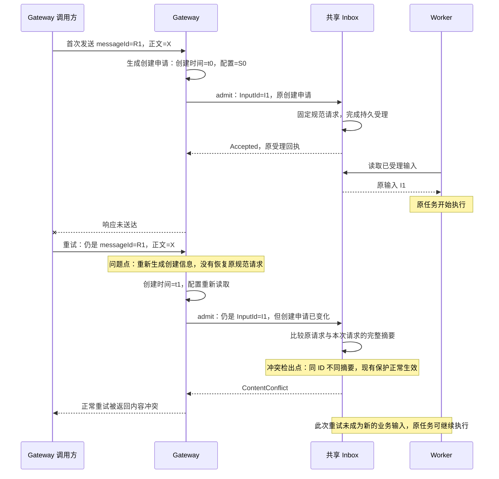

# Gateway–Worker 联调：问题与结论记录

Implementation authorized on 2026-11-19 for A2A conversion and A03/A04/A05.
Historical pause statements below are superseded only for that scope. Current
execution and evidence belong to plan.md and verification.md; A01/A02/A06 remain
separate work items.

日期：2026-11-19（Asia/Shanghai）。状态：**已授权实施 A2A 转换、A03、A04、A05；其他问题继续保留**。

Owner：BCS 分布式 Gateway、Worker、Inbox 和 TaskFeed 的公共契约与实现。
本文件记录本轮已明确的边界、尚未裁决的问题及其依据，不替代未修订的既有
SPEC，也不代表本轮草稿已经验证、合入或部署。

## 0. 阅读与执行状态

- 用户在逐项讨论后，明确授权在 #4245 rebase dev 后实施 A2A 转换、A03、A04、A05。
- 先前集成草稿保留在原 worktree；本轮独立 worktree 与精确基线见[实施计划](plan.md)。
- 本轮实现、契约修订及验证边界见[验证记录](verification.md)，不将历史验证冒充本轮证据。
- 后续讨论在这里更新状态与依据。只认可一个方向，不自动等于认可所有存储/API 细节。
- 公共逻辑属于 Avernet；企业存储适配、配置和真实 PROXY 证据属于宿主仓库。
  本文件不记录企业端点、凭据、私有配置路径或原始运行数据。

结论状态含义：

| 状态 | 含义 |
| --- | --- |
| 已明确：用户 | 用户在本轮明确要求或确认的范围/行为 |
| 已明确：既有契约 | 已采纳 SPEC 或公开端口已有约束；本轮仍需验证集成符合性 |
| 建议，待讨论 | 分析或实施建议，不能当作用户已接受的外部行为或设计 |
| 已观察 | 指定基线的代码事实或历史验证边界，不代表设计决议 |

### 0.1 本轮讨论结论速查

| 问题 | 当前结论或方向 | 状态 |
| --- | --- | --- |
| A2A 输出转换归属 | Worker 侧独立适配模块将内部展示/事件转为 A2A，保留其他消息格式扩展；Gateway 接收可交付结果，保留鉴权、协议封装和传输职责。 | 本轮采用协议无关持久化与注入式读侧转换；无来源时省略 history/status.message，不新增消息历史存储。 |
| A01 重试被当前任务状态挡住 | 身份/scope/group 授权后先识别原受理，新请求再检查当前状态；复用 Inbox，原受理记录未因取消而删除。 | Gateway 待修，用户要求记录后续处理。 |
| A02 回复重新选择 interaction | 回复携带原 interaction 关联，重试保留原绑定；复用既有内部 A2A Structured Input 扩展，不另造平行字段。 | 方向明确；分布式映射、一般提问覆盖和缺 ID 的兼容规则待定稿。 |
| A03 重试重建初始信息 | 首次固定创建信息，重试核对调用方业务内容后复用原规范请求；按 A04 分工由 Worker 侧公共受理组件负责初始任务生成/恢复。 | 用户认可方向；不削弱 Inbox 内容冲突校验。 |
| A04 共享契约与初始化职责 | 传递认证得到的 scope；本期取消单条/累计/完整快照输出大小上限；Worker 侧初始化任务和内部版本；Accepted/Duplicate 对 Gateway 统一为成功回执。 | 用户已确认四项方向；限制策略及 OSS 后续评估。 |
| A05 并发副本都查到无记录 | 复用 Inbox 原子规范选择；Worker 侧公共受理组件在竞争后核对业务内容，相同则复用/修复原受理，不同则冲突。 | 已授权本轮实施，执行证据另记。 |
| A06 回复正确但 HTTP 等待条件错误 | interaction ID 保证回复目标；当前 HTTP 等待使用重试时的当前进度，仍可能多等。建议等待/收流也关联原 interaction。 | 源码风险，尚未联合复现；具体修复接口未定稿。 |

所有修改限于分布式链路，不修改其他 A2A 代码。以上是问题和方案记录，不是已实现或
测试通过声明。续读裁剪、列表分页以及输出消息来源等问题仍按后续章节继续细化。

## 1. 核对基线与依据

以下为本轮先前已经核对的基线，非持续同步声明。恢复实施或发布前重新核对远端。

| 来源 | 已核对状态 |
| --- | --- |
| [Gateway #4132](https://github.com/inclusionAI/Avernet/pull/4132) | head `dd6deb7bb39abdf5d9960e05b3ddf0e9a2f84d77`；已合入，merge `03331c3354ccf0df0adaa187e4cee0f99cf2e829` |
| [Worker SPEC #4144](https://github.com/inclusionAI/Avernet/pull/4144) | head `8811efbc9751004747451d00c5ea1e6a30a6b224`；已合入，merge `17e3f0cc0109e5d0373d5d325e19478577bd35b9` |
| [Worker #4245](https://github.com/inclusionAI/Avernet/pull/4245) | head `c393d5cffd7030db950eaa68302d244109d69f88`；当时为 open |
| 公共 dev | `ff7c3c9a50b80f29725370071fca645317d173dd` |
| 本地集成基线 | 在上述 dev 重放 Worker 提交后为 `5bf8e9b595`；其后的未提交草稿不属于两个 PR 的原实现 |

依据：

- [Gateway SPEC](../2026-11-17-gateway-a2a-inbound/spec.md)：受理、查询、流式交付和 A2A 表面。
- [Gateway plan](../2026-11-17-gateway-a2a-inbound/plan.md)：已评审 Q1/Q2、Session 任务索引、As built 及未解决项。
- [Worker SPEC](../2026-11-18-worker-runtime-phase1/spec.md)：§3.2–3.3 投影与额度、§4.1 可靠受理、§5 输出与保留、§6 归档、§7.1 控制输入。
- [Inbox 端口](../../crates/service-api/bcs-service-api/src/port/repo/distributed/inbox.rs)、[TaskFeed 端口](../../crates/service-api/bcs-service-api/src/port/repo/distributed/task_feed.rs)。工作区端口可能包含未提交草稿；核对原行为时使用上表 PR head。

## 2. 已明确的总边界

| ID | 结论 | 状态与依据 |
| --- | --- | --- |
| C01 | 保留 #4132 的 A2A 1.0 接口、身份及 scope/group 授权；采用 #4245 Inbox、TaskFeed 和归档契约作为共享实现，经公共端口交接。 | 已明确：用户初始要求 |
| C02 | 输出转换归 Worker 侧的独立适配职责；Gateway 尽量少逻辑，接收可交付结果；保留其他消息格式的适配扩展。 | 已明确：用户确认方向。具体调用时机、持久编码、格式选择和升级机制尚未确认。 |
| C03 | 仅修改分布式执行链路及必要公共契约、组合和验证，不改其他 A2A 相关代码。 | 已明确：用户追加范围约束 |
| C04 | 原工作区改动保留，使用独立 worktree；涉及宿主时核对 dev，并遵循其 gitlink 集成规则。 | 已明确：用户初始要求 |
| C05 | 不新增 task 七天过期策略；无已采纳决议前沿用现有保留与证据策略。 | 已明确：用户要求；Gateway 索引决议、Worker §5.2 |
| C06 | 此前暂停已被后续明确实施授权替代，仅恢复 A2A 转换与 A03/A04/A05。 | 已明确：用户最新指示 |
| C07 | Gateway 保持稳定，不承担输出额度策略、用量初始化及内部展示版本生成；任务内部初始化职责归 Worker 侧。 | 用户明确的职责约束；建议通过 Worker 领域公共受理组件隔离，具体端口仍待定稿。 |
| C08 | 本期不设置单条输出、累计输出或完整展示快照的大小上限，不因这些人为输出配额拒绝输出或终止任务；限制策略和是否引入 OSS 等对象存储留待后续评估。 | 已明确：用户决定，取代原 Worker §3.3 的输出尺寸配额；本轮同步修订 SPEC、代码及测试。 |

“Gateway 尽量透传”仍保留身份/授权、请求参数、JSON-RPC/SSE 封装、错误映射和
游标传输职责。它不意味着绕过这些职责，也不证明所有 A2A 可选能力均已实现。

## 3. 受理和重试

### 3.1 已观察到的问题

| ID | 基线问题 | 后果 |
| --- | --- | --- |
| A01 | **Gateway 待修，后续处理。** Gateway 在 Inbox 去重之前检查 Reply/Cancel 的当前任务状态。 | 已生效但回包丢失后，重试可能因不再等待回复/已经终态而失败。Gateway As built 已记录此问题；不归因为 Worker 去重缺陷。 |
| A02 | 省略 interaction 的 Reply 每次都从当前任务读取唯一开放 interaction，没有先恢复该请求首次绑定。 | 无开放问题时拒绝；存在下一问题时，Gateway 会构造绑定下一问题的请求。同 scope/InputId 重试仍受 Inbox 摘要校验保护，绑定变化应被判 ContentConflict，不等于 Worker 已错误执行下一问题的回答。 |
| A03 | Gateway 重建创建时间、spec 等；Worker 的 `request_digest` 覆盖规范 `AdmitRequest`，不是只比较用户正文。 | 同一业务请求重试可能因派生创建信息变化而冲突。不能只复用 messageId 而重建整份请求。 |
| A04 | Gateway 原接线未传 Worker 新增的 `AdmitRequest.scope`；原初始任务不含额度/用量/版本化空展示；原 Accepted 统一成功，新 Worker 另分出 Duplicate。 | 需对齐可信身份传递和成功映射，并调整初始任务的生成职责；不能据此要求 Gateway 生成 Worker 内部策略及格式。 |
| A05 | 同一 scope/InputId 的两个并发请求副本都可能读到“无规范记录”，随后生成不同派生信息。 | lookup 不占位，不能消除竞争。Inbox 已有原子规范选择与完整摘要校验；按 A04 新分工，由 Worker 侧公共受理组件处理竞争后的原请求恢复，不能将派生差异直接等同于调用方改内容。 |
| A06 | HTTP Send/SendStreaming 在 submit 前读取当前展示覆盖位置，作为“刚回答的问题”的等待边界。 | 代码推断：旧回复重试若已能恢复原受理，但任务已停在下一问题，可能错误地继续等待更晚状态；阻塞请求可白等至超时后返回当前视图，SSE 可能已交付下一问题快照却未结束。需要联合测试确认，不能只修受理回执。 |

A01 的原因澄清：**原受理记录没有因任务取消而删除，Inbox 已支持按 scope + InputId
去重。** Gateway 基线 `admission::admit` 先执行 `check`，遇到终态直接返回
InvalidTransition，因而根本没有调用后面的 `core.inbox.admit`。Worker provider 若收到
同作用域、同 InputId、同规范内容，会利用保留的 canonical 记录确认/修复并返回原回执。
Worker SPEC §8.3 明确首批受理证据不自动过期/回收，`trim_committed` 也保留 Inbox 和
canonical 证据。因此 A01 是 Gateway 的校验/调用顺序问题，不能描述成 Inbox 没去重、
admit 记录已删除或需要重建一套去重机制。

A01 处理决定（2026-11-19，用户确认）：责任归属为 Gateway 的应用/核心受理路径，
先记录问题，后续再修，本次不修改代码。后续修复复用 Inbox 已有去重与保留能力；如需
补充公共查询端口，应单独说明接口改动，不将其视为重做 Worker 去重。暂停前相关代码
草稿继续保留为未提交、未采纳实现，不因已有草稿而把 A01 标为已解决。其他受理问题
仍按各自的分析和讨论状态处理，不由 A01 的归属结论一并裁定。

A02 的原因与影响澄清：interaction 标识任务内的一轮提问。同一任务先后出现 A、B 两轮
提问时，原回复 R1 首次绑定 A；若响应丢失后 R1 重试，Gateway 会重新观察当前问题，
可能选到 B。基线 `reply_input_id` 不包含 interaction，因此相同请求仍得到相同 InputId；
但 `HumanReply` 正文和 Worker 重算的规范摘要包含 interaction。原 canonical 记录仍在时，
Inbox 会拒绝该变化，返回 ContentConflict。这里确认的是 Gateway 重建请求不稳定和
重试失败，不声称已有“旧答案被 Worker 应用于新问题”的执行证据。当前无开放问题时
返回 interaction_not_open，多于一个时返回 interaction_ambiguous，同样无法恢复原受理。
修复方向是首次选择 interaction 后固定到规范请求，重试恢复原绑定；不能删除摘要中的
interaction 或把变化忽略为成功。A01 是校验顺序，A02 是重试时重新选择业务目标，二者
相关但不等价。本次仅核对基线源码并记录，未实施修复。

A03 的原因与影响澄清：这是 Start/创建任务路径的重试契约差异。Gateway 调用方可以
两次发送完全相同的 messageId 和消息内容，但 Gateway 的 `new_task` 每次调用时钟
重新设置初始任务 created_at/updated_at；创建 Session 时 `new_spec` 还会重新读取
group 的 workflow/participants/limits，并重新生成 spec.created_at。Worker Inbox
`request_digest` 对完整 AdmitRequest 生成摘要（去掉摘要字段本身；Agent 回流另有
排除字段），所以这些重新生成的创建信息也参与同 ID 内容冲突判定。

例如首次规范请求的 task.created_at 是 10:00:00，响应丢失后，同一 messageId 重试
生成 10:00:05，即使其他字段全部相同，摘要也不同。原记录仍在时 Inbox 返回
ContentConflict，任务本身可能已正常推进。已有 Session 中新建 Task 同样受时间字段
影响，不仅发生在创建 Session 时。补回已知 contextId 或目录读取失败导致
create_session 从 Some 变成 None，也是完整请求形状可能变化的来源。

责任分析：直接触发点是 Gateway 重建冻结创建信息，与共享 Inbox 的完整规范请求
比较规则不匹配；此项不证明 Worker 执行器或 Inbox 去重失效。只按 ID 返回成功会
漏掉用户修改正文的真实冲突，只从摘要删除时间字段也不足以解决 spec/额度变化。
建议区分客户端业务意图核对与规范请求完整性核对：首次原子选定创建信息后，重试在
确认客户端意图相同的前提下复用原规范请求，不能用当前任务快照替代最初创建快照。
并发首次请求尚无规范记录的竞争按 A05 处理。以上为基线源码分析；不声称两个未对齐
的 PR 已直接运行复现，也不代表现在实施修复。

A03 时序（省略与本问题无关的授权、通知和响应视图读取细节）：

A03 修复分工方向（用户认可，开发仍暂停）：Gateway 核对调用方业务意图并复用原
冻结创建信息；共享 Inbox 按需补公开查询/恢复能力，保留原子去重、冲突校验和受理修复；
不因此修改 Worker 执行流程。共享 Inbox 是 Gateway 直接调用的公共组件，不等于受理
发生在 Worker 进程中。接口形状和 A05 并发竞争处理仍待定稿。

A04 的原因与影响澄清：此项是 Gateway 与 Worker 共享接口版本的接线差异，包括请求
构造和返回值处理两部分。Gateway 基线已有 `scope_of(caller)`、core 的 scope 参数及
Session/Task scope 校验；缺的是构造 Worker 版 `AdmitRequest` 时显式携带该可信 scope，
不能描述为 Gateway 原来没有身份隔离。该字段应来自认证上下文，并与 Session/Task
scope 一致，不能使用调用方任意提交的值；group 授权继续保留。

Gateway 基线 `new_task` 未设置 Worker 新增的 `output_limits`、`output_usage`，且
`content.snapshot` 是 Inline null。Worker 基线要求首次创建时冻结合法的输出额度和
展示格式，初始用量为 `OutputUsage::default()`（当前累计字节为零），初始展示为
`DisplaySnapshot { format_version: 1, units: [] }` 的 Inline 编码。额度界定允许输出的
规模，用量记录已提交输出的累计消耗；新任务初始化为零，重试不能重置已有用量或
覆盖推进后的任务。版本化空展示表示“已知格式下尚无输出”，不是缺失/未知格式。
上述空展示是 #4245 基线编码事实，不据此裁决 C02 下尚未定稿的输出适配或持久格式。

Gateway 基线受理分支只匹配 Accepted、ContentConflict、Quarantined。进一步核对
`dd6deb7` 的 Inbox 端口注释：原 Accepted 已统一包含本次、此前尝试或修复者完成的
成功，原注释明确重试补齐后返回 Accepted；不能把原分支描述为没有考虑重试。
Worker 新增 Duplicate，将重复确认成功单独分类，携带原 AdmissionReceipt，且返回前
必须确认或修复持久受理。因此 Accepted
和 Duplicate 均应进入 Gateway 的成功受理路径，继续读取/交付任务；Duplicate 不应
变成错误或触发新任务。这里统一的是受理成功语义，不保证两次 HTTP Task 响应字节
相同，更不表示任务已经执行完成。

此项是已有 Worker §3.2、§3.3、§4.1 和端口约束的对齐，不需要重新设计 Worker 去重。
直接合用新模型时，缺必填字段与未穷尽枚举分支需要在编译/适配阶段补齐；即使临时
补齐类型，Inline null 仍不满足 Worker 初始快照校验。当前只读核对基线，未改运行代码。

A04 职责讨论补充（用户追问后修正此前表述）：

- **scope 的来源与作用**：原 Gateway SPEC 的验收项已有 tenant/principal 隔离；
  #4144 固定 head `8811efbc` 的 §4.1 已要求校验作用域并在作用域内选定 InputId，
  §5.2 要求读取隔离，§6 要求结果按作用域和 tid 唯一。原模型已有
  `TaskScope { tenant, principal }`，原 `AdmitRequest` 尚无顶层 scope 字段；这个
  显式字段是 Worker 新版端口变化。Gateway 负责认证和 group 授权，公共受理/存储
  校验可信 scope 与 Session/Task 一致，持久状态保留归属以支持恢复、读取和归档。
  Worker 不需要因此重新校验 HTTP token，也不要求每个内部对象都重复携带 scope。
- **策略所有权不由字段位置决定**：初始任务必须保存哪些状态，与 Gateway 是否负责
  生成这些状态是两件事。当前 `AdmitRequest` 携带完整 TaskSnapshot，让 Gateway 直接
  构造它会耦合 Worker 内部变化。按用户职责诉求，建议 Gateway 只提交可信身份及稳定
  业务命令，由 Worker 领域的公共受理/初始化组件生成并冻结初始任务，再使用共享 Inbox。
  该组件可在同进程调用，不等于新增 Worker 控制面网络提交接口。现有持久受理保证要求
  初始任务在返回成功前可恢复，不能简单推迟到异步执行器启动时才生成；具体端口待定。
- **output_limits / output_usage**：前者是运行时输出/持久化约束，后者是已提交输出
  的累计计量，不是 Gateway 自己计算的业务数据。按用户最新决定 C08，本期不设置单条、
  累计或完整展示快照的输出大小上限，也不要求 Gateway 提供这两个字段。已有计量若
  保留，仅由 Worker 内部维护，不作为本期输出额度拒绝条件。既有 §3.3 的 1 MiB/8 MiB
  是首批安全 profile，不是 A2A 要求或实测存储硬上限；现实现显式拒绝超出 profile 的
  配置，这属于恢复实施后须调整的既有逻辑，不能只在 Gateway 略去字段或伪装成无限值。
  限制策略和是否引入 OSS 等对象存储后续评估，本期沿用已有存储能力。该决定不等于
  已验证任意规模数据可成功存储；实际存储失败仍须正确报告，不能丢弃或截断后报成功。
- **展示格式版本**：它解释内部展示快照及事件折叠规则，不是 A2A 1.0 协议版本，也
  不是 Task 的业务修订号。Worker 接管、TaskFeed restore 和归档读取需识别该格式；
  Gateway 可通过稳定输出端口取得已适配结果，无需选择/构造内部版本。内部版本迁移
  由 Worker 侧兼容策略管理；仅标版本号不等于已经实现跨版本迁移。
- **Duplicate 的消费方式**：同 scope/InputId、同规范内容在此前已受理后重投，或
  此前受理中断而本次修复确认成功，可返回 Duplicate；内容不同仍冲突，结果未确认
  仍 Unknown。并发副本也可能进入重复确认路径，但不能依赖每组并发调用恰好一个
  Accepted，其余全 Duplicate。建议在公共受理层将两种成功统一成回执交给 Gateway，
  内部可保留重复标记用于诊断；不新增 A2A 重复错误或要求调用方换 ID。

A04 当前方案（职责和无输出上限按 C07/C08，具体公共 API 为实施建议）：Gateway 做
认证/group 授权，并提交可信 scope、目标、请求 ID 和业务内容；Worker 领域公共受理
组件生成初始任务和版本化空展示，交由共享 Inbox 完成持久受理。Gateway 不再构建完整
Worker TaskSnapshot，不感知内部展示版本及输出配额字段。公共受理层把 Accepted 与
Duplicate 统一为成功回执供 Gateway 使用；后者继续读取/订阅原任务。本期不新增 OSS
集成，不恢复开发。用户确认 A04 四项修改方向后继续讨论 A05，初始化组件内部的并发
处理按下文讨论，不能因职责迁移就认为竞争已自动消失。

A04 修改清单（方案细化，未实施）：

| 问题 | 修改位置与方式 | 复用边界 |
| --- | --- | --- |
| scope 传递 | Gateway 继续由认证上下文生成 TaskScope，经公共业务受理入口传给 Inbox；对齐原命令到新版 AdmitRequest 的组装。 | 复用已有 TaskScope、Session/Task scope 校验、scope 内去重和 group 授权，不在 Worker 重做 HTTP 认证。 |
| 输出大小配额及计量 | 修改模型、初始任务校验、输出投影、Worker 提交与收尾，以及 TaskFeed 写入/读取/恢复中的单条、累计和完整快照尺寸检查。本期建议移除这三个配额字段及相应拒绝条件，不以最大整数伪装无限。OutputUsage 若保留，仅作 Worker 内部计量，不参与输出大小拒绝。 | 现有 OutputLimits 还混合身份、批次、checkpoint/outbox 等工作参数，不能整个删掉后遗漏持久化职责；将其与本期移除的输出尺寸配额分开，内部参数不进入 Gateway 业务接口。沿用现有 Result/Blob，不新增 OSS。 |
| 初始任务与格式版本 | 修改 Gateway 公共受理命令，停止让 Gateway 传完整 create_task/TaskSnapshot；由 Worker 领域公共受理组件生成初始任务、版本化空展示及创建信息，再构造低层 Inbox 请求。 | 保留共享 DisplaySnapshot 编解码、投影及版本识别，Gateway 不选择内部版本。低层 AdmitRequest 可继续作为内部受理数据结构；不必另建网络服务。初始任务仍须在成功回执前持久可恢复。 |
| Duplicate 成功映射 | 公共受理实现将 Accepted(receipt) 与 Duplicate(receipt) 映射成同一个成功回执；Gateway 继续针对该回执中的任务获取/订阅结果。 | 复用现有 CoreAdmission/AdmissionReceipt 的统一成功语义及 Inbox 原子去重/修复；Conflict、Quarantined 和 OutcomeUnknown 保持各自错误语义。 |

对应代码入口以核对基线为准：Gateway 的 `submit::new_task`、核心 `admission::admit`
及 `AdmitTaskCommand`；Worker 公共模型的 `output.rs`/`task.rs`、`bcs-dist-projection`
和 Worker processor；共享 Store 的 `inbox/validation.rs` 及 TaskFeed 的 publish、follow、
reader、storage。现有 TaskFeed 解析单条 Payload 和完整 DisplaySnapshot 时也使用旧上限，
不能只改 Worker 写入端。移除输出配额不会自动证明任意尺寸数据可写，实际失败不能被
转换成成功；这里是后续实施检查范围，不是现有功能完成声明。

同步修订公共端口和 Worker SPEC §3.2/§3.3/§4.1 中的初始化职责、输出尺寸配额及成功
映射说明；§5.2 的读取契约同步说明不因已撤销的输出配额拒绝合法输出。Gateway 的
SPEC/plan 更新内部交接方式和 Duplicate 映射，不新增对外字段或修改非分布式 A2A。

恢复开发后的对应验收：错误 scope/group 仍被拒绝；Gateway 不构造内部展示版本即可
创建并读取空任务；超过原 1 MiB 的单条、超过原 8 MiB 的完整快照及累计输出通过真实
Gateway 请求完成输出和恢复，SSE/GetTask 内容一致；已受理响应丢失和中间受理修复后
重试恢复原回执/任务且无重复业务效果，真实内容冲突仍拒绝。以上均为待执行验收，
不进行本地压测，也不把这组有限样本称为无限容量证明。

A05 的原因与影响澄清：这里的“两个并发首请求”是同一业务请求的两个并发副本，
不是不同 messageId 的两个独立任务。它们可以进入两个 Gateway 实例，也可以是同一
实例内的两个并发处理过程。首次请求尚未完成时调用方已经重试，即可形成这种重叠。
A03 讨论原请求已存在后的重建变化；A05 讨论尚未建立规范记录时的并发窗口。

预查询 lookup 只是观察，不会占位：两个副本可以先后读到无记录，再分别生成 t0、t1
等创建信息，并使用相同 scope/InputId 提交。基线 `journal::select` 已使用仅在记录不存在
时创建的条件写入选定唯一 canonical；`producer::admit` 在选择后重新读取 canonical 并
比较完整摘要。因此此项不表示 Inbox 缺少并发去重，也不表示两个副本会各自执行一个
任务。派生信息不同时，未选中的副本会被判 ContentConflict，正常的并发重投无法恢复
同一受理结果。不存在差异的完整规范请求仍走现有受理确认/推进路径。

按 A04 分工更新的处理方向（用户认可，未实施）：Gateway 完成身份/scope/group 授权后
只提交业务请求；Worker 侧公共受理组件负责规范创建信息和竞争后恢复。初始任务生成
位置从 Gateway 移到该组件，本身并不会使两个并发副本串行，二者仍可能同时查到无记录。
继续由 Inbox 已有条件写入选定唯一规范请求；未选中本次候选的受理过程读取被选中的
原规范请求，核对调用方业务内容。内容相同则放弃本次派生创建信息，使用原规范请求
交给 Inbox 确认或修复；业务内容不同则保留冲突。不能把任意 ContentConflict 直接映射
为成功，也不能覆盖已选定的请求或已推进的任务。正常确认成功后向 Gateway 返回同一
任务/受理回执；未确认成功仍按既有 Unknown 等结果处理。公共端口的返回形状尚未定稿。

“修复”指原请求已经选定但持久受理步骤尚未完成时，由 Inbox 继续原流程，确认输入、
初始任务/spec 和持久激活满足成功条件；它不指重新选择一个版本或修改原业务内容。
canonical 存在不等于 Accepted；创建 canonical 的条件写入和决定受理的 Schedule EQ
是不同阶段。Gateway 不能仅凭 lookup 命中就返回受理成功。Worker 执行流程无需因此
新增去重逻辑。本次仅核对基线源码，尚无本轮 A05 联合并发验证。

A06 的原因与影响澄清（源码推断，尚未联合复现）：受理成功与 HTTP 等待/收流是两个
步骤。当前阻塞 Send 等到任务出现下一轮 InputRequired/AuthRequired 或终态再返回；
SendStreaming 在下一轮等待输入或终态结束流。为了避免刚提交答复就被尚未更新的旧
问题状态结束等待，HTTP `rpc::send`/`send_streaming` 在 submit 前读取当前 TaskView 的
`covered_through`，分别作为 `before`/`answered`。`wait::view_matches` 要求等待输入
的快照覆盖严格晚于 before；`end_on_waiting_snapshot` 将覆盖不晚于 answered 的等待
快照判为旧问题并继续流。覆盖位置表示视图包含到哪条输出事件，不是 interaction ID。

例如任务先问问题一，调用方发送答复；Worker 已处理答复并停在问题二，但第一次 HTTP
响应未送达。调用方以相同请求 ID 和原 interaction 重试问题一的答复。即使 A01/A02 等
受理问题已解决，能够确认同一原受理，HTTP 层仍会在重试前读到问题二的覆盖位置，并
错误地把它作为“这次刚回答的问题”的基线。后续读到同一问题二时，覆盖位置没有更晚，
于是继续等待；实际 Worker 正等调用方回答问题二，没有理由继续产生下一轮状态。

影响须准确限定：普通阻塞 Send 可能多等到配置的等待期限，然后返回当前视图，基线
默认 60 秒，并非必然报超时错误；returnImmediately=true 不经过该等待分支。SSE 初始
问题二快照可以已经交付，只是没有按下一问题结束流，可能持续 keep-alive；不声称该
快照被丢弃、Worker 把旧答案用于问题二或重复执行任务。终态、后续状态事件或读取错误
等路径可能使请求结束，因此不能把此风险描述成所有重试必然永久挂起。

既有测试覆盖首次回复保持旧问题的流、后续新问题结束流，以及无回复基线的订阅；
本轮未取得“已回复问题一、问题二快照已发布，再重试问题一”的联合测试证据。原基线
还可能先触发 A01/A02，阻止进入等待步骤；A06 是修复受理后仍须单独验证的 HTTP 行为。
本轮仅解释问题，不定稿新的等待端口或实施修复。

A06 角色及 interaction ID 澄清：发起补充信息/授权请求的是执行 Agent 或业务流程，
Worker 负责管理等待状态和执行推进，不把运行时描述成自行向用户提问。调用方按原
interaction ID 回复后，受理目标应保持正确；A06 不表示带 ID 的答案仍被绑定到下一轮。
当前 HTTP 等待判断只使用预读覆盖位置，并未关联本次回复实际绑定的 interaction，
所以业务去重/绑定正确仍可能伴随等待条件错误。建议等待逻辑使用原 interaction 的
推进关系：原 interaction 仍开放则继续等；已进入下一 interaction 的等待状态则交付
新状态并结束本次等待；终态结束；仅进入 Working 不等于可以提前结束阻塞等待。
此为已解释的修复建议，用户尚未逐项确认具体等待接口，仍待联合验证。

### 3.2 已明确的行为

| ID | 行为 | 依据 |
| --- | --- | --- |
| A-C1 | 重试仍执行身份、scope、group 授权；不能凭已存在的 ID 读取其他调用者的回执或绕过权限。 | 用户要求、Gateway 既有隔离 |
| A-C2 | 同一去重作用域内，同 ID 同业务内容恢复原受理；同 ID 不同内容冲突。 | 用户要求、Worker §4.1 |
| A-C3 | 已有请求的规范记录应在可变任务状态检查前识别；新请求才按当前状态判断可否 Reply/Cancel。 | 用户要求；Gateway 已知问题 |
| A-C4 | Reply 首次选定的 interaction 固定；省略 interaction 的重试沿用原绑定。 | 用户要求 |
| A-C5 | Accepted/Duplicate 都指向原规范回执；只有可确认的持久 Accepted 才可返回成功。中间记录或 Inbox 中有一条消息均不足以证明成功。 | Worker §4.1、InboxProducerPort |
| A-C6 | Duplicate 仍须确认或修复未完成受理步骤；不能因找到规范请求就跳过持久激活。 | Worker §4.1 |
| A-C7 | 首次规范创建固定任务身份、创建时间、spec；重试不覆盖推进后的任务。内部初始化和格式归 Worker 侧；本期不设置输出大小上限。 | Worker §4.1；C07/C08 替代本轮此前沿用的输出尺寸配额方案 |
| A-C8 | 回包丢失后可以重投、修复和确认；不能重复产生同一输入的已提交业务效果。 | 用户要求、Worker §4.1–4.3 |

### 3.3 当前讨论稿：不要混淆三个对象

1. **客户端请求身份与业务内容**：用于识别“是不是同一请求、有没有改意图”。
2. **Inbox 规范请求**：包含首次固定的创建信息或 interaction 绑定，负责可靠受理和恢复。
3. **A2A 返回内容**：可能是在本次读取时得到的 Task 状态或流，不等于内部 AdmissionReceipt。

建议流程（不是已确定的具体 API 形状）：校验身份/边界 → 查规范请求 →
有记录则比较业务内容并用原请求确认/修复 → 无记录才检查可变状态、绑定 interaction、
生成创建信息并提交 → 并发竞争失败时重新读取规范请求再比较。

不得削弱 Worker 已有摘要以绕过冲突。客户端意图比较与持久规范请求的完整性核对需要
分清职责；公开端口究竟返回规范请求、受理状态还是组合结果，留待讨论后定稿。

需要继续明确的细节：

- **A-Q1 原回执与 HTTP 响应**：建议保证相同内部回执、sid/tid 和受理结果，允许 A2A
  返回本次读取的当前任务状态，不缓存/重放整段旧 HTTP 响应。基线 Send/Cancel 在受理后
  另行读取/等待任务，本身不是原响应字节缓存。此解释须在本轮明确写入外部行为。
- **A-Q2 身份边界**：Send/Reply 基线使用 `message.messageId`；Cancel 基线使用
  JSON-RPC `id`，另按 scope/Session/task/操作类型限定。客户端换 ID 通常意味着新请求，
  不能按正文相同推断重试。Cancel 将数字和字符串 ID 转成同一字符串，null 使用固定值；
  是否保持、限制或修改这项外部约定尚未裁决。
- **A-Q3 业务内容边界**：正文、目标和显式 interaction 是业务意图；省略 interaction
  的已存在请求应采用原绑定。返回选项（阻塞/流式、historyLength）与受理内容应分开。
  字段级比较及显式/省略 interaction 等价规则仍需核对定稿。
- **A-Q4 路由配置**：首 Session ID 基线含由 `shard_count` 计算的 shard。跨重试改变
  此配置可能改变 Session/InputId。应明确配置稳定前提或另行定义迁移，不能笼统声称
  “所有配置变化都不会影响重试”。本轮尚无扩缩分片迁移决议。
- **A-Q5 状态竞争**：Gateway 检查后，任务可能先完成再由 Inbox 受理 Reply/Cancel。
  Worker §7.1 已规定迟到输入不能改写归档终态；“可靠受理”不能解释成“必然改变任务”。
  不据此引入跨任务状态与 Inbox 的新事务。
- **A-Q6 重试后的等待边界**：Reply 的阻塞/流式响应须识别原 interaction 是否已推进，
  不能把重试时新出现的问题当作本次已经回答的问题。建议从规范受理绑定和可见任务状态
  判断；是否需要扩充返回给应用层的信息、如何保留稳定边界，尚待定稿。
- **A-Q7 显式 interaction ID**：用户提出在协议上要求 interaction ID。内部契约已如此：
  `Interaction.id`、InputRequired/AuthRequired 事件和 `HumanReply.interaction` 均有明确 ID。
  缺口是 Gateway 对外呈现和 Reply 的携带规则。建议面向本分布式交互约定：每轮提问
  向 Gateway 调用方交付稳定 ID，回复显式带回该 ID，重试保持 messageId、interaction ID
  和业务内容不变；新回复缺 ID 时不再自动选择当前问题。此为讨论方向，尚未执行。
  A2A 1.0 的 Message 无标准 interactionId 字段，但支持 metadata/extensions。经用户
  提醒，已找到现有 BCS Structured Input 约定（见 §3.5）；优先复用其关联机制，不再把
  外部关联格式视为从零定义的问题，不修改其他 A2A 实现。核心标准依据为核对于 2026-11-19 的
  [Message 定义](https://a2a-protocol.org/latest/specification/#414-message)和
  [扩展机制](https://a2a-protocol.org/latest/specification/#46-extensions)。这会调整 Gateway
  原评审 Q7 的隐式绑定约定；既有扩展到分布式 interaction 的映射、支持范围、缺省拒绝
  策略及旧请求/调用方兼容需定稿。
  显式 ID 解决目标选择歧义，但仍须按 A01 在可变状态检查前识别原受理，不能因原问题
  已关闭而拒绝已受理回复的重试。输出契约 O-Q3 同时需要交付问题身份与可回答内容。

### 3.4 待恢复实施后的验收清单

同 ID/同内容、同 ID/不同内容、首请求并发、已生效回包丢失、受理中间失败修复、
配置/时钟变化后复用冻结输入、隐式 interaction 在状态推进后的重试、首次新 Cancel
与已有 Cancel 重试的区分、错误 scope/group、受理成功但读取响应失败后重试。
具体断言须区分回执稳定、逻辑效果不重复与本次 Task 视图可以变新。

### 3.5 已有 BCS A2A 扩展的核对结果

2026-11-19 只读核对：此前仅查 A2A 核心标准就建议新增交互扩展不充分。仓库已有
[Structured Input exec profile v1](../../../../docs/specs/a2a/structured-input-exec/v1.md)，
基于固定版本的上游 Structured Input 扩展；[BCN A2A 接口参考 §8.2](../../../../docs/bcn-a2a-api-reference.zh-CN.md#82-structured-input-的-exec-审批-profile)
给出完整请求、回复和回执约定。以下是既有事实，不是本轮新造字段：

| 对象 | 已有约定 |
| --- | --- |
| 提问 | INPUT_REQUIRED 的 status.message 中 DataPart；Part.metadata[Structured Input 扩展 URI] 为 `{"type":"input_schema","id":"原请求ID"}` |
| 回复 | 同一已鉴权 Task/context 的 Message；DataPart 元数据为 `{"type":"structured_input","id":"同一原请求ID"}` |
| 消息身份 | Message.messageId 标识本条消息，Structured Input 的 id 标识被回答的输入请求；二者不能混淆 |
| exec 接受证据 | Task.metadata 在 exec profile URI 下按请求 ID 保留 accepted，后续批次不清除早期证据；确认受理不等于工具执行成功 |

[现有编解码](../../crates/external-clients/bcs-a2a-http/src/structured_exec.rs)会读写上述
Part 元数据，并核对 Task/context；[既有测试](../../crates/external-clients/bcs-a2a-http/tests/structured_exec.rs)
覆盖回复编码、关联校验及接受证据。本次只读源码与测试，未重跑或改动这些非分布式代码。

适用范围必须保留：已有 BCS profile 明确是 exec 审批，不是已完成的通用 ask_user。
现有调用方向主要为 BCS 调用远端 Agent；分布式 Gateway 是入站服务，不能因已有出站
实现就声称入站已支持。其 `rpc::submit_input` 当前仍固定 `interaction: None`，没有提取
上述关联 ID。原问题应收敛为“分布式入站如何复用/映射已有扩展”，而非“协议没有关联 ID”。
现有 exec 的一批请求可含多个工具，内部 interaction ID 由请求 ID 与工具身份组合派生；
不能不经映射就把任意 Structured Input id 等同于一个分布式 InteractionId。

后续待讨论：分布式端支持哪些 Structured Input 形态、输出问题 Schema/内容与 ID 的
来源、与 Worker InteractionId 的稳定映射，以及旧隐式回复兼容。不新建平行 ID 字段，
也不把已有 exec-only 解码器直接当作通用问答解码器。开发继续暂停。

## 4. 任务创建与输出

已观察：Gateway Q2 预期 A2A 形状的 `artifacts/history/status_message` 和 artifact
更新；Worker §3.2 使用版本化 DisplaySnapshot、稳定单元身份和 Upsert/AppendText。
Gateway 原 GetTask 允许展示落后，Worker TaskFeed restore 合并已发布快照及后续事件。

已明确：

- 初始展示需要可解释的空状态；Worker 基线采用版本化空展示，生成职责按 C07 归 Worker
  侧。本期按 C08 不设置单条、累计及完整展示快照大小上限；额度及对象存储方案后续评估。
- 稳定单元身份、Upsert/AppendText、Thinking 不入完整展示及归档，遵循 Worker §3.2。
- 同一可见事件范围内，大文本经 SSE 累积的完整展示须与 GetTask 恢复结果一致。
- 转换职责和修改范围按 C02/C03；共享代码属于 Avernet。

待讨论，不能从 C02 自动推导：

| ID | 问题 | 当前建议/限制 |
| --- | --- | --- |
| O-Q1 | 持久化中立展示还是完整 A2A Task/事件？ | 倾向保留中立权威内容并集中转换；尚未采纳。此前草稿把 A2A 写入持久内容，也尚未采纳。 |
| O-Q2 | 转换模块何时调用？ | Worker 可先发布增量、后发布快照；TaskFeed restore 必须合并后续事件。建议恢复结果复用同一输出适配模块，不能靠透传旧快照满足一致性。物理部署及端口形状待定。 |
| O-Q3 | history 和 status.message 从哪里来？ | DisplaySnapshot 不能还原消息历史；Interaction 只有 id/did/kind，没有问题正文。已有 Structured Input profile 用 status.message 的 DataPart 携带 Schema 与关联 ID（§3.5）；分布式输出需明确这些内容来源，不能仅以字段可选就默认省略。 |
| O-Q4 | 格式扩展怎样约束？ | 需要确定格式/版本、失败与重放行为；本期不设输出大小配额。本轮是否只提供扩展点、不提供动态格式协商，尚待定稿。 |
| O-Q5 | Q1/Q2 如何修订？ | 保留原评审事实；共享事件物理编码由 TaskFeed provider 管理。新输出契约采纳后再显式修订引用，不回写成“原评审已经同意新方案”。 |
| O-Q6 | 输出限制及对象存储何时考虑？ | 本期范围已由 C08 确定：单条、累计和完整展示快照均不设大小上限。是否限制及引入 OSS 等对象存储后续评估；恢复实施时需调整现有 Worker 配额校验，不向 Gateway 转移职责。 |

## 5. 续读与裁剪

已观察：Gateway SSE 格式只支持 backend=tbase/generation=1；Worker TaskCursor
携带自己的 backend/namespace 信息；FollowItem 基线只有批末 next，无逐帧游标。
Gateway 原共享 reader 的实时 trim 检查也有已记录缺口。

已明确的集成要求（用户要求、Worker §5.2）：

- SSE ID 完整编解码 opaque TaskCursor；Gateway 不解释后端位置字符串。
- 逐帧恢复位置不得提前越过该帧；批次中途断线不得跳过未交付输出。
- TaskFeed 在取数和交付边界检查逻辑保留范围；发现 Gap 后恢复快照并从其覆盖位置继续。
- 旧 namespace/后端的游标不可伪装成当前游标；scope 错误不能降级为越权快照读取。
- 若保留共享 reader，置于 TaskFeed 已确认的可见性和保留边界之上。

范围澄清：快照恢复保障完整展示，不保证已裁剪的每条历史事件重新出现；Thinking
不在完整快照中。端到端网络交付不得凭 SSE ID 宣称无需客户端处理重连重复。
逐帧游标端口形状、旧 token 兼容方式及共享 reader 去留是待定实现细节。

## 6. 列表与归档

已观察：Gateway 已采纳 Session 内按 created_at 分页；Worker 基线 scope 索引按 tid
读取。二者不等价，不可因替换 provider 而改变外部顺序。

已明确：

- 保留 Session 筛选、scope/group 授权、创建顺序和分页约束；创建时间不随重试变化。
- 同时刻任务需要稳定次序；使用 tid 作次序补充是建议，索引/token 版本与迁移待设计。
- Worker §6 两次提交：冻结最终内容并 SaveResult → 确认不可变归档 → 提交/发布终态。
  归档失败留在可恢复状态；回包丢失核对同身份，不提前宣布 Completed。
- 七天 TTL 按 C05 处理，继续保留待决项；不旁路裁剪或删除必要恢复证据。

## 7. 验证与交付边界

已明确：真实 Gateway HTTP 请求串起 Inbox、Worker、TaskFeed 和 A2A 输出；Singlebox
可用内存 Store mock 加现有 SQLite Result/Blob。真实存储验证使用 TBase PROXY，
不用 SDK；这里的 PROXY 不指 OceanBase OBProxy。OB 实例验收继续 defer，不做本地
压测，DEV 耗时仅作诊断，覆盖率门槛沿用原配置，连接使用已有安全配置。

证据必须分别标记：

1. **单边验证**：Gateway 或 Worker 自身的单元/契约测试。
2. **Singlebox 联合验证**：真实 HTTP 与公共服务链，内存运行态 Store + SQLite 归档。
3. **真实 PROXY 联合验证**：相同链路经过真实 TBase PROXY；不能用前两项替代。

暂停前某一阶段的草稿测试曾通过，不代表后来改动后的工作区通过；输出转换方向
变更后的草稿尚未形成最终联合验证。本轮文档维护仅做链接、来源与状态一致性检查。
当前未取得可用于本轮完整联合验证的宿主 PROXY 适配/安全配置，不能宣称已完成该项。

## 8. 讨论记录

- 2026-11-19：确认 C02/C03 的输出职责方向与分布式范围；不把它扩大为完整 A2A
  持久格式、history/status.message 省略或新增协商协议的授权。
- 2026-11-19：按用户要求暂停开发，先审视四类大问题。
- 2026-11-19：保存本记录；继续讨论 A-Q1 至 A-Q6，其他议题保持现有状态。
- 2026-11-19：用户确认 A01 归属 Gateway，记录为后续待修；当前不实施该修复。
- 2026-11-19：核对 A02：Gateway 可能重建错误绑定，但同 scope/InputId 的规范摘要冲突
  会被 Inbox 拒绝；将“错误绑定”与“Worker 已错误执行”分开记录。
- 2026-11-19：记录显式 interaction ID 的协议讨论（A-Q7），区分内部已有必填字段与
  A2A 外部扩展；尚未变更 Q7 兼容行为或实施代码。
- 2026-11-19：按用户提示核对并找到既有 BCS Structured Input 扩展及 exec profile，
  补充 §3.5；纠正“需另起交互扩展”的推断。一般问答覆盖及分布式映射仍待讨论。
- 2026-11-19：展开 A03，区分调用方原始消息与 Gateway 派生的冻结创建信息，记录
  时间/spec 变化导致规范摘要冲突的代码依据和责任边界；未改代码。
- 2026-11-19：展开 A05，确认 Inbox 已有原子规范选择，区分预查询、规范选择和持久
  受理；记录 Gateway 竞争后核对/恢复的建议，未将其标为已定稿接口或已验证修复。
- 2026-11-19：按用户纠正的顺序先讨论 A04，A05 暂缓。核对可信 scope 的传递、初始
  额度/用量/空展示及 Accepted/Duplicate 映射；继续保持开发暂停。
- 2026-11-19：用户提出 A04 职责异议，记录 C07 与输出限制待决项；纠正把字段必需
  等同于 Gateway 负责生成的说法，补充原 Accepted 已含重复成功的源码事实。
- 2026-11-19：用户明确本期不限制单条、累计及完整展示快照大小，限制和 OSS 后续评估；
  更新 C08 与 A04 当前方案，移除该范围仍待确认的表述。只维护文档，A05 暂缓，开发暂停。
- 2026-11-19：细化 A04 四项修改位置、公共受理边界、SPEC 修订和待执行验收；额外核对
  TaskFeed 读端也使用原输出上限，要求移除配额时写入与恢复一致。未修改运行代码或执行测试。
- 2026-11-19：用户确认 A04 四项修改方向并继续讨论 A05；将竞争后规范请求恢复的建议
  归属改为 Worker 侧公共受理组件，保留 Inbox 已有原子选择能力，未新增实现或验证声明。
- 2026-11-19：用户认可 A05 处理方向后转入 A06；只读核对 HTTP 预读、阻塞等待和 SSE
  快照收流条件，记录两轮提问下的风险及影响边界，未运行联合复现或开始开发。
- 2026-11-19：按用户要求汇总最初的 A2A 输出转换与 A01–A06，新增速查表；澄清 A06
  的提问角色、回复绑定与 HTTP 等待条件是不同职责，未将修复建议标为已验证结论。
- 本次文档检查：本记录的 10 个本地链接存在；文档空白检查通过。
  对照 Gateway 请求身份、HTTP Send/Cancel、Worker Inbox 摘要与激活代码及上述 SPEC。
  未执行新运行时测试；A06 是代码推断，未列为已复现缺陷。
