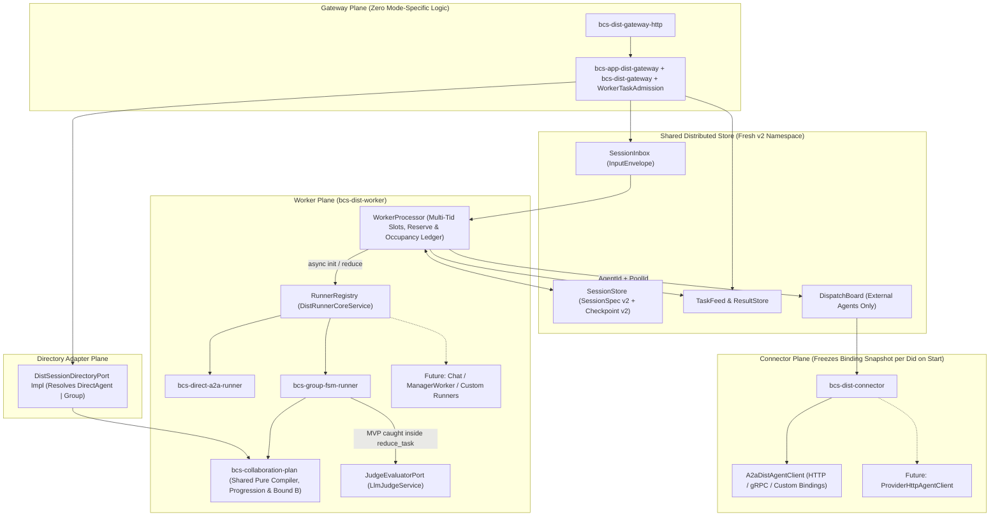

# BCS Distributed Multi-Mode Runner API / SPI & Migration Spec

## 1. Problem, Scope & Non-Goals

The distributed BCS execution plane (Gateway, Worker, and Connector) has established generic coordination, durable Inbox admission, atomic Checkpoint/Outbox commits, TaskFeed projection, and result archival, but `WorkerProcessor` currently executes only the test stub [bcs-dist-test-runner](../../crates/test-support/bcs-dist-test-runner/src/lib.rs).

Meanwhile, single-process BCS already supports **Direct A2A** and three group collaboration strategies (**Structured Collaboration / StateMachine**, **Free Chat**, and **Manager-Worker**). Current distributed contracts in [bcs-dist-model](../../crates/contracts/bcs-dist-model/src/session.rs) and [dist_runner.rs](../../crates/service-api/bcs-service-api/src/core/dist_runner.rs) are hardcoded to a single `SessionKind::FsmGroup`, require `GroupId` and `StateMachineDefinition` on every session, bind participants strictly by graph `NodeId`, and couple downstream protocol capabilities into `SessionSpec` and `DispatchSpec`.

### Scope

- Define the **Gateway ↔ Worker** mode-agnostic session/task contracts (`SessionTarget`, `CollaborationMode`, `ModeConfigEnvelope`, protocol-free `DispatchSpec`, `CorrelationKey`, `ModeLocal` interactions, and authenticated `HumanReply`).
- Define the **Worker ↔ Runner** Core API (`DistRunnerCoreService`) and strongly typed Mode Plugin SPI (`CollaborationModeRunner`), plus `RunnerRegistry` routing.
- Define the **migration design** for bringing **Direct A2A** (`CollaborationMode::DirectA2a`) and **Structured Collaboration** (`CollaborationMode::StateMachine`) onto the distributed Worker plane while reusing shared pure workflow compilation/progression logic.
- Preserve clean architectural seams for long-term support of **Free Chat** (`CollaborationMode::Chat`), **Manager-Worker** (`CollaborationMode::ManagerWorker`), and future extension modes (`CollaborationMode::Custom(String)`).

### Non-Goals

- No Rust code, configuration, or database migration changes are performed in this proposal.
- Gateway HTTP URL layout design is out of scope; this spec governs the Gateway ↔ Worker shared store/admission contract and Worker ↔ Runner API/SPI.
- Existing single-process `bcs-collaboration-runtime`, its tables, HTTP routes, and YAML authoring syntax remain unchanged.
- External IM channel notifications (e.g., human-input reminder cards or terminal IM notices) are outside the distributed Worker/Runner core path and remain external `TaskFeed` observers.
- WebSocket plugin Bots (`/ws/bot`) are not targeted by the distributed Connector.

## 2. Baseline & Architectural Decisions

This spec builds on `github/dev` commit `ad8f91fd57`, referencing [distributed contracts](../2026-11-15-distributed-contracts/spec.md), [worker runtime phase 1](../2026-11-18-worker-runtime-phase1/spec.md), [gateway inbound A2A](../2026-11-17-gateway-a2a-inbound/spec.md), [connector runtime](../2026-11-17-connector-runtime/spec.md), [bcs-service-api context](../../crates/service-api/bcs-service-api/CONTEXT.md), and [Avernet#4237](https://github.com/inclusionAI/Avernet/pull/4237).

### Confirmed Decisions (D1–D6)

| ID | Topic | Decision |
| --- | --- | --- |
| **D1** | **Task definition, concurrency & per-Agent occupancy** | 1. **No historical task state in `Checkpoint`**: completed tasks are archived to `ResultStore` / `TaskFeed` and retired from `Checkpoint`; no cross-task `SessionCarryover` is added.<br>2. **Unified `Task` boundary**: one external request triggering one collaboration convergence turn/run equals one `Task` (`tid`).<br>3. **Multi-active tasks, reservation accounting & per-Agent occupancy**: evolve `Checkpoint.runner_state` (`format_version = 2`, fresh namespace) into `runner_states: BTreeMap<Tid, RunnerState>` gated by `min(spec.limits.max_active_tasks, plugin.max_active_tasks(config))` (`1` for `DirectA2a` and `StateMachine`; `> 1` allowed for future `Chat`). Track `unresolved_dispatches: BTreeMap<Did, ActiveDispatchOccupancy>` plus per-active-task `remaining_dispatch_reserve` so starting a queued task enforces `O + sum(active.remaining_dispatch_reserve) + B_next <= C`, and expose a read-only `SessionOccupancyView` in `EvaluationContext` so future session-shared-context modes (`Chat`) can serialize/queue or reject same-`(Session, Agent)` dispatches inside Worker. |
| **D2** | **Gateway ↔ Worker alignment & strong typing** | 1. Define `CollaborationMode { DirectA2a, Chat, ManagerWorker, StateMachine, Custom(String) }` + `SemanticVersion(u32)`, aligned 1:1 with single-process `DirectA2a` and `GroupStrategy`.<br>2. **Gateway core/adapters stay mode-agnostic**: `bcs-dist-gateway-http`, `bcs-app-dist-gateway`, and `bcs-dist-gateway` validate only `SessionTarget { DirectAgent(AgentId), Group(GroupId) }` and forward the opaque `FrozenSessionProposal` produced by `DistSessionDirectoryPort`; adding new modes requires zero changes to Gateway HTTP/application/core crates (only the Directory resolver and new Runner plugin handle mode metadata).<br>3. **Worker routes with strong typing**: Worker dispatches on `CollaborationMode` to strongly typed `CollaborationModeRunner` plugins. |
| **D3** | **LLM Judge boundary & error isolation (MVP)** | Make `DistRunnerCoreService::reduce` and `CollaborationModeRunner::reduce_task` `async`. In the MVP, `GroupFsmRunner` invokes an injected `Arc<dyn JudgeEvaluatorPort>` (`LlmJudgeService`) inside `reduce_task` under a bounded per-call timeout (`min(judge_timeout, remaining_task_budget)`), keeping `StartDispatch`, `DispatchBoard`, and `Connector` 100% dedicated to external Agent calls.<br>**Error & replay contract**: `Err(RunnerError)` triggers Session isolation in [risk.rs](../../crates/services/bcs-dist-worker/src/processor/risk.rs) and is reserved strictly for corrupt state, unsupported format/version, or invalid config. Any `JudgeEvaluatorPort` timeout, 5xx, transport error, or invalid/undeclared `outcome` **must** be caught inside `GroupFsmRunner` and returned as `Ok(Decision)` (retrying the `bot_task` attempt when `attempt < max_attempts` or emitting `FinishTask(Failed)`). Crashes before `Checkpoint` commit may re-evaluate the uncommitted turn (matching single-process `CollaborationRuntime`); once committed, `outcome` is persisted in `RunnerState` and outbox replay never re-runs `reduce_task`. |
| **D4** | **Human interaction contract** | All contract edits are scoped strictly to `bcs-dist-*` crates; single-process `bcs-collaboration-runtime` behavior is untouched. `Interaction` replaces required `did: Did` with `origin: ModeLocal \| Dispatch { did }` and adds `prompt: Option<String>` (to populate A2A `TaskStatus.message`). Both `InputBody::HumanReply` and `RunnerInput::HumanReply` add Gateway-authenticated `responder: PrincipalId` so `GroupFsmRunner` can verify `assignee` constraints on `kind: human_input` nodes. |
| **D5** | **Downstream protocol decoupling & per-dispatch binding freeze** | Phase 1 distributed Connector supports A2A Agents (standard HTTP/gRPC and registered custom bindings via `bcs-a2a-binding-api`); future phases add stateless HTTP Provider Bots inside Connector; stateful WebSocket plugin Bots are excluded.<br>Gateway ↔ Worker `SessionSpec` and `DispatchSpec` carry only logical `AgentId` and wake `PoolId` (no `AgentBinding` or `DownstreamCapabilities`). To prevent mid-run registry drift across Connector failovers, **Connector resolves `AgentId` on first `start(did)` and persists the frozen `AgentBinding` / route fingerprint and `DownstreamCapabilities` snapshot inside Connector's `DispatchExecution` record**; subsequent `send_input`, `query`, `subscribe`, and `cancel` calls for that `did` use and verify that frozen snapshot. |
| **D6** | **Minimal input set, logical steps & physical evaluation cap** | Keep the 4 external `InputBody` / `RunnerInput` variants (`User`/`Start`, `HumanReply`, `Cancel`, `Agent`) plus internal `Timeout`.<br>Separate **logical business steps** from **physical reduction protection**: `TaskProgress.evaluations` increments by `1` before every `reduce` call against a generous `SessionLimits.max_task_evaluations` safety cap (preventing runaway streaming Agents from issuing unbounded CAS commits), while `TaskProgress.logical_steps` advances by `Decision.logical_steps_delta` (`>= 1` on node/attempt activations, `0` on streaming `Delta`/`Tool`). `logical_steps + logical_steps_delta > max_task_steps` is enforced **after `reduce` returns and before candidate commit**, discarding the uncommitted candidate and finalizing via `finalize_independently(Failed, "TaskStepLimitExceeded")`. |

## 3. Layered Architecture & Crate Ownership

All contracts and implementations follow the [architecture constitution](../../../../docs/arch/arch.rules.md) and [BCS layering rules](../../CLAUDE.md):



| Crate | Layer | Responsibility |
| --- | --- | --- |
| `crates/contracts/bcs-dist-model` | Contracts | `SessionTarget`, `CollaborationMode`, `SemanticVersion`, `ModeConfigEnvelope`, `AuthorizedAgent`, protocol-free `DispatchSpec`, `CorrelationKey` (across dispatch and display/output), `InteractionOrigin`, `HumanReply.responder` |
| `crates/service-api/bcs-service-api` | Service API | `core::dist_runner` (`DistRunnerCoreService`, `CollaborationModeRunner` SPI, `EvaluationContext`, `SessionOccupancyView`, `Decision`), `port::dist_agent` (`DistSessionDirectoryPort`) |
| `crates/services/bcs-collaboration-plan` | Core Service (Pure) | Zero-IO workflow validation, v1/v2 `fixed_loop` compiler, snapshot hash verification, reachability/join/upstream filtering, and static dispatch upper-bound `B` calculation shared with `bcs-collaboration-runtime` |
| `crates/services/bcs-runner-registry` | Core Service | Implements `DistRunnerCoreService`; static registration by `(CollaborationMode, SemanticVersion)`, config decode/cache, capacity bound derivation, state envelope validation |
| `crates/services/bcs-direct-a2a-runner` | Core Service | `CollaborationMode::DirectA2a@v1` implementation |
| `crates/services/bcs-group-fsm-runner` | Core Service | `CollaborationMode::StateMachine@v1` implementation with injected `JudgeEvaluatorPort` |
| `crates/services/bcs-dist-worker` | Core Service | Multi-active `runner_states`, `remaining_dispatch_reserve` + `unresolved_dispatches` ledger, `CorrelationKey` display handling, `ModeLocal` interaction checks, post-`reduce` `logical_steps_delta` & pre-`reduce` `max_task_evaluations` enforcement |

Concrete store providers (`DocumentCas`, `StrictLease`, `ZSet`), SQL archive providers (`bcs-db-api`), LLM providers (`bcs-llm-api`), and custom A2A transport bindings (`bcs-a2a-binding-api`) are wired only at the deployment composition root.

## 4. Gateway ↔ Worker Contracts & Checkpoint Evolution

### 4.1 `bcs-dist-model` Session, Dispatch & Display Contracts

`CorrelationKey` replaces graph-specific `NodeId` uniformly across `DispatchSpec`, `ActionIntent::Show`, `OutputBody::Artifact`, `ArtifactChange`, and `DisplayUnit`, making Worker validation, [bcs-dist-projection](../../crates/services/bcs-dist-projection/README.md), and [bcs-dist-a2a-output](../../crates/adapters/output/bcs-dist-a2a-output/src/lib.rs) independent of graph-based workflows (`DirectA2a` uses `"agent"`; `StateMachine` uses `execution_node_id`).

```rust
// crates/contracts/bcs-dist-model/src/ids.rs
// CorrelationKey(pub String) replaces NodeId in distributed dispatch and display types.

// crates/contracts/bcs-dist-model/src/session.rs
#[derive(Debug, Clone, PartialEq, Eq, Serialize, Deserialize)]
#[serde(tag = "kind", rename_all = "snake_case")]
pub enum SessionTarget {
    DirectAgent { agent: AgentId },
    Group { group: GroupId },
}

#[derive(Debug, Clone, PartialEq, Eq, PartialOrd, Ord, Hash, Serialize, Deserialize)]
#[serde(rename_all = "snake_case")]
pub enum CollaborationMode {
    DirectA2a,
    Chat,
    ManagerWorker,
    StateMachine,
    Custom(String),
}

#[derive(Debug, Clone, Copy, PartialEq, Eq, PartialOrd, Ord, Hash, Serialize, Deserialize)]
#[serde(transparent)]
pub struct SemanticVersion(pub u32);

#[derive(Debug, Clone, PartialEq, Serialize, Deserialize)]
pub struct ModeConfigEnvelope {
    pub mode: CollaborationMode,
    pub semantic_version: SemanticVersion,
    pub config_schema_version: u32,
    pub revision: String,
    pub digest: Digest,
    pub payload: Payload,
}

#[derive(Debug, Clone, PartialEq, Eq, Serialize, Deserialize)]
pub struct AuthorizedAgent {
    pub agent: AgentId,
    pub pool: PoolId,
}

#[derive(Debug, Clone, Copy, PartialEq, Eq, Serialize, Deserialize)]
pub struct SessionLimits {
    /// Deployment ceiling on concurrent Running tasks in one Session.
    /// Effective concurrency is `min(spec.limits.max_active_tasks, plugin.max_active_tasks(config))`.
    pub max_active_tasks: NonZeroU32,
    pub max_queued_tasks: u32,
    /// Bounds logical business progressions (`Decision.logical_steps_delta`).
    pub max_task_steps: u32,
    /// Safety ceiling on total `Runner::reduce` invocations per task (bounds runaway streaming commits).
    pub max_task_evaluations: u32,
    pub task_timeout_millis: u64,
    pub max_inline_bytes: u32,
    pub max_session_unresolved_dispatches: u32,
    pub capacity_wait_timeout_millis: u64,
}

#[derive(Debug, Clone, PartialEq, Serialize, Deserialize)]
pub struct SessionSpec {
    pub schema_version: u32, // Bumped to 2 (fresh distributed namespace)
    pub sid: Sid,
    pub shard: ShardId,
    pub scope: TaskScope,
    pub target: SessionTarget,
    pub mode_envelope: ModeConfigEnvelope,
    pub authorized_agents: Vec<AuthorizedAgent>,
    pub limits: SessionLimits,
    pub digest: Digest,
    pub created_at: TimestampMillis,
}
```

```rust
// crates/contracts/bcs-dist-model/src/dispatch.rs
#[derive(Debug, Clone, PartialEq, Serialize, Deserialize)]
pub struct DispatchSpec {
    pub schema_version: u32,
    pub sid: Sid,
    pub tid: Tid,
    pub did: Did,                  // Format: "{tid}.{mode_suffix}"
    pub source: CorrelationKey,
    pub attempt: NonZeroU32,       // 1-based attempt number
    pub agent: AgentId,            // Connector resolves & freezes AgentBinding + capabilities on first start(did)
    pub pool: PoolId,
    pub downstream_context: Option<String>,
    pub request: Payload,
    pub deadline: TimestampMillis,
}

// crates/contracts/bcs-dist-model/src/output.rs & task.rs
#[derive(Debug, Clone, PartialEq, Serialize, Deserialize)]
pub struct ArtifactChange {
    pub source: CorrelationKey,
    pub artifact_id: ArtifactId,
    pub class: OutputClass,
    pub update: ArtifactUpdate,
}

#[derive(Debug, Clone, PartialEq, Serialize, Deserialize)]
pub struct DisplayUnit {
    pub source: CorrelationKey,
    pub artifact_id: ArtifactId,
    pub class: OutputClass,
    pub content: serde_json::Value,
}

#[derive(Debug, Clone, PartialEq, Eq, Serialize, Deserialize)]
#[serde(tag = "origin", rename_all = "snake_case")]
pub enum InteractionOrigin {
    ModeLocal,
    Dispatch { did: Did },
}

#[derive(Debug, Clone, PartialEq, Eq, Serialize, Deserialize)]
pub struct Interaction {
    pub id: InteractionId,
    pub origin: InteractionOrigin,
    pub kind: InteractionKind,
    pub prompt: Option<String>,
}

#[derive(Debug, Clone, PartialEq, Serialize, Deserialize)]
#[serde(tag = "kind", rename_all = "snake_case")]
pub enum OutputBody {
    Status {
        status: TaskStatus,
        interactions: Vec<Interaction>,
    },
    Artifact {
        source: CorrelationKey,
        artifact_id: ArtifactId,
        class: OutputClass,
        update: ArtifactUpdate,
    },
    Terminal {
        status: TerminalStatus,
        result_ref: BlobRef,
    },
}

// crates/contracts/bcs-dist-model/src/input.rs
#[derive(Debug, Clone, PartialEq, Serialize, Deserialize)]
#[serde(tag = "kind", rename_all = "snake_case")]
pub enum InputBody {
    User {
        payload: Payload,
    },
    HumanReply {
        interaction: InteractionId,
        responder: PrincipalId,
        payload: Payload,
    },
    Cancel {
        reason: Option<String>,
    },
    Agent {
        event: AgentEvent,
    },
}
```

### 4.2 `Checkpoint` v2 Multi-Task, Reservation & Occupancy Ledger

Per [bcs-service-api/CONTEXT.md](../../crates/service-api/bcs-service-api/CONTEXT.md), the distributed runtime has not yet been enabled for production traffic; `Checkpoint.format_version` advances to `2` in a fresh distributed namespace (no in-place migration of prototype test-runner records; older format versions fail closed with `UnsupportedFormat`).

In [session.rs](../../crates/service-api/bcs-service-api/src/port/repo/distributed/session.rs):

```rust
#[derive(Debug, Clone, PartialEq, Eq, Serialize, Deserialize)]
pub struct ActiveDispatchOccupancy {
    pub tid: Tid,
    pub agent: AgentId,
}

#[derive(Debug, Clone, PartialEq, Serialize, Deserialize)]
pub struct TaskProgress {
    pub logical_steps: u32,
    pub evaluations: u32,
    /// Remaining dispatches this Running task may still create (`B` at start, decremented per new `did`, `0` on finalization).
    pub remaining_dispatch_reserve: u32,
    pub tid: Tid,
    pub phase: TaskPhase,
    pub input: Payload,
    pub result_ref: Option<BlobRef>,
    pub output_limits: OutputLimits,
    pub output_usage: OutputUsage,
    pub publication: SnapshotProgress,
    pub finalization: Option<TaskFinalization>,
}

pub struct Checkpoint {
    pub format_version: u32, // format_version = 2
    pub commit_seq: CommitSeq,
    pub consumed: Option<InboxPos>,
    pub tasks: VecDeque<TaskProgress>,
    pub runner_states: BTreeMap<Tid, RunnerState>,
    pub dispatch_seq: BTreeMap<Did, DispatchSequence>,
    pub unresolved_dispatches: BTreeMap<Did, ActiveDispatchOccupancy>,
    pub deadlines: Vec<Deadline>,
    pub deadline_history: BTreeMap<DeadlineId, Deadline>,
    pub view_drafts: BTreeMap<Tid, TaskContent>,
    pub last_event_id: Option<EventId>,
    pub outbox: Option<CommittedBatch>,
}
```

- **Fault isolation**: when a task completes or is terminated independently by Worker (`finalize_independently`), only `runner_states.remove(&tid)` is cleared and its `remaining_dispatch_reserve` becomes `0`; sibling active tasks in the same `Session` remain unaffected.
- **Cross-task capacity gate**: let `O = unresolved_dispatches.len() as u32`, `R_active = sum(t.remaining_dispatch_reserve for Running tasks)`, and `B_next = plugin.max_task_dispatches_bound(config)`. A `Queued` task may transition to `Running` only when:
  - `running_tasks < min(spec.limits.max_active_tasks, plugin.max_active_tasks(config))`, and
  - `O + R_active + B_next <= spec.limits.max_session_unresolved_dispatches`.
  When admitted to `Running`, `remaining_dispatch_reserve` is initialized to `B_next` and decremented by `1` on each committed `CreateDispatch` for that `tid` (exceeding `B_next` fails whole-Decision validation). `unresolved_dispatches` removes a `did` only upon confirmed remote termination or confirmed `NotSent` evidence.

## 5. Worker ↔ Runner API & Mode Plugin SPI

### 5.1 Core Service API (`bcs_service_api::core::dist_runner`)

```rust
#[derive(Debug, Clone, Default)]
pub struct SessionOccupancyView {
    pub busy_agents: BTreeMap<AgentId, BTreeSet<Did>>,
}

impl SessionOccupancyView {
    pub fn is_agent_busy(&self, agent: &AgentId) -> bool {
        self.busy_agents.get(agent).is_some_and(|dids| !dids.is_empty())
    }
}

pub trait ParsedModeConfig: Any + Send + Sync + Debug {
    fn mode(&self) -> &CollaborationMode;
    fn semantic_version(&self) -> SemanticVersion;
    fn digest(&self) -> &Digest;
    fn max_active_tasks(&self) -> NonZeroU32;
    fn max_task_dispatches_bound(&self) -> u32;
    fn as_any(&self) -> &dyn Any;
}

pub struct EvaluationContext<'a> {
    pub spec: &'a SessionSpec,
    pub mode_config: &'a dyn ParsedModeConfig,
    pub occupancy: &'a SessionOccupancyView,
    pub tid: &'a Tid,
    pub now: TimestampMillis,
}

#[derive(Debug, Clone, PartialEq, Serialize, Deserialize)]
pub enum RunnerInput {
    Start {
        tid: Tid,
        payload: Payload,
    },
    HumanReply {
        tid: Tid,
        interaction: InteractionId,
        responder: PrincipalId,
        payload: Payload,
    },
    Cancel {
        tid: Tid,
        reason: Option<String>,
    },
    Agent {
        tid: Tid,
        event: AgentEvent,
    },
    Timeout(Deadline),
}

#[derive(Debug, Clone, PartialEq, Serialize, Deserialize)]
pub enum ActionIntent {
    Show {
        tid: Tid,
        source: CorrelationKey,
        artifact_id: ArtifactId,
        class: OutputClass,
        update: ArtifactUpdate,
    },
    SetStatus {
        tid: Tid,
        status: TaskStatus,
        interactions: Vec<Interaction>,
    },
    StartDispatch(DispatchSpec),
    CancelDispatch {
        did: Did,
        intent: CancelIntent,
    },
    ContinueDispatch {
        did: Did,
        input: PendingInput,
    },
    FinishTask {
        tid: Tid,
        status: TerminalStatus,
        result: Payload,
    },
}

#[derive(Debug, Clone, PartialEq, Serialize, Deserialize)]
pub struct Decision {
    pub next_state: RunnerState,
    pub logical_steps_delta: u32,
    pub actions: Vec<ActionIntent>,
    pub next_deadlines: Vec<Deadline>,
}

#[async_trait]
pub trait DistRunnerCoreService: Send + Sync {
    fn decode_mode_config(
        &self,
        envelope: &ModeConfigEnvelope,
        resolved_payload: &serde_json::Value,
        authorized_agents: &[AuthorizedAgent],
        limits: &SessionLimits,
    ) -> Result<Arc<dyn ParsedModeConfig>, RunnerError>;

    async fn init(&self, context: &EvaluationContext<'_>) -> Result<RunnerState, RunnerError>;

    async fn reduce(
        &self,
        context: &EvaluationContext<'_>,
        state: &RunnerState,
        inputs: &[RunnerInput],
    ) -> Result<Decision, RunnerError>;
}
```

Effective session concurrency is computed deterministically in one place by `WorkerProcessor` as `spec.limits.max_active_tasks.min(mode_config.max_active_tasks())`.

### 5.2 Mode Plugin SPI (`CollaborationModeRunner`)

Each collaboration mode plugin owns its strongly typed `Config`, `State`, concurrency declaration, and static dispatch upper bound `B` calculation:

```rust
#[async_trait]
pub trait CollaborationModeRunner: Send + Sync {
    type Config: Send + Sync + Debug + 'static;
    type State: Serialize + for<'de> Deserialize<'de> + Send + Sync + Clone;

    fn mode(&self) -> CollaborationMode;
    fn semantic_version(&self) -> SemanticVersion;
    const STATE_FORMAT_VERSION: u32;

    fn parse_and_validate_config(
        &self,
        schema_version: u32,
        raw: &serde_json::Value,
        authorized_agents: &[AuthorizedAgent],
        limits: &SessionLimits,
    ) -> Result<Self::Config, RunnerError>;

    fn max_active_tasks(&self, _config: &Self::Config) -> NonZeroU32 {
        NonZeroU32::MIN // Default 1 for DirectA2a and StateMachine
    }

    /// Conservative upper bound `B` on dispatches a single task of this config can ever create.
    /// Must satisfy `B <= limits.max_session_unresolved_dispatches`.
    fn max_task_dispatches_bound(&self, config: &Self::Config) -> u32;

    async fn init_task(
        &self,
        spec: &SessionSpec,
        config: &Self::Config,
        tid: &Tid,
        now: TimestampMillis,
    ) -> Result<Self::State, RunnerError>;

    async fn reduce_task(
        &self,
        spec: &SessionSpec,
        config: &Self::Config,
        occupancy: &SessionOccupancyView,
        tid: &Tid,
        state: &Self::State,
        inputs: &[RunnerInput],
        now: TimestampMillis,
    ) -> Result<TypedDecision<Self::State>, RunnerError>;
}
```

### 5.3 Mode-Neutral Directory Port (`DistSessionDirectoryPort`)

Generalizes [DistGroupDirectoryPort](../../crates/service-api/bcs-service-api/src/port/dist_agent.rs):

```rust
#[async_trait]
pub trait DistSessionDirectoryPort: Send + Sync {
    async fn resolve(
        &self,
        scope: &TaskScope,
        target: &SessionTarget,
    ) -> Result<FrozenSessionProposal, DirectoryError>;

    async fn load_mode_config(
        &self,
        scope: &TaskScope,
        envelope: &ModeConfigEnvelope,
    ) -> Result<Payload, DirectoryError>;
}
```

## 6. Direct A2A & Structured Collaboration Migration Design

### 6.1 Direct A2A (`CollaborationMode::DirectA2a@v1`)

- **Admission & Freeze**: `DistSessionDirectoryPort::resolve(scope, SessionTarget::DirectAgent { agent })` reuses existing Bot visibility/friendship/organization checks and freezes `ModeConfigEnvelope { mode: DirectA2a, payload: Inline(DirectA2aConfig) }` with `authorized_agents = [AuthorizedAgent { agent, pool }]`; `DirectA2aRunner` reports `max_active_tasks = 1` and `max_task_dispatches_bound = 1`.
- **Execution Semantics**:
  - `Start`: creates `did = "{tid}.agent.1"`, emits `StartDispatch { agent, source: CorrelationKey("agent"), downstream_context: Some(sid.0), request }` so multi-turn tasks in the same `Session` share downstream conversation continuity safely under `max_active_tasks = 1`, registers dispatch deadline, and reports `logical_steps_delta = 1`.
  - Streaming (`Delta` / `Tool` / `Snapshot` / `Thinking`): first text chunk emits `Show(Upsert)`, subsequent chunks emit `Show(AppendText)` with `logical_steps_delta = 0`; `Thinking` uses Worker's rate-limited ephemeral path.
  - Remote interaction (`InputRequired` / `AuthRequired`): emits `SetStatus` with `Interaction { origin: Dispatch { did }, prompt }`; valid `HumanReply` emits `ContinueDispatch` with monotonic `seq`.
  - Completion & Failure: `Final` performs a full `Upsert` on the primary artifact slot followed by `FinishTask(Completed)`. Definitive `Error` immediately finishes with `FinishTask(Failed)` without fabricating a second business attempt (`NotSent` transport retries remain inside Connector).

### 6.2 Structured Collaboration (`CollaborationMode::StateMachine@v1`)

- **Shared Pure Plan Extraction (`bcs-collaboration-plan`)**:
  - Extract pure validation, `fixed_loop` v1/v2 compiler, `loop_context`, `progression`, snapshot hash verification, and conservative dispatch upper-bound calculation (`B = sum(bot_node.max_attempts)`) from [bcs-collaboration-runtime](../../crates/services/bcs-collaboration-runtime/src) into `crates/services/bcs-collaboration-plan`.
  - Both single-process `CollaborationRuntime` and distributed `GroupFsmRunner` call this shared crate, preserving byte-stable `compiler/v1` and `compiler/v2` node IDs, plan hashes, v1 vs v2 upstream artifact projection rules, and descending-`node_id` fallback selection when `final_output` is absent.
- **Execution Semantics & Downstream Context Isolation**:
  - **Per-dispatch `downstream_context` isolation**: unlike `DirectA2a` or conversational `Chat`, `StateMachine` constructs the complete prompt (`input` + filtered `upstream_outputs` + `LoopContext` + `instruction`) for every node attempt. Each `bot_task` dispatch sets `downstream_context = Some(did.0)` (isolated per `(tid, execution_node_id, attempt)`), ensuring neither parallel DAG branches bound to the same `AgentId` nor a new retry attempt after timeout ever collide on a shared downstream `context_id`.
  - **Bot nodes (`kind: bot_task`)**: deterministic activation in `execution_node_id` order; emits `StartDispatch { agent, source: CorrelationKey(execution_node_id), did: "{tid}.node.{hash}.{attempt}", downstream_context: Some(did.0) }`.
  - **Native human nodes (`kind: human_input`)**: emits no `StartDispatch`; transitions to `SetStatus(InputRequired)` with `Interaction { origin: ModeLocal, prompt }`. On `RunnerInput::HumanReply`, verifies `responder` against the frozen `assignee` constraint (when present) and deadline before advancing.
  - **MVP Internal Judge**: when a judged node receives a valid non-empty artifact or human reply, `GroupFsmRunner` calls its injected `JudgeEvaluatorPort` inside `reduce_task().await` under `min(judge_timeout, remaining_task_budget)`. Valid `outcome` values advance downstream Ready nodes in the same `Ok(Decision)`. Timeouts, 5xx errors, or undeclared outcomes are caught and mapped to `Ok(Decision)` as node-attempt failures (retrying `bot_task` if `attempt < max_attempts`, else `FinishTask(Failed)`), never returning `Err(RunnerError)`.
  - **Timeout & Retry**: on `bot_task` timeout with `attempt < max_attempts`, emits `CancelDispatch(old_did)` and `StartDispatch(new_did)` in one decision without waiting for `ConfirmedCanceled`; `old_did` stays in `Checkpoint.unresolved_dispatches` until terminal supervision completes, while `new_did` runs in its own isolated `downstream_context`. `human_input` nodes have fixed `max_attempts = 1`.
  - **Coexistence**: single-process `bcs-collaboration-runtime` and distributed `GroupFsmRunner` remain isolated by deployment/admission; no dual-writing of legacy state-machine tables and no live mid-run engine switching.

## 7. Long-Term Extensibility (`Chat`, `ManagerWorker`, `Custom`)

| Capability | `DirectA2a` (Phase 1) | `StateMachine` (Phase 1) | `Chat` (Future) | `ManagerWorker` (Future) |
| --- | --- | --- | --- | --- |
| `SessionTarget` | `DirectAgent(bot)` | `Group(id)` | `Group(id)` | `Group(id)` |
| `max_active_tasks` | `1` | `1` | `> 1` (configurable) | `1` or `> 1` |
| Downstream `context_id` | Shared per session (`sid`) | Isolated per dispatch (`did`) | Shared per session (`sid`) | Manager `sid` / Worker per-subtask |
| Same-`(Session, Agent)` concurrency protection | Serialized by `max_active_tasks = 1` | Avoided by per-`did` isolated `downstream_context` | Enforced via `SessionOccupancyView` (reject or wait-idle) | Enforced via `SessionOccupancyView` |
| Dispatch pattern | 1 `Agent` (`B = 1`) | Static DAG/Loop fan-out & join (`B = sum(max_attempts)`) | Dynamic `@mention` / `Driver` fan-out | Manager + dynamic Worker fan-out via A2A events |
| Gateway HTTP/app/core changes | Implemented once | Implemented once | **None** (Directory + Runner plugin only) | **None** (Directory + Runner plugin only) |

## 8. Implementation Slices & Verification Plan

| Slice | Scope | Exit Criteria |
| --- | --- | --- |
| **Step 1** | Extract `crates/services/bcs-collaboration-plan` | Existing `bcs-collaboration-runtime` regression suites (`definition_validation`, `fixed_loop_compiler`, `fixed_loop_snapshot`, `fixed_loop_context`, `runtime_progression`) pass with zero behavior drift. |
| **Step 2** | Evolve `bcs-dist-model`, `bcs-service-api`, `bcs-runner-registry`, `bcs-dist-worker`, and Connector binding freeze | Multi-slot `runner_states`, `remaining_dispatch_reserve` + `unresolved_dispatches` (`O + R_active + B_next <= C`), `CorrelationKey` across dispatch/display, Connector per-`did` binding snapshot freeze, `ModeLocal` interactions, `RunnerInput::HumanReply.responder`, `async DistRunnerCoreService`, post-`reduce` `logical_steps_delta`, and `max_task_evaluations` pass unit and conformance tests. |
| **Step 3** | Implement `bcs-direct-a2a-runner` and `DistSessionDirectoryPort` | End-to-end Gateway → Inbox → Worker → Connector integration tests pass for streaming, `InputRequired`/`ContinueDispatch`, cancel, and timeout. |
| **Step 4** | Implement `bcs-group-fsm-runner` | Pure Runner and Worker integration tests cover DAG, fan-out/join, parallel same-Agent `downstream_context` isolation, v1/v2 fixed loops, internal Judge branching and transient Judge error retry (verifying no Session quarantine), native `human_input` responder checks, and timeout retry, plus differential checks against `bcs-collaboration-runtime`. |
| **Step 5** | Production runtime composition & acceptance | Composition root wires `DirectA2aRunner`, `GroupFsmRunner`, real Agent registry resolver, shared SQL archive, and `JudgeEvaluatorPort`; passes architecture checks and store contract suites. |

## 9. Delivery Status & Unverified Boundaries

- **Status**: `proposed` (specification and index entry only; no Rust source, config, or schema migrations modified).
- **Verified in this change**: relative repository links, Markdown formatting, public-only content boundary (no private endpoints, credentials, or internal-only component names), and `git diff --check`.
- **Not executed**: Cargo build/tests, Worker/Connector integration tests, real store/provider contract tests, or deployment validation.
