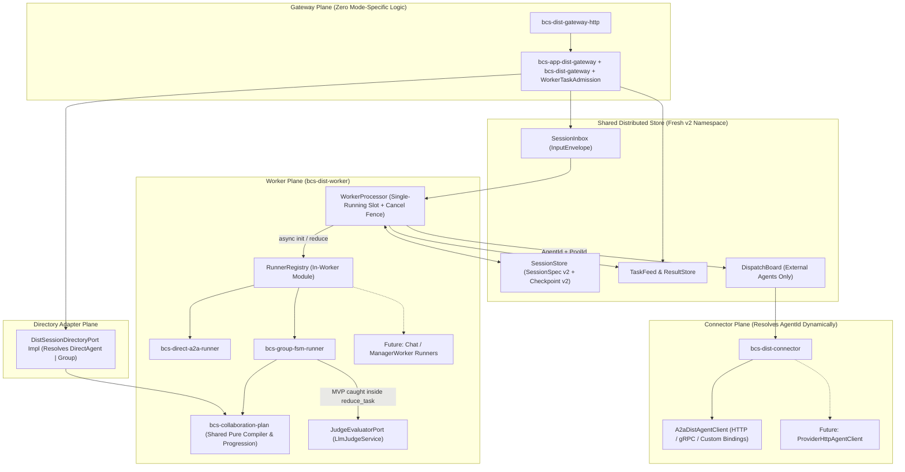

# BCS Distributed Multi-Mode Runner API / SPI & Migration Spec

## 1. Problem, Scope & Non-Goals

The distributed BCS execution plane (Gateway, Worker, and Connector) has established generic coordination, durable Inbox admission, atomic Checkpoint/Outbox commits, TaskFeed projection, and result archival, but `WorkerProcessor` currently executes only the test stub [bcs-dist-test-runner](../../crates/test-support/bcs-dist-test-runner/src/lib.rs).

Meanwhile, single-process BCS already supports **Direct A2A** and three group collaboration strategies (**Structured Collaboration / StateMachine**, **Free Chat**, and **Manager-Worker**). Current distributed contracts in [bcs-dist-model](../../crates/contracts/bcs-dist-model/src/session.rs) and [dist_runner.rs](../../crates/service-api/bcs-service-api/src/core/dist_runner.rs) are hardcoded to a single `SessionKind::FsmGroup`, require `GroupId` and `StateMachineDefinition` on every session, bind participants strictly by graph `NodeId`, and couple downstream protocol capabilities into `SessionSpec` and `DispatchSpec`.

### Scope

- Define the **Gateway ↔ Worker** mode-agnostic session/task contracts (`SessionTarget`, `CollaborationMode`, `ModeConfigEnvelope`, protocol-free `DispatchSpec`, `CorrelationKey`, `ModeLocal` interactions, and authenticated `HumanReply`).
- Define the **Worker ↔ Runner** Core API (`DistRunnerCoreService`) and strongly typed Mode Plugin SPI (`CollaborationModeRunner`), routed by an in-worker `RunnerRegistry`.
- Define the **migration design** for bringing **Direct A2A** (`CollaborationMode::DirectA2a`) and **Structured Collaboration** (`CollaborationMode::StateMachine`) onto the distributed Worker plane while reusing shared pure workflow compilation/progression logic.
- Preserve clean mode-routing seams for long-term support of **Free Chat** (`CollaborationMode::Chat`) and **Manager-Worker** (`CollaborationMode::ManagerWorker`) without adding unused multi-active-task fields in Phase 1.

### Non-Goals

- No Rust code, configuration, or database migration changes are performed in this proposal.
- Gateway HTTP URL layout design is out of scope; this spec governs the Gateway ↔ Worker shared store/admission contract and Worker ↔ Runner API/SPI.
- Existing single-process `bcs-collaboration-runtime`, its tables, HTTP routes, and YAML authoring syntax remain unchanged.
- External IM channel notifications (e.g., human-input reminder cards or terminal IM notices) are outside the distributed Worker/Runner core path and remain external `TaskFeed` observers.
- WebSocket plugin Bots (`/ws/bot`) are not targeted by the distributed Connector.

## 2. Baseline & Architectural Decisions

This spec builds on `github/dev` commit `ad8f91fd57`, referencing [distributed contracts](../2026-11-15-distributed-contracts/spec.md), [worker runtime phase 1](../2026-11-18-worker-runtime-phase1/spec.md), [gateway inbound A2A](../2026-11-17-gateway-a2a-inbound/spec.md), [connector runtime](../2026-11-17-connector-runtime/spec.md), [bcs-service-api context](../../crates/service-api/bcs-service-api/CONTEXT.md), and [Avernet#4237](https://github.com/inclusionAI/Avernet/pull/4237).

### Confirmed Decisions (D1–D6)

| ID | Topic | Decision |
| --- | --- | --- |
| **D1** | **Task boundary, single-slot Phase 1 & event-driven cancel fence** | 1. **No historical task state in `Checkpoint`**: completed tasks are archived to `ResultStore` / `TaskFeed` and retired from `Checkpoint`; no cross-task `SessionCarryover` is added.<br>2. **Unified `Task` boundary**: one external request triggering one collaboration convergence turn/run equals one `Task` (`tid`).<br>3. **Keep single-slot `runner_state` in Phase 1**: both `DirectA2a` and `StateMachine` run at most one active task per `Session`, so `Checkpoint.runner_state: Option<ActiveRunnerState>` and existing `Running`-promotion `DeadlineKind::Task` semantics stay unchanged (multi-active-task structures are deferred until `Chat` lands).<br>4. **Event-driven cancel fence + generation fallback for `DirectA2a`**: `Checkpoint` (`format_version = 2`) adds `downstream_generation: u64`, `pending_cancel_did: Option<Did>`, and `DispatchSequence.terminal_seen: bool`. Normal completions and confirmed aborts (where Connector delivers any terminal `InputBody::Agent` with `Final` or `Error` for that `did`) keep `downstream_generation` unchanged, preserving multi-turn conversation history on `"{sid}:{downstream_generation}"`. Only when a canceled/timed-out dispatch with `terminal_seen == false` fails to deliver terminal confirmation within `ProcessorConfig.cancel_grace` (default `15s`) does Worker increment `downstream_generation` to abandon the stuck downstream context before starting the next queued task. |
| **D2** | **Gateway ↔ Worker alignment & `sid`-scoped config caching** | 1. Define `CollaborationMode { DirectA2a, Chat, ManagerWorker, StateMachine }` + `mode_version: u32`, aligned 1:1 with single-process `DirectA2a` and `GroupStrategy`.<br>2. **Gateway core/adapters stay mode-agnostic**: `bcs-dist-gateway-http`, `bcs-app-dist-gateway`, and `bcs-dist-gateway` validate only `SessionTarget { DirectAgent { agent }, Group { group } }` and forward the opaque `FrozenSessionProposal` produced by `DistSessionDirectoryPort`; adding new modes requires zero changes to Gateway HTTP/application/core crates.<br>3. **Worker routes with strong typing & per-`sid` `Slot` caching**: an internal `RunnerRegistry` in `bcs-dist-worker` dispatches on `(CollaborationMode, mode_version)` to `CollaborationModeRunner` plugins via a private object-safe adapter. Validated mode config is cached per held `sid` on Worker's `Slot` (bound to that session's immutable `SessionSpec`, `authorized_agents`, and `limits`, and dropped on lease release) rather than shared across sessions by template digest. |
| **D3** | **LLM Judge boundary & error isolation (MVP)** | Make `DistRunnerCoreService::reduce` and `CollaborationModeRunner::reduce_task` `async` (updating the phase-one `"no IO"` doc comment on `dist_runner.rs` accordingly). In the MVP, `GroupFsmRunner` invokes an injected `Arc<dyn JudgeEvaluatorPort>` (`LlmJudgeService`, an intentional, documented exception to `apps/bcs/CLAUDE.md`'s generic `core::*CoreService` port rule matching existing `services/bcs-collaboration-runtime` precedent without importing transport frameworks) inside `reduce_task` under a bounded per-call timeout (`min(judge_timeout, remaining_task_budget)`), keeping `StartDispatch`, `DispatchBoard`, and `Connector` 100% dedicated to external Agent calls.<br>**Error & replay contract**: `Err(RunnerError)` triggers Session isolation in [risk.rs](../../crates/services/bcs-dist-worker/src/processor/risk.rs) and is reserved strictly for corrupt state, unsupported format/version, or invalid config. Any `JudgeEvaluatorPort` timeout, 5xx, transport error, or invalid/undeclared `outcome` **must** be caught inside `GroupFsmRunner` and returned as `Ok(Decision)` (retrying the `bot_task` attempt when `attempt < max_attempts` or emitting `FinishTask(Failed)`). Crashes before `Checkpoint` commit may re-evaluate the uncommitted turn (matching single-process `CollaborationRuntime`); once committed, `outcome` is persisted in `RunnerState` and outbox replay never re-runs `reduce_task`. |
| **D4** | **Human interaction contract** | All contract edits are scoped strictly to `bcs-dist-*` crates; single-process `bcs-collaboration-runtime` behavior is untouched. `Interaction` replaces required `did: Did` with `origin: ModeLocal \| Dispatch { did }` (`#[serde(tag = "kind")]`) and adds `prompt: Option<String>` (to populate A2A `TaskStatus.message`). Both `InputBody::HumanReply` and `RunnerInput::HumanReply` add Gateway-authenticated `responder: PrincipalId` so `GroupFsmRunner` can verify `assignee` constraints on `kind: human_input` nodes. |
| **D5** | **Downstream protocol decoupling (zero `DispatchExecution` schema change)** | Phase 1 distributed Connector supports A2A Agents (standard HTTP/gRPC and registered custom bindings via `bcs-a2a-binding-api`); future phases add stateless HTTP Provider Bots inside Connector; stateful WebSocket plugin Bots are excluded.<br>Gateway ↔ Worker `SessionSpec` and `DispatchSpec` carry only logical `AgentId` and wake `PoolId` (removing `AgentBinding` and `DownstreamCapabilities`). `DispatchExecution` and `RemoteTaskRef` stay unchanged: remote task identity across Connector failovers is anchored by `RemoteTaskRef`, while Connector forwards `DispatchSpec.downstream_context` on initial `start` and resolves the current registered endpoint, capabilities, and active credentials by `AgentId` from the Agent registry. The MVP assumes a logical `AgentId`'s registered entry points to one logical Agent service (supporting credential rotation and ingress domain updates backed by the same task store); mid-flight cutover to a disjoint stateful backend or mid-flight mutation of an Agent's protocol `DownstreamCapabilities` is unsupported in the MVP. |
| **D6** | **Minimal input set & zero-change `task.steps` safety cap** | Keep the 4 external `InputBody` / `RunnerInput` variants (`User`/`Start`, `HumanReply`, `Cancel`, `Agent`) plus internal `Timeout`.<br>Keep existing `TaskProgress.steps` and `SessionLimits.max_task_steps` **unchanged** in the MVP (no dual `logical_steps_delta` / `max_task_evaluations` counters): `DirectA2a` executes 1 call and `StateMachine` DAG + `fixed_loop` plans are already finite at compile time (bounded by per-node `max_attempts` and `task_timeout_millis`), while Worker's existing pre-`reduce` `task.steps < max_task_steps` check (sized generously in config, e.g., `10_000`) continues to bound runaway streaming CAS commits with zero changes to `prepare.rs` step accounting. |

## 3. Layered Architecture & Crate Ownership

All contracts and implementations follow the [architecture constitution](../../../../docs/arch/arch.rules.md) and [BCS layering rules](../../CLAUDE.md):



| Crate | Layer | Responsibility |
| --- | --- | --- |
| `crates/contracts/bcs-dist-model` | Contracts | `SessionTarget`, `CollaborationMode`, `ModeConfigEnvelope`, `AuthorizedAgent`, protocol-free `DispatchSpec`, `CorrelationKey` (across dispatch and display/output), `InteractionOrigin`, `HumanReply.responder`, `DeadlineKind::CancelGrace` |
| `crates/service-api/bcs-service-api` | Service API | `core::dist_runner` (`DistRunnerCoreService`, `CollaborationModeRunner` SPI, `TypedDecision`, `EvaluationContext`, `Decision`), `port::dist_agent` (`DistSessionDirectoryPort`, `FrozenSessionProposal`, `DirectoryError`) |
| `crates/services/bcs-collaboration-plan` | Core Service (Pure) | Zero-IO workflow validation, v1/v2 `fixed_loop` compiler, snapshot hash verification, and reachability/join/upstream filtering shared with `bcs-collaboration-runtime` |
| `crates/services/bcs-direct-a2a-runner` | Core Service | `CollaborationMode::DirectA2a` (`mode_version = 1`) implementation |
| `crates/services/bcs-group-fsm-runner` | Core Service | `CollaborationMode::StateMachine` (`mode_version = 1`) implementation with injected `JudgeEvaluatorPort` |
| `crates/services/bcs-dist-worker` | Core Service | Internal `RunnerRegistry` + per-`sid` `Slot` config caching, `DirectA2a` event-driven `pending_cancel_did` / `CancelGrace` (`ProcessorConfig.cancel_grace`) / `downstream_generation` fence, `CorrelationKey` display handling, `ModeLocal` interaction checks |
| `crates/services/bcs-dist-connector` | Core Service | Forwards `DispatchSpec.downstream_context` into `StableSendRequest.context_id` on initial `start` (`send.rs`) and resolves target binding & `DownstreamCapabilities` by `DispatchSpec.agent` |

Concrete store providers (`DocumentCas`, `StrictLease`, `ZSet`), SQL archive providers (`bcs-db-api`), LLM providers (`bcs-llm-api`), and custom A2A transport bindings (`bcs-a2a-binding-api`) are wired only at the deployment composition root.

## 4. Gateway ↔ Worker Contracts & Checkpoint Evolution

### 4.1 `bcs-dist-model` Session, Dispatch & Display Contracts

`CorrelationKey` replaces graph-specific `NodeId` uniformly across `DispatchSpec`, `ActionIntent::Show`, `OutputBody::Artifact`, `ArtifactChange`, and `DisplayUnit`, making Worker validation, [bcs-dist-projection](../../crates/services/bcs-dist-projection/README.md), and [bcs-dist-a2a-output](../../crates/adapters/output/bcs-dist-a2a-output/src/lib.rs) independent of graph-based workflows (`DirectA2a` uses `"agent"`; `StateMachine` uses `execution_node_id`).

```rust
// crates/contracts/bcs-dist-model/src/ids.rs
// CorrelationKey(pub String) replaces NodeId in distributed dispatch and display types.

// crates/contracts/bcs-dist-model/src/session.rs
#[derive(Debug, Clone, PartialEq, Eq, Serialize, Deserialize)]
#[serde(tag = "kind", rename_all = "snake_case")]
pub enum SessionTarget {
    DirectAgent { agent: AgentId },
    Group { group: GroupId },
}

#[derive(Debug, Clone, Copy, PartialEq, Eq, PartialOrd, Ord, Hash, Serialize, Deserialize)]
#[serde(rename_all = "snake_case")]
pub enum CollaborationMode {
    DirectA2a,
    Chat,
    ManagerWorker,
    StateMachine,
}

#[derive(Debug, Clone, PartialEq, Serialize, Deserialize)]
pub struct ModeConfigEnvelope {
    pub mode: CollaborationMode,
    pub mode_version: u32,
    pub revision: String,
    pub digest: Digest,
    pub payload: Payload,
}

#[derive(Debug, Clone, PartialEq, Eq, Serialize, Deserialize)]
pub struct AuthorizedAgent {
    pub agent: AgentId,
    pub pool: PoolId,
}

#[derive(Debug, Clone, Copy, PartialEq, Eq, Serialize, Deserialize)]
pub struct SessionLimits {
    pub max_queued_tasks: u32,
    /// Pre-`reduce` evaluation/commit ceiling per task (existing `TaskProgress.steps` behavior; sized generously for streaming).
    pub max_task_steps: u32,
    pub task_timeout_millis: u64,
    pub max_inline_bytes: u32,
}

#[derive(Debug, Clone, PartialEq, Serialize, Deserialize)]
pub struct SessionSpec {
    pub schema_version: u32, // Bumped to 2 (fresh distributed namespace)
    pub sid: Sid,
    pub shard: ShardId,
    pub scope: TaskScope,
    pub target: SessionTarget,
    pub mode_envelope: ModeConfigEnvelope,
    pub authorized_agents: Vec<AuthorizedAgent>,
    pub limits: SessionLimits,
    pub digest: Digest,
    pub created_at: TimestampMillis,
}
```

```rust
// crates/contracts/bcs-dist-model/src/dispatch.rs
#[derive(Debug, Clone, PartialEq, Serialize, Deserialize)]
pub struct DispatchSpec {
    pub schema_version: u32,
    pub sid: Sid,
    pub tid: Tid,
    pub did: Did,                  // Format: "{tid}.{mode_suffix}"
    pub source: CorrelationKey,
    pub attempt: NonZeroU32,       // 1-based attempt number
    pub agent: AgentId,            // Connector resolves endpoint, capabilities & active credentials by AgentId
    pub pool: PoolId,
    pub downstream_context: Option<String>,
    pub request: Payload,
    pub deadline: TimestampMillis,
}

// crates/contracts/bcs-dist-model/src/output.rs & task.rs
#[derive(Debug, Clone, PartialEq, Serialize, Deserialize)]
pub struct ArtifactChange {
    pub source: CorrelationKey,
    pub artifact_id: ArtifactId,
    pub class: OutputClass,
    pub update: ArtifactUpdate,
}

#[derive(Debug, Clone, PartialEq, Serialize, Deserialize)]
pub struct DisplayUnit {
    pub source: CorrelationKey,
    pub artifact_id: ArtifactId,
    pub class: OutputClass,
    pub content: serde_json::Value,
}

#[derive(Debug, Clone, PartialEq, Eq, Serialize, Deserialize)]
#[serde(tag = "kind", rename_all = "snake_case")]
pub enum InteractionOrigin {
    ModeLocal,
    Dispatch { did: Did },
}

#[derive(Debug, Clone, PartialEq, Eq, Serialize, Deserialize)]
pub struct Interaction {
    pub id: InteractionId,
    pub origin: InteractionOrigin,
    pub kind: InteractionKind,
    pub prompt: Option<String>,
}

#[derive(Debug, Clone, PartialEq, Serialize, Deserialize)]
#[serde(tag = "kind", rename_all = "snake_case")]
pub enum OutputBody {
    Status {
        status: TaskStatus,
        interactions: Vec<Interaction>,
    },
    Artifact {
        source: CorrelationKey,
        artifact_id: ArtifactId,
        class: OutputClass,
        update: ArtifactUpdate,
    },
    Terminal {
        status: TerminalStatus,
        result_ref: BlobRef,
    },
}

// crates/contracts/bcs-dist-model/src/input.rs
#[derive(Debug, Clone, PartialEq, Serialize, Deserialize)]
#[serde(tag = "kind", rename_all = "snake_case")]
pub enum InputBody {
    User {
        payload: Payload,
    },
    HumanReply {
        interaction: InteractionId,
        responder: PrincipalId,
        payload: Payload,
    },
    Cancel {
        reason: Option<String>,
    },
    Agent {
        event: AgentEvent,
    },
}
```

### 4.2 `Checkpoint` v2 & Event-Driven Cancel Fence

Per [bcs-service-api/CONTEXT.md](../../crates/service-api/bcs-service-api/CONTEXT.md), the distributed runtime has not yet been enabled for production traffic; `Checkpoint.format_version` advances to `2` in a fresh distributed namespace (no in-place migration of prototype test-runner records; older format versions fail closed with `UnsupportedFormat`).

In [session.rs](../../crates/service-api/bcs-service-api/src/port/repo/distributed/session.rs) and `bcs-dist-model/src/runner.rs`:

```rust
#[derive(Debug, Clone, PartialEq, Eq, Serialize, Deserialize)]
#[serde(tag = "kind", rename_all = "snake_case")]
pub enum DeadlineKind {
    Task { tid: Tid },
    Dispatch { tid: Tid, did: Did },
    Snapshot { tid: Tid },
    CancelGrace { did: Did }, // Session-scoped Worker-internal timer; never in deadline_history or sent to Runner
}

#[derive(Debug, Clone, PartialEq, Eq, Serialize, Deserialize)]
pub struct DispatchSequence {
    pub tid: Tid,
    pub holder_epoch: HolderEpoch,
    pub sequence: u64,
    pub terminal_seen: bool, // Set true when Final or Error is consumed for this did
}

pub struct Checkpoint {
    pub format_version: u32, // format_version = 2
    pub commit_seq: CommitSeq,
    pub consumed: Option<InboxPos>,
    pub tasks: VecDeque<TaskProgress>, // TaskProgress unchanged from baseline (retains `steps: u32`)
    pub runner_state: Option<ActiveRunnerState>,
    pub dispatch_seq: BTreeMap<Did, DispatchSequence>,
    pub downstream_generation: u64,
    pub pending_cancel_did: Option<Did>,
    pub deadlines: Vec<Deadline>,
    pub deadline_history: BTreeMap<DeadlineId, Deadline>,
    pub view_drafts: BTreeMap<Tid, TaskContent>,
    pub last_event_id: Option<EventId>,
    pub outbox: Option<CommittedBatch>,
}
```

- **Preserved single-slot, `TaskProgress.steps` & `Task` deadline semantics**: Phase 1 keeps `runner_state: Option<ActiveRunnerState>`, keeps existing `TaskProgress.steps` pre-`reduce` evaluation counting, and installs `DeadlineKind::Task { tid }` only when a `Queued` task promotes to `Running` (queue waiting never consumes active execution timeout budget and never creates duplicate task deadline IDs).
- **Event-driven cancel fence for shared-context modes (`DirectA2a`)**:
  - Only modes declaring `shares_session_downstream_context() == true` (`DirectA2a`; `false` for `StateMachine`) use `pending_cancel_did` and `downstream_generation`.
  - **Terminal tracking (`terminal_seen`)**: when Worker consumes a terminal `InputBody::Agent` (`Final` or `Error`) for a tracked `did`, it sets `dispatch_seq[did].terminal_seen = true`. `finalize_independently` emits `RequestCancel` only for `did`s with `terminal_seen == false`.
  - **Normal completion**: when a `DirectA2a` task finishes after `terminal_seen == true`, `pending_cancel_did` stays `None` and `downstream_generation` is unchanged, so subsequent turns reuse `"{sid}:{downstream_generation}"` with full downstream conversation memory.
  - **Abort / timeout with open dispatch**: if a `DirectA2a` task terminates (`finalize_independently` on Cancel/TaskTimeout/StepLimit/OutputQuota, or `CancelDispatch + FinishTask` on `DeadlineKind::Dispatch`) while its `did` still has `terminal_seen == false`, Worker sets `pending_cancel_did = Some(did)` and installs `DeadlineKind::CancelGrace { did }` at `now + ProcessorConfig.cancel_grace` (`ProcessorConfig` field in `bcs-dist-worker`, default `15s` to accommodate two-step `RequestAccepted` cancellations without premature context rotation). Task-scoped deadline filters and cleanups (`belongs_to_task`, `retire_published`, `apply_decision`, and `prepare.rs`'s task deadline loop) explicitly ignore session-scoped `DeadlineKind::CancelGrace` so retiring the terminated task never deletes the active grace timer. While `pending_cancel_did.is_some()`, `Queued` tasks remain queued (`DeadlineKind::Task` not yet started).
  - **Normal abort wakeup (preserves session context)**: per [control.rs](../../crates/services/bcs-dist-connector/src/control.rs) and [call.rs](../../crates/services/bcs-dist-connector/src/call.rs), Connector durably admits a key `InputBody::Agent` (`Final` or `Error`, e.g., `agent_canceled`, `canceled_before_send`, or `already_finished`) to `SessionInbox` on every `ConfirmedCanceled`, `AlreadyFinished`, and `NotSent` termination. In `prepare.rs`, **before** dropping inputs for finalized/retired `tid`s, Worker matches solely on `event.did == pending_cancel_did` and `matches!(event.kind, AgentEventKind::Final | AgentEventKind::Error)` (without inspecting error `code` strings); when matched, it clears `pending_cancel_did = None` and removes `DeadlineKind::CancelGrace` **without incrementing `downstream_generation`**, immediately unblocking the next `Queued` task on the **same** downstream `"{sid}:{downstream_generation}"` context with zero polling.
  - **Hung-agent fallback (abandons stuck context)**: only if the remote agent hangs or rejects cancellation (`CancelObservation::Rejected` / persistent `OutcomeUnknown`) so no terminal `AgentEvent` arrives before `DeadlineKind::CancelGrace { did }` fires in Worker's durable timer loop, Worker clears `pending_cancel_did = None` and increments `downstream_generation = downstream_generation.saturating_add(1)` (a user-visible context reset only on unresponsive remote cancels), explicitly switching subsequent tasks to `"{sid}:{gen+1}"` so two requests never collide on a still-running downstream context.

## 5. Worker ↔ Runner API & Mode Plugin SPI

### 5.1 Core Service API (`bcs_service_api::core::dist_runner`)

```rust
pub struct EvaluationContext<'a> {
    pub spec: &'a SessionSpec,
    pub resolved_mode_config: &'a serde_json::Value,
    pub tid: &'a Tid,
    pub downstream_generation: u64,
    pub now: TimestampMillis,
}

#[derive(Debug, Clone, PartialEq, Serialize, Deserialize)]
pub enum RunnerInput {
    Start {
        tid: Tid,
        payload: Payload,
    },
    HumanReply {
        tid: Tid,
        interaction: InteractionId,
        responder: PrincipalId,
        payload: Payload,
    },
    Cancel {
        tid: Tid,
        reason: Option<String>,
    },
    Agent {
        tid: Tid,
        event: AgentEvent,
    },
    Timeout(Deadline),
}

#[derive(Debug, Clone, PartialEq, Serialize, Deserialize)]
pub enum ActionIntent {
    Show {
        tid: Tid,
        source: CorrelationKey,
        artifact_id: ArtifactId,
        class: OutputClass,
        update: ArtifactUpdate,
    },
    SetStatus {
        tid: Tid,
        status: TaskStatus,
        interactions: Vec<Interaction>,
    },
    StartDispatch(DispatchSpec),
    CancelDispatch {
        did: Did,
        intent: CancelIntent,
    },
    ContinueDispatch {
        did: Did,
        input: PendingInput,
    },
    FinishTask {
        tid: Tid,
        status: TerminalStatus,
        result: Payload,
    },
}

#[derive(Debug, Clone, PartialEq, Serialize, Deserialize)]
pub struct Decision {
    pub next_state: RunnerState,
    pub actions: Vec<ActionIntent>,
    pub next_deadlines: Vec<Deadline>,
}

#[async_trait]
pub trait DistRunnerCoreService: Send + Sync {
    /// Validates `spec` + `resolved_mode_config` and returns whether this mode shares session-level downstream context.
    fn validate_session(
        &self,
        spec: &SessionSpec,
        resolved_mode_config: &serde_json::Value,
    ) -> Result<bool, RunnerError>;

    async fn init(&self, context: &EvaluationContext<'_>) -> Result<RunnerState, RunnerError>;

    async fn reduce(
        &self,
        context: &EvaluationContext<'_>,
        state: &RunnerState,
        inputs: &[RunnerInput],
    ) -> Result<Decision, RunnerError>;
}
```

`RunnerRegistry` lives inside `bcs-dist-worker`, implements `DistRunnerCoreService`, and routes by `(spec.mode_envelope.mode, spec.mode_envelope.mode_version)` through a private object-safe blanket adapter (wrapping `CollaborationModeRunner` serialization and `STATE_FORMAT_VERSION` checks without exposing a second public `ErasedRunner` trait in `bcs-service-api`). Loaded `resolved_mode_config` and per-session parsed configs are cached on Worker's per-`sid` `Slot` (bound to that `sid`'s frozen `SessionSpec` and dropped when the session lease is released), never shared across sessions by template digest.

### 5.2 Mode Plugin SPI (`CollaborationModeRunner`)

Each collaboration mode plugin owns its strongly typed `Config` and `State`:

```rust
#[derive(Debug, Clone, PartialEq)]
pub struct TypedDecision<S> {
    pub next_state: S,
    pub actions: Vec<ActionIntent>,
    pub next_deadlines: Vec<Deadline>,
}

#[async_trait]
pub trait CollaborationModeRunner: Send + Sync {
    type Config: Send + Sync + Debug + 'static;
    type State: Serialize + for<'de> Deserialize<'de> + Send + Sync + Clone;

    fn mode(&self) -> CollaborationMode;
    fn mode_version(&self) -> u32 {
        1
    }
    const STATE_FORMAT_VERSION: u32 = 1;

    /// `true` for modes sharing downstream `context_id` across sequential tasks in one Session (`DirectA2a`);
    /// `false` when dispatches isolate `downstream_context` per `did` (`StateMachine`).
    fn shares_session_downstream_context(&self) -> bool {
        false
    }

    fn parse_and_validate_config(
        &self,
        raw: &serde_json::Value,
        authorized_agents: &[AuthorizedAgent],
        limits: &SessionLimits,
    ) -> Result<Self::Config, RunnerError>;

    async fn init_task(
        &self,
        spec: &SessionSpec,
        config: &Self::Config,
        tid: &Tid,
        downstream_generation: u64,
        now: TimestampMillis,
    ) -> Result<Self::State, RunnerError>;

    async fn reduce_task(
        &self,
        spec: &SessionSpec,
        config: &Self::Config,
        tid: &Tid,
        downstream_generation: u64,
        state: &Self::State,
        inputs: &[RunnerInput],
        now: TimestampMillis,
    ) -> Result<TypedDecision<Self::State>, RunnerError>;
}
```

### 5.3 Mode-Neutral Directory Port (`DistSessionDirectoryPort`)

Generalizes [DistGroupDirectoryPort](../../crates/service-api/bcs-service-api/src/port/dist_agent.rs):

```rust
#[derive(Debug, Clone, PartialEq)]
pub struct FrozenSessionProposal {
    pub target: SessionTarget,
    pub mode_envelope: ModeConfigEnvelope,
    pub authorized_agents: Vec<AuthorizedAgent>,
    pub limits: SessionLimits,
}

#[derive(Debug, Clone, PartialEq, Eq, thiserror::Error)]
pub enum DirectoryError {
    #[error("session target not found or not accessible")]
    NotFound,
    #[error("session directory unavailable")]
    Unavailable,
    #[error("frozen mode config revision or digest mismatch")]
    InvalidRevision,
}

#[async_trait]
pub trait DistSessionDirectoryPort: Send + Sync {
    async fn resolve(
        &self,
        scope: &TaskScope,
        target: &SessionTarget,
    ) -> Result<FrozenSessionProposal, DirectoryError>;

    async fn load_mode_config(
        &self,
        scope: &TaskScope,
        envelope: &ModeConfigEnvelope,
    ) -> Result<Payload, DirectoryError>;
}
```

## 6. Direct A2A & Structured Collaboration Migration Design

### 6.1 Direct A2A (`CollaborationMode::DirectA2a`, `mode_version = 1`)

- **Admission, Freeze & Cancel Fence**: `DistSessionDirectoryPort::resolve(scope, SessionTarget::DirectAgent { agent })` reuses existing Bot visibility/friendship/organization checks and freezes `ModeConfigEnvelope { mode: DirectA2a, mode_version: 1, payload: Inline(DirectA2aConfig) }` with `authorized_agents = [AuthorizedAgent { agent, pool }]`; `DirectA2aRunner` declares `shares_session_downstream_context() = true`. Normal turns and confirmed aborts (cleared via Connector's terminal `AgentEvent` in `SessionInbox`) keep `downstream_generation` unchanged so prior conversation history is preserved; only unconfirmed hung cancels expiring `DeadlineKind::CancelGrace` increment `downstream_generation`.
- **Execution Semantics**:
  - `Start`: creates `did = "{tid}.agent.1"`, emits `StartDispatch { agent, source: CorrelationKey("agent"), downstream_context: Some(format!("{}:{}", sid.0, downstream_generation)), request }`, and registers dispatch deadline.
  - Streaming (`Delta` / `Tool` / `Snapshot` / `Thinking`): per [events.rs](../../crates/external-clients/bcs-a2a-http/src/dist_agent/events.rs), `Delta` events with `append == true` on an already-created artifact emit `Show(AppendText)`; initial or replacement `Delta` events (`append == false`) and recovery `Snapshot` reconciliations emit `Show(Upsert)` so non-incremental updates never duplicate text; `Thinking` uses Worker's rate-limited ephemeral path.
  - Remote interaction (`InputRequired` / `AuthRequired`): emits `SetStatus` with `Interaction { origin: Dispatch { did }, prompt }`; valid `HumanReply` emits `ContinueDispatch` with monotonic `seq`.
  - Completion & Failure: when `Final` carries authoritative `artifacts` or `message` content, `DirectA2aRunner` emits `Show(Upsert)` on the primary artifact slot before `FinishTask(Completed)`; when `Final` is status-only (`{"state": "completed"}` with no replacement content, per [events.rs](../../crates/external-clients/bcs-a2a-http/src/dist_agent/events.rs)), `DirectA2aRunner` preserves the already-streamed artifact content and emits `FinishTask(Completed)` directly (no extra remote `query` fetch, zero changes to `bcs-a2a-http`). Definitive `Error` immediately finishes with `FinishTask(Failed)` without fabricating a second business attempt (`NotSent` transport retries remain inside Connector).

### 6.2 Structured Collaboration (`CollaborationMode::StateMachine`, `mode_version = 1`)

- **Shared Pure Plan Extraction (`bcs-collaboration-plan`)**:
  - Extract pure validation, `fixed_loop` v1/v2 compiler, `loop_context`, `progression`, and snapshot hash verification from [bcs-collaboration-runtime](../../crates/services/bcs-collaboration-runtime/src) into `crates/services/bcs-collaboration-plan`.
  - Both single-process `CollaborationRuntime` and distributed `GroupFsmRunner` call this shared crate, preserving byte-stable `compiler/v1` and `compiler/v2` node IDs, plan hashes, v1 vs v2 upstream artifact projection rules, and descending-`node_id` fallback selection when `final_output` is absent.
- **Execution Semantics & Downstream Context Isolation**:
  - **Per-dispatch `downstream_context` isolation**: unlike `DirectA2a` or conversational `Chat`, `StateMachine` constructs the complete prompt (`input` + filtered `upstream_outputs` + `LoopContext` + `instruction`) for every node attempt. Each `bot_task` dispatch sets `downstream_context = Some(did.0)` (isolated per `(tid, execution_node_id, attempt)`), ensuring neither parallel DAG branches bound to the same `AgentId` nor a new retry attempt after timeout ever collide on a shared downstream `context_id`.
  - **Bot nodes (`kind: bot_task`)**: deterministic activation in `execution_node_id` order; emits `StartDispatch { agent, source: CorrelationKey(execution_node_id), did: "{tid}.node.{hash}.{attempt}", downstream_context: Some(did.0) }`.
  - **Native human nodes (`kind: human_input`)**: emits no `StartDispatch`; transitions to `SetStatus(InputRequired)` with `Interaction { origin: ModeLocal, prompt }`. On `RunnerInput::HumanReply`, verifies `responder` against the frozen `assignee` constraint (when present) and deadline before advancing.
  - **MVP Internal Judge**: when a judged node receives a valid non-empty artifact or human reply, `GroupFsmRunner` calls its injected `JudgeEvaluatorPort` inside `reduce_task().await` under `min(judge_timeout, remaining_task_budget)`. Valid `outcome` values advance downstream Ready nodes in the same `Ok(Decision)`. Timeouts, 5xx errors, or undeclared outcomes are caught and mapped to `Ok(Decision)` as node-attempt failures (retrying `bot_task` if `attempt < max_attempts`, else `FinishTask(Failed)`), never returning `Err(RunnerError)`.
  - **Timeout & Retry**: on `bot_task` timeout with `attempt < max_attempts`, emits `CancelDispatch(old_did)` and `StartDispatch(new_did)` in one decision without waiting for `ConfirmedCanceled`; `new_did` runs immediately in its own isolated `downstream_context` without recording cross-task cancel fence state. `human_input` nodes have fixed `max_attempts = 1`.
  - **Coexistence**: single-process `bcs-collaboration-runtime` and distributed `GroupFsmRunner` remain isolated by deployment/admission; no dual-writing of legacy state-machine tables and no live mid-run engine switching.

## 7. Long-Term Extensibility (`Chat`, `ManagerWorker`)

| Capability | `DirectA2a` (Phase 1) | `StateMachine` (Phase 1) | `Chat` (Future) | `ManagerWorker` (Future) |
| --- | --- | --- | --- | --- |
| `SessionTarget` | `DirectAgent { agent }` | `Group { group }` | `Group { group }` | `Group { group }` |
| Active tasks per Session | `1` (`Option<ActiveRunnerState>`) | `1` (`Option<ActiveRunnerState>`) | Future: `1` or multi-slot when `Chat` lands | `1` (or multi-slot if needed) |
| Downstream `context_id` | `"{sid}:{downstream_generation}"` | Isolated per dispatch (`did`) | Shared per session | Manager per session / Worker per subtask |
| Same-`(Session, Agent)` concurrency protection | Single active task + event-driven `pending_cancel_did` fence (`CancelGrace` fallback rotates `downstream_generation`) | Avoided by per-`did` isolated `downstream_context` | Future: defined with `Chat` runner design | Future: Manager serialized; Worker isolated per subtask |
| Dispatch pattern | 1 `Agent` | Static DAG/Loop fan-out & join | Dynamic `@mention` / `Driver` fan-out | Manager + dynamic Worker fan-out via A2A events |
| Gateway HTTP/app/core changes | Implemented once | Implemented once | **None** (Directory + Runner plugin only) | **None** (Directory + Runner plugin only) |

## 8. Implementation Slices & Verification Plan

| Slice | Scope | Exit Criteria |
| --- | --- | --- |
| **Step 1** | Extract `crates/services/bcs-collaboration-plan` | Existing `bcs-collaboration-runtime` regression suites (`definition_validation`, `fixed_loop_compiler`, `fixed_loop_snapshot`, `fixed_loop_context`, `runtime_progression`) pass with zero behavior drift. |
| **Step 2** | Evolve `bcs-dist-model`, `bcs-service-api`, `bcs-dist-worker` (including `RunnerRegistry`), and `bcs-dist-connector` | Per-`sid` `Slot` config caching, `DispatchSequence.terminal_seen` + `DirectA2a` event-driven `pending_cancel_did` / `CancelGrace` (`ProcessorConfig.cancel_grace`) / `downstream_generation` fence, `CorrelationKey` across dispatch/display, protocol-free `DispatchSpec`, Connector forwarding `downstream_context -> StableSendRequest.context_id` and resolving `spec.agent` via registry, `ModeLocal` interactions, `RunnerInput::HumanReply.responder`, and `async DistRunnerCoreService` pass unit and conformance tests. |
| **Step 3** | Implement `bcs-direct-a2a-runner` and `DistSessionDirectoryPort` | End-to-end Gateway → Inbox → Worker → Connector integration tests pass for streaming (`append` vs replacement/`Snapshot` `Upsert` and status-only `Final` preservation), `InputRequired`/`ContinueDispatch`, `downstream_context` reaching downstream A2A `contextId`, normal abort preserving `downstream_generation`, and hung-cancel `CancelGrace` rotating `downstream_generation` to a new `contextId`. |
| **Step 4** | Implement `bcs-group-fsm-runner` | Pure Runner and Worker integration tests cover DAG, fan-out/join, parallel same-Agent `downstream_context` isolation, v1/v2 fixed loops, internal Judge branching and transient Judge error retry (verifying no Session quarantine), native `human_input` responder checks, and timeout retry, plus differential checks against `bcs-collaboration-runtime`. |
| **Step 5** | Production runtime composition & acceptance | Composition root wires `DirectA2aRunner`, `GroupFsmRunner`, real Agent registry resolver, shared SQL archive, and `JudgeEvaluatorPort`; passes architecture checks and store contract suites. |

## 9. Delivery Status & Unverified Boundaries

- **Status**: `proposed` (specification and index entry only; no Rust source, config, or schema migrations modified).
- **Verified in this change**: relative repository links, Markdown formatting, public-only content boundary (no private endpoints, credentials, or internal-only component names), and `git diff --check`.
- **Not executed**: Cargo build/tests, Worker/Connector integration tests, real store/provider contract tests, or deployment validation.
