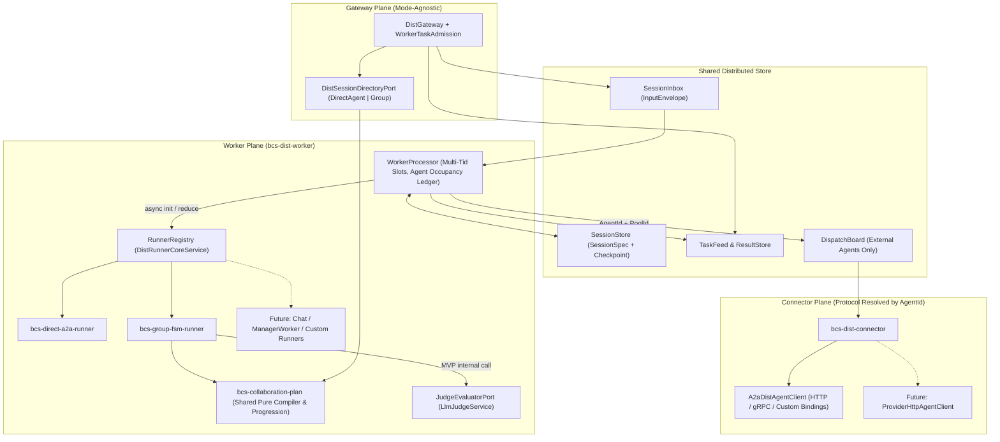

# BCS Distributed Multi-Mode Runner API / SPI & Migration Spec

## 1. Problem, Scope & Non-Goals

The distributed BCS execution plane (Gateway, Worker, and Connector) has established generic coordination, durable Inbox admission, atomic Checkpoint/Outbox commits, TaskFeed projection, and result archival, but `WorkerProcessor` currently executes only the test stub [bcs-dist-test-runner](../../crates/test-support/bcs-dist-test-runner/src/lib.rs).

Meanwhile, single-process BCS already supports **Direct A2A** and three group collaboration strategies (**Structured Collaboration / StateMachine**, **Free Chat**, and **Manager-Worker**). Current distributed contracts in [bcs-dist-model](../../crates/contracts/bcs-dist-model/src/session.rs) and [dist_runner.rs](../../crates/service-api/bcs-service-api/src/core/dist_runner.rs) are hardcoded to a single `SessionKind::FsmGroup`, require `GroupId` and `StateMachineDefinition` on every session, bind participants strictly by graph `NodeId`, and couple downstream protocol capabilities into `SessionSpec` and `DispatchSpec`.

### Scope

- Define the **Gateway ↔ Worker** mode-agnostic session/task contracts (`SessionTarget`, `CollaborationMode`, `ModeConfigEnvelope`, protocol-free `DispatchSpec`, `ModeLocal` interactions, and authenticated `HumanReply`).
- Define the **Worker ↔ Runner** Core API (`DistRunnerCoreService`) and strongly typed Mode Plugin SPI (`CollaborationModeRunner`), plus `RunnerRegistry` routing.
- Define the **migration design** for bringing **Direct A2A** (`CollaborationMode::DirectA2a`) and **Structured Collaboration** (`CollaborationMode::StateMachine`) onto the distributed Worker plane while reusing shared pure workflow compilation/progression logic.
- Preserve clean architectural seams for long-term support of **Free Chat** (`CollaborationMode::Chat`), **Manager-Worker** (`CollaborationMode::ManagerWorker`), and future extension modes (`CollaborationMode::Custom(String)`).

### Non-Goals

- No Rust code, configuration, or database migration changes are performed in this proposal.
- Gateway HTTP URL layout design is out of scope; this spec governs the Gateway ↔ Worker shared store/admission contract and Worker ↔ Runner API/SPI.
- Existing single-process `bcs-collaboration-runtime`, its tables, HTTP routes, and YAML authoring syntax remain unchanged.
- External IM channel notifications (e.g., human-input reminder cards or terminal IM notices) are outside the distributed Worker/Runner core path and remain external `TaskFeed` observers.
- WebSocket plugin Bots (`/ws/bot`) are not targeted by the distributed Connector.

## 2. Baseline & Architectural Decisions

This spec builds on `github/dev` commit `ad8f91fd57`, referencing [distributed contracts](../2026-11-15-distributed-contracts/spec.md), [worker runtime phase 1](../2026-11-18-worker-runtime-phase1/spec.md), [gateway inbound A2A](../2026-11-17-gateway-a2a-inbound/spec.md), [connector runtime](../2026-11-17-connector-runtime/spec.md), and [Avernet#4237](https://github.com/inclusionAI/Avernet/pull/4237).

### Confirmed Decisions (D1–D6)

| ID | Topic | Decision |
| --- | --- | --- |
| **D1** | **Task definition, concurrency & per-Agent occupancy** | 1. **No historical task state in `Checkpoint`**: completed tasks are archived to `ResultStore` / `TaskFeed` and retired from `Checkpoint`; no cross-task `SessionCarryover` is added.<br>2. **Unified `Task` boundary**: one external request triggering one collaboration convergence turn/run equals one `Task` (`tid`).<br>3. **Multi-active tasks & per-Agent occupancy**: evolve `Checkpoint.runner_state` into `runner_states: BTreeMap<Tid, RunnerState>` gated by mode-declared `max_active_tasks` (`1` for `DirectA2a` and `StateMachine`; `> 1` allowed for future `Chat`). Track `unresolved_dispatches: BTreeMap<Did, ActiveDispatchOccupancy>` in `Checkpoint` and inject a read-only `SessionOccupancyView` into `EvaluationContext` so future concurrent group modes can serialize/queue or reject same-`(Session, Agent)` dispatches inside Worker (since downstream agents cannot safely handle concurrent requests on the same session). |
| **D2** | **Gateway ↔ Worker alignment & strong typing** | 1. Define `CollaborationMode { DirectA2a, Chat, ManagerWorker, StateMachine, Custom(String) }` + `SemanticVersion(u32)`, aligned 1:1 with single-process `DirectA2a` and `GroupStrategy`.<br>2. **Gateway stays mode-agnostic**: Gateway validates only `SessionTarget { DirectAgent(AgentId), Group(GroupId) }` and forwards the opaque `ModeConfigEnvelope` produced by `DistSessionDirectoryPort`. Adding new modes requires zero Gateway code changes.<br>3. **Worker routes with strong typing**: Worker dispatches on `CollaborationMode` to strongly typed `CollaborationModeRunner` plugins. |
| **D3** | **LLM Judge boundary (MVP)** | Make `DistRunnerCoreService::reduce` and `CollaborationModeRunner::reduce_task` `async`. In the MVP, `GroupFsmRunner` directly invokes an injected `Arc<dyn JudgeEvaluatorPort>` (`LlmJudgeService`) inside `reduce_task`. `StartDispatch`, `DispatchBoard`, and `Connector` remain 100% dedicated to external Agent communication with zero Judge coupling. |
| **D4** | **Human interaction contract** | All contract edits are scoped strictly to `bcs-dist-*` crates; single-process `bcs-collaboration-runtime` behavior is untouched. `Interaction` replaces required `did: Did` with `origin: ModeLocal \| Dispatch { did }` and adds `prompt: Option<String>` (to populate A2A `TaskStatus.message`). `InputBody::HumanReply` adds Gateway-authenticated `responder: PrincipalId` so `GroupFsmRunner` can verify `assignee` constraints on `kind: human_input` nodes. |
| **D5** | **Downstream protocol decoupling** | Phase 1 distributed Connector supports A2A Agents (standard HTTP/gRPC and registered custom bindings via `bcs-a2a-binding-api`); future phases add stateless HTTP Provider Bots inside Connector; stateful WebSocket plugin Bots are excluded. Remove `DownstreamCapabilities` from `SessionSpec` and `DispatchSpec`: Gateway ↔ Worker carry only logical `AgentId` (and logical wake `PoolId`, default `"default"`), while Connector resolves transport protocol and capabilities from the Agent registry by `AgentId`. |
| **D6** | **Minimal input set & logical step accounting** | Do not pre-add a generic `Control` variant to `InputBody` / `RunnerInput`; keep the 4 external variants (`User`, `HumanReply`, `Cancel`, `Agent`) plus internal `Timeout`. Fix [prepare.rs](../../crates/services/bcs-dist-worker/src/processor/prepare.rs) incrementing `task.steps` on every streaming `Delta`: advance `task.steps` using `Decision.logical_steps_delta` (incremented on node/attempt activation, `0` on streaming events). |

## 3. Layered Architecture & Crate Ownership

All contracts and implementations follow the [architecture constitution](../../../../docs/arch/arch.rules.md) and [BCS layering rules](../../CLAUDE.md):



| Crate | Layer | Responsibility |
| --- | --- | --- |
| `crates/contracts/bcs-dist-model` | Contracts | `SessionTarget`, `CollaborationMode`, `SemanticVersion`, `ModeConfigEnvelope`, `AuthorizedAgent`, protocol-free `DispatchSpec`, `CorrelationKey`, `InteractionOrigin`, `HumanReply.responder` |
| `crates/service-api/bcs-service-api` | Service API | `core::dist_runner` (`DistRunnerCoreService`, `CollaborationModeRunner` SPI, `EvaluationContext`, `SessionOccupancyView`, `Decision`), `port::dist_agent` (`DistSessionDirectoryPort`) |
| `crates/services/bcs-collaboration-plan` | Core Service (Pure) | Zero-IO workflow validation, v1/v2 `fixed_loop` compiler, snapshot hash verification, reachability/join/upstream filtering, and static dispatch upper-bound `B` calculation shared with `bcs-collaboration-runtime` |
| `crates/services/bcs-runner-registry` | Core Service | Implements `DistRunnerCoreService`; static registration by `(CollaborationMode, SemanticVersion)`, config decode/cache, state envelope validation |
| `crates/services/bcs-direct-a2a-runner` | Core Service | `CollaborationMode::DirectA2a@v1` implementation |
| `crates/services/bcs-group-fsm-runner` | Core Service | `CollaborationMode::StateMachine@v1` implementation with injected `JudgeEvaluatorPort` |
| `crates/services/bcs-dist-worker` | Core Service | Multi-active `runner_states`, `unresolved_dispatches` ledger, `ModeLocal` interaction checks, `logical_steps_delta` accounting |

Concrete store providers (`DocumentCas`, `StrictLease`, `ZSet`), SQL archive providers (`bcs-db-api`), LLM providers (`bcs-llm-api`), and custom A2A transport bindings (`bcs-a2a-binding-api`) are wired only at the deployment composition root.

## 4. Gateway ↔ Worker Contracts & Checkpoint Evolution

### 4.1 `bcs-dist-model` Session & Dispatch Contracts

```rust
// crates/contracts/bcs-dist-model/src/session.rs

#[derive(Debug, Clone, PartialEq, Eq, Serialize, Deserialize)]
#[serde(tag = "kind", rename_all = "snake_case")]
pub enum SessionTarget {
    DirectAgent { agent: AgentId },
    Group { group: GroupId },
}

#[derive(Debug, Clone, PartialEq, Eq, PartialOrd, Ord, Hash, Serialize, Deserialize)]
#[serde(rename_all = "snake_case")]
pub enum CollaborationMode {
    DirectA2a,
    Chat,
    ManagerWorker,
    StateMachine,
    Custom(String),
}

#[derive(Debug, Clone, Copy, PartialEq, Eq, PartialOrd, Ord, Hash, Serialize, Deserialize)]
#[serde(transparent)]
pub struct SemanticVersion(pub u32);

#[derive(Debug, Clone, PartialEq, Serialize, Deserialize)]
pub struct ModeConfigEnvelope {
    pub mode: CollaborationMode,
    pub semantic_version: SemanticVersion,
    pub config_schema_version: u32,
    pub revision: String,
    pub digest: Digest,
    pub payload: Payload,
}

#[derive(Debug, Clone, PartialEq, Eq, Serialize, Deserialize)]
pub struct AuthorizedAgent {
    pub agent: AgentId,
    pub pool: PoolId,
}

#[derive(Debug, Clone, Copy, PartialEq, Eq, Serialize, Deserialize)]
pub struct SessionLimits {
    pub max_active_tasks: u32,
    pub max_queued_tasks: u32,
    pub max_task_steps: u32,
    pub task_timeout_millis: u64,
    pub max_inline_bytes: u32,
    pub max_task_dispatches_bound: u32,
    pub max_session_unresolved_dispatches: u32,
    pub capacity_wait_timeout_millis: u64,
}

#[derive(Debug, Clone, PartialEq, Serialize, Deserialize)]
pub struct SessionSpec {
    pub schema_version: u32,
    pub sid: Sid,
    pub shard: ShardId,
    pub scope: TaskScope,
    pub target: SessionTarget,
    pub mode_envelope: ModeConfigEnvelope,
    pub authorized_agents: Vec<AuthorizedAgent>,
    pub limits: SessionLimits,
    pub digest: Digest,
    pub created_at: TimestampMillis,
}
```

```rust
// crates/contracts/bcs-dist-model/src/dispatch.rs
#[derive(Debug, Clone, PartialEq, Serialize, Deserialize)]
pub struct DispatchSpec {
    pub schema_version: u32,
    pub sid: Sid,
    pub tid: Tid,
    pub did: Did,                  // Format: "{tid}.{mode_suffix}"
    pub source: CorrelationKey,    // Mode-opaque key (replaces NodeId in Worker/Projection)
    pub attempt: NonZeroU32,       // 1-based attempt number
    pub agent: AgentId,            // Connector resolves protocol & capabilities by AgentId
    pub pool: PoolId,
    pub downstream_context: Option<String>,
    pub request: Payload,
    pub deadline: TimestampMillis,
}

// crates/contracts/bcs-dist-model/src/task.rs
#[derive(Debug, Clone, PartialEq, Eq, Serialize, Deserialize)]
#[serde(tag = "origin", rename_all = "snake_case")]
pub enum InteractionOrigin {
    ModeLocal,
    Dispatch { did: Did },
}

#[derive(Debug, Clone, PartialEq, Eq, Serialize, Deserialize)]
pub struct Interaction {
    pub id: InteractionId,
    pub origin: InteractionOrigin,
    pub kind: InteractionKind,
    pub prompt: Option<String>,
}

// crates/contracts/bcs-dist-model/src/input.rs
#[derive(Debug, Clone, PartialEq, Serialize, Deserialize)]
#[serde(tag = "kind", rename_all = "snake_case")]
pub enum InputBody {
    User {
        payload: Payload,
    },
    HumanReply {
        interaction: InteractionId,
        responder: PrincipalId,
        payload: Payload,
    },
    Cancel {
        reason: Option<String>,
    },
    Agent {
        event: AgentEvent,
    },
}
```

### 4.2 `Checkpoint` Multi-Task & Occupancy Ledger

In [session.rs](../../crates/service-api/bcs-service-api/src/port/repo/distributed/session.rs):

```rust
#[derive(Debug, Clone, PartialEq, Eq, Serialize, Deserialize)]
pub struct ActiveDispatchOccupancy {
    pub tid: Tid,
    pub agent: AgentId,
}

pub struct Checkpoint {
    pub format_version: u32,
    pub commit_seq: CommitSeq,
    pub consumed: Option<InboxPos>,
    pub tasks: VecDeque<TaskProgress>,
    pub runner_states: BTreeMap<Tid, RunnerState>,
    pub dispatch_seq: BTreeMap<Did, DispatchSequence>,
    pub unresolved_dispatches: BTreeMap<Did, ActiveDispatchOccupancy>,
    pub deadlines: Vec<Deadline>,
    pub deadline_history: BTreeMap<DeadlineId, Deadline>,
    pub view_drafts: BTreeMap<Tid, TaskContent>,
    pub last_event_id: Option<EventId>,
    pub outbox: Option<CommittedBatch>,
}
```

- When a task completes or is terminated independently by Worker (`finalize_independently`), only `runner_states.remove(&tid)` is cleared; sibling active tasks in the same `Session` remain unaffected.
- `unresolved_dispatches` serves dual duty:
  1. Enforces cross-task unresolved dispatch capacity `O + B <= C` before admitting the next queued task to `Running`.
  2. Builds `SessionOccupancyView` so future concurrent group modes can detect whether a target `AgentId` is already busy in this `Session`.

## 5. Worker ↔ Runner API & Mode Plugin SPI

### 5.1 Core Service API (`bcs_service_api::core::dist_runner`)

```rust
#[derive(Debug, Clone, Default)]
pub struct SessionOccupancyView {
    pub active_tasks: BTreeSet<Tid>,
    pub busy_agents: BTreeMap<AgentId, BTreeSet<Did>>,
}

impl SessionOccupancyView {
    pub fn is_agent_busy(&self, agent: &AgentId) -> bool {
        self.busy_agents.get(agent).is_some_and(|dids| !dids.is_empty())
    }
}

pub trait ParsedModeConfig: Any + Send + Sync + Debug {
    fn mode(&self) -> &CollaborationMode;
    fn semantic_version(&self) -> SemanticVersion;
    fn digest(&self) -> &Digest;
    fn as_any(&self) -> &dyn Any;
}

pub struct EvaluationContext<'a> {
    pub spec: &'a SessionSpec,
    pub mode_config: &'a dyn ParsedModeConfig,
    pub occupancy: &'a SessionOccupancyView,
    pub tid: &'a Tid,
    pub now: TimestampMillis,
}

#[derive(Debug, Clone, PartialEq, Serialize, Deserialize)]
pub struct Decision {
    pub next_state: RunnerState,
    pub logical_steps_delta: u32,
    pub actions: Vec<ActionIntent>,
    pub next_deadlines: Vec<Deadline>,
}

#[async_trait]
pub trait DistRunnerCoreService: Send + Sync {
    fn effective_max_active_tasks(
        &self,
        spec: &SessionSpec,
        mode_config: &dyn ParsedModeConfig,
    ) -> u32;

    async fn init(&self, context: &EvaluationContext<'_>) -> Result<RunnerState, RunnerError>;

    async fn reduce(
        &self,
        context: &EvaluationContext<'_>,
        state: &RunnerState,
        inputs: &[RunnerInput],
    ) -> Result<Decision, RunnerError>;
}
```

### 5.2 Mode Plugin SPI (`CollaborationModeRunner`)

```rust
#[async_trait]
pub trait CollaborationModeRunner: Send + Sync {
    type Config: Send + Sync + Debug + 'static;
    type State: Serialize + for<'de> Deserialize<'de> + Send + Sync + Clone;

    fn mode(&self) -> CollaborationMode;
    fn semantic_version(&self) -> SemanticVersion;
    const STATE_FORMAT_VERSION: u32;

    fn parse_and_validate_config(
        &self,
        schema_version: u32,
        raw: &serde_json::Value,
        authorized_agents: &[AuthorizedAgent],
        limits: &SessionLimits,
    ) -> Result<Self::Config, RunnerError>;

    fn max_active_tasks(&self, _config: &Self::Config) -> u32 {
        1
    }

    async fn init_task(
        &self,
        spec: &SessionSpec,
        config: &Self::Config,
        tid: &Tid,
        now: TimestampMillis,
    ) -> Result<Self::State, RunnerError>;

    async fn reduce_task(
        &self,
        spec: &SessionSpec,
        config: &Self::Config,
        occupancy: &SessionOccupancyView,
        tid: &Tid,
        state: &Self::State,
        inputs: &[RunnerInput],
        now: TimestampMillis,
    ) -> Result<TypedDecision<Self::State>, RunnerError>;
}
```

### 5.3 Mode-Neutral Directory Port (`DistSessionDirectoryPort`)

Generalizes [DistGroupDirectoryPort](../../crates/service-api/bcs-service-api/src/port/dist_agent.rs):

```rust
#[async_trait]
pub trait DistSessionDirectoryPort: Send + Sync {
    async fn resolve(
        &self,
        scope: &TaskScope,
        target: &SessionTarget,
    ) -> Result<FrozenSessionProposal, DirectoryError>;

    async fn load_mode_config(
        &self,
        scope: &TaskScope,
        envelope: &ModeConfigEnvelope,
    ) -> Result<Payload, DirectoryError>;
}
```

## 6. Direct A2A & Structured Collaboration Migration Design

### 6.1 Direct A2A (`CollaborationMode::DirectA2a@v1`)

- **Admission & Freeze**: `DistSessionDirectoryPort::resolve(scope, SessionTarget::DirectAgent { agent })` reuses existing Bot visibility/friendship/organization checks and freezes `ModeConfigEnvelope { mode: DirectA2a, payload: Inline(DirectA2aConfig) }` with `authorized_agents = [AuthorizedAgent { agent, pool }]`, `max_active_tasks = 1`, and `max_task_dispatches_bound = 1`.
- **Execution Semantics**:
  - `Start`: creates `did = "{tid}.agent.1"`, emits `StartDispatch { agent, downstream_context: Some(sid.0), request }`, registers dispatch deadline, and reports `logical_steps_delta = 1`.
  - Streaming (`Delta` / `Tool` / `Snapshot` / `Thinking`): first text chunk emits `Show(Upsert)`, subsequent chunks emit `Show(AppendText)` with `logical_steps_delta = 0`; `Thinking` uses Worker's rate-limited ephemeral path.
  - Remote interaction (`InputRequired` / `AuthRequired`): emits `SetStatus` with `Interaction { origin: Dispatch { did }, prompt }`; valid `HumanReply` emits `ContinueDispatch` with monotonic `seq`.
  - Completion & Failure: `Final` performs a full `Upsert` on the primary artifact slot followed by `FinishTask(Completed)`. Definitive `Error` immediately finishes with `FinishTask(Failed)` without fabricating a second business attempt (`NotSent` transport retries remain inside Connector).

### 6.2 Structured Collaboration (`CollaborationMode::StateMachine@v1`)

- **Shared Pure Plan Extraction (`bcs-collaboration-plan`)**:
  - Extract pure validation, `fixed_loop` v1/v2 compiler, `loop_context`, `progression`, and snapshot hash verification from [bcs-collaboration-runtime](../../crates/services/bcs-collaboration-runtime/src) into `crates/services/bcs-collaboration-plan`.
  - Both single-process `CollaborationRuntime` and distributed `GroupFsmRunner` call this shared crate, preserving byte-stable `compiler/v1` and `compiler/v2` node IDs, plan hashes, v1 vs v2 upstream artifact projection rules, and descending-`node_id` fallback selection when `final_output` is absent.
- **Execution Semantics**:
  - **Bot nodes (`kind: bot_task`)**: deterministic activation in `execution_node_id` order; emits `StartDispatch { agent, source: execution_node_id, did: "{tid}.node.{hash}.{attempt}" }`.
  - **Native human nodes (`kind: human_input`)**: emits no `StartDispatch`; transitions to `SetStatus(InputRequired)` with `Interaction { origin: ModeLocal, prompt }`. On `HumanReply`, verifies `responder` against the frozen `assignee` constraint (when present) and deadline before advancing.
  - **MVP Internal Judge**: when a judged node receives a valid non-empty artifact or human reply, `GroupFsmRunner` calls its injected `JudgeEvaluatorPort` inside `reduce_task().await` under a bounded timeout, validates the returned `outcome` against declared transitions, and advances downstream Ready nodes in the same decision.
  - **Timeout & Retry**: on `bot_task` timeout with `attempt < max_attempts`, emits `CancelDispatch(old_did)` and `StartDispatch(new_did)` in one decision without waiting for remote cancellation confirmation; `old_did` stays tracked in `Checkpoint.unresolved_dispatches` for independent supervision. `human_input` nodes have fixed `max_attempts = 1`.
  - **Coexistence**: single-process `bcs-collaboration-runtime` and distributed `GroupFsmRunner` remain isolated by deployment/admission; no dual-writing of legacy state-machine tables and no live mid-run engine switching.

## 7. Long-Term Extensibility (`Chat`, `ManagerWorker`, `Custom`)

| Capability | `DirectA2a` (Phase 1) | `StateMachine` (Phase 1) | `Chat` (Future) | `ManagerWorker` (Future) |
| --- | --- | --- | --- | --- |
| `SessionTarget` | `DirectAgent(bot)` | `Group(id)` | `Group(id)` | `Group(id)` |
| `max_active_tasks` | `1` | `1` | `> 1` (configurable) | `1` or `> 1` |
| Same-`(Session, Agent)` protection | Inherent (`max_active_tasks = 1`) | Inherent (`max_active_tasks = 1`) | Uses `SessionOccupancyView` to reject or wait-idle | Uses `SessionOccupancyView` |
| Dispatch pattern | 1 `Agent` | Static DAG/Loop fan-out & join | Dynamic `@mention` / `Driver` fan-out | Manager + dynamic Worker fan-out via A2A events |
| Gateway changes needed | Implemented once | Implemented once | **None** | **None** |

## 8. Implementation Slices & Verification Plan

| Slice | Scope | Exit Criteria |
| --- | --- | --- |
| **Step 1** | Extract `crates/services/bcs-collaboration-plan` | Existing `bcs-collaboration-runtime` regression suites (`definition_validation`, `fixed_loop_compiler`, `fixed_loop_snapshot`, `fixed_loop_context`, `runtime_progression`) pass with zero behavior drift. |
| **Step 2** | Evolve `bcs-dist-model`, `bcs-service-api`, `bcs-runner-registry`, and `bcs-dist-worker` | Multi-slot `runner_states`, `unresolved_dispatches`, protocol-free `DispatchSpec`, `ModeLocal` interactions, `HumanReply.responder`, `async DistRunnerCoreService`, and `logical_steps_delta` pass Worker unit and conformance tests. |
| **Step 3** | Implement `bcs-direct-a2a-runner` and `DistSessionDirectoryPort` | End-to-end Gateway → Inbox → Worker → Connector integration tests pass for streaming, `InputRequired`/`ContinueDispatch`, cancel, and timeout. |
| **Step 4** | Implement `bcs-group-fsm-runner` | Pure Runner and Worker integration tests cover DAG, fan-out/join, v1/v2 fixed loops, internal Judge branching, native `human_input` responder checks, and timeout retry, plus differential checks against `bcs-collaboration-runtime`. |
| **Step 5** | Production runtime composition & acceptance | Composition root wires `DirectA2aRunner`, `GroupFsmRunner`, real Agent registry resolver, shared SQL archive, and `JudgeEvaluatorPort`; passes architecture checks and store contract suites. |

## 9. Delivery Status & Unverified Boundaries

- **Status**: `proposed` (specification and index entry only; no Rust source, config, or schema migrations modified).
- **Verified in this change**: relative repository links, Markdown formatting, public-only content boundary (no private endpoints, credentials, or internal-only component names), and `git diff --check`.
- **Not executed**: Cargo build/tests, Worker/Connector integration tests, real store/provider contract tests, or deployment validation. Commit and push use `--no-verify` as explicitly requested; skipped Git hooks are not claimed as passed.
