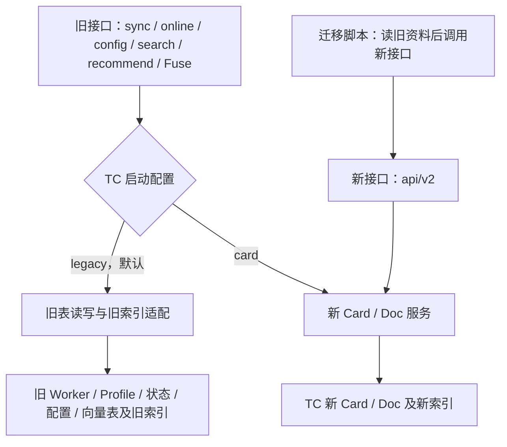

# TC BCSFuse 迁移改造方案

日期：2026-11-05。状态：同一新实例内的接口读写切换已实现并完成本地验证，尚未部署或迁移线上数据。

本次按已确认方案实现 TC 专属适配，验证结果见 [implementation.md](implementation.md)。未执行线上数据迁移或部署。
本文取代此前错误的双实例切流方案，以及“旧接口读旧索引但写新表”的混合方案。
同实例配置重启与实际 HTTP 读写已单独验证，此前双实例结果不作为本方案验收依据。
方案供 Avernet BCSFuse、BCS、Backend、Frontend 和 OCB 内部部署维护者共同使用。
TC 业务及公共搜索能力由 Avernet 维护，内部平台适配及部署组装由 OCB 维护。

## 1. 已确定的决策

| 事项 | 确定内容 |
| --- | --- |
| 迁移目标 | TC 接入公共 Card / Doc 存储和检索链路，删除被替代的旧内部实现 |
| 外部接口 | 保持现有业务调用的路径、请求、响应及必要业务语义；明确废弃下列阈值和草稿语义，业务系统后续再迁新接口 |
| 检索 | 采用新代码：关键词和向量召回，各路按 Worker 取最高分片段，RRF 合并，再精排 |
| 默认开关 | 关键词、Embedding、精排默认全部开启；旧请求显式关闭精排仍有效 |
| 推荐结果 | 允许排序和分数随新检索变化；不复刻旧评分体系，TC 必要过滤规则继续保留 |
| 分数阈值 | TC 不再按旧 `min_score` 筛选候选；旧字段继续兼容接收，新接口不再提供 |
| 候选权限 | 沿用实际已有的鉴权、可见性和群权限；不新增 TC 候选授权名单机制 |
| 资料模型 | 一个 Worker 只有一份当前资料；移除多 Profile、草稿、Profile 切换及独立激活关系 |
| sync | 始终更新该 Worker 唯一一份当前资料；旧 `activate` 参数兼容接收，不再影响保存或产生激活分支 |
| Fuse | G1、G2、G5、G9 全部继续支持，只做迁移所需适配，不扩展未使用能力 |
| 画像来源 | description 为核心；skills 独立保存，不直接拼入画像；MD 文件退出新资料构造 |
| 模型画像 | 无需为了迁表强制调用模型；需要生成时，可结合 description 和真实技能描述 |
| 数据 | 原始资料、已有画像、配置、必要身份关系和融合历史保留；Doc、向量、检索缓存重建 |
| 部署与接口 | 同一套新部署 TC 服务同时提供旧接口和新接口，不能用两个服务地址替代 |
| 切换 | TC 业务配置在启动时整体选择旧接口的读写后端；默认旧表，追平后改配置并重启选新表 |
| 新接口 | 无论旧接口选择哪个后端，新接口始终读写新 Card/Doc 和新索引 |
| 写入边界 | 切换前旧接口只写旧表、新接口只写新表；切换后两套接口都只写新表；没有自动双写或混读 |
| 本轮范围 | TC 代码、内部 TC 组装、必要兼容测试与文档；本地验证，不部署或执行线上迁移 |

“单资料”和“分片检索”不冲突：一份资料可以生成多个检索 Doc，最终仍只返回一个 Worker。
多片段命中不叠加旧类型权重，也不重复占用推荐名额。
本方案的“旧接口兼容”不包含已明确废弃的 `min_score` 筛选和 `activate=false` 草稿行为，
这两项是已确认的语义变更，不能描述成所有历史行为完全不变。

## 2. 当前事实、依据和适用范围

### 2.1 代码基线

本方案结合关联讨论《梳理 Avernet BCSFuse 代码与职责》及以下本地源码快照整理：

| 仓库 | 分支 / 快照 | 本次确认的事实 |
| --- | --- | --- |
| Avernet 公共重构分支 | `codex/bcsfuse-search-core`，`40be509dc5b8353b8c0e3b4456e1f215627c4d62` | 公共 Card / Doc 和检索能力已存在；TC 当前仍走旧 Worker/Profile 链路 |
| OCB 配套分支 | `codex/bcsfuse-search-core`，`8201f09e5d5cf45c5c743920cfc31a0b5f738053` | 内部 TC 组合 Avernet app 和内部 provider，支付宝应用有自己的业务投影 |
| 最初调用方盘点工作区 | 历史 `src/` 布局 | 已定位 Backend、BCS、Frontend、Gateway 的现有调用点 |

以上为最初盘点快照。本轮在 Avernet `008d2e62a`、OCB `b8c8c2a53e` 基础上补齐旧存储适配、
旧接口整套后端选择和固定新表的 v2 API；当前实现及本地证据见 implementation.md。

源码快照只代表静态证据，不证明对应版本已经部署，也不证明线上只有这些消费者。
最初调用方盘点曾使用 `src/` 布局；当前实施工作区为 `apps/` 布局，引用历史源码时须区分版本。

### 2.2 与已有文档的关系

本方案遵守 [架构规则](../../../../docs/arch/arch.rules.md)、[CI 要求](../../../../docs/arch/ci.enforce.md)、
[模块边界格式](../../../../docs/arch/context-boundary-format.md)和[协议契约测试要求](../../../../docs/arch/protocol-contract-tests.md)。
未发现现有 ADR 对 TC 的多 Profile 或旧评分方式作必须保留的决定。

重构分支原 `tc-card-migration.md` 中的多 Profile、旧加权聚合和 MD 资料保留要求，
在本次 TC 迁移范围内由本文已确认的简化方向替代：历史数据可归档，在线模型不继续这些设计。
公共与内部仓库的所有权边界不变，实施时同步更新相关模块文档，避免两个迁移口径并存。

### 2.3 业务边界

- Avernet `search_core`：Card 保存、Doc 加工发布、索引同步恢复、召回、RRF、精排、缓存及执行控制。
- Avernet TC 应用：旧接口转换、Worker 业务规则、单资料投影、旧结果格式及 Fuse 编排。
- OCB：内部数据库、模型、鉴权、配置订阅、应用组装和部署。
- Backend / BCS / Frontend / Gateway：保留本期既有调用方式；BCS 的旧 sync 请求构造按新资料规则清理。

不把支付宝专用字段解释、BCN 回查策略、默认候选策略或内部 SDK 加到公共搜索核心。
新实现依赖已发布的 Service API / Plugin API，具体 provider 只在组装入口选择。

## 3. 目标链路

以下所有入口均在同一个新部署的 TC 服务中，使用同一个服务地址。区别是 API 路径和内部绑定，
不是旧实例、新实例、代理地址或负载均衡流量切换。



### 3.1 必须满足的读写矩阵

| 同一 TC 服务内的接口 | 切换前：legacy | 切换后：card |
| --- | --- | --- |
| 旧 search / recommend / Fuse 及资料、状态、配置读取 | 只使用旧表、旧索引及旧配置/状态 | 只使用新 Card/Doc、新索引及新配置/状态 |
| 旧 sync / online / offline / availability / config / DELETE 等写入 | 只更新旧表及旧索引 | 只更新新表及新索引 |
| 新接口查询、写入、更新及删除 | 始终只使用新表及新索引 | 始终只使用新表及新索引 |

相同 Worker ID 在两套存储中可以同时存在；部署和导入期间不能优先读新表、缺失时跨表兜底，
也不能把一次旧接口调用偷偷变成迁移或双写。旧接口路径、调用地址和请求格式不因切换改变。
日常检索和 Fuse 不回查 `bot_info`；它只是旧资料迁移来源，未来规范 Card 直接走新接口。

### 3.2 一个 TC 专属启动配置

配置为 `BCSFUSE_TC_V1_STORAGE=legacy|card`，仅在 TC 组装入口读取，默认 legacy。
它选择旧接口的整套读写服务，不只是 Qdrant 集合或查询来源。
非法值、所选存储不可用时明确失败，不自动切到另一套存储。修改后重启生效，不做运行中热切换。
新接口固定绑定新服务，不读取此配置。原只切索引的配置不得作为兼容别名继续使用。

TC 启动时组装新服务，再按配置将旧接口绑定到最小旧存储适配或该新服务。
card 模式下两套接口共用同一个新 Card/Doc 服务及索引加工任务；不创建重复的新索引后台任务。
legacy 模式下维护两个独立索引空间；旧接口写旧持久向量及旧索引，新接口写新 Doc 及新索引。
card 模式不再初始化旧 Worker/Profile/运行状态/向量仓储及旧索引；融合历史仍使用原权威存储，
即使该存储与旧资料位于同一个物理库，也不能一并撤掉它的访问权限。
Qdrant Server 使用不同 collection；Local 使用独立目录，避免两个客户端争用同一目录。
服务生命周期复用已有连接和进程管理，不为两套数据启动第二个应用或通用切源管理器。

### 3.3 最小适配范围

- 保留旧接口操作当前 Worker/Profile、配置、状态和旧向量表所需的最小适配，复用已有仓储。
  不恢复旧评分体系、多 Profile 草稿/切换平台或重复 HTTP 应用。
  不把旧 SQL 表伪装成公共 Card 仓储，也不为容纳旧表改公共 Card/Doc 契约。
- 旧模式只依据旧存储构造请求内的资料视图，不创建新 Card，不把新 Card 当作旧状态的覆盖层。
- search/recommend 的过滤和召回必须来自所选后端；online/availability 的写入、过滤标签和
  返回前的状态复查都作用于同一后端。不能旧向量配新状态，也不能召回后才过滤 top-k。
- Fuse 的资料、配置、参与者状态和补充检索也使用同一个所选后端；融合会话/历史仍用原权威存储。
- 新 API 直接取得新服务对象，不修改全局服务注册或 Fuse 上下文来临时切源；两套接口并发时不串数据。
- 两个后端分别使用自己的查询缓存。重启切换清空进程缓存，不清空融合历史，不跨后端复用结果。
- 旧 sync 的成功依据是旧表与旧索引更新结果；切到 card 后才检查新 Card/Doc 的完成边界。
  任一后端写入或索引失败向调用方报错，沿既有幂等重试处理，不建设跨新旧事务或补偿平台。

本期不要求正常业务调用方先改用 v2、传内部 revision 或增加授权名单参数。

## 4. 单 Worker 单资料及持久化

### 4.1 数据分工

沿用公共 Card/Doc 存储结构及表名 `bcsfuse_agent_cards`、`search_index_documents`。
TC 继续使用原有 Worker Registry 数据源，与 zbcsfuse 的数据源独立；不使用 TC 表名前缀，不把 TC 切到 zbcsfuse 数据源。
生产 DDL 以实际数据库核对结果为准；启动不自动创建或升级内部数据库。
`card_json / profile_json / config` 已提供源资料、加工画像和配置的存放位置。
先复用这些能力，不为 TC 再建立多 Profile 表、激活关系表或版本注册平台。

| 数据 | 目标职责 |
| --- | --- |
| Worker 身份、名称、description、结构化 skills、规范业务字段 | 当前 TC Card；`agent_id` 映射原完整 `worker_id` |
| 新模型生成画像及其输入依据 | `profile_json`；与源 description 分开更新 |
| 旧画像、旧原始扩展资料 | 旧库 / 迁移归档保留，不自动选作新的检索正文 |
| `fusion_enable` 和已使用配置 | `config`；默认关闭融合 |
| 在线 / 离线 | 沿用运行状态职责，通过状态更新同步索引过滤标签 |
| 可见性、信任和生命周期 | 保留各自含义，不能把 private、offline、deleted 混为一类 |
| 正文片段、向量、来源版本、模型及转换依据 | 公共 Doc 存储；Qdrant 为查询索引 |
| 融合结果、会话和历史记录 | 现有融合存储继续使用 |

TC 与其他业务隔离数据库或索引命名空间。仅有 environment 不能防止相同 ID 的业务碰撞。
pre/prod 按现有身份和环境规则隔离，不能通过移除前缀或重造 Worker ID 合并数据。

### 4.2 移除多 Profile 的兼容边界

- 内部检索分组统一使用完整 Worker ID，不再以多 Profile key 区分同一 Worker 的多个候选。
- 旧 `profile_id / profile_key` 只在边界上兼容已有实际调用的身份标识，不恢复多份资料或切换能力。
- sync 以路径中的完整 `worker_id` 确定更新对象；旧 Profile 参数不再用于创建、选择或激活另一份资料。
- 迁移时仅选择一份当前资料。若旧数据有多份，优先采用明确的当前激活资料，其余归档。
- 无法确定当前资料的记录输出异常清单，迁移前核对，不按“最新一条”静默猜测。
- 存在被实际使用的历史 `profile_key` 时，为该 Worker 保留必要的单一兼容标识；不得随意改成 `:default`。
- 外部不存在的 Profile key 不得被静默解析为另一个 Worker，也不得因忽略参数覆盖错误资料。
- 旧 Profile 管理路径中已使用的单资料读写需要兼容；内部不保留草稿存储和激活状态机。
  确需保留的旧激活入口只适配单资料结果，不新增状态和激活关系。

历史多 Profile 和草稿操作不继续保留；无需再以“是否保留 activate=false”为待决策项。
实施第一步核对旧身份标识和路由消费者，目的是保证请求能正确进入单资料模型，
不因此重新实现多 Profile、草稿和切换能力。

## 5. 旧接口兼容

本节旧接口全部受第 3 节同一个后端选择约束，包括生命周期别名、资料管理和已启用的管理入口。
禁止只切 search 或只切 sync；数据、状态、配置、删除与对应索引必须一起选择。

### 5.1 已定位的主要调用面

以下均为服务端路径，`{id}` 表示原完整 Worker ID。

| 接口 | 已定位调用 / 契约 | 必须保留的内容 |
| --- | --- | --- |
| `POST /api/v1/recommend` | Backend Bot 发现、BCS 推荐 | question、topK、expand_factor、精排参数、filters、group/driver、type 和旧 recommendations；min_score 只兼容接收 |
| `POST /v1/workers/{id}/sync` | BCS 入网与重连、Backend 资料同步 | 唯一当前资料的创建 / 更新、按字段合并、状态规则和既有响应字段；activate 只兼容接收 |
| `PUT /v1/workers/{id}/online` | Backend 发布等生命周期调用 | 状态转换、版本和既有应答完成边界 |
| `PUT /v1/workers/{id}/offline` | Backend 下架、BCS 生命周期调用 | 下线后过滤和索引状态同步 |
| `PUT /v1/workers/{id}/availability` | BCS 可见性同步 | private/protected/public 及稀疏更新，不改写资料 |
| `DELETE /v1/workers/{id}` | BCS 退网与删除清理 | 持久删除 / tombstone、资料及索引清理、结构化不存在的幂等处理 |
| `POST /v1/workers/batch` | BCS 批量读取 Worker 及画像标签 | `data`、已使用 Worker 字段、`profile_tags`、未找到列表及其他既有字段 |
| `GET /v1/workers/{id}/config` | 前端读取融合配置 | `success`、worker_id、fusion_enable、config、version 和既有时间字段 |
| `PUT /v1/workers/{id}/config` | 前端设置融合配置 | 已有请求字段、写入 / 版本语义及响应 |
| `POST /v1/workers/config/batch` | Gateway 暴露的融合配置批量查询 | `worker_ids` 请求及 `success/data/not_found_ids` 查询响应 |
| `POST /api/v1/groups/{group_id}/fuse` | 前端、BCS | 全部 Fuse 模式、options、participants、结果和错误语义 |

`/api/v1` 下已有生命周期 / sync 别名继续保留。
前端 `/bcnfuse` 代理和 Gateway `/openapi/v1/bcsfuse/...` 重写规则不随内部迁移改变。

代码中另有 Worker CRUD、Profile 读写 / 激活 / 质量分析、verify 和 search 等路由。
当前未完整核实其线上消费者，不能仅凭主业务调用搜索无命中就删除。
先列入接口清单，再区分需要继续支持的入口、单资料兼容入口和可退出的历史入口。
这项盘点不改变已确认移除多 Profile 和草稿 / 激活分支的决定。

**已发现的路由差异：**同一个 `POST /workers/config/batch` 有批量查询与历史批量更新实现。
公共组合应用先注册的生命周期路由承载查询契约，Gateway schema 也是查询。
后续路由清理必须核对实际挂载顺序和部署入口，不能把被遮蔽的更新模型当成现有查询契约。

### 5.2 sync 合并与响应

- 未提供字段保留当前值；显式空字符串、空列表、空 map 和 null，沿原字段契约分别处理。
- 不把“未传”误当空值，不能用模型默认值清空已有资料或重新写入默认技能。
- 更新时未传 / null 的运行状态保留现状；新 Worker 未显式给状态时沿用原默认行为。
- Backend 已有显式 offline 同步继续有效；不能因接入新加工链路意外上线。
- `activate` 省略、true 或 false 均执行同一条单资料保存流程；不再“只保存草稿、不更新当前资料”。
  保存后可否被发现仍由在线状态、可见性、生命周期等已有规则决定，不由 activate 控制。
- 旧 `success / worker_id / created / runtime_state / profile_id / profile_activated` 等响应保留。
- 唯一当前资料成功保存时，兼容响应的 `profile_activated` 返回 true，即使请求传入 activate=false。
  该字段不再表示草稿到激活的转换，也不表示模型画像完成或所有实例索引已更新；保存失败仍返回错误。
- 资料保存、模型画像完成、本实例索引可用、全实例收敛分别判断；新 Card 的 202 不能直接替换旧应答。
- 核对现有 online 路由等待状态 / 索引同步的边界，切换后不得默默降成只排队就返回原成功含义。
- 持久化失败返回错误，不吞错报成功；模型画像失败按第 6 节回退，不影响已保存源资料。
- 配置版本与 Card 内部 revision 的含义分别保留，不要求旧调用方新增必填版本参数。

### 5.3 recommend 响应与参数

继续返回旧结构中的 `trace_id / type / driver_bot_id / recommendations / metadata`。
推荐项继续提供 `worker_id / profile_key / score / reasons / short_profile / profile_tags`，
不把新公共 `items/card` 结构直接暴露给旧消费者，也不只返回无法衔接 Fuse 的裸 ID。

`group_id` 的上下文改写、driver 选择和 TC 必要业务过滤保留。
`expand_factor` 用于映射新检索的有界召回预算，不为兼容它恢复旧候选配额算法。
`enable_rerank=false` 有效；已支持的 `reranker_model` 选择沿原约定解析，不能默默忽略。

TC 不再提供业务相关性分数阈值，依靠新排序、精排和 topK 选取候选。
即使全部候选的相关性较弱，也可能返回其中相对最相关的结果；精排不是自动拒绝无关候选的保证。

旧请求的 `min_score` 保留原类型和范围校验，省略或传合法值均可，但不映射到任何 TC 候选筛选阶段。
精排成功、显式关闭、精排失败降级都不再按该字段裁剪，也不迁移旧阈值配置、校准和兼容分支。
在现有 metadata 中明确标记该参数已废弃，不继续输出“旧阈值仍生效”的诊断，不新增必填字段。
未来新接口不提供 min_score；公共搜索核心可选的通用阈值能力不因此删除。

排序及分数允许变化，JSON 数值类型和有限值约束仍成立。
精排成功返回模型分数，关闭或降级时返回新 RRF 分数，沿现有 metadata 说明分数来源。
两者不作为同一量纲的业务准入门槛，也不为保持旧数值范围伪造相关性或归一化分数。

### 5.4 删除、鉴权与过滤

- Worker 不存在的结构化错误可作为幂等删除成功；路由不存在的普通 404 不能冒充删除完成。
- 删除或缩短正文后，所选后端的过期片段/Doc 要被清理，不能删除另一套数据或让离线实例复活旧片段。
- 沿用实际已有的身份传播、owner / group 权限和 BCS Catalog 可见性边界；请求 filters 不能扩大权限。
- 本期不新增 TC 候选授权名单、Profile key ACL 或专门的名单维护 / 转换机制，旧调用方不传额外授权参数。
  可选 v2 适配器支持 allowed_ids，不是 TC 旧 recommend 主链路使用该机制的证据，不因此纳入迁移范围。
- 已有业务过滤在 top-k 前生效，返回前复查当前状态；保留 Backend 的可见性校验。
  不新增名单机制不等于绕过实际已有的鉴权和权限边界；公共库的通用身份契约也不在本次删除范围。
- 信任、可见性、在线状态及融合开关分别处理，不引入“只要搜索命中即可参与融合”的规则。

### 5.5 新接口固定绑定新表

新接口是同一服务中的 `/api/v2` 路径，不是另一个部署地址。优先复用 search-core 已有 HTTP
适配器和契约，由 TC 显式绑定新服务；公共路由实现不增加 TC 开关或旧库分支。

| 入口 | 用途与边界 |
| --- | --- |
| PUT / GET / DELETE `/api/v2/agent-cards/{id}` | 规范 Card 的保存、读取、删除，始终操作 TC 新表 |
| GET `/api/v2/agent-cards/{id}/index-status` | 核对新 Doc/索引加工状态，不能冒充旧接口后端状态 |
| POST `/api/v2/search`、`/api/v2/recommend` | 固定查询新索引，供迁移核对及后续业务接入 |
| GET / PUT `/api/v2/workers/{id}/config` | TC 最小补充：复用现有 config 请求/响应和保存逻辑，固定操作新配置 |

状态、availability 等当前业务字段由新 Card 更新；不为迁移复制整套 v2 sync/online/Fuse 路由。
TC 边界校验当前资料和状态组合，保留 Card 的完整业务字段。融合配置仍以独立 config 职责为准，
迁移脚本必须显式补齐，不能把它塞进普通 Card JSON 就当作配置已生效。
沿用 TC 现有鉴权；不另建用户、角色、候选授权名单或迁移权限平台。

Card 保存的 202 只表示已提交新源资料，脚本须继续核对 index-status 和实际新查询。
迁移时将旧资料转换后调用这些新入口；切换前不能调用旧 sync 导入新表，因为它必须继续更新旧表。

## 6. TC 资料与画像构造

### 6.1 样例验证结果

本次只读解析 `bcs_bots_2026-11-04 22-27.csv`，结果如下。
这是用户提供的旧表样例，不是全量生产盘点或新 Card 契约。

| 项目 | 数量 / 现象 |
| --- | --- |
| 总记录 | 200 |
| 未删除 Bot | 132，其中 56 条 summary 非空 |
| human | 36，不应当作 Bot 强行导入 |
| 已删除 Bot | 32，不进入有效 Bot 候选集 |
| 未删除 Bot 的 summary 等于名称 | 15，属于待核对质量项，不能据此自动删 Bot |
| 未删除 Bot 的 summary 含默认模板标记 | 2，不能据此推断具体业务专长 |
| 全部记录的 `bot_info.skills` | 均为空，缺少真实技能样本 |
| `bot_info` 二次 JSON 编码 | 37 条，脚本需按结构化 JSON 正确解码 |

仅提取方案需要的业务字段，不将 CSV 整行写入 Card，也不将原始导出数据纳入仓库。
CSV 中的状态字段不能代替部署时的运行状态权威源。
human Worker 如果被现有 TC 业务消费，按原类型核对迁移，不擅自转换成 Bot 或取消支持。

### 6.2 三类输入统一到同一业务模型

| 输入来源 | name / description | skills | 处理边界 |
| --- | --- | --- | --- |
| 旧 bcs_bots 迁移 | 表中名称；`bot_info.summary → description` | 读取真实 skills 及其描述，样例中为空 | 仅迁移脚本读取旧 JSON；保持完整 Worker ID、环境及必要类型信息 |
| 旧 sync | `name / description` | 优先按既有 `profile.skill_sets` 契约读取名称和描述，保留实际传入语义 | 不让 root skills 中自动补的 builtin/trusted 冒充可信来源 |
| 未来规范 Card | 按新定义直接读取 name、description 等字段 | 保留规范 Card 中的 skills | 不经旧 bot_info，不反向伪造 MD、旧 Profile 或 expert capability |

旧 sync 的 `profile.summary` 是已有 role/capability 摘要对象，与旧表的字符串 summary 不同。
显式 description 为主，已有确实依赖摘要对象的调用按兼容规则接收，不能强制字符串化、
拼入技能或覆盖未传字段。未来 Card 的最终业务形状另按正式定义接入，不在本方案伪造字段。

### 6.3 description、skills 和 capabilities

1. description 保存真实业务介绍，去除多余空白及明确占位值，不自动补“通用能力”“专家”等内容。
2. 名称复述、测试字样和模板描述列为迁移质量报告，不采用宽泛关键词黑名单删除业务资料。
3. description 缺失时保留 Worker 及已有名称 / ID，不从 MD 或名称猜测业务能力，不生成虚假画像。
4. skills 独立存结构化名称和描述。不直接追加技能名称、tags 或整段技能说明到主画像。
5. 不再把 domains / skills 转成 `level=expert`。旧代码统一补的 builtin/trusted 不能证明真实技能来源。
6. 规范 Card 中有明确含义的 capabilities 按契约保留；旧推导字段不自动作为专长检索正文。

默认技能目前缺少可靠样本和来源标记。本期先避免它们无条件进入主检索正文，
不建设技能分类器或复杂黑名单，也不假定所有技能都有描述。

### 6.4 不生成模型画像时

名称和 description 足以构造基本检索 Doc，资料较长时按公共 Doc 能力合理分片。
不为了迁表对所有 Worker 强制执行画像模型调用。
skills 作为独立业务数据保留，首期不通过公共默认转换器自动混入主正文。
不将 SOUL、IDENTITY、MEMORY、TOOLS、AGENTS、心跳等 MD 内容补回新检索语料。

TC 应提供自己的 `CardDocumentConverter / CardProjection`，选择正文和过滤标签，
其余加工、索引与检索复用公共实现；不修改所有业务共用的默认转换器。

### 6.5 生成模型画像时

- 输入限于名称、description 和确实存在的技能描述；模型可以据此提炼能力，不得凭空扩展领域和等级。
- 不恢复“必须填写经验能力、SKILL 能力、固定三标签”等旧模板要求；可用信息不足时允许为空。
- 只吸收与该 Worker 业务职责有依据的技能信息，不以“装了某个默认技能”推断领域专长。
- 生成结果单独保存，成功且与当前输入一致时才进入新检索 / Fuse 资料。
- 未启用、失败或无有效输出时使用 description，不回退到拼接 MD、skills 或旧 expert 标签。
- 不覆盖原始 description 和 skills；新模型画像与历史画像区分，历史结果不自动获得新来源身份。

### 6.6 更新和失效

description 或实际用于模型输入的技能内容变化后，旧生成画像不能继续作为当前画像。
旧数据保留，但新索引先使用当前 description；新生成画像基于当前输入完成后再发布。
复用已有 revision、文本摘要和加工机制，拒绝迟到任务覆盖新资料，不另建画像版本平台。

源资料未变时不重复调用画像 / Embedding；仅 online/offline、visibility、fusion_enable 等变化，
更新相关状态、索引标签和缓存，不重新推导业务能力。
本地 revision 控制并发，不代表能判断上游网络迟到事件的业务先后。

## 7. 新检索链路及 TC 规则

### 7.1 固定主链路

```text
当前 description 或有效新画像 → 一个或多个 Doc
查询 → 关键词召回 + Embedding / 向量召回
     → 每路按 source_id=worker_id 保留最高分片段
     → RRF 合并 → 精排 → TC 过滤复查与旧响应投影
```

不保留按旧 Profile 分组的多份候选，不移植旧分片类型权重、加权平均 / 求和策略、
max/weighted 双配额候选选择或按 AGENT 等历史检索模式打分的体系。
同一 Worker 多片段命中不累加优势，不复刻旧推荐的逐条分数和顺序。

公共现有精排使用选中候选携带的 `rerank_text` 等正文。TC 转换时提供明确、有界的正文，
不声称模型看过整个 Worker 的所有片段，不在本期增加另一套跨片段证据融合算法。

### 7.2 继续保留的业务规则

- TC 的在线、可见性、生命周期、信任及候选排除规则，以及 group / driver 等上下文处理。
- 对明确 Worker ID 的既有精确命中优先，在 TC 应用层处理，不能绕过权限和状态过滤。
- Fuse 中显式 participants 的优先级和各模式原有补充候选规则；补充检索统一走新链路。
- 各调用路径原有差异要分别核对，不能把某一路的离线回退规则扩散成所有检索默认行为。

### 7.3 默认开启与降级

关键词、向量和精排默认开启不代表依赖必定可用，也不代表每次请求都成功执行全部阶段。
使用公共缓存、流控、超时和可选部分降级能力，TC 组装明确选择旧接口所需失败映射。
某路不可用、全部召回不可用、合法空结果、精排失败分别可观察，不以成功空结果掩盖数据库写失败。
精排失败时若沿既有 TC 策略降级，使用新 RRF 顺序；不回调旧评分器或全库扫描。
不默认引入支付宝的稳定 ID 默认 TopK 作为 TC 的新业务行为。

切换时清空旧检索缓存。运行中源资料、删除、状态、可见性、配置和检索策略变化应正确失效。
缓存范围沿用实际已有的环境、请求身份和业务过滤信息，不为缓存再建设候选授权名单。
命中缓存仍要遵守当前状态和已有权限校验。

## 8. Fuse 全模式适配

| 模式 | 保留行为 | 本次主要适配 |
| --- | --- | --- |
| G1 `agent` | Agent 融合、参与者处理及原结果字段 | 从单资料模型读取资料，替换涉及的检索依赖 |
| G2 `conflict_alignment` | 冲突、对齐点、结论及兼容字段 | 使用当前资料，保留错误与部分结果语义 |
| G5 `expert_diagnosis` | 专家选择、风险诊断、建议和条件 | 显式参与者优先，补充候选走新检索 |
| G9 `bot_profile_fuse` | 融合开关检查、资料融合、结果缓存和群组会话 | 输入改为名称、description、有效画像及独立 skills，不再依赖 MD |

迁移资料读取和组装，复用现有融合业务流程；不复制成新旧两套 Fuse 服务。
各模式对 participants 的含义并不完全相同，不能统一靠拆冒号解析：
例如 G9 有直接将 participant 当作 Worker ID 读取当前资料的路径，其他路径可能携带旧 Profile key。
兼容适配按模式还原身份，完整 Worker ID 自身也可能含冒号。

G9 不仅替换资料读取，还须改模型输入和内容哈希：当前 `_build_experts_info()` 未包含 description
或生成画像，`calculate_profile_content_hash()` 也未覆盖 description。仅删除 MD 会导致模型缺少业务描述，
描述更新还可能继续命中旧融合结果。
模型输入明确使用名称、description、有效新画像及独立 skills；缓存依据与实际模型输入一致的规范资料计算，
描述或有效画像变化必须使旧结果失效，不建立额外的缓存版本注册平台。

G9 的 `extend_result.fused_profile / group_conversation / timing` 等既有扩展字段保留。
保留 group_id 上下文范围、已有 session_id 接收方式、options.refresh、超时与原错误处理。
融合输入和 fusion_enable 变化后失效旧缓存，避免继续命中由旧 MD / 画像生成的结果。
切换后新请求使用新资料，已有会话 / 融合历史不重算、不批量覆盖；清理缓存不能删除持久会话历史。

旧 MD 可留在归档中，不作为新 TC 资料的必填项，也不主动回查后端文件补齐。
生成回答和会话写入结果分开验证。本期不顺带改变历史会话写失败的业务处理，
新增加的资料 / 配置持久化失败仍必须正确传播。

## 9. 数据迁移、重建与切换

### 9.1 迁移源和保留范围

旧 `bcs_bots` 只用于迁移基础身份、name、summary、skills、环境、类型、删除和可见性等业务信息。
它不包含完整的 BCSFuse 画像、fusion_enable、会话和全部运行状态，因此不能只靠这份 CSV 完成迁移。
配置、当前资料选择、历史画像、状态和融合历史分别从其实际权威存储核对。

| 类型 | 处理 |
| --- | --- |
| 当前身份和基础资料 | 按字段映射写新 Card，不重造外部 ID |
| 现有多 Profile | 选定唯一当前资料，其余归档；新表不保留激活关系 |
| 已有画像、MD 和历史原始扩展 | 归档保留，不直接进入新检索正文 |
| 已有配置、在线状态、可见性 | 按各自权威源迁移 / 接续，不被空值、默认值覆盖 |
| 融合历史、会话历史 | 保持现有存储或等价迁移，不因重建资料而清空 |
| Doc、向量、关键词索引和检索缓存 | 根据新正文、模型与转换规则重建 |
| 已删除资料 | 不进入有效数据集，保留必要删除依据，确保不会被旧任务复活 |

### 9.2 脚本要求

1. 先只读盘点：实际表结构、环境、字段类型、二次编码、身份关系、缺失资料和异常状态。
2. 输出迁移计数与异常原因，覆盖全部输入去向；不在报告中输出凭据或整份原始 JSON。
3. 分页读取并按环境 / Worker ID 幂等写入，支持重复执行，不用全表 fetchall 构建大内存对象。
4. 迁移的是表和字段，不是用模型重新猜测所有 Worker；旧资料及异常数据有可核对保留位置。
5. 新 Doc 先持久化，再构建索引；同一 Worker 的 Doc 成组发布，缩短 / 删除同步退役旧 Doc。
6. 使用隔离的新索引产物。复用公共既有构建与同步能力，不新增 HTTP 作业平台、热切换或长期双写。

### 9.3 切换顺序

同一新版本服务先以旧接口后端 legacy 部署，正常业务继续使用原路径读写旧表。
新接口同时用于准备新数据。切换只修改 TC 的旧接口后端配置并重启，不改域名、业务入口或调用地址。

1. 部署前核对两仓配套版本、旧表与 TC 新表权限、环境和独立索引空间。
   迁移阶段沿用已验证的模型/维度配置，不同时叠加模型换代或多模型切换设计。
2. 配置 legacy 启动新版本。先验证旧 sync/online/config 的落库位置和旧 search/Fuse 的数据来源，
   再确认新 Card/配置入口只操作新表；不能只看到进程存活就开始全量导入。
3. 脚本读取权威旧资料，通过同地址的新 API 幂等导入，等待新 Doc/向量准备并核对新查询。
   迁移清单内的 Worker 在切换前仍以旧表为权威，新接口用于同步导入；不要让两个业务写方
   同时修改同一个迁移对象。不增加服务锁或自动跨表冲突合并。
4. 进入短暂停写窗口，暂停两套接口的业务写入，仅允许迁移脚本完成最终重放。
   覆盖 sync、资料、状态、可见性、配置、删除及管理别名，停止或排空旧后台写任务。
   沿原调用机制处理重试，不返回“未保存但成功”。
5. 确定性重读、重放并核对资料、当前 Profile 标识、配置、状态、删除和索引结果。
   删除只依据迁移清单和旧删除事实核对，不能按“新表多出的 ID”全量删除新接口独有的记录。
6. 将旧接口后端配置改为 card，重启服务。所有旧接口一起绑定新服务，新接口保持原绑定不变。
   每个实例检查实际加载的后端、索引就绪及旧 search/recommend/Fuse 的结果，再恢复业务写入。

`/ready` 应报告实际加载的旧接口后端及两套索引准备状态；只验证健康和当前就绪，
不能据此声称迁移数量完整或所有实例已经切换。card 模式不访问旧资料和旧向量仓储，不允许失败后自动回退旧表；共享融合历史继续保留。

不假定旧表已有可靠修改时间或 CDC。若缺少可验证的差异依据，最终冻结阶段执行确定性的重读 / 对账，
不凭导出文件时间承诺追平。窗口时长依全量数据和模型 / 数据库容量实测确定。
不把进程 health 返回 200 当成索引 readiness 或全实例一致的证据。

### 9.4 回退

- 旧接口尚未切换时：保持 legacy，旧业务继续读写旧表；新表中的导入问题单独修复和重试。
- 旧接口已切到 card、且新业务写入已经发生后：先停写，对账并把新增 / 更新 / 删除 / 配置变化
  反向补齐旧表和旧索引，再将配置改回 legacy 并重启。只改配置或回滚镜像会读到过期旧数据。
- 切换前准备最小反向导出 / 还原步骤，验证能恢复单资料、配置和身份，不开发常驻补偿系统。
- 旧表、旧索引及备份在验收和回退窗口内保留；运行任务必须单一，不保留双主写作为回退方式。

## 10. 要清理的逻辑

### 10.1 生产逻辑

| 逻辑 | 处理方向 | 删除条件 / 保留边界 |
| --- | --- | --- |
| 多 Profile、草稿存储、切换、activate 分支和激活关系 | 删除在线能力 | sync 统一保存当前资料，旧参数只兼容接收，不恢复草稿 / 激活状态机 |
| TC 旧 min_score 筛选、阈值环境配置及生效阶段分支 | 删除 TC 的业务阈值逻辑 | 旧字段类型 / 范围校验保留，新链路不使用其值，metadata 明确废弃 |
| 可选 v2 候选授权名单 | 不新增到 TC 旧主链路 | 沿用实际已有权限，不为通用库的可选能力新增 TC 机制，不删除公共契约 |
| `ModeAwareScorer`、旧 V2 评分及旧非分片检索分支 | 新检索替代后删除 | 检查 G1/G2/G5 等消费者，替换完调用后连同废弃开关清理 |
| 旧分片类型权重、加权聚合、多策略及 max/weighted 双配额 | 不迁入新主链路 | 使用公共每路最高分聚合、RRF 和精排 |
| 从 domains / skills 推导 expert、统一补 builtin/trusted 的构造 | 停止用于新业务能力生成 | 旧 sync 格式兼容，规范 Card 有真实含义的字段仍保留 |
| MD 扫描、画像兜底拼接、认知信息拉取和旧画像固定标签模板 | 退出新 TC 画像 / 检索路径 | 各 Fuse 模式已适配新资料，归档与会话历史保留 |
| 公共默认转换器对 skills 的无条件拼接 | TC 不直接使用 | 提供 TC 正文投影，不删除其他业务可能使用的公共默认实现 |
| 旧 Worker/Profile 与旧向量表的读写适配 | 迁移期保留必要部分，完成切换及回退窗口后删除 | legacy 必须能读写旧表；不与新任务写同一索引，不恢复整个旧框架 |
| 同路径重复路由、501 skeleton、旧 parity 占位和初始化失败后的替代骨架 | 收敛为唯一实现 | 先核对实际 handler；文件名带 parity 不代表没有真实业务 |
| 被替代的 DAO、序列化、配置、导入和仅覆盖死实现的测试 | 随对应实现清理 | 有消费者的协议、失败用例和本地运行能力由新链路覆盖 |

不得将“清理”扩成删除所有旧入口、取消合法降级、取消本地开发、删 Fuse 模式或移除权限过滤。
旧表读写适配是满足切换前语义的必要兼容，不能先删掉后让 legacy 偷写新表。
所有 TC 环境完成迁移且回退窗口关闭后，可再删除旧存储适配和配置，旧接口永久绑定新服务。
尚未确认无人使用的 verify / quality / analyze 等入口只列清单，不先行扩展，也不无依据删除。
最终清理提交应给出消费者搜索和替代测试证据，不以弃用注释或文件名作为唯一依据。

### 10.2 测试清理

测试随目标行为收敛，不按类名、历史阶段名或数量批量删除，也不为旧断言重新保留已退出的设计。
本次静态审查发现的范围如下，路径相对 `apps/bcsfuse/`：

| 测试范围 | 清理方式 |
| --- | --- |
| `tests/contract/test_opencore_model_service_contract.py` 与 `tests/contract/test_public_safe_contract_models.py` | 合并 5 对重复 schema 测试函数；保留两文件各自独有的有效断言，不整文件删除 |
| `tests/unit/domain/services/test_agent_retrieval_compatibility.py` 的旧分数 / V2 分派，`tests/contract/test_fragment_candidate_selection.py` 的加权排序 / 配额 | 生产调用接入新检索后删除相应算法断言；过滤和失败降级行为迁移到新链路测试 |
| `tests/contract/test_search_migration_baseline.py` | 移除旧分数缩放和多 Profile 排名约束，保留请求格式；min_score 改测兼容接收且不影响筛选 |
| `tests/integration/test_profile_activation_index_acceptance.py` | 删除同 Worker 多 Profile 同时可搜索的目标，改测唯一资料；保留跨 Worker 隔离、索引 / 删除失败和重试 |
| `tests/contract/test_sync_identity_activation_contract.py` | 退出 activate=false 保存独立草稿的断言，改测各 activate 输入均更新当前资料；保留稀疏合并、显式清空和持久化失败 |
| `tests/integration/test_g9_core_acceptance.py` | 保留持久化、开关、模型 / 写失败和历史会话语义；补充无 MD 时模型确实收到 description 及存在时的有效新画像，以及描述变化导致缓存失效的断言 |
| 公共 search-core 检索契约和失败边界 | 保留按 source 聚合、去重、RRF、精排失败、索引恢复等实际目标能力测试；共享库授权测试不因 TC 不新增名单而删除 |

固定模型响应的测试替身可以继续用于持久化 / 失败测试；验证模型输入时检查实际 request 即可，
不另造一个模拟模型智能的系统。
现有公共 `search-core.yml` 执行全套 search-core，但 TC 兼容部分只选择 6 个 app 测试文件，
不包含上述 G9 和 sync 关键回归。将迁移后的最小必要 TC 回归接入现有入口，不新增平行测试体系。
文件数量、AST 测试函数数量、CI 实际选择范围和测试通过数分别统计，不相互替代。

## 11. 实施切片与验收

### 11.1 建议实施顺序

| 阶段 | 交付 | 完成条件 |
| --- | --- | --- |
| 1. 补齐旧表后端 | 审核已保留的仓储，最小恢复/适配旧 sync、配置、状态、删除和旧索引更新编排 | 同一新版本的旧接口在默认 legacy 下只读写旧表；不自动迁移到新表 |
| 2. 绑定两套接口 | TC 启动配置选择 v1；v2 固定使用新 Card/Doc 服务 | 同地址并存，所有旧别名和 Fuse 使用所选后端；card 时两套 API 共用新服务 |
| 3. 核对资料和检索 | 保留单资料、description/skills 规则、新检索及 Fuse 行为；清理错误测试 | 过滤取正确来源、旧响应兼容、不恢复旧评分或多 Profile 平台 |
| 4. 迁移和配置切换 | 小脚本调用 v2、停写追平、改配置重启、回退说明 | 同一新版本服务在重启前后通过读写矩阵，旧表可移除后继续运行 |

按风险组织少量可审阅变更，不为简单映射或格式调整拆大量提交。
正常业务继续使用旧接口，迁移脚本使用新 API。公共新 API 已有实现，不重新发明一套迁移接口。
旧仓储复用及旧 sync/旧向量编排现已补齐；同实例完整读写验证独立于底层仓储测试。
所有实现变化限于 TC 业务及其内部组装；不往 search-core 或 zbcsfuse 加后端切换条件。

### 11.2 必须验证的行为

| 范围 | 验证重点 |
| --- | --- |
| 旧 HTTP / Gateway / 前端 | 路由、别名、实际 handler、字段、状态码、错误码、参数省略与显式空值 |
| 单资料身份 | 完整 Worker ID、含冒号 ID、历史单一 Profile key、各模式 participants 解释 |
| sync | activate 省略 / true / false 均更新唯一当前资料，成功响应 profile_activated=true；重复调用、稀疏合并、显式清空、offline、写入失败和异步旧结果拒绝 |
| 画像 / Doc | description 映射、无技能 / 无描述、不读 MD、不推导 expert、不拼默认技能、模型失败回退 |
| 更新与删除 | 描述变化失效画像、删除 / 缩短清旧 Doc、状态变化不重算 Embedding、重启不复活删除记录 |
| 检索 | 每路按 Worker 取最高分、去重、RRF、默认三开、精排开关、已有过滤前置；省略或改变合法 min_score 均不改变候选筛选，精排成功 / 关闭 / 降级都适用 |
| 权限 | 不新增 TC 候选名单，既有鉴权、可见性和群权限仍有效；不能借公共库通用测试反向增加 TC 业务机制 |
| Fuse | G1/G2/G5/G9、fusion_enable 默认关闭、显式参与者、缺失资料；无 MD 时模型收到 description / 画像，描述变化失效缓存，历史会话保留 |
| 数据迁移 | 总数和各去向对账、单资料选择、环境隔离、画像 / 历史保留、重跑幂等及最终追平 |
| 多实例 | 更新、下线、删除、缓存失效、停机实例恢复，以及各实例实际索引 readiness |
| 架构 | Service / Plugin API 契约、依赖方向、配置和生命周期，公共仓库不导入内部实现 |

同实例切换必须新增以下端到端验收，取代此前的双实例/代理切流测试作为迁移验收依据：

1. 只启动一个当前新版本服务，在两套库放相同 Worker ID、不同名称/描述/状态和配置。
   未配置时默认 legacy；旧 GET/search/recommend/Fuse 只能看到旧数据，v2 只能看到新数据。
2. legacy 下调用旧 sync、新建、online/offline、availability、config、删除及管理别名，核对旧表
   和旧索引改变、新表/新 Doc/新索引内容不变；反向通过 v2 修改，旧数据必须不变。
3. 两套 API 并发访问同一个 ID，验证过滤在各自召回 top-k 前生效，状态更新只影响本套结果；
   验证缓存、Profile 标识、Fuse 配置及资料不会跨后端串用。
4. 停写并最终重放后，仅修改 TC 配置、重启同一新版本；URL、API 路径和部署不变。
   所有旧读写转到新表，v2 仍用新表；旧表及旧索引内容保持不变。
5. card 下移除旧库访问能力，服务仍能启动、查询及写入；两套 API 对新表的更新互相可见。
   所选后端失败、非法配置不得触发跨表回退或双写。
6. 验证正常调用的状态码/成功边界：旧 sync 不能拿另一后端就绪冒充成功；v2 的 202 不代表索引完成。
   补齐写入/索引失败、重试、删除恢复以及切换前后各 Fuse 模式。
7. zbcsfuse 使用原业务代码、模型/配置、表及集合；执行其回归及独立数据源的同 ID 跨业务删除隔离检查。

只保留覆盖上述风险的契约/流程测试，删除双实例代理切流、旧接口偷写新表、混合优先读新表等错误断言。
现有新链路测试显式选择 card；另以默认 legacy 覆盖同实例迁移流程，不用测试模式的隐含例外掩盖部署默认值。

推荐效果采用同一 TC 查询集对照检查正确候选、Recall@K、精排 / 降级结果和响应耗时，
不要求新旧排序完全一致。使用同一批数据、模型和缓存条件，不用支付宝样例或合成数据宣称 TC 容量通过。
单元、契约、模块、架构测试按改动范围运行；真实数据库、模型、部署和线上行为分别报告证据。
新增 / 修改源文件应不超过 1,000 行，不为通过检查随意加入 allowlist。

### 11.3 当前未核实项

1. 生产 / 预发部署 SHA、实际入口、挂载顺序和线上接口使用分布。
2. 实际 Card / Doc DDL、权限、表绑定、状态权威源、全量规模和可靠追平字段。
3. 存量多 Profile 数量、当前资料异常及实际被调用的历史 key。
4. 有内容的 skills 样本、默认技能可靠来源，以及未来规范 Card 的正式业务字段。
5. TC 实际查询集、新排序 / 精排效果、停写时长及实测资源容量；不再以旧 min_score 校准为实施前提。

这些是部署和正式迁移前应核实的事实，不改变已确定的单资料、新检索、旧接口兼容和画像构造方向。
发现影响旧业务兼容的差异时明确列出，不以推测补实现或悄悄扩大范围。

## 12. 源码索引及本次验证记录

以下是核对入口，路径以第 2 节 Avernet 重构分支为准：

| 主题 | 源码 / 文档 |
| --- | --- |
| 公共与 TC 边界 | `apps/bcsfuse/docs/architecture/search-core-boundary.md`、`composition-contract.md`、`tc-card-migration.md` |
| BCS 外部调用与 sync 构造 | `apps/bcs/crates/external-clients/bcs-fuse-client/src/client.rs`、`apps/bcs/crates/services/bcs-fusion/src/core/fuse_backed_sync.rs` |
| Backend 推荐 / 发布 / 资料同步 | `apps/backend/src/agentclaw/community/core/bot_public/services/`、`core/bot_management/services/sync_to_downstream.py` |
| Frontend / Gateway | `apps/frontend/src/services/backend-api/BcsfuseController.ts`、`apps/gateway/configs/application.yaml` 及 BCSFuse schemas |
| 实际路由与字段合并 | `apps/bcsfuse/src/app/bootstrap/app_factory.py`、`oss_business_routes.py`、`oss_worker_lifecycle_routes.py`、`app/adapters/http/worker_profile_routes/`、`app/application/services/worker_sync_merge.py` |
| 新聚合 / 排序 | `apps/bcsfuse/packages/search-core/src/search_core/core/retrieval.py`、`ranking.py`、`bootstrap/catalog.py` |
| 默认转换与 Card / Doc 存储 | `apps/bcsfuse/packages/search-core/src/search_core/catalog/conversion.py`、`documents.py`、`providers/card_schema.py`、`providers/sql_cards.py` |
| 旧评分 / 画像 | `apps/bcsfuse/src/app/domain/services/worker_profile_retrieval_service.py`、`profile_fragment_decomposer.py`、`app/application/services/worker_vector_match_fragments.py`、`profile_analyzer_service.py` |
| Fuse 模式与资料输入 | `apps/bcsfuse/src/app/domain/enums/fuse_enums.py`、`app/application/services/group_fusion_service.py`、`bot_fuse/profile_merge_service.py` |
| OCB 组装 | OCB `apps/bcsfuse/internal/bcsfuse_internal/bootstrap/tc.py`、`apps/bcsfuse/docs/architecture/search-application-architecture.md` |

本次已做：TC 专属代码及内部 TC 组装、同实例兼容契约、真实本地 HTTP 配置重启验证、
公开与内部测试、导入脚本及文档检查。具体结果见 [implementation.md](implementation.md)。
本轮未做：真实 ZDAS/MySQL、Qdrant Server、线上模型和部署验证，也未迁移线上数据。
此前双实例测试不作为同实例验收依据；本地证据不代表已发布或线上运行结果。
