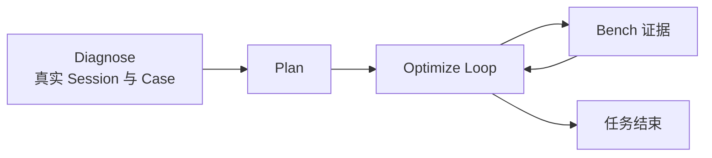
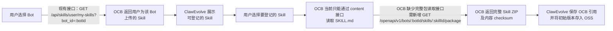
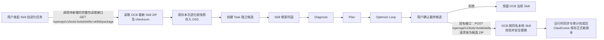
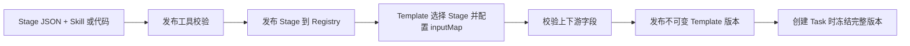

# ClawEvolve Stage 与 Skill 进化实施及验收 Spec（V3）

> 文档性质：历史设计稿归档，保留当时方案，不代表当前代码的实现状态；本文不更新现有运行时 Contract。
> 配套文档：[架构设计](./clawevolve-stage-template-architecture.md)、[声明式开发](./clawevolve-stage-template-authoring.md)。

> 本文说明本次建设要跑通的完整链路，并补充官方 Stage 与 Template 的开发方式。Contract、生命周期和 Runtime 等详细协议继续以已有完整 Spec 为准。

## 1. 这次要完成什么

ClawEvolve 从固定的 Bot 自进化流程，演进为由 Stage 和 Template 驱动的进化平台：

- 现有 Bot 自进化的诊断、规划、Optimize Loop 和 Bench 能力完整迁移，不能用简化逻辑或模拟结果替代；
- 新增 Skill 自进化，在现有进化链路前增加 Skill 框架巩固，并围绕同一个候选 Skill 完成后续诊断和优化；
- 对允许自定义的 Stage，用户可以开发自己的 Skill 实现，经过真实验证后用于进化任务；
- 已发布的 Template、Stage 和具体实现真正进入任务冻结快照，并由 ClawWeb 按冻结结果完成调度。

## 2. 一条完整链路如何跑通

```mermaid
flowchart LR
    A[平台开发者<br/>开发并发布 Stage] --> B[组合并发布 Template]
    B --> C[Registry<br/>保存已发布版本]

    C --> D[用户查看可自定义 Stage]
    D -->|下载开发包| E[开发 Stage Skill]
    E -->|上传| F[静态校验]
    F -->|选择自己的 Bot 和测试 Case| G[真实集成测试]
    G -->|通过后注册| H[Stage Implementation 版本]

    I[用户登记目标 Skill] --> J[创建进化任务]
    H -->|为开放 Stage 选择具体实现| J
    C -->|提供已发布 Template 与默认实现| J

    J --> K[冻结 Template、Stage、实现和任务输入]
    K --> L[从 OCB 读取最新 Skill<br/>冻结本次进化前快照]
    L --> CAND[基于快照创建 Task 独立候选]
    CAND --> M[ClawWeb 按 Template<br/>逐个执行 Stage]
    M -->|上游结果映射为下游输入| M
    M -->|需要补充信息| N[暂停并展示问题]
    N -->|保存回答，恢复当前 Stage| M
    M --> O[用户确认最终候选]
    O -->|接受| P[通过 OCB 应用候选]
    P --> R[ClawEvolve 保存新版本]
    O -->|拒绝| Q[保留原版本，结束任务]
```



### 2.1 平台先提供可运行的方法

官方 Stage 和 Template 由平台开发者在 Git 中维护并发布：

- Stage 定义这一步的用途、输入、最终结果，以及由平台代码还是官方 Skill 执行；
- Stage 可以声明是否允许用户提供自己的 Skill 实现；
- Template 选择已发布 Stage，规定执行顺序，并把上游结果连接到下游输入；
- 发布工具校验声明并写入 Registry。版本号、内部引用和校验值由平台生成，不要求开发者手填。

页面只负责展示已经发布的官方 Stage 和 Template。官方资产的开发、评审与发布仍在 Git 中完成。

### 2.2 用户为开放的 Stage 开发 Skill

用户先选择要实现的 Stage。页面应让用户看懂：这个 Stage 在哪个 Template 中、负责什么、运行时会拿到什么、完成时需要交付什么。

之后的操作只有四步：

1. 下载该 Stage 的开发包，交给本地开发 Agent 完成 Skill；
2. 上传 Skill ZIP，平台检查包结构、声明文件和基础安全约束；
3. 可选用自己的 Bot 运行真实集成测试，验证输入下发、Skill 执行、用户交互和最终结果；
4. 注册为该 Stage 的一个 Implementation 版本，后续可以升级或删除自己的版本。

静态校验只证明产物合法。是否真的遵守 Stage 输入输出、是否能够请求用户补充信息，必须由真实集成测试验证；业务效果则由完整进化任务和 Bench 验证。

### 2.3 创建任务时才决定本次使用哪个实现

Template 是平台已经发布的方法，不由普通用户临时编排。创建任务时，用户只需要：

- 选择本次要进化的目标；
- 填写各 Stage 声明为“用户提供”的初始信息；
- 对允许自定义的 Stage，选择平台默认实现或自己已注册的某个 Implementation 版本；
- 填写模板本身需要的参数，例如最大优化轮数。

ClawWeb 随后生成本次 Task 的冻结快照。任务启动后，即使 Stage、Template 或 Implementation 又发布了新版本，本次任务也继续使用创建时冻结的版本。

目标 Skill 的读取、候选隔离、正式应用和版本保存统一见第 3 章。

### 2.4 ClawWeb 按冻结结果执行

ClawWeb 依次创建并调度 Stage Run：

- 根据当前 Stage 的输入定义，组装任务信息、目标资源、用户填写内容和上游结果；
- 根据冻结的 Implementation 选择平台代码、官方 Skill 或用户 Skill；
- 完成后校验最终结果，再按 Template 映射交给下一 Stage；
- 返回 `hitl: true` 时保留当前 Stage，展示 Skill 生成的文本或 HTML；用户提交后，将回答带回并重新执行同一个 Stage；
- Optimize 的轮次和停止条件由 Template 中冻结的 Loop 配置控制，Implementation 只交付当前轮结果。

Stage Skill 不创建下一 Stage，也不决定整个流程怎么走；这些都由 ClawWeb 根据冻结 Template 推进。

### 2.5 现有 Bot 自进化如何保留

Bot 自进化继续提供原有创建参数和真实能力，只把固定调度迁移到同一套 Stage/Template 执行骨架：



Skill 自进化复用 Diagnose、Plan、Optimize Loop 和 Bench，在最前面增加 Skill 框架巩固，并在最后增加候选确认和版本发布。复用指复用现有真实执行能力，不是重新实现一套简化 Stage。

## 3. 待进化 Skill 如何登记、读取与更新

OCB 管理 Bot 当前实际使用的 Skill；ClawEvolve 保存待进化 Skill 的引用、任务候选和进化版本。

### 3.1 用户如何登记待进化 Skill



- **读取可登记 Skill**：调用现有接口 `GET /api/skills/user/my-skills?bot_id={bot_id}`，获得 Skill ID、名称和基础信息。
- **记录目标**：用户选择后，ClawEvolve 保存 `owner_id + bot_id + skill_id`，作为待进化 Skill 的唯一引用。
- **读取完整内容**：OCB 当前缺少读取用户私有 Skill 完整目录的接口，因此需要新增 `GET /openapi/v1/bots/{bot_id}/skills/{skill_id}/package`，按 `bot_id + skill_id` 返回完整 ZIP 和 checksum；接口内部复用 `LocalSkillPackageStorage.read_package_files()` 读取目录，并使用 `SkillPackageValidator.pack_directory()` 安全打包。
- **完成登记**：ClawEvolve 将返回的 ZIP 存入 OSS，记录 checksum，并建立初始版本。

### 3.2 运行进化任务时如何处理

用户对已登记 Skill 发起进化任务时，ClawEvolve 不直接使用登记时保存的旧版本，而是根据已保存的 OCB 引用再次读取最新内容：



- **读取最新内容**：每次发起任务都调用待新增的 `GET /openapi/v1/bots/{bot_id}/skills/{skill_id}/package`，取得 OCB 当前完整 ZIP 和 checksum。
- **冻结并进化**：完整 ZIP 和 checksum 保存为进化前快照；各 Stage 只修改由该快照复制出的 Task 候选。
- **用户拒绝**：不修改 OCB，也不产生正式新版本。
- **用户接受**：调用已有的 `POST /openapi/v1/bots/{bot_id}/skills`，以 `application/zip` 提交候选包；MVP 通过保持 Skill 名称不变触发同名替换。
- **OCB 已有能力**：包校验、编辑锁、临时写入、旧内容备份、失败回滚、运行时同步和审计。
- **OCB 生产缺口**：现有接口按名称匹配，不能限定 `skill_id`，也不能校验进化前 checksum；需要扩展现有接口或增加精确更新接口，目标已变化时返回冲突。
- **保存版本**：OCB 更新成功后，ClawEvolve 才将完整结果作为正式新版本保存到 OSS。
- **查看 Diff**：比较最终候选与本次进化前快照，不比较 vN 与 vN-1。
- **系统边界**：ClawEvolve 不通过 BaaS Shell 直接读写 Skill 目录。

## 4. 官方 Stage 和 Template 如何开发

官方资产和对应实现放在 ClawWeb 的固定目录中：

```text
clawweb/
└── server/evolve/official/
    ├── stages/
    │   ├── skill-foundation/
    │   │   ├── stage.json
    │   │   └── skill/
    │   │       └── SKILL.md
    │   └── candidate-review/
    │       ├── stage.json
    │       └── handler.ts
    └── templates/
        ├── bot-evolution.json
        └── skill-evolution.json
```

### 4.1 Stage 开发

每个 Stage 用一个 `stage.json` 描述自身边界，并和它的官方实现放在同一目录。

```json
{
  "name": "Skill 框架巩固",
  "description": "在诊断和优化前检查并补齐目标 Skill 的基础结构。",
  "skillFile": "./skill/SKILL.md",
  "allowCustomSkill": true,
  "inputSchema": {
    "type": "object",
    "required": ["target_skill", "objective"],
    "properties": {
      "target_skill": {
        "type": "string",
        "description": "本次需要处理的 Skill 目录",
        "source": "resource",
        "resourceType": "skill"
      },
      "objective": {
        "type": "string",
        "description": "本次处理目标和限制",
        "source": "user",
        "format": "textarea"
      }
    }
  },
  "resultSchema": {
    "type": "object",
    "required": ["changed", "change_summary", "target_skill"],
    "properties": {
      "changed": { "type": "boolean", "description": "是否修改了目标 Skill" },
      "change_summary": { "type": "string", "description": "完成了哪些检查和修改" },
      "target_skill": { "type": "string", "description": "处理完成后的 Skill 目录" }
    }
  }
}
```

官方实现有两种：

| 实现方式 | Stage 中的字段 | 放置内容 |
| --- | --- | --- |
| Agent 执行的 Skill | `skillFile` | Stage 目录内的 `skill/SKILL.md` |
| ClawWeb 执行的平台代码 | `codeFile` | Stage 目录内的 `handler.ts` |

两者只选择一种。`allowCustomSkill` 决定用户能否为这个 Stage 注册自己的 Skill 实现，不改变官方默认实现。

### 4.2 Template 开发

Template 不重复定义 Stage 的输入输出，只选择已经发布的 Stage、规定顺序，并连接必须由上游产生的字段。

```json
{
  "name": "Skill 自进化",
  "targetType": "skill",
  "taskInputs": {
    "maxRounds": {
      "type": "integer",
      "description": "最多执行几轮优化",
      "default": 3
    }
  },
  "stages": [
    { "stage": "skill-foundation" },
    { "stage": "diagnose" },
    {
      "stage": "plan",
      "inputMap": {
        "diagnosis": "stages.diagnose.result.diagnosis",
        "cases": "stages.diagnose.result.cases"
      }
    },
    {
      "stage": "optimize",
      "inputMap": {
        "goal": "stages.plan.result.goal",
        "spec": "stages.plan.result.spec",
        "previousRounds": "loop.optimize.previousResults"
      },
      "loop": {
        "maxRounds": "task.inputs.maxRounds",
        "stopWhen": "result.roundDecision.stop"
      }
    },
    {
      "stage": "candidate-review",
      "inputMap": {
        "optimizationResult": "loop.optimize.lastResult"
      }
    },
    {
      "stage": "skill-version-apply",
      "inputMap": {
        "optimizationResult": "loop.optimize.lastResult",
        "reviewResult": "stages.candidate-review.result"
      }
    }
  ]
}
```

其中：

- `stages` 的数组顺序就是执行顺序；
- `inputMap` 左侧是当前 Stage 需要的字段，右侧是真实数据来源；
- 用户填写、目标资源、平台信息和 HITL 回答由 Stage 自己声明来源，不在 Template 中重复连接；
- Optimize Loop 的历史轮次由 ClawWeb 按成功结果组装。

### 4.3 发布后如何进入运行链路



开发者只维护可读的 Stage 名称、文件位置和数据连接。Registry 使用的内部 ID、版本引用和 checksum 由发布工具生成。当前集中声明文件应逐步变成发布产物，不再由开发者直接维护。

## 5. 页面如何串起来

| 用户要做的事 | 页面入口 | 完成后的去向 |
| --- | --- | --- |
| 查看待进化 Skill | Skill 中心 | Skill 详情 |
| 查看内容和历史版本 | Skill 详情 | 可发起 Skill 自进化 |
| 开发某个 Stage 的 Skill | Stage 管理 → 新建 | 上传与验证 |
| 验证并注册实现 | Stage 开发记录 | Implementation 版本可用于任务 |
| 发起 Skill 自进化 | Skill 自进化表单 | Task 详情 |
| 处理 HITL | Task 详情 | 恢复当前 Stage |
| 接受或拒绝候选 | Task 详情 | 新版本或保持原版本 |

普通用户只看到 Skill、自己的 Stage Implementation 和进化任务。管理员模式额外展示已发布的官方 Stage 和 Template，但不在页面中编辑它们。

## 6. 必须守住的实现规则

- 不保留旧调度分支；现有能力迁移到新的 Stage/Template 链路。
- 不使用 Mock、固定成功结果或为单个 Case 写死的业务判断。
- Registry 中已发布的 Template 配置必须真正进入 Task 冻结快照并影响 ClawWeb 调度，不能只用于页面展示。
- 用户选择的 Implementation 版本必须进入冻结快照并在运行时被真实加载。
- 每次创建 Skill 自进化 Task，都从 OCB 读取最新完整 Skill，保存进化前快照，并据此创建独立候选。
- 进化过程中不能直接修改 OCB 中的正式 Skill；只有最终接受时才能通过 OCB 应用候选。
- Stage 的初始用户输入由 Stage 声明驱动，并按 Stage 分组展示，不能由 Skill 自进化接口自行猜默认值。
- HITL 的问题、表单和用户回答都要在 Task 详情中可追溯。
- ClawEvolve 独立保存每个正式 Skill 版本的完整不可变内容；生产环境使用 OSS。
- 本次进化 Diff 来自最终候选与本次任务进化前快照的真实文件比较，不默认使用 vN 与 vN-1。

## 7. 本次验收故事

本次完成以两条真实任务为准：

1. **Bot 自进化**：使用真实 Session、Diagnose、Plan、Optimize 和 Bench 跑到结束，原有输入和结果均可查看；
2. **Skill 自进化**：登记一个真实 Skill，为可自定义 Stage 注册并选择真实 Skill 实现，完成框架巩固、Diagnose、Plan、Optimize Loop、HITL 和候选确认，接受后产生新版本。

同时检查：

- Task 快照中的 Template、Stage 和 Implementation 与创建时选择一致；
- 各 Stage 的输入来自用户填写、目标资源或真实上游结果；
- 创建任务时读取并保存了 OCB 中最新 Skill 的进化前快照；
- Task 候选没有污染原 Skill 和其他任务；
- 接受候选时由 OCB 完成正式 Skill 更新，ClawEvolve 不直接写正式目录；
- Skill 中心能够查看历史正式版本的真实内容，并展示每次结果相对该次进化前快照的差异；
- 前后端重启后，任务、交互、开发记录和版本历史仍可查看。
