# ClawEvolve Stage、Template 与 Skill 进化架构设计 Spec

> 文档性质：历史设计稿归档，保留当时方案，不代表当前代码的实现状态；本文不更新现有运行时 Contract。
> 配套文档：[声明式开发](./clawevolve-stage-template-authoring.md)、[实施与验收（V3）](./clawevolve-stage-skill-evolution-implementation-v3.md)。

> 状态：讨论稿\
> 日期：2026-08-20\
> 目标读者：ClawEvolve 产品、架构与研发团队\
> 文档范围：整体产品与流程设计，不定义数据库表、完整 API 字段或 Runner 代码实现

## 0. 摘要

ClawEvolve 的核心价值不是编排任意工作流，而是把经过验证的效果提升方法沉淀为开箱即用的进化能力，并允许业务在平台规定的边界内扩展。整体结论如下：

- **现有基础**：保留已经验证的 `Diagnose → Plan → Optimize Loop` 方法，以及 ClawWeb 对 Task、Step、Round 和多轮推进的控制权。
- **新增需求**：Skill 进化需要业务自己的诊断和首轮升级、Skill 内 AskUser、复用现有多轮优化，以及最终由用户确认是否升级版本。
- **核心方案**：平台发布多套有默认逻辑、效果验证和停止标准的进化方法；业务只替换平台明确开放的执行位置，不自行搭工作流。
- **解耦边界**：通用 Evolve 负责方法运行、数据交接、等待恢复和审计；Skill 进化作为独立应用负责 Skill、候选版本和发布应用。
- **迁移要求**：保留现有方法代码和效果逻辑，但把固定命令、脚本路由和旧结果上报整体迁移到一套统一协议，不长期双轨运行。
- **开源定位**：开源交付的是默认可运行的方法、稳定协议和扩展方式，不是一个只有空白画布的工作流内核。

从产品职责看，方案采用“三层产品结构 + 一层运行时基础设施”：

1. **轻量 Evolve 内核**：负责执行平台选定的方法、任务状态、阶段推进、结构化交接校验、暂停恢复和多轮迭代。
2. **平台进化方法与扩展包**：沉淀默认方法和效果，包括现有自进化方法、Skill 进化方法及未来其他标准方法。
3. **独立进化应用**：Skill 中心、Skill 进化及未来其他业务应用，负责各自的资产和产品语义。
4. **OCB / Agent Runtime 基础设施**：承载 Bot、Session、容器、工具、Workspace 和实际执行策略，但不承载 Evolve 的方法判断。

平台方法以线性流程为主，只提供固定、可替换、有限可选和有限循环等受控变化。普通用户不画 DAG、不创建节点，也不手工连接字段；业务开发者只为平台明确开放的部分提供符合交接要求的执行逻辑。

---

## 1. 背景与现状

### 1.1 ClawEvolve 当前定位

ClawEvolve 是目标 Bot 的自进化层。它从问题与真实 Case 出发，形成优化目标和策略，修改目标 Workspace，通过 Bench 验证效果，并根据证据决定是否继续迭代。

当前产品语义可以概括为：

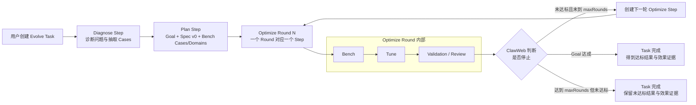

这里需要保持几个稳定边界：

- ClawWeb 是控制面，负责创建 Task/Step、组装输入、选择执行通道、校验报告、持久化状态和创建下一轮。
- 目标 Bot 中已安装的阶段脚本与 Skill 负责 Workspace 分析与修改、Bench 调用、Tune、Review、产物和业务结果。
- Diagnose 只产生诊断与原始 Cases。
- Plan 产生 Goal、Spec、Bench Cases 和 Bench Domains，但不执行 Bench。
- Optimize 消费 Diagnose、Plan 和历史 Round；Bench、Tune、Review 可以是 Optimize 内部能力，不需要全部提升为独立 ClawWeb Step。
- Optimize Skill 可以建议停止，但最终是否创建下一轮由 ClawWeb 结合 `maxRounds` 等任务配置决定。
- 在当前链路中，Step Report 是阶段完成的权威交付；Workspace 文件和 OSS Artifact 是交付物，不是“写出某个文件即自动推进”的隐式协议。

### 1.2 Skill 进化业务提出的新要求

业务希望进化的对象是一个 Skill，而不是笼统的整个 Bot Workspace。其特殊流程大致包含：

1. 检查 Skill 结构是否完整。
2. 进入业务自己的 Bootstrap：结构完整时可以不修改候选，只交付后续 Optimize 所需的数据；结构不完整时执行首轮升级。
3. Bootstrap 内可以主动 AskUser，收集问题后继续完成框架升级和数据交付。
4. 首轮结束后复用平台已有的后续多轮优化逻辑。
5. 每轮根据诊断、Spec 和 Bench 证据继续优化，直到达标或达到轮次上限。
6. 达标后再次让用户确认是否接受修改。
7. 用户接受后形成新 Skill 版本并应用；用户也可以拒绝或携带反馈继续优化。

此外，业务可能提供自己的诊断 Skill 和优化 Skill；未来其他业务还会有不同的进化对象、方法和交互要求。

### 1.3 真正的问题

当前固定链路无法直接容纳所有业务变化，但解决问题的方向也不能是“做一个任意工作流平台”：

- 为当前业务硬编码首轮升级、AskUser 和 Skill 版本逻辑，会污染现有自进化，并让后续业务继续堆分支。
- 每个业务单独实现一套调度，会重复建设状态、恢复、审计、输入输出和多轮 Loop。
- 提供任意 DAG、任意节点、任意字段连线，虽然最灵活，但设计和使用都过重，也无法保证用户最终获得效果。
- 只开放自然语言 Skill，而没有结构化输入输出与运行权限约束，平台无法判断它是否能安全接入上下游。
- 如果开源的只是一个空白编排内核，缺少默认方法、协议和参考实现，无法形成 ClawEvolve 的产品价值。

因此我们要解决的是：**如何把效果提升方法沉淀为有约束、可复用的标准方法，同时允许业务替换必要的执行逻辑，而不是如何支持任意工作流。**

### 1.4 SLLMWorks / DataMuse 提供的历史参考

此前 SLLMWorks/DataMuse 已经验证过一套相近的产品思想：平台将数据清洗、蒸馏和模型处理方法沉淀为模板；模板引用独立组件；组件声明输入输出；业务只实现开放的加工逻辑。实验运行时，通过模板的变量映射把组件本地字段连接到实验级全局参数。

本方案复用的是以下思想，而不是照搬其产品和代码：

| 可复用思想 | 在 ClawEvolve 中的演进 |
|---|---|
| 平台沉淀跨业务有效的方法 | 平台持续发布多套有默认执行逻辑的进化方法 |
| 独立组件由模板串联 | 每个阶段可以由目标 Bot 内 Agent、受信代码包或 ClawWeb 后端的确定性逻辑执行 |
| 组件输入输出 Schema | 每个阶段使用版本化、结构化的输入输出规则交接 |
| variableMap + globalParams | 平台按 Template 中固定的类型化绑定把已校验上游结果组装给下游，不开放任意字段映射 |
| 模板创建实验时形成快照 | Task 创建时冻结所选方法、执行逻辑和目标版本 |

两者的关键差异是：

- 过去的组件主要是普通函数，平台比较容易约束；现在的流程 Skill 由 Agent 理解和执行，仅有输入输出 Schema 还不够。
- 新方案还必须控制 Agent 能看到什么、能调用什么、能修改什么，如何暂停恢复，以及什么才算权威交付。
- DataMuse 可借鉴的是模板、组件和数据传递模型；它没有提供可直接复用的自动线性调度、跳过重连和强类型兼容校验。

---

## 2. 目标、原则与非目标

### 2.1 目标

1. 保持现有 `Diagnose → Plan → Optimize Loop` 行为稳定，并将其沉淀为默认进化方法。
2. 平台能够持续发布新的进化方法，表达跨业务有效的方法论，而不修改通用内核。
3. 业务能够为平台方法中明确开放的部分开发自己的流程 Skill，并安全复用其他默认逻辑。
4. 平台能够约束每次 Agent 执行的输入、输出、可调用能力、可见范围和流转条件。
5. AskUser 等交互由 Skill 在执行中主动发起，ClawWeb 提供异步等待、前端交互和恢复基建。
6. Skill 进化作为独立产品完整实现目标 Skill 注册、优化、候选确认、版本升级和应用。
7. 协议、方法定义、默认实现和扩展方式可开源、可理解、可复现。

### 2.2 设计原则

1. **效果优先，而不是编排优先**：平台首先交付有默认实现、有 Bench 证据、有停止标准的进化方法。扩展能力用于适配业务，不以支持最多的流程形态为成功标准。

2. **有约束地开放（Opinionated but extensible）**：平台方法有明确约束；业务只能在平台开放的位置替换执行逻辑。默认路径应当开箱即用，80% 的用户不需要理解内部编排。

3. **单一协议，完整迁移**：新的方法表达必须承载当前已经验证的 Diagnose、Plan 和 Optimize 方法，运行时只保留一套 Stage Implementation、输入和生命周期协议；新旧协议不双轨运行。

4. **内核不包含业务资产语义**：Evolve 内核只负责执行平台选定的方法、传递已校验的数据和维护状态，不认识 `skillId`、候选 Skill、`v1/v2`、发布或下线。这些属于 Skill 进化扩展和 Skill 中心。

5. **协议优先、版本冻结**：方法定义、阶段交接规则、具体执行逻辑、平台工具协议和运行依赖都必须版本化并在 Task 创建时冻结，保证运行可复现且不会中途漂移。


### 2.3 非目标

- 不建设自由拖拽、任意连线和任意并发分支的 DAG 编辑器。
- 不让普通用户创建流程阶段或在任务创建时临时插入节点。
- 不提供任意表达式语言和任意字段映射脚本。
- 不要求所有平台方法必须包含 Diagnose、Plan、Bench 或 Apply。
- 不把 Bench/Tune/Review 为了“节点化”而全部拆成独立流程阶段。
- 不允许 Agent Skill 直接改变平台 Task 状态、创建下一轮或发布线上 Skill 版本。
- 不将 Skill 进化专属字段和状态写入通用 Evolve 内核。

---

## 3. 方案思路与整体边界

面对前面的矛盾，方案不是先建设一套通用编排协议，而是先确定平台要怎样交付效果：

1. 平台持续探索有效的进化方法，并把成熟方法发布为用户可以直接使用的标准方案，而不是交付一张空白画布。
2. 每套标准方案保留既定主流程、默认执行逻辑、效果验证和停止条件，用户创建任务时主要选择“用哪套方法”，不需要自己设计流程。
3. 当某个方法确实需要适配业务时，平台只开放其中明确的执行位置；业务可以提供自己的逻辑替换这些位置，其他环节继续复用默认能力。
4. ClawWeb 统一负责阶段推进、数据交接、多轮迭代、等待恢复、失败和审计；发送到目标 Bot 的阶段继续通过现有 SecBaaS 或 Message 通道执行，目标 Bot 只处理当前阶段中的分析、修改和评测，不决定下一阶段。
5. Skill 进化、未来其他进化产品只是这套能力的不同应用：它们可以管理不同目标资产和结果，但不会改变通用执行内核。

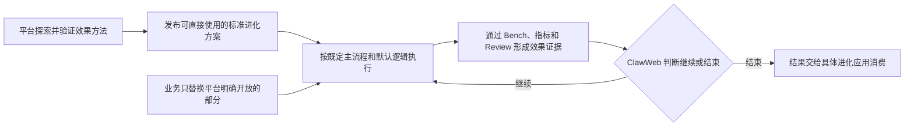

由此，平台交付的是经过验证的进化方法及其默认执行能力；模板化和扩展协议用于稳定发布、运行和复用这些方法，而不是把 Evolve 变成一张空白编排画布。

### 3.1 这套思路如何变成可执行设计

目标方案需要把“一套标准进化方法”保存成可发布、可升级的资产，因此将它称为 **Evolution Template（进化模板）**。

- 一套方法内部由平台预设若干粗粒度 **Stage**，例如 Diagnose、Plan 或一轮 Optimize。
- 某个 Stage 在具体 Task 中的一次顶层执行称为 **Stage Run**，继续由一个 ClawWeb Step 承载。

其次，业务替换某个阶段时，平台既要允许它使用不同逻辑，又不能让上下游失去约束。因此每个 Stage 都引用稳定的输入输出交接规则，称为 **Stage Contract**；真正完成该 Contract 的可执行逻辑称为 **Stage Implementation**。

Implementation 有三种执行形态：

| 执行形态 | 在哪里运行 | 适合什么逻辑 |
|---|---|---|
| Agent Skill Implementation | 目标 Bot 中的 Agent 加载已发布流程 Skill | 诊断、分析和开放式优化 |
| Container Code Implementation | 目标 Bot 中加载已发布、受信的代码包 | 确定性代码，以及现有 Diagnose、Plan、Optimize 方法迁移 |
| ClawWeb 后端 Stage Implementation | ClawWeb 或具体进化应用的后端 | 初始化平台资产、创建版本和应用结果等确定性平台操作 |

三种实现都作为版本化资产进入 **Registry**，并声明自己实现哪个 Stage Contract。Registry 是平台保存已发布、不可变版本及其引用关系的资产目录；它不是协议编辑器。三种实现的加载、运行、交付和现有代码迁移方式在后文分别展开。

再次，某些 Implementation 执行过程中需要使用平台能力。例如业务 Skill 主动 AskUser 时，当前 Stage 要暂停、等待前端答案并恢复。此类受控工具调用称为 **Capability**；它发生在 Stage 内部，不是模板里额外插入的流程节点。

最后，一次 Task 不能因为模板、执行逻辑或目标版本后来更新而在中途漂移。因此 Task 创建时要把当时选定的方法、各阶段交接规则、执行逻辑、权限策略和目标引用冻结为 **Creation Snapshot**。

它们的关系是：

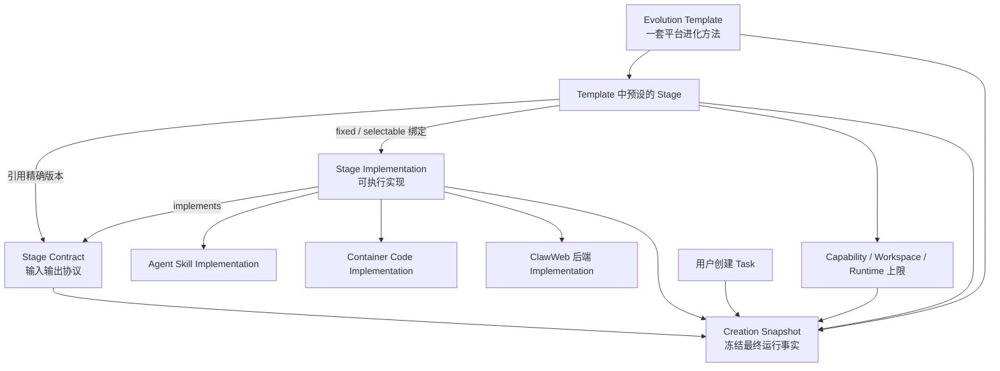

这套关系使平台能够稳定发布一套进化方法，同时只在明确开放的 Stage 上允许业务替换执行逻辑；Task 一旦创建，运行过程始终使用 Creation Snapshot 中冻结的精确版本。

### 3.2 目标整体架构与系统边界

目标架构保留现有 ClawWeb 控制面以及 SecBaaS、Message 两条 Bot 启动通道，重点增加三项能力：

- ClawWeb 在创建 Task 时冻结运行快照，运行时再按快照创建并调度 Stage Run。
- 目标 Bot 中增加统一 Stage 执行入口，根据冻结的 `ImplementationRef` 加载正式实现。
- Skill、候选版本和发布等资产语义继续由具体进化应用负责，通用 Evolve 只持有目标引用和已校验结果。

现有 Diagnose、Plan、Optimize 必须迁移成正式 Implementation；目标架构不保留旧脚本、旧报告协议或失败回退旁路。

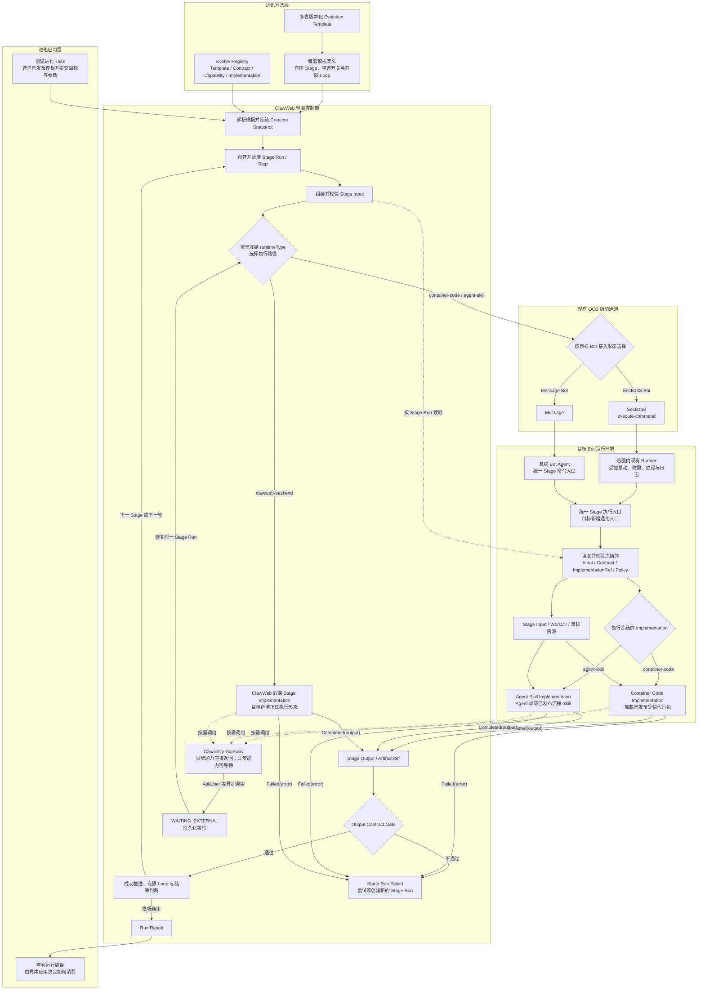

### 3.3 容器执行链如何从现状演进到目标

动态 Template 不会向目标 Bot 下发任意 Shell、脚本路径或业务命令。目标链路始终由 ClawWeb 冻结 `ImplementationRef`，再通过现有两条通道进入同一个 Stage 执行入口。

```mermaid
flowchart TB
    subgraph NOW[现状，仅用于说明一次性迁移；切换后删除旧入口]
        N1[ClawWeb 固定 Step] --> N2{选择现有启动通道}
        N2 -- SecBaaS --> N3[execute-command]
        N3 --> N4[目标 Bot 容器内 Runner]
        N2 -- Message --> N5[目标 Bot Agent<br/>现有 Skill 命令入口]
        N4 --> N6[进入对应的现有阶段逻辑]
        N5 --> N6
        N6 --> N7[当前 Step Report]
        N7 --> N8[ClawWeb 校验并推进]
    end

    subgraph TARGET[目标]
        T1[ClawWeb Stage Run<br/>冻结 ImplementationRef] --> T2{选择现有启动通道}
        T2 -- SecBaaS --> T3[execute-command]
        T3 --> T4[目标 Bot 容器内 Runner]
        T2 -- Message --> T5[目标 Bot Agent<br/>统一 Stage 命令入口]
        T4 --> T6[统一 Stage 执行入口]
        T5 --> T6
        T6 --> T7{加载冻结的 Implementation}
        T7 -- container-code --> T8[已发布受信代码包]
        T7 -- agent-skill --> T9[已发布流程 Skill]
        T8 --> T10{统一生命周期}
        T9 --> T10
        T10 -- Completed(output) --> T11[Output Contract Gate]
        T11 -- 通过 --> T12[ClawWeb 推进]
        T11 -- 不通过 --> T13[Stage Run 失败]
        T10 -- Failed(error) --> T13
        T10 -- 异步 Capability --> T14[ClawWeb 持久化等待<br/>WAITING_EXTERNAL]
        T14 -- 收到响应，重新调度同一 Stage Run --> T2
    end
```

各部分的目标职责如下：

- **Runner**：只存在于 SecBaaS `execute-command` 路径，运行在目标 Bot 容器内，负责参数校验、受控启动、防重、进程和日志。
- **Message Stage 命令入口**：由目标 Bot Agent 接收 Message 后进入，不经过 Shell Runner。
- **统一 Stage 执行入口**：校验冻结引用，准备 Input，校验并加载 Implementation 包，衔接完成、失败和等待生命周期。
- **Implementation**：执行 Diagnose、Plan、Optimize 或业务流程 Skill 的具体方法，不创建下一 Stage 或下一轮。
- **ClawWeb**：校验交付并推进模板、Loop 和 Task 状态。

现有脚本可以复用内部方法代码，但必须重新封装并发布为 Container Code Implementation。切换后删除固定 Stage 路由、脚本直启和旧 Step Report 完成分支，不运行新旧两套协议。

### 3.4 各层职责与改造边界

| 层级 | 职责 |
|---|---|
| 进化应用层 | 决定用户在进化什么目标、如何创建任务，以及如何消费最终结果。具体应用负责目标快照、候选副本和版本语义，并向 Evolve 提供不透明目标引用及其获授权的 Runtime 映射；通用内核不解析目标资产内容 |
| 进化方法层 | 将效果提升方法沉淀为版本化模板。模板预先定义 Stage 顺序、可选开关、有限 Loop、Contract、可选 Implementation 和效果验证要求 |
| ClawWeb 轻量控制面 | 解析并冻结模板，创建 Stage Run/Step，组装输入，校验交付，处理有限 Loop、等待、恢复、失败、审计和最终结果；不理解目标资产的业务语义 |
| 目标 Bot 执行面 | ClawWeb 复用现有 OCB 通道进入统一 Stage 执行入口，再加载 Creation Snapshot 中冻结的 Container Code 或 Agent Skill Implementation。Runtime 将不透明目标引用解析为本次 Stage 获准访问的目标 Workspace；目标 Bot 只执行当前 Stage，不创建下一阶段或下一轮 |

具体改造边界如下：

| 部分 | 当前状态 | 目标变化 |
|---|---|---|
| ClawWeb Task / Step / Round | 按现有固定链路创建 Diagnose、Plan 和 Optimize Round，校验报告并决定下一轮 | 保留控制权，改为根据冻结模板创建 Stage Run；仍独占流程推进和 Loop 决策 |
| 现有 OCB 启动通道 | 根据目标 Bot 接入形态选择 SecBaaS 或 Message | 原样复用；通道不进入模板配置，也不属于本方案的改造范围 |
| `clawevolve_async_runner.sh` | SecBaaS 路径中在目标 Bot 容器内按固定 Stage 启动脚本 | 保留受控启动、防重、进程和日志能力；删除业务 Stage 路由，只启动统一 Stage 执行入口 |
| Message Stage 命令入口 | Message 路径中由目标 Bot Agent 按 Skill 命令进入现有阶段逻辑 | 收敛为统一 Stage 命令，并进入同一个 Stage 执行入口 |
| 统一 Stage 执行入口 | 当前不存在基于 `ImplementationRef` 的统一解析层 | 新增薄层，校验冻结引用、准备输入、加载正式执行实现，并衔接完成、失败和等待生命周期 |
| 现有阶段 Python 脚本与 Skill | 实现现有 Diagnose、Plan、Optimize 以及内部 Bench、Tune、Review | 内部方法代码可以复用，但入口、Manifest、Input、生命周期和 Output 全部迁移到正式 Implementation 协议；旧入口在切换时删除 |
| Container Code Implementation | 当前 Python 阶段代码以固定脚本和命令运行 | 作为已发布、受信、可冻结的代码包进入 Registry，统一由 Stage 执行入口加载 |
| Agent Skill Implementation | 当前没有统一发布、绑定和受控加载方式 | 按 Stage Contract 发布，Task 创建时冻结版本，运行时由 Agent 加载 |
| ClawWeb 后端 Stage Implementation | 当前没有统一的后端 Stage 执行形态 | 由平台或进化应用扩展提供确定性后端代码，实现相同 Contract，适合版本创建、发布和应用等平台操作 |
| Contract / Capability / Output Gate | 主要依赖各固定 Step 的 Input 与 Report 约定 | 增加版本化交接校验、受控 AskUser 等能力以及统一输出门禁 |

这次改造保持三条边界：

- Workspace 分析和修改仍在目标 Bot 执行面完成，不搬进 ClawWeb。
- Runner 和 Message 命令入口只负责启动，不理解进化方法。
- 目标方案复用当前 OCB 启动通道，不讨论其未来统一；Template 作者、Implementation 开发者和任务用户都不选择启动通道。

---

## 4. 现有自进化与 Skill 进化如何复用同一条链路

“现有自进化”指当前已经运行的 `Diagnose → Plan → Optimize Loop`；“Skill 进化”指未来新增的 Skill 优化和版本升级流程。两者不会各自建设一套 Optimize Loop，而是从不同的前置 Stage 接入同一套现有能力。

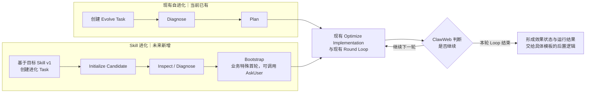

这张图表达三点：

- 当前自进化通过 Plan 接入现有 Optimize。
- Skill 进化通过 Bootstrap 接入同一个现有 Optimize。
- 两者后续使用同一个 Round Loop；Skill 进化自己的确认与版本应用在 4.2 展开。

### 4.1 为什么 Skill 进化可以没有原来的 Plan

Optimize 应依赖稳定的 Optimize Input Contract，而不是硬编码上游 Stage 必须叫 Plan。最小公共输入包括：当前目标引用、诊断结果、Goal、Spec、已冻结 Bench 资源、当前轮号、历史 Round，以及可选的用户反馈。

- 在现有自进化模板中，Diagnose 与 Plan 共同产生 Optimize 所需的诊断、Goal、Spec 和 Bench 选择信息。
- 在 Skill 进化模板中，Inspect/Diagnose 与 Bootstrap 共同交付同一类型的数据；Bootstrap 还负责业务特殊首轮。
- 这些上游 Stage 各自拥有自己的 Contract；ClawWeb 通过 Template 的固定类型化绑定和同一套资源固化规则，把结果组装成稳定的 Optimize Input。
- 现有 Optimize 不需要理解数据来自 Plan 还是 Bootstrap。

因此，Skill 进化可以不执行原 Plan，但不能省略 Optimize Contract 的必需字段，也不能保留一个只认识完整旧 Plan Output 的旁路。

### 4.2 如何复用现有 Optimize Round 和后续轮次

这里复用的是现有完整 Optimize Implementation 和 Round Loop，不是重新实现其中某几个内部步骤。

Skill 进化只需要完成两个交接：

- **候选交接**：Bootstrap 在本次 Task 的候选 Skill 上完成业务特殊首轮；后续 Optimize 继续优化同一个候选。
- **输入交接**：Inspect/Diagnose 与 Bootstrap 交付现有 Optimize 所需的数据；ClawWeb 校验通过后，直接进入现有 Optimize Loop。

因此，现有 Optimize 的内部方法和后续 Round 逻辑都不需要增加 Skill 业务分支，ClawWeb 仍按当前方式创建轮次并判断停止。

效果达标后，Skill 进化模板进入候选确认：

- 接受：创建并应用新 Skill 版本。
- 继续：携带用户反馈进入下一轮 Optimize，仍受同一个 `maxRounds` 约束。
- 拒绝：结束 Task，不发布候选。

Skill 进化模板从 Stage 开始的结构如下：

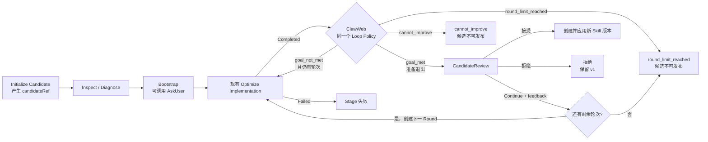

各部分的职责边界是：

- Skill 进化扩展负责候选初始化、候选确认和版本应用。
- 业务 Implementation 负责模板开放的 Inspect、Diagnose 或 Bootstrap Stage。
- 现有 Optimize Implementation 继续负责后续优化。
- ClawWeb 继续负责 Round、Loop、等待恢复和流程推进。
- 只有效果门禁通过的候选进入 CandidateReview；轮次耗尽未达标或失败都不会直接发布。
- CandidateReview 的 Continue 必须重新经过同一个 Loop Policy；`cannot_improve` 与 `round_limit_reached` 都以未发布结果结束并保留证据。

不需要新增 Skill 专属 Optimize，也不需要业务自行实现 Loop。完整 Skill 进化系统时序见附录 A。

---

## 5. 平台如何定义并发布一套进化方法

平台方法维护者负责把已经验证的方法沉淀为 Evolution Template。普通任务用户只选择已发布的方法；业务开发者只能为模板明确开放的 Stage 提供 Implementation，不能创建 Stage 或临时改流程。

### 5.1 Stage、Contract、Implementation 与 Template 的关系

- **Evolution Template** 定义一套完整方法，包含有序 Stage、可选开关、有限 Loop、默认实现和停止规则。
- **Stage** 是 Template 内的一个执行位置。它由 Template 定义和管理，不独立发布，也不存在单独的“Stage 市场”。
- **Stage Contract** 是独立发布、独立版本化的交接协议，定义该类执行位置可以获得什么 Input、必须交付什么 Output，以及允许交付哪些 Artifact。
- **Stage Implementation** 是 Contract 的可执行实现。它独立发布，并在 Manifest 中声明自己实现哪个精确 Contract 版本。
- **Template Binding** 决定一个 Stage 固定使用哪个 Implementation，或者允许任务用户从兼容实现中选择并在未选择时使用默认实现。

平台先把验证过的方法发布成可运行模板；业务再依据模板开放的 Contract 发布可选 Implementation；创建 Task 时，ClawWeb 解析并冻结每个 Stage 最终使用的实现。

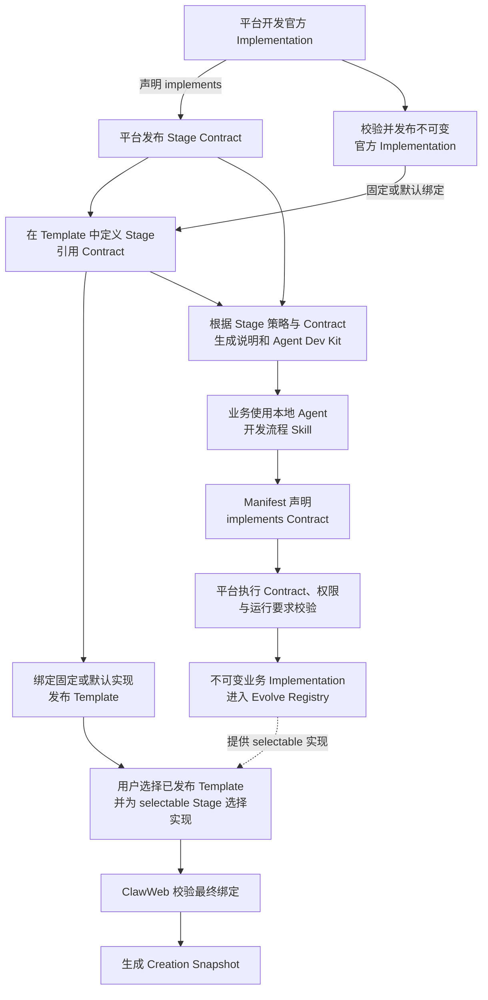

业务 Implementation 发布后只进入可选集合；Task 创建时形成的是运行快照，不会修改或重新发布 Template。

现有 `Diagnose → Plan → Optimize Loop` 如何写成一套 Template、Contract 和 Implementation，见附录 B。

### 5.2 Stage Contract 如何定义和管理

Contract 的标准源是可评审、可开源的版本化协议包；Evolve Registry 保存已发布的不可变版本，供页面展示、开发包生成、模板校验和运行时校验使用。

一份 Contract 至少说明：

| 内容 | 作用 |
|---|---|
| 身份、版本和用途 | 让人和平台明确这个协议解决什么交接问题 |
| Input Schema | 定义平台在 Stage 启动前必须组装的数据，以及字段是否必需 |
| Output Schema | 定义 Implementation 返回 `Completed(output)` 时必须交付的数据 |
| Artifact 类型 | 定义允许引用的大文件、目录或其他外部产物 |
| 统一生命周期引用 | 声明遵循平台统一的完成、失败、等待与恢复协议，不自行定义状态机 |
| Fixture 与 Contract Test | 让业务 Agent 和发布系统验证实现能否接入该协议 |
| Schema 兼容性声明 | 说明 Contract 新旧版本能否直接替换，避免运行时隐式猜测或适配字段 |

这里的“必需”是系统间交接要求：Input 必需字段由 ClawWeb 在运行前提供，Output 必需字段由 Implementation 在成功交付时提供；不表示任务用户需要在页面手工填写全部字段。

`lifecycleRef` 引用平台随协议包发布的内置 Stage Lifecycle Protocol 精确版本。它定义 `Completed / Failed / Waiting`、恢复和取消等通用 Envelope 与状态语义，不是业务可选的 Capability，也不是 Template 中的额外 Stage；Contract 发布和 Task 冻结都会校验该引用。

Output Schema 只校验 `Completed(output)` 的成功载荷。`Failed(error)`、等待与恢复遵循统一 Stage 生命周期；异步 Capability 触发等待后，仍由同一个 Stage Run 和 Implementation 恢复执行。

### 5.3 Template 如何定义 Stage

Template 中的每个 Stage 需要明确以下内容：

| 定义 | 说明 |
|---|---|
| 顺序与依赖 | 该 Stage 位于方法的什么位置，需要哪些已校验上游结果 |
| `contractRef` | 引用哪个已发布的精确 Contract 版本 |
| Execution Policy | `required` 必须执行；`guarded` 只能读取模板声明的任务参数或已校验上游枚举结果，按有限等值规则决定是否执行，并提供下游兜底；不支持脚本和任意表达式 |
| Implementation Policy | `fixed` 固定实现；`selectable` 提供默认实现并允许选择兼容实现 |
| 默认或固定 `implementationRef` | 保证方法开箱即用，而不是只发布空槽位 |
| Capability Ceiling | 该位置最多允许实现申请哪些平台能力 |
| Workspace Policy | 该位置可以读取和修改哪些目标区域与 Artifact |
| Agent 运行权限上限 | Agent 最多可以使用哪些工具、网络和凭证；它与 Implementation 的实际申请、部署环境策略共同形成当前 Stage Run 的有效权限 |
| Lifecycle Policy | 是否允许重试、最多次数，以及异步等待的期限和超时结果；只能从平台支持的有限语义中选择 |
| 结果转移与 Loop Policy | 只允许模板预定义的有限结果和有限循环，不支持任意连线或表达式 |

Implementation 可以报告本轮结果、效果证据和停止建议，但不能直接创建下一 Stage 或下一 Round。ClawWeb 依据已冻结的 Template Policy 推进流程。

### 5.4 Loop Policy 如何定义有限循环

Loop Policy 是 `Evolution Template` 内用于描述有限轮次的结构化策略。它不是 Stage、Capability 或 Implementation，不属于 Stage Contract，也不作为独立资产发布；它随 Template 一起发布、版本化和冻结，由 ClawWeb 解释执行。

Stage Contract 定义一次 Stage Run 的输入输出；Loop Policy 只读取已经通过 Contract 校验的结果，决定是否创建下一轮。

| 定义项 | 作用 |
|---|---|
| Round Stage | 指定哪个 Stage 可以按轮重复执行 |
| 最大轮数 | 定义默认值、上限以及创建 Task 时是否允许调整 |
| 效果门禁 | 指定 Goal 中的标准指标条件与 RoundResult 中对应的指标值，只允许平台内置的有限比较操作，不执行任意表达式或脚本 |
| 继续条件 | 例如效果未达标且仍有剩余轮次时创建下一轮 |
| 提前停止条件 | 例如 Implementation 提交无法继续改善的建议、原因与证据，并且模板允许提前停止 |
| 退出确认 | 模板可以声明一个确认 Stage；效果达标后先确认，Continue 仍受同一个最大轮数约束 |
| 轮次耗尽结果 | 最大轮数后仍未达标时，产生明确的 `round_limit_reached` 结果 |

运行关系为：

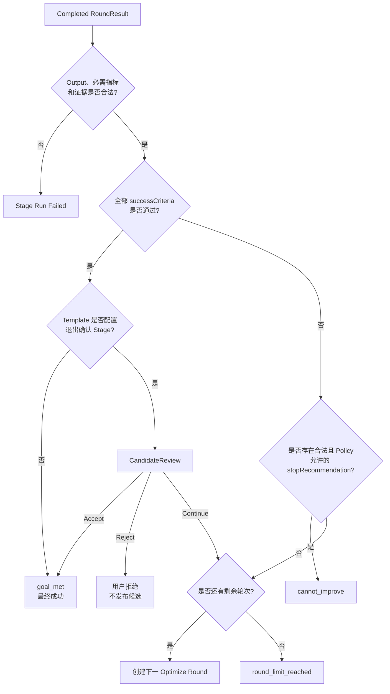

效果门禁采用平台统一的确定性比较语义：

- Goal 的 `successCriteria[]` 为每项指标交付 `metricKey`、有限操作符和阈值。
- RoundResult 使用相同 `metricKey` 交付实际值与 Bench 证据。
- ClawWeb 使用内置的 `>= / > / <= / < / ==` 比较器逐项判断；所有必需条件通过才产生 `goal_met`，否则产生 `goal_not_met`。
- Template 不能注入自定义比较脚本。

`cannot_improve` 只在 Goal 尚未达成、Implementation 提交结构化停止建议及证据，并且当前 Loop Policy 允许提前停止时产生；最终 Outcome 仍由 ClawWeb 按冻结规则确认。`Failed(error)` 不属于 Loop Policy 的业务结果，它直接进入 Stage 失败生命周期。

当一轮同时涉及多种条件时，ClawWeb 按固定顺序判断：

1. 必需指标或证据缺失、类型错误，RoundResult 无效，当前 Stage Run 失败，不进入 Loop 判断。
2. 所有效果条件通过，产生 `goal_met`。
3. 未达标但存在有效且 Policy 允许的停止建议，产生 `cannot_improve`。
4. 未达标且仍有轮次，产生 `goal_not_met` 并创建下一轮。
5. 未达标且轮次已经耗尽，产生 `round_limit_reached`。

效果门禁通过后，Template 可以直接形成最终成功结果，也可以先进入一个有限的退出确认 Stage。配置退出确认时，效果达标只表示“准备退出”：Accept 后才成功结束，Continue 则重新经过同一个 Loop Policy 的轮数检查。

| Template | 效果门禁通过后的动作 |
|---|---|
| 现有自进化模板 | 产生 `goal_met` 并退出 Loop，完成进化 Task |
| Skill 进化模板 | 进入 `CandidateReview`；Accept 产生最终成功结果，Reject 结束且不发布，Continue 在仍有轮数时创建下一轮 Optimize |

Loop Policy 由平台方法维护者随 Template 发布，任务用户和 Implementation 开发者不能修改。Template 详情与 Agent Dev Kit 展示其只读规则；Task 创建后，运行详情展示本次冻结的最大轮数、效果门禁和每轮继续或结束的判断依据。

### 5.5 发布门禁与 Registry

一套 Evolution Template 只有满足以下条件才允许发布：

- 引用的 Contract、Capability、固定或默认 Implementation 都是已发布的精确版本。
- `implementationPolicy = fixed` 的 Stage 绑定可用的固定实现；`implementationPolicy = selectable` 的 Stage 提供可用的默认实现。
- 上游结果能够通过 Template 的固定类型化绑定直接组装成下游 Contract Input；不能直接满足时，需要调整上游 Contract、Implementation 或发布新的显式 Stage/Template，不能插入隐藏转换脚本。
- `executionPolicy = guarded` 的 Stage 具有明确的跳过条件和下游兜底。
- Outcome 与 Loop Policy 不存在断路或无界循环。

Template、Contract、内置 Lifecycle Protocol、Capability 和 Implementation 经过发布校验后，都会形成 Registry 中不可变、可引用的精确版本。ClawWeb 用这些版本生成：

- 面向人的协议与依赖视图。
- 面向本地 Agent 的 Dev Kit。
- 模板绑定时的可选实现集合。
- Task 创建和运行所需的冻结事实。

新的业务 Implementation 进入 Registry 只会扩充可绑定实现集合，不会改变已经发布的 Template。

标准源、DB Registry、发布状态和权限治理在第 12 章统一说明。

### 5.6 Bench 资源仍使用现有语义

Evolution Template 与 Bench Template 不是同一种 Template：

- Evolution Template 描述进化方法及 Stage 间如何交接 Bench 信息。
- Bench Template 描述具体评测任务。
- Optimize 继续在内部创建 Bench Run 并使用其结果，不要求把 Bench 抽成独立 Stage。

现有 Bench 资源关系和执行边界在 11.2 统一说明。

---

## 6. 业务如何开发流程 Skill 并发布 Implementation

业务开发者面对的不是一份裸 Schema，也不是 ClawWeb 中的文本编辑器。平台需要把同一份已发布协议同时变成人能理解的说明和 Agent 能直接使用的开发材料。

### 6.1 业务开发者先看到什么

对于一个被标记为 `selectable` 的 Stage，协议中心需要展示：

- 它在方法中的位置、目的，以及为什么允许业务替换。
- 它引用的 Contract 精确版本，上游保证提供什么，下游依赖什么。
- Input、Output 与 Artifact 的业务含义、必需性和示例数据。
- Capability 上限、各能力的调用协议，以及工具、Workspace、网络和凭证的允许范围。
- 统一 Stage 生命周期：如何完成、失败、进入等待、恢复和重试。

页面用于让开发者读懂该 Stage 的协议和上下游要求；下载的 Agent Dev Kit 则把同一版本事实交给本地 Agent。两者必须从同一 Registry 版本生成，避免页面说明和机器协议不一致。

### 6.2 Agent Dev Kit 与 Implementation 包

Agent Dev Kit 至少包含：

- 面向 Agent 的任务说明和上下游语义。
- Contract 元数据、Input/Output Schema 与 Artifact 规则。
- 可用 Capability 的调用说明和 Mock。
- Workspace 与运行边界。
- Fixture、Contract Test 和 Implementation 模板。

业务把整个 Dev Kit 交给自己的本地 Agent。Agent 产出的 Agent Skill Implementation 包包括流程 Skill、Implementation Manifest、所需资源和测试；Manifest 以机器可校验的方式声明：

- Implementation 的身份和版本。
- 实现的精确 `contractRef`。
- `runtime.type = agent-skill` 及受控入口。
- 申请的 Capability 与 Workspace / Artifact 范围。
- 必要的 Runtime 环境要求和发布元数据。

`SKILL.md` 告诉运行时 Agent 如何完成工作；Manifest 告诉平台这个包实现什么、如何加载以及申请什么能力。平台不能靠解析自然语言 Skill 来猜 Contract 或权限。

业务提交流程 Skill、Manifest、资源和测试；平台发布时计算并固化 Package Digest。Digest 是发布结果，不能把业务包中自行填写的摘要当作权威事实。

### 6.3 发布前如何校验

Implementation 发布门禁至少检查：

1. 包结构、Manifest 和入口合法。
2. `implements` 指向已发布的精确 Contract 版本。
3. Contract Test 必须观察到结构化执行结果：成功用例返回 `Completed`，失败用例返回 `Failed`；只有申请异步 Capability 的实现才需要校验 `Waiting → Resume`。只输出自然语言或直接退出不算通过。
4. 成功结果符合 Output Schema，ArtifactRef 的类型、归属和摘要合法。
5. 请求的 Capability 已发布，Manifest 声明合法，并符合平台全局发布规则；是否超过某个 Stage 的 Capability Ceiling，在模板绑定时校验。
6. Runtime 类型受平台支持，入口可以在 Fixture 环境启动，Workspace 与 Runtime 要求声明完整；具体目标环境是否满足要求，在绑定或创建 Task 时校验。
7. Contract Test 与可执行的静态检查通过。

Contract 自己维护权威 Contract Test，Implementation 作者不能替换；实现包可以附加自己的单元测试和运行适配测试。发布服务始终运行 Contract 指定的标准测试集，再运行实现包附带的测试。

Contract Test 回答“这个实现能否在协议层接入该 Stage Contract”；工具、目录、网络和凭证边界仍由运行时策略约束。现有自进化中的 Bench 回答“整套方法是否真的改善目标”。两者职责不同，不能用 Bench 卡所有 Stage，也不能用 Contract Test 代替效果验证。

### 6.4 从开发到发布的协作链路

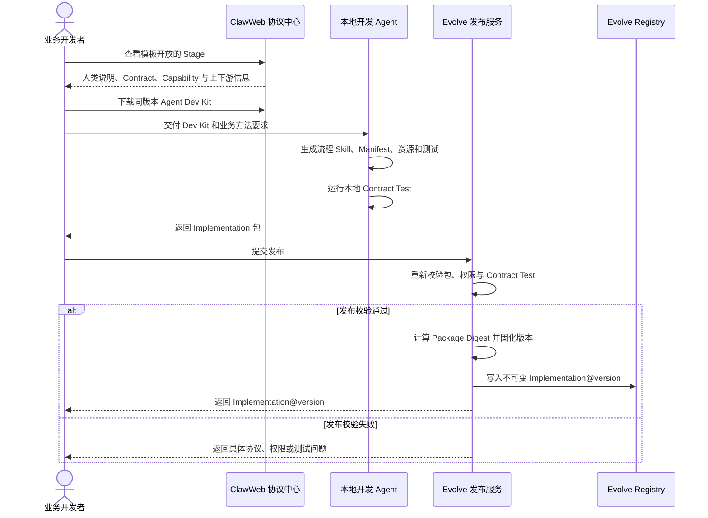

Implementation 发布成功后只进入可绑定实现集合，不会自动修改模板或正在运行的 Task。绑定与版本冻结由下一章说明。

---

## 7. Implementation 如何被模板绑定并冻结到 Task

业务 Implementation 发布成功后不会自动修改任何模板。它先进入对应 Contract 的可绑定实现集合，再由模板策略决定是否以及何时可以选择。

### 7.1 两组策略必须正交

| 维度 | 取值 | 平台约束 |
|---|---|---|
| Implementation Policy | `fixed` | 模板绑定已发布的精确实现版本，任务用户不能替换 |
| Implementation Policy | `selectable` | 模板提供默认实现；创建任务时只能从实现该 Stage Contract、通过发布校验且有权限的实现中选择 |
| Execution Policy | `required` | 每次运行都必须执行 |
| Execution Policy | `guarded` | 只能根据模板声明的任务参数或已校验上游枚举结果，使用有限等值规则决定是否执行；必须有确定性的下游兜底，不接受脚本或任意表达式 |

因此一个 Stage 可以同时是 `guarded + selectable`。若业务需要模板中不存在的新阶段，应由平台方法维护者发布新的 Template 版本，而不是让任务创建者临时插入节点。

### 7.2 如何判断业务 Implementation 可以绑定

流程能否组合不取决于 Stage 名称是否相同，而取决于协议是否衔接：

- 上游结果必须能够通过 Template 的固定类型化绑定直接组装成下游 Contract Input。
- 无法直接满足时，应调整 Contract、Implementation，或者发布包含显式处理 Stage 的新 Template。
- 平台不能在运行时猜字段，也不引入隐藏的数据转换脚本。

一个业务 Implementation 只有同时满足以下条件，才能进入某个 Stage 的可绑定集合：

1. Manifest 声明实现该 Stage 引用的精确 Contract 版本，或存在模板明确引用的兼容版本规则。
2. 请求的 Capability 不超过 Stage 的 Capability Ceiling。
3. Runtime 类型、Workspace 要求和目标运行环境兼容。
4. Implementation 已发布、未被阻断，并通过对应 Contract Test。
5. 当前租户和任务创建者拥有使用该实现的权限。

对于 `fixed` Stage，模板直接绑定官方 Implementation 精确版本。对于 `selectable` Stage，任务创建页可以在高级配置中展示平台默认实现和实现相同 Contract 的业务实现。用户选择的是“模板中这个 Stage 的实现”，不是把自己的 Stage 插进流程。

### 7.3 创建 Task 时一次性冻结什么

ClawWeb 解析用户选择并形成不可变 Creation Snapshot：

- Template 精确版本与摘要。
- 每个 Stage 的 Contract 精确版本。
- 每个 Stage 实际绑定的 Implementation、`runtime.type` 和 Package Digest。
- Stage 的 Capability Ceiling、Lifecycle Policy、Workspace Policy、`runtimePermissionCeiling` 及相关策略版本，以及 Implementation 声明的工具、网络和凭证运行要求；这些是调度时计算实际授权的冻结输入。
- 源目标引用与任务参数。目标资产支持版本时冻结基线精确版本；不支持版本时冻结基线快照或可验证内容摘要。运行中由 Stage 产生的新目标引用在 Output Gate 通过后另行固定为 Task 运行事实。
- 创建时已经可确定的 Bench 资源版本。

某个 Implementation 后续发布新版本时，已经创建的 Task 仍执行 Creation Snapshot 中冻结的旧版本。Agent 使用 SecBaaS 还是 Message 不属于 Template 或 Implementation 配置；ClawWeb 在每次调度时根据目标 Bot 的接入形态解析实际通道，并把结果记录在 dispatch audit 中。

### 7.4 运行期才产生的资源如何处理

Creation Snapshot 只冻结创建 Task 时已经能够确定的内容。运行中才产生或选定的资源按以下方式固定：

- 已发布 Bench Template 保存精确版本和摘要。
- Task 内动态生成的 Case、Domain 或文件保存不可变快照或内容摘要。
- 资源记录同时保留类型、来源 Stage Run 和生成时间，便于追溯。

后续 Round 始终复用同一组事实，不能漂移到最新版，也不能被同名资源覆盖。

### 7.5 有限 Loop 与结果转移如何冻结

Loop Policy 的定义见 5.4。创建 Task 时，它随 Template 精确版本一起进入 Creation Snapshot；运行中的 Implementation、用户反馈或后续模板发布都不能修改本次 Task 已冻结的循环规则。

- 每轮产生独立的 Round、Stage Run、Input 和 Output；历史结果由平台组装进入下一轮。
- ClawWeb 只执行冻结的最大轮数、有限枚举结果和结果转移，不接受运行时新增脚本、表达式或连线。
- `accept / continue / reject` 等结果只能触发 Template 已声明的后续动作；其中 Continue 必须重新经过同一个 Loop Policy 的轮数检查，不能直接创建无界回环。

---

## 8. Implementation 如何真正运行

运行时先按冻结的 `runtime.type` 决定由谁执行。Bot 启动通道沿用当前 OCB 选择逻辑，只负责把受控 Stage Run 送到目标环境，不属于模板和 Implementation 协议。

### 8.1 三种 Implementation 执行形态

- **Agent Skill Implementation**：ClawWeb 将 Stage Run 发到目标 Bot，容器内 Agent 加载流程 Skill 执行，适合诊断、分析、候选内容修改和优化。
- **Container Code Implementation**：目标 Bot 中的统一 Stage 执行入口加载已发布、受信的代码包执行，适合由 Python 代码组织的确定性阶段逻辑，以及现有 Diagnose、Plan、Optimize 方法的正式迁移。
- **ClawWeb 后端 Stage Implementation**：由 ClawWeb 或进化应用扩展中的确定性后端代码执行，适合初始化候选、创建版本、发布和应用等平台操作，不进入目标 Bot，也不启动 Agent。

三种执行形态遵守同一组边界：

- 都实现明确的 Stage Contract，并消费同一语义的 Stage Input。
- 平台为每种 `runtime.type` 提供固定的 Runtime Adapter，负责加载实现并把执行结果转换为统一的 `Completed / Failed / Waiting`；Adapter 不是第四种业务 Implementation。
- ClawWeb 后端 Stage Implementation 不是 HTTP Handler、容器 Python Handler、Hook 或 Capability，也不会因为业务名称不同而变成内核中的特殊 Stage 类型。

ClawWeb 后端 Stage Implementation 自己完成确定性平台逻辑。目标 Bot 中的统一 Stage 执行入口则是薄执行层，只负责校验冻结引用、准备输入，并通过 Runtime Adapter 加载 Container Code 或 Agent Skill Implementation；它不实现诊断或优化方法。

当前 `scripts/handlers/` 下的阶段 Python 代码必须迁移为正式的 Container Code Implementation，不能继续作为脚本入口存在。

### 8.2 ClawWeb 如何组装 Stage Input

模板声明当前 Stage 依赖哪些上游 Stage；ClawWeb 根据这些 Stage 已通过校验的 Output Contract，从 Stage Output、ArtifactRef，以及 Task 运行上下文中已经固定的具体资源引用里，按当前 Stage Contract 组装 Stage Input：

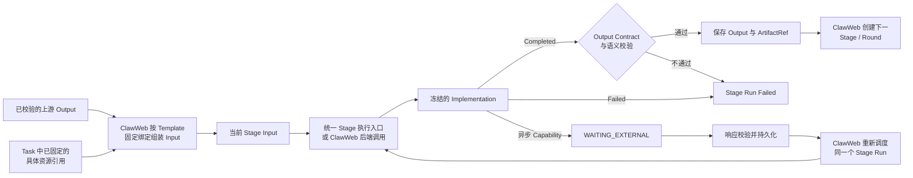

输入组装遵守三个限制：

- 后续 Stage 不扫描全部历史结果，也不要求 Implementation 读取所有可选字段。
- ClawWeb 只按照 Template 中声明的固定绑定传递完整类型化片段；无法直接满足下游 Contract 时，Template 不能发布，必须修改协议或增加显式 Stage。
- `guarded` Stage 被跳过时，Template 必须预先声明下游兜底，不能在运行中猜测字段如何连接。

### 8.3 Bot 启动通道不进入方法协议

当前 ClawWeb/OCB 根据目标 Bot 的接入形态选择已有通道：

- **SecBaaS Bot**：ClawWeb 调用 `execute-command`，进入目标 Bot 容器中的现有 Runner，再由 Runner 启动统一 Stage 执行入口。
- **Message Bot**：ClawWeb 发送 Message，由目标 Bot Agent 的统一 Stage 命令进入同一个 Stage 执行入口；这条路径不经过 Runner。

两条通道只解决“如何到达目标 Bot”，不属于 Evolution Template、Contract 或 Implementation 配置。`ImplementationRef`、Input 和 Policy 都从 ClawWeb 冻结事实中读取；目标环境若无法满足正式 Stage 协议，就不能运行新模板，不能回退到旧脚本或旧报告协议。

### 8.4 Runner、统一 Stage 执行入口与 Implementation 分别做什么

| 组件 | 负责什么 | 不负责什么 |
|---|---|---|
| ClawWeb 模板调度 | 创建 Stage Run / Step、分配 Round、组装输入、推进有限 Loop | 不编排 Optimize 内部每一次 Bench、Tune 或 Review |
| SecBaaS / `execute-command` | 将受控 Stage Run 请求送到目标 Bot 容器中的 Runner | 不改变 Contract、选择 Implementation 或参与方法判断 |
| 容器内现有 Runner | 校验启动参数、防重，管理进程与日志，并启动统一 Stage 执行入口 | 不解析 Implementation 包，不组装 Input，不理解业务方法，不执行任意脚本路径 |
| Message / Agent 统一 Stage 命令 | 不经过 Runner，把受控 Stage Run 标识交给同一个统一 Stage 执行入口 | 不自行选择 Implementation，不持有模板规则，不推进流程 |
| 统一 Stage 执行入口 | 校验冻结引用与包摘要，取得 Input，加载正式 Container Code 或 Agent Skill Implementation，并衔接完成、失败和等待生命周期 | 不执行 Diagnose、Plan、Optimize 业务，不创建下一轮，不决定 Stage 间推进 |
| Container Code / Agent Skill Implementation | 执行当前 Stage 的业务方法，例如 Optimize 内部组织 Bench、Tune 和 Review | 不直接创建下一 Stage、下一轮或修改 ClawWeb Task 状态 |

当前 Runner 仍按固定 `stage → Python 脚本` 路由。目标改造是让现有 Runner 成为统一 Stage 执行入口的稳定启动入口：

- Runner 只接收受控 Task/Step 标识并启动统一 Stage 执行入口。
- 统一 Stage 执行入口根据服务端冻结的 `ImplementationRef` 加载正式代码包或流程 Skill。
- 现有 Diagnose、Plan、Optimize Python 逻辑完成封装、Manifest、Contract Test 和生命周期迁移后一次性切换。
- 切换后删除固定路由、脚本直启和旧 Step Report 完成分支；动态模板不能向 Runner 下发任意 Shell、脚本路径或命令。

### 8.5 Workspace、Artifact 与权威交付

Stage Run 具有独立 WorkDir 和访问策略。ClawWeb 投影只读 Input 与获准的上游 Artifact；Runtime 根据 Creation Snapshot 中冻结的权限上限和请求，在本次调度时计算并审计实际授权，再控制目标区域的读写：

- 进化应用提供的 `targetRef` 是不透明资源引用，不是调用方可注入的宿主机路径；Runtime 只把该引用解析到当前 Stage 获准访问的目标区域。
- 创建 Task 时先冻结源目标引用；如果 `InitializeCandidate` 等 Stage 产生新的工作目标引用，ClawWeb 只在 Output Gate 通过后把它固定为后续 Stage 的当前目标。
- Skill 进化中的当前目标是 Task 级候选；Bootstrap 与 Optimize 使用同一个 `candidateRef`，因此现有 Optimize 看到的仍是标准目标 Workspace，不需要理解 Skill 版本或候选语义。
- Task 产物按 Task、Stage/Step 和 Round 隔离。
- 上游数据只读；目标区域是否可写由 Stage Workspace Policy 决定。
- 凭证不进入 Task Context、命令、报告或 Artifact。
- 大文件和目录通过 ArtifactRef 提交，平台校验类型、归属和摘要。
- Stage 是否完成只以结构化 `Completed` 结果为准；写出某个本地文件不能自动推进。
- Output Contract Gate 通过后，结构化 Output 与 ArtifactRef 才进入 Task Runtime Context，供下游消费。

现有目录布局可以迁移并统一，但权威交付必须切换到正式生命周期协议，不能再由某个约定文件或旧结果目录隐式推进流程。

---

## 9. Capability、Agent 权限与交付约束

Contract 保证上下游结构能够连接；Capability 约束 Implementation 可以调用哪些平台 API，Agent 运行权限则约束它可以使用哪些工具、目录、网络和凭证。Agent 运行权限不是 Contract，也不是一个独立 Registry 资产。

### 9.1 Capability Protocol 是什么

Capability 是平台向 Stage Run 提供的版本化工具调用协议，不是 Hook 或模板节点。每个 Capability 定义：

- 稳定 ID、版本、请求和返回 Schema。
- 同步调用、异步暂停或平台控制等执行语义。
- 权限范围、允许作用的资源、幂等、超时和审计规则。
- 后端 Provider；需要交互时还包括前端 Renderer。

例如 `AskUser@1.0.0` 定义如何提交题目、创建 Interaction、进入等待和恢复；`Artifact@1.0.0` 定义如何上传并返回受控 ArtifactRef。

`completeStage` 和 `failStage` 是当前 Stage Run 的基础生命周期接口，不是 Stage，也不是业务可自由选择的 Capability：

- Agent Skill Implementation 通过 Runtime 注入的生命周期工具提交结果。
- Container Code Implementation 返回结构化 Envelope，由 Runtime Adapter 代为提交。
- ClawWeb 后端 Implementation 直接返回同一结构化 Envelope。
- 三种形态最终都形成统一的 `Completed / Failed` 结果；只有 `Completed` 的成功载荷进入 Output Contract Gate，`Failed` 直接进入失败生命周期。

### 9.2 本次 Stage 实际获得哪些能力

平台 Capability 与 Agent 底层运行权限分别计算。Manifest 声明需要 AskUser、网络或某个工具，并不代表运行时一定获得：

```text
Template Stage 允许的平台 Capability
∩ Implementation Manifest 申请的 Capability
∩ 租户和部署环境策略
= 本次 Stage Run 可调用的平台 Capability

Template Stage 允许的工具、Workspace、网络和凭证范围
∩ Implementation Manifest 声明的 Runtime Requirements
∩ 目标运行环境实际可执行的安全策略
= 本次 Stage Run 的有效 Agent 运行权限
```

前者由 Capability Gateway 在 API 调用处执行；后者由 Agent Runtime 在真实 Tool Call、Filesystem、Network 和 Credential 边界执行：

- Creation Snapshot 冻结 Template 上限、Implementation 请求和相关策略版本。
- 每次 Stage 调度前，根据目标环境实际能力计算本次授权；不满足必需条件时拒绝调度。
- 实际授予、拒绝和使用情况写入对应 Stage Run 的运行审计，不反向修改 Creation Snapshot。

### 9.3 平台如何形成完整约束闭环

| 约束问题 | 平台手段 |
|---|---|
| 能拿到什么 | Contract Input + ClawWeb 固定输入组装，只注入当前 Stage 获准数据 |
| 能调用哪些平台能力 | Capability Ceiling、Manifest 请求与环境策略取交集，并由 Capability Gateway 校验每次请求 |
| 能使用哪些 Agent 工具 | Template 运行权限上限、Manifest Runtime Requirements 与环境策略取交集，并由 Agent Runtime 强制执行 |
| 能看到和修改什么 | Stage Workspace Scope、容器权限和资源代理 |
| 必须交付什么 | 成功时提交 `Completed(output)` 并按 Output Schema 校验；失败时提交 `Failed(error)` |
| 能否继续 | ClawWeb 根据模板、当前状态和已经校验的结果推进 |
| 是否真的有效 | 由具体进化方法中的 Bench、目标指标和 Review 判断整体效果 |

自然语言 `SKILL.md` 只能指导 Agent，不能自己证明安全或正确。Manifest 是声明，不是权限边界；真正的约束必须发生在输入装配、真实工具调用、Filesystem、Network、Credential 和输出校验处。

### 9.4 现状与完整目标必须如实区分

当前 OCB / SecBaaS 的主要运行单元仍是 Bot Session / Run，尚未完整开放按 Stage 注册工具、目录和网络策略的统一协议。因此要分三层描述保证：

| 保证等级 | 设计口径 |
|---|---|
| 当前控制面可强保证 | Stage Input 由 ClawWeb 组装；Output Contract 不通过不推进；平台受控 Capability 经过 Gateway；版本发布等平台操作不能被 Agent 绕过 |
| Runtime 未闭环时的受限保证 | 可以向 Agent 展示约定工具，但底层若仍存在宽权限 Shell、Filesystem 或 Network，不能宣称已经形成逐 Stage 硬隔离 |
| 完整目标保证 | Runtime 在每次真实 Tool Call、Filesystem、Network 和 Credential 访问处执行本次 Stage Run 的有效权限，并审计允许、拒绝和资源范围 |

完整约束需要 Evolve 与 Agent Runtime 共同完成：

- Evolve 计算并传递本次 Stage Run 的有效运行权限。
- OCB / Avernet 在真实执行边界落实这些权限。
- 目标 Runtime 不能执行模板要求的硬限制时，ClawWeb 必须拒绝调度需要该保证的 Template。
- 提示词约束不能替代运行时强制执行。

### 9.5 完成、失败和等待如何进入生命周期

一次 Implementation 执行只能形成三类生命周期结果：

- `Completed(output)`：Implementation 或 Runtime Adapter 通过 `completeStage` 提交；Schema 校验通过后 Stage 才成功。
- `Failed(error)`：Implementation 或 Runtime Adapter 通过 `failStage` 提交；本次 Stage Run 进入失败终态。
- `Waiting(interactionRef)`：调用 AskUser / Approval 等异步 Capability 后进入 `WAITING_EXTERNAL`，收到有效响应后恢复同一个逻辑 Stage Run。

Implementation 不能自行创建下一 Stage、下一轮或修改 Task 状态。AskUser、Session 恢复、超时、取消和重试都由统一 Stage 生命周期处理。

真实运行中若 Implementation 只输出自然语言、直接退出或没有产生结构化结果，按协议错误或超时处理，不能推进流程。

---

## 10. Stage 生命周期与 AskUser

### 10.1 通用生命周期

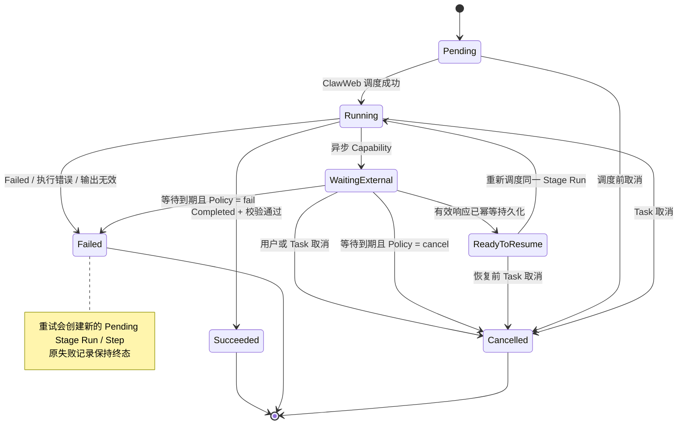

这张图描述的是一次 Stage Run 的生命周期，不是整个 Template 的执行流程：

- Stage Run 是 ClawWeb 管理的一次逻辑执行记录。
- 对于 Agent Skill Implementation，一次 Stage Run 可以跨越多个 Agent Turn，不要求始终保持同一个容器进程或 Agent Session。
- Agent Turn 指 Agent 收到一次输入或恢复消息后进行推理、调用工具，并以结果或等待状态结束的一次执行片段。

| 环节 | 状态变化 | ClawWeb 与 Runtime 的行为 |
|---|---|---|
| 首次执行 | `Pending → Running` | ClawWeb 组装 Input 并调度 Implementation；统一 Stage 执行入口认领成功后进入 `Running`。 |
| 成功 | `Running → Succeeded` | Implementation 返回 `Completed(output)`；Output Contract 校验通过后才成功。 |
| 失败 | `Running → Failed` | Implementation 返回 `Failed(error)`、执行异常或成功输出校验失败。 |
| 等待外部输入 | `Running → WaitingExternal` | 调用 AskUser、Approval 等异步 Capability；当前 Agent Turn 结束，不保持同步进程等待。 |
| 响应就绪 | `WaitingExternal → ReadyToResume` | ClawWeb 校验并幂等保存外部响应，准备恢复同一个 Stage Run。 |
| 恢复执行 | `ReadyToResume → Running` | ClawWeb 为同一 `stageRunId` 创建恢复任务：SecBaaS 走 `execute-command → Runner`，Message 走固定 Stage 命令，后端 Implementation 直接调用。优先复用原 Session，否则按 Input、响应和 Checkpoint 重建。 |
| 流程推进 | 当前 Stage Run 保持 `Succeeded` 终态 | Implementation 不创建后续节点；ClawWeb 根据冻结的 Template、Output 和 Loop Policy，另行创建下一 Stage Run / Round，或者结束 Task。 |
| 取消 | 任意非终态 `→ Cancelled` | 用户或 Task 主动取消当前 Stage Run。 |
| 等待到期 | `WaitingExternal → Failed / Cancelled` | 按冻结的 Lifecycle Policy 进入失败或取消，不临时改变结果语义。 |
| 重试 | 原 Stage Run 保持 `Failed`，另建 `Pending` Stage Run | 保留原失败记录；只有冻结的 Stage 重试策略允许时，ClawWeb 才为同一个模板 Stage 新建 Step/Stage Run，并把 attempt 加一。重试不等于新的 Optimize Round，也不消耗 `maxRounds`。 |

`Pending` 表示尚未首次执行，不表示等待用户；等待外部输入统一记为 `WAITING_EXTERNAL`，当等待对象是用户时，产品页面可以展示为 `WAITING_USER`。

生命周期策略的归属保持明确：

- 是否允许 Stage 重试、最多重试次数和间隔由 Template 的 Stage 策略定义，并随 Task 冻结。
- Capability 定义交互响应的 Schema、幂等和协议级超时；Template 在允许范围内选择等待期限及超时后的失败或取消结果。
- 具体进化应用可以负责页面展示和提醒，但不能在运行中改变本次 Task 已冻结的结果语义。

### 10.2 AskUser 是 Skill 内主动调用的平台能力

AskUser 不应被拆出 Skill 的优化过程。何时提问、问什么，仍由正在执行的业务 Skill 决定；平台只提供可靠的交互与恢复通道。

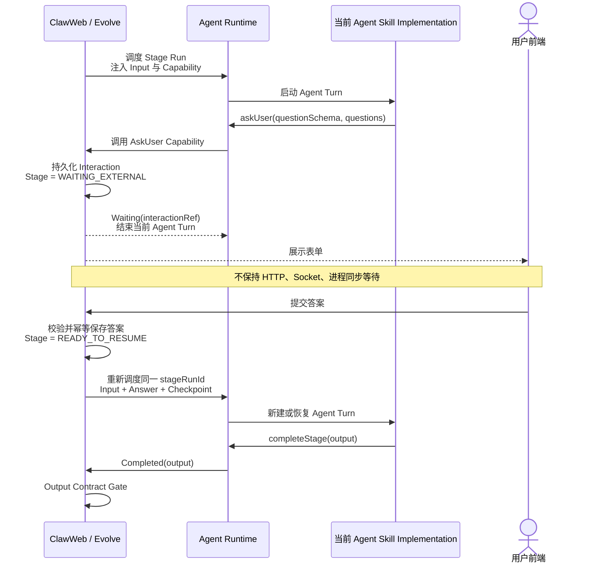

图中的 `askUser(...)` 和 `completeStage(output)` 箭头表达的是逻辑调用。Agent Skill 实际通过 Runtime 注入的受控接口发起请求：AskUser 进入 Capability Gateway，完成结果由统一 Stage 执行入口上报 ClawWeb；两者都不能绕过 Runtime 直接修改 ClawWeb 状态。

必须恢复同一个逻辑 Stage Run。在 Runtime 支持时优先复用原 Agent Session 以保留对话上下文；Session 不可用时，从持久化的问题、答案、Stage Input、Checkpoint 和必要上下文重建新的 Agent Turn。正确性不能依赖原物理 Session 永久在线。

重复提交答案必须幂等；已结束或已取消的 Interaction 不能再次恢复 Stage。用户长期不回答时，ClawWeb 按本次 Task 已冻结的等待策略处理：应用可以提醒用户，但最终是继续等待、取消还是失败不能由页面临时改写，也不能让同步进程无限悬挂。

AskUser 是第一项交互 Capability，后续可以用同样机制扩展 Approval、Checkpoint、外部系统确认等，而不增加新的流程 Hook 概念。

---

## 11. 现有自进化整体迁移到统一协议

### 11.1 默认模板是现有链路的资产化表达

第一套内置模板应精确表达当前行为：

| 默认模板 Stage | 迁移后的官方 Implementation | 行为要求 |
|---|---|---|
| Diagnose | `official.diagnose-container@1.0.0` | 交付 diagnosis + cases |
| Plan | `official.plan-container@1.0.0` | 交付 Goal + Spec + Bench Cases/Domains |
| Optimize | `official.optimize-container@1.0.0` | 作为 Round Stage 消费稳定 Optimize Input Contract 和 previousRounds；Loop 由 Template 中冻结的 Loop Policy 控制，Implementation 内部调用 Bench/Tune/Review |

默认模板迁移保持以下边界：

- Task Completed 是模板终态，不是额外 Result Stage，也不自动引入 Skill 发布或其他业务 Apply。
- 新运行时发布前，现有 Diagnose、Plan 和 Optimize 必须完成正式 Implementation 迁移并通过 Contract Test；模板只绑定这些正式版本。
- 迁移保持今天的用户结果与方法行为，但不保留原命令、脚本直启或 Step Report 完成协议。

### 11.2 Bench 如何接入进化方法

Template 不把某个 Bench 直接绑定到 Stage；它规定上游 Stage 交付 Bench Case、Domain 等选择结果，并把 ClawWeb 固定后的具体 Bench 资源注入 Optimize Stage。Optimize 拿到这些资源后，在内部调用现有 Bench 能力产生效果证据。

#### 管理时：定义 Bench 信息如何传递

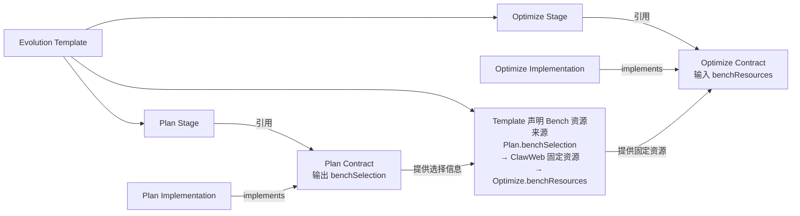

在默认自进化方法中，Template 决定：

- Plan Stage 负责生成或选择 Train/Test Bench Case、Domain，以及确定性的 Template 选择范围，例如指定 Template 名称集合或“该 Domain 下当前全部 Published Template”。
- Plan 的成功输出通过 Contract Gate 后，ClawWeb 解析这些 Domain 当前可用的 Published Bench Template，并立即固定精确版本和摘要。
- Optimize Stage 只消费 ClawWeb 已经固定的 Bench 资源，不在每轮重新查询“最新版本”。

这不是给 Plan 绑定一个固定 Bench。Plan 交付符合 Contract 的 Case、Domain 和确定性 Template 选择范围；ClawWeb 只负责按该范围解析精确版本并形成当前 Task 后续各轮共同使用的 `benchResources`，不能自行猜选评测模板。资源集合记录 Case/Domain 的不可变引用或摘要，以及 Published Bench Template 的精确版本。

Template 中保存的是“Bench 资源从哪个 Stage Output 产生”的类型化来源声明，该声明随 Creation Snapshot 冻结。它不是新的 Stage、独立资产或任意数据转换器。来源 Stage 成功后，ClawWeb 执行一次平台内置的 Bench 资源解析：

- 解析成功：保存具体资源 ID、每个 Published Bench Template 的精确版本与摘要，以及动态 Case/Domain 的不可变引用或内容摘要。
- 解析失败或资源无权访问：不创建 Optimize Stage，记录资源解析失败及证据。

#### 运行时：使用 Bench 产生效果证据

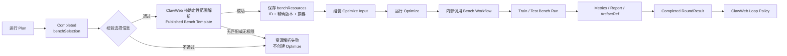

| 对象 | 在进化方法中的作用 |
|---|---|
| Bench Domain / Template / Case | 定义使用什么任务进行评测 |
| `benchResources` | ClawWeb 根据 Plan 结果解析并固定的评测资源集合，包含不可变 Case/Domain 引用或内容摘要，以及 Published Bench Template 的 ID、精确版本和摘要 |
| Bench Workflow | Optimize Implementation 内部调用的现有评测能力 |
| Bench Run | 一次真实的 Train 或 Test 评测执行 |
| Bench Evidence | Bench Run 产生的分数、报告和 Artifact |
| RoundResult | Optimize 对本轮结果的统一交付 |
| Loop Policy | ClawWeb 根据已校验的 RoundResult 决定继续下一轮或结束 |

完整自进化创建 Task 时不要求用户手工选择 Bench。Plan 运行后生成或选定 Train/Test Case 与 Domain；ClawWeb 校验后解析 Published Bench Template，保存精确版本、不可变资源引用和必要的内容摘要。后续 Optimize Round 始终使用这同一组资源，不随运行过程漂移。

Bench 的边界是：

- 默认不是单独的顶层 Stage，也不是 AskUser 一类 Capability，而是 Optimize 内部使用的效果验证能力。
- 独立 Bench 与 Bench 驱动 Optimize 可以继续作为独立产品形态存在，但不与完整自进化入口混为一谈。
- Contract Test 判断 Stage Implementation 能否接入；Bench 判断完整优化方法是否真的改善目标。两者不能替代。

### 11.3 不让模板抽象侵入 Optimize 内部方法

Tune、Review、Pack、Restore 和多次 Bench 调用仍由迁移后的官方 Optimize Implementation 在内部组织。只有当某项能力需要独立的控制面生命周期、输入输出或用户可替换边界时，才考虑将其提升为顶层 Stage。

### 11.4 官方阶段实现的完整协议迁移

当前 OCB 启动通道继续按现状工作，本方案不处理其未来统一。Evolve 需要迁移的是通道之后的阶段执行协议：今天 Runner 和 Skill 命令按固定 Stage 进入指定脚本，目标则只允许进入统一 Stage 执行入口，并解析 Registry 中冻结的正式 `ImplementationRef`。

迁移不重写已经验证的内部方法，重点验收统一执行协议是否完成：

- Diagnose、Plan、Optimize 都已封装并发布为正式 Container Code Implementation，声明精确 Contract、权限请求和受控入口。
- 三个实现都通过 Contract Test 和现有行为回归，能够使用统一 Stage Input 与 `Completed / Failed / Waiting` 生命周期。
- Runner 和 Message 通道都只进入统一 Stage 执行入口；固定 `stage → script` 路由、脚本直启和旧 Step Report 完成分支已经删除。
- 切换后只运行新协议，不保留并行链路或失败回退。

具体运行职责与入口改造分别见 3.3 和 8.4。未来若用流程 Skill 重写某种方法，应发布新的 Agent Skill Implementation，并在新 Template 版本中显式替换绑定；同一个 `ImplementationRef` 不能在运行时二选一。

---

## 12. Registry 治理与协议中心

Template、Stage Contract、内置 Lifecycle Protocol、Capability 和 Implementation 完成发布、绑定和冻结后，还需要统一的长期治理原则与 ClawWeb 查询入口，避免把运行数据库误当成协议编辑器。

### 12.1 Git 协议包是标准源，DB 是发布 Registry

Evolution Template、Stage Contract、内置 Lifecycle Protocol 和 Capability 虽然需要进入 DB 供 ClawWeb 查询和运行，但不能只以数据库 JSON 的形式存在。平台应使用可评审、可开源的 Git 协议包作为源：

Git 协议包用于开源和分发平台沉淀的进化方法，使官方 Template、Contract、Lifecycle Protocol 和 Capability 可以被阅读、评审、Fork，并随开源项目一起部署。Evolve Registry 不负责编辑这些协议，只保存当前部署环境中经过校验的已发布版本，供运行时查询、绑定和冻结。

```text
protocols/
  evolution-templates/<template-id>/<version>/
    template.yaml
    README.md
    examples/
    compatibility-tests/

  stage-contracts/<contract-id>/<version>/
    contract.yaml
    input.schema.json
    output.schema.json
    README.md
    examples/
    tests/

  stage-lifecycle/<version>/
    lifecycle.yaml
    envelope.schema.json
    README.md
    tests/

  capabilities/<capability-id>/<version>/
    capability.yaml
    input.schema.json
    output.schema.json
    README.md
    examples/
```

`template.yaml` 必须声明：

- Stage Contract 和默认 Implementation 的精确版本。
- 固定类型化数据绑定。
- Implementation、Execution 与 Lifecycle Policy。
- Capability Ceiling、运行权限上限与 Loop Policy。

Template 与 Contract 发布后都不可原地修改。Implementation 包及其 Manifest 可以由独立仓库发布，但 Template 最终引用的仍必须是不可变版本和摘要。

发布链路为：

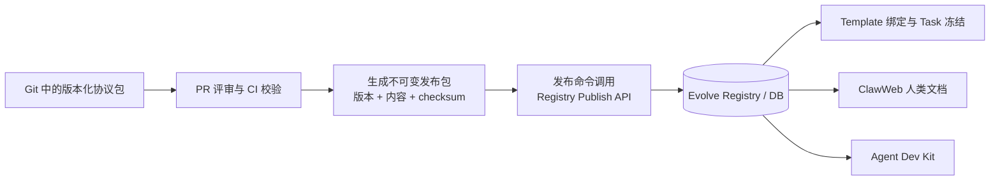

Registry Publish API 在写入 DB 前必须重新校验包类型、Schema、精确引用和版本不可变性，并由发布服务计算或核验权威 checksum；CI 生成的发布包不能绕过服务端门禁直接写库。

已发布版本不可原地修改，只能发布新版本；模板只能引用已发布版本；Task 只读取冻结版本。DB 保存协议内容、版本、状态、摘要、引用关系和发布元数据，服务运行时和 UI 查询，但不成为不可见的唯一标准源。

Implementation Manifest 应随 Implementation 包一起提交，作为其 Contract 与 Capability 声明的作者源；Registry 在发布时固化一份不可变副本。ClawWeb UI 可以展示这些声明，但不能另设一套可覆盖 Manifest 的编辑入口，避免 Git、Skill 包和 DB 出现三个相互冲突的事实源。

### 12.2 协议中心

平台方可以在 ClawWeb 提供内部“协议中心”：

- Stage Contracts：查看用途、Input/Output、示例、版本 Diff 和引用模板。
- Stage Lifecycle：查看 `Completed / Failed / Waiting`、恢复、取消和错误 Envelope 的平台统一版本。
- Capabilities：查看调用协议、状态语义、权限范围、Provider 和前端 Renderer。
- Implementations：查看实现的 Contract、请求 Capability、测试结果、可见范围和发布状态。
- Templates：查看 Stage 顺序、槽位模式、默认绑定和版本引用。

协议和模板只通过 Git + PR + 发布流水线维护；协议中心用于查询、审计、查看发布状态和依赖关系，不提供在线协议编辑，也不能直接修改已发布的 DB 记录。

这里的“平台方”是方法和平台的维护者：在公司内部是 ClawEvolve 平台团队；在开源部署中是对应社区或部署方。开源使用方可以通过代码和协议包开发自己的模板，但普通任务用户仍不在产品界面中自由创建 Stage 或 DAG。

### 12.3 版本状态与权限边界

- Git 分支和 PR 中尚未发布的内容属于草稿，只用于评审和 CI，不进入运行时 Registry，也不能被 Task 引用。
- Published 版本不可原地修改，可以被 Template 或 Task 绑定。
- Deprecated 版本不再作为新任务默认选择，但已有 Creation Snapshot 仍可解析和复现。
- 因安全问题需要阻断时，Registry 只能追加阻断状态和原因，不能删除历史内容；正在运行的 Task 按明确的安全策略失败或停止。
- 平台方法维护者负责 Template、Contract 和 Capability 的发布；业务开发者只能发布自己有权限的 Implementation；任务用户只能选择已发布、满足 Stage Contract 且有使用权限的版本。

Registry 需要保存引用关系，阻止仍被已发布 Template 使用的 Contract、Capability 或默认 Implementation 被无提示下线。版本升级通过发布新版本和迁移模板引用完成，不修改历史 Task。

---

## 13. 开源交付边界

开源版本不能只提供一个模板解析器。下列内容是逻辑上的开源交付项，不表示必须拆成多个 Git 仓库：

| 开源交付项 | 主要内容 | 目的 |
|---|---|---|
| 轻量 Evolve 内核 | Template 执行、Task/Stage Run 生命周期、有限 Loop、状态推进和结果校验 | 让平台沉淀的方法能够可靠运行，同时避免演变成通用重型工作流引擎 |
| 协议文件、Schema 与测试 | `template.yaml`、Contract/Capability YAML、Stage Lifecycle YAML 与 Envelope Schema、Implementation Manifest Schema、Input/Output JSON Schema、生命周期 API、README、示例和一致性测试 | 将设计中需要平台与外部实现共同遵守的部分固化成 Git 中的实际文件，供 Agent Dev Kit、Registry 和 ClawWeb 读取与校验 |
| 官方进化方法 | 当前成熟的 Diagnose、Plan、Optimize 默认 Template 及其官方 Contract | 将平台已经验证过的效果提升方法直接交付给开源使用方，而不只提供空白编排能力 |
| 默认 Implementation 与参考示例 | 每套默认 Template 必需的可运行官方 Stage Implementation，以及额外用于演示协议的参考实现 | 保证官方方法开箱即用；参考示例用于说明其他运行形态如何正确实现 Contract，不能代替默认实现 |
| Bench 集成 | Bench 资源传递、Bench Workflow 接入、效果证据和 RoundResult 交付方法 | 让进化结果以可重复的评测证据证明有效，而不是只证明流程执行完成 |
| Stage Capability 基建 | Evolve Registry 中的 Capability 目录、调用 API、请求/响应 Schema、权限校验及同步/异步结果处理；AskUser 作为首个参考实现，提供对应 Provider/Renderer | 让 Stage Implementation 通过统一受控接口使用平台能力，并支持未来扩展更多 Capability，而不为每种业务需求修改 Template 或增加 Hook |
| Agent Dev Kit 与验证工具 | 面向人和 Agent 的开发说明、脚手架、示例流程 Skill、校验命令和契约测试执行器 | 帮助人或本地 Agent 理解协议、生成 Implementation，并在发布前发现协议、权限和输出问题 |
| Evolve Registry 接口 | Template、Contract、Capability 和 Implementation 的发布、版本、查询、引用和摘要接口 | 将 Git 中的开源协议包发布为当前部署环境可查询、可绑定、可冻结的不可变版本 |
| Skill 进化扩展 | Skill 注册、候选版本、用户确认、版本升级和应用的参考产品实现 | 展示如何基于通用 Evolve 能力构建具体资产进化产品，同时保持通用内核不依赖 Skill 中心 |

开源交付中将 Skill 进化作为独立参考扩展提供，用来验证通用协议如何支撑具体资产进化；通用内核不依赖 Skill 中心。企业内部的身份、权限、Bot 发布和存储实现可以替换为 Adapter；开放协议不能依赖内部数据库字段、内部工号或专有执行通道。

判断一个设计是否适合进入开源内核，可以问三个问题：

1. 不使用 Skill 中心的用户是否仍然需要它？
2. 未来进化其他资产时是否仍然成立？
3. 它描述的是稳定协议和控制语义，还是某个业务当前页面或流程的特殊判断？

只有前两项为“是”且第三项属于稳定协议时，才应进入通用内核。

---

## 14. 最终结论

ClawEvolve 应从“代码中固定的一条自进化流程”演进为“由平台沉淀方法模板、通过稳定协议受控扩展的效果提升平台”，但不能演进成通用工作流产品。

各部分最终形成清晰分工：

- 现有 Diagnose、Plan、Optimize Loop 是第一套默认方法，其内部方法逻辑迁移为正式 Implementation，旧启动和报告协议不保留。
- Skill 进化是第一套验证扩展能力的独立应用，不是写进内核的特殊流程。
- Template 约束方法，Contract 保证上下游可组合，Capability 支持 Agent 与平台受控协作，Bench 验证整体效果，Skill 中心负责目标 Skill 的版本与发布。

最终形成的产品应当是：**有方法、有默认效果、有稳定协议、可以扩展，但不要求用户自己设计工作流。**

---

## 附录 A：从 Skill 注册到自进化完成的完整时序

本附录补充主文第 4 章中的系统协作关系，用于串起 Skill 资产、模板运行、Agent 执行、用户交互和版本升级；具体页面与 API 形态不在本文定义。

Skill 进化 Task 的产品入口属于 Skill 中心/Skill 进化扩展：用户在该应用中选择目标 Skill，由扩展向通用 Evolve 提交不透明目标引用、模板和任务参数。下面时序图中的“用户创建进化 Task”是这一调用的简写，不表示通用 Evolve 页面理解 `skillId` 或 Skill 版本。

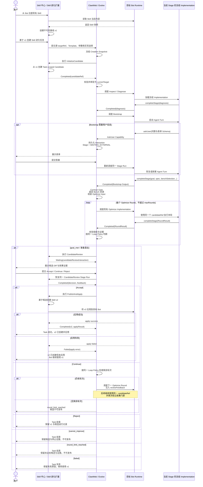

这条时序中的职责保持分离：

- Evolve 负责冻结方法、调度 Stage、校验交付、等待恢复和 Loop 推进。
- 目标 Bot 中的流程 Skill 或代码实现负责当前 Stage 的分析与修改。
- Skill 中心与 Skill 进化扩展负责 v1、候选、v2、发布和应用。
- 用户确认发生在 CandidateReview Stage 内，但交互持久化和恢复由通用 Capability 基建提供。
- CandidateReview 的 Continue 由 ClawWeb 重新交给同一个 Loop Policy 检查剩余轮数；`cannot_improve` 与 `round_limit_reached` 都结束且不发布候选。
- 如果版本记录已经创建但应用失败，应保留“v2 已创建但未应用”的审计事实；目标 Bot 当前应用版本仍为 v1，不能把这两个状态合并描述成“没有 v2”。

---

## 附录 B：用现有自进化链路看懂 Template、Contract 与 Implementation

> 本附录只用于直观说明目标协议如何等价表达现有 `Diagnose → Plan → Optimize Loop`。示例中的字段名、ID、版本、入口和 Schema 路径都是概念占位，不代表已经实现或最终确定的 API；完整 JSON Schema、数据库结构和 Runner 参数不在本附录展开。

### B.1 先看三类管理对象分别解决什么问题

| 想知道的问题 | 看哪个对象 | 现有自进化中的答案 |
|---|---|---|
| 方法包含哪些阶段、顺序和循环 | Evolution Template | `Diagnose → Plan → Optimize`，其中 Optimize 按有限轮次重复 |
| 每个阶段必须接收和交付什么 | Stage Contract | Diagnose、Plan、Optimize 各有独立 Input/Output |
| 哪段逻辑真正完成阶段工作 | Stage Implementation | 三个官方 Container Code Implementation |

三类 Stage 的关系如下：

| Stage | Contract 主要交接 | 默认 Implementation | Bench 关系 |
|---|---|---|---|
| Diagnose | 输入任务配置与诊断数据；输出 `diagnosis`、`cases` | `official.diagnose-container@1.0.0` | 产生原始诊断 Case，不执行 Bench |
| Plan | 输入 Diagnose 结果；输出 `goal`、`spec`、`benchSelection` | `official.plan-container@1.0.0` | 生成或选择后续所需的 Bench Case 和 Domain；ClawWeb 在 Plan 成功后将其解析为包含精确版本和摘要的 `benchResources` |
| Optimize | 输入诊断结果、Goal、Spec、固定 Bench 资源和历史 Round；输出本轮结果与效果证据 | `official.optimize-container@1.0.0` | 每轮内部执行真实 Bench Run |

外层轮次由 ClawWeb 控制：Optimize Implementation 只完成当前 Round，不能自行创建下一轮。

### B.2 `template.yaml` 示例

```yaml
# 概念示例，非最终 API
kind: EvolutionTemplate

metadata:
  id: official.full-self-evolution
  version: 1.0.0
  name: 现有完整自进化

spec:
  parameters:
    diagnose:
      type: object
    maxRounds:
      type: integer
      minimum: 1
      default: 3
      maximum: 100

  resources:
    optimizeBench:
      kind: bench
      source: stage.plan.output.benchSelection
      freezeWhen: source_completed

  stages:
    - id: diagnose
      contractRef: official.evolve.diagnose@1.0.0
      executionPolicy: required
      implementationPolicy:
        mode: fixed
        implementationRef: official.diagnose-container@1.0.0
      inputBindings:
        target: task.target
        parameters: task.parameters.diagnose
      onCompleted: plan

    - id: plan
      contractRef: official.evolve.plan@1.0.0
      executionPolicy: required
      implementationPolicy:
        mode: fixed
        implementationRef: official.plan-container@1.0.0
      inputBindings:
        target: task.target
        diagnose: stage.diagnose.output
      onCompleted: optimize

    - id: optimize
      contractRef: official.evolve.optimize@1.0.0
      executionPolicy: required
      implementationPolicy:
        mode: fixed
        implementationRef: official.optimize-container@1.0.0
      inputBindings:
        target: task.target
        diagnose: stage.diagnose.output
        goal: stage.plan.output.goal
        spec: stage.plan.output.spec
        benchResources: resources.optimizeBench
        round: runtime.round
        previousRounds: loop.previousSuccessfulRounds

  loopPolicy:
    roundStage: optimize
    maxRounds:
      taskParameter: maxRounds
    decisionInputs:
      goal: stage.plan.output.goal
      metrics: currentRound.output.metrics
      recommendation: currentRound.output.stopRecommendation
    continueOn:
      - goal_not_met
    successOn:
      - goal_met
    terminalOn:
      - cannot_improve
    onExhausted: round_limit_reached

  resultTransitions:
    goal_met: complete_task
    cannot_improve: finish_without_goal
    round_limit_reached: finish_without_goal
```

Template 字段说明：

| 字段 | 含义 |
|---|---|
| `kind` | 当前文档描述的是一套 Evolution Template |
| `metadata.id` | 模板稳定标识 |
| `metadata.version` | 模板不可变版本；修改方法必须发布新版本 |
| `metadata.name` | 面向使用者展示的名称 |
| `spec.parameters` | 创建 Task 时允许提供的参数类型和边界；`maxRounds` 的上下限保证 Loop 有界 |
| `spec.resources.optimizeBench` | 声明 Plan 的 `benchSelection` 是后续 Optimize 使用的 Bench 来源；ClawWeb 在 Plan 成功后解析并固定具体 Bench 资源。`kind: bench` 是平台内置的类型化资源处理，不是任意数据转换脚本 |
| `spec.stages` | 平台方法维护者预先定义的有序 Stage |
| `spec.stages[].id` | Stage 在当前 Template 内的局部标识，不是独立资产 |
| `spec.stages[].contractRef` | 当前 Stage 引用的精确 Contract 版本 |
| `spec.stages[].executionPolicy` | 当前 Stage 必须执行，还是只能按模板条件跳过 |
| `spec.stages[].implementationPolicy.mode` | 固定实现，或允许从兼容实现中选择 |
| `spec.stages[].implementationPolicy.implementationRef` | 当前 Stage 固定或默认使用的精确 Implementation 版本 |
| `spec.stages[].inputBindings` | 把固定的 Task、上游结果或已固定资源绑定到 Contract Input；只绑定完整类型块，不执行任意表达式 |
| `spec.stages[].onCompleted` | 当前非循环 Stage 成功后进入哪个 Stage |
| `spec.loopPolicy.roundStage` | 哪个 Stage 被 ClawWeb 按 Round 重复创建 |
| `spec.loopPolicy.maxRounds.taskParameter` | 最大轮数从哪个任务参数取得 |
| `spec.loopPolicy.decisionInputs` | ClawWeb 可以用于 Loop 判断的已校验 Goal、Metrics 和停止建议 |
| `spec.loopPolicy.continueOn / successOn / terminalOn` | 有限枚举结果分别对应继续、成功退出和终止退出 |
| `spec.loopPolicy.onExhausted` | 轮次耗尽仍未达标时产生的明确结果 |
| `spec.resultTransitions` | Loop 退出结果如何成为 Task 结果；动作名称仅为概念示意 |

`spec.resources.optimizeBench` 在创建 Task 时只冻结来源声明。Plan 成功后，ClawWeb 才按 `kind: bench` 解析并保存固定资源；解析失败时不创建 Optimize，并记录资源解析失败。这是平台内置的 Bench 资源处理语义，不是 Template 作者可注入的转换代码。

这里的 `Failed(error)` 不属于 `resultTransitions`。它直接进入统一 Stage 失败生命周期，不经过 Loop Policy。

`runtime.round` 由 ClawWeb 为当前 Optimize Stage Run 注入；`loop.previousSuccessfulRounds` 由 ClawWeb 按顺序组装，Round 1 为空。

Loop 结果按主文 5.4 的确定性语义产生：

- Goal 的每项 `successCriteria` 使用标准 `metricKey + operator + threshold`。
- RoundResult 交付相同 `metricKey` 的实际值和证据。
- ClawWeb 使用内置有限比较器产生 `goal_met / goal_not_met`。
- `cannot_improve` 需要 Implementation 提交结构化停止建议和证据，并由 ClawWeb 按冻结 Policy 确认；Implementation 的建议不是权威结果。

为突出 Stage 连接关系，这份 YAML 省略了每个 Stage 重复出现的 `capabilityCeiling`、`workspacePolicy`、`runtimePermissionCeiling` 和 `lifecyclePolicy`。正式 Template 必须声明平台 Capability 上限、Workspace 读写范围、工具/网络/凭证上限，以及重试与等待策略；绑定和调度时再与 Implementation 请求及环境策略取交集。

### B.3 Stage Contract 示例

三个 Contract 的业务交接如下。为了直观，这里展示语义字段；最终类型、必需性和嵌套结构仍以各自 JSON Schema 为准。

| Contract | ClawWeb 组装的 Input | `Completed(output)` |
|---|---|---|
| Diagnose | Task 诊断参数、Session/Case 数据源和目标引用 | `diagnosis`、`cases` |
| Plan | 目标引用和已校验的 Diagnose Output | `goal`、`spec`、`benchSelection` |
| Optimize | 目标引用、诊断结果、`goal`、`spec`、已冻结的 `benchResources`、`round`、`previousRounds[]`，以及可选 `reviewFeedback` | `diff`、`metrics[]`、可选的新 `spec` 和可选 `stopRecommendation`；每项 metric 必须包含 `metricKey / value / evidenceRefs`，停止建议必须包含 `reason / evidenceRefs` |

下面以 Plan Contract 为例：

```yaml
# 概念示例，完整字段由 input/output JSON Schema 定义
kind: StageContract

metadata:
  id: official.evolve.plan
  version: 1.0.0
  name: Plan Contract

spec:
  purpose: 根据诊断结果生成 Goal、Spec 与后续 Optimize 使用的 Bench 选择信息

  input:
    schemaRef: ./input.schema.json
    required:
      - target
      - diagnose

  output:
    schemaRef: ./output.schema.json
    required:
      - goal
      - spec
      - benchSelection

  artifactTypes: []
  lifecycleRef: platform.stage-lifecycle@1.0.0
  fixturesRef: ./examples/
  contractTestsRef: ./tests/
  compatibility:
    compatibleWith: []
```

Contract 字段说明：

| 字段 | 含义 |
|---|---|
| `kind` | 当前文档描述的是一个独立发布的 Stage Contract |
| `metadata.id` | Contract 稳定标识 |
| `metadata.version` | 不可变协议版本；Implementation 必须声明实现精确版本 |
| `metadata.name` | 面向人展示的名称 |
| `purpose` | 该 Contract 解决的交接问题，不参与运行时判断 |
| `input.schemaRef` | Stage Input 的完整 JSON Schema |
| `input.required` | 从 Input Schema 自动生成的必需字段摘要；发布时必须校验一致 |
| `output.schemaRef` | `Completed(output)` 成功载荷的完整 JSON Schema |
| `output.required` | 从 Output Schema 自动生成的必需字段摘要；发布时必须校验一致 |
| `artifactTypes` | 当前 Contract 允许引用的 Artifact 类型；空数组表示本示例没有额外 Artifact 约束 |
| `lifecycleRef` | 所有实现共同遵循的完成、失败、等待和恢复协议 |
| `fixturesRef` | 人和 Agent 都可以读取的输入输出示例 |
| `contractTestsRef` | Contract Test 所在位置 |
| `compatibility.compatibleWith` | 无需数据转换即可兼容的旧 Contract 版本；空数组表示只接受精确版本 |

Plan 的几个关键业务字段：

| 字段 | 含义 |
|---|---|
| `goal` | 可机器比较的优化目标、成功标准和指标阈值 |
| `spec` | Optimize 使用并可能在后续 Round 更新的优化策略 |
| `benchSelection` | Plan 生成或选择的 Train/Test Bench Case、Domain 和确定性 Template 选择范围；它不包含尚未由 ClawWeb 固定的 Published Bench Template 精确版本 |
| `benchRunId` | 不属于 Plan Output；只有 Optimize 真正执行 Bench 后才产生 |

这里区分两层事实：

- `benchSelection` 是 Plan 的权威 Output，对应当前链路中的 `benchCases + benchDomains`。
- `benchResources` 是 ClawWeb 在 Plan 成功后形成并保存到 Task 运行上下文的固定资源集合，包含不可变 Case/Domain 引用以及 Published Bench Template 精确版本和摘要。

Optimize 只接收 `benchResources`，不会在每轮重新查询“最新版本”。这些名字用于说明目标协议，不表示现有 API 已经完成同名改造。

本示例不规定最终 API 的字段嵌套方式，但固定以下语义：

- Optimize 必须获得当前目标引用、诊断结果、Goal、Spec、ClawWeb 已固定的 Bench 资源、当前轮号，以及此前已经成功并通过校验的 Round 结果。
- `reviewFeedback` 是 Optimize Contract 的可选标准字段；只有退出确认后继续优化时才由 ClawWeb 注入，默认自进化不提供该字段。
- Skill 进化模板由 Inspect/Diagnose 与 Bootstrap 共同提供相同类型的数据，ClawWeb 按同一个 Optimize Contract 直接绑定和组装，不传入一个只能由旧 Plan 解释的整体对象。

### B.4 Stage Implementation Manifest 示例

默认模板绑定的三个官方实现为：

| Implementation | `implements` | Runtime |
|---|---|---|
| `official.diagnose-container@1.0.0` | `official.evolve.diagnose@1.0.0` | `container-code` |
| `official.plan-container@1.0.0` | `official.evolve.plan@1.0.0` | `container-code` |
| `official.optimize-container@1.0.0` | `official.evolve.optimize@1.0.0` | `container-code` |

下面以 Plan Implementation 为例：

```yaml
# 作者提交的概念 Manifest；不包含作者自行填写的 packageDigest
kind: StageImplementation

metadata:
  id: official.plan-container
  version: 1.0.0

spec:
  implements: official.evolve.plan@1.0.0

  runtime:
    type: container-code
    entrypoint: plan.run

  requests:
    capabilities: []
    workspace:
      targetWorkspace: read-only
      taskWorkDir: read-write

  runtimeRequirements:
    tools: []
    network: none
    credentials: []

  implementationTestsRef: ./tests/
```

Implementation 字段说明：

| 字段 | 含义 |
|---|---|
| `kind` | 当前文档描述的是一个 Stage Implementation 包 |
| `metadata.id` | Implementation 稳定标识 |
| `metadata.version` | 不可变实现版本 |
| `implements` | 该实现承诺完成的精确 Contract 版本 |
| `runtime.type` | 由哪种 Runtime Adapter 执行；这里是受信代码包 |
| `runtime.entrypoint` | 统一 Stage 执行入口加载的包内受控入口，不是任意 Shell 命令 |
| `requests.capabilities` | Implementation 希望使用的平台 Capability；最终权限仍与 Stage Ceiling、租户和环境策略取交集 |
| `requests.workspace` | Implementation 运行所需的 Workspace 范围；不能超过 Template 的 Workspace Policy |
| `runtimeRequirements` | Implementation 对工具、网络和凭证的运行要求；最终有效权限由 Template 上限、该声明和目标环境策略共同计算 |
| `implementationTestsRef` | 实现包附带的单元测试和运行适配测试；发布服务仍以 Contract 自己的 `contractTestsRef` 为权威契约测试 |

Implementation 作者不填写权威 `packageDigest`。发布服务校验通过后计算 Digest，并把它与不可变 Implementation 版本一起写入 Registry。

`official.optimize-container` 在一轮执行内部调用现有 Bench Workflow；Bench 不是该 Template 中的额外 Stage，也不是 Loop Policy。

### B.5 发布后如何成为一次 Task

| 时点 | ClawWeb 保存的事实 |
|---|---|
| 发布 Template | Template 精确版本和摘要，以及它引用的 Contract、Lifecycle Protocol、Capability、默认 Implementation 的精确版本与摘要 |
| 创建 Task | Creation Snapshot 冻结上述版本、Loop/Lifecycle/Capability/Workspace Policy、Implementation 运行要求、任务参数、目标基线的身份与精确版本或内容摘要，以及运行时解析所需的源 `targetRef`；Task 级工作目标是否可写仍由各 Stage Policy 控制 |
| Plan 成功 | 校验 Plan 交付的 `benchSelection`，解析 Published Bench Template 精确版本，并把形成的 `benchResources` 及其不可变引用、版本和摘要保存到 Task 运行上下文 |
| Optimize Round 1 | ClawWeb 注入 `round = 1`、`previousRounds = []` |
| Optimize Round N | ClawWeb 注入当前轮号和此前所有已成功、已通过 Contract Gate 的 RoundResult |

因此，Template 固定方法，Contract 固定交接，Implementation 提供执行逻辑；Plan 交付 Bench 选择信息，ClawWeb 解析并固定具体 Bench 资源，Optimize 内部创建 Bench Run，下一轮始终由 ClawWeb 而不是 Implementation 创建。
