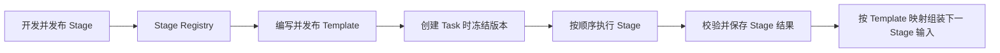

# ClawEvolve Stage 与 Template 声明式开发 Spec

> 文档性质：历史设计稿归档，保留当时方案，不代表当前代码的实现状态；本文不更新现有运行时 Contract。
> 配套文档：[架构设计](./clawevolve-stage-template-architecture.md)、[实施与验收（V3）](./clawevolve-stage-skill-evolution-implementation-v3.md)。

## 1. 核心思路

借鉴 Datamuse 的是维护方式，不照搬它的字段：

- 官方 Stage 和 Template 由开发者以 JSON 维护；
- Stage 文件直接说明职责、输入、结果以及官方处理逻辑的位置；
- Template 选择已发布 Stage，规定顺序，并连接上下游数据；
- 发布工具完成校验，再生成版本及内部引用并写入 Registry；
- 创建 Task 时，ClawWeb 冻结本次使用的 Template、Stage 和实现版本。

开发者不填写 `ContractRef`、`ImplementationRef`、`defaultImplementation`、版本号或 checksum。这些只存在于 Registry 和 Task 冻结快照中。



## 2. Stage 怎么写

### 2.1 官方处理逻辑是 Skill

`skillFile` 是官方 Skill 的入口文件，不是本次要进化的目标 Skill。

```json
{
  "name": "Skill 框架巩固",
  "description": "在诊断和优化前检查目标 Skill 的目录、说明与必要约束，补齐缺失内容并保留已有业务能力。",
  "skillFile": "./skill/SKILL.md",
  "allowCustomSkill": true,
  "inputSchema": {
    "type": "object",
    "required": [
      "target_skill",
      "objective"
    ],
    "properties": {
      "target_skill": {
        "type": "string",
        "description": "本次需要检查和巩固的 Skill。运行时由平台提供可访问的目录。",
        "source": "resource",
        "resourceType": "skill"
      },
      "objective": {
        "type": "string",
        "description": "本次框架巩固希望达到的目标和必须遵守的限制。",
        "source": "user",
        "format": "textarea"
      }
    },
    "additionalProperties": false
  },
  "resultSchema": {
    "type": "object",
    "required": [
      "changed",
      "change_summary",
      "target_skill"
    ],
    "properties": {
      "changed": {
        "type": "boolean",
        "description": "本次是否修改了目标 Skill"
      },
      "change_summary": {
        "type": "string",
        "description": "完成了哪些检查和修改"
      },
      "target_skill": {
        "type": "string",
        "description": "处理完成后的目标 Skill 目录"
      }
    },
    "additionalProperties": false
  }
}
```

### 2.2 官方处理逻辑是平台代码

没有官方 Skill 时，用 `codeFile` 指向平台代码。该文件按统一约定导出 `run(input, context)`。

```json
{
  "name": "确认候选版本",
  "description": "展示最后一轮优化结果，并记录用户是否接受当前候选版本。",
  "codeFile": "./handler.ts",
  "allowCustomSkill": false,
  "inputSchema": {
    "type": "object",
    "required": [
      "optimizationResult"
    ],
    "properties": {
      "optimizationResult": {
        "type": "object",
        "description": "最后一轮 Optimize 的执行结果",
        "source": "upstream"
      }
    },
    "additionalProperties": false
  },
  "resultSchema": {
    "type": "object",
    "required": [
      "accepted"
    ],
    "properties": {
      "accepted": {
        "type": "boolean",
        "description": "用户是否接受当前候选版本"
      }
    },
    "additionalProperties": false
  }
}
```

`skillFile` 和 `codeFile` 二选一：

| 字段 | 含义 |
| --- | --- |
| `skillFile` | 由 Agent 执行官方 Skill |
| `codeFile` | 由 ClawWeb 执行平台代码 |
| `allowCustomSkill` | 是否允许用户为同一个 Stage 提供自己的 Skill |

输入字段的 `source` 只有以下五种：

| `source` | 数据来源 |
| --- | --- |
| `user` | 创建任务时由用户填写 |
| `resource` | 创建任务时选择 Skill、Session 等资源 |
| `platform` | Task ID、Step ID、Round 等平台信息 |
| `upstream` | 由 Template 从上游 Stage 结果中取得 |
| `resume` | 用户回答问题后由平台补充 |

## 3. 用户交互如何返回

`hitl` 是所有 Stage 共用的运行时返回格式，不是一个单独的 Stage。每次执行只会出现以下两种结果：

| 返回 | 含义 | 平台处理 |
| --- | --- | --- |
| `hitl: true` | 当前 Stage 尚未完成，需要用户补充信息 | 暂停当前 Stage，展示交互内容；用户提交后重新执行同一个 Stage |
| `hitl: false` | 当前 Stage 已完成 | 按 `resultSchema` 校验 `result`，通过后进入下一 Stage |

Stage 定义只描述正常执行时的业务输入和最终结果：

- `inputSchema` 定义首次执行该 Stage 时会拿到什么；
- `resultSchema` 定义 `hitl: false` 时 `result` 必须交付什么；
- `hitl`、交互内容和恢复时的 `human_input` 由平台通用协议处理，不需要每个 Stage 重复定义。

### 3.1 返回简单内容

只需要一句问题或确认时，直接返回文本：

```json
{
  "hitl": true,
  "content": {
    "type": "text",
    "text": "请确认本次优先补齐哪部分能力。"
  }
}
```

### 3.2 返回动态表单

需要多题、单选、多选、文本或文件时，由 Skill 根据当前任务生成 HTML：

```json
{
  "hitl": true,
  "content": {
    "type": "html",
    "path": "outputs/upgrade-questions.html"
  }
}
```

ClawWeb 在隔离的 iframe 中展示该 HTML。表单内容和校验由 Skill 决定；平台只负责展示、接收提交内容并保存回答。

### 3.3 用户提交后

平台重新执行同一个 Stage，并提供本次回答的位置：

```json
{
  "human_input": {
    "path": "inputs/user-response.json"
  }
}
```

Skill 读取回答后继续处理。如果仍需补充信息，可以再次返回 `hitl: true`；处理完成后返回：

```json
{
  "hitl": false,
  "result": {}
}
```

这里的 `result` 才是当前 Stage 的最终输出，其内容必须符合该 Stage 的 `resultSchema`。

Template 不增加 HITL 节点或回边：Stage 返回 `hitl: true` 时停留在当前步骤，最终返回 `hitl: false` 后才按原顺序继续。

## 4. Template 怎么写

下面是完整的 Skill 自进化 Template。`stage` 使用已发布 Stage 的稳定名称，不带版本。

```json
{
  "name": "Skill 自进化",
  "description": "对目标 Skill 进行结构巩固、问题诊断、优化规划和多轮优化，最终由用户确认并应用新版本。",
  "targetType": "skill",
  "taskInputs": {
    "maxRounds": {
      "type": "integer",
      "description": "最多执行几轮优化",
      "default": 3,
      "minimum": 1,
      "maximum": 10
    }
  },
  "stages": [
    {
      "stage": "skill-foundation"
    },
    {
      "stage": "diagnose"
    },
    {
      "stage": "plan",
      "inputMap": {
        "diagnosis": "stages.diagnose.result.diagnosis",
        "cases": "stages.diagnose.result.cases"
      }
    },
    {
      "stage": "optimize",
      "inputMap": {
        "diagnosis": "stages.diagnose.result.diagnosis",
        "cases": "stages.diagnose.result.cases",
        "goal": "stages.plan.result.goal",
        "spec": "stages.plan.result.spec",
        "benchCases": "stages.plan.result.benchCases",
        "benchDomains": "stages.plan.result.benchDomains",
        "previousRounds": "loop.optimize.previousResults"
      },
      "loop": {
        "maxRounds": "task.inputs.maxRounds",
        "stopWhen": "result.roundDecision.stop"
      }
    },
    {
      "stage": "candidate-review",
      "inputMap": {
        "optimizationResult": "loop.optimize.lastResult"
      }
    },
    {
      "stage": "skill-version-apply",
      "inputMap": {
        "optimizationResult": "loop.optimize.lastResult",
        "reviewResult": "stages.candidate-review.result"
      }
    }
  ]
}
```

其中：

- `stage` 决定使用哪个已发布 Stage；数组顺序就是执行顺序；
- `inputMap` 左侧必须是当前 Stage `inputSchema` 中的字段；
- `inputMap` 右侧必须指向上游 Stage 的 `resultSchema` 字段或 Loop 结果；
- `loop.optimize.previousResults` 是当前轮之前所有成功轮次；
- `loop.optimize.lastResult` 是 Optimize Loop 最后一轮成功结果。

Stage Contract 中标记为 `user`、`resource`、`platform`、`resume` 的输入由平台自动提供，不需要在 Template 中重复连接。创建任务页面会按 Stage 分组展示其中 `source=user` 的字段。

## 5. 一次具体的数据交接

Plan 完成后返回：

```json
{
  "hitl": false,
  "result": {
    "goal": {
      "summary": "提升参数缺失场景下的处理正确率",
      "successCriteria": [
        "测试集任务完成率达到 90%"
      ],
      "metrics": [
        {
          "key": "task_completion_rate",
          "name": "任务完成率",
          "operator": ">=",
          "target": 0.9,
          "unit": "ratio"
        }
      ]
    },
    "spec": {
      "version": "v0",
      "content_type": "text",
      "content": "缺少 Bot ID、Server Code 或环境信息时先向用户确认。"
    },
    "benchCases": {
      "items": [
        {
          "sourceCaseId": "case-missing-bot-id",
          "taskId": "missing-bot-id",
          "split": "test",
          "template": {
            "ownerUserId": "399185",
            "domainId": "mcp-logql-diagnosis",
            "templateName": "缺少 Bot ID"
          }
        }
      ]
    },
    "benchDomains": {
      "trainBenchDomainId": "TRAIN-001",
      "testBenchDomainId": "TEST-001"
    }
  }
}
```

ClawWeb 根据 Template 的 `inputMap` 给 Optimize 组装：

```json
{
  "diagnosis": {
    "summary": "缺少必要参数时仍然生成查询语句"
  },
  "cases": {
    "items": [
      {
        "caseId": "case-missing-bot-id",
        "type": "bad"
      }
    ]
  },
  "goal": {
    "summary": "提升参数缺失场景下的处理正确率",
    "successCriteria": [
      "测试集任务完成率达到 90%"
    ],
    "metrics": [
      {
        "key": "task_completion_rate",
        "name": "任务完成率",
        "operator": ">=",
        "target": 0.9,
        "unit": "ratio"
      }
    ]
  },
  "spec": {
    "version": "v0",
    "content_type": "text",
    "content": "缺少 Bot ID、Server Code 或环境信息时先向用户确认。"
  },
  "benchCases": {
    "items": [
      {
        "sourceCaseId": "case-missing-bot-id",
        "taskId": "missing-bot-id",
        "split": "test",
        "template": {
          "ownerUserId": "399185",
          "domainId": "mcp-logql-diagnosis",
          "templateName": "缺少 Bot ID"
        }
      }
    ]
  },
  "benchDomains": {
    "trainBenchDomainId": "TRAIN-001",
    "testBenchDomainId": "TEST-001"
  },
  "previousRounds": [],
  "target_skill": "/workspace/tasks/EV-001/candidate-skill"
}
```

`target_skill` 没有写进 `inputMap`，因为 Optimize Contract 已将它声明为 `source=resource`。ClawWeb 会将创建 Task 时选择的 Skill 复制为本次 Task 的独立候选，并在每个相关 Stage 执行前提供同一个候选目录。

## 6. ClawWeb 中的代码位置

后续开发按下面的目录维护官方 Stage、Template 和内置实现：

```text
clawweb/
└── server/evolve/official/
    ├── stages/
    │   ├── skill-foundation/
    │   │   ├── stage.json
    │   │   └── skill/
    │   │       └── SKILL.md
    │   └── candidate-review/
    │       ├── stage.json
    │       └── handler.ts
    └── templates/
        ├── bot-evolution.json
        └── skill-evolution.json
```

| 内容 | 维护位置 | 说明 |
| --- | --- | --- |
| Stage 与 Contract 声明 | `stages/<stage-name>/stage.json` | 包含 Stage 介绍、`inputSchema`、`resultSchema` 和实现入口 |
| 内置 Skill | `stages/<stage-name>/skill/` | `skillFile` 指向该目录中的 `SKILL.md` |
| 平台代码 | `stages/<stage-name>/handler.ts` | `codeFile` 指向该文件；与 `skillFile` 二选一 |
| Template 声明 | `templates/<template-name>.json` | 选择 Stage、规定顺序并配置 `inputMap` |

文件路径都相对于当前 Stage 目录。例如：

```json
{ "skillFile": "./skill/SKILL.md" }
```

或：

```json
{ "codeFile": "./handler.ts" }
```

当前集中存放声明的 `server/resources/evolve/official-registry-v1.json` 后续由发布工具生成并写入 Registry，不再由开发者直接维护。

## 7. 发布和运行

```text
Stage JSON + Skill/代码 + 官方测试 Case
  → 静态校验
  → 发布 Stage，平台生成内部版本和引用
  → Template 选择已发布 Stage 并配置 inputMap
  → 校验上下游字段及类型
  → 发布不可变 Template 版本
  → 创建 Task 时冻结完整版本
  → 每个 Stage 完成后保存结果并组装下一 Stage 输入
```

Stage 结果始终保存在对应 Step 下，不写入无类型的全局变量。Template 的 `inputMap` 直接描述数据来源，因此能够看出每个下游输入来自哪里。
