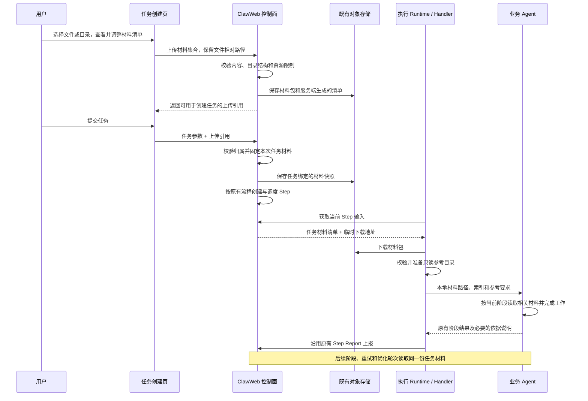

# ClawEvolve：任务自定义参考材料 Spec

> 日期：2026-11-03  
> 范围：Bot 自进化、Skill 优化、Skill 加固任务创建时上传参考材料，以及材料在执行链路中的交付与使用。

## 1. 这次要完成什么

用户创建 Bot 自进化、Skill 优化或 Skill 加固任务时，可以上传单个文件、多个文件或目录，提供本次任务需要参考的业务说明、规范、案例和示例代码。平台保存材料及目录结构，在任务执行前准备为 Agent 可读取的本地文件，并明确提示 Agent 结合任务目标参考这些材料。

例如，用户希望加固一个日报 Skill，可以上传包含汇报规则、人员关系说明和输入输出示例的目录。加固 Agent 读取这些材料，理解 Skill 应当保留和完善的业务行为，再修改本次任务的候选 Skill。Bot 自进化同样可以参考用户提供的业务标准，形成规划并完成后续优化。

本次交付包括：

- 创建任务时选择、查看、移除和上传材料；任务详情查看及下载材料。
- 材料随任务固定，保留相对路径，在后续阶段、重试和多轮优化中保持一致。
- 控制面下发材料引用，Runtime 完成下载、校验和本地文件准备。
- 将材料位置及使用要求交给实际执行分析、规划、优化或加固的 Agent，覆盖默认实现与自定义 Stage。

材料是可选输入。未上传材料的任务继续沿用现有行为。

### 1.1 范围与相邻能力

| 对象 | 与本次能力的关系 |
| --- | --- |
| 任务目标 | 说明用户希望完成什么；材料为理解和实现目标提供依据。 |
| 待加固 Skill | 本次分析、修改和版本交付的对象，继续使用已有独立候选机制。 |
| 自定义参考材料 | 创建任务时提供的补充输入，默认只读，随本次任务固定。 |
| 执行中反馈附件 | 针对某次 Stage 交互补充的信息，继续使用已有交互与恢复链路。 |
| Bench 用例与结果 | 继续由现有规划和评测流程管理；上传材料不直接等同于导入 Bench。 |

覆盖 Bot 自进化、Skill 优化与 Skill 加固入口。Bot 自进化与 Skill 优化均支持先诊断和直接目标模式；Skill 优化与加固均覆盖快捷弹窗及高级创建表单。独立诊断和其他任务类型暂不新增上传入口；实现时检查其共享调用链的兼容性，避免公共合同变更影响已有任务。

本期不建设跨任务材料库、在线文档编辑、外部链接抓取或统一文档解析服务。任务启动后不修改创建时的材料；需要补充信息时继续使用已有反馈机制，或携带新材料创建新任务。

## 2. 一条完整链路如何跑通



任务带有材料时，必须在材料成功保存并固定后才能调度首个 Step。上传完成不代表任务已创建，下载成功也不代表 Agent 已参考材料。

### 2.1 职责划分

| 参与方 | 职责 |
| --- | --- |
| 创建页 | 选择材料、展示目录与上传进度、处理重试、提交上传引用。 |
| ClawWeb 任务服务 | 校验上传归属、固定任务材料、维护任务可见性、组装各 Step 的材料输入。 |
| 对象存储适配层 | 复用已有存储与签名能力，保存包和清单，提供受控下载。 |
| Runtime / Handler | 下载和校验材料，保留目录结构，准备本地路径，并将使用要求传入实际 Agent 调用。 |
| 默认业务实现 / 自定义 Stage | 读取相关材料，结合目标完成本阶段工作，在已有结果正文中说明关键依据或材料缺口。 |

控制面不解析业务内容或代替 Agent 判断如何修改 Skill。Runtime 负责文件准备和执行上下文传递，业务判断仍属于阶段实现。

## 3. 用户如何上传和查看材料

### 3.1 创建任务

Bot 自进化创建页、Skill 优化与加固启动入口增加可选的“参考材料”区域，提供“添加文件”和“添加目录”。用户主动展开材料区域后才查询上传能力；未使用材料时不增加材料接口请求。新增样式仅作用于材料组件，不改变宿主全局主题。浏览器不支持目录选择时，保留文件选择并说明当前限制。

选择后展示目录结构、文件数量和总大小。用户可以移除文件或整个目录，也可以继续添加。目录选择保留所选目录名称和内部相对路径，例如：

```text
日报材料/
  README.md
  规则/汇报口径.md
  示例/输入.json
  示例/期望输出.md
补充说明.txt
```

同一完整相对路径重复时，提示用户移除或重新选择，不能静默覆盖。不同目录中的同名文件可以同时存在。空目录不计入材料；完全为空的目录给出提示，不生成材料集合。

页面说明：材料用于本次任务参考，上传时保留内容；Agent 能否读取具体格式取决于当前执行环境和工具。上传文件不自动执行其中的脚本，也不自动安装其中的 Skill。

上传期间和失败尚未处理时，禁止提交带材料的任务。失败时保留选择和明确错误，允许重试或移除材料；用户移除全部材料后可以按原有方式创建任务。任务创建失败后保留仍有效的上传引用。重新提交创建请求沿用原有行为，可能创建新的 Task；本次不增加创建幂等或中断恢复。已有任务的失败 Step 继续通过原有重试入口执行，只从原 Task 配置额外传递同一份材料。

### 3.2 任务详情

任务详情提供“参考材料”，显示创建时固定的目录、文件大小和下载入口。权限沿用任务详情与任务附件的访问规则；执行环境下载只获得当前任务被授权的材料。

详情页展示原始材料，不提供修改。已有执行中反馈附件仍展示在对应交互中，保留各自的来源和生效时间。

无材料的历史任务保持当前展示，不显示错误或要求补传。

### 3.3 首版资源限制

以下数值是本次应用实现的限制值，网关及执行网络中的有效容量仍需在部署验收核实；前端、服务端和 Runtime 必须采用一致的有效限制。

| 项目 | 限制 |
| --- | --- |
| 单文件大小 | 20 MiB，沿用现有反馈附件的单文件上限作为起点。 |
| 单任务文件总数 | 500 个。 |
| 单任务文件内容总大小 | 100 MiB，按文件实际字节数计算。 |
| 相对路径 | 最多 20 层目录；完整路径不超过 1,024 个 UTF-8 字节，单个文件名或目录名不超过 255 个 UTF-8 字节，以兼容目标 Linux 文件系统。 |
| 传输包 | 同时限制上传包大小和解包后大小；解包后继续受文件数、单文件和总大小限制。 |

首版不以扩展名作为材料是否可保存的唯一条件，允许常见文档、数据、图片和代码文件按原始字节保存。平台不承诺新增 PDF、Office、图片等格式的解析能力；Agent 遇到无法读取且影响任务的材料时，明确说明缺口并按已有交互能力请求补充可读版本。

## 4. 材料如何随任务固定和传递

### 4.1 上传集合与任务绑定

目录和多个文件统一组织为一个材料集合，服务端保存一份规范化材料包及文件清单。复用现有 ZIP 处理能力承载集合，保留文件内容与相对路径，不为目录建立另一套存储机制。

材料清单由服务端检查实际内容后生成，至少包含：材料集合标识、每个文件的相对路径、大小、内容类型、SHA-256，以及集合包的大小和 SHA-256。浏览器提供的路径、大小、校验值属于待校验输入，不能直接作为可信清单持久化。

创建任务时仅接收平台签发的上传引用。服务端检查当前用户是否有权绑定这份上传、内容是否完整且仍可用，再固定到本次 Task；不能接受客户端指定的任意对象存储地址、本地路径或外部下载 URL。

在已有 Task `config_json` 中保存可选的 `reference_materials` 描述，包含集合标识、内容校验值及持久存储引用，不新增业务表。文件清单保存在材料包的 `index.json` 中，并在同一对象存储目录保存一份由清单 SHA-256 校验的 `index.json`，供详情及下载签名读取，避免每次读取整个材料包；避免大量长路径撑大已有 Task JSON 字段。新增字段承担任务输入冻结职责；具体类型和接口路径在实现阶段按现有路由与服务分层确定，并同步输入合同和兼容测试。

材料快照一旦绑定任务，其内容不再变化。已有 Task 的阶段推进和失败 Step 重试始终使用其原材料绑定，不能因客户端重新上传而改变已创建任务的材料。重新提交创建请求产生的新 Task 可以复用仍有效的上传引用，各 Task 分别绑定。其他任务即使使用相同内容，也必须有独立、可核对的任务授权与引用关系。

### 4.2 存储与生命周期

参考材料属于任务输入附件，复用既有任务 Artifact 存储及宿主配置，不写入专门保存 Skill 版本和 Stage 实现包的存储位置。材料以任务标识隔离，不能混入待加固候选包或任务输出。

上传完成但任务尚未创建时属于临时材料；创建成功后形成任务绑定的持久快照。临时材料过期或被清理后，页面明确要求重新上传。未绑定上传引用有效期为 24 小时，服务端独立校验过期时间。临时对象统一位于 `evolution/reference-uploads/` 前缀，绑定任务时复制到任务下以集合校验值隔离的永久位置。物理回收由宿主对象存储对临时前缀设置生命周期；现有公共 ObjectStore 未提供枚举和删除能力，本次不虚构应用内清理已完成。上线前需核实宿主生命周期策略，不能将临时前缀策略应用到任务永久材料。

任务绑定材料跟随现有任务附件保留策略。材料永久对象和本地副本随任务附件保留策略管理。当前 Evolve 公共路由没有面向用户的任务删除接口，本次不新增删除流程；后续任务清理接入时，应将对应材料一并纳入，物理删除前确认没有有效引用。任务创建中断产生的孤立快照需要由宿主按任务记录核对后回收，不能因某一次请求失败就删除仍被已创建任务引用的内容。该部署回收策略与应用内上传引用过期校验分别验收。

存储凭据继续由宿主管理，不进入任务配置、Agent 提示或日志。签名下载地址在获取 Step 输入或用户请求下载时生成，不持久保存为材料身份；过期后重新签发同一对象。

### 4.3 Step 输入和本地目录

各相关阶段使用统一的可选材料描述 `reference_materials`，协议版本为 `clawevolve.reference-materials/v1`。控制面输入提供可移植的集合身份、清单和临时下载信息；Runtime 下载后向业务实现交付本地目录及索引路径。

材料落在当前 Task 独立的参考目录中，与目标 Workspace、待加固候选目录和阶段输出分开。索引列出文件的相对路径、大小和类型，供 Agent 先了解材料范围，再按需要读取正文。目录结构示意如下，最终路径由现有运行时布局负责确定：

```text
<当前任务目录>/
  reference-materials/<集合校验值>/
    index.json                 # 平台生成的文件索引
    files/
      日报材料/
        README.md
        规则/汇报口径.md
        示例/输入.json
        示例/期望输出.md
      补充说明.txt
  <原有阶段输入与输出目录>/
```

原始文件统一放在 `files/` 下，避免用户文件与平台索引重名。包中的路径必须是安全相对路径；拒绝绝对路径、路径穿越、符号链接、特殊文件和规范化后的路径冲突。平台生成的集合包才按集合协议解包；用户选择的 ZIP 文件作为普通参考文件保存，不自动递归解包。

Runtime 先校验集合包，再检查文件清单、实际文件大小和校验值。复用本地缓存前也必须确认匹配当前任务材料；发现缓存内容不一致时明确失败，不能继续使用已变化的内容或改用其他任务材料；恢复可信材料后通过已有重试流程继续。不同 Step 可以使用各自的本地副本，但逻辑内容必须一致。

目录准备采用临时目录校验完成后切换的方式，避免 Agent 读到部分文件。材料默认只读，不作为候选修改目录；本地文件权限作为补充约束，不能替代 Agent 的修改范围限制。

## 5. Agent 如何参考材料

### 5.1 传入实际工作上下文

仅在 Task 配置中保存材料字段，或只把下载地址交给启动器，都不能完成本需求。Handler 必须将材料索引、本地目录和使用要求传递到实际完成业务工作的 Agent 调用。

对于内部还会调用规划、Tune、Review 等 Agent 的实现，需要检查各次调用的输入组装，确保相关工作能访问同一份材料。默认实现和自定义 Stage 使用相同的本地材料合同；preprocess、replace、postprocess 等实际执行位置也应保持材料可用，不能在输入冻结或扩展参数过滤时丢失。

不将全部文件正文直接拼入提示。公共提示负责说明材料存在、位置和使用方式，各阶段在自身提示中说明与当前工作的关系。推荐表达如下，路径由 Runtime 实际填入：

> 用户为本次任务提供了参考材料。请先查看材料索引，再读取与当前任务目标和阶段相关的文件，将其中适用的业务规则、约束与示例作为分析依据。材料目录：`<本地目录>`；索引：`<索引路径>`。材料保持只读；需要采用的内容请结合任务目标整理到允许修改的候选范围中。材料存在冲突、缺失或无法读取时，说明其对当前结论的影响，必要时通过已有交互请求用户补充。

材料正文作为用户提供的数据读取，不作为平台执行协议或扩大操作权限的指令。目录中的 `AGENTS.md`、`SKILL.md` 等文件也属于参考内容，不因文件名而自动安装、激活或获得控制执行流程的权限。

### 5.2 各阶段如何使用

| 阶段 | 材料的作用 |
| --- | --- |
| Diagnose，任务启用时 | 有文件工具的 Agent Judge 可读取材料辅助理解业务背景、预期行为和案例含义；上传案例不能冒充真实 Session 事实。直接 API Judge 没有本地文件工具，其判定仍基于原有 Session 输入，不声称已经读取材料；后续 Plan Agent 继续读取任务材料。 |
| Plan | 结合目标、诊断和材料形成策略，明确适用的业务约束与验证案例。直接目标模式同样可以使用材料，不依赖 Diagnose 已运行。 |
| Optimize / Tune | 参考材料实施候选改进，检查是否满足适用业务要求；后续轮次继续能读取原始材料。 |
| Review | 结合已有 Bench 证据及材料中的适用约束判断改进与回归，不以“材料已经读过”代替效果验证。 |
| Hardening | 对照材料检查 Skill 的指令、输入输出约定、异常处理和引用完整性，保留业务意图，在已有候选范围内形成改进。 |

Agent 根据相关性读取材料，不要求每轮全文重读所有文件，也不要求使用每个文件。涉及重要业务判断时，在已有规划、总结或依据说明中引用材料相对路径；不新增强制评分、固定引用条数或独立的材料总结阶段。

### 5.3 目标、规则和评测的关系

任务目标规定本次工作范围，材料补充实现和判断依据。Agent 对材料中的规则、示例和历史记录进行区分，不把单个示例扩大为所有任务的通用规则。目标与材料之间存在实质冲突、或多份材料给出互相矛盾的关键要求时，明确指出差异；影响执行正确性时通过已有交互确认。

材料中的输入输出示例可以帮助 Plan 形成评测案例，但仍须经过原有的用例生成、校验和 Bench 流程。参考材料不会被自动加入评测运行环境，也不自动成为隐藏测试集或评分器；验证任务若需要材料文件，按现有 Bench 输入合同显式准备并校验，避免依赖优化 Agent 的本地路径。

材料作为任务输入证据，不进入 Plan 的 `reference_files`、`merged_targets` 或 `planned_deliverables`，也不进入诊断 Session 列表；这些字段继续表示原有 Workspace 引用、修改范围和真实 Session。材料依据可在已有说明正文中引用相对路径。

上传材料默认只供本次任务使用。Agent 可以按目标将必要规则、示例或参考文件整理进候选 Skill，但不能直接把整个材料目录并入交付包。最终 Skill 需要使用的内容应在候选中自包含，不能引用本次临时下载地址或任务专属目录；材料副本以外的原始任务输入保持不变。

## 6. 实现位置、异常与兼容

### 6.1 沿用现有能力

当前已核查的基础包括：Task 配置与 Step 输入、独立候选 Skill、对象存储与签名下载，以及 Stage 反馈附件的上传、下载和内容校验。现有反馈附件按交互提供平铺文件，不能直接充当创建时的任务材料合同。

实现应复用已有底层能力，分别补齐创建上传、任务绑定、目录集合和 Agent 输入传递。控制面与 Runtime 的公共行为归 Avernet；内部宿主存储装配与发布配置归 OCB。是否需要 OCB 代码变更，以现有宿主接口能否完整承载新行为为准，不预设必须两仓修改。

| 位置 | 需要核查和修改的职责 |
| --- | --- |
| `clawweb/public/modules/clawevolve` 的页面与客户端 | Bot 创建与 Skill 优化、加固入口、上传交互、任务详情材料展示。 |
| 同模块任务路由与服务 | 上传校验、服务端清单、任务配置绑定、访问控制和 Step 输入签名。 |
| 同模块 Stage 定义与输入校验 | 默认输入和自定义 Stage 输入均允许、保留同一可选材料描述。 |
| `clawweb-skills/clawevolve-skills/platform` | 材料下载、校验、本地准备，以及向 Stage 实现传递本地材料上下文。 |
| Diagnose / Plan / Workflow / Hardening 的实际调用链 | 材料进入实际 Agent 提示与内部调用；保持原有职责和输出。 |
| OCB 内部装配与消费端 | 核查对象存储可达性、Runtime 包消费、接口类型与默认行为兼容。 |

不新增材料分析服务、独立调度阶段、创建幂等、中断恢复或另一套任务状态机。不改变公共派发的节点领取顺序、运行前维护参数及其失败行为；无材料任务沿用原有创建、重试和阶段推进逻辑。Stage Report 保持现有业务输出结构；材料准备失败沿用当前 Step 失败与重试机制。

### 6.2 异常行为

| 情况 | 行为 |
| --- | --- |
| 选择重复路径、危险路径或超过限制 | 上传或创建前明确拒绝，指出受影响项；服务端独立复核。 |
| 上传中断或服务端存储失败 | 本次材料不可用于创建任务，保留前端选择并允许重试，不返回虚假成功。 |
| 上传归属不匹配、引用失效或内容不完整 | 拒绝任务创建，不启动执行；需要时让用户重新上传。 |
| 材料固定失败或 Task 持久化失败 | 材料固定失败时不调度 Step；Task 持久化失败沿用原有错误处理，保留仍有效的上传引用供重新提交，孤立对象按生命周期清理。 |
| 下载失败、签名过期或网络暂不可达 | 沿用现有受控重试，必要时重新获取签名；仍失败则记录当前 Step 失败。 |
| 包损坏、缺文件或校验不一致 | 不把部分材料交给 Agent，不静默继续或换用其他任务材料；按失败处理。 |
| Agent 无法解析某个格式 | 与传输失败区分；说明文件及影响，关键材料通过已有交互请求可读版本。 |
| Runtime 不支持材料合同 | 带材料的任务明确拒绝或失败；不能忽略字段后声称已使用材料。 |

没有上传材料时不新增材料错误分支。存在材料时，平台可以保证交付完整和提示传入，不能仅凭下载日志声称 Agent 已理解或采纳全部内容。

### 6.3 兼容与上线顺序

新字段是可选输入，历史任务和无材料的新任务保持原有默认行为。材料合同变更需要同步控制面校验、Runtime、默认实现与自定义 Stage 的公共输入说明，并验证已有扩展不因新增字段失效。

先完成控制面和执行端合同支持及组合验证，再开放上传入口。开放前确认实际执行环境已消费支持材料的 Runtime 与 Skill 包，并能从执行网络访问下载地址。带材料的阶段命令附带 `--reference-materials-version 1`，新执行端要求材料合同存在且校验通过；旧脚本拒绝未知参数，防止静默忽略材料。上传选项接口仅表明控制面存储能力，不代表目标执行端已升级；部署验收需要核实目标执行端。沿用现有发布与版本管理，不增加独立配置体系。

本地测试、跨仓组合验证、部署与真实 Bot 验收分别记录。通过控制面测试或成功上传到存储，不代表执行环境已经具备材料能力。

## 7. 本次验收故事

| 场景 | 可观察的验收结果 |
| --- | --- |
| Bot 自进化上传单文件 | 文件随任务保存；实际 Plan 或 Optimize Agent 能读取，输出体现其中与目标相关的要求。 |
| Bot 自进化上传多层目录 | 文件内容和相对层级保持一致；不同目录中的同名文件均可分别引用。 |
| 直接目标模式 | 不运行 Diagnose 时，Plan 仍得到材料并结合其形成策略。 |
| 启用 Diagnose | 材料可作为背景和补充证据，但用户案例不会被标为真实 Session 观察结果。 |
| 多轮优化及 Step 重试 | 同一任务各阶段、后续轮次与重试读取相同校验值的材料；签名更新不改变内容。 |
| Skill 优化与加固 | Agent 在独立候选中按材料改进 Skill；任务原始材料不被修改，候选产物不依赖任务临时路径。 |
| 自定义 Stage | replace 及已启用的扩展执行位置拿到相同材料上下文，真实执行能读取文件。 |
| 上传失败、超限与危险目录 | 页面说明失败原因；服务端拒绝非法内容；任务不会携带不完整材料启动。 |
| 创建重试与权限 | 重新提交创建请求保持原有新建 Task 行为，已有 Task 的 Step 重试保持材料不变；另一用户不能绑定或下载无权访问的材料。 |
| 下载、校验或版本不兼容 | 执行明确失败，不向 Agent 提供半成品，也不忽略材料继续。 |
| 无法读取的格式 | Agent 明确说明缺口及其影响，使用已有交互请求必要补充。 |
| 不上传材料、历史任务及其他任务类型 | 原有创建、状态推进、结果展示和扩展行为保持兼容。 |

验证分三层完成：

1. **控制面与文件合同测试**：检查任务绑定、授权、原有创建及 Step 重试兼容、清单校验、目录边界和输入组装，验证非法或不完整材料不会进入调度。
2. **Runtime 与 Agent 输入验证**：检查文件落地、内容一致性、重试恢复，以及材料路径和使用要求确实进入实际 Agent 调用，而非只出现在控制面日志。
3. **真实 Bot 验收**：在用户指定的自有测试 Bot 上，分别运行 Bot 自进化、Skill 优化和 Skill 加固。测试材料提供任务目标中没有重复写明的、与目标相关且可核对的业务约束，通过文件读取轨迹、阶段结果和候选内容共同确认 Agent 参考了材料。自定义 Stage 单独覆盖；上传成功与任务完成状态不能代替这项证据。

## 8. 输入合同与实现依据

### 8.1 新增接口与兼容

| 接口 | 合同 |
| --- | --- |
| `GET /api/evolve/reference-materials/options` | 返回控制面上传能力及文件数、大小和路径限制。 |
| `POST /api/evolve/reference-materials/uploads` | 接收 `package` multipart 字段，内容为浏览器生成的 STORE ZIP；服务端校验后返回 `materialId`、过期时间及文件清单。 |
| `POST /api/evolve/tasks` | 新增可选 `referenceMaterialsUploadId`；不新增幂等键要求，沿用原 Task ID 生成、创建与派发流程。重新提交创建请求和已有 Step 重试继续保持原有语义。 |
| `GET /api/evolve/tasks/:taskId/reference-materials` | 沿用任务读取权限，返回清单及新签发的材料包下载地址。 |
| 原有 Step Input | 原生输入在顶层提供可选 `reference_materials`；Stage 输入和加固 `businessInput` 在对应业务输入中携带同一材料。签名只在下发时生成。 |

上传集合采用 STORE ZIP，避免对不可信压缩内容进行无界展开；服务端在 JSZip 规范化路径前核对 ZIP 原始目录，检查重复路径、文件目录冲突、文件类型与大小，再重建带可信索引的材料包。用户选择的压缩文件作为集合中的普通文件保留。

`reference_materials` 的持久描述包含协议版本、材料标识、Task ID、包校验值、清单校验值、包大小、文件数、总大小、存储桶及精确对象引用。下发时将对象引用替换为临时 GET 地址；Runtime 替换为本地 `directory` 和 `index`。业务实现不需要自行访问对象存储或保管签名。

### 8.2 代码与部署核查


本需求实施基于 2026-11-03 重新拉取的 Avernet `origin/dev`（`4483e5576`），并核对 OCB `origin/dev`（`e1f4790249`）；前期核查包含任务创建路由、Stage 输入组装、Skill 加固启动入口、官方 Stage 输入定义、反馈附件签名与 Runtime 文件准备，以及 Skill 包存储边界。

写法参考现有 `clawevolve-stage-skill-evolution-implementation-v3.md` 和 `clawinsight-session-recovery-final-summary.md`；历史 Stage / Template 架构稿用于理解背景，不作为当前执行协议的替代来源。

部署验收需重点核实网关和执行网络容量、宿主临时对象生命周期及孤立对象回收策略，以及实际 Runtime / Skill 包升级。Task JSON 使用紧凑引用、Stage 可选输入兼容及本地 Agent 提示传递由代码与测试验证；真实 Bot 是否参考材料仍需以用户指定测试 Bot 的执行轨迹和候选结果验收。
