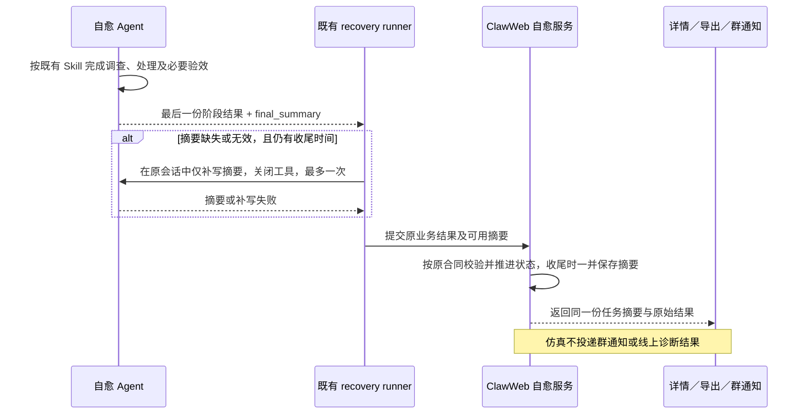

# ClawInsight：自愈任务整体摘要

## 1. 背景与目标

业务评审在线自愈或历史仿真时，需要快速看懂原问题、Agent 为什么这样判断、最终采取或建议什么方案，以及实际进展。阶段判断、完整干预消息和修复方案分别承担调查、投递和执行职责，不能直接充当整个任务的总结。

**由同一个自愈 Agent 在任务收尾时交付整体摘要，详情、接口导出与群结果通知读取同一份已保存内容。** 摘要帮助业务评审，不承担手册知识缺口识别或方案评分。

## 2. 范围与边界

- 在线与仿真共用 `final_summary`。在线说明实际动作及效果；仿真说明拟议消息或完整方案，明确未执行、未验证效果。
- 摘要覆盖整个任务，不能只描述最后一次工具调用或一个阶段。保留已有完整判断、消息、方案、回执与证据。
- 形成待审批方案不代表在线任务结束；方案执行成功也不代表业务已恢复。观察到期暂停时，可以保存截至暂停的整体进展，恢复任务后清除暂停摘要，最终按新的收尾结果保存。
- 摘要是可用性增强：缺失、无效或补写失败不能改变主任务状态、干预与效果标签、真实动作或统计口径。
- 外部停止、执行异常或历史任务没有可用 Agent 摘要时如实显示不可用，不以控制面模板或阶段长文冒充 Agent 总结。

## 3. 整体流程与职责

| 角色 | 职责 |
| --- | --- |
| 自愈 Agent | 根据整个任务已取得的事实，总结问题、依据、处理及结果；区分实际动作、拟议方案、推断和未知。 |
| recovery runner | 沿用原会话、阶段输出与校正机制，识别收尾候选；可做一次无工具的摘要补写，不改变业务结果。 |
| ClawWeb 自愈服务 | 原有业务校验和状态流转仍是最终依据；只在任务收尾或观察暂停时接收有效摘要，与状态变更在同次持久化中保存。 |
| 详情、接口与通知 | 展示或直接读取已保存字段，不再次调用模型或拼接阶段字段生成另一个摘要。 |
| 业务 | 结合整体摘要、完整方案和证据评审处理方式。 |

仿真消息分支在完整拟发送消息形成后收尾；环境分支在完整方案形成后收尾。在线继续沿用 assess → observe／plan → apply → verify 的既有流程，不新增总结阶段或执行通路。

## 4. 摘要内容与展示

摘要用几个紧凑段落说清三件事，不固定句数或模板：

1. 原用户目标与实际问题。
2. 支持判断的关键事实，以及影响结论的不确定性。
3. 最终方案或实际动作、原任务进展及必要配合。

保留必要上下文，避免长篇调查记录、完整命令、证据 ID 清单及整段消息。最多 2,000 个 UTF-16 代码单元，沿用 Markdown 正文表达方式。

- **详情**：任务概览下默认展开“任务总结”，完整判断、方案与流程继续可查。未结束时说明任务结束后生成；已收尾但缺失时显示“摘要暂不可用”。
- **接口／导出**：任务详情直接提供 `final_summary`，表格按任务读取该值，不从过程小结推导最终方案。
- **群结果通知**：显示任务状态、同一份摘要、已验证的触达／响应／业务效果和详情链接。已有投递幂等、群路由、无干预不发结果通知等规则不变；过程通知不改为最终摘要。

### 恢复效果的语境

效果卡片表达原业务任务的进展，执行异常另行显示。

| 当前语境 | 效果展示 |
| --- | --- |
| 调查、形成方案、等待确认或执行 | 中性的“待验证”，说明等待事项。 |
| 正在观察原会话或验证方案效果 | 蓝色“验证中”。 |
| 已结束且有证据表明原任务仍受阻 | 黄色“未恢复”，说明“原任务仍受阻，需继续处理”。 |
| 已有恢复证据 | 绿色“已恢复”。 |
| 执行异常 | 保留独立红色执行失败提示，不据此声称业务未恢复。 |

这只是展示语义，保留原始 `status`、`judgment.effect`、干预状态与统计合同。验效结束得到 `failed + verify + not_recovered` 时展示为处理结束和业务未恢复，不冒充执行异常。

## 5. 失败与兼容

- 正常随最后一份结果输出；仅摘要缺失、空白、类型无效或超长时，runner 最多补写一次，使用同一 Agent 会话并关闭所有工具。
- 补写只接收 `final_summary`，不允许替换原决策、方案、效果或重放动作。超时、解析失败、会话不匹配或补写携带凭据均降级为空摘要，继续提交原结果。主业务输出原有凭据安全拒绝规则不放宽。
- 控制面独立检查摘要类型、长度与凭据形态，忽略无效可选元数据；业务结果仍按原合同校验，错误业务回报不能因摘要可用而被接受。
- 复用既有 Task JSON 和状态事务，不新增表、阶段、工具或模型服务。旧 runner 和无字段的历史任务继续可读；历史摘要不自动回填。
- 先部署支持可选字段的控制面／页面，OCB 合并后仅从最新已合并 dev 打自愈 Skill 包。Repair 共享 runtime 和 AIS Base 本次不变。
