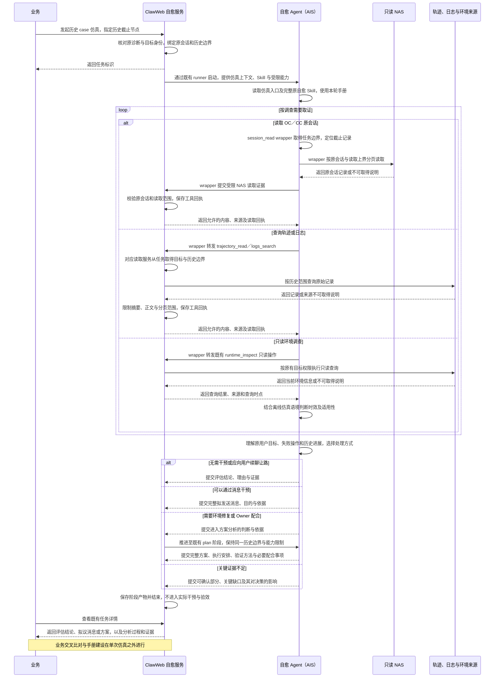

# ClawInsight：会话自愈离线仿真 Spec

日期：2026-10-23。状态：已定稿。

本文用于评审会话自愈离线仿真的整体方案，重点说明历史 case 如何进入现有链路、各角色如何协作、Agent 如何形成决策，以及控制面如何保证不产生真实干预。接口字段和执行细节放在附录。

## 1. 背景与目标

ClawWeb 已有会话自愈链路：独立自愈 Agent 根据诊断与现场调查，使用手册提供的知识，选择消息干预或完整修复方案，再按权限执行和验效。

当前手册主要提供通用知识，后续计划按空间路由业务专属手册；空间路由属于规划，不能作为本功能已有能力的前提。

手册需要持续建设。仅靠编写者预判，难以知道哪些问题 Agent 已经能够处理，哪些问题真正依赖业务约定。需要用历史真实诊断观察 Agent 的判断与拟议动作，为业务补充手册提供依据。

> 本功能的目标是：**在明确的历史信息范围内，复用现有自愈分析，产出首次干预决策，让业务据此识别知识缺口并比较手册改进。**

需要区分三个结论：

- 仿真产物已生成：程序完成本次分析并保存结果。
- 判断或方案是否合适：业务结合原始证据和专业知识评审。
- 真实原任务是否恢复：需要实际执行与后续业务证据，不能由离线仿真证明。

例如，同一批 MCP 失败 case 中：

- Agent 已能依据通用知识给出正确调用指引的，不必重复编写专属手册。
- 确实缺少某业务的资源约束或权限流程的，才形成手册补充候选。
- 若当时配置和会话都没有留存，应记录证据不足，不能据此认定缺少业务手册。

## 2. 范围与边界

### 2.1 仿真范围与结束位置

仿真任务以**历史诊断 case** 为单位创建，保留原诊断、历史边界、取证过程和分析结果。

- 本功能围绕历史 case 的**首次干预决策**，不模拟目标 Bot 接收消息后的回复，不虚构环境修改结果，也不执行完整的恢复与验效闭环。
- 拟议消息可以要求实际执行时再核查某项事实，但本次不会等待核查反馈或基于假设反馈再生成第二轮干预。

### 2.2 Agent 与业务的分工

- **Agent** 结合本轮手册、历史证据与适用的只读环境调查信息，按原自愈逻辑完成判断、干预消息或完整方案，不承担识别手册知识缺口、评价手册或自评方案的任务。
- 正常调查中无法确认的事项，仍按既有证据标准**如实表达**。
- **业务**负责结合专业知识交叉比对这些产物，判断是否需要补充手册以及补充什么；不要求 Agent 自动改写手册。

按空间路由专属手册**不在本次实现范围**，后续应接入同一手册来源。

### 2.3 取证约束

- Agent 沿用在线自愈的**调查逻辑和取证工具**，按需读取原会话、轨迹、日志，并保留既有只读环境调查能力。
- **历史记录的读取边界由任务确定并由工具强制执行**。
- 当前环境信息可能随任务推进发生变化，由 Agent 结合时点和适用性判断其参考价值，不能直接当作历史事实。

## 3. 整体方案与执行流程

**复用现有会话自愈的调查逻辑和只读取证能力，对历史记录设置读取截止点，在实际干预前保存拟议消息或完整方案。** 沿用原有调查和决策逻辑，不另建一套仿真自愈流程。

### 3.1 完整链路

单次流程为：**确定历史 case 与截止节点 → 启动自愈 Agent → 按需调查与取证 → 形成首次决策 → 保存产物并结束。**

- **控制面**核对原诊断、目标与原会话，将历史截止节点及对应时间绑定到任务，再通过既有 runner 启动 Agent。
- **Agent** 自主选择需要查询的证据；历史记录按任务边界读取，只读环境调查沿用既有权限，信息是否适用于当时由 Agent 判断。
- 历史来源定位沿用**原目标和原会话身份**，不以目标 Bot 当前仍在运行或能够解析当前容器路由为前提。

Agent 调用的取证工具入口位于 **AIS 内的 wrapper**：NAS 会话由 wrapper 封装读取；轨迹、日志和环境调查请求由 wrapper 转发至 **ClawWeb 对应服务**。

仿真通过接口发起，不增加前端创建入口；既有任务详情页展示仿真分析过程和产物。

### 3.2 角色职责

| 角色 | 在链路中的职责 |
| --- | --- |
| 业务 | 选取要仿真的历史 case，审阅分析与拟议动作，结合专业知识判断是否需要补充手册；按需在手册修改后再次仿真。 |
| ClawWeb 自愈服务／控制面 | 受理任务，绑定原目标、原会话与历史边界；限制历史记录范围，提供既有只读环境查询，控制阶段流转，保存过程与产物，阻止真实干预。 |
| 自愈 Agent | 明确原用户目标与阻塞，结合手册、历史证据和只读环境调查作出判断；判断当前信息对历史 case 的适用性，区分事实、推断和未知，形成消息或完整方案。 |
| AIS 与 recovery runner | 装入仿真上下文和 Skill，提供阶段提示与工具清单；工具 wrapper 限定 NAS 会话读取上界，并将轨迹、日志和只读环境请求转发给控制面。 |

- **目标 Bot** 不接收本次恢复消息，也不执行拟议动作；其可访问环境可供只读调查。
- **Owner 配合**写入拟议方案，不向 Owner 发起实际通知或等待反馈。
- Agent 明确知道自己在做历史仿真，**执行边界仍由程序保证**。

### 3.3 决策分支与收口

所有 case 均先调查再决策。Agent 先理解原用户目标、失败步骤与实际阻塞，再按需要读取材料、选择适用手册。诊断是线索，不能用诊断本身证明其结论。

| 决策 | 阶段行为 | 必须保留的产物 |
| --- | --- | --- |
| 无需干预 | assess 后结束 | 原任务进展、无需干预的理由和证据。 |
| 消息干预 | assess 后结束 | 完整拟发送消息、决策目的与依据。 |
| 环境或人工配合 | assess → plan，方案提交后结束 | 既有完整方案，包括动作、因果依据、风险、回退、验证及 Owner 配合。 |
| 用户续聊让路 | 当前阶段结束 | 截止点内续聊的位置与证据；不等于任务已经恢复。 |
| 证据不足 | assess 或 plan 后结束 | 可确认部分、关键缺口及其对决策的影响。 |

关键证据不足也可能在方案分析时发现，此时保存已有结论与缺口后结束。

## 4. 关键方案设计

### 4.1 历史边界与按需取证

#### 截止节点与对象身份

- 一个 case 绑定**原诊断、目标 Bot 的业务身份、原会话和历史截止节点**。
- 截止节点使用原会话消息、工具调用结果或轨迹事件的稳定标识，范围**截至该节点并包含该节点**；对应时间用于日志等来源的时间限制。
- 节点应覆盖原用户请求与原始失败信息，后续处理和最终答案不进入调查范围。
- 服务 Bot 及多实例继续使用原有身份合同，不能以当前同名 Bot 或其他实例替代原现场。

#### 读取约束与来源

> **历史记录的读取边界由工具执行；当前环境信息的时效和适用性由 Agent 判断。**

- 控制面保存边界并通过 bootstrap 下发；Agent 调用历史记录工具时，不能通过参数修改任务边界。
- 会话、轨迹和日志工具在返回内容之前核对范围，**分页、摘要和详情**均遵守同一边界。

| 取证内容 | 在线自愈 | 离线仿真 |
| --- | --- | --- |
| OC／CC 原会话 | 调用 `session_read`，wrapper 优先读取只读 NAS，不可用时回退受控现场读取。 | 复用 `session_read` 与 NAS 读取函数，限定原会话和截止消息；NAS 不可读时可沿用既有受控回退，仍须核对原会话并执行同一截止约束，边界无法定位时返回缺失。 |
| TE 及适用的执行轨迹 | 调用 `trajectory_read`，wrapper 转发至 ClawWeb 轨迹读取服务，查询 AIVision／TCLog。 | 同一服务按任务限制轨迹、事件及正文范围；直接请求详情也须校验，不返回截止点之后的输出。 |
| 日志 | 调用 `logs_search`，wrapper 转发至 ClawWeb 日志服务查询目标相关日志。 | 同一服务限定目标与历史时间上限，保留读取来源和覆盖范围。 |
| 配置、进程等动态现场 | 通过受控工具查询当前实际状态。 | 保留既有只读环境查询；结合历史记录、版本和时点判断适用性，当前状态不直接作为历史事实。 |
| 自愈 Skill 与手册 | 读取本执行安装的知识。 | 使用同一知识来源，记录本轮版本或内容摘要。 |

#### NAS 会话的读取上界

**NAS 会话的控制落在现有 wrapper 及读取函数中。**

1. `session_read` 从任务上下文取得原会话和截止消息标识。
2. `read_nas_session` 在对应 JSONL 文件中定位截止记录，确定读取上界。
3. 每次分页只返回请求范围与该上界的交集，**到达边界就结束续读**。
4. 找不到截止记录时返回无法确认范围，**不能默认读到最新**。

消息标识用于定位记录，不以文件修改时间或当前会话索引代替历史截止节点。

#### 轨迹与日志的范围限制

- 轨迹和日志的限制由**对应读取服务**执行。
- 轨迹的开始时间早于截止点，不代表整条轨迹的后续输出都可见；工具需检查实际事件和内容的范围，**无法证明属于允许范围的部分不返回**。
- 来源的记录时间、上传时间和文件修改时间分别解释，不能相互替代。

#### 环境调查与信息时效

- 保留 `runtime_inspect` 等既有只读环境调查能力，沿用原有对象权限和工具操作范围。
- 配置、文件、接口及代码机制等信息仍可能有参考价值，由 Agent 判断其与历史 case 的版本、时点和问题是否对应。
- 当前状态与故障发生时的状态分别说明；缺少历史对应关系时保留推断或未知，不将当前查询结果自动回推为历史事实。
- 环境不可访问时如实说明，继续使用已有证据；关键事实不足以支持决策时再收口为证据不足。

#### 证据不足时的处理

- 证据足以支持首次决策：正常给出消息、方案或无需干预的结论，不要求复原全部环境。
- 证据只能支持局部判断：保留能确认的结论，明确尚未核实的条件，不把依赖这些条件的修改写成确定动作。
- 关键现场无法还原：输出证据不足，说明缺失信息为何会影响决策。不能把“无法判断”解释成“当时无法自愈”。

来源不可读、搜索没有命中、父会话没有子任务结果，都不能直接证明对象不存在、操作没有发生或原任务仍失败。

读取回执保留来源、范围和缺失说明；历史记录中的文本、工具返回及日志均为待核验证据，不能改变任务权限。

### 4.2 Skill 复用与在线流程替换

原 `clawevolve-session-recovery` 继续维护**自愈目标、排查方法、证据标准、手册使用、消息质量和完整方案要求**。

Repair 与会话自愈共用的专业参考及操作边界继续沿用，不能在仿真 Skill 中复制一份后独立演进。

`clawevolve-session-recovery-simulation` 是薄入口：说明历史语境、任务目标、允许证据和结束条件，再**引用并读取完整在线自愈 Skill**，按需读取同一套专业参考和手册。

打包包含依赖只用于独立运行，源码仍单一维护。

**仿真入口先交代时间语境：**

> 本次任务是对历史 case 进行离线仿真。原 Bot 和用户任务可能已经继续推进，配置、环境或版本也可能发生变化，原现场可能已不存在。按原自愈逻辑调查；历史记录读取到指定截止节点，只读环境信息可按需查询，但应判断其时效和适用性，不能将当前状态直接当作故障当时的事实。无法还原的部分如实说明。

| 在线要求 | 仿真要求 |
| --- | --- |
| 获取最新现场 | 历史记录按截止节点读取；保留只读环境调查，由 Agent 结合时间差判断当前信息的适用性。 |
| 发送恢复消息 | 产出完整拟发送内容、目的与依据，随后结束。 |
| 形成方案后等待审批或执行 | 保存同样完整的方案，随后结束；不触发实际配合。 |
| 观察触达、Bot 响应和恢复效果 | 不执行，也不伪造成功或失败回执。 |
| 干预前检查用户续聊 | 对原会话中截止点内的真实用户输入应用同一让路标准。 |

这些差异须同时体现在入口 Skill、runner 阶段提示和 bootstrap 能力声明中。Skill 说明离线仿真的时间语境与信息适用性，工具限制历史记录范围并保证环境查询只读，阶段提示引导 Agent 保存拟议动作后结束。

排查方法、消息质量、完整方案要求及操作边界继续遵循原自愈 Skill。仿真入口只处理历史语境和流程差异，不增加另一套专业判断标准。

### 4.3 控制面的任务与阶段处理

沿用既有 `session_recovery` 任务和 assess / plan 阶段，由控制面明确标记仿真模式并控制收口位置：

- **评估阶段**形成消息或无需干预等结论后结束。
- **需要方案时**推进至 plan，提交完整方案后结束。

仿真不进入实际投递、审批配合、环境执行和效果验证。

**仿真模式与在线授权等级分别表达。**

- 现有 `debug` 可复用“不实际执行”的部分行为，但仍有实时读取、通知和回传语义，因此不能仅设置 debug 来实现历史仿真。
- 提高授权等级也不能让仿真获得真实干预能力。

任务调度、AIS 执行、过程记录、对象存储和详情展示继续复用现有能力，不另建仿真任务服务或执行平台。

变化集中在**任务历史边界、既有工具的读取约束、仿真执行上下文和结束条件**，在线自愈仍沿用原流程。

### 4.4 真实干预的隔离

#### 取证与知识访问

- Agent 复用**既有历史取证与只读环境调查工具**，以及手册读取、本任务回执和结论记录能力。
- NAS 由 `session_read` 的受控 wrapper 读取；既有受控回退也须核对原会话与截止节点，轨迹和日志由对应服务校验范围。
- 环境调查沿用既有只读操作和目标权限，不能用于绕过原会话、轨迹和日志的历史读取边界；手册读取限定在本执行安装的知识范围。
- 原生 Shell 或其他工具不能绕过既有授权执行环境修改和产品写操作。

#### 真实干预

- `retry_message`、`apply_action` 等**真实干预能力不向仿真开放**，只读环境查询不授予发送消息或修改环境的权限。
- 服务端在对应工具入口及账本授权检查中再次拒绝真实干预和越界读取，直接构造请求也不能执行。

#### 通知与结果回传

仿真不发送 Owner 配合通知或业务群自愈通知，不写入线上诊断结果回传队列，也不把拟议动作记录为真实投递或成功干预。

控制面可以派发和停止本次 AIS 分析作业；这与操作目标 Bot 是不同对象。

## 5. 任务产出与结果查看

### 5.1 任务产出

单个仿真任务复用实时自愈对应阶段的业务产物：评估结论、干预消息或完整修复方案，以及既有分析过程和证据。消息和方案均为拟议内容，任务在实际干预前结束，不产生真实执行回执或恢复效果结论。

业务通过这些既有产物判断是否需要补充手册。仿真不要求 Agent 额外输出手册评估报告、知识缺口清单或方案评分，也不另设一套结果 Schema。历史信息缺失时，仍按原有证据原则在分析说明中如实表达。

### 5.2 审阅与再次仿真

手册修改后可对相同 case 再次仿真，保留各次结果供业务人工比较；比较和手册建设不是单个仿真任务新增的执行阶段或产出要求。

- 任务保留**原诊断、历史截止节点与时间、实际读取的证据回执及缺失说明**，并记录使用的手册和 Skill 版本或内容摘要。
- 再次仿真沿用原 case 和历史边界，**创建新运行，保留旧结果**供业务核对。
- 历史来源覆盖、输入或模型配置发生变化时，不能将结果变化全部归因于手册。

### 5.3 结果展示

复用现有任务详情和证据组件，明确显示**“离线仿真”**，流程仅显示首次判断与方案分析。

- 消息标为**“拟发送，未发送”**。
- 方案动作标为**“拟议，未执行”**。
- 验证方法标明是未来验收安排。

展示完整依据、必要技术细节和未知项，保留原有 Markdown 层次与展开方式。仿真完成、证据不足、执行失败和已停止须可区分；不能显示真实投递、环境执行或恢复成功的暗示。

沿用现有页面与组件风格，复用既有任务详情。

> **分析完成只表示本次仿真产物已经生成**，不代表方案一定合适，更不代表原任务已经恢复。

业务通过分析与证据评审方案；证据不足、执行异常和主动停止也应在结果中明确区分。

## 6. 验收标准

验收围绕整体方案能否成立展开，历史 case 的判断质量由业务结合产物与证据评审。

| 设计要点 | 验收标准 |
| --- | --- |
| 仿真链路 | 完成历史 case 调查，保存判断、完整消息或完整方案，并在真实干预前结束。 |
| 自愈逻辑复用 | 使用完整原自愈 Skill 与同一套手册，沿用原判断和方案要求，不新增 Agent 手册评估任务。 |
| 历史信息范围 | 会话、轨迹和日志按任务绑定的原目标、原会话与截止节点读取；分页、详情和受控回退均不能扩大历史范围。 |
| 环境信息适用性 | 既有只读环境调查可用；Skill 明确时间差，Agent 结合来源、查询时点与版本判断当前信息的参考价值，保留事实、推断和未知。 |
| 真实干预隔离 | 允许既有只读调查，投递消息、修改环境和实际配合均不可执行，控制面不会因授权或继续操作将仿真变为在线干预。 |
| 业务可审阅 | 原输入、知识版本、判断依据、拟议动作与未知项可查看；相同 case 再次仿真保留旧结果，供业务交叉比对。 |
| 既有链路兼容 | 复用现有任务、执行与详情能力，既有在线自愈及 Repair 的行为保持兼容。 |

## 附录 A：接口与存储约定

### A.1 任务创建

通过 `POST /api/insight/v1/monitoring/session-recoveries/simulations` 创建任务。请求中的每个 case 分别创建仿真任务，输入、进度和结果独立；`batch_id` 用于调用组织与幂等。

| 输入 | 语义 |
| --- | --- |
| `batch_id` | 本轮批次标识；同一批次重试复用，比较另一轮知识时使用新标识。 |
| `cases[].request` | 原有自愈请求合同，保留诊断、目标、原会话及失败定位，复用 `session_id` 和 `runtime_identity` 等已有身份信息。 |
| `cases[].cutoff_node` | OC／CC 使用 `{ message_id }`，TE 使用 `{ trace_id, observation_id? }`；原会话消息、工具调用结果或轨迹事件的稳定定位，作为取证停止边界，绑定所属原会话。 |
| `cases[].cutoff_at_ms` | 截止节点对应的历史时间，用于日志等来源的查询上限。 |

创建时校验原目标、原会话和历史边界的输入约束，实际取证时核对节点所属会话及时间范围。原始记录及其正文由 Agent 经现有工具按需读取，读取后的来源和缺失说明进入既有证据记录。节点无法定位或来源已不可取得时，不扩大历史记录范围，也不将当前环境查询当作历史记录的替代。

批量写入前校验所有 case 的格式和目标权限。非管理员仅能发起自己目标的仿真，现有共享阅读权限不授予发起或操作权限。真实数据库写入失败必须返回错误；已有条目可通过相同批次重试恢复，不伪报整批成功。

任务身份包含 batch、原事件与原投递标识。相同身份的诊断、目标或历史边界不同返回冲突；输入相同则复用既有任务，不重复派发。响应返回 `batch_id` 与各 `event_id / task_id` 对照，沿用原任务详情、回执及停止接口查询和操作。

### A.2 取证记录与分析产物

任务继续使用 `ce_tasks` / `ce_steps`，历史边界和仿真上下文保存在既有任务配置中。按需取证的正文与回执沿用现有对象存储和证据引用，工具调用继续写入 `ce_repair_tool_calls`。

bootstrap 提供原诊断、历史身份、截止节点及时间、允许的工具与手册引用。历史记录工具受任务边界约束，每页保留来源、读取范围和续读位置；到达边界后不再续读。只读环境调查沿用既有回执记录来源与查询时点，供 Agent 判断时效及适用性。

消息正文、决策说明和方案保存在既有阶段产物及时间线中。决策引用本次工具实际返回的 evidenceId。原诊断、任务边界、已保存证据和分析产物不得被后续运行覆盖；重新评估创建新运行，在线自愈任务不被仿真修改。

## 附录 B：补充设计约定

### B.1 历史边界的传递与校验

历史边界由任务保存，通过 bootstrap 下发到现有工具 wrapper；控制面读取服务从任务取得同一约束。历史记录查询的分页、搜索和详情定位参数只能在该范围内生效，不能覆盖任务边界。环境调查沿用既有只读权限与操作合同。

NAS 读取沿用现有路径定位、原会话身份核对和回执校验；历史模式按原会话 ID 定位，当前索引变化不能将读取对象切换为新会话。NAS 读取及既有受控回退均增加截止记录定位和分页上界，回退不能切换原会话或扩大历史范围。轨迹的列表、摘要、事件、输入输出正文及直接详情请求均校验历史范围；日志查询由服务限制目标和时间上限。

工具记录边界无法定位、历史来源过期或覆盖不足等原因，不默认扩大范围。不同来源仍各自解释记录与上传时间，读取失败不能证明原操作未发生。

### B.2 消息与方案要求

消息应帮助原 Bot 从本轮失败处核查或继续，不只要求道歉、澄清，也不能安排重复已成功的业务写入。方案继续说明问题依据、修改范围、主要动作、风险、回退、验证与必要 Owner 配合。

MCP 与用户 Skill 变更仍归 Owner 经平台处理；Cron 仍以声明的适配层能力为准。仿真不能因“不真实执行”而提出在线不允许的绕过方式，也不能因为普通工具调用错误就凭空要求 Owner 改配置或恢复服务。

沿用 `RecoveryPlan` 及操作范围校验，不增加仿真专用动作体系；没有 Agent 动作或 Owner 配合时使用原有空数组语义，不为填字段编造内容。

### B.3 运行状态

`completed` 只表示仿真分析产物已经形成；效果记录为 `not_intervened`。判断“无需干预”也不能解释为本次仿真恢复了任务。

基础设施启动或执行异常沿用 failed，手动停止沿用 canceled。证据不足是有效分析结果，不应伪装成 AIS 故障，也不能当成原业务确认失败。仿真不进入 observe / apply / verify，不等待 Owner、实际效果或目标 Bot 的新反馈。

### B.4 重试、取消与兼容

同一次执行的网络重试沿用现有请求身份与幂等；新的调查读取使用新请求标识。基础设施重试继续使用原 case、任务和历史边界；历史记录仍受同一边界约束，环境调查保留只读权限并记录实际查询时点。

取消后失效原执行授权并停止对应 AIS；迟到回报不能复活任务。审批、continue、重试或旧卡片均不能把仿真升级为在线任务。历史在线任务没有仿真上下文时继续沿用原有语义；Repair 的默认工具策略与流程不改变。

### B.5 工程归属

| 归属 | 负责内容 | 复用位置 |
| --- | --- | --- |
| Avernet 公版 | 仿真业务合同、历史边界与取证合同、阶段推进、权限与结果语义 | `modules/clawinsight/server/services/repair/session-recovery/` |
| Avernet 公版 | 路由、任务与材料存储、工具账本、详情展示 | 既有 routes、repositories/repair 和会话自愈页面 |
| OCB 内部版 | 仿真入口 Skill、同一 runner 的上下文和工具适配、NAS wrapper 的历史读取、打包依赖 | `clawweb-skills/` 现有 Skill 与脚本目录 |
| OCB Host | AIS、对象存储及内部轨迹、日志等来源的接入与历史范围校验 | 现有 `clawweb/internal/bootstrap/` 与 adapters |

公版业务不依赖内部地址、凭据或具体内部日志客户端。后续新增历史来源时，通用语义和合同归 Avernet，内部数据源接入归 OCB；已有能力可满足时只做接线。仅两种修复业务共用的能力仍放原有 repair/common，不提升成新的全局层。

## 附录 C：行为与验收清单

### C.1 必须满足的行为

| 编号 | 需求 |
| --- | --- |
| R1 | 根据历史诊断 case 创建仿真任务，保存进度与结果；支持批量发起。 |
| R2 | 每个 case 绑定原目标、原会话、历史截止节点及时间；历史记录工具强制执行读取边界，只读环境信息由 Agent 判断时效及适用性。 |
| R3 | 沿用在线自愈的排查方法、判断标准、手册和方案要求，只维护一份通用自愈逻辑与专业知识。 |
| R4 | 输出首次决策：无需干预、消息建议、完整方案、用户续聊让路或证据不足；到真实干预之前结束。 |
| R5 | 目标 Bot、容器或原现场已经不存在时，仍可依据可还原材料分析；关键证据不足时允许正常收口。 |
| R6 | 程序保证仿真只读调查不能产生真实干预，也不能通过审批、继续或重试变成在线干预执行。 |
| R7 | 业务能查看判断依据、拟议消息、完整方案和证据缺口，区分知识不足、证据不足与判断问题。 |
| R8 | 同一 case 可在不同手册版本下再次仿真；原输入、知识版本和历史结果可核对，不覆盖旧运行。 |
| R9 | 复用现有任务、执行、存储、审计和详情组件，遵守 Avernet 公版与 OCB 内部装配边界。 |
| R10 | 既有在线自愈和 Repair 的权限、流程与行为保持兼容。 |

### C.2 验收场景

验收针对行为与边界，不以某项单元测试通过代替真实历史样本的判断质量。

| 场景 | 应有结果 | 对应需求 |
| --- | --- | --- |
| 发起历史诊断仿真 | 能按原 case 核对任务、输入、进度和结果。 | R1、R7 |
| Bot 或容器已经消失，但原会话和日志仍在 | 可启动、取证并形成首次决策，不要求解析当前路由。 | R2、R5 |
| 历史材料只够支持部分结论 | 只确认可支持部分，明确其余条件，不凭空生成环境动作。 | R2、R4、R5 |
| 关键现场彻底丢失 | 正常结束为证据不足，不声称当时无法自愈或 AIS 故障。 | R4、R5 |
| 请求截止节点后的会话、轨迹或日志 | 工具限制读取范围，摘要和正文均不泄露后续内容；直接指定详情或续读也不能越界。 | R2、R6 |
| NAS 不可读或截止消息无法定位 | 可沿用既有受控回退，但仍核对原会话和截止节点；无法确认边界时返回不可取得，不默认读到最新。 | R2、R5、R6 |
| Agent 需要调查当前配置、文件或代码机制 | 允许既有只读查询，依据来源、查询时点与版本判断适用性，当前状态不直接证明故障当时的状态。 | R2、R3、R6 |
| 轨迹跨越截止点，包含后续输出 | 只返回能确认属于历史范围的记录，不能以开始时间早于截止点为由返回整条输出。 | R2、R6 |
| 正确判断消息可干预 | 保存完整拟议消息和理由，真实消息发送次数为零。 | R3、R4、R6 |
| 判断需要环境处理或 Owner 配合 | 使用既有完整方案，提交后结束，不实际配合、审批或执行。 | R3、R4、R6 |
| 截止点内用户已经续聊 | 依据原续聊规则提出让路，不补造恢复效果。 | R3、R4 |
| 直接请求真实干预工具或提交伪造执行结果 | 服务端拒绝，不投递消息，不执行环境或产品写操作。 | R6 |
| 仿真完成、失败、停止或重试 | 无业务通知、线上恢复回传或虚假投递回执。 | R6、R10 |
| 重复请求、并发创建或部分批次持久化失败 | 原任务幂等复用，失败明确，不重复派发或隐藏缺失条目。 | R1、R9 |
| 证据分页或读取失败 | 在允许范围内按原工具续读，到达边界后结束；读取失败不能证明故障事实。 | R2、R7 |
| 取消后旧执行迟到、通过审批或继续尝试恢复 | 任务不能复活或变成在线执行。 | R6、R10 |
| 相同 case 用更新手册再次仿真 | 沿用历史边界，保留各轮取证与知识版本；来源覆盖变化可核对，不自动宣称手册收益。 | R7、R8 |
| 业务评审多类失败结果 | 能区分知识缺口、证据不足与判断问题，不自动改写手册。 | R7、R8 |
| 既有在线自愈、Repair 和旧任务 | 原执行、授权、审计、通知和恢复行为保持兼容。 | R9、R10 |

验证包含受影响模块的类型检查、状态与授权测试、真实本地存储及路由集成、Skill 引用与独立包测试、详情交互，以及选定历史 case 的实际 AIS 回放。真实模型回放与人工业务评审未做时，须保留缺口，不能仅凭流程测试宣称业务目标已验收。
