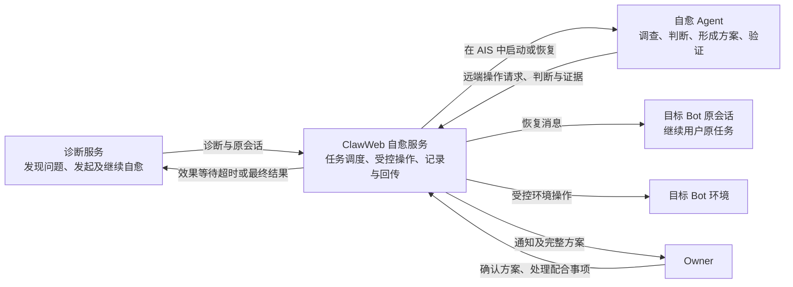
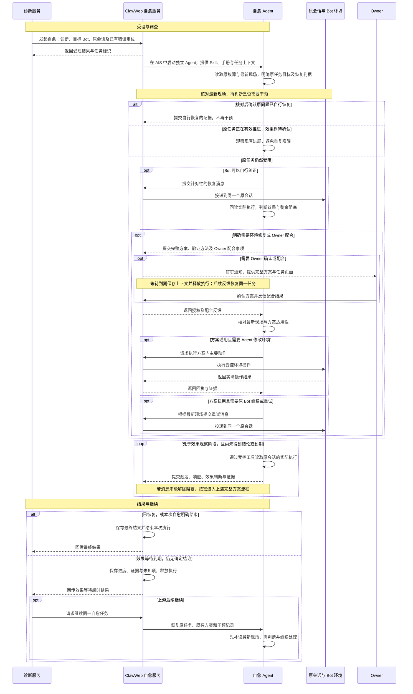

# ClawInsight：会话自愈设计 Spec

2026-10-23

会话自愈接收诊断服务发现的问题，由独立 Agent 调查现场、选择干预方式，并核验原任务是否恢复。**目标是解除用户任务的实际阻塞，让原 Bot 继续完成原任务。**

## 1. 能力与职责



| 能力 | 行为 |
| --- | --- |
| 指令干预 | 自愈 Agent 根据现场编写具体的自然语言建议，经服务发送到原会话，推动原 Agent 纠正操作、继续处理，并核验后续效果。 |
| 环境干预 | 自愈 Agent 分析原因、形成完整方案，按授权通过受控工具执行允许的环境操作，例如调整 Cron；涉及 MCP 或用户 Skill 变更时，由 Owner 通过平台完成，Agent 复核结果并验证原任务是否恢复。 |
| 人工求助 | 将需要 Owner 提供的权限、信息、配合或决策及其依据写入完整方案，由自愈服务在方案确认环节统一通知，并通过任务页面接收反馈。 |

人工求助通过钉钉通知 Owner，说明需要配合的事项，并提供任务页面入口。通知能力也用于报告修复失败及其原因。

| 参与方 | 职责 |
| --- | --- |
| 诊断服务 | 提供业务诊断、系统诊断及已有错误定位，关联目标 Bot 和原会话；接收自愈结果，按需调度继续。 |
| ClawWeb 自愈服务 | 受理和调度任务；提供受控能力，处理方案确认与 Owner 反馈；保存过程和证据，向上游回传结果。 |
| 自愈 Agent | 结合诊断、手册和实际现场分析阻塞，决定干预方式；形成并执行方案，判断恢复效果。 |
| 目标 Bot／原 Agent | 接收原会话中的恢复指引，使用自身能力继续用户原来的任务。 |
| Owner | 在需要时确认完整方案，处理权限、信息或业务决策等配合事项。 |

**自愈 Skill 与手册各有分工：**

- **自愈 Skill**：规定调查、分流、方案执行和效果验证的工作方式。
- **恢复手册**：提供专业知识、常见原因与处理参考，目前包含 MCP 章节；未覆盖的问题由 Agent 结合现场独立分析。

两者随任务包装入自愈 Agent 工作区。手册不安装到目标 Bot；原 Bot 接收的是结合现场编写的具体指引。

### MCP、用户 Skill 与 Cron 的操作边界

本节的用户 Skill 指目标 Bot 中的业务技能，与自愈 Agent 自身执行的自愈 Skill 不同。

| 对象 | 自愈 Agent 的操作范围 | Owner 配合事项 |
| --- | --- | --- |
| MCP | 只读查询服务清单、配置及 `mcporter` 配置文件，结合原会话核查实际调用；调用方法错误时提供具体使用指引。 | 通过平台完成新增、修改、删除、启停、账户配置和能力集关联调整，以及必要的权限申请。 |
| 用户 Skill | 只读查看已安装内容、相关文件和挂载情况，结合原会话核实是否实际加载和使用，提出具体处理建议。 | 通过平台完成安装、更新、改写、替换、删除及启停／挂载调整。 |
| Cron | 在当前工具合同、目标支持能力与授权范围内，查询、创建、修改、删除、启停、手动执行，并读取运行历史。 | 需要确认或业务决策时，按完整方案确认；不因 Cron 当前禁用就认定需要启用或重跑。 |

**MCP／Skill 的产品状态由平台后端管理。** 平台负责权限检查、能力集关联、激活与同步；运行时适配层将同步后的配置落实到底层引擎。直接修改运行时配置或文件，不能代替完整的产品流程，后续同步也可能覆盖这些修改。因此，即使方案已获批准，Agent 也不能自行变更 MCP／用户 Skill，或让原 Bot 代改来绕过边界；相关变更写入 Owner 配合事项。

**Cron 由运行时维护，通过受控工具操作。** 后端完成身份与目标解析并转发请求，Agent 只需按下发的真实适配层接口合同提交参数，不自行选择连接通路。所有操作均经受控工具与适配层完成，不通过底层引擎 CLI／RPC、调度文件或容器内 HTTP 命令绕过；未声明或目标不支持的接口不能使用。

**查询证据与恢复证据分别判断。** MCP 配置存在不等于调用成功，Skill 目录存在不等于已加载；不以引擎能力清单代替用户 Skill 的加载证据，也不把重启作为固定步骤。Owner 完成变更后，Agent 重新读取相关状态，并回到原失败步骤核实实际调用和原任务进展。

## 2. 完整执行流程

**所有类别均先由 Agent 调查，再选择干预路径。** 上游诊断是调查入口；Agent 同时核对原用户请求、失败操作和最新进展，明确原任务目标、当前阻塞与恢复判据。

诊断上报与 Agent 启动之间有时间差，因此先复核最新现场。原 Bot 已自行解除阻塞时，保存证据后结束，不计为自愈干预效果。

| 现场判断 | 处理方式 |
| --- | --- |
| 核对后确认原问题已自行恢复 | 保存自行恢复的证据，结束本次任务，不再干预。 |
| 原任务正在有效推进，效果尚待确认 | 观察现有进展，避免重复唤醒；根据最新结果判断是否仍需处理。 |
| Bot 可以自行纠正操作或执行方式 | 编写针对性的恢复消息，投递到同一个原会话，再读取后续执行验证效果。 |
| 需要环境修复或 Owner 配合 | 独立形成完整方案，列明主要动作、执行方和配合事项；满足确认与配合条件后执行，再验证原任务。 |



**方案确定主要动作，Agent 自主完成落地。**

- 方案说明依据、范围、执行安排、风险与回退、验证方法，以及 Owner 配合事项。
- 具体命令或接口请求可以随现场调整，不能改变方案方向、主要动作和目标范围；方案已不适用时停止执行，提交原因与证据。
- 一次任务最多执行一个完整环境修复方案。方案失败后回传结果，不自动生成第二套方案。

**等待保留同一业务任务。** Owner 后续反馈或上游继续调度时，恢复已有上下文，先核对最新现场，不自动重发旧建议或重做修复。AIS 拉起或执行异常由控制面有界重试，保留原因与执行记录；重试后仍无法继续时，回传异常结果。

**上游回传只有两类：效果等待超时、任务彻底结束。** 等待 Owner、方案确认和一般阶段进展保存在任务内。回传失败重送已保存的结果，不重新干预 Bot。

## 3. 自愈效果判断与证据

效果判断围绕**原用户任务**展开。调查开始时确定目标和恢复判据；后续消息、方案与验证沿用同一目标。

| 层次 | 要确认什么 | 有效证据 |
| --- | --- | --- |
| 触达 | 恢复消息是否实际进入原会话 | 原会话中的实际用户消息，包含本次投递标识及对应消息位置。仅有发送受理回执不足以证明触达。 |
| 响应 | Bot 是否采纳指引并采取行动 | 后续工具调用、参数和返回结果。道歉、承诺重试或声称已修复，不等于实际行动。 |
| 效果 | 本次阻塞是否解除，原任务是否继续推进 | 原失败步骤成功，或有效替代路径取得原任务所需结果，并有实际后续进展。配置写入成功或无关操作成功不能代替恢复证据。 |

**恢复推进与任务全部完成分别判断。** 长任务无需等到全部结束，但必须有解除当前阻塞、继续原任务的直接证据。纠正回答、澄清事实或承认未完成，只能证明局部行为变化；原任务所需条件仍缺失时，应继续调查或形成方案。

**不同引擎使用相应的现场来源：**

| 引擎 | 原会话与执行证据 |
| --- | --- |
| OpenClaw／Claude Code | 优先通过受控会话工具读取只读 NAS 中的目标 Bot 会话文件；不可用或无法唯一定位时，经受控工具读取同一目标的现场文件。 |
| Teclaw（TE） | 通过 AIVision 轨迹工具核查原会话输入、输出与工具执行，不先尝试直接读取 TE 会话。 |

NAS 定位和读取由受控会话工具完成，范围限定在目标 Bot 和原会话。远端操作由 ClawWeb 通过既有 Bot 接入能力连接目标运行时；Agent 使用下发的受控工具与适配层接口合同，不直接操作底层引擎。

每次判断保留可复核的证据关系：

```text
原用户请求与失败现场
  → 具体干预消息／方案与实际操作
  → 原 Bot 后续调用及返回
  → 原任务进展
  → 恢复结论与依据
```

事实、推断和未知分别记录。会话读取失败、轨迹延迟、记录裁剪或覆盖不足时，保留“无法判断”；自愈执行异常也不直接等于原故障未恢复。
