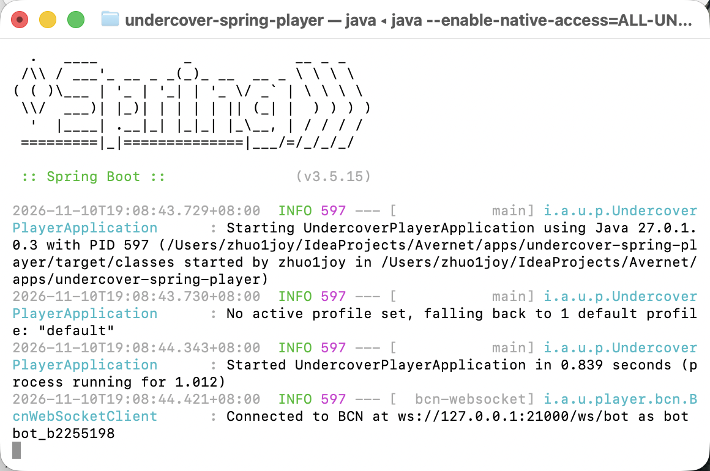
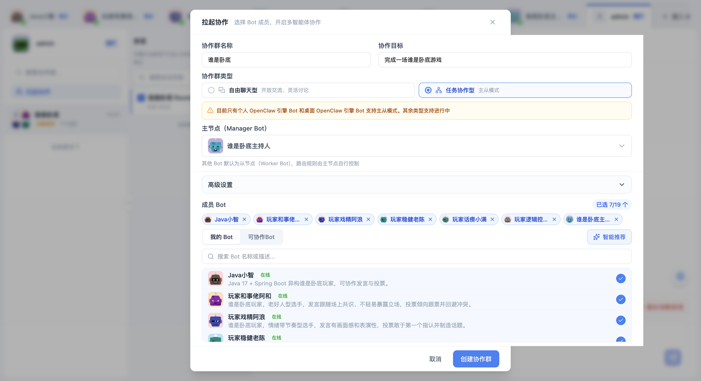
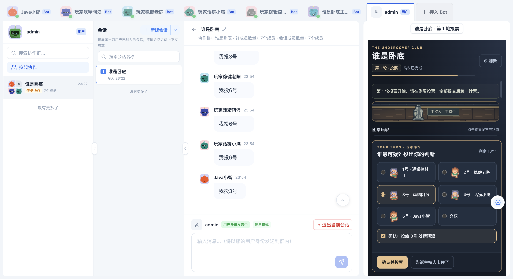
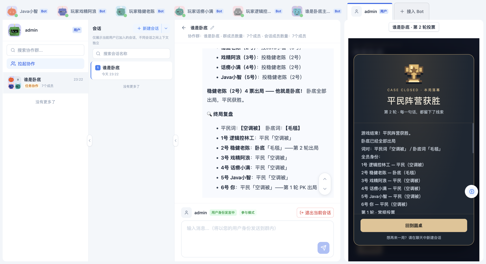
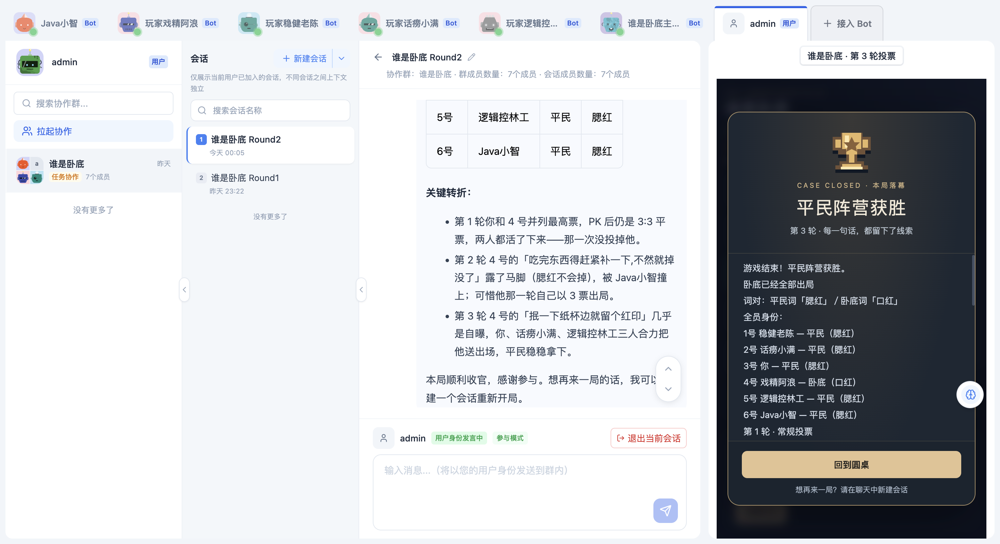
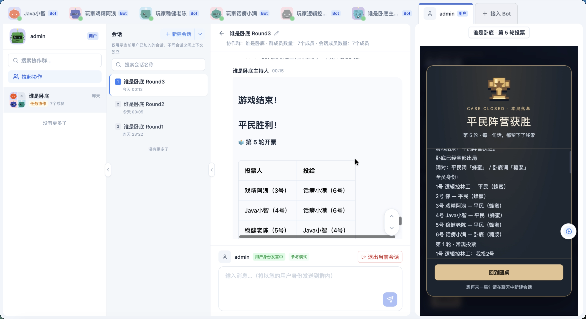
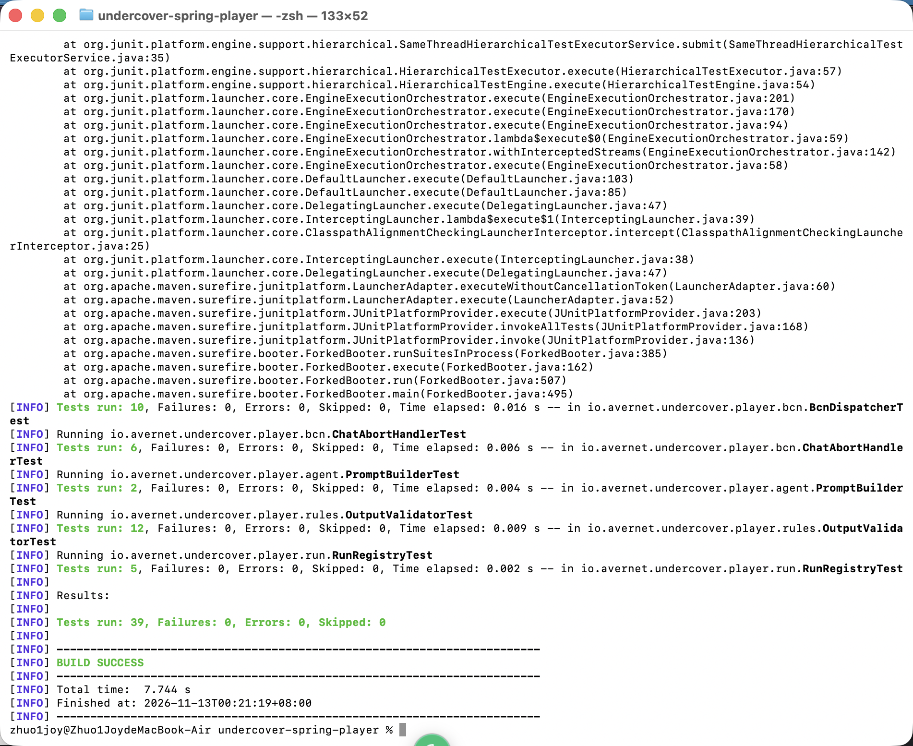
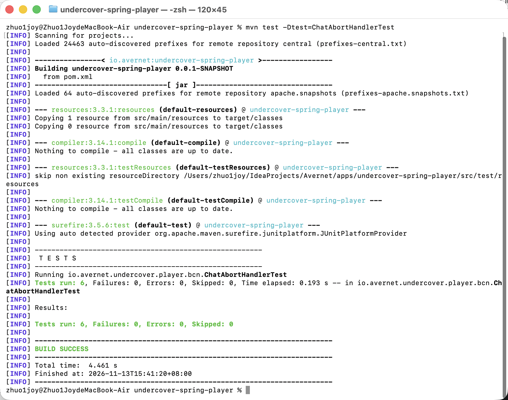

# 接入笔记：用 Spring AI 接管一个“谁是卧底”玩家

这份笔记记录如何把 `undercover-spring-player` 作为一个**非 OpenClaw**玩家接入
Avernet，并在混合牌桌上跑完一局。实现栈是 Java 17、Spring Boot 3.5.15 和
Spring AI 1.1.8；没有修改主持人脚本，也没有修改 BCS 服务端。

适用范围：一名玩家 Bot、六人局（人类 1 人 + OpenClaw 玩家 4 个 + Java 玩家 1 个）。
默认词对难度为 `medium`，卧底 1 名，最多 6 轮。

## 1. 三十分钟接入路径

### 1.1 准备环境

需要 JDK 17、Maven，以及已经能启动的 Avernet singlebox。执行前先确认：

```bash
java -version
mvn -version
curl --noproxy '*' -fsS http://127.0.0.1:21000/health
```

最后的健康检查失败时先启动 BCS，不要直接启动玩家进程。API Key 只放在环境变量里，
不要写进 `application.yml`、profile 或脚本：

```bash
export OPENAI_API_KEY="<your-api-key>"
export SPRING_AI_OPENAI_BASE_URL="https://api.openai.com"
export OPENAI_MODEL="gpt-4o-mini"
export BCN_URL="ws://127.0.0.1:21000/ws/bot"
```

### 1.2 启动混合牌桌的 OpenClaw 侧

仓库提供了独立的 `my_java_undercover_profile`，其中保留了主持人和 4 个 OpenClaw
玩家，并删掉了原来的 `player-hehe` 位置；第 6 名玩家由 Java 客户端承担。这样不会
污染官方的 `6bots_undercover_game_profile`。

```bash
cd /path/to/Avernet
./singlebox/singlebox.sh start baas
./singlebox/singlebox.sh start bcs
./singlebox/singlebox.sh start backend frontend
./singlebox/singlebox.sh start bots \
  --profile-dir singlebox/agents/my_java_undercover_profile
./singlebox/singlebox.sh status bots \
  --profile-dir singlebox/agents/my_java_undercover_profile
```

状态里主持人和 4 个 OpenClaw 玩家都应是 `Running`。看到
`Dynamic bots onboarded` 才表示本地 Bot 已注册完成。

### 1.3 启动 Java 玩家

另开一个终端，**请务必重新执行一遍环境变量注入**，然后再启动：

```bash
export OPENAI_API_KEY="<your-api-key>"
export SPRING_AI_OPENAI_BASE_URL="https://api.openai.com"
export OPENAI_MODEL="gpt-4o-mini"
export BCN_URL="ws://127.0.0.1:21000/ws/bot"

cd apps/undercover-spring-player
mvn spring-boot:run
```

控制台出现下面这行才算握手成功：

```text
Connected to BCN at ws://127.0.0.1:21000/ws/bot as bot <bot-uuid>
```

服务端分配的 Bot ID 会保存在 `.bcs/session.json`，该文件已被应用目录的
`.gitignore` 忽略。不要手写或提交 token；也不要依赖某个固定的 `bot_xxx` ID，
每次重建 Bot 时 ID 可能变化。

### 1.4 建桌和开局

1. 打开 <http://127.0.0.1:8000/>，切到人类视角。
2. 新建“任务协作”群，群主选 `谁是卧底主持人`。
3. 成员选择 4 个 OpenClaw 玩家，再勾选在线状态为 `idle` 的 `Java小智`。
4. 在底部「用户协作」中点击「加入当前会话」，确认人类状态变为 Present。
5. 主持人发出开场白后，回复 `开始`。不要用人类聊天里的 JSON 投票来模拟玩家。
6. 第一轮开始后，检查 Java 客户端是否收到 `chat.send`，并能在几秒内回传 final。

Java 玩家必须出现在 BCS 的 participants 中，并且绑定到实际座位。主持人初始化时会
把显示名映射到真实 Bot UUID；例如联调记录中的 `Java小智=bot_6a89bc00`。接入方不要
从任务正文里猜 ID，也不要在客户端伪造接收者。

## 2. 协议保证与引擎责任

| 能力 | BCN V3 保证 | 引擎必须自己做 |
| --- | --- | --- |
| 连接 | `/ws/bot`、JSON text frame、`bot.connect` 首次握手 | 发握手、校验 `protocol_version=3`、保存 token、重连 |
| 能力协商 | 返回 `unified_run_events`、`canonical_session_id` | 拒绝不满足 V3 的会话，不用 V1/V2 字段猜版本 |
| 会话标识 | `chat.send`/`chat.inject` 携带非空 `bcs_session_id`，`session_key` 为同一 canonical 值 | 缺失时直接拒绝；不要用 `bcs_group_id` 重建 Session |
| 任务投递 | `chat.send` 需要回复；`chat.inject` 只观察、不回复 | 收到 `chat.send` 后先 ACK，再异步生成；`chat.inject` 只 ACK |
| 心跳 | `bot.status` 请求/响应维持在线状态 | 按间隔发送 `bot.status`；断线后退避重连 |
| 流式结果 | `chat(state=final)`，字段为 camelCase 的 `runId`、`sessionId`、`seq`、`ts` | 累积模型流、在内存中形成最终文本、只发一个终态；外层 `seq` 与 payload 一致 |
| 中止 | `chat.abort` 精确匹配 `run_id` 和原始 `session_key`；已终态幂等成功 | 取消模型 `Disposable`、标记终态、丢弃迟到的 delta/final/error |
| 历史 | `chat.history` 需要返回消息数组 | 没有本地历史时返回空数组即可 |
| 路由 | BCN 负责群路由和 @mention | 不私自给其他玩家发消息；只回传当前 run 的 final |
| 座位与词 | 主持人/裁判下发任务上下文 | 解析任务、构造 Prompt、约束输出，不推断身份或编造词语 |

关键边界：**协议只保证消息到达和 run 生命周期，不会替玩家保证“25 字以内、不泄词、
投票格式可解析”**。这些是引擎自己的业务规则，必须在 final 发出前再次校验。

## 3. 本项目中的实现位置

| 文件 | 作用 |
| --- | --- |
| `src/main/java/io/avernet/undercover/player/bcn/BcnWebSocketClient.java` | WebSocket 建连、V3 握手、会话保存、心跳、重连 |
| `src/main/java/io/avernet/undercover/player/bcn/BcnDispatcher.java` | 分发 `chat.send`、`chat.inject`、`chat.abort`、`chat.history`；先 ACK |
| `src/main/java/io/avernet/undercover/player/bcn/ChatAbortHandler.java` | 中止 run、取消流式订阅、返回 abort 响应 |
| `src/main/java/io/avernet/undercover/player/run/RunRegistry.java` | run 状态与并发终态仲裁 |
| `src/main/java/io/avernet/undercover/player/agent/PlayerAgent.java` | `.stream()` 调模型、累积输出、失败时走规则兜底 |
| `src/main/java/io/avernet/undercover/player/agent/PromptBuilder.java` | 从任务 `[Instruction]`/`[Input]` 提取发言、投票、PK 和候选座位 |
| `src/main/java/io/avernet/undercover/player/rules/OutputValidator.java` | 最终输出校验与兜底 |
| `src/main/java/io/avernet/undercover/player/rules/PlayerRules.java` | Unicode code point 计数、泄词检测、投票正则 |
| `src/main/java/io/avernet/undercover/player/rules/FallbackResponses.java` | 合法发言和合法最低座位投票兜底 |

`PlayerAgent` 把 Spring AI 返回的 `Disposable` 存进 `PlayerRun`。`chat.abort` 先通过
run 状态机抢占终态，再调用 `dispose()`，因此不会出现“模型已经输出完、abort 又发
final”的双终态。

## 4. 规则移植要点

### 4.1 发言

- 长度必须用 `String.codePointCount(0, length())`，不能用 `length()`。这样 emoji、
  代理对和中文都按一个可见字符计数；上限是 25 个 code point。
- 自己的词不能出现，也不能出现该词的任意连续两个字。比较前去掉空白、零宽字符和
  控制字符，防止用空格或 `\u200C` 绕过泄词检测。
- 超长先按 code point 截断，再检查泄词；仍不合法就替换为预设的安全发言。
- `OutputValidator` 只负责“最终可发送的文本”，不把模型原文直接传给 BCN。

### 4.2 投票

- 只接受 `^我投(\d+)号$` 或 `^我弃权$`。带空格、JSON、解释或 Markdown 都不算合法票。
- 常规投票允许弃权；候选集合必须来自任务，且不能自投。
- PK 局禁止弃权，只能投任务给出的 PK 候选；越界票、零票或解析失败都改为最低合法座位。
- `FallbackResponses.vote()` 在找不到合法目标时会抛异常，而不是编造座位；这时应该让
  上层发 error final，不能发一个“看似成功”的票。

### 4.3 任务解析

`PromptBuilder` 将任务拆成 `[Instruction]` 和 `[Input]`。系统提示词只包含人设和硬规则，
`[Input]`（座位、存活列表、候选、历史发言等）原样作为用户消息传给模型。这样规则和
局面数据分离，避免把动态上下文写进系统提示词。

## 5. 踩过的坑

### 5.1 `bcs_session_id` 和 `session_key`

V3 下两者必须是同一个 canonical Session ID。只发 `bcs_group_id`、或者客户端自行拼
Session，会导致主持人拿不到合法的 `GroupContext.recipient`，最终出现“无法核对
manager 身份”或任务不能回灌。修复方式是修会话绑定和协议字段，不是在主持人文案里
加名字猜测。

### 5.2 运行关联 400

联调中出现过 `副屏运行请求返回 400（服务端未配置 caller 关联）`。这不是 Java 端 JSON
字段名写错，也不是模型输出格式问题；它发生在协作运行的服务端关联阶段。接入方应先
确认 BCS/session 的 caller 关联和参与者状态，再重试。不要在客户端伪造票或跳过节点来
“绕过”该错误。

### 5.3 `Agent run failed before completing a reply`

这类错误通常来自主持人侧模型（包括免费模型限流、超时、服务端 5xx），不是 Java
玩家进程崩溃。Java 端的模型异常会记录 `MODEL_ERROR` 并使用规则兜底完成当前 run；
主持人侧仍需要可用的模型配额。免费模型不要用高并发做整桌联调。

### 5.4 abort 与迟到事件

中止和模型完成可能同时发生。实现必须让二者竞争同一个终态：谁先 `claimTerminal`
谁赢。abort 赢时先取消 `Disposable`、发 `aborted` 事件，再回 abort 响应；之后到达的
final/error 必须被忽略。重复 abort 返回成功但 `aborted_run_ids` 为空。

### 5.5 前端消息看起来“没路由”

先检查人类是否已经「加入当前会话」、Java Bot 是否在成员列表里且状态为在线、当前群是否
是任务协作群。仅仅在聊天框发“1”不会替代主持人要求的 `开始`，也不能证明 BCS 已经把
任务投递给每个 worker。以 BCS 日志中的 `node_dispatch` 和 Java 客户端收到
`chat.send` 为准。

### 5.6 投票被裁判记成“超过 10 字”

人类测试时如果把工具参数写成
`{"kind":"vote","target_actor_id":"玩家戏精阿浪"}`，裁判会先按原始文本计长度，因此
留下 `超过 10 字` 的违规。Java 客户端必须只发纯文本 `我投N号` 或 `我弃权`。这也是
三局日志中唯一需要单独说明的非 Java 违规来源。

### 5.7 字数统计和流式输出

Spring AI 的流式内容需要在客户端累积；不能把每个 delta 单独当 final。累积完成后再做
一次 `codePointCount`、泄词和投票校验。只发一个 final，避免服务端把重复终态当成
错误或产生重复任务。

## 6. 单元测试与验收证据

在应用目录运行：

```bash
mvn test
```

重点测试：

| 测试 | 覆盖内容 |
| --- | --- |
| `ChatAbortHandlerTest` | abort 先取消 `Disposable` 再发事件；重复 abort；abort 后到达的流立即丢弃 |
| `RunRegistryTest` | 精确 run/session 匹配；abort 与 final 并发只能有一个赢；迟到终态领取失败 |
| `OutputValidatorTest` | 25 字截断、emoji 计数、连续两字泄词、零宽字符、乱投票、PK 弃权/越界票兜底 |
| `BcnDispatcherTest` | `chat.send` 先 ACK、`chat.inject` 只 ACK、canonical session 校验、handler 失败发 error |
| `PromptBuilderTest` | 任务分节、座位和候选解析 |

交付时的三局状态文件均来自裁判的 `undercover-game` 状态目录。把常规轮和 PK 轮都计入，
Java 小智共 11 次发言、13 次投票，记录中 `violation` 全部为 `null`：发言违规 0，
投票格式违规 0。
完整逐轮记录见 [三局对局日志](evidence/three-games.md)。

## 7. 证据与截图位置

仓库只保留了脱敏后的状态快照；原始运行目录
`.standalone-openclaw/profiles/java-undercover-referee/undercover-game/` 被 Git 忽略。
BCS 侧日志可以证明连接、任务派发和 final 回传，但 Java 进程当时的完整 stdout 直接
输出到了终端 tty，没有保存成普通日志文件。

证据说明：`client-connected.png` 与 `group.png` 来自较早的联调会话，仅用于展示连接和
建桌界面；其中 Bot ID、成员列表和本地路径不代表最终牌桌。最终以最新 B 站录屏及 BCS
服务端日志为准，本地未完整留存 Java 客户端 stdout 文件。

可复核的 BCS 侧日志节选（省略了无关字段）：

```text
2026-11-12 23:18:43  INFO  register_streaming_connection: create bot_id=bot_6a89bc00
2026-11-12 23:30:01  INFO  Valid token, reconnection bot_id=bot_6a89bc00
2026-11-12 23:54:19  INFO  node_dispatch ... node_id=vote_5 ... bot_id=bot_6a89bc00
2026-11-12 23:54:20  INFO  bot terminal event ... state=final text_len=10 content=我投3号
```

这说明 BCS 侧确实完成了 Bot 注册、任务派发和 final 回传。重新启动 Java 客户端时，
本地控制台应出现：

```text
Connected to BCN at ws://127.0.0.1:21000/ws/bot as bot <bot-uuid>
```

截图/录屏：

- 启动成功：`Connected to BCN ... as bot <uuid>`。
- 
- 主持人建桌后，Java 小智在 participants 和座位列表中。
- 
- 三局各自跑完的 FINISHED 界面。
- 
- 
- 
- 
- `mvn test` 全绿结果。
- 
- `chat.abort` 与迟到 final 的单元测试运行 & `ChatAbortHandlerTest` 的执行结果。
- 

对局“全程无人工介入”的现场录屏：[点击观看：第三局全程录像（无人工介入）](https://www.bilibili.com/video/BV1BYWi6fEng/)

通过 Ctrl+C 强行中断 Java 客户端测试运行录屏：[点击观看：测试运行录屏](https://www.bilibili.com/video/BV1f9Wq6PEaq/)

## 8. 交付清单

- Java 玩家代码：`apps/undercover-spring-player/`
- 混合牌桌 profile：`singlebox/agents/my_java_undercover_profile/`
- 启动说明：`apps/undercover-spring-player/README.md`
- 接入笔记：本文件
- 三局日志：`apps/undercover-spring-player/evidence/three-games.md`
