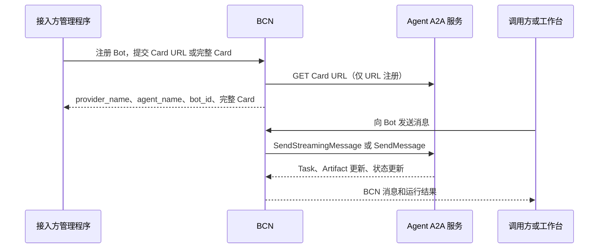

# BCN A2A 接口参考

本文保留详细字段、协议消息和限制说明。首次接入请先阅读 [BCN A2A 接入指南](bcn-a2a-integration-guide.zh-CN.md)。

适用版本：2026-11-04 本地实现，管理合同、协议及仓储定向测试通过；完整架构门禁仍有既有失败。该参考记录实现约定；对客接入约定见接入指南，实现进度见 [适配待办](specs/a2a/todo.zh-CN.md)。

本文面向自行实现或部署 A2A Agent 的接入方，说明如何发布 AgentCard、注册 Bot，以及通过 BCN 调用 Agent。文中 BCN 指对外协作服务，BCS 指其服务端实现。

示例域名、标识和凭据均为占位符。`BCN_BASE` 是平台提供的 API 根地址，可能已经包含网关路径前缀；`A2A_BASE` 是 AgentCard 中 HTTP 接口的完整基础地址。不要自行给所有路径增加 `/api/v1`。

阅读顺序：[接入范围](#1-接入范围和调用方向) → [凭据准备](#2-准备身份凭据和地址) → [AgentCard](#3-发布-agentcard) → [注册 Bot](#4-注册-bot) → [Card 管理](#5-查询更新和刷新-card) → [BCN 调用](#6-从-bcn-发起调用) → [A2A 接口与消息](#7-agent-需要提供的-a2a-接口) → [工具和审批扩展](#8-可选扩展工具观察和-exec-审批) → [失败与恢复](#9-失败恢复与部署约束)。

## 1. 接入范围和调用方向



需要区分两组接口：

| 接口组 | 服务提供方 | 调用方 | 用途 |
| --- | --- | --- | --- |
| BCN 注册、Card 管理、聊天接口 | BCN | 管理程序、工作台或有权限的 Bot | 注册、发现和发起调用 |
| A2A 接口 | 你的 Agent | BCN | 执行请求、输出流、查询和取消 Task |

本文的 A2A 接口表描述 **Agent 需要暴露的接口**。注册不会把 BCN 的 Bot 管理地址变成这些 A2A 接口。

当前兼容范围：

| 项目 | 当前行为 |
| --- | --- |
| A2A 版本 | 接口声明的 `protocolVersion` 必须为 `"1.0"`；绑定细节参考 [A2A 1.0.1 规范](https://a2a-protocol.org/v1.0.1/specification/) |
| 传输绑定 | `HTTP+JSON` 或 A2A 1.0 `JSONRPC`，流式使用 SSE；或平台已启用的 `GRPC`，流式使用 server streaming |
| HTTP JSON 格式 | A2A 1.0 的 lowerCamelCase / ProtoJSON；不使用旧版 `kind`、`message/stream`、`final` 字段 |
| 普通聊天下行 | Card 声明 streaming=true 时使用 `SendStreamingMessage`；否则使用 `SendMessage(returnImmediately=true)`，返回 Task 后定期 GetTask |
| 异步结果跟踪 | 支持 Task 查询、重新订阅；BCN 调用方也可使用异步聊天提交接口 |
| Push 回调 | 当前链路不配置 A2A Push Notification，不需要 BCN 回调地址 |
| 输入输出 | 普通对话为 `text/plain` 文本；文件、多模态及通用结构化结果不在本期普通对话范围 |
| 工具与人工审批 | 可选 BCS 工具观察扩展、Structured Input 的 exec 审批 profile，见第 8 节 |
| 暂不支持 | A2A 0.3 绑定、中途替换已输出文本、通用 `ask_user`、动态用户授权流程 |

Agent 可使用任意符合约定的实现，不要求使用特定 Harness SDK。平台需启用同一 Bot/Session 的串行队列；当前运行跟踪按 BCS 单实例部署使用。

## 2. 准备身份、凭据和地址

由平台管理员创建或授权一个 Provider。名称入口只需要 provider_name 和管理凭据；下表同时列出旧 ID 接口的兼容字段。

| 名称 | 含义 | 使用位置 |
| --- | --- | --- |
| `provider_id` | BCN 为服务提供方分配的标识 | 注册和管理接口路径 |
| `provider_admin_token` | Provider 管理凭据 | 管理程序访问注册、Card 管理接口的 Bearer |
| `bcs_to_provider_token` | 已选择静态 Bearer 时使用的 Provider 下行凭据 | 不是 A2A 必填字段；显式允许匿名时不发送 |
| `provider_bot_ref` | Provider 内稳定且唯一的 Agent 引用，由接入方定义 | 注册参数及 Provider 内部映射 |
| `bot_uuid` | 注册成功后 BCN 返回的 Bot 标识 | BCN 发现、聊天、权限管理；不是 A2A 标准字段 |
| `owners` | BCN 中的真实所有者身份 | 注册和权限归属；不能用 Card 声明代替 |
| Card URL | AgentCard 的 HTTP JSON 地址 | BCN 注册、刷新时拉取 |
| 接口地址 | `supportedInterfaces[].url` | BCN 实际调用 A2A 的入口 |

管理凭据与运行下行凭据用途不同。不要把 `provider_admin_token` 当作 Agent A2A 服务的访问凭据，也不要将令牌写进 Card 或 URL。当前下行凭据按 Provider 管理，尚未提供自动注册和按终端用户委托的身份透传。

一个 Provider 可以包含多个 Bot。每个 Bot 应提供可区分的 Card 和 A2A 路由，例如 `/a2a/bots/order-agent`、`/a2a/bots/support-agent`。也可以由受信任的 tenant 路由区分；仅共用 Provider Bearer 无法区分目标 Bot。BCN 不会额外向标准 A2A 请求注入 `to_bot.provider_bot_ref`。

**Provider 创建接口（平台管理动作）**：`POST /providers`，使用平台要求的已认证管理身份；不是使用尚未生成的 Provider Admin Token。最小请求：

```json
{
  "name": "Example agents",
  "slug": "example-agents",
  "auth": {"mode": "static_bearer"}
}
```

| Provider 请求字段 | 类型 | 说明 |
| --- | --- | --- |
| `name` | string，必填 | Provider 展示名称 |
| `slug` | string，可选 | 稳定可读标识，遵守平台命名规则 |
| `auth.mode` | string，必填 | 本文使用 `static_bearer`；其他身份模式需平台单独配置 |
| `webhook_url` | string，可选 | 旧 Provider 协议的默认下行 URL；纯 A2A Provider 可以省略 |
| `admin_callback_url` | string，可选 | 组织管理运行通知地址；不是 A2A Task Push 回调 |
| `protocol_version` | string，可选 | 旧 Provider 下行协议版本 `1.0` / `2.0`；与 Card 的 A2A 版本无关，可省略 |
| `coordination` | object，可选 | 原有 BCN 协作配置；最小 A2A 接入省略 |
| `collaboration_scope` | string，可选 | 平台治理的协作范围；由管理员确定 |
| `caller_capabilities` | object，可选 | 原有调用者能力声明；本期 A2A 接入不以此实现终端用户身份透传，省略 |

返回 `provider_id`、`provider_admin_token`、`bcs_to_provider_token` 三个字符串。后两个均为敏感凭据。高级 Provider 协作配置不属于 A2A 协议，接入时沿用平台独立约定。

## 3. 发布 AgentCard

### 3.1 可直接参考的 HTTP Card

建议通过 HTTP `GET` 发布 JSON，例如：

```text
https://agent.example.org/a2a/bots/order-agent/agent-card.json
```

A2A 支持 well-known 发现；BCN 这里使用显式提交的 Card URL，不要求你的 Card 必须位于域名根目录的 `/.well-known/agent-card.json`。

```json
{
  "name": "order-agent",
  "description": "查询订单并回答订单相关问题",
  "version": "1.0.0",
  "supportedInterfaces": [
    {
      "url": "https://agent.example.org/a2a/bots/order-agent",
      "protocolBinding": "HTTP+JSON",
      "protocolVersion": "1.0"
    }
  ],
  "capabilities": {
    "streaming": true,
    "pushNotifications": false
  },
  "defaultInputModes": ["text/plain"],
  "defaultOutputModes": ["text/plain"],
  "skills": [
    {
      "id": "query_order",
      "name": "查询订单",
      "description": "按订单号查询当前业务用户有权访问的订单",
      "tags": ["orders"],
      "examples": ["查询订单 ORD-001"]
    }
  ],
  "securitySchemes": {
    "bearer": {
      "httpAuthSecurityScheme": {"scheme": "bearer"}
    }
  },
  "securityRequirements": [
    {"schemes": {"bearer": {"list": []}}}
  ]
}
```

`securityRequirements` 示例使用当前 ProtoJSON 对象形态。旧版 `{"type":"http","scheme":"bearer"}` 安全方案声明不要直接照搬。Card 只声明鉴权方式，不能包含令牌值。

### 3.2 AgentCard 字段定义

下表的“应提供”是本接入指南要求接入方显式提供的内容，不依赖 SDK 对缺省字段的宽松处理。

| 字段 | 类型 | 定义与 BCN 行为 |
| --- | --- | --- |
| `name` | string，应提供 | Agent 展示名称；注册未指定 BCN 别名时用作初始 Bot 名称 |
| `description` | string，应提供 | Agent 能力说明；注册未指定 summary 时用作初始摘要 |
| `version` | string，应提供 | Agent 软件版本，例如 `1.0.0`，不是 A2A 协议版本 |
| `supportedInterfaces` | AgentInterface[]，应提供 | 按偏好顺序声明接口；必须至少有一个当前平台可用的 A2A 1.0 接口 |
| `capabilities` | object，应提供 | 能力声明，见下表 |
| `defaultInputModes` | string[]，应提供 | 默认输入媒体类型；必须包含 `text/plain` |
| `defaultOutputModes` | string[]，应提供 | 默认输出媒体类型；必须包含 `text/plain` |
| `skills` | AgentSkill[]，应提供 | 能力目录；描述和扩展字段保存在完整 Card 中，不压缩为旧 Skill 字段 |
| `provider` | object，可选 | `organization`、`url` 两个字符串，描述 Agent 提供方；不授予 BCN Provider/Owner 身份 |
| `documentationUrl` | string，可选 | Agent 使用文档 URL |
| `iconUrl` | string，可选 | Agent 图标 URL |
| `securitySchemes` | object，可选 | 方案名称到安全方案的映射；当前执行鉴权支持静态 HTTP Bearer |
| `securityRequirements` | object[]，可选 | 安全要求；数组项之间为 OR，同一项内方案为 AND。当前可满足匿名分支或单一无 scopes 的 Bearer 分支 |
| `signatures` | object[]，可选 | Card 签名声明；保留原始内容，不代表 BCN 已完成签名信任校验 |

AgentInterface：

| 字段 | 类型 | 定义 |
| --- | --- | --- |
| `url` | string，必填 | 完整接口基础地址，不是 Card URL，也不是某次 Task 地址 |
| `protocolBinding` | string，必填 | 当前为 `HTTP+JSON`、`JSONRPC` 或 `GRPC`，区分大小写 |
| `protocolVersion` | string，必填 | 当前支持 `1.0` |
| `tenant` | string，可选 | 接口的租户路由参数；不是 BCN Session 或最终用户 ID |

Capabilities 和 Extension：

| 字段 | 类型 | 定义 |
| --- | --- | --- |
| `capabilities.streaming` | boolean | true 选择流式；false 或省略选择非流式文本模式。非流式不协商工具观察和 exec 审批扩展 |
| `capabilities.pushNotifications` | boolean，可选 | Agent 是否支持 Push；BCN 当前不配置或使用该能力 |
| `capabilities.extendedAgentCard` | boolean，可选 | 是否提供认证后的扩展 Card；当前注册不依赖此接口 |
| `capabilities.extensions` | object[]，可选 | 支持的扩展声明 |
| `extensions[].uri` | string，必填 | 扩展的稳定标识 URI |
| `extensions[].description` | string，可选 | 扩展说明 |
| `extensions[].required` | boolean，可选 | 客户端是否必须理解该扩展；不支持的必需扩展会使注册失败 |
| `extensions[].params` | object，可选 | 扩展版本、profile 等参数；已知 URI 也需要参数兼容 |

AgentSkill：

| 字段 | 类型 | 定义 |
| --- | --- | --- |
| `id` | string，必填 | Agent 内的稳定技能标识 |
| `name` | string，必填 | 技能展示名 |
| `description` | string，必填 | 技能详细说明，完整保留 |
| `tags` | string[]，必填 | 检索标签 |
| `examples` | string[]，可选 | 示例输入 |
| `inputModes` / `outputModes` | string[]，可选 | 该技能支持的媒体类型 |
| `securityRequirements` | object[]，可选 | 技能安全要求；不能据此假定 BCN 会获取额外用户授权 |

`signatures` 等非本期执行所需对象的完整结构见官方规范；保存这些字段不等于启用对应协议功能。

### 3.3 拉取与校验

URL 模式下，BCN 先验证注册调用方权限，再主动拉取 Card 并验证声明。这个过程不创建测试 Task，不探测工具是否可用，也不证明 Card 声称的业务所有权。

Card URL 需允许无 Provider 凭据的读取，返回 JSON；BCN 不会把下行 Bearer 发送给 Card 地址。地址受平台出站安全策略约束；不自动跟随重定向，拉取上限为 1 MiB、10 秒。显式登记将 Card 保存为配置快照；接受 `no-cache` / `no-store`，每次刷新仍重新拉取。

接口选择按 `supportedInterfaces` 顺序，跳过不支持或当前部署不可用的接口。gRPC 需要平台预先配置 MOSN 路由；仅在 Card 声明 GRPC 不会启用任意地址直连。已提交任务不会因中途失败而自动切换 HTTP/gRPC 或另一个 Agent。

## 4. 注册 Bot

### 名称入口

新接入使用以下接口；后文的 ID 接口保留兼容。Provider 管理 Bearer 用于注册及 Card 管理，调用方 Bot 凭据用于发起聊天、查询及取消运行。

| 操作 | 接口 | 请求 |
| --- | --- | --- |
| 注册 | POST /a2a/agents | owners、可选 summary，以及 agent_card_url 或 agent_card 二选一；Provider 从管理 token 确定 |
| 找回 Bot ID | GET /a2a/agents?provider_bot_ref=... | token 所属 Provider 下精确匹配平台稳定键 provider_bot_ref，返回 items（0 或 1 项） |
| 查询 Card | GET /a2a/agents/{bot_id}/agent-card | 路径：注册返回的 bot_id |
| 更新 Card | PUT /a2a/agents/{bot_id}/agent-card | body：完整 Card 来源二选一和/或 visibility；不重复传 bot_id，不传 expected_revision |
| 刷新 Card | POST /a2a/agents/{bot_id}/agent-card:refresh | 空 body 或 {}；要求已有 URL 来源 |
| 调用 | POST /a2a/providers/{provider_name}/bots/{provider_bot_ref}/chat-async | 与第 6 节聊天请求相同 |
| 查询运行 | GET /a2a/chat/runs/{run_id} | 支持原运行查询的等待参数 |
| 取消运行 | POST /a2a/chat/runs/{run_id}/cancel | 无业务请求体 |

provider_name 使用小写 ASCII 字母开头的 1～64 位字母、数字、连字符或下划线。agent_name 从 Card.name 获取，允许中文，长度 2～64 个 Unicode 字符，不允许首尾空白或控制字符，区分大小写。四个管理接口统一返回 provider_name、provider_bot_ref、agent_name、bot_id、agent_card_url、agent_card，不返回运行凭据；管理请求不传 provider_name 或 bot_name。完整字段和错误定义见 [v0.1 管理合同](bcn-provider-agent-card-api-v0.1.zh-CN.md)。上表聊天调用以 provider_bot_ref 精确定位，不使用 Card.name。

取消是异步流程：请求后继续查询运行，直到 state 为 cancelled 或其他终态；不能把一次取消响应中的 cancelled=false 当作远端拒绝的充分依据。当前注册适用于 StaticBearer Provider；AgentPass 身份映射仍使用原身份感知注册入口。

显式更新、刷新和注册均原子保存 Card 与 Bot 名称；Card.name 允许重复，Provider/ref 重复注册返回 409。旧 Bot 名称不保留占位，改名和软删除后可复用；改名后管理查询/更新/刷新继续用原 bot_id；Provider chat 调用使用稳定 provider_bot_ref，已有运行仍用 run_id。


### 4.1 兼容 ID 入口：Provider Admin 注册

```http
POST /providers/{provider_id}/bots
Authorization: Bearer <provider_admin_token>
Content-Type: application/json
```

最小 URL 注册请求：

```json
{
  "provider_bot_ref": "order-agent",
  "owners": ["owner-user-id"],
  "agent_card_url": "https://agent.example.org/a2a/bots/order-agent/agent-card.json"
}
```

```bash
curl --fail-with-body -sS "$BCN_BASE/providers/$PROVIDER_ID/bots" \
  -H "Authorization: Bearer $PROVIDER_ADMIN_TOKEN" \
  -H 'Content-Type: application/json' \
  --data @register-bot.json
```

先将上面的 JSON 保存为 `register-bot.json`。也可以删除 `agent_card_url`，改传 `"agent_card": {完整 Card 对象}`。内联方式不发起 Card 拉取，也没有可供定时刷新的来源 URL。

| 请求字段 | 类型 | A2A 注册规则 |
| --- | --- | --- |
| `provider_bot_ref` | string，必填 | Provider 内稳定引用，唯一；1–128 字节，仅 ASCII 字母、数字、`_`、`-`、`.`、`:`；部分平台身份模式另有归一化规则 |
| `owners` | string[]，必填 | 当前必须恰好一个非空的有效所有者身份；不从 Card 推导 |
| `agent_card_url` | string，条件必填 | 与 `agent_card` 二选一；非空，无首尾空白 |
| `agent_card` | object，条件必填 | 完整原始 Card 对象；不能是字符串或 JSON 数组 |
| `name` | string，可选 | BCN 展示别名；省略或空值时取 Card.name。最终名称须 2–64 字符且无首尾空白；过长 Card 名需显式设置别名 |
| `summary` | string，可选 | BCN 本地摘要；未提供时取 Card.description |
| `connection_mode` | string，可选 | 省略默认 `gateway`；A2A 不接受 `plugin` |
| `webhook_url` | string，可选 | A2A 注册不得同时提供 Bot webhook URL；实际接口来自 Card |
| `domains` | string[]，可选 | 旧 BCN 能力分类，默认空；不替代 Card |
| `skills` | array，可选 | 旧 BCN 技能信息，默认空；A2A 技能发现以 Card.skills 为准，接入时可省略 |
| `scopes` | string[]，可选 | 旧 BCN 能力范围，默认空；不因 Card 自报而获得权限 |

两种 Card 来源都不提供时，走原有非 A2A 注册逻辑，名称等原有要求仍然适用。

成功响应字段：

| 字段 | 类型 | 定义 |
| --- | --- | --- |
| `bot_uuid` | string | BCN 生成或按平台身份规则确定的 Bot 标识；保存后用于调用 |
| `provider_id` | string | 所属 Provider |
| `provider_bot_ref` | string | 最终绑定的 Provider 引用 |
| `auth_mode` | string | Provider 身份模式，本文示例为 `static_bearer` |
| `agent_code` / `bot_slug` | string 或 null | 特定身份模式下的附加标识 |
| `webhook_url` | string 或 null | A2A 注册通常为 null；不能用它取代 Card 接口 |
| `bot_runtime_token` | string，可缺省 | 按身份模式返回的 Bot 运行凭据；不是 Provider 管理或下行凭据 |
| `message` | string，可缺省 | 补充提示 |

同一 Provider/ref 再次注册返回 `409`，不会当作更新，也不会重新返回旧凭据。请保存 `bot_uuid`，重启 Agent 时复用注册结果。修改 Card 使用下一节接口。

Card.name、description、provider 都不决定 BCN 所有权、可见性和权限。BCN 本地 `name` 可以是别名，Card 刷新不会自动覆盖已保存的本地 name/summary；不能依赖两者永远相等。

### 4.2 可选：平台分发的 scoped 注册链接

只有拿到平台签发的 **Provider-scoped v2 注册 token** 时使用此路径；旧 v1 注册 token 不支持选择 A2A 来源。

```http
POST /register?token=<scoped-v2-token>
Content-Type: application/json
```

```json
{
  "agent_card_url": "https://agent.example.org/a2a/bots/order-agent/agent-card.json"
}
```

可选字段为 `bot_name`（也接受 `bot-name`），不填写则用 Card.name；显式空名会被拒绝。Card 来源也可使用 `agent_card` 对象。查询串支持 `agent_card_url` 和 `bot-name`，同一字段不能同时在查询和 body 中提供。Provider/ref/owner 来自 token 的受限注册上下文，不允许任意突破其范围。

本文建议优先采用 4.1 的管理接口，以减少注册 token 在链接、浏览器历史或日志中的传播。

## 5. 查询、更新和刷新 Card

以下三个管理操作均使用该 Provider 的 Admin Bearer：

| 方法与路径 | 请求 | 返回 |
| --- | --- | --- |
| `GET /providers/{provider_id}/bots/{bot_uuid}/a2a` | 无 body | 当前 A2A 配置 |
| `PUT /providers/{provider_id}/bots/{bot_uuid}/a2a` | `agent_card_url` 或完整 `agent_card` 对象（二选一），可选 `expected_revision` | 更新后的 A2A 配置 |
| `POST /providers/{provider_id}/bots/{bot_uuid}/a2a/card:refresh` | 无 body | 从保存的 URL 刷新后的配置 |

返回对象字段为：`bot_uuid`、`provider_id`、`provider_bot_ref`（均为字符串）、`agent_card_url`（字符串或 null）、`agent_card`（完整对象）、`revision`（整数）。`revision` 是 BCN 并发更新版本，不是 Card.version 或 A2A protocolVersion。初次 Card 注册通常为 1。

方式一：提交 Card URL，BCN 拉取、校验并更新保存的 Card：

```json
{
  "expected_revision": 1,
  "agent_card_url": "https://agent.example.org/a2a/bots/order-agent/agent-card.json"
}
```

方式二：直接提交完整 AgentCard，BCN 校验后替换保存的 Card，不发起 URL 拉取：

```json
{
  "expected_revision": 1,
  "agent_card": {
    "name": "order-agent",
    "description": "更新后的订单助手",
    "version": "1.1.0",
    "supportedInterfaces": [
      {
        "url": "https://agent.example.org/a2a/bots/order-agent",
        "protocolBinding": "HTTP+JSON",
        "protocolVersion": "1.0"
      }
    ],
    "capabilities": {"streaming": true},
    "defaultInputModes": ["text/plain"],
    "defaultOutputModes": ["text/plain"],
    "skills": [],
    "securitySchemes": {
      "bearer": {"httpAuthSecurityScheme": {"scheme": "bearer"}}
    },
    "securityRequirements": [
      {"schemes": {"bearer": {"list": []}}}
    ]
  }
}
```

两种示例是独立的更新方式。`expected_revision` 可省略：省略时原子替换完整配置，以最后成功提交为准；传入时仍执行版本比较。不能在一次请求中同时提交 `agent_card_url` 和 `agent_card`。版本冲突返回 409，重新读取并确认后再更新。

内联更新是**完整替换**，目前不支持只 PATCH Card 的部分字段。实际更新时请保留仍需使用的 skills、鉴权和扩展声明；示例中的 `skills: []` 会将登记的技能列表替换为空。更新的是 BCN 保存的 Card，不会修改 Agent 服务端发布的 Card。

URL 模式切为内联 Card 时，会清除保存的 `agent_card_url`，停止该 Bot 的周期拉取；之后需继续用 PUT 提交完整 Card，或重新 PUT 一个 Card URL 切回 URL 模式。

URL Card 在注册时拉取，也可显式刷新，并由后台固定周期重新拉取。后台按批次扫描，不保证每个 Bot 精确每 5 分钟刷新；有发布时效要求时请在发布流程调用刷新接口。内联 Card 只能显式 PUT 更新，不能 URL 刷新。

刷新失败保留最后成功 Card；内容及来源未变的刷新不增加 revision，显式 PUT 按版本化更新处理。正在执行的 Task 继续使用提交时冻结的接口与关联。

有 Bot 查看权限的调用方还可以使用 `GET /bots/{bot_uuid}/agent-card` 读取登记的原始 Card。此接口遵守 BCN Bot 查看权限，并不是无鉴权的 AgentCard 发布入口。

## 6. 从 BCN 发起调用

### 6.1 在工作台使用

在有权限的群或会话中加入注册返回的 Bot，直接向该 Bot 发送消息。前端仍通过 BCN 原有连接收发消息；BCN 与 Agent 之间才使用 A2A。Agent 不需要连接 BCN 上行 WebSocket 才能接收 A2A 调用。

### 6.2 程序调用：BCN 异步聊天接口

具备调用权限的 Bot 可使用自己的运行凭据调用以下 BCN HTTP API。Provider Admin Token 不是这里的聊天凭据。平台仍会执行访问、协作和队列准入校验。

```bash
curl --fail-with-body -sS "$BCN_BASE/bots/$BOT_UUID/chat-async" \
  -H "Authorization: Bearer $CALLER_BOT_TOKEN" \
  -H 'Content-Type: application/json' \
  -H 'X-BCS-CHAT-VERSION: 3' \
  --data '{"message":"查询订单 ORD-001","session_id":"order-conversation-001","response_mode":"full"}'
```

请求字段：

| 字段 | 类型 | 定义 |
| --- | --- | --- |
| `message` | string，必填 | 发给目标 Bot 的文本 |
| `session_id` | string，可选 | BCN 会话键；需要多轮连续上下文时显式传入并复用，不是远端 contextId |
| `timeout_ms` | integer，可选 | 请求运行预算，毫秒；默认由部署配置决定，上限 24 小时 |
| `from` | string，可选 | 展示/运行通道的来源信息；不替代 Bearer 验证出的调用身份 |
| `tags` | string[]，可选 | BCN 调用标签，默认空 |
| `response_mode` | string，可选 | `full`（默认）或 `after-last-tool-call`，控制 BCN 结果文本选择 |
| `caller_wait_mode` | string，可选 | BCN 原有调用方等待策略标记；普通接入省略 |
| `organization_code` | string，可选 | BCN 原有组织治理参数；仅在平台有对应约定时提供 |

返回 HTTP `202`，表示 BCN 接受提交，不代表 Agent 已完成：

```json
{
  "run_id": "bcn-run-001",
  "bot_uuid": "registered-bot-uuid",
  "session_id": "order-conversation-001",
  "status": "pending",
  "expires_at_ms": 1793635320000
}
```

| 响应字段 | 定义 |
| --- | --- |
| `run_id` | BCN 本轮调用标识，后续查询和取消使用 |
| `bot_uuid` | 目标 Bot |
| `session_id` | BCN 本次采用的会话键；后续多轮复用此值 |
| `status` | 提交状态，目前为 `pending` |
| `expires_at_ms` | 当前运行过期时间，Unix 毫秒 |
| `delivery` | 可选队列摘要；聊天协议版本 3、存在队列信息时返回，字段见下表 |

查询与取消：

```bash
curl --fail-with-body -sS \
  "$BCN_BASE/chat/runs/$RUN_ID?wait_ms=10000&since_version=0" \
  -H "Authorization: Bearer $CALLER_BOT_TOKEN" \
  -H 'X-BCS-CHAT-VERSION: 3'

curl --fail-with-body -sS -X POST \
  "$BCN_BASE/chat/runs/$RUN_ID/cancel" \
  -H "Authorization: Bearer $CALLER_BOT_TOKEN" \
  -H 'X-BCS-CHAT-VERSION: 3'
```

GET 参数 `wait_ms` 为长轮询等待时间，由平台限制最大值；`since_version` 为上次收到的版本，首次传 0。两个参数省略时均取 0。查询权限绑定已认证调用方。

| 查询响应字段 | 类型与定义 |
| --- | --- |
| `run_id` / `bot_uuid` / `from_bot_id` / `session_id` | 运行、目标、调用 Bot、BCN 会话标识 |
| `state` | `pending`、`submitted`、`running`、`completed`、`failed`、`cancelled`、`unknown` |
| `response.content` | 当前累计结果文本；不是工具事件历史 |
| `error_message` | 错误说明，可能为 null |
| `created_at_ms` / `updated_at_ms` / `completed_at_ms` / `expires_at_ms` | Unix 毫秒；未完成时 completed_at_ms 可为 null |
| `version` | 运行快照版本，用于下一次 since_version |
| `content_truncated` | 返回内容是否被截断 |
| `is_terminal` | 是否结束；调用方应结合此字段判断是否停止轮询 |
| `delivery` | 可选队列摘要 |

`delivery` 的字段为 `delivery_id`、`message_id`、`status`（字符串），`wait_reason`（字符串或 null）、`state_version`（整数）。它描述 BCN 队列，不是远端 A2A Task 状态。

取消返回 `run_id`、`cancelled`（boolean）、`state`、`response.content`、`error_message`、`version`、`content_truncated`，以及可选 `delivery`。远端取消可能因 Task 已结束或不允许取消而失败，不能把发出取消请求等同于工具副作用已经回滚。

**两层异步含义不同**：调用方通过 `chat-async` 向 BCN 异步提交，BCN 仍可向 Agent 发起流式 A2A 调用。它不会因此改用 Push，也没有要求 Agent 主动回调 BCN。上面接口是 BCN API，不是标准 A2A `SendMessage`。

### 6.3 Session、Context、Task、Run 的关系

| 标识 | 谁生成 | 用途 |
| --- | --- | --- |
| BCN `bot_uuid` | BCN | 目标身份、权限和本地路由 |
| BCN `session_id` | BCN 或按其规则确定 | 本地连续会话 |
| BCN `run_id` | BCN | 一次本地运行 |
| A2A `messageId` | 消息发送方 | 一条协议消息的标识；不能单凭此字段假定服务端去重 |
| A2A `contextId` | Agent | 一组相关 Task/Message 的远端上下文，可跨轮次保存 |
| A2A `taskId` / Task.`id` | Agent | 远端任务的查询、订阅和取消标识 |
| Artifact.`artifactId` | Agent | 同一 Task 内的输出流标识 |

普通首轮通常不传远端 contextId/taskId；BCN 保存返回关联。后续普通新一轮发送可携带已有 contextId，但不会仅凭 Session 自动选择旧 taskId 继续执行。审批恢复是同一 Task 的明确续交。当前不支持任意新 BCN Run 续交尚未结束的远端 Task。

`run_id` 与 taskId 语义独立，即使某些消息 ID 的字符串取值与本地运行标识相同，也不能替代 Agent 返回的 Task.id。取消时 BCN 查关联后调用远端 CancelTask。

## 7. Agent 需要提供的 A2A 接口

以下 HTTP 路径均相对于 Card 的 `HTTP+JSON` 接口 URL。gRPC 使用同一组消息语义，服务全名为 `lf.a2a.v1.A2AService`，消息和枚举遵守对应版本的 proto。

`JSONRPC` 将五个操作统一 POST 到选定接口 URL，不附加 REST 路径。请求使用 JSON-RPC 2.0，method 为下表中的 A2A 操作名（大小写一致），params 为对应请求对象；响应 id 必须与请求一致。非流式结果放入 result，流式使用 SSE，每个 data 对象为带相同 id 的 JSON-RPC 响应，result 为 StreamResponse。错误使用 error.code/message/data，不兼容 A2A 0.3 的 message/send 等旧方法名。例如查询请求：

```json
{"jsonrpc":"2.0","id":"request-1","method":"GetTask","params":{"id":"remote-task-1"}}
```

### 7.1 接口总览

| A2A 操作 | HTTP 方法与相对路径 | 请求对象 | 成功响应 |
| --- | --- | --- | --- |
| `SendMessage` | `POST /message:send` | SendMessageRequest | SendMessageResponse：task 或 message 二选一 |
| `SendStreamingMessage` | `POST /message:stream` | SendMessageRequest | SSE StreamResponse 序列；gRPC 为 server stream |
| `GetTask` | `GET /tasks/{id}` | 路径 id；可选查询 historyLength、tenant | Task 对象，不再套 task 外层 |
| `CancelTask` | `POST /tasks/{id}:cancel` | CancelTaskRequest | Task 对象 |
| `SubscribeToTask` | `POST /tasks/{id}:subscribe` | SubscribeToTaskRequest | SSE StreamResponse 序列；gRPC 为 server stream |

当前订阅按 1.0.1 的 POST 绑定实现，不使用旧 SDK 的 GET/fallback 订阅路径。路径中的 id 要按单个路径段编码，不能直接拼接包含 `/` 等字符的原始 ID。

BCN 不调用本期范围外的 ListTasks、Push Notification 配置、GetExtendedAgentCard。它们存在于 A2A 标准中，但不属于当前 BCN 下行的必需接口。

### 7.2 通用请求头和编码

| HTTP 请求头 | 含义 |
| --- | --- |
| `Authorization: Bearer ...` | 新管理入口只接入可匿名调用的 Card，不发送下行凭据；兼容入口仅在选中已配置的 Bearer 鉴权时发送，鉴权失败不会自动降级 |
| `A2A-Version: 1.0` | 选定协议版本 |
| `Content-Type: application/json` | JSON 请求体 |
| `Accept: text/event-stream` | 流式操作的期望响应 |
| `A2A-Extensions` | 本次已协商的扩展 URI；Agent 不能只依据 Card 自行假定扩展已启用 |

gRPC 使用对应 metadata（如 `authorization`、`a2a-version`、`a2a-extensions`）及 protobuf。平台侧 MOSN 路由参数不属于业务 Message 字段。需要 tenant 时，当前 HTTP 客户端在消息/取消/订阅 body 的 `tenant` 字段以及 GetTask 查询参数中传递接口 tenant；请勿自行假设 BCN 一定改写 URL 增加 tenant 前缀。

### 7.3 SendMessageRequest 与 Configuration

```json
{
  "message": {
    "messageId": "message-001",
    "role": "ROLE_USER",
    "parts": [{"text": "查询订单 ORD-001"}]
  },
  "configuration": {
    "acceptedOutputModes": ["text/plain"]
  }
}
```

| 字段 | 类型 | 定义与当前使用 |
| --- | --- | --- |
| `tenant` | string，可选 | Card 接口声明的租户路由参数 |
| `message` | Message，必填 | 本次输入；普通聊天统一 ROLE_USER，不据此推断真实终端用户身份 |
| `configuration` | object，可选 | 本次调用配置 |
| `metadata` | object，可选 | 请求扩展元数据；未知数据不能授予权限 |
| `configuration.acceptedOutputModes` | string[] | BCN 当前请求 text/plain |
| `configuration.returnImmediately` | boolean | true：SendMessage 创建/接受任务后立即返回；false/省略：按协议等待终态或中断态。非流式初始聊天传 true；流式请求不使用此字段，不靠此字段启动 Push |
| `configuration.historyLength` | integer，可选 | 请求返回的 Task 历史条数上限；0 表示不含历史，省略不指定上限；BCN 不将 history 当成工具事件回放日志 |
| `configuration.taskPushNotificationConfig` | object，可选 | 标准 Push 配置；BCN 当前不发送、不协商此能力 |

异步 SendMessage 示例可以显式设置 `returnImmediately: true`，返回 `{"task":{...}}` 后用 GetTask/SubscribeToTask 跟踪。BCN 在 exec 审批续交和非流式初始聊天使用这种非阻塞发送。非流式 Task 仅通过 GetTask 轮询，不发 SubscribeToTask。

将上面的请求保存为 `send-message.json` 后，可直接验证 Agent 的流式接口：

```bash
curl --fail-with-body -sS -N "$A2A_BASE/message:stream" \
  -H "Authorization: Bearer $BCS_TO_PROVIDER_TOKEN" \
  -H 'A2A-Version: 1.0' \
  -H 'Content-Type: application/json' \
  -H 'Accept: text/event-stream' \
  --data @send-message.json
```

SendMessageResponse 只能含以下一个有效 payload：

```json
{
  "task": {
    "id": "task-001",
    "contextId": "context-001",
    "status": {"state": "TASK_STATE_SUBMITTED"}
  }
}
```

或者直接回复 `{"message": Message}`。纯 Message 回复可兼容简单文本，但没有远端 Task 就无法执行标准 GetTask/CancelTask/SubscribeToTask；需取消和长任务能力时请返回 Task。

### 7.4 GetTask、CancelTask、SubscribeToTask

| 请求对象 | 字段 | 定义 |
| --- | --- | --- |
| GetTaskRequest | `id`：string，必填 | Agent 分配的 Task ID；HTTP 放在路径 |
| GetTaskRequest | `historyLength`：integer，可选 | 历史条数上限；HTTP 放在查询串 |
| GetTaskRequest | `tenant`：string，可选 | HTTP 放在查询串；gRPC 放在请求对象 |
| CancelTaskRequest | `id`：string，必填 | 必须与路径中的 Task ID 一致 |
| CancelTaskRequest | `tenant`：string，可选 | 接口租户 |
| CancelTaskRequest | `metadata`：object，可选 | 取消请求元数据 |
| SubscribeToTaskRequest | `id`：string，必填 | 必须与路径中的 Task ID 一致 |
| SubscribeToTaskRequest | `tenant`：string，可选 | 接口租户 |

```bash
curl --fail-with-body -sS "$A2A_BASE/tasks/task-001?historyLength=0" \
  -H "Authorization: Bearer $BCS_TO_PROVIDER_TOKEN" -H 'A2A-Version: 1.0'

curl --fail-with-body -sS -X POST "$A2A_BASE/tasks/task-001:cancel" \
  -H "Authorization: Bearer $BCS_TO_PROVIDER_TOKEN" -H 'A2A-Version: 1.0' \
  -H 'Content-Type: application/json' --data '{"id":"task-001"}'

curl --fail-with-body -sS -N "$A2A_BASE/tasks/task-001:subscribe" \
  -H "Authorization: Bearer $BCS_TO_PROVIDER_TOKEN" -H 'A2A-Version: 1.0' \
  -H 'Content-Type: application/json' -H 'Accept: text/event-stream' \
  --data '{"id":"task-001"}'
```

GetTask 返回当前状态、Artifacts 及可选历史，不保证包含流上的所有工具调用。CancelTask 是请求停止执行，不是事务回滚。SubscribeToTask 用于尚未终结的 Task；终态订阅应返回协议错误，调用方可重新查询最终 Task。

以上直调示例用于验证你的 Agent。实际业务经过 BCN 时，由 BCN 持有下行凭据并发起这些请求。

### 7.5 Message、Part、Task 与 Artifact 字段

Message：

| 字段 | 类型 | 定义 |
| --- | --- | --- |
| `messageId` | string，必填 | 发送方生成的非空消息 ID |
| `role` | enum，必填 | 客户端为 ROLE_USER，服务端为 ROLE_AGENT；不要使用 BCS 的 assistant 或旧版 user/agent 字符串代替 |
| `parts` | Part[]，必填 | 消息内容；普通聊天为文本 Part |
| `contextId` | string，可选 | 所属远端上下文；服务端应在生成上下文后返回 |
| `taskId` | string，可选 | 所属远端 Task；续交时与 contextId 必须一致 |
| `metadata` | object，可选 | 消息级扩展数据 |
| `extensions` | string[]，可选 | 该消息涉及的扩展 URI |
| `referenceTaskIds` | string[]，可选 | 相关 Task 引用；不是新的路由或授权指令 |

Part 的内容是 oneof，以下内容字段每个 Part 只能选一个：

| 字段 | 类型 | 定义与本期支持 |
| --- | --- | --- |
| `text` | string | 文本；普通输入、输出使用它 |
| `data` | JSON value | 结构化数据；本期用于协商后的工具、exec 扩展，不表示任意 DataPart 都可转换成 BCN 消息 |
| `raw` | base64 string | 原始文件字节；本期普通对话不支持 |
| `url` | string | 文件 URL；本期普通对话不支持 |
| `metadata` | object，可选 | Part 级扩展数据，非内容 oneof |
| `filename` | string，可选 | 文件名 |
| `mediaType` | string，可选 | MIME 类型 |

Task、TaskStatus、Artifact：

| 对象 | 字段 | 类型与定义 |
| --- | --- | --- |
| Task | `id` | string，必填；远端 Task ID |
| Task | `contextId` | string；远端上下文 ID，多轮和交互场景应提供且保持一致 |
| Task | `status` | TaskStatus，必填 |
| Task | `artifacts` | Artifact[]；当前权威输出快照 |
| Task | `history` | Message[]，可选历史；受 historyLength 等限制 |
| Task | `metadata` | object，可选；包含扩展的 Task 级状态或审批回执 |
| TaskStatus | `state` | TaskState，必填，见下表 |
| TaskStatus | `message` | Message，可选；状态说明或已协商的扩展内容 |
| TaskStatus | `timestamp` | RFC 3339 时间字符串，可选 |
| Artifact | `artifactId` | string，必填；同一 Task 内唯一且稳定 |
| Artifact | `parts` | Part[]，必填；文本 Artifact 完全合法 |
| Artifact | `name` / `description` | string，可选；展示名称与说明 |
| Artifact | `metadata` | object，可选 |
| Artifact | `extensions` | string[]，可选；涉及的扩展 URI |

| TaskState | 含义 | BCN 当前处理 |
| --- | --- | --- |
| TASK_STATE_SUBMITTED | 已接受、未开始 | 继续跟踪 |
| TASK_STATE_WORKING | 执行中 | 持续处理输出 |
| TASK_STATE_COMPLETED | 成功终态 | 校准最终 Task 文本并结束 |
| TASK_STATE_FAILED | 失败终态 | 结束并报告失败 |
| TASK_STATE_CANCELED | 已取消终态 | 结束并报告取消 |
| TASK_STATE_REJECTED | 拒绝执行终态 | 结束并报告拒绝 |
| TASK_STATE_INPUT_REQUIRED | 等待输入的中断态 | 仅支持已协商且匹配 exec profile 的审批；不是通用 ask_user |
| TASK_STATE_AUTH_REQUIRED | 等待额外认证 | 本期不实现动态认证恢复，不作为正常成功完成 |
| TASK_STATE_UNSPECIFIED | 未知状态 | 不当作成功终态；受有限查询和运行预算约束 |

### 7.6 StreamResponse 与完整文本流示例

每个 StreamResponse 只能有一个 payload：`task`、`message`、`statusUpdate`、`artifactUpdate`。HTTP+JSON SSE 每条 `data:` 是完整 StreamResponse，以空行分隔；JSONRPC SSE 则将 StreamResponse 放在 JSON-RPC 响应的 result 中。

| 事件对象 | 字段 | 定义 |
| --- | --- | --- |
| TaskStatusUpdateEvent | `taskId`、`contextId` | string，必填；必须与当前可信关联一致 |
| TaskStatusUpdateEvent | `status` | TaskStatus，必填 |
| TaskStatusUpdateEvent | `metadata` | object，可选 |
| TaskArtifactUpdateEvent | `taskId`、`contextId` | string，必填；所属 Task/Context |
| TaskArtifactUpdateEvent | `artifact` | Artifact，必填 |
| TaskArtifactUpdateEvent | `append` | boolean；true 为追加，false 为完整内容声明 |
| TaskArtifactUpdateEvent | `lastChunk` | boolean；仅表示该 Artifact 的最后一块，不表示整个 Task 完成 |
| TaskArtifactUpdateEvent | `metadata` | object，可选 |

```text
data: {"task":{"id":"task-001","contextId":"context-001","status":{"state":"TASK_STATE_WORKING"}}}

data: {"artifactUpdate":{"taskId":"task-001","contextId":"context-001","artifact":{"artifactId":"answer","parts":[{"text":"订单 ORD-001"}]},"append":false,"lastChunk":false}}

data: {"artifactUpdate":{"taskId":"task-001","contextId":"context-001","artifact":{"artifactId":"answer","parts":[{"text":" 已发货。"}]},"append":true,"lastChunk":true}}

data: {"statusUpdate":{"taskId":"task-001","contextId":"context-001","status":{"state":"TASK_STATE_COMPLETED"}}}

```

随后 GetTask 应返回含完整文本 `订单 ORD-001 已发货。` 的 Artifact。不要只在流里输出增量而让 Task 快照丢失完整结果。

BCN 转换规则：

1. 同一 artifactId 首次用 `append:false` 建立基线；之后用 `append:true` 发送新后缀。没有基线就追加会失败。
2. 已建立基线后，不接受中途 `append:false,lastChunk:false` 替换；最后的完整块允许 `append:false,lastChunk:true`，但已有文本必须是它的前缀。
3. Task/GetTask 快照可补齐未收到的后缀，不能修改已输出的前缀。已结束的 Artifact 不能继续追加。
4. 转成 BCN 文本增量时只投递新增后缀；中间出现工具事件不清空 Artifact 累积状态。
5. `lastChunk:true` 只结束该 Artifact；需要 Task 终态才结束整轮运行。断流本身也不是完成。

发送前验证引擎输出是否真的是追加文本。若引擎产生修订快照，Agent 应在标准 A2A 输出层选择适当的流式策略；当前 BCN 不支持已显示文本的修订。

### 7.7 gRPC 接入说明

gRPC 和 HTTP 使用相同的 Task、Message、Part、Artifact 与事件语义。GRPC 接口可以与 HTTP 接口同时声明，并按 Card 顺序表达偏好。例如一个 GRPC 接口项：

```json
{
  "url": "https://agent.example.org:8443",
  "protocolBinding": "GRPC",
  "protocolVersion": "1.0",
  "tenant": "order-agent"
}
```

这里的 URL 是平台路由所匹配的接口身份，需由平台确认；当前 BCS 实际连接本机 MOSN，由 MOSN 寻址 Agent，而不是直接拨号该 URL。HTTP Card 发布地址仍然需要保留，或采用内联 Card 注册；BCN 不通过 gRPC 获取初始 Card。

| gRPC 完整方法名 | 调用类型 |
| --- | --- |
| `/lf.a2a.v1.A2AService/SendMessage` | unary |
| `/lf.a2a.v1.A2AService/SendStreamingMessage` | server streaming |
| `/lf.a2a.v1.A2AService/GetTask` | unary |
| `/lf.a2a.v1.A2AService/CancelTask` | unary |
| `/lf.a2a.v1.A2AService/SubscribeToTask` | server streaming |

Agent 若通过 SOFARPC Triple 暴露服务，需要与上述标准 protobuf 服务和流式方法兼容；仅提供普通 Bolt/Hessian unary 接口不能替代 A2A gRPC server streaming。gRPC 中 tenant 在请求消息字段传递；任务关联和审批规则不因传输变化而改变。

## 8. 可选扩展：工具观察和 exec 审批

纯文本 Agent 可以跳过本节。扩展必须先在 Card 声明并通过 A2A-Extensions 协商；不兼容的 required 扩展会拒绝接入，未知可选扩展不会被当作 BCS 工具事件解释。

### 8.1 BCS 工具观察扩展 v1

标识及完整约定：[BCS tools v1](specs/a2a/extensions/tools/v1.md)。这是 BCS 自有的版本化 A2A 扩展，不是 A2A 核心定义的 toolcall 事件，也不使用 Gemini CLI RFC 格式。

Card 增加以下 `capabilities.extensions` 数组项：

```json
{
  "uri": "https://github.com/inclusionAI/Avernet/blob/dev/docs/specs/a2a/extensions/tools/v1.md",
  "description": "BCS tool observations v1",
  "required": false
}
```

使用 `statusUpdate.status.message` 内的 DataPart 传递一条记录，Message.metadata 在扩展 URI 下写入 `{"version":"1"}`，保持真实 Task 状态：

```json
{
  "statusUpdate": {
    "taskId": "task-001",
    "contextId": "context-001",
    "status": {
      "state": "TASK_STATE_WORKING",
      "message": {
        "messageId": "tool-observation-001",
        "role": "ROLE_AGENT",
        "taskId": "task-001",
        "contextId": "context-001",
        "parts": [{"data": {"phase": "start", "toolCallId": "tool-001", "name": "query_order", "args": {"orderId": "ORD-001"}}}],
        "metadata": {
          "https://github.com/inclusionAI/Avernet/blob/dev/docs/specs/a2a/extensions/tools/v1.md": {"version": "1"}
        }
      }
    }
  }
}
```

结果记录的 DataPart.data：

```json
{
  "phase": "result",
  "toolCallId": "tool-001",
  "name": "query_order",
  "isError": false,
  "result": {"content": [{"type": "text", "text": "订单已发货"}]}
}
```

| 字段 | 规则 |
| --- | --- |
| `phase` | start 或 result |
| `toolCallId` | Task 内稳定且非空的工具调用标识；start/result 一致 |
| `name` | 非空工具名 |
| `args` | start 必填 object，工具参数快照 |
| `isError` | result 必填 boolean；工具失败不自动等于 Task 失败 |
| `result.content` | result 必填的有序结果 Part 数组；文本项为 type=text、text=字符串 |

相同阶段、相同内容的重复记录可忽略；同一调用同一阶段内容冲突会报错。只有结果而没观察到开始时不伪造开始事件。其他厂商的工具扩展不会自动适配为 BCS 工具卡片；应仍提供正常文本 Artifact，使普通答案可用。

### 8.2 Structured Input 的 exec 审批 profile

当前支持的是执行工具确认，不是通用问答输入。使用 [Structured Input 扩展](https://github.com/a2aproject/experimental-ext-structured-input/tree/main/v1) 及固定的 [BCS exec profile v1](specs/a2a/structured-input-exec/v1.md)。实验性上游扩展不等于 A2A 核心标准。

Card 扩展声明：

```json
{
  "uri": "https://github.com/a2aproject/experimental-ext-structured-input/tree/main/v1",
  "required": false,
  "params": {
    "jsonschema_draft": "2020-12",
    "bcs_exec_profile": "https://github.com/inclusionAI/Avernet/blob/dev/docs/specs/a2a/structured-input-exec/v1.md"
  }
}
```

请求与恢复的字段约定：

| 位置 | 字段/值 | 定义 |
| --- | --- | --- |
| TaskStatus.state | TASK_STATE_INPUT_REQUIRED | Agent 已暂停，等待明确审批 |
| status.message.parts[].data | JSON Schema 对象 | 根对象仅接受 decisions，决策对象至少一个工具项，不允许额外属性 |
| 同一 Part.metadata[扩展 URI] | `{"type":"input_schema","id":"approval-001"}` | 类型及审批批次标识 |
| Schema.properties.decisions | object schema | 工具调用 ID 到 allow_once/deny 枚举；已接受决策使用 const 固定 |
| Schema.x-bcs-exec.profile / version | profile URI / 数字 1 | 固定业务语义 |
| Schema.x-bcs-exec.expiresAtMs | Unix 毫秒 | Agent 提供的审批过期时间 |
| Schema.x-bcs-exec.tools | object | 工具 ID → name、args、argsSha256；参数快照和绑定摘要 |
| Schema.x-bcs-exec.accepted | object | 已接受的工具 ID → 决策，不允许后续改写 |
| 回复 Message | ROLE_USER、相同 taskId/contextId | SendMessage 明确续交当前任务 |
| 回复 Part.data | `{"decisions":{"tool-001":"allow_once"}}` | 明确一次许可；拒绝使用 deny，不使用 approve 或自然语言代替 |
| 回复 Part.metadata[扩展 URI] | `{"type":"structured_input","id":"approval-001"}` | 绑定原审批批次 |

回复 Message 示例：

```json
{
  "messageId": "approval-reply-001",
  "role": "ROLE_USER",
  "taskId": "task-001",
  "contextId": "context-001",
  "parts": [{
    "data": {"decisions": {"tool-001": "allow_once"}},
    "metadata": {
      "https://github.com/a2aproject/experimental-ext-structured-input/tree/main/v1": {
        "type": "structured_input",
        "id": "approval-001"
      }
    }
  }]
}
```

BCN 的 `interaction.resolve` 在服务端转换为上述 A2A Message，通过 SendMessage 且 `returnImmediately:true` 发送，之后查询/重新订阅当前 Task；Agent 不需要实现名为 interaction.resolve 的 A2A RPC。

Agent 需记录接受结果：Task.metadata 在 profile URI 下包含 `version:1` 和 `requests`；requests[审批批次 ID].accepted 保存工具决策。流上的状态 Message.metadata 在同一 profile URI 下包含当前 `version`、`id`、`accepted`。GetTask 的回执用于断流后核对；回执只证明已接受决策，不证明工具执行成功。

允许分批提交，不允许改写已接受决策；工具/参数变化需新审批请求。BCN 将 argsSha256 作为不透明绑定，不重新编码参数计算替代值。完整 Schema 子集、校验错误、64 工具批次等大小限制见 profile 文档，不能把任意 JSON Schema 自动投影为审批卡片。

等待审批时 BCN 关闭远端订阅，暂停执行预算，使用独立等待与总时长限制；仍占用同一 Bot/Session 的运行槽，后续消息排队。宿主 Agent 同样需要提供可覆盖审批等待的任务生命周期，不能继续套用短执行超时。

## 9. 失败、恢复与部署约束

### 9.1 注册和 Card 管理错误

| HTTP 状态 | 常见原因 | 处理方式 |
| --- | --- | --- |
| 400 | 来源二选一错误、非法字段、Card/版本/文本/streaming/鉴权/必需扩展不兼容，或地址策略拒绝 | 修正输入、Card 或平台路由，不盲目重试 |
| 401 | 缺少或无效管理凭据 | 使用正确 Provider Admin Bearer |
| 403 | Provider 禁用或无权管理目标 Bot | 联系 Provider/平台管理员 |
| 404 | Provider/Bot/配置不存在，或当前调用方不可见 | 核对标识及权限 |
| 409 | 重复 Provider/ref 或 Card revision 冲突 | 复用原 Bot，或重新 GET 后确认更新 |
| 500 / 503 | 存储或服务不可用、A2A 管理能力未配置等 | 保留响应与请求标识，联系平台排查；不要据此假定注册一定未落库 |

以上表格描述兼容 ID 入口，其错误通常包含 error 字符串。新管理入口统一使用 error.code/message/request_id/details，并区分 400、409、422、502、504 等状态，详见 [v0.1 管理合同](bcn-provider-agent-card-api-v0.1.zh-CN.md)。A2A Agent 端错误遵守所选绑定的标准格式：HTTP+JSON 使用对应 HTTP 错误对象，JSONRPC 使用 JSON-RPC 错误对象，gRPC 使用对应状态。认证失败、Task 不存在、Task 不可取消、扩展不支持等应明确报告，不能返回成功空对象。

### 9.2 运行恢复

非流式 Task 按 1 秒间隔查询；单次查询受 15 秒及运行剩余时间限制，连续失败最多 3 次，成功处理快照后重置。终态按权威文本收尾；INPUT_REQUIRED/AUTH_REQUIRED 不属于非流式接入范围，明确失败并按可信 Task 关联尝试清理，不转为流式或重新提交。

- 已获得 Task 后流断开：BCN 先 GetTask；已终结则按权威快照收尾，未终结则 SubscribeToTask。连续恢复失败有上限，成功处理有效恢复流事件后重置；仍受运行 deadline 约束。
- GetTask 可修补满足前缀规则的文本后缀，不能保证补齐所有中间工具观察。不要依赖它作为完整工具审计日志。
- 尚未获得 Task 就断开：不能仅因 messageId 相同就假定安全重发。没有协商专用幂等扩展时，BCN 不盲目重复初始提交，可能报告结果未知。
- 结果未知或失去跟踪可能阻塞该 Bot/Session；本期不提供专门的人工解除管理入口，也不保证 BCS 重启后自动恢复全部执行所有权。涉及副作用时需核实远端结果再处理。
- 取消仅对可信关联的远端 Task 执行；Message-only 应答没有标准远端取消能力。断开 SSE/gRPC 本身不会取消 Task。

### 9.3 Agent 实现建议

Agent 接受请求后，尽早输出含有效 id 的 Task，再继续长时间执行；维护可查询的最新 Task、完整 Artifact 和正确终态。不同 Bot/tenant 的 Task、Context、审批和鉴权必须隔离。

如果采用内存 TaskStore，进程重启会丢失状态，多实例也不会自动共享 Task 或执行归属。需要高可用时，宿主应集成共享存储、事件队列和执行协调；仅把内存 Map 换成 Redis 不等于完成多实例支持。BCN 不强制接入方创建 H2 数据库或去重表。

业务工具的数据隔离不能依赖普通 ROLE_USER 或客户端任意 metadata。当前链路没有向 Agent 提供可验证的最终用户业务身份；需要查询个人数据时，先与平台约定可信身份与授权接入，不能把 Provider Bearer 当作个人身份。

## 10. 接入验收清单

1. 发布 JSON Card，检查文本、协议版本、接口和鉴权声明；按 streaming 能力确认流式或轮询模式，Card 不含秘密。
2. 在 Agent 校验 BCN 下行 Bearer；配置每个 Bot 可区分的路由或 tenant。
3. 使用 Provider Admin 注册，保存 bot_uuid；重复注册应返回冲突，不创建第二个 Bot。
4. 通过 BCN 工作台或 chat-async 发起调用，确认 Task → 文本基线 → 追加 → Task 终态完整闭环。
5. GetTask 能返回完整 Artifact；取消使用远端 Task ID；订阅支持 POST，并在断流恢复后不重复显示已收到文本。
6. 如声明工具扩展，核对 start/result 和稳定 toolCallId；如声明 exec profile，分别验证允许一次、拒绝、不重复执行和过期拒绝。
7. 发布 Card 更新后调用刷新接口；内联 Card 用 PUT 更新，expected_revision 可省略；核对已有运行不被新接口重定向。

## 11. 协议与接口依据

- [A2A 1.0.1 协议规范](https://a2a-protocol.org/v1.0.1/specification/)：标准对象与绑定；BCN 仅实现本文列出的子集。
- [Provider 管理注册约定](specs/a2a/provider-admin-registration-v1.md)、[最小 Card 注册与刷新约定](specs/a2a/minimal-card-registration-v1.md)。
- [BCS 工具观察扩展 v1](specs/a2a/extensions/tools/v1.md)、[Structured Input exec profile v1](specs/a2a/structured-input-exec/v1.md)。
- BCN 实现合同：[Provider HTTP DTO](../apps/bcs/crates/contracts/bcs-protocol/src/http/provider.rs)、[聊天运行 HTTP DTO](../apps/bcs/crates/contracts/bcs-protocol/src/http/chat_run.rs)。
- 当前 A2A 下行绑定与文本规则：[REST client](../apps/bcs/crates/external-clients/bcs-a2a-http/src/client.rs)、[gRPC client](../apps/bcs/crates/external-clients/bcs-a2a-http/src/grpc_client.rs)、[Artifact 文本转换](../apps/bcs/crates/external-clients/bcs-a2a-http/src/text.rs)。


### Provider Bot 名称校验

注册前检查同一环境、同一 Provider 下未删除 Bot 的名称，包含非 A2A Bot；已存在同名时返回 409。A2A Card 更新也进行名称预检查。改名和软删除后旧名称可以复用，已有运行仍按内部身份关联。按名称解析发现多个匹配时返回冲突，不任意选择 Bot。

本期仅服务端预检查，不增加名称索引、不缩短数据库字段、不修订存量数据。并发注册与旧改名入口仍可能产生重名；数据库唯一约束待存量订正后补齐。本次不需要 040 名称迁移。
