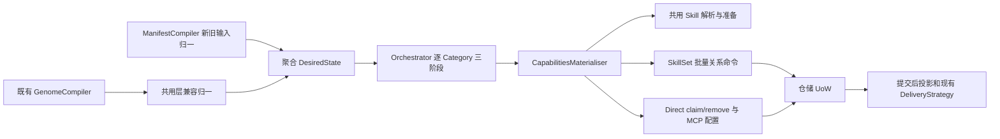
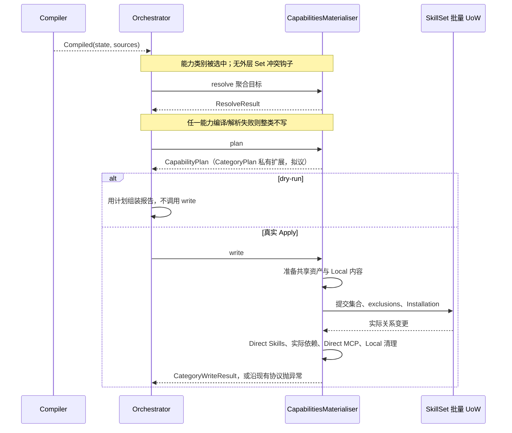

# Manifest SkillSet Replace 与稳定 Skill 引用

**状态 · 原 Spec 持续修订：统一能力 Category，接口细节 grill 中**
创建于 2026-11-03，更新于 2026-11-05。本文是本需求唯一的当前评审主稿；本轮原位修订执行模型，保留此前已确认的业务语义。Q41–Q43 已确认，Q41 的声明接入已按方案 B 收窄为复用 Declaration 子类，本轮业务语义与核心接口已收口，可进入主稿完整评审。内部 helper 命名、字段映射和合同测试属于实施前后的工程核验，不据此持续扩张业务问题；当前尚未开发。所有验收项均为实施后的验证目标。

> 最新架构方向：根据与 totalfrank 的技术评审及随后用户确认，将 Direct Skills、普通 SkillSet/Default 和顶层 Direct MCP 合并为一个 Apply Category，在同一个 Materialiser 的 resolve/plan/write 中处理。不采用跨 Materialiser 的 PlannedSetSupply 或新增 Context 预测透传方案，也不降低 dry-run 的准确性作为最终方案。Orchestrator 继续逐 Category 三阶段循环。
>
> 本轮已将聚合模型、执行图、失败与验收矩阵修订到正文。保留此前已确认的资产来源、Default exclusion、MCP 配置及 Local 引用保护。Q34/Q36 已确认输入兼容和报告类别；内部 write 策略已由 Q37/Q38 收口；Q41–Q43 已确认 resolve 接入、Center 准备守卫及最小能力发现形状。部分失败报告恢复此前 Q19 已确认的现有协议，不新增异常回执。历史候选稿不再独立维护。

本轮已确认有效 Manifest 中省略 `skill_sets` 与 `skill_sets: []` 等价，覆盖此前整段省略 no-op 的约定。正文同时采用 #3557 的 MCP 配置清除/替换语义及 `CategoryWriteResult` 写结果协议。主要更新集中在 §2–3 的声明与编译、§7–9 的执行与配置、兼容和验收矩阵。

合并前的确认记录：Q33 及同类跨类别关联阻断已撤回，Orchestrator 保持逐 Category 三阶段。此前拟议的跨类别检查器输入与规划读取视图已被统一 Category 方向覆盖；聚合后采用下述已确认的整体校验失败范围，不再保留 Skills、SkillSet 和 MCP 三个独立类别的失败边界。

## 本轮已确认的聚合边界

1. **不做并行化改造。** Orchestrator 保持当前逐 Category 的 resolve → plan → write 调度。本期不新增并行执行器、跨 Category 预测状态透传或协调 DAG。合并范围为 Direct Skills、普通 SkillSet/Default、Direct MCP；既有 Skills → MCP 依赖计算收进聚合内部。
2. **Genome 上层范围不变。** 本期扩充 DesiredState、Materialiser 等横向能力层及 Manifest 链路，不新增 Genome SkillSet schema、capture、diff/drift、patch/policy 或 promotion 能力，不迁移历史 revision JSON/ID。兼容接入须保留旧 Genome 的 Direct Skills/MCP 目标，并将普通集与 Default 子目标表达为“不参与”，不能归一为空目标。优先在共用入口归一旧声明；具体适配位置随聚合接口 review，不能据此扩展 Genome 上层范围。
3. **能力 Category 按整体校验。** 沿用现有类别合同：该类别任一 compile/resolve 错误导致整组能力不进入 write，包括 Direct MCP 权限错误或 Skill 包校验错误。此类类别内错误按现有 Orchestrator 错误处理继续其他类别；Q35-R 已确认将原 Set 占用检查一并移入能力 resolve，取消外层专用钩子。write 中途失败仍可能部分成功，聚合不承诺共享资产、Bot 关系、配置和 Runtime 的统一事务或自动回滚。Q37/Q38 已确认内部写入顺序、控制面失败停止后续步骤及 Local 内容更新非整体原子；失败报告沿既有 Q19。

这取代旧稿按三个能力类别独立失败的约定；Q33 仍已撤回，不恢复跨类别关联阻断机制。

## Problem Statement

当前问题包括两部分。第一，Manifest 资产声明存在缺口。现有 skills 条目通过 source/from 获取 Local 包，虽然可以从 Git 获取内容，却缺少直接引用平台已同步共享 Repo Skill 的语法，也缺少引用已有 Center UUID 和按公开 skill_code 首次引入资产的语法。第二，用户要交付一个包含多个可启停技能集的 Bot 时，需要在 Apply 之外另外创建集合、组织成员和处理默认供应。用户希望用同一份声明表达这些资产和集合，并能在 Apply 前预览实际结果。

[#3049](https://github.com/inclusionAI/Avernet/pull/3049) 最初提出保留默认能力的诉求。[#3083](https://github.com/inclusionAI/Avernet/pull/3083) 和 [#3220](https://github.com/inclusionAI/Avernet/pull/3220) 建立了共用 DesiredState、按类别物化及 Direct claim。新方案在这些边界上扩展 SkillSet 和资产引用。

## Solution

- 通过 Manifest 的 `skill_sets` 子目标声明真实的普通 SkillSet（新位置为 `manifest.capabilities.skill_sets`，兼容旧平铺语法）。有效 Manifest 为受支持类别提供完整目标，省略该字段编译为空列表目标。重复 Apply 按 Bot 和集名复用集合 ID，保存成员关系及启停状态。
- 用列表中的 `name: default` 引用平台默认供应。包含该引用时清除当前适用范围的成员排除，缺少该引用时写入当前成员排除。省略 `skill_sets` 因而清空计划范围内普通集并排除当前 Default 成员。
- Direct 与普通集成员统一支持 Local、共享 Repo、Center UUID 和公开 Center code。Center 沿用 Track Latest。首次公开 code 在所属类别 resolve 时预览精确包并校验，在真实 write 时准备共享资产并建立声明的供应。
- 将 Direct Skills、普通 SkillSet/Default 与 Direct MCP 聚合为一个能力 Category，统一 resolve/plan 检查目标供应、名称、依赖和配置。dry-run 在该类别 plan 后返回，真实 Apply 进入其 write；Orchestrator 仍逐 Category 执行三阶段。
- 范围覆盖共用 DesiredState/Apply、SkillSet 控制面与 Manifest 生产链。既有 Genome 调用继续使用原声明和兼容解析路径。

## User Stories

本节同时列出新增交付目标与需要复用的现有能力。标注「既有能力复用」的故事用于约束新编译、物化和批量 UoW 的接入行为，验收以已合入实现为基线。

1. 作为清单作者，我希望声明具名普通集，使创建后的 Bot 展示实际集合和成员。
2. 作为 Bot 管理者，我希望在清单中声明集的启停状态，使关闭的集合保留成员而停止供应。
3. 作为清单作者，我希望重 Apply 时复用集合 ID，使重复请求收敛到同一个集合。
4. 作为清单作者，我希望省略列表中的旧普通集时撤销它，使清单表达该类别的完整目标。
5. 作为 Bot 管理者，我希望声明空列表时清空受管普通集并排除当前默认成员，使该类别能显式重置。
6. 作为清单作者，我希望只配置顶层 `skills` 时，其余受支持类别收敛到空目标，使清单完整决定受管状态。
7. 作为专家 Bot 作者，我希望声明 `name: default` 并添加普通集，使平台基础能力和专家能力共同供应。
8. 作为 Bot 管理者，我希望显式恢复 Default 时清掉当前适用排除，使平台供应重新生效。
9. 作为 Bot 管理者，我希望撤掉默认供应后可按正常权限显式安装其中的 Skill 或 MCP，使供应来源由我的声明决定。
10. 作为清单作者，我希望同时声明 Default 退供与 Direct 安装，使已经释放的名称或 code 可以在同次 Apply 中使用。
11. 作为清单作者，我希望能力 Category 内任一编译或解析错误阻止整组能力写入；若 write 已开始后失败，报告应反映实际部分成功，以便修正声明后重试。
12. 作为 Bot 管理者，我希望只写 Direct 声明时收到已有集合占用错误，使成员归属不会被悄悄改变。
13. 作为 Agent 使用者，我希望最终生效的不同 Skill 资产不重名，使运行时技能寻址稳定。
14. 【既有能力复用】作为清单作者，我希望通过现有 Git 或 OSS 内容源获取 Local 包，使自有内容交付继续工作。
15. 作为清单作者，我希望在 Manifest 中直接引用平台已同步的共享 Repo Skill，使其在 Direct 和普通集内都能按共享资产身份安装。
16. 作为清单作者，我希望通过 Center UUID 指定一项可见的 Center 资产，使资产选择具有确定身份，目录中存在同名资产时也能明确选中哪一项。
17. 作为清单作者，我希望通过公开 `skill_code` 首次引入技能，使准备共享资产和安装可由同一次 Apply 完成。
18. 作为清单作者，我希望预览首次公开引用的实际名称和依赖，使 dry-run 能发现与真实 Apply 相同的可预知冲突。
19. 作为 Center 资产使用者，我希望跟随平台最新已发布版本，使共享内容后续更新能沿既有链路到达 Bot。
20. 【既有能力复用】作为 Bot 管理者，我希望新增批量 Set 路径遵守已由 #3408 落地的 MCP override 独立生命周期，使成员变更、启停、删除和 Default exclusion 继续保留配置，后续顶层 MCP Replace 按其受管范围执行。
21. 作为 Bot 管理者，我希望集合关系变更及后续 Skills 清理保留仍被其他集合、inactive 集或 Default 原始成员引用的 Local 包，使这些引用可以继续使用或恢复。
22. 作为 API 调用方，我希望先查询可用类别和引用形式，使生成的清单与目标环境能力匹配。
23. 作为运维人员，我希望报告说明实际写入、阻断和运行态未收敛，使我能判断需要修正输入还是重新 Apply。
24. 作为旧 Genome 使用者，我希望原有快照和 promotion 路径继续生效，使本次共用层扩展保持已有兼容性。
25. 作为部署维护者，我希望核验实际装配和镜像包含本次改动，使公共实现的验证能落到交付环境。
26. 作为清单作者，我希望仅版本号的有效文档与没有 Manifest 记录分别处理，使清空目标与不参与执行的意图清晰。
27. 【既有能力复用】作为 MCP 使用者，我希望继续采用 #3557 已落地的 config 省略清除语义，使旧 Bot override 退出覆盖并恢复上游继承。
28. 【既有能力复用】作为报告使用者，我希望聚合能力 Materialiser 使用现有 CategoryWriteResult 返回确认移除项，使预览与实际提交结果可核对。

## Technical Design

### 1. 已观察事实与边界

以下代码证据固定到 #3557 的最终 head `3892374cc07e370fe8a9713d56d84b7e682a4dc2`，对应合并提交为 `f555d126b52b0fa58aa021a25d12d8c5c85113cd`。该基线已包含 #3408 的 MCP 配置生命周期与稳定寻址修订，#3557 随后更新了 Manifest 的省略解释和共用 write 返回协议。SkillSet 声明与物化仍是本稿拟新增能力。[#3557](https://github.com/inclusionAI/Avernet/pull/3557)

本轮用户故事批注另以 `dev@943b7e0ccc55f0373863b540cf7d9a1fa7f38bf2` 复核。#3408 已合入，Manifest Skill schema/compiler 仍仅接受 Local 包获取形式，SkillsMaterialiser 的移除及 Local 删除服务仍包含下文记录的现有行为。

2026-11-05 聚合接口复核沿用固定源码 `d1db4d5467e3f18f3882cdc0df450363102b0c32`，不声称当前远端最新或已部署。当前 resolve 接收 entries；§8.1 保持该签名，通过 Declaration 子类 CapabilityDeclaration 提供聚合目标及报告视图，declaration() 保持原返回类型和字段映射读取。异常路径不能保留逐项 write 回执，按原 Q19 接受该限制；§9.3 不再新增异常协议。

| 本次交付或接入项 | 范围 |
| --- | --- |
| 共享 Repo 与 Center 的 Manifest 声明 | 新增 Repo 路径、Center UUID/code 输入，Direct 和普通集复用编译/解析规则。 |
| 真实普通 SkillSet 与 Default 声明 | 扩充聚合能力目标和 compiler 产出，由一个能力 Materialiser 统一规划，内部复用批量关系命令。 |
| MCP override 生命周期与稳定寻址 | 复用 #3408 已有合同，在新增批量 UoW 中保留配置并做回归。 |
| Manifest 终态与配置清除/替换 | 以 #3557 为基线，新增 skill_sets 加入同一省略补空规则。 |
| write 结果及 Local 清理 | 接入现有 CategoryWriteResult，把 Local 物理清理后置，按实际及声明引用保护集合目标，沿用受管 Local 的删除语义。 |

| 现有事实 | 方案影响 | 源码 |
| --- | --- | --- |
| Manifest 和 Genome 均产生 `Compiled(state, sources)`。Manifest Skill compiler 只交付 Local 包，SkillsMaterialiser 已具备 Repo 和旧 Center by-name 读写路径。 | 扩展 Manifest 的来源分支和共用 Skill 处理。保留 compiler 契约与 Genome 兼容分支。 | [Compiler](https://github.com/inclusionAI/Avernet/blob/3892374cc07e370fe8a9713d56d84b7e682a4dc2/apps/backend/src/agentclaw/community/core/apply_engine/compiler.py#L83), [Manifest Skill 编译](https://github.com/inclusionAI/Avernet/blob/3892374cc07e370fe8a9713d56d84b7e682a4dc2/apps/backend/src/agentclaw/community/core/bot_config_manifest/compiler/entries/skills.py#L65) |
| 目录资产名不承担全局唯一身份。统一 Runtime resolver 已按 `ac_skill.name` 检查 Local/Repo/Center 的映射冲突；普通 Direct 安装、向 active Set 加成员及启用普通集也已有名称检查。旧软链生成器仅在传入 `additional_skill_paths` 时检查目标冲突，普通全量调用没有该检查，且该旧生成器不支持 Center。 | 不能把现状表述为所有安装和推送入口均保证重名拒绝。本次为 Manifest Apply 增加基于最终目标的统一写前检查，复用现有名称政策和 Runtime 防线。 | [映射冲突](https://github.com/inclusionAI/Avernet/blob/943b7e0ccc55f0373863b540cf7d9a1fa7f38bf2/apps/backend/src/agentclaw/community/core/skills_pool/mapping_intent.py#L82), [普通 Direct 安装](https://github.com/inclusionAI/Avernet/blob/943b7e0ccc55f0373863b540cf7d9a1fa7f38bf2/apps/backend/src/agentclaw/community/core/repository/implementations/skill_center/direct_installation_commands.py#L85), [旧软链检查条件](https://github.com/inclusionAI/Avernet/blob/943b7e0ccc55f0373863b540cf7d9a1fa7f38bf2/apps/backend/src/agentclaw/community/core/skill_center/services/skill_set_runtime_content.py#L224) |
| Orchestrator 当前先检查已有 Set supply，再逐类 resolve、plan、write。dry-run 在 plan 后返回。 | 将原 Set 占用检查移入统一能力 resolve，与完整目标检查共用事实；Orchestrator 仅保留通用逐类三阶段。 | [Orchestrator](https://github.com/inclusionAI/Avernet/blob/3892374cc07e370fe8a9713d56d84b7e682a4dc2/apps/backend/src/agentclaw/community/core/apply_engine/orchestrator.py#L115) |
| 普通集、成员和 Installation 已有持久化模型。创建时按 Bot+name 查重，数据库没有普通集名业务唯一键。单项命令及公开 flush 各自开事务。 | 批量关系替换保留单一仓储事务，沿用已有检查与保护；Q40 已接受管理 API 并发，不新增跨入口保护或业务唯一约束。 | [能力仓储](https://github.com/inclusionAI/Avernet/blob/3892374cc07e370fe8a9713d56d84b7e682a4dc2/apps/backend/src/agentclaw/community/core/repository/implementations/skill_center/capability_desired_state.py#L158), [Installation 对账](https://github.com/inclusionAI/Avernet/blob/3892374cc07e370fe8a9713d56d84b7e682a4dc2/apps/backend/src/agentclaw/community/core/repository/implementations/skill_center/bot_skillset_installations.py#L229) |
| 两张 Default exclusion 表保存逐成员排除。默认 MCP policy 可能在缺少实际 Default 行时提供 code。 | 按实际 Default ID 写排除。需要排除却缺少配置时返回明确错误。 | [Exclusion ORM](https://github.com/inclusionAI/Avernet/blob/3892374cc07e370fe8a9713d56d84b7e682a4dc2/apps/backend/src/agentclaw/community/core/skill_center/orm.py#L13), [MCP 供应读取](https://github.com/inclusionAI/Avernet/blob/3892374cc07e370fe8a9713d56d84b7e682a4dc2/apps/backend/src/agentclaw/community/core/skill_center/services/effective_mcp_state_reader.py#L57) |
| Center 精确物化现有实现把下载、校验、canonical 写入和 publish 连在一起。公开 Reference 异步处理随后还会写目标集。 | 提取共享只读精确包校验及发布步骤。Manifest 复用资产准备，保留自己的 Replace 与失败收尾。 | [Center 物化](https://github.com/inclusionAI/Avernet/blob/3892374cc07e370fe8a9713d56d84b7e682a4dc2/apps/backend/src/agentclaw/community/core/skill_center/services/skill_version_materializer.py#L193) |
| #3557 在有效 Manifest 编译时为受支持的省略类别补空，无记录则返回空 DesiredState。 | 新增 skill_sets 复用同一归一化路径。共用模型 None 仍表达本次不参与。 | [类别补空](https://github.com/inclusionAI/Avernet/blob/3892374cc07e370fe8a9713d56d84b7e682a4dc2/apps/backend/src/agentclaw/community/core/bot_config_manifest/compiler/compile.py#L145) |
| MCP 省略 config 与空对象均编译为 None。write 返回 CategoryWriteResult，Orchestrator 读取确认的 removals。 | 删除旧 preserve 三态和额外 removal 组装接点，采用当前共用协议。 | [MCP 编译](https://github.com/inclusionAI/Avernet/blob/3892374cc07e370fe8a9713d56d84b7e682a4dc2/apps/backend/src/agentclaw/community/core/bot_config_manifest/compiler/entries/mcp.py#L42), [write 返回](https://github.com/inclusionAI/Avernet/blob/3892374cc07e370fe8a9713d56d84b7e682a4dc2/apps/backend/src/agentclaw/community/core/apply_engine/registry.py#L100) |

领域上分别追踪四类事实。**内容来源**定位 Local、Repo、Center 资产。**运行时名称**是 Agent 使用名称及 Skill 声明身份。**供应来源**说明能力由 Direct、普通 SkillSet 或 Default 提供，MCP 还可由生效 Skill 的依赖派生。**运行态**是控制面提交后交付到设备或 artifact 的结果。Membership 可在停用时存在，Bot MCP override 可在当前无供应时存在。

### 2. Manifest 表示与替换范围

#### 2.0 输入归一（Q34 已确认）

新写法为 `manifest.capabilities: {skills, skill_sets, mcp}`。兼容读取原 `manifest.skills/mcp` 及此前草案的平铺 `skill_sets`，两种输入生成同一聚合目标，不维护两条执行链。新旧位置按字段存在性判断，混写即拒绝，包括旧位置值为空列表；不按优先级合并。旧存储文档不批量改写，GET 仍返回原文档。

以下语义表中的三个字段指归一后的子目标，适用于两种写法。有效 Manifest 的省略补空保持已确认的 #3557 语义；`capabilities: {}` 或有效文档完全省略能力字段均产生受支持子范围的空目标。无 Manifest、阶段外则不参与。包装只改变输入组织，不改变 Default、配置或清理范围。Q34 已确认：capabilities:null 或子列表:null 非法；原文档验证和 digest 绑定先于执行输入归一，不改变历史文档身份。

#### 2.1 capabilities 内的子字段组合

| `manifest.capabilities.skill_sets`（旧写法为 `manifest.skill_sets`） | 普通集 | Default |
| --- | --- | --- |
| 省略 | 编译为空目标，清空计划范围内普通集 | 排除当前适用成员 |
| `[]` | 清空计划范围内普通集 | 排除当前适用成员 |
| `[{name: default}]` | 清空计划范围内普通集 | 清除当前适用排除 |
| 普通集列表 | 完整 Replace | 排除当前适用成员 |
| `default` + 普通集列表 | 完整 Replace 普通集部分 | 清除当前适用排除 |
| 无 Manifest 记录 | 不参与 | 不参与 |
| 本阶段未选择该类别，或 Genome 未产出该类别 | 不参与 | 不参与 |

`capabilities.skills` 和 `capabilities.mcp` 各自控制 Direct 目标；`capabilities.skill_sets` 控制集合目标。这里的 Direct 指不归属于普通集的供应方式，不表示字段放在 `manifest` 顶层。有效 Manifest 中，当前受支持且属于本次阶段的类别省略时由 compiler 补成空声明，效果与显式空列表一致。三者按各自管理范围共同构成目标。删除存储的 Manifest 只删除文档，后续普通 Apply 无记录时得到空 DesiredState。

| 有效 Manifest 的能力字段 | Direct Skills | 普通集 | Default | Direct MCP |
| --- | --- | --- | --- | --- |
| 只有 `skills` 列表 | Replace | 清空计划范围 | 排除当前成员 | 清空受管范围 |
| 只有 `skill_sets: [{name: default}]` | 清空受管范围 | 清空遗漏普通集 | 清除对应排除 | 清空受管范围，保护仍由 Set/Default 供应的内容 |
| 只有普通集列表 | 清空受管范围 | Replace | 排除当前成员 | 清空受管范围，保护当前有效 Set 供应 |
| `skills`、`skill_sets`、`mcp` 均非空，列表含 default | Replace | Replace | 清除对应排除 | Replace |
| 仅 `schema_version: 1` | 空目标 | 空目标 | 排除当前成员 | 空目标 |

要在完整目标中保留默认供应，需在 `skill_sets` 列出 `name: default`。Default 的平台原始成员由既有供应链维护，空目标通过成员排除撤销当前供应。未来新增默认成员仍按本期已确认的快照边界处理。

`default` 是精确小写保留名，每份声明最多出现一次，条目仅允许 `name`。普通创建和改名入口同时保留此名称。历史同名普通集兼容与迁移属于本期范围之外。普通集按 `(tenant, env, Bot 资源归属, bot_id, name)` 匹配。普通条目必填 `name`、`is_active`、`skills`、`mcp`，成员列表可空，`null` 非法。可选 `description` 省略时清空旧描述。改名走现有按 ID 管理入口，再同步清单。

#### 2.2 Skill 和 MCP 语法

| 输入 | 内容来源 | 校验 | 编译产物 |
| --- | --- | --- | --- |
| `origin: local`，沿用 `from` 或 `source` | Bot-owned Local | 现有包源、路径、解包、摘要、安全与名称校验。省略 `origin` 沿用 Local 语义。 | `LocalSkillPackage(tree=ContentRef(...))` |
| `origin: repo` + `repo_path` | 平台已同步共享 Git 资产 | 规范化仓库内地址，按既有 `git://` 规则和访问权限解析。 | `RepoSkillPath(path=...)` |
| `origin: center` + `skill_uuid` | 当前作用域已有 Center 资产 | UUID 格式、作用域、可见性、已发布版本及名称。 | `CenterSkillRef(skill_uuid=...)` |
| `origin: center` + `skill_code` | 公开 Center 市场资产 | code 与 UUID 二选一。精确公开定位、已登记资产或首次预览。 | `CenterSkillByCode(skill_code=...)` |

Direct 与普通集的成员使用同一套 Skill 语法。`name` 必填，必须等于实际 Runtime Name。每个来源分支采用闭集字段。Repo 只接受共享资产路径。用 Git URL 获取 Local 包则走既有 Local `source`/`from` 分支。集内 MCP 仅接受 `server_code`。`capabilities.mcp` 中的 Direct MCP 继续使用独立的可选 `config` 约定。

Center UUID 解决「选中哪一项资产」。例如目录里 A、B 两项资产具有不同 UUID，但运行时名称都为 review，引用 A 的 UUID 就精确选择 A；声明的 name 仍必须等于 A 的真实名称。按本次拟新增的 Apply 统一目标预检，若 B 在本次 Apply 后仍有效且名称同为 review，A、B 同时生效的目标应在写入前报冲突。若 B 随本次合法 Replace 退出最终目标，则不因旧状态曾有同名资产而误拒绝。资产选择和 Bot 最终名称唯一分别检查；这不是对现有全部推送入口的保证。

普通集最多 50 个。Direct 与普通集成员合计最多 50 条 Skill 声明、50 条显式 MCP 声明。inactive 成员计数，Default 引用及依赖派生项排除在声明计数之外。保留 v1 整文档 64 KiB、现有单包/解包限制和每次 Apply 500 MiB / 300 秒获取总预算，嵌套集和首次公开包预览共享总预算。创建阶段沿原阶段选择和预算生命周期实现，禁止为每个集重新开账本。

#### 2.3 完整示例

示例中的仓库、UUID、code 均为虚构值。假设资源可见、名称相符，所有显式供应与有效 Default 无占用冲突。

层级约束：`skills`、`skill_sets`、`mcp` 都位于 `manifest.capabilities` 内，不与 `capabilities` 同级。普通集条目内的 `skills`/`mcp` 描述该集成员；`capabilities` 下直接声明的 `skills`/`mcp` 描述 Direct 目标。出现 `manifest.capabilities` 后，再出现同级 `manifest.skills`、`manifest.skill_sets` 或 `manifest.mcp` 均为非法混写，即使值为 `[]` 也拒绝。

```yaml
schema_version: 1
sources:
  packages:
    protocol: git
    url: https://github.com/example/bot-assets.git
    ref: "0123456789abcdef0123456789abcdef01234567"
manifest:
  capabilities:
    skills:
      - name: direct-review
        origin: repo
        repo_path: common/direct-review
    skill_sets:
      - name: default
      - name: engineering
        description: 工程协作技能集
        is_active: true
        skills:
          - name: local-review
            origin: local
            from: packages
            subpath: skills/local-review
          - name: git-triage
            origin: repo
            repo_path: engineering/git-triage
          - name: center-review
            origin: center
            skill_uuid: "5e79e624-6898-4d77-91fd-11b9fb0822c4"
          - name: public-research
            origin: center
            skill_code: public-research-helper
        mcp:
          - server_code: mcp.docs
    mcp:
      - server_code: mcp.calendar
```

工程集的 Local 包通过 Git 获取。`git-triage` 复用平台已经同步的 Repo 资产。`mcp.calendar` 是显式 Direct，省略 `config` 表达清除已有 Bot override 并恢复上游继承。此例省略的 identity、resources、cli_tools 及受支持的 script 同样编译为空目标，按各自受管范围清理。

### 3. 领域对象与编译边界

#### 3.1 共用 DesiredState

下列为拟议 Python 类型形状。保留既有 `DesiredSkill(name, source, note)`、`DesiredMcpServer(server_code, override)` 及其身份合同。

```python
@dataclass(frozen=True)
class CenterSkillRef:
    skill_uuid: str

@dataclass(frozen=True)
class CenterSkillByCode:
    skill_code: str

@dataclass(frozen=True)
class DesiredSkillSet:
    name: str
    is_active: bool
    skills: tuple[DesiredSkill, ...]
    mcp: tuple[str, ...]  # MCP 成员 code
    description: str | None = None

    @property
    def identity(self) -> str:
        return self.name

@dataclass(frozen=True)
class DefaultSkillSetRef:
    identity: ClassVar[str] = "default"

@dataclass(frozen=True)
class DesiredCapabilities:
    skills: Declaration[DesiredSkill] | None = None
    skill_sets: Declaration[DesiredSkillSet | DefaultSkillSetRef] | None = None
    mcp: Declaration[DesiredMcpServer] | None = None
    identity: ClassVar[str] = "capabilities"

# 新执行字段；旧 skills/mcp 仅作为共用入口的兼容输入。
# 实际存入 CapabilityDeclaration（Declaration 子类），见 §8.1。
capabilities: Declaration[DesiredCapabilities] | None = None
```

- `DesiredSkill.source` 扩展 UUID/code 两个分支。`origin` 对 `CenterSkillByName`、`CenterSkillRef`、`CenterSkillByCode` 均返回 `CENTER`。Repo 和 Local 既有含义保留。
- 子 `Declaration.entries` 保存成功编译条目，`failures` 保存 EntryFailure。普通集成员编译失败按集名报告，reason 指出成员。CapabilityDeclaration 的 identities 从子声明派生，既有 failures 字段在构造时从子失败汇总；任一子声明编译失败阻止整个能力 Category 写入。具体报告键见 §9.3。
- 外层 capabilities=None 表示整类不参与；内部子声明 None 表示该范围不参与，空 Declaration 表示参与且目标为空。三个子声明均 None 时归一为外层 None；三个空声明则是整组清空目标。有效 Manifest 的类别省略由 compiler 归一化为空声明。无记录、阶段外或当前不支持的类别，以及 Genome 未产出的类别保留 None。`DefaultSkillSetRef` 用保留 identity 复用去重和报告规则。
- DesiredState 增加 capabilities 声明字段并更新 construct 映射；`declaration()` 保持 `Declaration[Any] | None` 和字段映射读取，不新增能力专属返回分支。`declared` 保持非 None 字段枚举，`only()` 保持按执行类别将未选字段置 None。共用层保留旧 `DesiredState(skills=..., mcp=...)` 输入，先归一再裁剪；旧 Genome 的集合及 Default 子目标为 None，不能补空。非 None 的新 capabilities 与旧执行字段同时提供时明确拒绝，规范化执行对象只保留一份目标。Genome 上层 schema/capture/diff/drift/promotion 不扩范围。
- Declared name、资产身份、版本、Membership、Installation 分开。共享资产稳定 UUID 与数据库资产 ID 由 SkillCenter 解析。集名是目标身份，真实 `set_id` 由仓储在受信 Bot scope 内分配或复用。

上例编译结果的关键部分如下。Local 摘要为符号占位。 `CapabilityDeclaration.from_target` 是能力模块内部构造入口的示意名：汇总子失败、校验单聚合 entry；三个子目标均 None 时返回 None。它不是通用 Declaration 的新 API。

```python
DesiredState(
    capabilities=CapabilityDeclaration.from_target(DesiredCapabilities(
        skills=Declaration(entries=(
            DesiredSkill("direct-review", RepoSkillPath("common/direct-review")),
        )),
        skill_sets=Declaration(entries=(
            DefaultSkillSetRef(),
            DesiredSkillSet(
                name="engineering", description="工程协作技能集", is_active=True,
                skills=(
                    DesiredSkill("local-review", LocalSkillPackage(ContentRef(LOCAL_TREE_DIGEST))),
                    DesiredSkill("git-triage", RepoSkillPath("engineering/git-triage")),
                    DesiredSkill("center-review", CenterSkillRef("5e79e624-6898-4d77-91fd-11b9fb0822c4")),
                    DesiredSkill("public-research", CenterSkillByCode("public-research-helper")),
                ),
                mcp=("mcp.docs",),
            ),
        )),
        mcp=Declaration(entries=(
            DesiredMcpServer("mcp.calendar", override=None),  # 省略 config，清除 Bot override
        )),
    )),
)
```

#### 3.2 Manifest compiler

`check(ctx, ref)` 保持廉价的语法与能力验证。`compile(ctx, ref, *, only=...) -> Compiled` 保持现有签名。先区分无记录与有效文档，并完成原文校验和既有 digest 绑定验证。普通 Apply 无记录时直接返回 `Compiled(DesiredState.EMPTY, ())`，绑定文档缺失按原合同拒绝。

有效文档先识别并校验新旧能力输入，再按本阶段 only 选择聚合类别；只有选中且支持时才为省略的子目标补空。子声明统一放入 DesiredCapabilities，再由 CapabilityDeclaration.from_target 包装为一个声明；不能作为三个独立调度项。显式写出不支持的类别由原校验拒绝。随后才获取所选内容。Direct 与普通集复用 Skill 条目编译函数和同一 `CompileSession`。Local 获取包、校验 `SKILL.md` 并存为 `ContentRef`。Repo/Center 产出来源引用，公开 code 原样保留到物化阶段。Git 来源追踪沿 `Compiled.sources`。

对有效的仅版本号文档，选中能力 Category 且支持三个子范围时得到下列空目标。其余适用 construct 同样补空，script 沿现有空节语义。

```python
DesiredState(
    capabilities=CapabilityDeclaration.from_target(DesiredCapabilities(
        skills=Declaration(entries=()),
        mcp=Declaration(entries=()),
        skill_sets=Declaration(entries=()),
    )),
    # 其他本阶段支持的类别也由 ManifestCompiler 补空
)
```

`Compiled` 保留 `state` 与 `sources`。`ApplyContext` 继续携带现有身份和执行环境，不新增预测或准备字段。既有 Skills→MCP 依赖传递收进能力内部计划。准备描述、精确包、版本观察与计划中的排除操作保存在一次执行的内部值中。Manifest adapter 处理 DTO、地址与错误翻译。领域决定由 compiler、Apply 和 SkillCenter 各自负责。

### 4. 对外 API 与能力发现

现有 OpenAPI 路径继续承载该能力。以下路径以 `/openapi/v1/bots` 为前缀。

| HTTP 操作 | 合同与本次变化 |
| --- | --- |
| `GET /{bot_id}/config-manifest` | 返回原文档及现有元信息。新语法作为 v1 文档内容保存。 |
| `PUT /{bot_id}/config-manifest` | 沿现有鉴权、文档校验、保存和自动 Apply 规则。新增字段、嵌套预算及来源支持验证。 |
| `DELETE /{bot_id}/config-manifest` | 清除文档。能力清理由明确的 Apply 声明表达。 |
| `GET /{bot_id}/config-manifest/capabilities` | 按 Q43 已确认的最小形状声明一个聚合能力 construct 及 Skill 引用支持信息。 |
| `POST /{bot_id}/config-manifest/apply?dry_run=true` | 同步 `200` 计划报告。复用 compile、resolve、plan，返回前跳过 write。无 `apply_id` 和历史行。 |
| `POST /{bot_id}/config-manifest/apply` | `202` 接受，返回 `apply_id`，沿既有 worker 和互斥规则。 |
| `GET /{bot_id}/config-manifest/applies/{apply_id}`、`GET /{bot_id}/config-manifest/last-apply` | 原报告 envelope，按 Q36 统一报告为 capabilities 类别；旧报告保留解码。 |
| `POST /with-manifest` | 创建参数中已有 Manifest 文档支持新语法，沿既有创建授权与 delivery phase。 |
| `GET /{bot_id}/with-manifest/status` | 既有创建状态及阶段 Apply 报告，支持新类别随原结构序列化。 |
| `/{bot_id}/skill-sets` 下既有管理操作 | 继续使用既有集合 ID、成员与启停接口。新增保留名校验，Default 已排除成员的 Direct 守卫按第 7 节调整。批量 Replace 为内部 Service API。 |

维持现有调用身份、Bot 地址及创建授权。真实 actor 用于权限检查，audit actor 仅用于记录。仓储 owner 使用既有 Bot 稳定资源地址。请求体不能自填内部 `entity_id` 来扩大权限。`409` 进行中、`422` 不可接受文档等既有状态码继续由 adapter 映射。

**Q43 已确认：最小能力发现。** constructs 中只发布一个可调度的 capabilities。现有 source_matrix 继续描述 Local 包的 content/oss/git 传输，不能用 git 传输支持推断共享 Repo 引用支持。新增一个小的 skill_references 列表，逐项声明 package、repo_path、skill_uuid、skill_code 的 supported/reason；结果针对本次查询的 Bot/engine，不暴露 engine × scope × origin × reference 的通用组合框架。Direct 与 Set 复用同一引用支持判断，本期不分别维护两套表。

例如响应新增部分为：

```json
{
  "skill_references": [
    {"reference": "package", "supported": true, "reason": ""},
    {"reference": "repo_path", "supported": true, "reason": ""},
    {"reference": "skill_uuid", "supported": true, "reason": ""},
    {"reference": "skill_code", "supported": true, "reason": ""}
  ]
}
```

这是新增字段片段，实际 supported 随现有装配判断，不是全部环境一律 true。旧类别枚举保留用于历史解码，但现有能力与来源表遍历需使用当前执行集合，不能再次对外宣称旧 Skills/MCP 是独立执行类别。此前多维 skill_reference_matrix 草图由此已确认的最小列表替代。

读取 capabilities、PUT、创建前校验与 compiler 使用同一支持判断。按 engine、Bot 类型及现有装配支持能力决定可用范围，单个资产的权限、在线状态及版本在 resolve 时判断。对外 Schema、示例、用户文档、OpenAPI allow-list 与报告序列化一并核对。内容传输与资产引用两条能力轴分离已确认；本轮只确认 Q43 的最小发现输出，其他字段映射属于实现核验。

### 5. 组件职责与核心调用链



Manifest 与 Genome 是目标生产者；兼容旧声明的责任放在共用层。一个能力 Materialiser 拥有全部能力的解析、计划、写入和清理。其内部按职责拆文件与函数，不再注册独立 SkillSet/Skills/MCP Materialiser，也不嵌套调度它们的完整三阶段。Repository 独占持久化，领域服务复用既有 Gateway/内容存储/Runtime 端口，由 composition root 装配。



script、identity、resources 等保持现有相对顺序。Orchestrator 不认识能力内部步骤，不构建 DAG，也不做并行化。内部写入顺序按 Q37/Q38，失败报告沿 Q19 已确认的现有协议，不能把聚合解释为跨资产、关系和 Runtime 的整体事务。

### 6. Skill 来源共用接口与 Center 准备

#### 6.1 读写接口草图（拟议）

统一能力模块中的 Direct 与 Set 子流程复用同一套来源解析和准备逻辑。现有 `SharedSkillPort.find_repo_skill` 和 `find_center_skill` 保留。建议把新增稳定引用读写收敛到 SkillCenter 所有的窄领域接口。以下名字和同步/异步适配方式供 review。

```python
# Apply 侧共用内部值，使用既有 Intent.value 承载。
ResolvedSkill = ReadySharedSkill | LocalUpload | PublicSkillPreview

async def resolve_skill(
    scope: SkillAccessScope, skill: DesiredSkill,
) -> ResolvedSkill: ...

async def prepare_shared_skill(
    scope: SkillAccessScope, preview: PublicSkillPreview,
) -> ReadySharedSkill: ...

# SkillCenter 侧拟议窄接口。复用 Gateway、版本 resolver 和 canonical store。
def resolve_center_uuid(scope, skill_uuid, expected_name) -> ReadySharedSkill: ...
def preview_public_reference(scope, skill_code, expected_name) -> ReadySharedSkill | PublicSkillPreview: ...
def prepare_public_reference(scope, preview) -> ReadySharedSkill: ...
```

`SkillAccessScope` 是拟议签名的简写，复用受信的 tenant/env、actor、Bot/资源归属和创建阶段输入。只有目标身份已建立的调用才能产生供写入的领域地址。可见性、离线状态、访问许可和本地包归属沿现有判定。跨作用域资源统一按拒绝/找不到处理。

| 私有结果 | 最少需要的事实 | 真正写入 |
| --- | --- | --- |
| `ReadySharedSkill` | 真实资产 ID/稳定身份、Runtime Name、已解析版本及 MCP 依赖 | 复核后使用已有资产 ID 建立 Direct 或 Set 供应。 |
| `LocalUpload` | 已校验内容引用/包、预期名称、可解析依赖 | 复用 Bot Local 上传路径取得资产 ID。Direct 再 claim，Set 交给批量 UoW。 |
| `PublicSkillPreview` | 公开 code、当前作用域的真实或候选稳定身份、上游精确版本标识、验证摘要、包内容引用、真实名称及依赖 | 复用已 Ready 资产或发布这次已预览的精确内容。获取真实 ID 后建立目标供应。 |

Repo 使用现有已同步共享资产。Center UUID 使用当前作用域 UUID 查找和版本解析。UUID 缺失返回引用失败，公开导入仅由 `skill_code` 分支启动。Manifest 新语法不通过名称查 Center。旧 Genome `CenterSkillByName` 按既有歧义拒绝和访问控制运行。

#### 6.2 公开 code 的读取与写入阶段

1. 按当前 tenant/env 的精确 `center://<skill_code>` 定位已有资产，优先使用实际存储 UUID。首次登记可以复用 `PublicCenterSkillIdentity.derive(tenant, env, code)` 推导候选 UUID。能力 resolve 统一检查当前占用、目标冲突、可见性、发布状态和精确包。真正仓储 ID 在 write 后取得。
2. 已 Ready 时按平台当前最新 PUBLISHED 解析 canonical 内容、名称和依赖。Ready 路径无市场刷新要求。只有确认为未准备时才进入首次预览，权限拒绝、下架或标识冲突均明确失败。
3. 首次预览在所属类别 resolve 通过公开详情和版本查询确定精确版本。复用现有 exact download、摘要、归档安全、`SKILL.md` 校验及依赖解析。包内名称必须满足声明的 Runtime Name 约束。下载链接、凭据及原始包不进入报告。未知依赖不能用空集合代替。
4. dry-run 可以完成预览，允许复用原有内容获取、缓存或 ContentStore 审计记录。共享 Skill/Version、canonical 发布、Track Latest、Bot Local、Membership、Installation、exclusion、MCP override 和 Apply history 的写入均由真实执行阶段负责。预检的能力读取使用无 reconcile 的只读路径。
5. 真实 write 先完成该类别所有必要的公开准备，再上传 Local 或提交目标关系。复用现有 materialize/publish/Track Latest 服务，传入预览中的精确版本和已验证内容。公开 Reference 的既有 `ac_task_queue` 调用链继续负责自身批次和成员增量加入。Manifest worker 直接复用共享资产准备步骤，沿原 Apply 完成和任务恢复机制。

#### 6.3 Track Latest 与竞争

单次 Apply 使用精确内容做核验，持久引用沿 Track Latest。已有版本观察与本次下载摘要只存在于执行计划。后续平台发布可沿既有传播更新有效引用的 Bot 及 MCP 依赖。

Q18 已确认。write 发现并发出现的 Ready 时，复用当时最新已发布版本。最终名称或必要依赖与所属类别 resolve/plan 的结果不同则中止该类别。尚无 Ready 时才尝试发布已预览的 exact 包。保留旧预览为较高 ordinal 会使有效内容倒退，因此并发判定必须与版本分配和 publish 的实际锁边界配合。

**现有代码与最小差额。** 已有 Skill → exact Version 行锁、公共资产稳定 UUID 去重及 exact 版本唯一键可以复用。但 ensure_public_version 对新 exact 直接分配 max(version_ordinal)+1，publish 不比较其他版本先后；平台 latest 又按已发布 ordinal 选取。因此“原样复用现有方法”不能自动满足 Q18：旧预览晚进入 ensure，可能得到更高 ordinal 并成为 latest。

**Q42 已确认。** 仅在 Manifest 首次公开准备接入的现有 Skill 锁事务中补复用/拒绝判断：已有 Ready 时复用其最新发布并校验名称/依赖；出现无法安全判定的其他准备中版本时受控失败；符合首次准备条件才为本次 exact 创建版本。版本创建与这个判定使用同一现有事务边界，不能先解锁重读再调用 ensure。仍复用现有下载校验、canonical 和 publish，不新增锁表/锁机制、不统一重构 Reference/Sync、不自动追市场 latest 或重试。只读下载校验从现有 materializer 提取，是已确认 dry-run 的必要实现。

上述是已确认新增的窄业务守卫，复用现有事务和锁，不是假称现成能力。该检查只约束本次 Apply 准备，不承诺修复平台所有历史并发发布问题。


### 7. 统一能力预检、计划与执行

#### 7.1 检查事实与来源约束

**现状与新增范围。** 当前统一 Runtime 路径先经 `RuntimeProjectionResolver.resolve_skills` 生成映射，再执行设备交付；不同内容定位共用一个 `ac_skill.name` 时抛出名称冲突，同一映射重复输入则去重。普通 Direct 安装、active Set 加成员和普通集启用已有事务内的名称守卫；Apply 的 Direct claim 对原 Direct 同名资产沿既有 Replace 语义处理。上述检查不等同于已有跨类别、面向本次完整目标的 Manifest 预检。旧 `get_symlink_mappings()` 的普通全量调用仍可能生成同一 target 的多条 Local/Repo 映射，不能据此声称下游成功保留了两项同名能力；实际覆盖或失败取决于消费端。它遇到 Center 会拒绝并要求走支持 Center 的适配器。本次落实下述统一 Apply 写前契约，保留现有 Runtime 守卫，不把修复所有历史软链调用入口隐含纳入交付。[Runtime resolver](https://github.com/inclusionAI/Avernet/blob/943b7e0ccc55f0373863b540cf7d9a1fa7f38bf2/apps/backend/src/agentclaw/community/core/skill_center/runtime_resolver.py#L102), [旧软链生成](https://github.com/inclusionAI/Avernet/blob/943b7e0ccc55f0373863b540cf7d9a1fa7f38bf2/apps/backend/src/agentclaw/community/core/skill_center/services/skill_set_runtime_content.py#L179)

能力检查使用归一后的完整目标、当前持久供应、原始成员、适用 Default/policy MCP，以及已解析的资产身份、实际名称、版本和依赖。参与范围替换为本次目标，未参与范围保留并作为占用事实。目录同名允许，最终有效资产重名拒绝。只读路径不能隐式 flush/reconcile Installation。

| 约束 | 检查和处理 |
| --- | --- |
| 普通集成员互斥 | 按既有能力身份及 Direct 占用检查成员。普通集成员关系可在 inactive 时保留占用。复用 `RESOURCE_DIRECT_ACTIVE`、`RESOURCE_ALREADY_IN_ANOTHER_SKILL_SET` 等既有拒绝。 |
| Default 占用 | 用当前适用 Default 扣除 exclusions。已排除成员可按原权限和资产归属显式 Direct 安装或管理，普通 UI/API 与 Apply 守卫一致。完整 policy code 传到事务，按锁内实际排除过滤。 |
| 恢复 Default | 清排除前识别真正恢复的供应，检查当前 Direct、普通集及本次普通集目标。过期排除记录清理与恢复供应分别判断。缺少必要身份、名称或依赖时，DefaultRef resolve 失败。 |
| 最终 Runtime Name | 同一 Bot 最终生效的不同 Skill 资产不可重名。明确的 Direct Replace 仍可按现有行为替换原 Direct 同名资产。先按最终生效集合计算，再做名称唯一检查。 |
| 普通集生效前的当前 Direct 同名占用 | 新增或启用普通集供应时，resolve 同时复用当前 Direct 的名称占用检查。不同资产同名也拒绝，即使该 Direct 已被本次目标计划撤销；不能仅因最终集合不重名就放行。该规则对应 Set UoW 先于 Direct 撤销的既定写入顺序，不引入自动迁移或提前退供。 |
| Center/Repo 资产身份 | 按解析后的稳定身份识别重复。Center UUID 和公开 code 指向同一资产时适用同一占用规则。目录资产允许同名。 |
| MCP 依赖 | Skill 依赖不是显式成员占用，不因此拒绝同 code 的合法 Direct 声明。在聚合 resolve/plan 内统一解析目标依赖；write 按实际有效供应复核。 |

来源保护先于关系删除。普通集之间以及普通集与 Direct 之间不因同次 Replace 自动转移归属。Default 退供后允许按正常权限显式 Direct 安装；仅规划退供不等于占用已真实释放，write 必须先提交排除并锁内复核。平台或其他 Bot 的 Local 不因排除变成本 Bot 所有。

#### 7.2 冲突检查收进能力 resolve（Q35-R 已确认）

Q35-R 已确认取消外层 _set_conflicts，原保留方案撤回。聚合后，仅原 Skills/MCP 使用的这条检查可以和其他能力检查一起进入 CapabilitiesMaterialiser.resolve，无需再维护全局与类别内部两层能力准入。

删除 Orchestrator.apply 中的 _set_conflicts 调用、专用 _set_conflicts/_refused 分支，以及失去消费者的 ChecksSetSupply 协议。删除前按实际引用核对，仅清理该专用钩子和失去用途的代码；通用 _aborted、文档校验、鉴权和持久化守卫保持各自职责。

resolve 的内部流程：

1. 只读取得当前有效供应和原始成员关系，解析适用 Default 与目标资产。
2. 根据子范围 None/空/非空形成完整目标。未参与范围的既有集合及 Default 仍是检查事实；不会因为旧 Genome 没声明 Set 就失去保护。
3. 在同一范围检查现有占用、本次目标内部冲突、最终生效名称、权限和 MCP 依赖。Default 退供后的显式 Direct 接管按既定例外处理，普通集↔Direct 的来源保护不改变。 普通集新增/启用供应还必须检查当前 Direct 同名占用，覆盖不同资产的同名情况；不得把稍后才撤销的 Direct 提前视为已释放。
4. 无法可靠读取供应、引用不可用或冲突均产生能力 resolve 失败；整组能力不进入 plan/write。真实 write 继续锁内复核，不能用预览代替并发守卫。

**行为变化需要明确记录：** 原 Set 占用冲突会拒绝全部所选类别；移入 resolve 后只拒绝能力 Category，Resources、Identity 等仍按原调度各自执行，也可能已写入。该变化作用于所有进入共用执行层的输入，包括旧 YAML 和旧 Genome；不改变其上层格式，也不承诺保留旧全局拒绝语义。Q35-R 已明确接受该失败范围变化；这不是行为完全不变的代码搬移。

固定基线的实际依赖只有 Skills/MCP 两个 ChecksSetSupply 实现，唯一生产调用为 Orchestrator；没有其他 Category 实现依赖此协议。现有 `test_apply_engine.py::test_a_set_conflict_refuses_every_category_not_only_its_own` 明确断言冲突时连 script 也不写，必须随失败范围变更更新；供应查询失败与既有 Set 保护测试则迁入聚合 resolve，保留能力整组零写的断言。不是删除测试来取消占用保护。

例如 skill_sets=[] 且 Direct MCP 含原默认 X 和无权限 Y，Y 在统一 resolve 失败，Default 排除也不执行；Resources 不因这个能力错误跳过。只有进入 write 后发生错误才可能留下已退供但未完成 Direct 安装的状态。Q33 跨类别关联机制仍撤回。

#### 7.3 内部解析与计划

resolve 统一读取事实并解析 Direct/Set 来源，首次公开 code 在此预览 exact 包。错误以 ResolveFailure 汇总。成功时将完整私有解析结果作为一个内部 Intent，通过 Intent.value 传给同一个 Materialiser 的 plan，不放进 Compiled 或 ApplyContext。即使全部参与子目标为空，也不能因为没有展示条目而返回空 intents；否则 plan 将丢失清空范围。内部 Intent 不直接作为公开报告条目，plan 按目标及实际差异生成报告。

plan 生成一个 CapabilityPlan：包含普通集与排除差异、Direct Skill 操作、目标依赖、MCP 安装及配置、Local 清理候选、公共展示条目与移除摘要。空子目标也必须计算删除与排除。is_noop 覆盖所有关系、配置和排除操作，不只检查展示条目。具体输入协议见 §8.1。

#### 7.4 dry-run 与内部写入（Q37/Q38 已确认行为）

dry-run 与真实 Apply 使用同一个 resolve/plan；上层在 plan 后返回，根本不调用 write。全部目标供应和依赖都在同一份私有计划中，无 PlannedSetSupply、record_set_plan、跨 Materialiser 预测 Reader 或 Context 状态接力。旧 capability_state 的 Skills→MCP 依赖计算收进能力模块内部。

真实 write 按 Q37/Q38 确认的顺序执行：

1. 完成所需共享准备和 Local 上传，上传不建立临时 Direct。
2. 批量 UoW 提交普通集、成员、Default exclusion 与 Installation。
3. 收敛 Direct Skills，推迟 Local 物理删除。
4. 按实际有效 Skills 与供应复核 MCP 依赖。
5. 收敛 Direct MCP 和受管 Bot override。
6. 前述收敛成功后按 §9.2 复核并清理 Local；最后汇总实际结果。

**Local 上传的实际写边界。** 现有 Local upload 不是跨 Apply 的暂存。Device 同名上传会复用资产 ID、替换内容并可能触发 Runtime 同步；Platform 会先覆盖稳定路径文件，再更新同名资产。当前 SkillsMaterialiser 在 upload 成功、claim 之前即标记 confirmed_write。先准备全部包再执行 Set UoW 只保证尚未提交本次集合关系，不能保证 Bot 内容未变。上传内部局部补偿不等于回滚整次能力 Apply。Q38 已确认沿用此边界，不新增跨 Apply staging、整体发布或内容回滚。

Q37 已确认：控制面写入失败后停止本 Category 后续步骤；既有已提交事实保留，不执行后置清理。Runtime pending/degraded 沿原合同处理，不等同于控制面失败。Local 清理位于本 Materialiser.write 内，不能放在仅记录 note 的 strategy.finish。预览与真实写入共用规则不代表免除并发锁内复核。

### 8. 统一 Materialiser、批量 UoW 与持久化

#### 8.1 Materialiser 契约（Q41 方案 B 已确认）

复用现有 Declaration，CapabilityDeclaration 是它在能力模块内的具体子类。DesiredState.capabilities 与其他类别一样存放声明，不再存裸目标后在 declaration() 查询时临时包装。撤回独立声明类型及联合返回类型方案，不新增通用声明接口、报告策略参数或能力开关。

```python
@dataclass(frozen=True)
class CapabilityDeclaration(Declaration[DesiredCapabilities]):
    # entries/failures 沿用基类字段；构造时校验下文的不变量。
    @classmethod
    def from_target(
        cls, target: DesiredCapabilities,
    ) -> CapabilityDeclaration | None: ...

    @property
    def identities(self) -> tuple[str, ...]: ...  # 子声明的带前缀报告身份

# DesiredState 字段：实际存放上面的具体子类。
capabilities: Declaration[DesiredCapabilities] | None = None

# 下列查询继续采用现有形状，仅 construct→field 映射新增 CAPABILITIES。
def declaration(self, construct: Construct) -> Declaration[Any] | None:
    return getattr(self, _FIELD_BY_CONSTRUCT[construct])

class CapabilitiesMaterialiser(Materialiser[DesiredCapabilities]):
    construct = Category.CAPABILITIES

    async def resolve(self, ctx, entries: Sequence[DesiredCapabilities]) -> ResolveResult: ...
    async def plan(self, ctx, intents: Sequence[Intent]) -> CategoryPlan: ...
    async def write(self, ctx, plan: CategoryPlan) -> CategoryWriteResult: ...
```

**能力声明的构造不变量。** `from_target` 只属于能力声明：三个子声明均 None 时返回 None；否则 entries 恰好包含一个完整 DesiredCapabilities，failures 在此从子编译失败汇总。子类构造校验单项和失败视图一致性，保留基类的 entry.identity 去重检查；不能依赖调用方手工拼两份失败事实。普通 Declaration 的字段、构造参数、HasIdentity 上界、去重检查和 identities 实现不改。DesiredCapabilities.identity 为 capabilities，表示聚合条目身份，满足既有 HasIdentity 合同，不作为额外公开报告条目。

三个空声明仍用单个聚合目标表达清空，不能写成外层空 entries 丢掉范围。Direct、Set、MCP 子声明的 None/空/非空原样保留。resolve 成功后仍经一个既有 Intent.value 传递完整解析结果，plan 不因空目标丢失清理范围。

**报告视图。** 子类 identities 只枚举成功编译的子 entries；外层 failures 使用既有 EntryFailure。两者统一增加 skills/、skill_sets/ 或 mcp/ 前缀，普通集成员失败归属集名并在 reason 说明成员。三子目标均为空时，entries 仍有一项，报告 identities 可以为空。此处定制报告视图，不修改普通 Declaration 的逐 entry 行为；能力的“一个执行 entry、多条报告身份”由合同测试覆盖。不能用普通裸 Declaration((target,)) 替代能力子类，否则报告会退化为 capabilities 一行。

Orchestrator 继续按 Declaration[Any] 读取 entries/identities/failures，调用 resolve(ctx, declaration.entries)，不增加 isinstance(CapabilityDeclaration)、类别专属报告分支或新的声明协议。子类不承载准备权限、可变执行状态或持久化记录。编译失败、resolve 失败及 plan/write 异常沿既有报告路径使用上述子身份；正常 dry-run/write 仍读取原计划和结果。

**DesiredState 查询及旧输入兼容。** 仅新增能力字段、执行类别映射及必要的构造归一。declaration() 返回字段本身；declared 继续列出非 None 的当前执行字段，空目标和仅有编译失败的声明也须列入；only() 继续按类别整体保留/裁掉声明，不解释能力子范围，不补空。旧 SKILLS/MCP 枚举用于历史解码，当前执行映射/注册/阶段表改用 CAPABILITIES，不把只选择旧 SKILLS 的调用静默扩大为整个能力目标。

旧 DesiredState(skills=..., mcp=...) 在共用构造边界一次归一为 DesiredCapabilities(skills=旧声明, skill_sets=None, mcp=旧声明)，再用同一个能力声明构造入口包装。非 None 的新 capabilities 与旧执行参数混用拒绝，包括旧参数为空 Declaration。归一在 only/declared/declaration 前完成；旧参数只用于输入兼容，不能保留为会在 dataclasses.replace/only 后重新补回的第二份执行目标。Genome 上层不改，不用 producer 类型或 Context 标志推断集合范围。能力子范围 None 保持不参与，Manifest 的省略补空只由其 compiler 决定。

**通用能力复用约束。** Materialiser 三阶段签名、Compiled、ApplyContext、Intent、ResolveResult、PlannedEntry、CategoryPlan、CategoryWriteResult 和现有异常 API 均不新增字段或参数。能力内部解析值使用既有 Intent.value；CapabilityPlan 如需保存完整写入步骤，仅在能力模块内扩展 CategoryPlan，不扩充通用 plan。优先通过既有 PlannedEntry.requires_write 与 CategoryPlan.removal_writes 表达“展示未变但需要收敛”及“只清理配置而有效能力仍保留”，使既有 is_noop 正确覆盖实际写入；不得通过伪造公开条目、修改通用 no-op 算法或新增 Context 状态传递实现。

Set UoW 是能力 write 内部领域步骤，不独立注册。既有读端、权限/名称守卫及 session 级关系操作优先复用；不为聚合引入新持久化模型或通用调度协议。成功返回既有 CategoryWriteResult，异常沿 Q19。本节只保留三合一必需的 DesiredState 字段、类别注册/映射、旧输入归一以及已确认的报告值兼容，不以此扩展其他通用领域模型和 API。

#### 8.2 Default 成员排除

复用 `ac_default_skillset_skill_exclusion` 与 `ac_default_skillset_mcp_exclusion`。作用域由当前 tenant/env、Bot 稳定资源归属和当前 engine 的适用 Default 查询确定。用实际 `skill_set_id` 和成员 ID/code 写入既有键。`env` 通过真实 Default 行的作用域约束，读、写、policy 过滤使用一致的适用集合范围。关闭快照读取原始成员与 policy code，退供可以处理不可用成员。

| 操作 | 本次持久变化 |
| --- | --- |
| 含 `name: default` | 清除计划时在当前 scope 内读到的 exclusion，包括人工排除。恢复有效供应前检查成员身份、名称、依赖和占用。 |
| 有效 Manifest 的规范化列表无 `default`，包括省略或显式空列表 | 对计划时适用的 Default Skills、显式默认 MCP 与 policy MCP 插入成员排除。现有记录为幂等 no-op。 |
| 无 Manifest 记录、阶段外或 Genome 未产出 SkillSet 类别 | 聚合目标的 skill_sets 子声明为 None，本次不处理集合及排除。 |
| 需要写 exclusion，缺少实际适用 Default 行 | 能力 Category 明确配置缺失失败，整组不写。 |
| 实际适用 Default 存在但无当前成员或 policy code | 空快照按已有状态处理。 |

Default 共享集及其原始成员由平台管理。exclusion 是 Bot 本次成员快照的差量。后续平台新加成员可能生效，下一次 Apply 按新快照收敛。选择恢复会重置当前 scope 中的人工排除。已废弃 `ac_user_default_skill_set.is_enabled` 保持历史用途，本方案存储仅使用现有成员排除。关闭时如无其他合法来源或依赖则撤销有效能力，有其他合法来源则保留。只有显式声明才建立 Direct。

#### 8.3 控制面 API 草图（拟议）

能力 writer 的集合子流程通过 `SkillSetManagementServiceProtocol` 调用批量领域命令。服务负责 Bot/创建授权、scope、MCP 权限、资产与投影协作。`CapabilityDesiredStateRepositoryProtocol` 增加对应原子写方法。领域命令以已准备的资产 ID 为输入。仓储负责真实状态重检、关系提交和变更记录。

```python
# 简化签名。实际 scope/actor/policy 复用领域既有可信输入。
def replace_apply_skill_sets(
    *,
    scope: BotCapabilityScope,
    actor_id: str,
    sets: tuple[ResolvedSkillSetWrite, ...],
    remove_names: tuple[str, ...],
    default_change: DefaultExclusionChange,
    platform_default_codes: frozenset[str],
    project: bool,
) -> SkillSetApplyResult: ...
```

| 值 | 内容及归属 |
| --- | --- |
| `BotCapabilityScope` | 受信 tenant/env、Bot ID、稳定资源归属、engine 和适用默认选择输入。现有 Bot 从已授权记录取值，创建阶段从既有受信创建链路取值。 |
| `ResolvedSkillSetWrite` | 名称、描述、启停、已准备 Skill 资产身份、显式 MCP code。使用 Center 成员既有稳定 UUID 规则。 |
| `remove_names` | plan 确定的普通集名。`default` 报告摘要与真实普通集删除名分开。 |
| `DefaultExclusionChange` | 指定实际 Default scope 和计划的逐成员新增/移除键。保留 scope 查验与实际占用复核所需输入。 |
| `platform_default_codes` | 完整适用 policy code。仓储按实际 exclusions 计算有效范围。 |
| `project` | 沿既有 Device/Platform 写入策略由装配确定。 |
| `SkillSetApplyResult` | 内部服务返回实际创建、更新、不变与撤销摘要及既有投影结果。仓储复用 `DesiredStateMutation` 的 `changed`、`mcp_codes` 等信息。对外仍用原 Apply 报告 DTO。 |

`project` 由领域服务消费。仓储接收已解析的 scope、写入事实及 policy 快照，无需执行网络权限检查或知道投影策略。`MutationProjectionFlow` 负责提交后投影、Runtime pending/degraded 与审计。能力 writer 正常完成时汇总该服务与 Direct 子流程的实际结果，形成一个 CategoryWriteResult；write 抛异常时沿 §9.3 既有保守协议。拟议领域服务返回形状仍需核对既有 mutation 信息是否足够。

#### 8.4 事务内顺序

1. 写前完成网络资产准备、Local 内容上传及服务侧校验。进入仓储后使用一个 `transactional_orm_session`。
2. 在可信隔离 scope 内复用既有 session 级读取、已有行锁和占用守卫，复核 Default scope、资产在线和真实占用。不新增 Bot 共同锁、命名空间锁、CAS 或跨入口串行化。对恢复 Default 先检查已有 Direct 与普通集，避免删除遗漏集之后误接管供应。
3. 应用已计划的 exclusions。普通集按名称复用现存记录，创建新目标、替换成员与启停；删除按 remove_names 在执行时解析当前同作用域集合，不固定计划时 ID。计划后新建但名称位于 remove_names 的集合仍在删除范围；新增其他名称不扩大删除。执行时已不存在该名称则跳过。
4. 基于最终供应在同一 session 收敛 Installation 和来源。Default、普通集和 Direct 的事实按现有持久化模型分别维护。MCP 派生依赖由有效 Skill 计算。相关 Bot override 按第 9 节保留。
5. 提交并返回实际变更、MCP 受影响范围和审计事实。事务失败回滚本批次关系写入。提交后执行现有投影，外部 Runtime 失败沿既有结果处理。

现有 create/update/delete、成员增删、启停、exclude/unexclude 以及公开 `flush_installations` 都有独立事务。当前 `_mutate_skills_batch` 逐项提交后执行补偿。新批量命令复用 session 级表操作和安装计划计算，将 reconcile 所需写段放进同一 session。旧 `previous_state` 可用于原有记录和影响范围，批量回滚由数据库事务提供。

#### 8.5 名称收敛、幂等与现有并发边界（Q39/Q40 已确认）

**Q39：按 name 声明和删除。** 普通 SkillSet 的声明身份是 Bot scope 内的 name。目标集合和删除目标均按名称在执行时解析，保留 §8.3 的 remove_names，不向 Manifest、DesiredSkillSet 或删除计划引入“计划时实例 ID”。仓储内部沿用已有主键维护成员与 Installation 是持久化细节，不构成声明身份。

例如 plan 要删除 expert，之后原 expert 被删除并重建为另一个同名集合，本次仍按 expert 名称收敛，不因底层 ID 已变而保留它。若执行时该名称已不存在则跳过；原集合改名为不在删除名单的新名称，本次不追踪旧 ID 删除。Q17 固定的是本次计划的删除名称及 exclusion 变化范围，不在 write 扩大到其他新增名称。没有并发干扰时，重复 Apply 按名称复用集合、保存成员/启停并收敛，实际无变更时跳过持久写入。

**Q40：沿用现有保护，不新增并发机制。** 保留 Apply 已有互斥、领域命令既有事务/行锁和权限/作用域/占用检查。普通管理 API 可以与 Apply 并发创建同名集合或修改占用，本期接受该边界。不新增 Bot 行共同锁、命名空间锁、跨入口锁协议、唯一索引或 CAS，也不以本需求为由统一改造所有管理/Direct/对账写入口。

固定 d1db4d 基线中，Apply 的持久互斥只覆盖 Apply 本身；PRE/ON 分别持锁。普通管理 API 不使用这个锁，生产普通集名没有业务 unique。因而本期不承诺任意并发下无同名重复或完整串行化。检测到的真实权限/占用冲突仍由既有守卫拒绝，遵循 Q37 停止后续步骤；不放松租户、环境、Bot 归属或来源保护。

**批量事务保留。** 已确认的单次 Set/Default 批量关系事务仍要实现，用于本次成员、exclusions 与 Installation 的共同提交/回滚；它不等于新增跨请求互斥。网络准备、Local 内容及 Runtime 仍在关系事务外。用户重试 Apply 重新读取名称目标和当前事实，不增加同 apply_id 自动重试或整体回滚。

现有阶段事实仅供装配核验：Device 能力在 ON，Platform 能力在先建立真实 Bot 行后的 PRE。该事实不再用于引入新的 Bot 锁锚点。旧按实例删除和共同锁候选已撤回，后续实现不能恢复为隐藏前置要求。

### 9. Direct MCP、Local 清理及报告

#### 9.1 MCP 供应与配置

单独的 Set 成员变更、启停、删除和 Default exclusion 命令保留 Bot 级 MCP override。配置按 Bot 稳定资源地址独立保存，继续使用 #3408 的生命周期与寻址合同。Manifest 的顶层 MCP 目标则采用 #3557 的终态配置语义。

| 输入 | 供应目标与 Bot override |
| --- | --- |
| 有效 Manifest 省略整个 mcp | 空 Declaration，撤销受管的显式安装与 override，保护当前有效 Set/Default 供应。 |
| 已声明条目省略 config | 建立或保留声明的 Direct 供应，清除 Bot override，继承适用上游配置。 |
| `config: {}` | 与省略 config 等价，清除完整 Bot override。 |
| 非空 config | 完整替换 Bot override，旧覆盖中未声明的字段恢复继承。 |
| 无 Manifest 记录或本阶段不参与 MCP | 该类别无执行目标。 |

当前 `McpConfigWriteIntent[T]` 为 `T | None`。Manifest compiler 对缺省或空 config 产出 None，对非空对象产出 McpOverride。服务和事务写入据此执行清除或完整替换。Set 内 MCP 成员只有 code，批量关系命令只改变关系与供应。Genome 原有配置快照继续使用清除/替换含义。

同次 Manifest 需要区分两步。Set 批量 UoW 先改变供应并保留 override，随后顶层 MCP Replace 按更新后的实际供应执行。若 MCP 已因停用、删除集合或 Default 排除退出有效 Set 供应，暂存 override 会进入现有非 Set 受管候选，并可能被空目标清除。若 active Set/Default 仍供应它，则沿既有范围保护。有效 Skill 依赖可以继续提供 MCP 能力，但受管的 Direct 供应和 Bot override 仍可被清理。单独 Set 命令保留配置，与整份 Manifest 的后续 MCP 收敛分别验收。

同次 Apply 先提交 Set 的 Default 排除，再走正常 Direct MCP claim。已排除的 policy code 由事务按实际 scope 判断释放。安装权限与配置验证照常。若仍有 Skill 依赖，撤销 Default 后 MCP 可继续有效，新增显式 Direct 时仍建立相应供应事实。报告依据实际 claim 和有效依赖，配置保留与来源变化分别判断。

#### 9.2 Local 包上传与物理清理

**当前实现。** 顶层 skills Replace 移除一个受管 Local Skill 时，先调用 remove_apply_skill 撤销 Direct Installation。对无 Set 引用的 Bot 自有 Local 资产，随后调用 delete_local_skill 删除包存储与资产记录。当前流程也把无引用、未启用的 Bot Local 包纳入清理。设备路径由 LocalSkillDeleteService 执行 package.delete 和 delete_bot_local_skill，Platform 路径删除受管包文件并调用同一资产删除守卫。[Skills 移除](https://github.com/inclusionAI/Avernet/blob/943b7e0ccc55f0373863b540cf7d9a1fa7f38bf2/apps/backend/src/agentclaw/community/core/apply_engine/materialisers/skills.py#L309), [Local 删除](https://github.com/inclusionAI/Avernet/blob/943b7e0ccc55f0373863b540cf7d9a1fa7f38bf2/apps/backend/src/agentclaw/community/core/skill_center/services/local_skill_delete_service.py#L105)

| 当前移除情形 | 安装与资产处理 |
| --- | --- |
| 无引用的 Bot-owned Local | 撤销 Direct Installation，并删除 Local 包和资产记录。 |
| Local 仍被 inactive 普通集引用 | 可撤销 Direct 安装，保留包和资产记录。当前有效 Set 供应的能力受该供应范围保护。 |
| Local 仍有 Default 原始成员等持久引用 | 资产删除守卫拒绝删除。本次需补齐清理预筛选，使 excluded Default 也被正确保护。 |
| 共享 Repo / Center 资产 | 撤销受管 Direct Installation，保留共享资产。 |

本次引入 SkillSet 后，把 Local 物理删除从 Skills 的逐项 write 后置到能力写入之后，保证本次集合目标先建立引用。沿用上表的资产清理合同。安装撤销与包删除分步执行，删除失败时可能已有 Direct 撤销，按现有 confirmed partial 规则报告。

上传和归入供应为两步。Set 成员通过 Local 内容入口得到 Bot 自有资产 ID，随后在批量 UoW 中加入集合。Direct 通过现有 claim 建立 Direct Installation。先 claim Direct 再加 Set 会触发 `RESOURCE_DIRECT_ACTIVE`，应避免这条路径。

物理清理授权来自有效 Manifest 编译后的 Skills Replace 目标，覆盖省略 skills 归一化成空声明的情况。单独集合移除、停用与 Default 退供只影响关系及供应。Direct 在原写入步骤撤销被管理的 Direct 供应，物理删除安排在统一能力 write 的关系、Direct Skills 和 MCP 收敛之后、报告状态推导之前。无记录、阶段外、Direct Skills 子目标不参与，或能力编译/解析中止时不执行这部分清理。

计划按实际资产 ID 识别既有受管范围内的 Local 候选。保留本次声明目标、任何当前有效引用、inactive 普通集及已 excluded 的 Default 原始成员引用。删除入口锁内复核归属、有效状态和原始持久引用。`member_skill_ids` 当前扣除 Default exclusions，需要使用保留原始引用的只读查询来判断删除资格。引用读取不可靠或相关写入失败时保留候选并报告未完成。

#### 9.3 失败、报告及 Runtime

| 阶段 | 持久结果 | 报告口径 |
| --- | --- | --- |
| 文档语法或能力不支持 | 现有验证拒绝，未开始该次 Apply。 | 既有 API 校验错误。 |
| 能力占用/目标冲突拒绝（Q35-R 已确认） | 能力整组未写入，其他 Category 不受该错误阻断。 | 冲突项失败，能力内其他项 skipped；不再产生原全阶段拒绝。 |
| 能力 compile/resolve/plan 失败 | Direct Skills、Set/Default、MCP 全部不写；其他 Category 继续。 | 保留失败项和聚合内 skipped/aborted；不恢复 Q33。 |
| 首次共享准备遇错 | 本类别立即停止后续共享准备、Local 上传、关系提交和删除。先前成功的共享发布保留。 | 普通受控 write 异常。沿现有类别 FAILED 和保守 `partially_written=True`。共享发布本身不算已确认的 Bot 局部成功。 |
| Bot Local 上传、claim 或批量 UoW 已确认提交后再失败 | 已提交结果保留，单个失败事务回滚，后续步骤按 Q37 停止。 | 沿 Q19 使用 ConfirmedPartialWriteError 和既有 PARTIAL 汇总；不精确保留已成功条目/removals，不把未执行删除报成功。 |
| 控制面成功，Runtime 暂不可用 | 已保存期望态保留，后续按既有投影收敛。 | 通过原 `note` / `notes` 说明 pending/degraded，沿当前状态枚举。 |

对普通集按集合名输出一条结果。成员名和原因进入受控 `error` 摘要，报告继续使用已有字段。声明 `default` 时，清排除或修复安装记 `updated`，实际无变化记 `unchanged`。规范化目标缺少 default 引用时，包括省略 skill_sets，只有真实新增排除或撤销默认供应才在 write 返回的 `removals` 中摘要 `default`。空 Default 或已经排除的快照不会虚报移除。普通遗漏集同样返回实际撤销的名称。dry-run 的对应字段表达计划。


**聚合报告（Q36 已确认）与失败报告（沿用 Q19）。** 新执行报告使用一个 capabilities 类别，identity 分别为 skills/<name>、skill_sets/<name>、mcp/<code>；集内成员错误仍写 reason，不新增成员 DTO。旧报告保留原值解码，不重写历史。Q36 已确认：新旧 YAML 及旧 Genome 的新执行均使用聚合报告，不按入口分叉。

恢复原 Q19 已确认合同：不新增执行失败协议。write 正常返回时沿 #3557 的 CategoryWriteResult 使用确认 entries/removals；write 抛异常时由 Orchestrator 生成当前类别失败结果、aborted=True、partially_written=True，removals 为空，不保证逐项保留已提交成功。只有确认 Bot Local 上传、claim 或 Set UoW 等 Bot 写入已提交时使用现有 ConfirmedPartialWriteError，使总状态按既有规则为 PARTIAL；该状态不等于所有声明均已完成安装。只有共享资产发布的情况不使用此标记，错误说明共享发布可能保留、Bot 关系尚未提交；其他 Category 的成功仍按既有汇总规则计算。

上一轮提出的 PartialCategoryWriteError(result: CategoryWriteResult) 撤回：聚合类别本身不要求扩充通用异常协议，不能因希望更精细展示就覆盖此前已接受的限制。不新增失败字段、持久化回执或自动补偿；未知提交结果沿普通异常保守报告，不猜测已确认写入。

Device 延续每次实际命令提交后的投影，接受先退供再安装之间的短暂窗口。Platform 仍按写入时 `project=False` 及现有整 artifact 交付策略收尾。由实际状态推导后续有效依赖及交付。报告保留类别失败和部分成功的既有语义。

### 10. 交付阶段、兼容与传播范围

| 消费者或边界 | 变更与兼容计划 |
| --- | --- |
| Manifest v1 调用方 | 新来源语法为可选扩展。旧无 origin 的 Skill 仍按 Local。支持新类别后，有效存量文档省略 skill_sets 同样编译为空目标，清空普通集并排除当前默认成员。需要保留的集合与 default 引用必须写入完整清单。旧服务对新构造明确拒绝。 |
| Apply constructs、阶段与持久报告 | 注册一个聚合能力 Category；旧 skills/mcp 保留历史解码与输入兼容，不重复调度。共用旧声明先归一再 only 裁剪；Manifest 按所选阶段取源。落实 Q34/Q36 已确认的输入与报告兼容，核验消费者和 phase carry。 |
| Device 创建 | script 原有 PRE，新增 Set 与 Skills/MCP 同一能力阶段。在容器可用的原阶段执行能力写入。 |
| Platform 创建 | Set 和 Skills/MCP 沿现有 PRE_CONTAINER 能力流程。在首个 artifact compose 前持久化。该能力阶段已先建立真实 Bot 记录；不把通用 script PRE 可无 Bot 的情况混入能力 UoW。 |
| Genome | 上层功能范围不变；共用层将旧 skills/mcp 映射到聚合目标，Set/Default 子声明 None。兼容只读/only 入口，保留旧 by-name；不迁移历史 JSON/ID。 |
| SkillSet 管理与 Direct API | 保留原路径、鉴权及 DTO。保留名校验和 excluded Default 的行为变化在用户文档与合同测试中明确。 |
| Center Gateway、数据库、Runtime Plugin API | 复用现有协议。共享 exact、发布及 session 内操作在领域层组织。新 Service API 与仓储接口同步更新装配、边界 README 及协议/反射检查。 |
| 下游企业装配 | 核对实际 submodule 版本、Gateway 精确下载与权限、Repo 同步、数据库事务、Device/Platform DI、创建及报告调用方。按目标集成提交验证运行镜像。 |

发布前升级会接收新 Manifest 的 backend、worker 和需要读取新类别任务/报告的消费者。新服务应能读取旧文档与报告。旧服务对新类别任务、报告和 phase carry 的续跑不在兼容承诺内。启用时以能力发现为准，部署降级前处理相关在途任务。现有表和历史文档沿原布局使用。

本次继续直接扩展 schema v1。有效文档在支持 SkillSet 的实现上执行完整目标，原来只描述部分能力的文档也采用这一解释。调用方需核对省略的普通集、Default、MCP config 和其他受支持类别，补写希望保留的内容。无 Manifest 记录与 Genome 未产出的新类别继续不参与。实际公共与下游集成版本分别验证。

## Implementation Decisions

1. 一个通用 DesiredState，两个现有生产者。Direct Skills、普通 SkillSet/Default 和 Direct MCP 聚合为一个执行类别。Manifest 扩展来源和集合语法，Genome 沿既有构造和来源解析。
2. 普通集的管理单位为 Bot 作用域内的名称，完整目标包括描述、启停和成员。有效 Manifest 中省略与空列表统一编译为空目标，共用 DesiredState 的 None 表达本次不参与。
3. 平台默认选择由 `name: default` 表达，通过当前作用域的成员 exclusions 收敛。省略 skill_sets 也触发当前默认成员排除。本期接受快照与人工排除重置的取舍。
4. 内容来源、成员与有效供应分别维护。Direct 与 Set 复用 Skill 解析/准备，分别负责安装。Center 精确内容只用于执行校验，长期引用 Track Latest。
5. 复用 materialiser 三阶段。所有共享发布在真实 write，集合关系在一个批量事务。编译结果和执行 Context 保持通用。
6. Orchestrator 保持逐 Category 三阶段。Q35-R 已确认取消外层 Set 冲突钩子，将现有占用与目标冲突统一归能力 resolve；失败只阻止能力整组写入，无跨类别预测或关联调度。
7. Local 物理清理由编译后参与执行的 Direct Skills Replace 授权并后置，包含省略补空。原始持久引用与本次目标参与保护。
8. 采用现有 CategoryWriteResult 传递条目和确认移除项，对外继续使用原报告字段。能力发现单独表达传输和资产引用支持。Runtime 在提交后沿既有 Device/Platform 交付。
9. 普通 Set 及 Default 命令管理关系与供应并保留 override，聚合 writer 内的 Direct MCP 子流程按实际供应执行配置清理或替换。缺省 config 与空对象统一清除。

## Testing Decisions

### 测试接缝（请在 Spec review 中核对）

主要使用**现有 Manifest Apply/Orchestrator 入口**。用真实编译器、物化器和可事务持久化的 fixture 验证文档到关系、Installation、报告和 Runtime 请求。替换外部市场、存储、设备等既有端口以控制错误及并发。事务回滚、既有占用守卫、版本解析及普通管理 API 兼容使用少量专项合同测试；不以新增全写者锁协议为验收前提。用户可观察结果是断言依据。插件合同用实际消费者和装配实例，并验证调用经过协议。

参考已有 `test_apply_engine.py`、`test_capability_full_replace_contract.py`、`test_capability_desired_state_uow.py`、`test_skill_version_materializer.py`、`test_teclaw_delivery.py`、Manifest schema/HTTP 测试和 `test_genome_flows.py`。对应 baseline 的既有测试作为先例，本票待实现后执行。

### 验收矩阵

| 场景 | 通过条件 |
| --- | --- |
| 有效 v1 文档、skills only、仅版本号 | 旧 Local 语法可用，当前支持且选中的省略类别均为空目标。省略 skill_sets 与显式空得到相同集合、exclusions、Installation 和报告。 |
| 无 Manifest、无效或绑定缺失、阶段外与 Genome | 无记录返回空 DesiredState，无效或绑定缺失拒绝，阶段外字段为 None，Genome 未产出的 skill_sets 保持 None。删除文档后的 Apply 不清能力。 |
| 普通集首次创建、重复 Apply、遗漏集、inactive | 集名和 ID 幂等，成员/描述/启停正确，遗漏按计划删除，inactive 保留关系和 Local 引用。 |
| Default 与三字段组合 | 覆盖 skill_sets 省略/空/default-only/普通集/default+普通集，以及 skills/mcp 同时或分别省略。按第 2 节完整目标收敛，默认供应保留真实平台来源。 |
| Default 快照范围 | 覆盖成员与 policy MCP、适用真实 ID、缺配置、空 Default、人工排除重置、后续新增成员及下一次 Apply。其他 Bot/env 保持隔离。 |
| Direct 和普通集的全部来源 | Local、Repo、UUID、公开 code 各走正确解析。共享资产复用 ID。Set Local 从未建立临时 Direct。 |
| Center UUID 权限和历史兼容 | 不可见、跨作用域、离线、无 PUBLISHED、名称不符均明确失败。Genome 旧按名可用且歧义拒绝。 |
| 首次公开 code 与 dry-run | exact 包/摘要/名称/依赖参与计划。无共享发布、Track Latest、Bot 写入或 Apply history。真实 Apply 提交后绑定正确 ID。 |
| Ready 复用与 Apply 准备守卫 | Ready 重复 Apply 不刷新市场。现有 Skill 锁事务内，出现新 Ready 时同名称/依赖可复用，变化中止；其他 MATERIALIZING 使安全排序无法判定时受控失败。判定与版本创建同事务，旧 preview 不新分配更高 ordinal 造成回退。不承诺治理其他 Reference/Sync 发布竞争。 |
| 身份与名称冲突 | 同资产 UUID/code 归一，普通 Set/Direct/Default 占用清晰，最终有效同名拒绝。既有 Direct 同名 Replace 合法。 |
| 当前 Direct 与待启用普通集的不同资产同名 | 当前 Direct A 与 inactive 集内 B 均名为 review、资产身份不同；本次 skills=[] 并启用 B。resolve 明确拒绝，dry-run 与真实 Apply 均不进入能力 write，保留 A 安装和集合 inactive 状态。覆盖新增 active 集供应的同类场景；不自动提前撤销 A。 |
| 同次退供与整体校验 | Default 退供及显式 Direct 接管统一规划。MCP 无权限时整组零写；write 退供成功后安装失败才可能部分提交。无自动 Direct 接管或整体回滚。 |
| 逐 Category 三阶段与冲突归属 | 跟踪证明能力只经历一次 resolve/plan/write，无外层 Set 冲突钩子；原 Set 占用和新增目标冲突均使能力整组零写，Resources/Identity 不因此阻断。覆盖旧 YAML、旧 Genome 及空子目标。 |
| 聚合声明与空目标传递 | 能力声明是 Declaration 子类，declaration 返回同一声明对象，通用查询无需能力分支。单个聚合 entry 经单个内部 Intent 传完整解析目标，全空目标仍生成删除/exclusion 计划；None 不参与。子 failures 与 identities 前缀正确，整类异常不退化为聚合一行。普通声明行为不变。 |
| 旧输入归一与阶段裁剪 | 新旧 Python 输入混用拒绝；旧 Genome 在 only 前归一，集合保持 None。only({SCRIPT}) 后能力为 None 且不被旧参数复活；only({CAPABILITIES}) 保留内部 None/空差别。declared 仅出现一个能力类别，包含空目标及编译失败目标。 |
| 复用通用计划与 no-op | 内部收敛需要写而公开结果 unchanged 时 requires_write 生效；MCP 能力仍由依赖保留但配置需清理时 removal_writes 生效。空目标的实际删除不被误判 no-op；真正收敛后重复 Apply 无持久写入。通用报告、异常和其他 Materialiser API 不变。 |
| dry-run 完整能力计划 | 同一能力 resolve/plan 计算供应与依赖，无跨 Materialiser 预测或 Context 接力。Default 退供与 Direct 接管、Set/Direct 重名、空目标均可预判。首次 code 预览零共享发布及 Bot 写入。 |
| 真实写后失败 | 首个共享准备错误停止该类，已发布共享资产保留。批量关系提交中失败全部回滚。已确认部分写及后续依赖按实际状态。 |
| 普通 API 与 Apply 守卫一致 | excluded Skill/MCP 可显式安装及管理。Default 恢复拒绝抢占 Direct 或普通集。权限、scope 和 Local 所有权正确。 |
| MCP config 省略、空与非空 | 声明条目时省略或空均清 override 并继承，非空完整替换。顶层 mcp 省略与空的实际受管清理一致，包含仅 override 记录。 |
| MCP 生命周期与同次 Manifest | 单独 Set/Default 命令保留配置。同次 Manifest 的后续 MCP Replace 按更新后的供应清理退供/停用/删除集的暂存 override，保护仍有效的 Set/Default。派生依赖继续有效时仍验证受管 override 已清除。 |
| Local 清理 | 显式和省略补空的 Skills Replace 使用相同授权范围，保留 excluded Default、inactive 集、本次目标。无记录或中止类别不执行清理，回读/写入失败安全保留。删除失败进入原报告。 |
| CategoryWriteResult 与失败报告 | dry-run 使用计划，真实正常返回使用确认回执；异常沿 Q19，确认 Bot 写后失败为 PARTIAL、整类失败项及空 removals，不要求精确保留此前成功。仅共享发布不冒充已安装；未知提交不伪造确认。 |
| API、能力发现、预算 | constructs 仅发布一个活跃 capabilities；历史 skills/mcp 可解码但不参与活跃执行遍历。四种 skill_references 与 PUT/创建/compiler 的支持判断一致，Git 包传输不代表共享 Repo 引用可用。超限、闭集字段、保留名、成员格式错误准确，报告和鉴权兼容。 |
| 名称范围与既有并发边界 | 按 name 收敛，删除后重建的同名集合仍匹配计划删除名，改名或新增其他名称不按旧 ID 追删。沿用现有事务/行锁和守卫，接受管理 API 并发同名创建或占用修改，不新增唯一性保证。租户、环境、Bot 归属仍隔离。 |
| Device / Platform 和创建 | 各阶段正确选择，新类别任务/报告可恢复，首个 artifact 含目标能力，真实设备投影验证。 |
| Genome 兼容回归 | 既有捕获、编译、promotion 与报告仍可执行，skill_sets 缺省不改变现有集合。 |

实施时按仓库约定先运行相关单测、合同、架构、DI、类型与兼容性窄门禁。HTTP 合同变更覆盖快速 schema、显式 user_id、handler 边界及 capability 持久化归属检查。窄门禁后做 Standards/Spec 双轴 review，随后启动 PR CI 和一次本地全量 CI。实际集成通过下游 simulator 验证运行镜像、源提交及真实行为。

## Out of Scope

- Genome 上层 schema、capture/replay、patch/policy、diff/drift、promotion 和历史 UUID 迁移。后续单独建设。
- 固定 Center 内容版本、任意 Git URL 作为共享 Repo 引用、全目录 Skill Name 唯一约束。
- 历史普通集 `default` 同名兼容、声明 rename、engine 切换。
- 永久停用 Default、区分人工与 Manifest 排除、集级 MCP 配置、旧 override 恢复迁移。
- 并行化改造、整份 Manifest 事务、跨类别 Runtime 原子切换、通用依赖调度器、额外同 apply_id 业务重试。
- 新报告状态与结构化成员错误 DTO。
- 以本次普通 SkillSet 收敛为由新增共同 Bot 锁、命名空间锁、跨入口锁协议、唯一索引或 CAS；计划实例 ID 绑定与并发同名数据治理。

## Further Notes

### 已确认决策与工程核验

| 项目 | 已确认方向 | 工程核验 |
| --- | --- | --- |
| 聚合执行 | 一类、一份计划、三阶段 | Q41 方案 B 已确认：复用 Declaration 子类，保持 declaration 返回类型和三阶段协议 |
| 输入归一 | Q34 已确认：新包装兼容旧平铺 | 按字段存在性拒绝混写/null，原文绑定先于归一，合同测试覆盖 |
| 冲突检查归属 | Q35-R 已确认：全部收进能力 resolve | 删除外层钩子、迁移守卫及更新原全局拒绝测试 |
| 报告 | Q36 已确认：所有新执行统一输出 | 历史报告不迁移、保留旧解码，客户端与 phase carry 适配 |
| 部分写入 | Q19/Q37/Q38 已确认 | 现有异常协议、控制面失败停后续、Local 上传算实际写入；落实回归 |
| 子范围与 Genome | 子声明 None 与空目标分开 | only 前归一、旧字段读取者、旧 Center by-name 回归 |
| 批量 UoW | Q39/Q40 已确认：名称收敛、现有保护 | 保留单次关系事务和 remove_names，不固定实例，不新增跨入口并发机制 |
| Center 发布 | Q18 既定语义、复用现有原语 | Q42 已确认：在现有事务补窄复用/拒绝守卫，不新增并发机制 |
| 能力发现 | 传输与引用分开 | Q43 已确认：一份四种引用支持列表，不建通用多维矩阵 |

Q34、Q35-R、Q36 均已确认。取消外层钩子及失败范围收窄不再作为未决项。聚合范围、整体解析失败、不做并行化、Genome 上层不扩范围已确认，不再重新提问。

**Q34 已确认 — 严格输入兼容。** 新包装与旧平铺按键存在性互斥，包括空列表；capabilities:null、子列表:null 拒绝。合法省略/空对象/空列表按终态规则解释。原文存储和 digest 绑定保持，执行输入在内存归一。

**Q35-R 已确认 — 取消外层专用冲突检查。** 现有 ChecksSetSupply 仅由 Skills/MCP 实现，聚合后统一 resolve 可以覆盖当前占用与目标内部冲突，不必保留 _set_conflicts。旧全局拒绝收窄为能力类别拒绝，用户已明确确认；详见 §7.2。

**Q36 已确认 — 新报告统一、历史报告兼容。** 新旧 YAML 与旧 Genome 的新执行统一输出 capabilities；旧已存储 skills/mcp 报告保持可读、不迁移。现有 codec 会跳过未知类别的条目及 removals，需保留旧枚举并适配新消费者。沿原 DTO，使用既定 identity 前缀。

**Q37 已确认 — 聚合 write 的失败停止范围。** 原 Q20 的准备阶段 fail-fast 扩展到聚合 write 的全部控制面步骤。某个关系 UoW、Direct claim、MCP 配置/安装或 Local 清理失败后，不继续尚未开始的能力步骤，不回滚已提交事实；其他 Category 仍执行。可正常表达的 Runtime pending/degraded 沿旧投影合同，不作为控制面失败强行回滚。例：Set/Default 已提交、Direct Skill 写入失败，则不继续 MCP Replace 或 Local 清理，按 Q19 报告。

**Q38 已确认 — Local 内容提前变化沿用现状。** 例：Bot 已生效的 Local A 为 v1；目标把 A 更新到 v2，并修改集 B。A 上传成功后，B 的批量关系提交失败，A 内容仍可为 v2，B 事务回滚。已接受这一既有非整体原子边界，本期不引入跨 Apply 的内容 staging、整体发布或内容回滚；统一 resolve 先完成可预知校验，write 中 Local 上传即视为 Bot 写入，后续失败使用 Q19 的已确认部分写标记。此问题只细化聚合准备顺序的后果，不重新讨论已确认的共享发布不回滚。

**Q39 已确认 — 按 name 收敛。** 不采用 skill_set_id + planned_name 删除计划，不固定到某个实例。Manifest 声明和计划删除均使用名称；执行时重新解析当前集合。底层关系持久化沿用已有 ID，不暴露为新的声明约束。

**Q40 已确认 — 不新增并发保护。** 现有 Apply 互斥和仓储事务/行锁/占用检查继续使用；接受普通 API 同时创建同名集合或修改占用。不新增共同 Bot 锁、唯一索引、CAS 或管理入口锁协议。单次批量关系事务保留，不能把它说成跨请求串行化保证。

**Q41 方案 B 已确认 — 复用 Declaration，保持通用接口。** CapabilityDeclaration 继承现有 Declaration；DesiredState.capabilities 存放声明，declaration() 保持原返回类型及字段读取，declared/only 保持通用枚举和裁剪。一个聚合 entry 对应多个报告身份由能力子类处理，基类不新增字段或参数。旧输入在构造边界归一且不得在 only 后复活，Genome 的集合目标保持 None。此前独立声明类型、联合返回类型及全量修改 resolve 入参的候选均撤回。见 §8.1。

**Q42 已确认 — Center 仅补必要的既有事务内业务守卫。** 为落实 Q18，复用现有 Skill/Version 锁与发布原语，只在 Manifest 首次准备增加原子复用/拒绝判断，不扩大成全平台并发改造。该判断与版本创建处于同一既有事务。见 §6.3。

**Q43 已确认 — 最小能力发现列表。** 一个执行类别、既有传输 source_matrix 加四种引用支持列表；Direct/Set 共用，不新增通用维度框架。见 §4。

**工程核验，不另开业务决策：** 批量 UoW 的 session 级函数复用与领域返回值；已有权限/来源政策；Genome 旧声明、only 和报告读回；历史枚举与当前执行集合拆分；预算计数、DI、公共/企业装配和 simulator 验证。具体 helper 名称不作为要求用户逐项确认的门槛。发现与已确认语义真实冲突时再提出具体问题，不为实现便利添加功能。

原 Q19 的逐项失败报告限制继续有效，上一轮新增部分回执候选已撤回；不要求用户重新批准已确认的旧合同。Q37/Q38 已确认，不再作为待决项。

原 platform_defaults、长期默认总开关、Compiled.preparations、跨 Materialiser PlannedSetSupply/预测 Reader 和 Q33 关联阻断均为历史提案。当前主稿采用 name: default、成员排除快照、write 内资产准备、统一能力 Category；此前独立候选文件已冻结，只作为演进记录。

### 基线已知问题与验证状态

#3557 review 发现 Resources 上传失败时可能把失败目标的父目录当作已重建，漏报此前成功删除的空目录。该 P2 属于基线实现问题，验收要覆盖「旧空目录清理成功、新文件上传失败」的确认删除与 PARTIAL。另有 SkillCenter 维护文档仍描述旧 preserve 的 P3。问题与复现记录保留在本地 review 报告。本稿记录目标合同，修复状态需在实施时核验。
