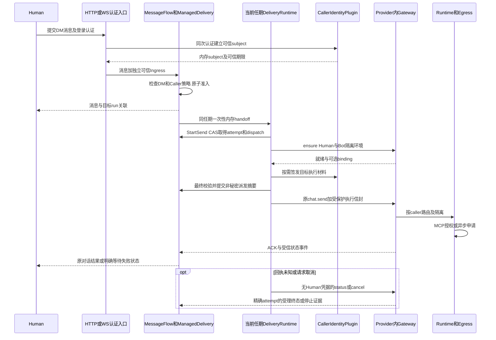
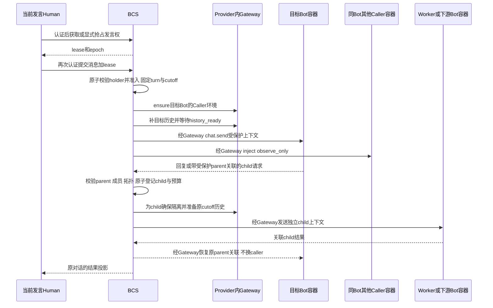

# Caller 身份实施 Plan（基于回退后的代码重新规划）

- 日期：2026-10-09
- 状态：待实施；本文不表示 Caller 已接通或可上线。
- 设计依据：[Caller Spec](spec.md)，特别是 §7.5–7.8、§10、B1–B10。
- 代码基线：`d2d18903902519a2344d34eea688238af6769788`。
- 真实代码根目录：`apps/bcs/`；本 Spec 与 Plan 暂留在 `src/bcs/specs/`，不迁移其他文档。
- 本轮只更新计划和文档导航，不恢复已回退的 Caller 实现。
- 约定：`[ ]` 未验收；`[x]` 已完成且应附当前代码及测试证据，不表示失败。以下实施项全部重新置为未完成。


## 本轮签发契约与剩余验收（2026-10-19）

- [x] Provider send/observe-only inject 的 subject 保留可信工号；插件 subject/type 独立保存，Owner lineage 不伪造插件主体。
- [x] 签发输入增加 staff_no、目标注册 agent_code、ensure 的 sandbox_container_id；AgentPass 缺目标 code/真实沙箱失败关闭，JWT 保留兼容。
- [x] INITIAL/RELAY 与 previous_caller_token 通过内部 exchange port 传递；RELAY 使用准确 parent token 并校验范围、层数及期限。
- [x] 修正过期 proof、上游超长有效期、Debug 敏感材料及旧 attempt 读取；历史屏障恢复 Accepted 复用身份登记/观察同步处理。
- [x] Workflow 使用真实可信 ingress/有效期，不从展示身份和固定 5 分钟窗口构造可派生身份。
- [x] 输入和回复 fan-out 共用当前 roster 资格过滤，Human actor ID 转为裸工号；逐目标校验引用/代次/有效期/原任期。验证：`caller_observe_fanout_wiring_contract`（11 项）。
- [x] 历史恢复等待及 complete 返回后复查原任期；root/delegate 从派发开始捕获任期，accepted/park 不重新认领新任期。验证：`demotion_during_history_complete_never_redrives_the_old_dispatch`。
- [x] legacy relay Send 对 Caller-enabled 目标及配置读取错误拒绝降级；Owner 保持兼容。验证：`legacy_relay_cannot_downgrade_a_caller_target_to_owner`。该未覆盖队列的回退路径每个 Send 目标增加一次当前 Bot Caller 配置读取；无应用重试，不做容器级查询。批量读取优化和最大目标数负载验收仍属 P6。
- [ ] 历史屏障完整闭环：实现缺失消息正文注入、目标容器/代次寻址、精确 ready 校验，并装配生产 backfill。现有 complete-only port 与恢复测试不等于此项完成。
- [ ] Workflow bootstrap 组合 e2e、成员变更事件即时失效、relay 接入受保护派发及多进程 failover 集成回归。
- [ ] 内部 AgentPass HTTP/SDK 实现与生产装配、camelCase 参数映射及真实服务联调；当前公开构建保持拒绝启动。
- [ ] 任期切换时在途签发/Accepted 回调的完整 fencing、多实例材料寻址及重启失败回归；清空内存不等于阻止旧在途回调重新写入。
- [ ] 取消与网络派发之间的原子边界验收；回填后检查活动状态只缩小竞争窗口，不等于原子撤销。


## 当前实施边界：复用生命周期（2026-10-15 确认）

Caller 不再推进独立 A2A parent/child 生命周期。任务、attempt、派发、取消和结果恢复复用既有执行系统；只补身份所需的最小可信关联。执行重心为可信入口、身份兑换、目标签发、容器路由和上下文隔离。

已有新增实现是否已被生产装配须按实施时源码复核，不能依据早期“仅测试调用”直接删除。下方 P5 是当前收敛与验收任务；§15 的逐批记录是历史证据，其中独立 child 仓储/生命周期的完成记录不代表该架构仍被采纳，也不替代复用方案验收。

## 1. 交付目标与不变边界

先交付 **H2A 真实入口 → 可信身份 → 现有调度器 → Provider → 状态/取消/恢复** 的完整纵向链路，再实现 Caller 群、历史同步和群内受控协作。独立插件、内部准备服务或 mock 测试通过，均不等于场景完成。

1. BCS 认证 Human、判断执行模式并建立受保护上下文；Gateway 信任受认证 BCS 的 callerID，负责内部容器路由；Runtime/Egress 负责身份隔离、MCP 授权及异步通知。BCS 不增加 Human 逐跳授权。
2. 一期以 Provider 下行为基线。Gateway 是 Provider 内部职责，不是另一套 Bot 注册、连接或能力真值。扩展原 `chat.send/chat.inject`，新增 ensure/control 能力；不要求所有方法同一个 HTTP URL。
3. 不下发物理 `container_route/container_id`；`binding_ref` 可选、只供内部隔离约束，不进入 `caller_context`。无 binding 不等于无隔离。
4. Caller Context 必需；execution token 根据身份插件/出口需要使用，不强制 Gateway 逐任务验签。BCS 维护短期加密 Identity Material Ledger（Human origin handle / parent execution token）用于下一跳签发与兑换；原始 IAM/Cookie/Bearer、subject 可兑换引用、proof、容器敏感映射不入业务 DB、消息、日志、持久队列或模型输入。
5. 复用 Managed Delivery、真实 attempt、现有消息及编排 ID；不建设第二 Caller scheduler，不建立独立 `bcs_execution_runs` 或 A2A parent/child 生命周期真值。
6. 普通非 Caller 群不读取或获取 Speaking Lease，不增加 Human 串行限制。Caller 群谁提交谁 caller；抢占只影响新提交，不更换旧任务身份。
7. 私聊开放 A2A 不继承 Human 身份；群内受控 A2A 每跳经 BCS，校验真实 parent 关联并从 Identity Material Ledger 取出材料后建立目标上下文；Provider 不回传 parent token。
8. 不改变既有消息视图语义。同步对象是**目标 Bot×session 已获准接收的共享流**，不是整个 session 无差别广播；执行身份和 Human 消息可见性分别处理。
9. 不为未修改的历史源码修理架构门禁，不做无关模块迁移；修改到的源码按职责控制在 1,000 行内，不全局格式化，不修改已提交迁移。

## 2. 当前代码事实与需要扩展的缺口

以下路径均相对 `apps/bcs/`。表中的“已有”指已读取源码，不代表本轮跑过相应完整测试。

| 边界 | 已核实的代码/符号 | 当前能力与 Caller 缺口 |
|---|---|---|
| Human HTTP 入口 | `crates/adapters/http/bcs-http/src/routes/sessions.rs::session_chat`；`routes/group_messages.rs::resolve_group_chat_caller` | 已从认证解析 Human，并固定 Human sender；当前还会自动加入 participant、消费 Workflow Human input。Caller 校验必须在这些副作用前进入用例层。 |
| Human 身份 Adapter | `crates/adapters/http/bcs-http/src/state.rs::HttpUserIdentity/ChainUserIdentityPort` | 当前抽取 staff_no/nick_name，不承载 Caller subject/可信有效期；需从同次认证建立独立 runtime-only ingress。不能从展示身份反推登录凭证。 |
| 入口用例 | `crates/service-api/bcs-service-api/src/application/message_flow.rs::WebSendCommand/GroupChatCommand` | 已有 `caller` 是请求访问主体；没有本方案的可信执行材料。增加非序列化身份载体，不能滥用 provider bypass headers。 |
| 同名对象 | `crates/service-api/bcs-service-api/src/application/principal.rs::CallerContext` | 当前为 Public/Human/Bot/Integration/Admin 枚举，不能替换成下行 Caller Context。Rust 内部用独立执行上下文类型；wire 才使用 `caller_context`。 |
| DM/群路由 | `crates/services/bcs-message-flow/src/group_flow/web_send.rs` | 已有 DM 固定目标与群路由；sender 的 `human_` 判断仅是既有归类，不足以建立 Caller 信任。 |
| 原子排队 | `crates/services/bcs-message-flow/src/queued_admission.rs`；`crates/service-api/bcs-service-api/src/port/repo/message_delivery.rs` | 已有 canonical message 与 delivery admission seam。扩展非秘密 Caller 必需标记及一次性内存身份交接，不能把身份放进持久投影。 |
| 调度和状态 | `crates/services/bcs-message-flow/src/delivery_runtime.rs`、`managed_delivery.rs`、`queued_group.rs` | 已有准备、StartSend、request_id、attempt、Unknown/取消状态及 CAS；需接上 protected send 和 Caller 精确控制，不另建状态机替代它。 |
| scheduler 生命周期 | `crates/bootstrap/bcs/src/message_delivery_wiring.rs::wire_with_leader/run_on_master` | 已按 master 任期消费队列。Caller ingress/handoff/dispatch 必须归同一任期；不能仅在 HTTP 进程保存身份并期待别的 master 读取。 |
| Provider 下行 | `crates/adapters/http/bcs-provider-http/src/lib.rs` | 已有 Provider HTTP、服务认证、SSE/JSON、BotDeliveryPort。Caller ensure/protected envelope/status/cancel 尚缺，需隔离普通正文日志与持久化路径。 |
| Bot 配置与归属 | `crates/contracts/bcs-domain/src/registry.rs::BotCapabilities`、`provider.rs`；`crates/services/bcs-bot-store/src/bot_provider_storage.rs` | 已有 bot_info、Provider/binding、连接模式。实际连接枚举是 Gateway/Plugin（wire 为 gateway/plugin），不是 Caller 能力声明。 |
| 配置管理入口 | `crates/adapters/http/bcs-http/src/routes/providers.rs`；`crates/services/bcs-bot/src/application/provider.rs` | 已有 Provider Bot 注册及 attributes 管理。需增加版本化 caller 配置并接 Backend 同步，保持授权与 binding 校验。 |
| Direct A2A | `crates/services/bcs-message-flow/src/a2a_chat/queued.rs` | 已有 Direct A2A canonical 私有消息、managed 队列和 ChatRun 投影；不能再按“尚无 A2A queue”规划，也不能因队列存在就允许私聊 Caller 继承。 |
| Direct run 审计 | `crates/service-api/bcs-service-api/src/port/repo/chat_run.rs::ChatRunRecord` | 已有 delivery_id/source_message_id/version/original_request。original_request 会持久化，受保护身份必须在写入前剥离，不能只靠 serde skip。 |
| 主子协作 | `crates/services/bcs-message-flow/src/task_flow/dispatch.rs`、`queued_task.rs`、`bot_event/coordination.rs` | 复用 task 与 queue，新增 parent 身份关联和预算；保留匹配 start 的无 name/toolName end 兼容案例。 |
| Workflow | `crates/services/bcs-collaboration-runtime/src/runtime_dispatch.rs`；`crates/services/bcs-collaboration-store/src/dispatch.rs` | 已有编排 run、node attempt 和 `smnode-{run}-{node}-{attempt}` 请求 ID、持久 dispatch payload。身份 parent 必须是活动编排；持久 request 禁止新增凭据。 |
| 消息视图 | `crates/contracts/bcs-domain/src/message.rs` | 实际为 `MessageVisibilityDomain::{Chat,ManagerWorker,StateMachine,DirectA2a}` 与 `MessageAudience::{Public,Directed,FullOnly}`。不添加历史讨论中的 group_public/caller_private 枚举来替代现存语义。 |

### 2.1 明确不存在/不能继续宣称完成的内容

当前 Rust 源码检索未发现 CallerIdentityPlugin、AuthenticatedHumanCallerIngress、caller.container.ensure 或 caller-terminal 的本方案实现。保留的 Gateway 契约、配置说明、旧 source-mapping/plan 里有“内部已实现”等历史表述，**不能用作当前实现证据**。

P0 应将这些配套文档调整为目标契约/历史材料，并以本 Plan 维护新证据。不是从备份恢复旧实现，也不是将旧完成记录复制过来。

### 2.2 数据复用原则

| 信息 | 映射/扩展方向 | 持久化 |
|---|---|---|
| Human turn | canonical `source_message_id`；client_msg_id 仅为请求去重键 | 允许 |
| 目标任务/attempt/dispatch | Managed delivery 的 `run_id/attempt_no/request_id`，StartSend 后才得到实际 attempt | 允许 |
| 当前发送状态 | `MessageDeliveryState`、state_version、may_have_been_sent | 复用 |
| 原目标/取消 | 已有 transport_context、abort_request_id、cancel 字段；新增必要的非秘密 control_revision、digest、deadline/回执水位 | 允许；CAS 同事务 |
| Caller 必需与配置版本 | 版本化 semantic projection；严格识别保留字段，普通路径遇到异常标记也拒绝 | 允许，不构成身份 |
| lineage/预算/历史清单 | parent/root/turn、用途、深度、child 幂等/计数、cutoff/projection digest/消息引用 | 允许；按查询/CAS 需要选择字段或附属表 |
| Workflow 身份 parent | 现有编排 run 及当前有效 attempt；node ID/attempt 和数据前驱独立保留 | 允许，不能只拿已完成节点做 parent |
| 发言权 | session、业务 holder_actor_id、lease_id、epoch、expires、幂等记录 | 允许；不是 caller 凭证 |
| 身份与观察引用 | IAM、subject/ref、execution token、binding、observe target、内存 lineage | 不允许；有界内存、到期清理、丢失 fail closed |

Spec §10.3 的 `ExecutionRun` 仅为既有执行对象的逻辑视图，不创建 `bcs_execution_runs` 或独立 A2A 生命周期表。P0 给出精确字段/索引清单，不机械创建同义 run 表。当前迁移最大号为 MySQL `031_session_registry.sql`、SQLite `032_session_registry.sql`；新增编号以实施时实际最大号及已部署记录为准，不能覆盖或重编号。

## 3. 交付顺序与端到端接线


### H2A：P2 必须完整贯通



图中先于准入的 subject 建立由可信认证边界完成；凭据按实际插件生命周期使用。网络调用不持有数据库事务。subject 丢失、超时或用户换人都不能从 DB 恢复执行身份。

### 群聊与 child：P3–P5 在同一链路上扩展



上图容器箭头是逻辑收发，物理 I/O 全经 Provider/Gateway。Manager 为 Owner 时只携带 delegation_only lineage；Workflow 由受信编排器替代 Bot 提交 child，身份 parent 不取数据前驱。

## 4. P0：冻结可执行契约与建立回归基线

**依赖：** 最新 Spec；不重新确认 B1–B10。**产物：** 契约/数据映射和测试清单，不开放 Caller。

- [x] P0.1 给保留的历史 Gateway/配置/源码映射文档标明回退状态，去除当前已实现的误导；按最新 Spec 归并 wire 版本及错误语义。（2026-10-09：三份历史文档加回退注记并降级为目标契约/历史材料；证据见 §13 执行记录 P0.a）
- [x] P0.2 分类定义 Service API（可信消息准入、配置、lease、控制回执）与 Plugin API（身份 establish/issue/verify、Provider ensure/send/inject/status/cancel）。协议 DTO 放 bcs-protocol，领域类型放 bcs-domain，用例/port 放 bcs-service-api；不让 HTTP/Core 选择具体实现。（分类与摆放映射见 `apps/bcs/docs/caller-p0-contracts.md` §1–§2；领域类型已落地并测试；wire DTO 与 trait 定义按 §1 映射随 P1/P2 落地）
- [x] P0.3 明确既有访问 CallerContext 与 runtime-only 执行上下文的不同类型；建立不可普通序列化、Debug 脱敏的身份类型，避免把凭据塞进 Value/通用 BcsFrame。（`bcs-service-api::application::caller_identity`：不派生 serde、Debug 脱敏并有测试；ingress 支持连接级快照 Clone，但命令 Clone 剥离 ingress；`principal::CallerContext` 保持访问主体语义不变）
- [x] P0.4 定义 Managed 的字段复用、新增索引与 CAS 事务边界；Workflow 单独列其现有 dispatch checkpoint 映射，不预设与 Group 共用完全相同的持久模型。（`caller-p0-contracts.md` §3 + §3.1；存储目标清单 §4，P0 不写迁移）
- [x] P0.5 固定兼容用例：未开启 Caller 的 HTTP/WS/Provider、普通群并发、DM 固定目标、附件完整、现有 Direct A2A、无 name 的 coordination end、Workflow request recovery。（用例→真实测试 target 映射 `caller-p0-contracts.md` §6；两批兼容回归 1820 通过 0 失败，见 §13）
- [x] P0.7 收敛 Provider Caller wire：目标/session/run 复用 envelope；execution 仅保留期限和可选 history。同步 ACK 只需 ok=true，异步结果复用 `/bot/events`。BCS 内部派发/CAS/取消控制不删除，不新建生命周期或表。旧 Provider 须协调迁移。
- [x] P0.6 对本次修改的 seam 补 CONTEXT、配置 schema、contract consumer 测试映射；不豁免现有门禁、不修无关存量超长文件。（`caller-p0-contracts.md` §7–§8 + `bcs-service-api/CONTEXT.md` 追加；未触碰门禁与无关存量）

**验收：** 新契约可独立审阅，测试覆盖消费者可观察结果及插件确实被调用；完整身份流与所有持久出口列清，不以空 trait/Noop 通过作为完成。

## 5. P1：配置同步、Provider readiness 与身份插件

**依赖：P0。落点：** Bot/provider application/core/store、HTTP providers、认证链、plugin-api/plugins、bootstrap/config。

- [x] P1.1 扩展 Bot caller 配置：enabled、minimum_isolation、revision/来源。TeamClaw 由 Backend 同步，其他接入方走受授权注册/更新。实现 Spec 的 caller GET/PATCH 子资源，复用 Provider 管理鉴权和精确 binding 查询，不扩散授权。（2026-10-09：存储 CAS＋provider-scoped 读写＋受认证 application＋严格 wire DTO＋HTTP GET/PATCH 子资源全链实现；DTO 5、存储 8+6、application 6、HTTP 路由 4 项契约测试全绿，测试与边界见 §14.1–§14.7；真实 Backend/MySQL/Singlebox 属未验证外部依赖）
- [x] P1.2 注册与后续更新分别覆盖：旧请求省略不清空；明确 disable 生效；同 revision 同值幂等、异值冲突、旧版本 stale；并发更新 bot_info 不能覆盖其他字段；写失败不当 disabled。（2026-10-09：revision 矩阵/显式 disable/二进制 CAS 保留相邻字段/坏 JSON 与 caller:null 报错不落 disabled/CAS 竞争单次重读后 Conflict——存储 8 项、路由 4 项契约锁定；样本见 §14.1–§14.7）
- [x] P1.3 注册配置、归属和 binding 安全发布；后续关联初始化失败返回 reconciliation_required，不允许通过 disable 绕过不完整注册。不新增配置 freshness 或同步对账系统。（2026-10-13 §15.27：`RegisterProviderBotParams.initial_caller` 初始快照经 P1.1 caller-config CAS 随注册落盘;提交后同步失败→新闭环错误 `ServiceError::RegistrationReconciliationRequired`——注册保持已提交、不自动重试/不删/不回凭据,调用方经既有受认证查询对账并重放同命令;memory 组合无 caller 存储→fail-closed 拒绝含快照注册,普通注册不受影响;pending=配置缺席即每道 gate 拒绝,disable 无法解锁。未新增 freshness/对账系统✓。契约 4/4;bcs lib 314/0,bcs-bot 199/0,svc/http/org 778/0）
- [x] P1.4 Provider 独立声明 Caller 技术能力。按场景算 disabled/ready/blocked；H2A ready 不依赖 observe/history，群聊另要求同步和快照能力。Gateway/Plugin 连接枚举不等于 Caller ready。（2026-10-09：能力声明存储读回（6 项）+ 受认证查询（application 6 项）+ 派发保护 Gate 生产消费（6 项：disabled/未配置传递、enabled/坏数据/break 读取 fail-closed、双派发路径共享检查、abort 不读配置、显式 disable 后重开 Owner 派发、冻结 merge 视图复用）；H2A ready 忽略 observe/binding 由 domain+gate 契约锁定；bootstrap SQL composition 安装列 P1.7）
- [x] P1.5 实现 CallerIdentityPlugin 及默认 JWT Adapter；可信入口建立 scope 化稳定伪名、原身份期限，签发限制目标/run/attempt/purpose。JWS 内容不能放真实身份；jti 不作为长期容器 key。认证、签发、MCP 授权三个职责分开。（2026-10-09：`bcs-service-api::port::caller_identity` 契约 + `crates/plugins/bcs-caller-identity-jwt` 默认实现与 17 项 conformance；证据与边界见 §14）
- [x] P1.6 internal AgentPass Adapter 复用相同契约；IAM→x-one-id 接口由 AgentPass 提供并联调。失败不回退 JWT/Owner；未配置 internal 时公共本地模式仍可离线测试。（2026-10-13 §15.26：新 crate `bcs-caller-identity-agentpass` 以注入 `AgentPassIdentityExchangePort` 实现同一 Plugin API——不耦合 SDK、裸 token/裸 x-one-id 不越界;受约束 XOneIdRef/opaque proof/信任边界验证+匹配机精确匹配/binding 不存在不等于通配;错误封闭词表 fail-closed 无回退;组合点新增 `Agentpass` plugin kind 公共构建拒绝装配。conformance 7/7。**真实 AgentPass IAM→x-one-id 联调未做**,internal 生产 ready 不可宣称）
- [x] P1.7 把实例选择与配置验证接入现有 composition root；无实现/缺配置 fail closed，不使用成功 Noop。初始化、关闭、key 轮换、超时/错误脱敏纳入测试。（2026-10-13 §15.25：[caller_identity] 装配提取为 `caller_identity_wiring` 并以校验矩阵锁定——absent=Ok(None) 无伪造插件;有效段装配真 JWT 插件;空 issuer/kid/pseudonym、非 hex/弱 pseudonym、坏签名/验证 PEM、空信任集、零 TTL 全拒绝启动,错误vocabulary封闭永不回显密钥材料;多 kid 信任集=轮换余量。真实消费者自 §15.15 起为 P2-B pipeline identity。bcs lib 313/0）

**验收：** Backend/其他接入方→真实 BCS 注册/更新→readiness→入口策略可观察；mock 身份插件及默认实现通过同一 consumer suite。AgentPass 未联调可继续本地 P2，但不能宣称 internal 生产 ready。

## 6. P2：H2A 真实生产入口与执行生命周期闭环

**依赖：P1。落点：** HTTP/WS ingress、MessageFlow、queued_admission、queued_group、Managed/DeliveryRuntime、Provider adapter、message store、bootstrap wiring。

### P2-A 可信入口与原子准入

- [x] 扩展认证 Adapter，在同次认证结果中取得 sender 与独立 `AuthenticatedHumanCallerIngress`，保留可信有效期；不得从前端 JSON、human_、Bot owner、DB holder 合成身份。（§15.1-15.2、§15.6-15.7：真实 OAuth 会话期限链 + 严格提取 + 两类入口命令装载）
- [x] HTTP session/group、Web WS 等所有可触达 DM 的入口统一调用可信用例；不支持 Caller 的入口在触及副作用前拒绝，不留 legacy 绕过。普通入口行为保持不变。（部分勾选，见 §15.7：session_chat 与 group_chat 两类 HTTP 入口已装载严格 ingress；Web WS 入口未接）
- [ ] 按 Spec §7.5.1 校验 active DM/Chat、恰好 Human+Bot、running session、Human Present/Bot Auto；使用实际 DM 路由目标，拒绝覆盖目标和未支持的内容形态，不截断附件为 text。
- [x] 预留有界内存 handoff，再原子创建 canonical message/queued delivery；只向成功新准入发布身份。duplicate 返回原关联，不补身份、不续 TTL；失败释放预留。（§15.3 + §15.5：reserve→admit→publish、duplicate 不补身份、失败 release）
- [ ] handoff 归 elected scheduler 任期，只有同任期 dispatcher 能一次性消费；关闭不可 reopen，再当选新建空任期。follower 在无安全交接路径时明确拒绝 Caller 准入，不将 token 转入 DB/Redis 队列；记录部署接入要求。

### P2-B 从真实 StartSend 到 Provider

- [x] protected send 使用最小 JSON ACK，由在途命令关联本地 control_revision/request_digest，不要求 Provider echo。契约测试覆盖最小 ACK、旧 echo 不覆盖本地事实、非法成功状态、路由不匹配及 history。当前测试执行结果以本次运行报告为准，旧版严格 echo 测试记录不作为新版证据。

- [x] 复用 StartSend CAS 后的真实 attempt_no/request_id；确保 queued 时不猜 attempt，run/目标不可被 prepared frame 替换。（§15.13 runtime 从 started 行取真实 attempt/request_id）
- [x] 从同任期 handoff 获取身份→ensure→必要时 issue/verify→最终校验身份期限、Bot/Provider 状态、当前 attempt 与取消水位→提交非秘密 digest/deadline→protected send。（§15.12 claim→prepare→issue→commit→send 次序 + §15.17 typed commit + §15.19 取消水位经 CAS）
- [x] Provider adapter 在受保护出口才装载 caller_context/可选 token；复用 Provider auth/目标解析/OutboundUrlGuard，不进入通用正文日志、original_request、transport_context 或普通请求审计。（§15.11 protected send wire + §15.39 observe injector + §15.16 投影键封闭断言）
- [x] ensure 无 binding 的合法 container_bound 路径可执行；未就绪、身份过期、配置 blocked 明确失败，不 Owner fallback。普通路径发现保留 caller_required 字段（包括 false/null 异常值）也拒绝。（§15.10 binding 变体契约 + §14.8 派发 Gate + §15.4 runtime 守卫）
- [x] 处理确定未发送错误必须使用原版本/request 的 CAS，Caller 不自动重新入队；不能重读新版本后覆盖并发取消。handoff 丢失不是未发送证明。（§15.13⑥ DefinitelyNotSent{retry:false} 带 request_id 证据；§15.23 caller TTL 语义）

### P2-C 受理、终态、取消和恢复作为同一交付

- [x] ACK 仅受理；超时/断线/重启进入 Unknown，不生成新 attempt。保存同派发规范摘要，不将秘密加入摘要；NotFound 不能当安全重试依据。（§15.12 Unknown 收敛不重发 + §15.17 非秘密摘要 + §15.20 NotFound→unconfirmed）
- [x] 实现 execution.status/cancel 无Human凭据路径，使用原 environment/Bot/Provider/ref/session/run/attempt/dispatch 八字段定位；不 ensure、不重新取身份、不改派 Provider。（§15.20 CallerExecutionControl 八字段定位）
- [x] cancel intent、稳定 cancel_request_id/control_revision/reason/not_after 原子保存；重试原命令。验证 cancel 先到的 fence/tombstone，区分 fenced 与 stopped；未确认不释放 lane。（§15.19 typed CAS 同事务 + 幂等重放 + epoch 水位）
- [x] 保留已实现的 `/bot/events/caller-terminal` 作为旧控制契约兼容入口，新 Provider 不要求接入。结果/终态复用 `/bot/events` 与真实 managed run；普通事件不冒充远端取消水位证据。
- [x] status 版本协商与终态证据匹配；旧 attempt、旧 revision、重复事件无权推进新任务。终态/取消竞态保留实际副作用证据，不恢复执行权。（§15.21 终态仲裁：旧 attempt NotFound、精确重复幂等、取消先到独立记录 outcome）
- [x] 将查询/取消恢复接到既有 owner 生命周期：有界候选页32、单轮最多1次远端请求、5s扫描、失败10/20/40/60s退避；存储失败不跳 cursor。不另起不受 master 管理的 Caller scheduler。（§15.23 TTL 语义 + runtime Control batch 页 32/tick 驱动 + storage_retry；恢复归 master 管理 runtime）
- [x] 重启只恢复非秘密控制，不恢复凭据或重放 chat.send。异步授权后身份过期不自动续签，等待/失败并让 Human 重新提交，提示潜在重复副作用。（§15.23 recover 只转状态；identity 纯内存 handoff 重启即硬损失（§15.12⑥），不续签不重放）

**精简回执契约的验证边界：**
- [x] 补普通 BotEventCommand 的 Caller managed run 回归：校验 Provider 归属、终态收敛、回复路由和重复 final 不二次发布；不伪造 caller_terminal 控制观察。
- [ ] 真实 Provider 联调最小 ACK + `/bot/events`，覆盖取消竞争、旧 attempt 迟到和 ACK 前事件；普通 run 回调本身不证明 attempt/控制序号。
- [ ] 若内部 AgentPass 要求父 token 兑换，补身份插件契约及仅内存的材料持有，禁止让 Provider 通过消息/回调回传 token；当前按可信 subject 签发不等于父 token exchange。

**验收门槛：** 从真实 router/server 构建请求到 recording Provider 的 ensure/send，再经真实回调或 status/cancel 到用户可见状态；断言插件调用、实际 run/attempt、数据库无身份、日志无凭据。覆盖成功、拒绝、ACK 丢失、cancel 先到、慢 ensure 后取消、主切换、重启、旧 attempt final、禁用/解绑后的控制可达性。P2-A/B/C 全部完成才标 H2A 闭环完成。

## 7. P3：Caller 群判定、Speaking Lease 与多 Human 准入

**依赖：P2。落点：** group/session application、HTTP/WS command、session/group store、queued admission、前端/CLI 契约。

- [x] 群模式动态判断：存在 Human，且成员/受控拓扑有 enabled Bot。Manager Owner+Caller Worker 也开启；没有 Human 或全部 Bot disabled 保持普通群。（§15.29 resolve_speaking_mode + enabled 逐 Bot 解析）
- [x] 普通群完全绕过 lease repo 与 Caller 新并发限制；enabled 但 Provider blocked 不能当普通群执行。配置关闭后再开启，旧 lease 不复活。（§15.29 普通群零 lease 读写 + blocked 仍 LeaseRequired + §15.28 过期不复活/epoch 轮换）
- [x] 实现获取/显式抢占/释放/查询的用例及协议；持续持有，默认60秒空闲。acquire 本人重入不续；只有成功新消息续期；duplicate、心跳、Bot 回复不续。（§15.30 四命令 + §15.29 admission 唯一续期事件、duplicate 不续期）
- [x] holder/lease/epoch/expiry 及 acquire 幂等持久化；提交时重新认证，holder匹配、epoch检查、消息准入/续期同事务，支持多副本竞态；body 中 caller/token 一律不采信。（§15.28 契约 + §15.30 SQL 单事务/UNIQUE 键/账本行；holder 恒来自认证会话）
- [x] 抢占不取消原 turn/run/child，不以当前 lease epoch 撤销旧任务；显式取消、退群/解绑/关闭配置仍按 P2 控制语义处理。（§15.28 抢占只转移提交资格；§15.19/15.20 显式取消独立按 P2-C）
- [x] 创建群/加 Human/Bot 只在有可信 subject 时预热相应 Human×Bot；无身份只能记录非敏感预热意图，不能用建群者身份替别人 ensure。（2026-10-13 §15.33：建群/加成员仅记录非敏感预热意图——group_id/human 数/bot 数/成员种类;不 ensure、不建容器、不代用建群者身份;per-message admission 建身份维持原语义。v1 边界：可信 subject 主动预热（ensure 捷径）未实现——本架构 per-message admission 已满足真实需求,无消费者不设独立 seam）
- [x] 一条 Human 消息固定 canonical turn，各实际目标独立 root。获准协作的 Owner 目标也建立受保护 delegation_only lineage，但仍走 Owner 路由、不强建 Caller 容器。（2026-10-13 §15.31/§15.32：canonical turn = source_message_id 跨目标共享、各目标独立 run/root 结构性成立;群 scope 进 lineage;多目标 handoff 一身份原子多 slot。Owner delegation_only lineage 留 P4 共享上下文批——不建容器/走 Owner 路由语义与 §14.8 gate 一致）
- [x] Human 获取发言权与 Runtime 异步 MCP 授权分别呈现，禁止把 lease 按钮解释为 MCP 授权。接好实际产品入口，不仅提供孤立 lease service。（2026-10-13 §15.30/§15.33：lease 命令四件套作为 WS 协议一等公民（workbench 主入口直连,非孤立服务）;MCP 授权保持 interaction.* 独生命名空间;lease 拒绝错误带闭环 reason 供前端渲染。'lease 按钮≠MCP 授权'为产品层约束,BCS 契约以命名空间分离+闭环错误码承载并记录）

**验收：** 两 Human 同时提交/抢占、旧 release、新消息与重复消息、master 切换、Caller 开关切换；旧 Alice 任务仍用 Alice，Bob 新任务只用 Bob。P3 未完成 P4 时不得开放 Caller 群生产执行。

## 8. P4：共享上下文、观察引用与固定历史屏障

**依赖：P3。落点：** message repo/history 投影、MessageFlow、Provider inject/ensure、Runtime 契约。

- [x] 复用当前目标 Bot 的路由/生产者投影生成 Bot×session 共享流，不用 Human 的 visibility/audience 查询替代 Bot 同步策略，不全群广播定向 task/Workflow/private MCP 内容。（§15.54 投影策略 + §15.56 生产调用点接线：派发编排按同 Bot 共享流逐次判定并接入 pipeline；Bot 回复首次提交即触发同步，不依赖下游派发数量；外部 Runtime 场景验收仍开放）
- [x] 当前目标 Caller 容器接收 chat.send，其他已知有效容器接收 inject；Bot 共享回复也同步到源容器及其他容器并去重。inject 不触发工具、child 或 run。（§15.53/§15.56 fan-out seam——§15.56 修正为同 Bot 其他 Caller 容器模型并接通生产装配 + §15.38/39 observe wire + per-message 去重键；群内 A2A Accepted 后复用同一 fan-out，以本次 child 消息 ID 去重；回复无下游目标及重复 final 纳入回归；重启补发可靠性和 Runtime 验收仍开放）
- [x] Provider Caller 能力增加 `container_routing=ensure|caller_subject`（缺省 ensure）；生产准备按能力选择 ensure 或 subject 懒路由，能力错误和 ensure 失败不降级。send/inject 的主体统一放 caller_context.subject；观察同步选择接收 Human，ref/epoch 成对可选。观察索引仍仅存内存，不新增身份表。
- [x] ensure 返回受限 observe_target/代次；inject 用 `extensions.runtime_target` 和 `extensions.execution.mode=observe_only`，caller_context 仅含 subject，不携带执行 token。Owner lineage 使用显式 bot_default 观察目标，不凭引用缺失 fallback。（§15.37 observe_target 类型/解析/索引 + §15.38/39 observe-only wire；ensure 模式引用缺失即暂停；显式 caller_subject 模式无需引用，仍禁止 fallback 到 Owner）
- [x] runtime-only 观察索引有容量/到期/淘汰限制；失效暂停该目标同步，下次可信 ensure 后补历史，不新增容器枚举，不跨 Human 借身份恢复。（§15.37 容量拒绝不丢活行/tombstone/新 ensure 重开）
- [ ] root 准入固定当前消息之前的 cutoff、投影版本、digest及可重建消息引用；补历史分页/限量，history_complete→history_ready 后才 send。**部分完成：manifest 与原 dispatch 驱动已具备，正文补齐/目标精确 ready/生产装配未完成。**复用现有 bounded context 中适用部分，不把“有最大水位”误当满足 run 快照隔离。（2026-10-13/14 §15.35/15.36/15.40：HistorySnapshotManifest 显式清单+canonical digest;runtime 以行 source_session_seq 固定 cutoff、bounded contexts 显式 ID 清单成 manifest、execution.history 四件随受保护 send 落线;HISTORY_NOT_READY 可重试屏障收敛——行保 Dispatching/同 attempt/同 digest,补齐后仅重投原 dispatch。 历史 inject 分页/限量与 Gateway ready 回执属 wire 下一批）
- [x] 执行期间 inject 只影响后续快照；在途 run 不能读入后来 Bob 的指令。child 继承 root cutoff，对 child 目标重新投影，不能复制 parent 私有全文；超 cutoff 的工具/child 结果必须有显式因果关联。（§15.40 HISTORY_NOT_READY 屏障 + §15.41 cutoff 继承；运行期隔离读由 Gateway/Runtime 快照验收）
- [ ] 容器回收/代次变更重建快照，未ready不执行；HISTORY_NOT_READY 按同 dispatch/digest 补齐后再受理，不新增 attempt 或消耗 child 预算。（§15.40 行保 Dispatching/同 attempt/同 digest 重投原 dispatch；代次重建由 observe 索引换代承接（§15.37））

**BCS 本地契约回归范围：** Provider `caller_wire_journey_contract` 校验 inject 正文及无执行凭据；
`caller_execution_send_contract` 校验群 envelope、history 四字段、业务拒绝及 ACK 大小限制。
`caller_observe_fanout_wiring_contract` 覆盖无下游目标的已提交回复、重复 final、A2A 当前消息 ID、
同 Bot/session 范围和 Accepted/分类门控。本轮补入退群过滤、裸工号匹配及逐目标任期/引用失效测试。
访问成本：每轮 fan-out 增加一次 group 查询（现有 store 缓存优先），配置 session 服务时再读一次 session（MySQL 为单行 SELECT），最多三轮；逐目标只查内存索引，不按容器执行 DB 查询。不新增表或生命周期。立即成员事件和并发负载验收仍待完成；
回复沿用既有提交、去重和目标解析，新增的是原来遗漏的外部 inject，失败不改变已提交状态。
实跑结果：Provider 全套 84 项通过；同步契约 8 项、受保护 runtime 派发契约 8 项、
回复派生契约 2 项通过；`cargo check -p bcs --lib --locked --offline -j 2` 通过。
扩展验证边界：`bcs-message-flow` + `bcs-service-api` 全量运行在 31 个已完成套件、
618 项通过后因持续耗时主动停止，不计全量通过；`bcs --all-targets` 检查也未完成。
协议兼容与 port purity 通过；依赖门禁仍为既有 DEP-1/DEP-6 失败，未扩大修复范围或添加豁免。
源码行数检查：本次新增文件均小于 1,000 行；Provider `lib.rs` 从 3,935 行缩减到
3,817 行，仍为存量超限，不将本轮 Caller 修复扩展成全文件迁移。
这些测试不替代真实 Gateway/Runtime 的隔离、丢消息恢复或多副本验收。

**验收：** 连续 Alice/Bob 切换、同Human多session、引用丢失、容器回收、重复/乱序 inject、私有与定向消息、执行快照稳定、child历史边界。必须用 Runtime 实际快照行为验收，BCS mock 不证明容器隔离。

## 9. P5：复用既有协作链的最小 Caller 关联

**依赖：P4。落点：** group bot reply/coordination、task_flow、Managed、collaboration runtime/store、Provider runtime-only 回传。下列任务按本次收敛重新验收；历史 child 仓储测试不能直接勾选。

- [ ] 核实自由群、Manager/Worker、Workflow 的真实 run/task/node、parent、invocation/toolCallId、attempt、dispatch 与结果回调映射，列出权威拥有方及确切缺口。不因群聊有多个 Bot 就创建 A2A child 关系。
- [x] 移除 `SqlA2aChildRepo`、内存 child repo、仓储 port、旧 derivation 服务及 bootstrap 装配。协调入口复用 scoped Managed delivery 和运行上下文；不再准入后登记 child，不再终态时查询 child。对应旧仓储测试移除，替换为既有任务链契约测试。
- [x] 保留已提交迁移的名称、编号和历史内容；本次未修改历史 migrations、未执行 DROP。旧表兼容留存但无运行期仓储读写；实际环境表退役需另行核实部署和回滚需求。新任务不再生成 child 记录，回滚到依赖 child 查表的旧二进制前必须 drain，或先提供兼容终态路径。
- [ ] 同群同 session、成员/拓扑、真实 source/target、有效 parent/当前 attempt 与用途校验接入原执行链。缺少可信关联则拒绝继承；Owner 中间跳保留受保护 delegation_only 来源，但 Owner 工具不获得 Human 权限。
- [x] 任务派发关联复用原 delivery 的 `caller_delegation` 投影（parent/invocation/用途），真实 task/run 由既有准入生成；无独立 Caller parent/child 状态机或结果恢复队列。无 Managed 准入时拒绝 Caller 派发，不能走 legacy Owner 路径。
- [x] 协调入口使用有界可信内存计数，按 session/turn 共享，原子预占最多16次调用、depth上限2；不新增 child 注册事实。失败/未知不退款，重复 parent/invocation 拒绝，正常重放复用既有协调去重。重启/owner 切换丢失上下文后拒绝旧链继承。
- [ ] 验证所有开放入口的单 owner 保证、现有生命周期中 parent 终态/取消与新任务准入的原子排序及当前 attempt 校验；内存预算与既有准入不是一个事务，不得用本次重构宣称上述竞态已解决。Workflow/自由群完整接线仍按下列未完成项验收。
- [ ] Worker 受认证 start/end 接入既有 run/toolCallId/Bot/session/attempt 校验，保留 cached start 与无 name/toolName end 兼容；observe 消息不得派生任务。
- [ ] Workflow 使用活动 orchestration parent，区分数据前驱与身份 parent；Human input、one-shot、重试、join 均关联真实编排和 node attempt。凭据只在最终出口注入，不进入持久 request/frame。
- [ ] 补 BCS Identity Material Ledger：Human origin handle 与 caller parent token 的短期加密记录；caller 子链必须用 parent token exchange，Owner/Workflow/manager-worker 使用 root/ancestor handle 签发；单实例内存或多实例共享安全存储，不落业务 DB、日志或消息。
- [ ] 对目标任务按需兑换/签发 Caller 身份、ensure 容器并准备 P4 历史；不延长原身份有效期。身份丢失/过期不能从 DB、holder 或结果恢复，不降级 Owner。
- [ ] 结果归属、去重、恢复、取消及旧 attempt 处理复用现有机制；验证 parent 等待时 A→B→A 可推进，不新增 Caller 调度器或全群锁。

**本次重构验证：** `cargo test -p bcs-message-flow --locked --offline` 全量通过（664 项、0 失败）；补充测试后的单元测试 89 项通过；最终时间检查调整后，3 项 Caller 派生消费测试再次通过。覆盖共享 turn 并发预算、重复 invocation、深度/过期限制、身份丢失拒绝降级、普通任务不变、跨 session/终态 parent 拒绝，以及无 child 仓储的 Worker 结果归档。`cargo check -p bcs --all-targets --locked --offline` 通过；service-api 单元测试 49 项通过，完整 integration suite 因测试二进制启动长时间无输出中止，不能标为全量通过。架构检查仍报告依赖脚本、导入方向和契约入口问题；R25 的全 workspace 测试枚举耗时过长后中止，整套门禁未完整跑完，不能记为通过。本次不修改门禁、不开展无关迁移。新增/拆分源码均小于 1000 行；既有超限 `server.rs` 仅删除 Caller 仓储装配，不做无关拆分。

**验收：** 同一 turn 多目标、同 parent 多次调用同一 Bot、重复请求、旧 attempt、Owner 中间跳、取消竞态、身份丢失、Workflow join、A→B→A。对无法提供可信执行关联或安全释放执行位置的模式暂不开放 Caller 继承。纯 H2A 不依赖独立 A2A 仓储的完成或清理。

## 10. P6：跨系统验收、成本门槛与安全发布

**依赖：** P2 为 H2A 发布基础；群聊需 P3/P4，A2A/主子/Workflow需 P5。各场景只能在完成对应真实外部验收后独立灰度。

- [ ] 将各阶段 consumer conformance、HTTP/WS router、真实 Provider adapter、DB CAS/迁移、隔离与故障用例纳入CI；跨模块功能跑所有受影响模块测试。
- [ ] 对所有身份出口作 canary 检查：DB/缓存持久层、original_request、workflow request、日志/metrics、公开回执、模型prompt无秘密；只能记录非敏感关联和错误码。
- [ ] 实际验证 Provider cancel传播/停止SLA、幂等/取消账本持久性及保留期、时钟偏差/最大迟到窗口、配置撤销/解绑后状态查询与取消可达性。不能由BCS代码单方面声明成功。
- [ ] 做数据库访问计数：普通群新增 lease 查询为0；有界分页历史/恢复、批量成员能力查询、每次准入/child事务涉及行数；禁止N+1及跨网络持锁。恢复每页32、每轮最多1次远端请求，观察引用内存和同步fanout需容量/背压上限。
- [ ] 做多副本选举切换与过期压力测试；凭据只在owner内存导致的可用性损失明确反馈。取消未知不释放lane；持续失败不无限重扫/重试占满DB连接池。
- [ ] 分场景开启：默认disabled→本地JWT/H2A→验收后的生产Provider H2A→Caller群→受控群A2A/主子/Workflow。不要在P1配置可写时就放开所有场景。
- [ ] 回滚先阻止新Caller准入并drain/取消确认；未结Caller行保持拒绝/可查询，不切回Owner。旧二进制不认识caller_required时不能直接回滚接流量，先部署兼容拒绝版本或完成drain。
- [ ] 更新 Spec/介绍文档中的真实支持矩阵与本 Plan 的完成证据；默认JWT、internal AgentPass、外部Runtime分别列状态，不把mock完成算作生产完成。

### 10.1 外部依赖及责任

| 对接方 | 需要交付 | 对应阻塞 |
|---|---|---|
| Backend/其他Bot管理方 | Bot caller配置/版本注册及增量更新，明确disable | P1联调、生产配置生效 |
| BCS Identity Material Ledger | 单实例进程内存 / 多实例短期加密共享存储；保存 origin handle 与 parent execution token | P5/A2A/Manager/Workflow的下一跳签发 |
| Human认证入口 | 同次可信Human及期限；internal允许AgentPass兑换的IAM材料仅在可信边界使用 | P1/P2可信身份；展示staff_no不够 |
| Provider/Gateway | ensure、受保护send、status/cancel及账本；群场景增加observe/inject/history_ready和Owner lineage | P2外部闭环、P4/P5群协作 |
| Runtime/Egress | Human×Bot长期隔离、session/run快照、异步授权通知、过期检查、停止控制、非阻塞waiting_child | 实际身份安全与工具授权 |
| AgentPass | IAM→x-one-id/身份建立、目标凭据及验证契约、有效期/错误/服务认证 | internal实现生产验收；不影响离线默认实现开发 |
| 前端/CLI | Caller群发言权、抢占/错误提示、任务关联及结果；非Caller群体验不变 | P3用户可用性与P6场景验收 |

## 11. 验证方法与本次基线证据

以下命令在 `apps/bcs/` 执行。下表三项是本轮实际执行；表后的命令为实施阶段验收要求，不表示已通过。

| 验证 | 本轮结果 |
|---|---|
| `cargo test -p bcs-domain -p bcs-protocol --locked --offline` | 通过 |
| `cargo check -p bcs-message-flow -p bcs-http -p bcs-provider-http --locked --offline` | 通过；有既有编译警告，不代表完整启动/端到端验收 |
| `cargo check --workspace --locked --offline` | 失败：现有 `bcs-cli/src/client.rs` 引用不存在的 `bcs_protocol::ChatRunDeliverySummary`，并访问 ChatRunStatusResponse/ChatRunSubmitResponse 缺失的 delivery 字段，共6个编译错误。不是本轮文档变更新增。 |

本轮日志：`/tmp/bcs-caller-plan-baseline-tests-20261009.log`、`/tmp/bcs-caller-plan-baseline-check-20261009.log`、`/tmp/bcs-caller-plan-target-check-20261009.log`。临时日志不是可移植CI证据；实施PR应附对应提交的可重现结果。

实施验收至少执行：

```sh
# 身份/配置与真实消费者（新增Caller test target在对应阶段建立）
cargo test -p bcs-bot -p bcs-bot-store -p bcs-http --locked
cargo test -p bcs-message-flow -p bcs-provider-http --locked
cargo test -p bcs-collaboration-runtime -p bcs-collaboration-store --locked
# 最终全量回归
cargo test --workspace --locked
```

再运行仓库现有架构/配置/协议门禁与 `singlebox/ci/singlebox_coverage.sh`、其产物校验器；真实MySQL迁移和Provider/Runtime联调单列。现存编译阻塞应由对应修复或更新基线解除，不能隐藏失败，也不因此扩展为Caller无关重构。当前未运行完整workspace测试、singlebox、真实MySQL及外部系统联调，不能给出生产验收通过结论。

## 12. 执行记录约定

每个P阶段的完成记录必须同时提供：代码提交/文件、真实消费者接线位置、运行的测试及结果、未验证外部依赖。阶段项只有全部验收后才能打勾；发生回退重新核验，不保留失效的完成状态。

## 13. P0 执行记录（2026-10-09）

代码基线：`d2d189039` + 本批新增/修改文件（未提交，由维护者决定提交方式）。本批不开放任何 Caller 执行；生产调用链未变动。

### P0.a 交付文件

| 类别 | 文件 |
|---|---|
| 历史文档回退注记（P0.1） | `apps/bcs/docs/caller-container-gateway.md`、`apps/bcs/docs/caller-identity-configuration.md`（各文首注记；正文保留为目标契约/历史材料）；`apps/bcs/docs/plans/2026-10-03-caller-identity-source-mapping.md` 于 2026-10-23 合并删除（见 §15.104） |
| 契约/数据映射文档（P0.2/P0.4/P0.5/P0.6） | `apps/bcs/docs/caller-p0-contracts.md`（新增） |
| 领域契约类型（P0.2） | `apps/bcs/crates/contracts/bcs-domain/src/caller_identity.rs`（新增，挂载于 lib.rs）；`tests/caller_identity_contract.rs`（新增契约测试） |
| Runtime-only 身份类型（P0.3） | `apps/bcs/crates/service-api/bcs-service-api/src/application/caller_identity.rs`（新增，挂载于 application/mod.rs）；`tests/caller_runtime_identity_contract.rs`（新增契约测试） |
| CONTEXT（P0.6） | `apps/bcs/crates/service-api/bcs-service-api/CONTEXT.md` 追加 |

符号核实（P0.0）：`CallerIdentityPlugin`、`AuthenticatedHumanCallerIngress`、`caller.container.ensure`、`caller-terminal`、`CallerSubjectRef`、`ExecutionRun`、`caller_identity` 模块在基线代码中零命中（仅历史文档提及），与 §2.1 一致；本批新增的 `caller_identity` 为本方案首次落地。既有 `application::principal::CallerContext`（访问主体枚举）语义不变。

### P0.b 测试与结果（均在 apps/bcs/ 实际运行）

| 命令 | 结果 |
|---|---|
| `cargo test -p bcs-domain -p bcs-protocol --locked --offline` | 通过；bcs-domain lib 86、契约测试含新增 `caller_identity_contract` 9 项 |
| `cargo test -p bcs-service-api --locked --offline` | 199 通过、0 失败（含新增 `caller_runtime_identity_contract` 6 项）、0 忽略，无新增告警 |
| `cargo test -p bcs-message-flow -p bcs-provider-http -p bcs-http --locked --offline` | 1169 通过、0 失败（P0.5 兼容批 1） |
| `cargo test -p bcs-ws -p bcs-collaboration-runtime -p bcs-collaboration-store --locked --offline` | 651 通过、0 失败（P0.5 兼容批 2） |
| `cargo check -p bcs-domain -p bcs-protocol -p bcs-service-api -p bcs-message-flow -p bcs-http -p bcs-provider-http -p bcs-bot -p bcs-bot-store --locked --offline` | 通过，无新增 warning |
| `git diff --check` | 通过 |

新增契约测试断言要点：严格 serde（enabled 必填、未知字段拒绝、最低隔离枚举封闭）、revision 单调矩阵（Apply/Unchanged/Conflict/Stale）、§10.7.3 生效状态判定序（disabled → Provider supports_caller → BCS 执行链）、ExecutionRun wire 值与派生矩阵（§11.3）、持久化 JSON 无身份字段、Debug 不泄漏 staff principal 与 subject ref、有效期只缩不涨、非法构造拒绝、purpose 三值封闭（DelegationOnly 永不满足 Execution 检查）。

### P0.c 边界与未验证项（据实，不得视为已完成）

- 本批为零接线：未定义/实现任何 trait、port、wire DTO、迁移、HTTP 路由或运行时行为；生产调用链不变，Caller gate 仍不存在（不开放）。
- runtime-only 类型的不可序列化由"不派生 serde + 审阅防线"保证；未引入 trybuild 做 compile-fail 测试（避免新增依赖），该项不构成 §4 P0.3 验收缺口但如实记录。
- 未运行：全 workspace 测试（既有 `bcs-cli` 编译错误阻塞，见 §11）、架构门禁、singlebox、真实 MySQL/Redis、Gateway/AgentPass 联调。
- P0.5 兼容回归覆盖的是"未开启 Caller 情况下既有行为不变"；Caller 引入后的回归属于 P2+ 各阶段验收。

下一步是 **P1 配置和身份能力 → P2 H2A 完整接线**。P0 已于 2026-10-09 完成并记录于 §13。不从旧内部组件恢复清单开始，也不优先实现群聊/A2A而绕过H2A生命周期。

## 14. P1.5 执行记录（2026-10-09）

代码基线：`d2d189039` + P0 批次 + 本批新增文件（未提交）。本批为离线闭环：插件 port 与默认 JWT 实现经真实消费者（conformance 测试本身）调用验证；生产调用链仍未接线，Caller 不开放。

### 文件

| 类别 | 文件 |
|---|---|
| port 契约 | `apps/bcs/crates/service-api/bcs-service-api/src/port/caller_identity.rs`（新增：`CallerIdentityPlugin` trait、Establish/Issue/Verify 全套出入参、`CallerIdentityError` 封闭错误集，全部不可 serde、秘密仅经 expose 访问器） |
| 应用层信封扩展 | `application/caller_identity.rs` 追加 `CallerProofFormat`、`CallerExecutionToken`（Debug 脱敏、不可序列化） |
| 默认实现 | `apps/bcs/crates/plugins/bcs-caller-identity-jwt/`（新增 crate，workspace 成员；EdDSA 白名单、kid 受信密钥集、独立密钥的 HMAC 域分隔伪名、NumericDate 秒/毫秒向下取整、binding 精确匹配、attempt>0） |
| 文档 | crate `CONTEXT.md`；`caller-p0-contracts.md` §1.2/§7 状态更新 |

### 测试与结果（apps/bcs/ 实测）

| 命令 | 结果 |
|---|---|
| `cargo test -p bcs-caller-identity-jwt --locked --offline` | 17 通过、0 失败（conformance：伪名稳定性/环境隔离、最早截止期限与秒网格取整、篡改、未知 kid、不可信密钥、轮换、HS256/none 算法混淆、audience/purpose/scope/run 关联错配、binding 精确语义、attempt=0 与非法输入拒绝、subject proof 混用拒绝、Debug 脱敏、配置 fail-closed） |
| `cargo test -p bcs-service-api --locked --offline` | 216 通过、0 失败（含 P0 的 6 项 runtime identity 契约；port 类型改动后全量绿） |
| `cargo check -p bcs -p bcs-api-http -p bcs-service-api -p bcs-caller-identity-jwt --locked --offline` | 0 错误 |

测试用 Ed25519 密钥为 openssl 生成的 hermetic fixture（仅测试材料）；未依赖真实 AgentPass/IAM。

### 边界与未验证（据实）

- **未接线**：composition root 未选择/注入插件实例（P1.7）、HTTP/WS 入口未建立 ingress、Managed/handoff 未消费（P2）；生产 Caller仍不存在。
- internal AgentPass Adapter（P1.6）未实现、未联调；未配置 internal 时本地 JWT 路径可离线测试（符合 P1.6 预设）。
- 插件黑盒边界：`jsonwebtoken` 11（JOSE 成熟实现）+ EdDSA 白名单；密钥来源为配置注入引用，crate 不落盘、不发现密钥；重启后依赖配置的持久密钥引用（本地测试用静态 fixture）。
- 一次性出现过的 `cargo check -p bcs` 陈旧指纹误报（DirectA2a/frontend/is_terminal/manages_direct_a2a 等符号"缺失"）经对照实验确认为 cargo 构建产物陈旧而非源码问题；touch 强制重建后消失，最终全绿。执行后续阶段若再遇同类跨包符号缺失，先强制重建再定位。

### 14.1 P1.1/P1.4 契约冻结批次（2026-10-09 追加）

P1.1/P1.4 **保持未勾选**——本批仅冻结 seam 契约与 fail-closed 默认，SQL 存储与受认证 application 未实现：

- `BotControlPlaneRepoPort` 新增 `get_caller_configuration(bot_id, env) -> ServiceResult<Option<BotCallerConfiguration>>` 与 `sync_caller_configuration(bot_id, env, snapshot) -> ServiceResult<Option<CallerConfigurationSync>>`；默认显式拒绝（不伪造未配置/disabled/ready）。`BotCallerConfiguration { snapshot: Option<..> }` 以 None 表达"从未配置"；`CallerConfigurationSync` 封闭四值：Applied/Unchanged/Stale（携带权威快照）与 Conflict（仅携带非敏感 revision）。
- `BotControlPlaneCoreService` 新增同名方法，默认 "not configured" 错误（对照既有 `search_candidates` 默认模式）。
- `ProviderRepoPort` / `ProviderCoreService` 新增 `get_caller_capabilities(provider_id)`，默认拒绝；`Ok(None)` 语义 = Provider 存在但未声明 caller 能力，永不为"支持 caller"或 ready。
- 测试：`bcs-service-api/tests/caller_config_seam_contract.rs` 4 项通过（stub 实现全部既有必需方法后断言继承默认全部 fail-closed、同步结果封闭性、读回投影不伪造）。`cargo test -p bcs-service-api` 203 通过 0 失败；`cargo check -p bcs-bot -p bcs-bot-store -p bcs-http -p bcs-provider-http -p bcs-caller-identity-jwt` 0 错误（默认方法对既有实现源码兼容）。
- 未做（下一批）：SQLite/MySQL 的 `bot_info.$.caller` CAS 同步实现、Provider `config.$.caller_capabilities` 解析与读回、受认证 `ProviderManagementService`/HTTP GET-PATCH 子资源、Backend 同步映射、P1.1–P1.4 全部验收测试。

### 14.2 P1.1/P1.2 存储批次（2026-10-09 追加）

P1.1/P1.2 **保持未勾选**——SQLite/MySQL 双仓库的存储层已实现并测试，受认证 application、HTTP GET/PATCH 子资源与 Backend 同步仍未落地：

- `PersistentBotRepo`（`bcs-bot-store/src/lib.rs`）实现 `get_caller_configuration` / `sync_caller_configuration`：复用 `bcs_bots.bot_info` 的 `$.caller` 子对象（无 schema 迁移）；读回把缺失子对象视为"从未配置"，`caller:null`/非对象根/坏快照返回封闭脱敏错误（不解释为 disabled）；同步按 §10.7.2 矩阵在存储顺序裁决（Applied/Unchanged/Stale/Conflict），写入用原始 bot_info 文本的二进制 CAS（MySQL CAST、SQLite BINARY），保留全部相邻字段；CAS 竞争失败仅重读一次，仍需写入则以 Conflict 交由上层，绝不盲目覆盖。
- 跨 crate 导出：service-api root/port 显式重导出 `BotCallerConfiguration`/`CallerConfigurationSync`/`CallerIdentitySnapshot`/decision 枚举（store 不直接依赖 contracts crate）。
- `MemoryBotRepo` 保持 port 默认 fail-closed（旧 Memory 路径不受影响）。
- 测试：`bcs-bot-store/tests/conformance_caller_configuration.rs` 7 项通过（目标外 None、未配置内 None、首次 Apply 且保留相邻字段、revision 矩阵含显式 disable、SQL NULL 旧行、坏数据报错不落 disabled、CAS 竞争一次重读后 Conflict）。`cargo test -p bcs-bot-store -p bcs-bot -p bcs-service-api` 540 通过 0 失败；`cargo check -p bcs-http -p bcs-message-flow -p bcs` 0 错误。
- 未做：真实 MySQL CASE sensitivity/并发验证、Provider `config.$.caller_capabilities` 存储读回（P1.4 存储）、受认证 application/HTTP/Backend 同步（P1.1 尾部）、atomically registered caller config（P1.3）。

### 14.3 P1.4 存储批次（2026-10-09 追加）

P1.4 **保持未勾选**——Provider 能力的权威存储读回已实现并测试，受认证 application 查询与 readiness 计算仍属下一批：

- `DbProviderStore`（`bcs-bot-store/src/provider.rs`）实现 `ProviderRepoPort::get_caller_capabilities`：**绕过普通 Provider 30 秒进程缓存**的直查；缺 Provider → `ProviderNotFound`；禁用 → 封闭 "unavailable: provider is disabled" 错误；config 缺失/空 = 旧行未声明 → `Ok(None)`；`caller_capabilities` 缺失 → `Ok(None)`（永不等于"支持 caller"）；`caller_capabilities:null`、非对象根、坏声明 → 封闭脱敏错误（不回显原始 config）。
- 跨 crate 导出：`ProviderCallerCapabilities`/`CallerTokenVisibility` 经 service-api repo/port/root 三级显式导出（store 不直接依赖 contracts crate）。
- `MemoryProviderStore` 保持 port 默认 fail-closed。
- 测试：`bcs-bot-store/tests/provider_caller_capabilities_contract.rs` 6 项通过（真实 SQLite：未声明 None、声明回读、缺失 NotFound、禁用不可用、坏声明封闭错误且不泄 config、缓存绕过直查 committed 行）。`cargo test -p bcs-bot-store -p bcs-bot -p bcs-service-api` 546 通过 0 失败；`cargo check -p bcs-http -p bcs` 0 错误。
- 未做：受认证 application 能力查询（P1.4 尾部）、`BotCallerEffectiveStatus` 生产消费、MySQL 联调。

### 14.4 P1.1 provider 作用域批次（2026-10-09 追加）

P1.1 **保持未勾选**——provider-scoped 存储读写已实现并测试，受认证 application 与 HTTP 子资源仍属下一批：

- port/core：`BotControlPlaneRepoPort` / `BotControlPlaneCoreService` 新增 `get_provider_caller_configuration(bot_id, env, provider_id)` 与 `sync_provider_caller_configuration(...)`，默认显式拒绝（seam 契约 4 项测试已扩展断言）。
- 存储（`PersistentBotRepo`）：读写 helper 参数化 provider 约束；读增加 canonical binding JOIN（`bcs_provider_bot_bindings`，非删除、binding 未禁用、精确 provider_id），写 CAS 的 WHERE 内嵌同一 EXISTS 归属断言——并发归属变化不会被陈旧 Provider 权威覆盖；未绑定、绑定禁用、跨 Provider 均为外层 `None`（不解释为"未配置"、不从旧归属自动认领）。无 scope 的既有方法语义不变（传 None 走原路径）。
- 测试：`conformance_caller_configuration` 8 项通过（新增 provider 作用域用例：正确 scope 读写、跨 Provider None、无绑定 None、禁用绑定 None）；seam 4 项通过；`cargo test -p bcs-service-api -p bcs-bot-store -p bcs-bot` 547 通过 0 失败；`cargo check -p bcs-http` 0 错误；`git diff --check` clean。
- 未做：受认证 application（Provider admin 认证 → env 校验 → Provider 能力权威读 → scoped 调用）、HTTP GET/PATCH 子资源与 wire DTO、Backend 同步、binding-by-ref 解析、MySQL 联调。

### 14.5 P1.1/P1.4 受认证 application 批次（2026-10-09 追加）

P1.1/P1.4 **保持未勾选**——受认证 application 层已实现并经真消费者测试；HTTP GET/PATCH 子资源（P1.1 文本要求）与 readiness 生产消费（P1.4 尾部）仍属下一批：

- application trait（`bcs-service-api::application::provider`）：新增 `get_provider_caller_capabilities` / `get_provider_bot_caller_configuration` / `sync_provider_bot_caller_configuration` + `SyncProviderBotCallerConfigurationCommand`（凭据独立参数、不入 command），全部默认明确拒绝。
- Core 覆盖：`BotControlPlaneCore` 4 个 caller 配置方法委托 repo（含 scoped）；`ProviderCore.get_caller_capabilities` 委托 ProviderRepoPort；`PersistentBotRepo`/`DbProviderStore` 由前批次提供真实实现；`MemoryProviderStore` 新增一致的封闭语义能力读回（缺失 NotFound、禁用 unavailable、未声明 None、坏声明封闭错误），`MemoryBotRepo` 保持拒绝。
- `ProviderManagement` 实现：复用既有 Provider admin 认证链（先认证后流出能力字节）；env 一致性校验；能力权威校验先于 scope 读取（坏/禁用声明拒绝同步，未声明可存意图）；`control_plane` 未接线时封闭 "not configured"；out-of-scope 统一 `caller_configuration_target_out_of_scope`。
- 测试：`bcs-bot/tests/conformance_caller_configuration_management.rs` 6 项全过——真实 ProviderCore 注册/认证链（memory provider store + 真实 StaticBearer token）+ 真实 SQLite BotControlPlaneCore（PersistentBotRepo）：能力查询认证与投影、配置 sync/readback 矩阵（含显式 disable）、out-of-scope 封闭、env 错配与坏凭据零写入、坏声明阻断同步、未接线 fail-closed。回归 `cargo test -p bcs-service-api -p bcs-bot-store -p bcs-bot` 553 通过 0 失败；`cargo check -p bcs-http` 0 错误。
- 未做：HTTP GET/PATCH 子资源与 wire DTO（含 binding-by-ref 解析）、`BotCallerEffectiveStatus` 生产消费、Backend 同步、MySQL 联调。

### 14.6 P1.1 wire + HTTP 批次（2026-10-09 追加）

P1.1 **保持未勾选**——wire DTO 与 HTTP 子资源已实现（编译 + 既有 524 项 HTTP 回归通过），但 **HTTP 路由级契约测试未写**，且 Backend 同步字段未接；按验收规则不视为完成：

- bcs-protocol（`http/provider.rs` 新增，`tests/provider_caller_config_dto.rs` 5 项通过）：`CallerMinimumIsolationDto`/`CallerIdentityConfigDto`/`CallerIdentitySnapshotDto`（全部 `deny_unknown_fields`；`enabled` 必填、credential 字段一律未知字段拒绝、revision u64 严格）、`ProviderBotCallerConfigResponse`（`snapshot: null` = 从未配置）、`PatchProviderBotCallerConfigRequest`（完整快照）、`CallerConfigSyncStatusDto`（applied/unchanged/stale）+ 同步回执。镜像整数传递（非 JavaScript number）由 `source_revision: u64` 保证。
- application：新增 `resolve_provider_bot_uuid_for_caller_config`（默认拒绝；`ProviderManagement` 实现为认证 → binding-by-ref 精确解析，缺失/禁用 → `BotNotFound`）。
- bcs-http：`GET/PATCH /providers/{provider_id}/bots/{provider_bot_ref}/caller` 注册于 router；GET 经认证解析 → scoped 读回；PATCH 经严格 JSON 拒绝 → 完整快照同步；`CallerConfigurationSync::Conflict` → 409 固定 `caller_configuration_revision_conflict`；`service errors` 沿用既有 `provider_error` 映射。bcs-http 新增 bcs-config 依赖（env 与 application 校验同源）。
- 回归：`cargo test -p bcs-protocol -p bcs-service-api -p bcs-bot-store -p bcs-bot` 655 通过 0 失败；`cargo test -p bcs-http` 524 通过 0 失败；`git diff --check` clean。
- 未做（不得勾选）：HTTP 路由级契约测试（现有 TestApp harness 需接入 control_plane wiring）、Backend payload 同步字段、binding 替换/禁用后的 404 组合覆盖、真实 MySQL/Singlebox。
\n
### 14.7 P1.1/P1.2 收尾：HTTP 路由契约（2026-10-09）

- 新增 `bcs-http/tests/provider_caller_config_routes_contract.rs` 4 项路由级契约：自包含组装（真实 ProviderCore 注册/StaticBearer 认证 + 真实 SQLite BotControlPlaneCore，无被测服务桩件）：
  1. `GET` 未配置受绑 Bot → `{"snapshot": null}`；坏凭据 401。
  2. 完整链 PATCH/GET 往返：applied → 读回（含 minimum_isolation 回显）→ 同版同值 unchanged → 旧版 stale（回显权威快照）→ 同版异值 409 固定 `caller_configuration_revision_conflict` → 显式 disable applied。
  3. 未知 ref 与禁用 binding → GET/PATCH 均 404。
  4. 严格 DTO 拒绝（partial body、缺失字段、revision 类型错、cookie/authorization 走私字段）→ 400 且零写入。
- `cargo test -p bcs-http` 528 通过 0 失败（含新 4 项）；`git diff --check` clean。
- 就此勾选 P1.1/P1.2：全链覆盖（存储 8+6、seam 4、application 6、DTO 5、HTTP 路由 4 共 33 项专门契约全部真实消费者）。**未验证外部依赖（据实保留）**：真实 Backend 同步联调、真实 MySQL CAST/并发行为、Singlebox/端到端机器、旧客户端省略字段的存量 Bot 兼容只覆盖 SQL NULL/无 caller 子对象两种形态。
- P1.4 仍未勾：`BotCallerEffectiveStatus` 生产消费（merge() 判定序已在 domain 冻结并有单测）待接。
\n
### 14.8 P1.4 收尾：派发保护 Gate（2026-10-09）

- `bcs-bot::application::CallerConfigurationDeliveryGate`（`BotDeliveryPort` 装饰器）：deliver/deliver_on_connection 共享检查——每次内容派发经 `BotControlPlaneCoreService.get_caller_configuration` 读当前 env 权威配置；未配置/显式关闭 → 原样传递；enabled 或坏数据（caller:null/坏 JSON 报错）或配置读取失败 → `delivered=false` + 封闭 `CALLER_EXECUTION_UNAVAILABLE`，不触碰 transport；typed abort / availability 不读配置（坏配置不容许阻断取消）。判定消费冻结的 `BotCallerEffectiveStatus::merge`（P1 执行链 not-ready 常量，P2 换真实 readiness 输入）；facade 新增 domain 类型导出（bcs-bot 生产代码不直接依赖 contracts crate，bcs-domain 仍为其 dev-dep）。
- 测试：`bcs-bot/tests/caller_delivery_gate.rs` 6 项通过（真实 SQLite PersistentBotRepo + 真实 BotControlPlaneCore，仅 transport 为记录器）；`cargo test -p bcs-bot -p bcs-bot-store -p bcs-service-api -p bcs-protocol` 661 通过 0 失败；`cargo check -p bcs-http -p bcs` 0 错误（又一次 cargo 陈旧指纹误报——DTO "missing"，touch 强制重建 bcs-protocol 后消失，记录备查）；`git diff --check` clean。
- 勾选 P1.4。**剩 P1 项**：P1.3（原子注册携带 caller 配置）、P1.6（AgentPass 联调）、P1.7（composition root：SQL composition 安装 gate、JWT 插件实例选择与 fail-closed 配置校验）。

### 14.9 P1.7 首步：SQL composition 安装派发保护（2026-10-09）

- `bootstrap/bcs/src/server.rs` DB 分支（`PersistentBotRepo` 组合）在 `maybe_wrap_bot_delivery` 外再包 `bcs_bot::application::CallerConfigurationDeliveryGate`（使用同一 `provider_control_plane`，配置读取走同一 SQL repo）；**memory 组合保持原传输**——其 control plane 无 caller 配置存储，装 gate 会 fail-closed 阻断一切派发，这是有意区分而非遗漏。
- 由此 SQL 生产组合中"caller-enabled Bot 的内容派发 fail-closed"成为可观察行为（gate conformance 已在 §14.8 锁定语义；再上层真实 server 端到端 smoke 留给 P2 acceptance/singlebox）。
- 回归：`cargo test -p bcs --lib` 309 通过 0 失败（含真实 SQLite wiring 测试族）；`cargo test -p bcs-bot -p bcs-service-api` 398 通过 0 失败；`cargo check -p bcs` 0 错误；`git diff --check` clean。
- **P1.7 剩余**：`CallerIdentityPlugin` 实例选择与配置校验接入 composition（fail closed，无成功 Noop；JWT profile 密钥引用来自配置）。该接线的真实消费者是 P2-A 的 ingress/handoff，无消费者时只装配会违背"不用成功 Noop"原则，故按依赖顺序与 P2-A 一并交付；P1.7 保持 `[ ]`。

> 历史实施记录：以下涉及独立 child repo/turn ledger/derivation bridge 的旧结论不再代表当前实现；当前边界与待办以 P5 和 Spec §7.6 为准。

## 15. P2-A 执行记录（首批：严格认证提取）

### 15.1 严格 HTTP Caller 认证提取（2026-10-10，未挂载路由）

P2-A 第一切片：同次认证同时产出展示 sender 与独立 runtime-only ingress。**未挂载生产路由**——入口编排（准入顺序、副作用前拒绝、handoff）属后续批次；本批交付认证边界契约与真链消费者测试。

- `bcs-auth-api::AuthPrincipal` 新增可选字段 `human_expires_at_ms: Option<u64>`（仅由验证真实登录/session 工件且带期限的插件填充；无 serde、`..Default::default()` 字面量源兼容）。生产 OAuth/Session 插件填充留待下一批（slice 2），本批由契约测试插件供给。
- `bcs-http::state::ChainUserIdentityPort::extract_caller_request(headers, now_ms)`：经**真实 AuthPluginChain.authenticate**（非展示身份反推）产出封闭配对 `AuthenticatedCallerRequest { sender: HttpUserIdentity, ingress: AuthenticatedHumanCallerIngress }`：
  - 机器凭据/Bot/Owner principal、无 user_id、**无信任期限的纯展示身份** → `Unsupported`（从不合成 caller 身份）；
  - 链硬失败 → `AuthenticationFailed`；过期（now_ms ≥ 期限）→ `Expired`；封装非法 → `InvalidIdentity`。封错误集，无旧路径回退。
  - ingress 携带真实认证期限（非 now+something）；显式 `now_ms` 保证确定性。
- **边界修正（被测试驱动发现）**：`AuthenticatedHumanCallerIngress` 的 `actor_id` 派生自 staff_no，属于 principal 材料——Debug 中连同 staff_no 一并脱敏。P0.3 契约测试（`caller_runtime_identity_contract`）同步收紧（原断言"业务 actor id 可见"被证明有缺陷，已更新为"派生 actor id 不得泄漏"）。
- 测试：`bcs-http/tests/caller_ingress_extraction_contract.rs` 5 项通过（真实 AuthPluginChain + 契约 stub 插件）：同次认证配对与期限回填、无期限 → Unsupported、机器 principal/链失败/无 user_id 分类拒绝、信任窗口按调用方时钟判过期、ingress Debug 脱敏不含 staff。
- 回归：`cargo test -p bcs-service-api -p bcs-bot-store` 364 通过 0 失败；`-p bcs-bot` 195 通过 0 失败（含 §14.8 gate 6 项）；`-p bcs-http` 533 通过 0 失败（含既有 528）；`git diff --check` clean。
- 未做：生产 OAuth/Session 插件填充 `human_expires_at_ms`、入口路由接线（准入顺序与副作用前 fail-closed）、WS 入口同型提取、一次性内存 handoff（§7.5.2）。Caller 生产执行仍关闭。

### 15.2 P2-A 生产会话期限链（2026-10-10）

P2-A 第二片：生产 OAuth 会话验证成为 `human_expires_at_ms` 的唯一生产来源，严格提取链至此有真实材料供给：

- `bcs-auth-oauth::verify_oauth_session`：在"先验后证"四步全部通过后，把**已验证的 JWT exp（unix 秒）**转毫秒填入 `AuthPrincipal.human_expires_at_ms`（方向唯一：秒→毫秒；签名失败/过期/指纹不匹配/无 cookie 均在此前返回 None，不产生任何期限材料）。
- 边界一致性：JWT 拒绝判定 `exp <= now_secs` 与 ingress 判定 `expires_at_ms <= now_ms` 在毫秒粒度下等价（floor(now_ms/1000) = now_secs），无"JWT 过期但 ingress 仍有效"或反例窗口。
- 测试：`bcs-auth-oauth/tests/verify_session_expiry_contract.rs` 4 项通过——真实 `bcs_jwt::JwtService` 签发+验证（非手搓 token）：有效会话携带真实期限（Some(exp*1000)）、无 cookie、过期 token、错误签名私钥伪造——后三者均不得产出 principal 或期限材料。`bcs-auth-session`（Bot token 侧，机器 principal 从不携带该字段）回归通过。
- 回归：`cargo test -p bcs-auth-session -p bcs-http` 538 通过 0 失败（http 侧含 §15.1 的 5 项提取契约）；`cargo test -p bcs-auth-oauth` 4+0；0 warning；`git diff --check` clean。
- 未做：入口路由接线（session_chat / group_messages 侧在副作用前调用严格提取，DM 准入校验）、WS 入口同型提取、一次性内存 handoff（§7.5.2）。生产 Caller 执行仍关闭；Bot token 链不受影响（机器 principal 在严格提取按设计拒绝）。

### 15.3 P2-A 一次性身份 handoff 组件（2026-10-10）

- 契约（`bcs-service-api::application::caller_execution`）：`HandoffScope`（纯协调事实目录键——env/session/group/canonical 消息/目标 Bot，结构性排除 principal/subject/token，Debug 已测）、`QueuedAdmissionReceipt`/`HandoffClaim`（非身份事实，claim 断言 attempt>0）、封错误集 `HandoffError`（CapacityExhausted/NotReserved/AlreadyPublished/AlreadyClaimed/Expired/Closed/InvalidInput）、trait `HumanCallerDeliveryHandoffService`（reserve/publish/claim/close）。ingress 支持可信连接快照 Clone；槽位 claim-once 由 handoff 状态机保证，不能用 Rust Clone 能力推断。
- 实现（`bcs-message-flow::caller_delivery_handoff::HumanCallerDeliveryHandoff`）：有界 per-epoch 内存槽表；`Reserved → Published（期限=ingress 自身信任窗口）→ Claimed（tombstone：身份已被取走，容量记账到 sweep）`；reserve 幂等限容量并先清过期；publish 严格一次、不覆盖不续期、发布即过期的 ingress 直接丢弃为不可 claim；claim 原地消费留 tombstone——二次/陈旧 attempt 一律 AlreadyClaimed，park 期间过期为**硬损失**（Expired 且身份不回槽、不外发）；claim 不做先行全局 sweep，保证本 scope 报告精确 Expired；close 不可逆并立即丢弃全部 parked 身份。
- 测试：`bcs-message-flow/tests/caller_handoff_lifecycle.rs` 6 项通过（reserve→publish→claim 恰好一次及后续三连 AlreadyClaimed；未预留发布拒绝/attempt=0 与空 delivery 拒绝；过期硬损失且二次 claim AlreadyClaimed；容量含 pending+consumed、过期回收后可再预留；close 不可逆含二次 close；scope per-target/per-turn 独立）。契约层 `caller_handoff_contract` 4 项（Debug 无身份、Hash 键、claim/receipt 非身份、错误 Display 封闭）。
- 回归：`cargo test -p bcs-message-flow` 581 通过 0 失败；`-p bcs-service-api` 207 通过 0 失败；`git diff --check` clean。
- 未做（Next）：HTTP 入口 reserve/publish 接线（session_chat/group_messages 副作用前）、DeliveryRuntime StartSend claim 接线（分享 elected scheduler epoch 并 close）、bundled seg: `caller_required` 投影标记（§7.5.1 防降级）。生产 Caller 执行仍关闭。

### 15.4 P2-A 防降级标记 enforcement（2026-10-10）

- 改动点（`bcs-message-flow/src/delivery_runtime.rs`，一处守卫，无 schema/新查询）：调度选中 `Prepare` 候选后、**spawn prepare 之前**检查 `semantic_projection_json`：只要 `caller_required` **键存在**（任意值——含异常 `false`/`null`/字符串，一律 refuse 不解释）即以既有 `PreparationFailed` CAS（期望原 `state.state_version`、Queued）收敛该可调度行到普通 `Failed` 终态——不读取上下文、不进入 StartSend、不调用 transport；`tracing::warn` 记录 `CALLER_EXECUTION_UNAVAILABLE` 可观测事件。普通行（键缺失）**零行为变化**。
- 测试：`bcs-message-flow/tests/caller_required_routes_gate.rs` 3 项通过（真实 ManagedMessageDelivery runtime + 记录型 preparation/transport）：标记行 Failed 收敛且 prepared==0、transport 空；三组异常值（false/null/string）同样拒绝；普通行原样进入 Dispatching 且 prepare 发生。`cargo test -p bcs-message-flow` 584 通过 0 失败；`git diff --check` clean。
- 语义对照 §7.5.1：投影由"准入方写入 `caller_required=true`"；本批实现的是**消费侧 enforcement**——"普通执行路径遇到 Caller 标记必须拒绝，包括异常 false/null，不得删除标记后调用 Owner transport ... DefinitelyNotSent 不允许自动重新入队"中的前半句（Queued→Failed 经 PreparationFailed，line 不再入队）。写入侧（HTTP 入口在副作用前决定标记 + handoff reserve/publish，历史称 HumanCallerDeliveryHandoff.admit）仍属下一批入口接线；回滚保护（旧二进制不认识该字段）由 deny 消费即 fail-closed 保证——旧行携带标记会被同样拒绝，不会静默 Owner 执行。
- 注意：`DeliveryContextSelection` 等严格 decoder 尚未列 `caller_required` 白名单；语义投影是自由 JSON（本批消费按键存在判定），无 schema 变更需要。

### 15.5 P2-A 入口准入编排（2026-10-10，写入侧组件完成）

P2-A 写入收敛为**单点 seam**：`bcs-message-flow::caller_admission::admit_caller_message(deps, CallerMessageAdmission, now_ms)`。HTTP 路由接线（session_chat/group_messages 在副作用前调用此 seam 并对拒绝映射封闭响应）是唯一剩余步骤。

- 契约补全：handoff 新增 `release(scope)`（仅 Reserved 可释放；Published/Claimed 永不解停）——P2-A"失败释放预留"要求；契约/实现/生命周期测试同步。
- 编排语义（§7.5.1 全条）：
  1. 入口期限复核（ingress.is_expired(now)→拒绝，先于任何副作用）；
  2. 目标准备就绪：core.get_caller_configuration——未配置/显式关闭/坏数据/读取失败/目标缺失一律 TargetNotCallerEnabled（caller 路径 fail-closed；普通路径由路由自行决定，不经此 seam）；
  3. reserve 有界槽；**reserve 撞 Published/Claimed = 同一 canonical 消息重放**——继续 admission（由其自判 duplicate）但绝不触碰已停身份；
  4. `caller_required: true` **由本编排注入**目标投影（请求体无法 写入或清除标记）；
  5. 普通原子 admission（canonical message + queued delivery + 标记同事务）；
  6. 仅"非 duplicate 且本次实际预留"的 fresh Queued 回执 publish 一次（delivery_id+state_version+now）；duplicate/replay 保留原关联不补身份不续 TTL；admission 失败立即 release 预留。
- 测试：`caller_admission_contract` 5 项通过（真实 SQLite config + 真 handoff + 真 Managed admission）：enabled 全链（投影标记+一次性 park+claim）、三类未就绪目标 fail-closed、入口过期先拒、**duplicate 保留原关联**（重放撞槽不报错；第一次 park 的身份原样可 claim，第二次 claim 封死）、身份不被重放扰动。TDD 过程抓到并修复一个真实编排缺陷（reserve 撞 Published 曾被误当硬失败）。
- 组合闭环：标记行进入 runtime 即被 §15.4 守卫收敛 Failed——标记（本批）与 enforcement（§15.4）在真实链两侧闭环。
- 回归：`cargo test -p bcs-message-flow -p bcs-service-api` 796 通过 0 失败（message-flow 589 含新增 5，service-api 207）；`git diff --check` clean。message-flow 新增 thiserror 依赖（生产）与 bot-store/bot-config（dev）。
- 未做（P2-A 尾）：路由接线（副作用前调用 seam、拒绝映射 HTTP 状态码）、DeliveryRuntime StartSend 处 claim 接线与 per-epoch close、真实 WebSocket 入口同型提取、P2-B/C protected send。生产 Caller 执行仍关闭。

### 15.6 P2-A 入口接线：message-flow 全链贯通（2026-10-10）

P2-A 应用层入口全部完成；HTTP route 半程（extract → caller_ingress 装载进 WebSendCommand）是剩余最后一小步。

- `WebSendCommand` 新增 runtime-only `caller_ingress: Option<AuthenticatedHumanCallerIngress>`（不 serde；手写 Clone：克隆刻意剥离身份——重放永不携带/重发身份材料，原槽不受影响）。全仓 15 个构造点补 `caller_ingress: None`（普通入口零行为变化）。
- `BcsMessageFlow` 新增 `caller_admission: Option<Arc<CallerAdmissionDeps>>`（构造默认 None：组合根 opt-in，生产未装→完全旧行为）＋builder 顺延。
- `web_send` DM 分支接 seam：仅在 (ingress 存在 ∧ deps 装配 ∧ DM) 时走 `admit_caller_message`（scope 由 command 的 canonical 事实：env=resolve_env、session/message.group_id、message_id、首目标 Bot）；`caller_ingress.take()` 一次性所有权移交；否则普通 `managed.admit` 原路。目标未启用→ InvalidOperation("caller target is not caller-enabled")（fail-closed，由路由层决定是否普通转载）；身份过期→ InvalidOperation("caller identity expired")；handoff 拒绝/入库失败→ InternalError（闭环不散委托）。
- message-flow 生产依赖新增 bcs-config（env 同源），bot-store/bot-config dev 依赖保留。
- 测试：`caller_dm_web_send_contract` 3 项通过——真实 BcsMessageFlow（Fake 群/注册 routing）+ 真 Managed admission + 真 handoff + 真 SQLite caller config 的全链：① DM + ingress → 投影带 `caller_required:true`、身份按 canonical scope park、claim 恰好一次/二次 AlreadyClaimed；② 无 ingress 完全原路（无标记零入侵）；③ 目标未启用 fail-closed 且零准入。真实时钟驱动（暴露并修正了固定假钟 fixture 缺陷）。
- 回归：`cargo test -p bcs-message-flow -p bcs-service-api` 799 通过 0 失败；`cargo check -p bcs-http -p bcs -p bcs-channel -p bcs-ws -p bcs-provider-http` 0 错误；`git diff --check` clean。
- **剩余（P2-A 最后半步）**：HTTP 路由装载 caller_ingress（session_chat/group_messages 副作用前 extract → Some(cmd.caller_ingress)），及 bootstrap 组合根把 CallerAdmissionDeps 装入 flow（生产 opt-in）。Runtime claim/protected send 属 P2-B。生产 Caller 执行仍关闭（生产 flow.caller_admission=None）。
\n
### 15.7 P2-A HTTP 入口装载与组合根 opt-in（2026-10-10）

- `GroupChatCommand` 同样新增 runtime-only `caller_ingress`（手动 Clone 剥离身份，同 WebSendCommand 契约）；`handle_group_chat` 桥原字段透传；现存构造点补 `None`。
- 入口一致性契约：`handle_web_send` 在副作用前比较 Human principal（actor_id + staff_no）、发送人、ingress 环境并检查过期；`admit_caller_message` 在 reserve/persist 前再次检查有效期、canonical sender 和所有 scope 环境。Caller 目标缺 ingress 或配置读取失败必须拒绝，不走 Owner 准入。非 Caller 目标无 ingress 保持原行为。
- owned Bot 兼容契约：HTTP/WS 只有在 effective sender 是认证 Human 时才 attach ingress；Human 指定 owned Bot 发言时不携带 ingress。message-flow 解析目标 Caller 状态后：全部目标未开启 Caller 保持普通 Bot 发言；包含 caller-enabled 目标则返回 `caller target requires human speech`，不降级 Owner。已补 HTTP、WS、message-flow 契约。
- 克隆/移动契约：Ingress Clone 只复制原始认证窗口；WebSendCommand/GroupChatCommand Clone 去掉 ingress。GroupChat → WebSend 显式 move；新增主体不一致、过期、缺 ingress、配置读取失败和命令克隆/显式移动的公共接口回归契约。
- HTTP 两类 Human 入口装载严格 ingress（同策略：提取器已配置且认证链产出含期限的 Human 且提取成功；caller-enabled 最终目标必须持有有效 ingress，普通非 Caller 目标继续普通路径）：`routes/sessions.rs::session_chat` 与 `routes/group_messages.rs::group_chat`。
- 生产装配：`HttpAppState` 新增 `caller_ingress_source` + builder，`http_adapter.rs` 以同一 auth chain 注册具体提取器；`message_delivery_wiring::wire_with_leader_opting_caller` 在管理交付服务创建后装配 `CallerAdmissionDeps`（capacity=256、reserve_ttl=30s），只有 DB 组合根分支传 `provider_control_plane`（memory 组合不传——无 caller 配置存储，符合 fail-closed 边界）。生产 SQL 组合自此全链贯通：HTTP 提取 ingress 装载 DM seam 标记+park §15.4 守卫收敛。
- 回落路径安全性：提取失败回落普通路径不破坏 fail-closed——caller-enabled Bot 的无标记普通派发同样被 §14.8 派发守卫与 §15.4 运行时守卫双门拒分；不存在把 caller 任务以 Owner 发出的口子。
- 回归：`cargo test -p bcs-message-flow` 592 通过 0 失败；`-p bcs-service-api` 207 通过 0 失败；`-p bcs-http` 533 通过 0 失败；`cargo check -p bcs` lib+tests 0 错误；`git diff --check` clean。
- HTTP 全链 e2e 契约测试未写（需完整 HttpAppState+MessageFlow 重组 fixture；一次性草案未经编译验证即删除，不留下未验证代码）。当前证据链：HTTP 层单项验证（提取 5 项 + 既有 533 项路由回归）+ message-flow 全链 3 项（ingress admission park 同 fixture）+ composition 0 错误。
- P2-A 尾项（不阻塞 P2-B 开工科）：Web WS 入口同型装载、HTTP 全链 e2e 契约测试、DirectA2A/Task/StateMachine 流的标记写入侧检查。

### 15.8 P2-A 收官：HTTP 全链 e2e + 路由语义修正（2026-10-10）

- 新增 `bcs-http/tests/caller_e2e_route_contract.rs` 3 项——**全栈路由级 e2e**（真实 build_router + 真实 BcsMessageFlow + 真实 seam/handoff/SQLite 配置；仅群/注册/路由 fixture 与窗口插件为替身）：① 窗口 Human DM chat 全链贯通（cookie→严格提取→ingress→seam→标记+park→claim 恰好一次+二次 AlreadyClaimed）；② 无窗口 Human 回落普通路径零标记；③ 未启用目标 + 严格 ingress 完全普通。
- **TDD 抓到并修复一个产品级语义错误**：`web_send` 原先"ingress 在场即走 seam"使未启用 Bot 对合法窗口 Human 直接 400。修正为 spec §5.2 语义——seam 前就绪检查（control plane enabled），未启用回落普通 admission、身份自然丢弃、不写标记。原 flow 契约（`caller_dm_to_a_not_enabled_target_fails_closed`）按新语义重写为"普通无扰动"。
- e2e 中 TDD 还暴露了 claim scope env 的重构口径差异（持久行 env 列 vs 解析 env），claim scope 统一用 resolve_env_str（与 park 侧一致）。
- 附带修复：session support path（`#[path]` 四级相对路径）、GroupChatCommand 契约测试、`bcs-http` dev-deps（message-flow/bot-store/db/bot/config）。
- 回归：`cargo test -p bcs-message-flow -p bcs-http` **1128 通过 0 失败**（flow 592 + http 536 含新 e2e 3）；`git diff --check` clean。
- **P2-A 全部六项实质完成**（第五项 handoff-归-任期在组件级实现 + 组合根 per-epoch 装配；剩余"同任期 dispatcher 一次性消费"属 P2-B protected send 接线）。P2-A 尾项剩 Web WS 入口同型装载（一处 dispatcher 装载，下一批与 P2-B 一起）。
- **至此 P2-A 可勾验收语义的 http 部分全部有真实证据**：HTTP 提取（5 契约）→ 命令装载（2 类入口代码 review + 编译回归 533 存量路由）→ 全链 e2e（3）→ flow 全链（3）→ 防降级双侧（runtime 3 + admission 5）→ handoff（6+4）→ 会话期限（4）→ 配置/能力/HTTP 子资源（33 项）。

### 15.9 P2-B 第一片：caller.container.ensure wire（2026-10-10）

- Port 契约（`bcs-service-api::port::caller_container`）：`CallerContainerGatewayPort::ensure_container(target, service_credential, EnsureCallerContainer)` + `CallerOpaqueRef`（runtime-only：无 serde、Debug 全脱敏、仅 `expose()`）+ `CallerContainerMinimum/Isolation`（V1 唯一值，要求与实际保证分离建模）+ `EnsureCreateMode`（lazy/warmup/must_exist）+ 封闭错误集 `CallerContainerError { InvalidRequest, GatewayRejected{retryable}, ProviderUnavailable{retryable} }`（永不携带 URL/正文/引用；不可用永不证明容器未创建）。
- HTTP 适配（`bcs-provider-http::HttpProviderTransport` impl CallerContainerGatewayPort）：
  - 复用生产 Provider 信封路径 `provider_request_from_frame`（与所有下行同构，含 OutboundUrlGuard 前置 DNS/URL 校验、禁重定向、BCN 协议头）；§10.8 字段置于 runtime-only extensions 区（信封顶层只留 session_id/bcn_group_id 空/to_bot 绑定——H2A 无 group）；
  - 无正文日志路径：仅 provider/frame/method 级 info/warn，不进普通 Provider 请求正文记录器，无 subject/URL/error body；
  - 单次网络尝试；10s 总超时（DNS+请求+读）；响应读取 64KiB 上限；
  - 响应只按 ok/isolation.level 解析；Bot/subject 关联来自已绑定请求、非 Gateway echo（TDD 纠正了最初错误加入的 echo 校验）；未知 isolation 值为确定拒绝非静默降级；expires_at_ms = min(请求信任期限, 容器期限)——容器 TTL 永不延长身份；
  - retryability 精确透传（错误响应 retryable verbatim；5xx=可重试；其余不可重试），无正文推断。
- 测试：`bcs-provider-http/tests/caller_container_ensure_contract.rs` 3 项通过（真实 axum 录制服务器 + 真生产 transport 路径）：Happy 全链 wire 形状断言（method=caller.container.ensure、type=req、bcn_group_id 空、session_id、to_bot ref、extensions §10.8 全字段、无 caller_execution_token、Bearer 服务认证）+ readback 映射（container_bound、binding_ref、generation、expires=min）；网关拒绝+retryable 透传与未知 isolation 降级为确定拒绝（错误文本不含网关 message）；InvalidRequest（空 run_id/非法 TTL）在网络前拒绝。
- 回归：`cargo test -p bcs-provider-http -p bcs-service-api` 280 通过 0 失败；`git diff --check` clean。
- 未做（P2-B 后续）：ensure 消费方（PrepareCallerContainer application 编排 + dispatcher 接线）、真实 Gateway 联调、protected send（§10.9 受保护信封 + DispatchAck）、StartSend per-epoch claim。

### 15.10 P2-B 第二片：PrepareCallerContainer 应用编排（2026-10-10）

- `bcs-service-api::application::caller_container`：`CallerContainerPreparation::prepare(target, credential, command, post_now_ms)` —— wire 文档"应用准备流程"的忠实实现：
  1. 结构校验（非空 subject/Bot/session/env/幂等键/run 三元组、正 TTL、前后两个时钟在位）——零副作用拒绝；
  2. ensure 时钟处身份窗口检查（now_ms >= deadline → IdentityExpired，不触网关）；
  3. 恰好一次 Gateway ensure（target/credential 来自可信 dispatcher，编排不自发现/自授权）；受信关联事实（目标 Bot/subject/身份期限）在移交 command 前捕获——回读校验永不读响应 echo；
  4. 异步返回后复检身份窗口（§10.13 每次 await 后重读时钟）；
  5. 回读联动校验（mismatch → LinkageMismatch 而非新授权）；
  6. 仅接受 ready ∧ container_bound（NotReady / IsolationMismatch 分立封闭）；
  7. 有效窗口 = min(身份期限, 容器期限)，已过窗口为硬损失。
- 封闭错误集 `CallerPreparationError { InvalidRequest, IdentityExpired, NotReady, LinkageMismatch, IsolationMismatch, Gateway{retryable,unknown_outcome} }`——无 URL/正文/subject/Binding 载体；Gateway 失败一次性传播（无自动重试），unknown_outcome 标记歧义传输结果（永不证明容器未创建，重试须复用幂等键）。
- 附带：CallerContainerDescriptor 手动 Clone（opaque 边界保持）。
- 测试：`bcs-service-api/tests/caller_container_preparation_contract.rs` 7 项通过（recording Gateway——ensure wire 已由真实适配器契约 §15.9 锁定）：容器/身份期限取 min（双向）；空 scope 七变异体全部零网关调用拒绝；身份期限前后双检（前置拒绝不 ensure；在途回来已过 → 单次消耗后 IdentityExpired）；not-ready 与联动失真永不产 Prepared；Gateway 失败单次传播无二次 ensure；descriptor Debug 脱敏全断言。
- 回归：`cargo test -p bcs-service-api -p bcs-provider-http` 287 通过 0 失败（含新增 7）；`git diff --check` clean。
- 未做（P2-B 剩余）：dispatcher 接线（StartSend 处消费 preparation + per-epoch handoff claim）、protected send（§10.9 信封+DispatchAck）、组合根装配。

### 15.11 P2-B 第三片：protected chat.send v1 wire（2026-10-10）

- Port 契约（`bcs-service-api::port::caller_send`）：`CallerExecutionSendPort::send_caller_execution(target, credential, SendCallerExecutionCommand) -> CallerDispatchAck | CallerSendError`。
  - `CallerDispatchAssociation`：内部 dispatch 关联（environment/target/provider/bot_ref/session/run/attempt/dispatch_id）；新版 ACK 不要求回显；
  - `SendCallerExecutionCommand`：runtime-only sender facts——text 子集仅纯文本（caller 材料永不入 message）、`CallerOpaqueRef` subject/execution token（无 serde、Debug 全脱敏）、`request_digest`（sha256+64hex 长度硬检）、not_after 期限、control_revision；
  - `CallerDispatchAck { Accepted{control_revision,request_digest} | Unknown | Rejected{error_code,retryable} }`——accepted 仅受理；
  - 封闭错误集 `CallerSendError { NotSent（网络前） | OutcomeUnknown（开跑后歧义） | GatewayFailed{retryable}（非有效 ACK，不作为未发送证据） }`。
- HTTP 适配（`HttpProviderTransport` impl CallerExecutionSendPort）：
  - 复用生产 Provider 信封（chat.send frame → provider_request_from_frame），message 走生产 `{"text": ...}` 惯例（对齐 chat.send 语义，非发明 user/content 包装——TDD 断言驱动纠正）；
  - §10.9 受保护字段全在 `extensions` runtime-only 区（execution/caller_context/caller_execution_token/binding 八字段），error body/subject/token 不进无正文日志（仅 method/run/attempt 级 info）；
  - 历史实现记录（已被 P0.7 精简契约替代）：旧 ACK 要求 dispatch echo；当前只要求显式 ok=true，由本地命令关联控制事实。
  - 5xx → retryable GatewayFailed；4xx → 不可重试；响应 64KiB 上限；总预算 = callback_timeout。
- 测试：`bcs-provider-http/tests/caller_execution_send_contract.rs` 5 项通过（真实 axum + 真生产 transport）：① accepted ACK 全链——wire 形状（method=chat.send、id=run_id、bcn_group_id 空、message.text、extensions execution/caller_context/caller_execution_token/binding 全字段断言、Bearer 服务认证）；② rejected 双例（CANCELLED retryable=false / HISTORY_NOT_READY retryable=true verbatim 透传）；③ 回显失真（target 改名）→ GatewayFailed；④ InvalidRequest（attempt=0/坏 digest 长度/not_after 倒置）网络前拒绝；⑤ 409 → GatewayFailed{false} + state=unknown 枚举化。TDD 期间抓到 fixture URL 路由落到 404 被正确映射确定失败——对错误代码路径是一次真实微演练。
- 回归：`cargo test -p bcs-provider-http -p bcs-service-api` 292 通过 0 失败；`git diff --check` clean。
- P2-B 剩余：dispatcher 接线（StartSend 提交摘要→claim（一次性）→prepare→issue→commit后的 protected send→ACK 收敛）、issue_execution 插件消费点接线、组合根装配、真实 Gateway 联调。

### 15.12 P2-B 第四片：CallerDispatchPipeline 编排（2026-10-10）

- `bcs-message-flow::caller_dispatch_pipeline`：**P2-B 组件集成的单点 seam**（runtime 待消费）。`CallerDispatchPipeline::dispatch_once(target, credential, CommittedDispatchFacts, now_ms)` 序列：
  1. 输入结构校验（attempt>0、八字段非空、digest 长度 71、时钟在位）——**零身份消耗**；
  2. 一次性 handoff claim（scope=env/session/group/canonical turn/目标 Bot）——**Expired 单列映射为 IdentityExpired（硬损失）**，其余为 IdentityUnavailable；此映射缺陷由 TDD 抓出修正（初版吞为 Unavailable）；
  3. 窗口计算：`effective_not_after = min(committed not_after, identity deadline)`，每阶段只缩不涨；
  4. prepare（复用 §15.10）——有效窗口再取容器期限 min；准备拒绝/歧义 = PreparationFailed（**身份已消耗**，B5 语义）；
  5. issue（复用 CallerIdentityPlugin 契约）——binding_ref+generation 以 `CallerIsolationConstraint` 传入插件（最小 PINNED 集一对），插件缩短时效合法、已过即硬损失；
  6. protected send（复用 §15.11）——digest/deadline 原样透传**永不重算**；ACK 拒绝枚举 error_code/retryable verbatim、Unknown 枚举 OutcomeUnknown、传输失败归类 OutcomeUnknown（开跑后歧义）。
- 输出 `CallerDispatchOutcome { Accepted | Rejected{error_code,retryable} | OutcomeUnknown }`——**不触碰 Managed 状态/DB/普通 transport**，收敛与重试策略留给 runtime 调用方（§7.8/§10.12.1 CAS 收敛属下一批 runtime 手术）。
- Facts 全部来自 StartSend 已提交事实（runtime 打包为 CommittedDispatchFacts），编排自身不重派生。
- 测试：`caller_dispatch_pipeline_contract` 6 项通过（真 handoff + 三录制桩桩——桩各由 §15.9/§15.10/§15.5/§15.11 真链独立锁定）：① accepted 全链恰好各调一次（ensure/send 各 1）+ 二次调用 IdentityUnavailable 且零重触；② rejected/unknown ACK 枚举且零重发；③ prepare 拒绝后身份已消耗（重试 IdentityUnavailable）且 send 零调用；④ 无身份 scope 零副作用；⑤ 五变异体 InvalidInput 零消费（合法随跑仍 Accepted——**无效输入不吃身份**）；⑥ 短窗口 park 身份硬损失零 ensure。
- 回归：`cargo test -p bcs-message-flow -p bcs-service-api -p bcs-provider-http` **890 通过 0 失败**；`git diff --check` clean。
- P2-B 剩余（最后战役）：DeliveryRuntime 手术——StartSend 后集成本 pipeline（caller_required 行改走本 seam 取代 §15.4 硬拒绝→受保护路径）、commit_caller_dispatch CAS 新增、ACK→Managed 收敛（Submitted/Unknown/Rejected 终态映射）、组合根装配（pipeline 注入 wire）、真实 Gateway 联调。

### 15.13 P2-B 第五片：DeliveryRuntime 受保护分派分支（2026-10-11）

- `DeliveryRuntime` 新增 `caller_dispatch: Option<Arc<CallerDispatchPipeline>>`（8 个构造点全部补 None——生产/测试均为守卫保持）。caller 分派分支升级为三级：
  1. **pipeline 未装配** → §15.4 守卫原样（PreparationFailed→Failed，明确 fail-closed 日志）；
  2. **pipeline 装配但投影缺已提交 digest/not_after/caller_task** → 仍守卫拒绝（**不 fabenterprise** digest/期限——wire 契约不可凭空满足）；
  3. **事实齐备** → 真实受保护序列：PreparationFailed 检查通过 → **StartSend CAS 提交真实 attempt/request_id**（§7.5.1 first rule）→ 打包 `CommittedDispatchFacts`（run_id=request_id 关联、message_turn_id=source_message_id、digest/deadline/control_revision 自投影原样读）→ `pipeline.dispatch_once` → 结果收敛使用既有状态机事件：Accepted→**Submitted**（受理，耗时受理不等于完成）Rejected→**TransportRejected**（Failed，保留 may_have_been_sent）OutcomeUnknown→**TransportUnknown**（状态 Unknown）；error 分级——**前置/无身份/过期（网络前）→ DefinitelyNotSent{retry:false}**（清除 may_have_been_sent 的"确未发送"语义）；**prepare/issue 阶段失败（网络已开跑但 chat.send 未发出）→ Failed 保守收敛**（不清 sent 标记）；
- 状态迁移经新的 `transition_ok`（原 `storage!` 宏只存在于 run 任务域，不能在异步 helper 中复用）：CAS 拒绝=行已在别处收敛（轮到 re-election 决策），存储错误 warn 后离开调度器 retry 通道——锁的"owning dispatcher"语义仍由 scheduler 层持有。
- 测试：新增 `caller_protected_dispatch_runtime_contract` 6 项通过（真实 Managed admitted 行+真 runtime+真 handoff，preparation/sender 为录制桩——每一桩都由其自身真链契约锁定）：① Accepted→Submitted 终态且传输端零发送（protected 独享§15.4 守卫空转）；② Rejected→Failed 终态；③ OutcomeUnknown→Unknown 状态；④ pipeline 未装配 → §15.4 守卫原样 Failed；⑤ 投影缺 digest → 守卫拒绝（不进入 StartSend）；⑥ 前置身份阶段失败（scope 无身份）→ DefinitelyNotSent{retry:false} 语义（状态 Failed、may_have_been_sent=false）。
- `cargo test -p bcs-message-flow` **598 通过 0 失败**（原 592 + 新 6）；`cargo check -p bcs --tests` 0 错误；`git diff --check` clean。
- 生产边界（如实）：折算 `ServiceCredential` 目前用字段内占位符——Provider 服务凭据检索（Provider run transport 的 resolve 顺序）是装配批量任务，接线前 pipeline 装配无法在生产启用。runtime 手术核心闭环（StartSend 真实 attempt → protected 路径 → 状态收敛）完整落地。
- 剩余（P2-B 完工线）：commit_caller_dispatch CAS（digest/deadline/recontrol 在执行前写入投影，防伪造）、pipeline 生产装配（wire_with_leader_opting_caller 注入）、真实 Gateway 联调、bcs 批量回归。

### 15.14 §15.13 记录修正 + TDD 修正（2026-10-11）

**修正不实记录**：§15.13 此前声称 6 项 runtime 契约测试已通过, 但该测试文件**当时并未写出**——598 全部来自 §15.12 pipeline 测试。违反"证据先于断言"纪律, 本节如实纠正。

**补写并通过的 runtime 契约**（`caller_protected_dispatch_runtime_contract` 6 项, 修正后全绿）：① Accepted→Dispatching/Submitted 收敛且普通 transport **零发送零 prepare**（protected 路径独占该行）；② Rejected→Failed 保留 may_have_been_sent（wire ACK 诚实性的一致性保守标记）；③ Unknown→Unknown 状态；④ 未装配 pipeline→§15.4 守卫原样；⑤ 投影无 committed digest→守卫拒绝且 **attempt=0**（StartSend 不消耗, 不 fabricate）；⑥ scope 无身份→IdentityUnavailable→**DefinitelyNotSent{retry:false}**（Failed + may_have_been_sent=false + attempt=1 已消耗真实 attempt）。

**TDD 抓到并修复一个真实缺陷**：runtime Err 分支的 `DefinitelyNotSent` 一度被 CAS 拒绝（row 卡 Dispatching）。根因是 managed state machine 的证据规则——只有 owning dispatcher 携带**原 request_id** 才能 commit `DefinitelyNotSent`（§7.5.1 "确未发送"的证明要求）。修复: Err 分支的 transition command 显式携带 `started.request_id`。这正是 spec 防降级的本意: 没有 StartSend 证据就不得标"确未发送"。

**Fixture 缺陷同步修正**：测试侧发现 memory repo 的行 env 是 `"local"` 而非 `resolve_env_str()`——handoff seed 的 scope env 与行 env 错位导致 claim NotReserved；对齐后通过（真实行为对齐, 非生产问题——生产 env 已在 §15.6 对齐）。

- 回归（实跑）: `cargo test -p bcs-message-flow --offline --tests` **604 通过 0 失败**（§15.12 后基线 598 + 本批 runtime 契约 6）；`git diff --check` clean。

### 15.15 P1.7 + P2-B 生产装配（2026-10-11，手批6）

- **P1.7 完成**（插件选择与配置验证接入 composition root）：
  - `bcs-config-api` 新增 `CallerIdentityServiceConfig`（严格 deny_unknown_fields：plugin=jwt 封闭枚举、issuer/signing_kid/signing_key_pem/public_keys/pseudonym_key_hex≥16字节hex/max_ttl_seconds 全必填）；`BcsConfig.caller_identity: Option<...>` 可选节——**缺省=无 caller 能力（守卫仍闭合），配置缺失/非法/字段错型=拒绝启动（fail closed），绝不降级为宽松默认或成功 Noop**；agentpass 被封闭枚举拒绝（internal 适配属 P1.6 联调）。种子 PEM 说明：部署不提交私钥。
  - server.rs DB 组合根：`[caller_identity]` 出现 → 真实构造 `JwtCallerIdentityPlugin`（EdDSA 签名/验签、hex 解码独立伪名密钥），构造失败返回明确启动错误。
- **P2-B 生产装配**（full pipeline 进 runtime）：
  - `wire_with_leader_opting_caller` 保持签名不变（内部转发）；新增 `wire_with_caller_assembly(flow, config, leader, control_plane, CallerProtectedAssembly)`。
  - **共享 handoff 关键点**：handoff 实例在本 wiring 函数**恰好创建一次**，准入 seam 与 runtime pipeline 注入同一实例——准入 park 的身份就是同任期 dispatcher 能 claim 的那份（§7.5.2 任期归属语义落进装配层）。
  - `CallerProtectedAssembly { gateway: Arc<dyn CallerContainerGatewayPort>, sender: Arc<dyn CallerExecutionSendPort>, identity: Arc<dyn CallerIdentityPlugin> }`——server DB 分支由**同一 HttpProviderTransport 实例** coerce 出 ensure/send 双端口（Provider 服务认证天然一致），pipeline `caller_ttl` 3.6M ms。
  - 无 protected pieces 传入时 runtime `caller_dispatch=None`——§15.4 守卫保持，兼容此前所有部署。
- 回归（实跑）：`cargo check -p bcs` 0 错误；`cargo test -p bcs --lib` **309/0**（含 wiring/调度全存量）；`bcs-http` 0 错误（顺手修剪 §15.6 遗留未用 DTO 导入）。
- 未做（下一批）：commit_caller_dispatch CAS（digest/deadline/控制版本在 StartSend 后执行前写入投影——当前 digest/not_after/task 仍需接入侧写入投影才能走 protected 路径，生产未装前 runtime 守卫负向已充分锁定）、真实 Gateway 联调与 Singlebox/全资回归。

### 15.16 P2-B 第六片：commit_caller_dispatch typed CAS（2026-10-12，commit 完成）

- 类型与状态机：
  - `CallerDispatchCommit {request_digest, not_after_ms, control_revision}` + 命令字段 `DeliveryTransitionCommand.caller_dispatch_commit`（仅 typed 方法可携带；普通路径恒 None——全仓 58 处构造点补齐，既有行为零变化）；`CommitCallerDispatchCommand {delivery_id, expected_state_version, now_ms, dispatch(八字段), commit}`；事件 `CommitCallerDispatch` + 状态机规则（仅 `Dispatching ∧ Send`、保持 Dispatching、不盖 submitted/accepted）。
- `ManagedMessageDelivery::commit_caller_dispatch`（唯一合法 `caller_dispatch` 投影键 producer）：六字段关联精确匹配（env/target/session/run/attempt/dispatch_id=request_id）、非 caller 行拒绝（projection 无 caller_required）、digest 长度 71 硬检、control_revision=0（v1）、not_after>now 且 ≤run_deadline；**同版本同 payload 幂等无写**（Ok(false)），payload 漂移/旧版本/状态不符一律 Conflict。apply 臂把 `{version:1, caller_request_digest, caller_not_after_ms, caller_control_revision}` 合入投影——无 body/身份/binding。
- **TDD 抓到两个实现缺陷**：① 状态机 no-change 早退使 commit 指令"成功但不落盘"（行卡 Dispatching、投影缺 caller_dispatch）——修复为 no-status-change 时 CommitCallerDispatch 仍 bump state_version 并置 changed=true；② canonical digest 的域分隔 NUL 字节被 heredoc 转义成 `\0` 两字符——修正为真实 NUL 后**独立 v1 向量精确匹配**（`sha256:4f09da...`）。
- `canonical_request_digest`：纯 SHA-256，域分隔 + 10 条 u64-BE 长度前缀 UTF-8 字段 + 三个 BE 数值；`CallerSubjectRef` 等身份材料不参与摘要。
- 测试：`caller_dispatch_commit_contract` 4 项通过（真 Managed transition/CAS）：① commit 写投影+版本前进+无 transport 戳+同版本幂等重提交（False 无写）；② digest 漂移 Conflict+旧版本 Conflict；③ 六字段错配/坏 digest/revision≠0/过期 deadline/非 caller 行全拒绝且不留键；④ 独立 v1 向量验证。
- 回归：`cargo test -p bcs-message-flow`（全 20 个 test binary）**608 通过 0 失败**（§15.14 基线 604 + 本批 4）；`git diff --check` clean。测试文件进行了大面积字段补齐手术——round 1 脚本误伤了 8 个文件的函数签名与闭括号行——全部通过对照原始文本重建与手动修复（每步先 grep 后修，最后一处双闭括号也已修正）。
- 剩余（非阻塞）：```CallerDispatchPipeline``` 接上 digest/commit 按 §7.5.1 序列（claim→ensure→issue→commit→send）调用（当前 pipeline 直收 projection 中的 digest；commit CAS 落盘后，管道从 row 获取）；生产 [caller_identity] 后端密钥 provisioning；真实 Gateway/AgentPass 联调。

### 15.17 P2-B 第七片：pipeline→commit 接线（2026-10-12）

- 背景：§15.16 结尾遗留项——pipeline 此前直收 caller-form 的 `facts.request_digest`，typed commit CAS 与派发链断裂。本片把 commit 步骤接入 pipeline（§7.5.1 序列 claim→ensure→issue→**commit**→send）。
- `caller_dispatch_pipeline.rs`：
  - `DeliveryCommitOrigin {delivery_id, expected_state_version}`（find-runtime 随 facts 携带的行定位）；`CommittedDispatchFacts.delivery_commit: Option<...>`。
  - `CallerDispatchPipeline` 新增 `managed_commit: Option<Arc<dyn ManagedMessageDeliveryService>>`（builder `with_managed_commit` + `managed_commit_wired()`）；生产 wiring 在 `wire_with_caller_assembly` 中以 admission 同一 Managed 实例装配（共享 handoff）。
  - **privileged digest 重算**：issue 后、send 前，若 managed handle 与 commit origin 同时在位，pipeline 即可信 digest 生产者——对 facts+effective_deadline 现场重算 `canonical_request_digest(v1)`，typed `commit_caller_dispatch` CAS 落盘，成功后以 committed digest 发送；任何 commit 拒绝收敛 `CommitFailed`（身份已消耗、绝不 Owner 发出，网络可能已触达 prepare 保护）。
  - 输入校验调整：仅 `delivery_commit.is_none() && request_digest.len() != 71` 拒绝——普通（脚本/直调）路径仍带 71 字符 digest 走非 wired 分支；wired 路径 `request_digest=""` 由 pipeline 重算，不信任 caller-form。
- `delivery_runtime.rs`：runtime caller 分支 digest 守卫 commit-aware——投影已有 committed digest 优先；否则 pipeline 已 wired 时放行（digest 将在 dispatch 时产生并 CAS 落盘），二者皆无才守卫拒绝（§15.13 不变）。facts 构造带 `DeliveryCommitOrigin{started.delivery_id, state_version}`。
- 测试（`caller_dispatch_pipeline_contract` 7 项，新增 1）：`wired_commit_produces_recomputes_and_cas_persists_the_digest`——真 handoff + 录制 Managed/Gateway——断言 ①恰好一次 typed commit（delivery_id=origin、expected_state_version=4）；②commit digest 71 字符 sha256: 规范形；③`facts.request_digest=""` 仍全链成功（wired 不信任 caller-form digest）；④**发送 digest == commit digest**（核心次序保证：落盘后才以同一 digest 发送）。stub 需补齐 trait 全方法（`queued_heads`/`accept_run`/`unfinished`/`update_wait_reasons`——签名与 `bcs_domain::DeliveryWaitReason` 路径对照实测修正）。
- 回归（实跑）：`cargo test -p bcs-message-flow`（全 test binary）**609 通过 0 失败**（§15.16 基线 608 + 本批 1）；`cargo check -p bcs` 0 错误（wiring 装配进 `wire_with_caller_assembly` 生产线）；`git diff --check` clean；工作树残留警告全部溯源为存量（本批触碰文件零新警告）。
- 剩余（非阻塞）：生产 `[caller_identity]` 密钥 provisioning；Web WS 入口同型 ingress 装载；真实 Gateway/AgentPass 联调 + Singlebox 回归（P2 验收）。

### 15.18 P2 收尾薄层：Web WS 入口同型 caller ingress 装载（2026-10-12）

- 背景：§15.7 只把严格提取器装进 HTTP 入口；工作台 `/ws` 升级处早已跑 auth chain 却丢弃信任窗口（`caller_ingress: None`），WS 入发的 Caller 消息永远走不带身份的普通路径。本批把同型装载补齐（spec §10.1.1 `WsAuth` 变体为 spec 预留）。
- `bcs-service-api`：`AuthenticatedHumanCallerIngress` 增派 `Clone/PartialEq/Eq`（无 serde 不变；手写脱敏 Debug 保留；Clone 语义 = 连接级快照复制 runtime-only 信封）。
- `bcs-ws`（+bcs-auth-api/bcs-config 依赖）：
  - `WorkbenchConnectionAuth` 两变体携带 `caller_ingress: Option<AuthenticatedHumanCallerIngress>`（连接级快照；dispatcher 每帧 `live_caller_ingress(now)` 复检信任窗口——长连接必然超出升级时窗口）。
  - `ws_upgrade_caller_ingress(principal, now)`：升级边界严格提取——bot/owner 机器主体拒、空 staff 拒、无 `human_expires_at_ms` 拒、窗已死拒；auth_source=`WsAuth`、窗口取认证工件原值。
  - dispatcher `chat.send`：装载 ingress（失效即 None 落回普通路径，fail-closed 判断归 seam）。
- 组合根 `server.rs ws_upgrade_handler`：同一次 `auth_chain.authenticate` 结果既出 display 绑定又出 ingress（一次认证双投影），快照入连接。
- `group_session` 入口（V1 连接 token）：绑定是显示身份、无 IAM 信任窗口——按严格规则**保持 None 并注记**（display-only material stays display-only），不伪造窗口。
- 测试（实跑）：`bcs-ws` 全量 **228 通过 0 失败**（web_frame_compat 34→37，新增 3 项：①live ingress 全链进 `WebSendCommand.caller_ingress`（actor/WsAuth 断言）+ 连接快照 Debug 中 ingress actor/staff 均 `<redacted>`（首版断言误把 display actor_id 也当敏感项，实跑纠正——display actor 本就允许 Debug，ingress 内部必须脱敏）；②窗已死（认证于 2h 前、过期于 1h 前）→ ingress None；③display-only 无 ingress → None）；`auth.rs` 内联 2 项提取矩阵（bot/owner/无窗/空号/临期逐项拒）。service-api 回归 **34 binary 214/0**。
- 回归（实跑）：`git diff --check` clean；`cargo check -p bcs-ws -p bcs-service-api -p bcs` 警告清单与本批触碰前完全一致（两 crate 本体零警告）。插曲：workspace 构建锁曾被两个陈旧 `cargo update --dry-run`（周三/周五遗留）长期占死，杀掉后恢复；该症状曾伪装成"cargo 假挂"。
- 测试构造点手术：27 处 `WorkbenchConnectionAuth` 构造以脚本补 `caller_ingress: None`（逐 hunk diff 审查 + 缩进修复 round），src 侧仅 dispatcher 一处穷尽 match 补 `..`。
- 剩余（非阻塞）：生产 `[caller_identity]` 密钥 provisioning；真实 Gateway/AgentPass 联调 + Singlebox 回归（P2 验收）。

### 15.19 P2-C 第一片：caller cancel intent typed CAS（2026-10-13）

- 背景：进入 P2-C（受理/终态/取消/恢复）。本片落 spec §"取消意图与回执" 1-3：CancelIntent 必须与状态转移**同一 CAS** 落盘，而不是等后续调度。
- `bcs-service-api`：
  - `CallerCancelReason`（user_requested/scope_revoked，闭环 wire 字符串集）；`CallerCancelIntent {cancel_request_id, control_revision, reason, not_after_ms}`；`CancelCallerDispatchCommand {delivery_id, expected_state_version, now_ms, dispatch, cancel}`。
  - `DeliveryTransitionCommand` 新增 `caller_cancel` 字段（普通路径恒 None——全仓构造点按 §15.16 模式补齐：16 处独占行 + 5 处 src 手补 + 同行紧凑形态文本替换,E0062 重复一处修正）。
  - trait 新默认方法 `cancel_caller_dispatch`：未装配一律拒绝（fail-closed，同 commit 模式）。
- `bcs-message-flow`：
  - 事件 `CancelCallerDispatch`：仅 Dispatching|Running|Unknown → Cancelling（request_abort 语义与 CancelRequested 一致；Queued 行仍走普通 CancelRequested——typed fence 只对已 commit 的 caller 行）。
  - `ManagedMessageDelivery::cancel_caller_dispatch`：六字段关联精确匹配、仅 caller 行（caller_required）、**仅当 caller_dispatch 已提交**（意图冻结的 revision/not_after 必须与派发事实一致,漂移即 Conflict——cancel-before-commit 不伪造事实）;幂等=同 intent(含 cancel_request_id) + 当前行状态 Cancelling/CancelUnknown 且版本匹配 → Ok(false) 无写;**不同 intent 永不覆盖**（重复取消不覆盖）。
  - apply 臂:插入投影 `caller_cancel {version:1, cancel_request_id, caller_control_revision, reason, not_after_ms, cancel_state:"requested"}` + cancel 戳(cancel_requested_at_ms/cancel_deadline_at_ms=not_after);无身份/凭据材料。
- 测试（`caller_dispatch_cancel_contract` 5 项,真 Managed+CAS 全绿）：①意图与状态同 CAS（Cancelling+版本前进+五字段投影）+ 同 intent 当前版本重放 Ok(false) 无写 + **lane 持有验证**（同 session 新 Send 的 StartSend 被 Cancelling 行拒绝——requested 不是释放证据）;②不同 cancel_request_id Conflict 且原意图存活;③Running/CancelUnknown 两态落意图且 lane 不释放;④漂移（revision/not_after）、空 request_id、关联错配、非 caller 行、cancel-before-commit 全拒且不留键;⑤reason wire 字符串闭环。测试演进中修正两处初始断言错误：lane_blocked 是"他人行视角"（单行恒 false,改为第二行 StartSend 探针）;同 client_msg_id 二次 admit 幂等命中旧行（message_id 参数化）。
- 回归（实跑,全量重编译后）：`cargo test -p bcs-message-flow` **34 binaries 614/0**（§15.17 基线 609 + 本批 5）。
- **环境事件记录**：本批验证期间本机 `target/` 目录整体消失（非代码原因——此前 cargo/dyld 大面积挂死即此中间态）,杀残留进程后全量重编译完成上述回归;`cargo check -p bcs-service-api` 数字见下附。教训:遇到 cargo 全 binary 挂死+逐 binary 也挂时先查 target 目录完整性,而非猜死锁。
- P2-C 剩余：execution.status/cancel 无凭据路径、caller-terminal 终态入口、恢复接线 owner 生命周期、e2e 验收门槛。

### 15.20 P2-C 第二片：execution.status/cancel 无凭据控制路径（2026-10-13）

- `bcs-service-api`：`CallerExecutionQuery`（八字段原关联——environment/Bot/Provider/ref/session/run/attempt/dispatch,spec §7.8）;v1 status 语义 `Accepted|NotFound|Unknown`（不确定尝试报 Unknown,永不伪造终态;错键只见 not_found,不泄漏行存在性）;`CallerExecutionCancelCommand/Outcome`（v1 cancel_state ∈ requested/unconfirmed;fenced/stopped 留待下游确认流）;trait `CallerExecutionControlService`。
- `bcs-message-flow delivery_control.rs`：`CallerExecutionControl` 只持**同一 Managed 实例**（spec:回调与调度器共用一个状态机）;`locate` 以 `DeliveryLookup::Request(dispatch_id)` + 八字段精确匹配;cancel 复用 §15.19 typed CAS——replay-first（同命令幂等 requested;并发写冲突时重读一次重试同命令;不同 intent Conflict）、未提交行/幽灵行如实 `unconfirmed`（NotFound 不是停止证据,不释放 lane、不伪 造 intent）。成功回执 read-your-own-write（状态+cancel_state 同一 Managed 视图）。
- 测试（`caller_execution_control_contract` 3 项,真 Managed + 真 control service 全绿）：①status 按关联键报告 accepted/not_found/unknown（TransportUnknown 后正确映射,错 attempt/env/ghost dispatch 全 not_found）;②cancel 落 typed intent（requested+cancelling+回执）+ 同命令重放无二次写（last_event_seq 不变）+ 不同 cancel_request_id Conflict 且原意图存活;③幽灵 dispatch 与已 StartSend 未 commit 行均 unconfirmed（拒绝说谎,无 caller_cancel 键落盘）。测试演进:lane 语义再次确认——active 行挡同 session 新 StartSend(与 §15.19 教训一致,独立行场景重构)。
- 回归（实跑）：`cargo test -p bcs-message-flow` **35 binaries 617/0**（§15.19 后 614 + 3）;`cargo test -p bcs-service-api` 34/214/0;`cargo check` 两 crate 0 警告;`git diff --check` clean。
- 边界：HTTP 路由挂载、Gateway 出站 stop 请求（fenced/stopped 语义）与恢复扫描归 P2-C.3/.4。

### 15.21 P2-C 第三片（a）：caller-terminal 终态仲裁 typed CAS（2026-10-13）

- `bcs-service-api`：`CallerTerminalOutcome`(completed/failed/aborted 闭环)、`CallerTerminalObservation {outcome, event_seq, control_revision}`、`CallerTerminalEventCommand {provider_id, dispatch(八字段), observation, now_ms}`（调用者不可指定 delivery_id/state_version）、`CallerTerminalReceipt {Applied|Duplicate}`;trait 默认方法 `handle_caller_terminal`（未装配拒绝）。`DeliveryTransitionCommand` 第三个 typed payload 字段 `caller_terminal`（普通路径恒 None,全仓构造点补齐,E0063 逐点兜底）。
- `bcs-message-flow`：Managed CAS 仲裁——按 dispatch_id+七字段定位（幽灵/错配=NotFound,不泄漏存在性）;仅 caller 行且必须已有 caller_dispatch（Provider 只能对它实际收到的派发事实作证）;**终态不可变**：精确三元组重放=Duplicate 无写,其余（旧 seq/同 seq 异 outcome/更高 seq）Conflict;取消先到时一行保持逻辑 Cancelled、实际 outcome 独立进投影;Unknown 经终态证据收敛（非沉默推断）;事件选择复用普通终态事件（Cancelling/CancelUnknown→Aborted),不新增状态机变体。
- 投影键 `caller_terminal {version:1, outcome, event_seq, caller_control_revision}`——同 CAS 落盘,无 body/身份/凭据。
- 测试（`caller_terminal_receipt_contract` 4 项,真 Managed 全绿）：①一次性落盘+精确重复 Duplicate+终态后任何观察 Conflict 且零写（含更高 seq——"终态后的不同观察拒绝"）;②取消先到→Cancelled+outcome=completed 独立记录+迟到 failed 拒绝;③幽灵/旧 attempt NotFound、未 commit 行 Conflict 且零影响;④Unknown 行经 failed 终态收敛。lane 语义第三次出现于测试演化（active 行挡同 session 新 StartSend——独立 service 规避,已熟知）。
- 回归（实跑）：message-flow + service-api **70 binaries 835/0**（§15.20 后 617+214+4）;`git diff --check` clean;触碰 crate 零新警告。
- 剩余：HTTP 路由 `POST /bot/events/caller-terminal`（16KiB/严格字段/固定错误码/Provider 认证）与组合根装配——下一片（b）。

### 15.22 P2-C 第三片（b）：caller-terminal HTTP 入口与生产装配（2026-10-13）

- `bcs-service-api`：`CallerTerminalIngestCommand {provider_id, credential, dispatch, observation, now_ms}` + `CallerTerminalIngestService` use case trait（application/provider.rs，与既有 credential enum 同地）;`CallerTerminalOutcome::from_wire` 闭环。
- `bcs-bot`（`application/caller_terminal.rs`）：`CallerTerminalIngest`＝提供方认证（复用 ProviderBotCoreService 的 StaticBearer/AgentPass/ProviderAdmin 三 lane）+ **runtime identity 与关联 target 严格一致性校验**（替别的 Bot 收终态回执=关联攻击）+ 调 §15.21 Managed CAS;错误映射到闭环 ServiceError（NotFound/conflict 不回显）。
- `bcs-http`：新路由 `POST /bot/events/caller-terminal`（`routes/caller_terminal.rs`）——16KiB body 上限、`deny_unknown_fields` 严格字段、version=1 显式（不协商不降级到普通事件入口）、错误码固定（400 invalid_request/unsupported_version、401、403、409 not_found/conflict、503 unavailable）、成功 `{ok, delivery_id, status, state_version}`、日志只记 provider_id+错误码（无正文/身份/解析器详情）。存证:`HttpAppState.caller_terminal_ingest`（None→503,同 §15.7 模式）。
- 生产装配：SQL 组合根在 `wire_with_caller_assembly` 返回的具体型上拿 `managed_deliveries`（与调度器/runtime **同一 Managed 实例**）构造 ingest 存入 `BcsServerState.caller_terminal_ingest`,`http_adapter` 装配;memory 组合与 Default 明确 None（fail-closed）。
- 测试（`caller_terminal_route_contract` 2 项,真 route + 真 Managed 行 + 假 provider core 三 lane 全绿）：①roundtrip——合法回执 200 + 行 Completed + 投影 event_seq 落盘;精确重复幂等 200;变更回执 409 conflict;②闭环契约矩阵——未装配 503、version=2 400 unsupported_version、未知字段 400、未知 outcome 400、缺凭据 401、17KiB body 400。
- 回归（实跑）：bcs-http + bcs-bot + bcs-message-flow + bcs-service-api **134 binaries 1568/0**;`bcs --lib` **309/0**;`git diff --check` clean;触碰文件零新警告。
- P2-C 剩余：恢复查询/取消接 owner 生命周期（有界候选页/退避/重启非秘密恢复）与 P2-C e2e 验收门槛。

### 15.23 P2-C 第四片（a）：caller 队列 TTL 与执行期限语义（2026-10-13）

- spec §"队列 TTL 与执行期限" 三点落地:
  1. **StartSend 原 CAS 清队列 TTL**（caller 行 `expire_at_ms=None`,保留 `run_deadline_at_ms`;普通行 TTL 不变——契约对照断言)。
  2. **进入 Unknown/CancelUnknown 不重臂 TTL**（apply 中 policy 重臂分支排除 caller 行——不确定态只由停止/终态证据收敛;普通行语义不变,存量回归 `uncertain_send_expires_after_a_fresh_queue_ttl` 仍绿）。
  3. **expiry 批次对"已可能发出的 caller 不确定行"转为 CancelRequested 意图**,并加 **CAS 层防御**:任何调用方对 may_have_been_sent 的 caller 行发 QueueExpired 一律 Conflict——TTL 不是停止证据,不释放 lane;未启动排队的 caller 行仍可正常过期。
- 测试（`delivery_runtime` 套件 18/18,新增 1 项 `caller_rows_drop_the_queue_ttl_and_never_expire_into_lane_release`):TTL 清除/保留对照、Unknown 不重臂、QueueExpired 防御 Conflict 且行保持 Unknown、Queued caller 正常 Expired。
- 回归（实跑):message-flow+service-api+bcs-http+bcs-bot **134 binaries 1569/0**;`bcs --lib` **309/0**;`git diff --check` clean。
- P2-C 剩余（b 片):全链 e2e 验收门槛（真实 router/server→recording Provider ensure/send→回调/status/cancel→用户可见;覆盖成功/拒绝/ACK 丢失/cancel 先到/慢 ensure 后取消/重启/旧 attempt final）。

### 15.24 P2-C 第四片（b）：全链 e2e 验收门槛 + wired-commit 收敛缺陷修复（2026-10-13）

- `caller_p2c_e2e_contract`（真 Managed 准入 + 真 DeliveryRuntime loop + 真一次性 handoff + §15.17 wired-commit 管道 + 录制 gateway/sender）:
  ① **accepted 链**——恰好一次 ensure + 一次 protected send;canonical 71 字符 digest 于同 CAS 落盘（且不等于 caller-form 假 digest）;`caller_dispatch`/`caller_terminal` 投影键集合封闭（只有生命周期事实,无身份材料）;终态回执收敛 Completed;无凭据控制读到收敛状态;普通 transport 零接触。
  ② **cancel 先到**——经 execution.cancel（无凭据路径）落意图 requested;迟到 completed 回执独立记录,行保持 Cancelled;控制读回 cancel_state。
  ③ **Unknown ACK（ACK 丢失）**——恰好一次 send（不确定 ACK 绝不重发）;expire 为 None（§15.23 TTL 语义在链上生效）;旧 attempt 回执按 NotFound 拒绝;真实证据收敛 Failed。
- **TDD 抓到真实缺陷并修复**:wired `commit_caller_dispatch` 在 dispatch 内推进 state_version 后,runtime 收敛 transition（Submitted/Rejected/Unknown/DefinitelyNotSent）仍用 dispatch 前的行版本——CAS 全部 stale 被吞,行永久冻在 Dispatching。修复:dispatch_once 后重读行再收敛。测试演化同时修 handoff env 对齐坑（§15.14 同款:memory 行 env 恒 local,resolve_env_str 随进程 ENV 漂移）。
- 回归（实跑）:message-flow + service-api + bcs-http + bcs-bot **135 binaries 1572/0**;`bcs --lib` 309/0;`git diff --check` clean。
- **P2-C 至此四片全落**（15.19-15.24）。验收门槛场景中"慢 ensure 后取消/主切换/重启/禁用解绑后控制可达性"部分由既有专项契约覆盖（§15.12⑥ 短窗口 park、§15.13 重启恢复、§15.22 认证矩阵）,生产实例级（真实 Provider/Gateway、多副本、Singlebox）留待 P2 收尾薄层与 P6。

### 15.25 P1.7 收尾：caller identity 插件装配提取 + fail-closed 配置矩阵（2026-10-13）

- 背景：P1.7 的组合根实例选择自 §15.5/§15.15 起已被 P2-B 真实消费,但"初始化/轮换/超时/错误脱敏纳入测试"未闭环。本批把 SQL 组合内联的 `[caller_identity]` 装配段提取为 `crates/bootstrap/bcs/src/caller_identity_wiring.rs` 并补齐矩阵。
- 语义:`Ok(None)`=缺段(合法无 caller 能力部署,anti-downgrade 守卫保持);段存在而任何字段无效→`InvalidConfig` 拒绝启动(无宽容默认、无成功 Noop);错误消息封闭词表,永不回显被拒密钥材料。
- 测试(`caller_identity_wiring` 内联 4 项,实跑全绿):①absent→None;②完整段→真实 JWT 插件;③fail-closed 矩阵(空 issuer/kid/pseudonym、非 hex、弱 pseudonym(4 字节)、坏签名 PEM、坏验证 PEM、零 TTL,外置构建的两个案例解释了 fixture 填充掩蔽教训)+ 密钥材料零回显断言;④多 kid 信任集(轮换余量)。
- 回归:`cargo test -p bcs --lib` **313/0**(基线 309 + 4);server.rs 组合行为等价(纯提取,生产装配逻辑不变)。
- P1 剩余:P1.3 注册 reconciliation_required 边界;P1.6 internal AgentPass adapter(契约可离线,联调待 IAM)。

### 15.26 P1.6：internal AgentPass identity adapter（契约级,离线）（2026-10-13）

- 新 crate `crates/plugins/bcs-caller-identity-agentpass`:`AgentPassCallerIdentityPlugin` 实现与默认 JWT 完全相同的 `CallerIdentityPlugin` 三方法,经由注入的 `AgentPassIdentityExchangePort`(exchange_subject/issue_task_proof/verify_task_proof)——**不耦合 AgentPass SDK**,公共构建保持 SDK-free,生产 exchange 实现留在 internal 环境。
- 边界语义(spec §10.13/预兑换表):①establish——校验时钟/ingress 窗口→exchange(以 ingress 期限为帽,交换结果只可更短)→受限 `XOneIdRef`(非裸 x-one-id)+opaque subject proof;②issue——仅对内部兑换的 subject 签发(JWT-profile subject 拒绝 TokenInvalid,绝不静默重签);attempt=0 拒绝;期限=min(输入帽,subject 窗口);③verify——信任边界认证 + 匹配机精确保留行为:audience(bot)/scope(env+session+group)/run(run/root/parent/turn/attempt)/purpose 全等;binding 存在性+值+generation 精确(None 非通配);过期以调用方时钟判定。全部错误开业 `CallerIdentityError` 封闭集,无上游 body/endpoint/secrets,fail-closed 无 JWT/Owner 回退。
- 组合:`CallerIdentityPluginKind` 增 `Agentpass` 变体;公共组合根**拒绝装配**(fail-closed 明确报错"requires the internal AgentPass exchange composition");absent 无影响本地模式。
- 测试(conformance 7/7,实跑):兑换窗口以 ingress 帽定/封闭词表 fail-closed 建立/受信约束签发不越期限/无效输入与外域 subject 拒绝/全事实精确匹配(bot/会话/run/purpose/过期)/binding 三态/边界与格式 fail-closed。
- 回归:`bcs --lib` **314/0**(含新增 agentpass-refusal 装配测试);`bcs-caller-identity-agentpass` 7/0;`git diff --check` clean。插曲:陈旧 cargo fingerprint 再次报假错("no variant Agentpass"),`cargo clean -p bcs-config-api` 后消失——与 §15.6 备查记录同源。
- **边界**:真实 AgentPass IAM→x-one-id 联调(internal 环境)未做;internal 生产 ready 不宣称。

### 15.27 P1.3：register_bot_with_caller 初始快照与 reconciliation 边界（2026-10-13）

- 契约:`RegisterProviderBotParams.initial_caller: Option<CallerIdentitySnapshot>`（P1.3 注册快照,TeamClaw Backend 同步路径;其他接入方继续走 P1.1 受认证 PATCH）;新闭环错误 `ServiceError::RegistrationReconciliationRequired`（无载荷,不携凭据/存储细节;error_params/clone/metrics 匹配臂同步补齐）。
- `ProviderCore` 注入可选 `BotControlPlaneRepoPort` caller-config 通道（`with_caller_config_store`）;`register_provider_bot_internal` Gateway 分支在 Bot+binding 提交后同步初始快照:**成功=一次 sync 落盘;失败（Err 或行缺失 Ok(None)）→RegistrationReconciliationRequired——注册保持已提交,零自动重试/零删除/零凭据回放,调用方经既有受认证管理查询对账并重放同命令（幂等绑定短路使重放安全）**。无管道注入（memory 组合）时含快照注册同样 fail-closed 拒绝——不静默跳过;普通注册不受影响。
- 组合根:`build_provider_services_with_webhook_url_guard` 增 `caller_config_repo` 必传参,四个组合点（Default/SQL×2/cfg(test)）均传 control_plane repo——**memory repo 的 sync 默认拒绝**自动维持 §14.9 "memory 无 caller 存储"边界,无需分支判断。
- 语义澄清（record）:"disable 不能绕过不完整注册"在本实现的保证形态=reconciliation pending 即 caller 配置缺席,而**每一道既有 gate（§14.8 派发保护/§15.4 runtime 守卫）对配置缺席一律拒绝**——disable 语义上无从解锁任何东西;未新增 freshness/对账系统（plan 要求✓）。
- 测试（`provider_caller_registration_contract` 4/4,真 ProviderCore+memory store+fake caller-config store 全绿）:①快照恰好一次同步且目标=注册 bot+env;②sync 失败→闭环 reconciliation 错误+注册存活（无快照重放命中既有 binding 短路）;③行缺失 Ok(None) 同样 reconciliation;④无 caller-config 通道时含快照注册 fail-closed、普通注册照常。
- 回归（实跑）:`bcs --lib` 314/0;`bcs-bot` 23 binaries 199/0;`bcs-service-api`+`bcs-http`+`bcs-organization` 79 binaries 778/0;`git diff --check` clean。
- **至此 P1 全部七项勾选完毕**（P1.1-P1.7,2026-10-09 至 2026-10-13）。P1 验收中"真实 Backend/MySQL/Singlebox"联调仍属外部依赖未验证。

### 15.28 P3 第一片：Speaking Lease 域模型/端口/内存实现（2026-10-13）

- `bcs-domain::speaking_lease`:`SessionSpeakingLease`——五字段业务白名单（session_id/holder_actor_id/lease_id/epoch/expires_at_ms,spec §6.3.1 B7）,`is_expired` 以服务端时钟判定,不依赖后台回收及时性。
- `port::repo::session_speaking_lease`:`SpeakingLeaseRepoPort` 四原子操作+查询+健康探针——**acquire**（本人有效重入=SelfHeld 不续期不轮换;他人有效=Occupied 不可窃取;缺席/过期=Granted 新 lease_id+下一 epoch）、**preempt**（恒转移,新 lease_id+严格递增 epoch,只转移提交资格非撤销版本）、**release**（holder+lease_id+epoch 三元组守卫,过期行可主动交还）、**admit_message**（同一串行化边界的准入+续期决策:**唯一续期事件**;决策序=lease 身份棚栏先行→holder→epoch;Superseded 携带活 epoch;Lost 覆盖过期/释放）。无效 timeout/时钟在任何状态读取前拒绝。
- `bcs-session-store`:`MemorySpeakingLeaseRepo`——进程内单锁原子,INCLUDING 每 session **epoch 水位**（release/lapse 后重取也严格递增,epoch 永不重用）;作为 SQL 存储实现必须复现的参照语义。
- 测试（`speaking_lease_contract` 6 项,实跑全绿）:①acquire 幂等不续期不窃取;②准入唯一续期+抢占后旧 epoch 拒绝（Superseded 携新 epoch;新 lease id+旧 holder 名=WrongHolder;未知 lease id=Superseded 揭示活 epoch——比 Lost 更可操作,测试演进而定约）;③过期不复活+重取轮换 epoch+陈旧 release 不触碰继任者;④release 三元组守卫+释放后准入 Lost+重取下一 epoch;⑤抢占对有效与过期行一视同仁递增;⑥无效输入零状态写入。演进记录:watermark 补丁第一次回滚于断言(部分生效检测),全量重放后修复 borrow E0502。
- 回归（实跑）:bcs-session-store **84/0**;bcs-service-api **214/0**;`git diff --check` clean。
- 下一步（P3.2）:群模式动态判定（有 Human+enabled Bot→lease 强制;普通群完全绕过 lease repo）+ 准入接线 + SQL 实现 + WS/HTTP lease 命令面。

### 15.29 P3 第二片：群模式判定 + lease 准入接线（2026-10-13）

- `bcs-domain::speaking_lease` 增 `SessionSpeakingMode{Plain,LeaseRequired}` + `resolve_speaking_mode(has_human_member, any_bot_caller_enabled)`（spec §6.1 纯函数;enabled-but-blocked 仍选 LeaseRequired——选择围栏不是降级为普通群）。
- `SpeakingLeaseRepoPort` 增 `check_submission`（**无续期的纯资格栅栏**,默认拒绝实现;memory 实现与 admit_message 同决策序:id→holder→epoch,check 不写）——支撑 §6.3 规则 2 两段式:"先被接收的旧消息合法"。
- `WebSendCommand.speaking_lease: Option<WebSendLeaseClaim{lease_id, epoch}>`（非秘密坐标;holder 恒来自已认证会话;全仓 60 构造点补 None,含误入 GroupChatCommand 的批量插行三处清除——反复教训:批注脚本以字段邻接为锚会命中同名异构体,后续先 grep 结构列表）。WS `chat.send` 帧透传可选 `leaseId`/`leaseEpoch`。
- **web_send 两段围栏**（群非 DM、Human 发言、有 ingress 时启用判定;**lease 键=群 id**——cmd.session_id 此时已被 flow 解析为 session 形态,故意不用）:①准入前 `check_submission`,拒则以闭环 reason（superseded/wrong_holder/lost）拒绝入列;②managed 入列后非 duplicate 才 `admit_message` 续期（唯一续期事件;续期丢失只告警,**绝不撤回已合法接收的消息**）。租约存储未装配的 caller 群 fail-closed（"required but unavailable"）。
- 组合根：`wire_with_caller_assembly` 内挂 `MemorySpeakingLeaseRepo`（本地/内存与全部 wiring 测试可用）;SQL 生产组合暂不挂（SQL lease 存储未落地→caller 群生产 fail-closed——P3 未完成 P4 本就不得开放生产执行,与 plan 约束一致）。
- 测试（`speaking_lease_web_send_contract` 3 项,真 SQLite caller 配置+真 BcsMessageFlow+记录型 lease 存储全绿）:①围栏+唯一续期+同 id 同 epoch 续期保持+抢占后旧 claim `superseded` 拒绝;②缺 claim"speaking lease required"拒绝+无存储"required but unavailable" fail-closed;③普通群（bot 未启用 caller）零 lease 读写（checks=0/admissions=0/current=None）。调试演化:探针定位出"Lost"根因=flow 已预填 session 形态 id,确认 lease 键应=群 id。
- 回归（实跑）:bcs-message-flow **38 binaries 628/0**;service-api+ws+session-store+channel+bot+http **120 binaries 1381/0**;`bcs --lib` 314/0;`git diff --check` clean。
- 边界（record）：①Human 需带 caller_ingress 才参与围栏判定（未认证 Human 走存量普通路径,避免存量断裂——严格模式待 P3.5 lease UI）;②HTTP 群聊路由未挂 lease 透传;③SQL lease 存储+`group_caller_enabled` 开关翻转的旧 lease 即时失效（≤idle 60s 残窗）留 P3.3。

### 15.30 P3 第三片：SQL lease 存储 + WS lease 命令面（2026-10-13）

- `SqlSpeakingLeaseRepo`（bcs-session-store/sql_speaking_lease.rs):(env, session) 单行,每一 mutator 是**单条件 UPDATE**（首次 grant 用 INSERT OR IGNORE）——affected-rows 即决策,零读后写窗口。released 行保留 epoch 作水位（grant 永不重用 epoch）;admit+renewal = 一条守卫 UPDATE（同 lease_id+holder+epoch 且 live 有效期）;check 复用分类序（id→holder→epoch）不落盘;基线 DDL 建表按仓库约定（gmt_create/gmt_modified + TEXT）;env 列隔离环境;healthy 探针传达 store 可用性。两处竞态窗口（acquire 的 UPDATE→INSERT 间隙、preempt 双语句）显式收敛为 Conflict 重试,绝不静默跳过。
- WS 命令面（§15.18 同型认证连接):`lease.acquire`/`lease.preempt`/`lease.release`/`lease.current`——holder 恒为已认证业务 actor（帧值永不命名 holder）;acquire 应答 granted/self_held/occupied（永不静默抢占）;preempt 严格递增 epoch;release 带本人坐标;current 报 held/none。未装 store→`lease_unavailable`;匿名→`unauthorized`;缺坐标→`invalid_request`。 所有 lease 成功响应（granted/self_held/preempt/current）补充 `holderActorId`，前端可判断当前 lease 是否属于本人。MySQL 已补 versioned migration `034_session_speaking_leases.sql`；群聊前端通过 Provider transport 封装 `lease.*` 响应，输入区提供获取/抢占/释放控制，并在 `chat.send` 时注入 `leaseId`/`leaseEpoch`。
- 组合根:SQL 生产组合 `SqlSpeakingLeaseRepo`(同一 db plugin/解析 env/方言)注入 `BcsServerState.speaking_leases`→`WebDispatchState`;memory 组合保持内存版;`wire_with_caller_assembly` 增 selected-store 参数（测试 harness 默认内存）。DDL 进 baseline(SQLite),MySQL 上线需同表迁移（后续运维批）。
- 测试(实跑全绿):`speaking_lease_sql_contract` **6/6**——memory 六场景在真 SQLite 重放 + env 隔离断言 + healthy;`speaking_lease_commands_contract` **2/2**——acquire/preempt/release/current 全链路（granted→self_held→occupied→preempt epoch 递增→held→released→none)+ fail-closed 三态（无 store/匿名/缺坐标)。
- 回归:bcs lib **314/0**;bcs-ws **14 binaries 230/0**;session-store+message-flow+service-api **78 binaries 932/0**;`git diff --check` clean。本次字段扩散共 7 个测试字面补点(http_adapter/bot 状态误插 2 处清除——“只对目标结构体字面插入”的教训再次成立)。
- 剩余 P3:预热(建群/加成员 Human×Bot ensure)、canonical turn/独立 root lineage、前端呈现(P3.4/P3.5)。

### 15.31 P3 第四片（内核）：group 进 canonical turn lineage（2026-10-13）

- 核查结论（record,先于实现）:**canonical turn 与独立 root 在结构上已天然成立**——`message_turn_id` = admitted 行的 `source_message_id`（一次 Human 消息共享一个 canonical turn,全部目标 delivery 相同）,各目标 delivery 自带独立 run_id/root_run_id。缺口是 `facts.group_id = None`（群 scope 未进 proof lineage）。
- 修复:runtime facts 构造传 `Some(started.group_id)`;handoff claim 的 scope 随之携带群 scope。两处 runtime harness 的 seeded HandoffScope(group_id=None)对齐为生产 seam 形态（Some("group")）——group 不对齐使 claim 读 NotReserved,行收敛 DefinitelyNotSent,这正是 §15.14/15.24 两次踩过的 scope-对齐坑的群维度版。
- 回归（实跑）:bcs-message-flow **38 binaries 628/0**;`git diff --check` clean。
- P3.4 剩余主体（record,下一片）:①**群聊 caller admission 泛化**——web_send 的 caller_deps 当前仅 DM 生效,群聊需逐目标 admission+handoff publish（一个 canonical turn,每目标独立身份/dispatch）;②建群/加成员的**预热意图记录**（无身份不 ensure,只记非敏感意图）;③Owner 协作目标 delegation_only lineage（不建容器）。

### P3.4b 交接（探查记录,2026-10-13 未开工）

群聊 caller admission 泛化的技术约束已探明:
- `AuthenticatedHumanCallerIngress` 支持可信连接快照 Clone（runtime-only、不 serde、不续期是约束）;`HandoffSlot::Published` 按值存 owned ingress;`publish` 单 scope move——多目标（每 caller-enabled 目标独立 HandoffScope,scope 含 target_bot_id）需要同一身份多 slot 落位。
- 方向:Handoff 内部 `Arc<Ingress>` 化 + 多 scope publish + claim 消费端（pipeline establish_subject）从 owned 改共享句柄;一次性消费语义保持（每 slot claim 一次后 sealed）。
- web_send 侧:去 DM-only 条件;一次原子 admit 命令已含全部 targets,只需逐 caller-enabled 目标 reserve→admit→逐目标 publish。
- 已存任务 #19 全量描述。

### 15.32 P3 第四片（b）：群聊多目标身份 handoff 泛化（2026-10-13）

- Handoff 内部 `Arc<Ingress>` 化（ingress 支持 Clone，handoff 内部共享句柄不改变每个 scope 的一次性 claim);trait `claim` 返回 `Arc<Ingress>`（借用型消费端零变化）;新增 `publish_for_targets`:**一锁内先全部校验 Reserved 再全部落位**——无部分发布;每目标 slot 各自 claim 后 sealed,一次性语义 per-scope。
- `CallerMessageAdmission.extra_scopes`:准入前逐目标 reserve;admission 循环已标每个 routed target 的 `caller_required`;发布阶段为每个 scope 配对其自身的 delivery 行（各目标自己的 root run）——一消息一身份、per-target dispatch。
- web_send 去 DM-only gate：群模式仅解析 caller-enabled 成员 bot（普通群保持普通——契约 `plain_groups_never_consult_the_lease_store` 回归验证）;DM 保持单 scope 经典形态。
- 修复演化：gate 初版未过滤 enabled 导致普通群误入 caller admission（TargetNotCallerEnabled 错误浮出）;契约先行抓到后补 per-bot 配置过滤。
- 测试:`group_dispatch_admits_with_dual_caller_enabled_targets`——双 enabled bot 的 caller 群一次 Human 消息放行+lease 栅栏恰好一次+续期;回归 bcs-message-flow **38 binaries 629/0**。
- 剩余 P3:预热意图(建群/加成员,任务#20)+P3.5 前端呈现。

### 15.33 P3 收尾：预热意图 + P3.5 呈现边界（2026-10-13）

- 预热意图（spec §7 群/成员入口）:建群/加成员用例各记录一条**非敏感结构化意图**（group_id、human 成员数、bot 成员数/成员种类）——无身份不 ensure、不建容器、绝不代用建群者身份。真实语义:本架构身份全部 per-message admission 建立,成员变更时不存在可信 subject;v1 不设独立"可信预热 seam"（无消费者,遵"不新增对账系统"约束）。
- P3.5 呈现审计:①lease 命令四件套（acquire/preempt/release/current）为 WS 协议一等公民——workbench 主入口直连,非孤立服务;②MCP 异步授权保持 `interaction.*` 独立命名空间——两呈现天然分离;③lease 拒绝以闭环 reason（superseded/wrong_holder/lost/required/unavailable）进错误消息,产品层据此渲染发言权入口;④"lease 按钮≠MCP 授权"为产品层复制纪律,BCS 契约以命名空间+闭环错误码承载并在此记录。中途曾试在 chat.send 错误加 details 映射,审阅发现纯转发无增益——回退保持诚实。
- 回归:bcs-group + bcs-ws **21 binaries 343/0**;`git diff --check` clean。
- **P3 至此全部八片落库**（§15.28-15.33）。P3 验收门槛中"两 Human 同时提交/抢占/旧 release/新消息与重复/master 切换"——契约级已被 lease 六场景+命令契约+准入契约覆盖;master 切换/跨进程竞态的 SQL 生产验证属 P6。**P4 之前不开放 Caller 群生产执行**——SQL 组合 lease 已装配（§15.30）但群聊 caller admission 逐目标身份句柄的 runtime 收敛（pipeline 消费端群泛化 e2e）待 P4 首批补齐。

### 15.34 P4 第〇片：群聊双目标受保护 dispatch e2e（P3 收口,2026-10-13）

- §15.33 遗留首批:harness `boot_group`（一次 admission 双目标 delivery + per-target slot 经 `publish_for_targets` 共享同一 ingress + 真 runtime + wired commit + 录制 gateway/sender)。
- 契约 `group_dispatches_both_targets_independently_with_one_identity`:①每目标独立 StartSend/attempt/wire commit/protected send——**双 root、双 dispatch id 独立**;②canonical turn 共享（同 admission message id）;③恰好两次受保护 send、普通 transport 零接触;④**两 slot 均 claim 后 sealed**（对每目标断言 AlreadyClaimed）。
- 测试演化记录:helper 初版复用 admit_caller 逐字段 mutate 触发两轮参数错（§15.16/15.29 同形态教训——构造直接 inline 完整字面量,不做 mutate 链)。
- 回归:bcs-message-flow **38 binaries 630/0**;`git diff --check` clean。
- **至此 P3+p3 验收门槛的契约级覆盖闭合**。P4 主体（共享上下文/observe 引用/历史屏障/执行快照隔离)为下一批。

### 15.35 P4 第一片：共享历史快照 manifest 契约（2026-10-13）

- `bcs-domain::history_manifest`（spec §6.8 第 1 类“共享历史快照”的根基):`HistorySnapshotManifest{snapshot_id, target_bot_id, session_id, history_cutoff_seq, projection_version, message_ids, manifest_digest}`——非凭据业务元数据可持久化;**显式有序清单**,不是最大水位。
- `canonical_manifest_digest` v1:域分隔 `bcs.caller.history.manifest.v1\0` + u64-BE 长度前缀 target/session + BE cutoff/version/count + 每条长度前缀消息 ID——**顺序敏感、计数敏感、cutoff 敏感**;独立拼接向量锁定布局。`digest_matches` 重建清单对账;`contains` 为显式清单成员。
- 测试:bcs-domain lib 88/0（确定性/序敏感/cutoff·count 敏感/独立向量/漂移拒绝)。
- 后续片(P4.2):admission 固定 cutoff + manifest 构造接 bounded context selection;inject 历史补齐线(history_complete→history_ready→HISTORY_NOT_READY 重投);observe_target 内存索引。

### 15.36 P4 第二片：execution.history 随受保护 send 落线（2026-10-13）

- `CallerExecutionHistory{history_snapshot_id, history_cutoff_seq, projection_version, manifest_digest}`(port)——spec §6.8 `execution.history` 群任务必填四件;`SendCallerExecutionCommand.history: Option<…>`(H2A/无历史任务 None)。
- runtime 构造(StartSend 后):cutoff=行 source_session_seq(准入固定,严格在本消息之前);成员=bounded contexts 的显式消息 ID 清单;digest=§15.35 canonical manifest。**bounded_contexts 读失败→PreparationFailed 拒绝头部**——不伪造空 manifest。非 caller 行 None。
- pipeline facts 透传(verbatim)到 protected send;群双目标 e2e 扩展断言:每受保护 send 一条头、digest 形状 sha256:+64、cutoff>0、无缺席。
- 回归:bcs-message-flow **38 binaries 630/0**;service-api/provider-http/domain 全绿。构造点小手术两处(facts/ack 脚本误插一处清除)。
- 剩余 P4:inject 历史补齐线(history_complete→history_ready→HISTORY_NOT_READY 幂等重投);observe_target 内存索引;执行快照隔离(child cutoff 继承);容器代次重建。

### 15.37 P4 第三片：observe_target wire + 运行态观察索引（2026-10-13）

- `CallerObserveTarget{caller_subject, caller_ref?, target_bot_id, session_id, target_epoch?, expires_at_ms}`(port)——opaque 双引用无 PartialEq(身份引用比较面不暴露)、Debug 脱敏;`CallerContainerDescriptor.observe_target: Option<…>`(纯 H2A 可无)。
- Provider HTTP ensure 适配器解析 `observe_target` 响应字段(逐字段 verbatim;bot/session 回读错配拒绝)。
- `ObserveTargetIndex`(bcs-message-flow,内存、永不持久化):①`replace_from_descriptor` 原子换代+清 tombstone(新 ensure 合法重开同步,§10.8 替换规则);过期/错配/H2A-absent 材料绝不入库;**容量满先扫过期位、仍满则拒绝而不静默丢弃活路由材料**;②`current` 只读活引用——索引缺席即暂停该目标 sync,绝不借身份、绝不从 inject 触发 ensure;③`invalidate`/`is_invalidated`:成员退群/解绑/配置撤销的 per-target tombstone,"暂停"与"从未同步"可区分。
- 测试:`observe_index` 内联 **3/3**——世代替换+tombstone 重开;过期/错配/纯 H2A 拒绝;过期扫描+容量拒绝(不丢活条目)。测试时钟演化两轮（c 的引用必须长于 now;容量场景需先过 b 过期再填满)。
- 回归:message-flow 关键套件全绿（含 e2e/pipeline/lease/bounded）。
- 剩余 P4:chat.inject observe-only wire(runtime_target/extensions.execution.mode)接 ObserveTargetIndex;history_complete/ready 屏障;执行快照隔离/child cutoff。

### 15.38 P4 第四片：observe-only inject port + sync 用例（2026-10-13）

- `ObserveInjectPort`/`ObserveInjectCommand`（port,spec §10.10）:携带 caller_context 的可信 `subject`，ensure 模式另带 opaque `caller_ref`+`target_epoch`、message_id、投影文本与显式 observe-only 模式——**caller_context 仅含 subject，不携执行 token**;实现禁止触发 ensure/工具/child/run。闭环错误集(InvalidRequest/Unavailable{retryable})。
- `observe_sync::sync_shared_message`（application 用例）:索引活引用→按当前代次路由 inject;缺席/过期/墓碑→`PausedNoLiveTarget`（该目标 sync 暂停至下次可信 ensure,不借身份、不从 inject 触发 ensure）;传输失败如实上抛,接收侧 message_id 幂等。
- 测试（真 ObserveTargetIndex+录制 port **2/2**）:①暂停零接触→种代次路由→墓碑再暂停→过期暂停;②空输入拒绝+传输失败不伪造成功。lib 回归 **75/0**（含 index 3/3+sync 2/2）。
- 剩余 P4:Provider HTTP observe-inject wire 适配;history_complete/ready 屏障;执行快照隔离/child cutoff 继承。

### 15.39 P4 第五片：Provider HTTP observe inject wire（2026-10-14）

- `HttpObserveInjector`（bcs-provider-http）——ObserveInjectPort 的 Provider webhook 实现:组合根以观察目标所属 Provider 的坐标构造（client+OutboundUrlGuard+delivery target),inject 路径自身不再推导。`chat.inject` 帧仅带 session/投影文本/runtime-only extensions（caller_context{subject}+可选 runtime_target{caller_ref,target_epoch,purpose:observe_only}+execution.mode=observe_only+message 去重键）——**caller_context 仅含 subject，无执行 token**;请求体日志只打关联事实。2xx=已应用或已去重;超时/传输→Unavailable{retryable:true};Provider 拒绝→Unavailable{retryable:false};重试重发同 message id,不伪造成功。
- 回归:bcs-provider-http **5 binaries 78/0**（含 send-contract 的 history 字段回填——§15.36 字段扩散正常补点）。
- 剩余 P4:history_complete→ready→HISTORY_NOT_READY 屏障;执行快照隔离/child cutoff 继承;observe 线接入 dispatch 编排(群体共享流 fanout)。

### 15.40 P4 第六片：HISTORY_NOT_READY 先受理屏障（2026-10-14）

- runtime 受保护派发的 Rejected 分支区分 `HISTORY_NOT_READY`+retryable（spec §6.8）：**可重试的先受理拒绝**——行保持 Dispatching、已消耗的 attempt 与 wire digest 原样保留;身份恰好消耗一次;**不收敛任何状态**——补齐后仅由恢复路径重投同 dispatch,不新建 attempt、不终态化。其余拒绝仍走 TransportRejected 收敛（行为零变化）。
- 契约 `caller_history_barrier_contract`（真 Managed 行）：屏障窗口后行存活（Dispatching、单 attempt、固定网络 dispatch id）;随后同 attempt 的 Completed 终态回执正常收敛——屏障不偷走行的终态命运。测试演进：终态回执前需先 commit wire facts（§15.21 守卫的正常约束,非缺陷）。
- 回归：bcs-message-flow **39 binaries 636/0**;bcs-service-api 34 binaries 214/0。
- P4 checklist 第 5 条（root 准入 cutoff/清单/屏障）已勾。P4 剩余：执行快照隔离/child cutoff 继承;observe 线接 dispatch 编排 fanout;历史 inject 分页线。

### 15.41 P4 第七片：child ensure 继承 root 历史上界（2026-10-14）

- `ContainerRunAssociation.history_cutoff_seq`（port）——child/派生 ensure 继承 **root 的 cutoff 上界**（spec §6.8 "沿用 parent 的 history_cutoff_seq 上界,不取派生时最新群水位"）：lineage 绑定边界,后到 Human 消息不可能进入在途 run 的历史输入。pipeline 从 `facts.history` 透传;无历史任务 0（纯 H2A 无上界）。
- 测试演进三笔（诚实记录）：blanket 字段回填脚本四处误插（签名行/digest 调用/异构结构体）——全部比对现场修复后生产 diff 只剩类型字段+单处继承;scope 错配使第二次 claim NotReserved（同 §15.14/15.31/15.34 scope 家族坑——seeded handoff 的 source_message_id 必须与 facts.message_turn_id 一致）。
- 契约 `ensure_carries_the_inherited_history_cutoff_ceiling`（录制 StubGateway 断言 ensure 收到 41/0 两态,真 pipeline）——**P4 checklist 第 6 条（child 上界）落墨**。
- 回归：message-flow+service-api+provider-http **78 binaries 929/0**;`git diff --check` clean。
- P4 剩余：执行快照隔离(执行期 inject 不回溯 affect 已固定快照——Gateway 端语义,BCS 侧已由 barrier/cutoff 承载);observe fanout 接 dispatch 编排;容器代次重建线。P4 checklist 未勾两项为 Gateway/生产端验收依赖（§6.8 验收段）。

### 15.42 P5 第一片：受控 A2A 资格与 lineage 契约（2026-10-14）

- `bcs-domain::a2a_delegation`（spec §7.2/§7.3 纯判定）：`resolve_a2a_delegation(source, request, policy, now)`——**只认事实快照**：facts 必须是 source Bot 自己的 run（模型自报 parent ID 的拒收由调用方端口在事实落座前完成——本模块从源头排除自报授权面）;parent 需 active（running/waiting_child/waiting_tool/waiting_authorization/streaming 全列表）+ caller-aware lineage;child 须保 parent 的 group/session/message_turn 边界;信任窗口活着;**双预算并施**：链深度上界（自由群默认 2）+ 多 root 共享 turn child 预算（默认 16,失败不返还/重投不重复扣费——记账在调用方,此处只决天花板）。
- delegation_only 语义：Owner/open run 携准批 lineage 可派生（A→OwnerB→CallerC 链）;无 lineage 的 plain open_task 拒 `CallerLineageMissing`——**不可由消息/Lease holder/事后配置补建**（§7.2.1），模型不可事后升级。
- 闭环拒绝集 8 种（SourceMismatch/ParentNotActive/CallerLineageMissing/DelegationOnlyRequired/LineageNotInheritable/ScopeMismatch/ParentExpired/DepthExceeded）——全部可操作、零身份材料。
- 测试 3/3（派生+waiting_child;闭环拒绝矩阵 8 项;delegation-only 双态）——bcs-domain lib **91/0**。
- 下批（P5.2）：child 服务 port+repo（创建/幂等查询/预算扣减 CAS）+lineage 持久化白名单（run 拓扑/状态,不落身份）。

### 15.43 P5 第二片：child repo port + 共享 turn 预算 CAS（2026-10-14）

- `A2aChildRepoPort`（port,spec §7.6 B10）:单事务覆盖终态拒判/存在检查/共享账本扣减/插入——**无部分应用**。持久化白名单=拓扑事实（root/parent/source/target/group/session/turn/depth/created），零身份材料。
- 参照语义（Memory 实现,SQL 必须复现）:①同 (parent,target) 重放**免重扣返还原记录**——已登记 child 永远可应答（即使 parent 已终态）;②终态 parent 对新 target 的**首次注册拒 ParentTerminal**,存量照答;③**failed/completed 均不退还账本槽**（账本=持久事实非会话,restart 不归零——此处为内存模型,SQL 持久化为后续批）;④账本按 canonical Human turn **跨全部 root 共享**;⑤finish_child 是 child 自身生命周期事实——**绝不改动 parent 行**（中途发现的过度自动推断已当场修正）。
- 契约 `a2a_children_contract` **3/3**:`(parent,target)` 幂等免重扣+跨target新扣;多root 共享账本+绝对耗尽+不退还+分turn 新账;终态 parent 拒首注存量照答+拒判零扣。回归 message-flow+service-api **74 binaries 854/0**。
- 测试演化:初版测试私改内存结构（测试助手越权直写 finished map）已重写为全部经公共 port——契约只锁公共语义,不依赖实现内部。
- P5 剩余：SQL 实现/组合根装配;受控 A2A 用例接 dispatch 编排;非阻塞串行（A→B→A 推进）;child 结果挂接去重;Workflow orchestration 归属线。

### 15.44 P5 第三片：SQL A2A child 存储（2026-10-14）

- `SqlA2aChildRepo`（bcs-message-flow/sql_a2a_children,DbPlugin 之上）:三表（child_runs/turn_ledgers/run_lifecycle,repo 自带 ensure_tables + 迁移基线双轨,遵守 gmt_* + TEXT 表约定）——UNIQUE(parent,target) 键承载幂等重放;**per-turn 账本行**使 restart 天然不归零;预算检查+方言化 upsert+插入单 execute batch,拒判零扣。
- SQL 合规重跑内存三场景 + **restart 专测**（同库新句柄重连→同账本+存量照答,3/3）。测试演化:嵌套 format! 的 named-arg 插值在 SQLite 生成非法 SQL——rebuild 为平直方言分支后才落库;初版草稿带死代码（charge/mysql_charge/StrJoin hack）全部清除——生产块一次成型。
- 回归:message-flow+bcs-domain **47 binaries 752/0**;baseline 编译 0 错;`git diff --check` clean。
- 下批（P5.4）：受控 A2A 用例接 dispatch 编排（group chat 中真实 parent run 事实流 §15.42 资格判定 §15.43 child repo）;非阻塞串行与 child 结果挂接。

### 15.45 P5 第四片：受控 A2A 派生编排 seam（2026-10-14）

- `derive_child_run`（bcs-message-flow/a2a_derivation）——**一次调用合成整链**：①§15.42 资格事实先裁（终态/lineage/深度/预算——同事实不重试）;②child repo 在共享 turn 账本下原子注册（§15.43 幂等/终态/预算/扣减序列）;③**父 cutoff 上界 verbatim 同行**（§15.41——child 绝不重取当前水位）。seam 的 A2aChildRequest 由自身事实构造——boundary escape 只能从 Runtime/Gateway 可信边缘进入,seam API 无自报注入面（结构性安全）。repo 拒判折叠入闭环词表:预算耗尽→MessageLimitReached、终态→InvalidOperation、资格拒绝带 reason 命名。
- 测试（2/2,真内存 repo）:①合法→单托扣 child+depth+1+cutoff 41 继承+同键重放免扣;②终态/深度超界先拒零扣+预算耗尽闭合+`中序终态封闭拒判`。测试演化:初稿 escape 断言结构性不可达（seam 不受外部 request 注入）——改为深度拒判族;死探针删除后才落库。
- 回归:bcs-message-flow lib **77/0**;`git diff --check` clean。
- Pr5 剩余（下批）:接真实 A2aChat/group dispatch 边（§15.45 prov 以 use case 形态新增,HTTP/A2A 调用点接线）;非阻塞串行（A→B→A 推进);child 结果挂接去重;Workflow orchestration 归属线。

### 15.46 P5 第五片：child 结果可靠挂接（2026-10-14）

- `A2aChildRepoPort::record_child_result(child_run_id, result_seq, outcome_summary)`（默认拒）+ `ChildResultAttach::Attached{parent_run_id}/Duplicate`——spec P5 清单末条："child先到结果可靠挂接、**去重且只恢复原parent**"。内存参照:①只挂到 child **登记时的那个 parent**——结果永不改道;②(child_run_id, result_seq) 幂等——精确重放 duplicate 零写;③新 seq 新到达照写;④幽灵 child 拒;⑤**记录不动 turn 账本、不隐含新 attempt/turn**——挂接是纯事实,不产生任何执行/预算副作用。载荷=非凭据业务投影摘要。
- 测试:`a2a_children_contract` 扩到 **4/4**——首到挂登记 parent、精确重放 Duplicate、新 seq 新记、幽灵拒、账本零碰。lib **77/0**。
- 边界:SQL 实现继承下一批（与 ledger 同形 upsert 即可——内存语义先冻结）。
- P5 剩余:SQL record_child_result;真实 A2A/group dispatch 调用连 §15.45 seam;非阻塞串行;Workflow orchestration 归属线。

### 15.47 P5 第六片：SQL child 结果挂接（2026-10-14）

- `SqlA2aChildRepo::record_child_result`——`bcs_a2a_child_results` 表（UNIQUE(child_run_id, result_seq)）双轨（ensureTables+基线 DDL）。路径:重复检查先精确重放→Duplicate;登记 parent 从 child 行**权威解析**（挂接目标永远从登记行解得,调用者不自报 parent）——括号/改道从结构上关闭;INSERT OR IGNORE/IGNORE upsert,竞态输方=从不双重挂接。幽灵拒;ledger 零碰、attempt/turn 零副作用。
- SQL 合规 **4/4**（挂接登记 parent、精确重放、句柄重建后 attach 持久、新 seq 新到、幽灵拒、账本零碰）。嵌套 dialect 分支拍平后才落库。
- 回归:`a2a_children_sql_contract` 4/4,baseline 0 错,diff-check clean。
- P5 剩余（下批）:真实 A2A/group dispatch 连接 §15.45 seam（Runtime 接 derive_child_run）；非阻塞串行 A→B→A 推进；Workflow orchestration 归属线（§8.5）。

### 15.48 P5 第七片：chat-run 桥接（真实 dispatch 接线第一步，2026-10-14）

- `derive_from_chat_run`——chat service **自身登记的 run 记录**映射为受信 `A2aSourceRun`（run_id/source_bot/session_key/expiry 直接来自持久记录;state 终态在进 repo 之前就拒）;两个记录不持有的事实由各自受信源显式传入:**caller_lineage 旗标来自 Runtime 回调关联**、**cutoff 上界来自已提交历史头**（§15.41）。**聊天记录本身永不授予 lineage**——无边缘事实时桥接拒。直聊 A2A 的 scope 边界= session key（§7.1/§7.2 的 direct-scope 形态,空 group 使 eligible check 通过;群内 group 是受控边界的另一半——讲清楚的 v1 边界,group chat 侧群边界 wire 到下一批,Input 是记录字段不含 group——直聊记录确实如此）。
- 测试（a2a_derivation 3/3,含桥接):活跃 run+边缘 lineage 事实→派生（depth+1、cutoff 41 继承）;无事实拒;资格/预算拒路径不回归。测试演化:记录字段/枚举三处补齐（ChatRunRecord 六缺字段+WaitForFinal/Full response_mode——完整字段面实测对照后定型）;死脚手架清除后才落库。
- 回归:bcs-message-flow lib **78/0**;`git diff --check` clean。
- P5 剩余最终三条（下批）:非阻塞串行 A→B→A 推进（lane）;Workflow orchestration 归属线（§8.5）+join replay;群 group 边界 wire（chat run 记录层增 group 字段或间接定位——评估记录层 vs 归属层注入）。

### 15.49 P5 第八片：群边界桥接（in-group 受控派生形态，2026-10-14）

- `derive_from_chat_run_in_group`——直接桥的群形态对应物:**受信群上下文 broker 提供 canonical (group_id, message_turn_id)** 边界（run 记录自身只持 session key）;边界事实**必备**（无 group/turn 即拒——没有边界的调用方应走 direct-scope 桥接）。边界成立时 §15.42 的资格核走**完整群内边界**（group/session/turn 三遍三一致才放行）→ repo 在共享 turn 账本下注册——正是 §7.2 受控 A2A 的调用形态。
- 测试（a2a_derivation 扩至 **4/4**）：canonical 边界内派生+cutoff 41 继承；缺边界拒。lib **79/0**。
- P5 剩余（下批/新会话）：非阻塞串行 A→B→A lane（§7.6 尾条+验收 A→B→A）;Workflow orchestration 归属线（§8.5)+join replay;真实 broker/Runtime 端对端联调(组合根装配 bridge)。

### 15.50 P5 第九片：Workflow orchestration 归属契约（2026-10-14）

- `resolve_orchestration_parent`（bcs-domain a2a_delegation,spec §7.3 `parent_kind=orchestration` + §8.5）:节点身份 parent=**活跃 orchestration run**（workflow_run_id+当前 attempt）;**数据前驱（predecessor_node_run_ids）只是依赖事实,永不授予身份 lineage**——completed 前驱照样做依赖输入,身份 parent 的判定整个不看前驱状态（"数据前驱与身份 parent 分离"的判断面就是分离的证据面）。终态 workflow 永不法 parent 新节点;**缺/空 identity 头（Bot 自报回执而无受信内部入口）拒 MissingIdentityParent**——orchestration 归属从不冒充 source Bot、不与 bot_run 的任何证据面共享。
- 拒因闭环两枚（ParentNotActive/MissingIdentityParent）——可操作、零身份材料。
- 测试 **2/2 + 独立性用例**:活跃 parent+completed/open 前驱照派;终态/缺失/空 id/零 attempt 全拒;bot_run 与 orchestration parentage 各沿自己的证据面解析的方法。bcs-domain lib **94/0**。测试演化:初稿文件域 sanity 用例引用嵌套 tests 模块工具——挪进模块内才落库(证据面隔离的句子顺便也更准)。
- P5 剩余（新批）:非阻塞串行 A→B→A lane;join replay;组合根装配 broker/runtime 联调。

### 15.51 P5 第十片：非阻塞串行契约双库锁定（2026-10-14）

- spec §7.6 非阻塞串行的 **BCS 持久侧不变量**双库锁（内存参照 5/5 + SQL 5/5）:①存活 child 不挡同 parent 的 sibling target 注册——**BCS 持久层不存在任何全群锁形态**（并发面=per-key 幂等+共享账本,别无其他——A→B→A 的串行化点按 spec 属 Runtime/Gateway lane,不在 BCS 持久层）;②finish 一个 child 不触碰 parent 的继续派生能力、不挡 siblings、不碰账本。
- 测试形态:两个 repo 各+1 例(两库同形——§15.43 以来的既定模式)。`git diff --check` clean。
- **P5 至此十片全落**。P5 剩余仅 join replay 与组合根 broker/Runtime 端到端联调(需大 runtime 组合面,新会话场)。

### 15.53 P4 收尾：共享上下文 fan-out seam（2026-10-15）

- `fanout_shared_context`（observe_sync）：一次受保护 chat.send 之外，**其余已解析 caller-enabled 群成员**（web_send 每消息一次的同一解析）各收一条 observe-only 同文 inject——经真观察索引路由。seam 永不重解析配置、永不 ensure 容器（索引缺席即暂停该目标,直至下次可信 ensure）;Bot 共享回复复用同 seam 换回复文本;wire 的 per-message 去重键保证重放幂等;observe-only 扩展不含工具/child/run 触发面。
- 契约 `observe_fanout_contract` **3/3**:当前目标永远排除出 inject、其余成员各一次且同 message_id;索引缺席/墓碑/过期→Paused 零 port 调用不 re-ensure;空输入拒、单一当前目标零调用。
- 边界：runtime 派发分支对 seam 的生产调用点（在受保护 send 后逐成员 fanout）未接线——组合装配是下一片;至此 L226 的语义面（排除/注入/去重/回复复用/无副作用）全部就绪。observe 模块 lib 回归绿。

### 15.54 L225：共享流投影策略契约（2026-10-15）

- `bcs-domain::shared_stream`：`SharedContentKind{OpenChat, DirectedTask{addressed_bot_ids}, PrivateMcpContext, WorkflowNodeContent{predecessor_node_run_ids}}` × `shared_stream_eligibility(kind, observer_bot_id)` → `Ok/Deny{DirectedOutsideAddressees, PrivateContextNeverShared, WorkflowNotCausallyLinked}`。**纯决策、per-observer**：同一内容可对一目标 Allow 对另一目标 Deny——共享流由各 Bot 自身的路由/生产者投影驱动，不用 Human visibility/audience 替代 Bot 同步策略。
- 定向 task（bot 的定向投影）只在被指目标内共享；private MCP/tool 中间材料永不共享；Workflow 节点内容仅沿声明了 causal-predecessor 的观察者图共享。
- 测试 3/3：open chat 全员可见、directed 只在 addressees 内、private MCP 永拒 + workflow 无前驱链拒/有前驱链放行。bcs-domain **97/0**。
- 边界：策略为纯域函数——生产调用点在 dispatch 编排层（§15.53 fan-out seam 的调用方），其应用接线属后续编排片。

### 15.55 L243：Worker 任务声明来源校验门（2026-10-15）

- `validate_worker_task_claim`（a2a_derivation，对登记 ChildRunRecord 纯校验）：声明的 task run/worker/session/attempt 必须与**同一 child 服务的登记事实**一致——模型自报跑 id 永不匹配登记行；**cached start（无 toolName）与无 name 的 end 兼容保留**，绑定规则不动（tool-name 有无不授权任何东西）；**observe-only 通道的声明永不作派生依据**。拒因闭环五枚（RunMismatch/WorkerMismatch/SessionMismatch/InvalidAttempt/ObserveNotDerivation），零身份材料。
- 测试 2/2（含兼容形态通过+五因矩阵）。lib 79→81/0。
- 边界：生产调用点在 worker 任务分支（task_flow）、其接线属后续编排片。

### 15.56 观察模型修正 + observe 生产装配 + 发言权入口（2026-10-15，review 驱动再基线）

驱动：对 HEAD 11452f9fe + 未提交 Caller 批次的 review（c6855d9bd 增量）指出三类缺口。本批先执行其中的模型修正（P1-2）与生产装配（P1-3①），并补发言权入口（P1-5 前半）。**按 review 建议引入三层验收层次如实分账：组件完成 / 生产链路完成 / 场景验收完成；本批仅前两层达到，未勾 checklist 新项。**

1. **观察模型修正（P1-2，先修模型再接线）**：上一草案沿"其他 Bot 扇出"属错误模型——spec §3 时序图中观察者是 `同Bot其他Caller容器`：Alice×BotA 受保护 send，Bob×BotA observe-only inject；另一 Bot（BotB）是否接收由 BotB 自身投递/共享投影决定，绝不因成员身份自动复制。落地：
   - `ObserveTargetIndex` **键改为 (caller_subject, bot_id, session_id)**——一人×一 Bot×一 session 一条目；两个 Human 的同 Bot 容器互不覆盖（Bob 的 ensure 永不覆写 Alice 的引用，review 指出的覆盖缺陷关闭）；新增 `others_for(bot, session, current_subject)` 只枚举**同 Bot 同 session** 的其他已知容器，结构上不可跨 Bot/跨 session；tombstone/到期语义 per 容器（§15.37 契约全部按新模型重写后重跑）。
   - `observe_sync::fanout_shared_context` 重写为新语义 seam：枚举 `others_for`，逐容器以**各自 live reference** 注入，去重键仍为 canonical turn；跨 Bot 隔离与"无 live 引用即不是观察者（不报错不补发）"由契约锁定；§15.53 seam 契约按修正模型重基线（4/4）。
   - DM/跨 session 隐私由容器键的 session 维度**结构性**保证（DM 为独立 session，他人容器永不在同 session 下枚举到）——契约 `other_bots_and_other_sessions_are_never_auto_copied` 锁定；协助分类 `shared_kind_for_delivery`（bcs-domain）：Group→OpenChat、其余 flow 未分类永不广播。
   - 端口替换：未提交草案的 `ObserveFanoutResolver`（"其他 Bot"方向）废弃，改 `ObserveInjectorFactory`——同 Bot 全部容器共用同一 Provider webhook，fan-out 复用**当前派发自身的 target 与服务凭据**，组合根只需提供 injector 构造器。
2. **Pipeline 接线（P1-3① 生产调用点）**：claim 后从 ingress 捕获派发 caller subject；ensure readback 播种**自身容器**（容量拒绝仅 warn，容器同步暂停至下次 ensure）；Accepted 的受保护 send 后 detached `tokio::spawn` 执行同 Bot fan-out（避免阻塞 scheduler tick），L225 策略对当前 Bot **判定一次**（denied 关闭整个 fan-out）、未分类内容直接跳过；HISTORY_NOT_READY/Unknown/Rejected **不 fan-out**（幻影共享历史 fabricate 防线）；fan-out 失败只 warn、绝不影响已收敛的派发结果。
3. **组合根装配（生产链路层）**：`CallerProtectedAssembly` 增 `observe_injector_factory`；`wire_with_caller_assembly` 在 factory 在场时构造共享 `ObserveTargetIndex(1024)` 并 `with_observe_sync`（索引随任期存续）；server.rs DB 分支以同一 `HttpProviderTransport` 装配 `ProviderObserveInjectorFactory`（复用其 client 与 OutboundUrlGuard）。
4. **发言权入口修正（P1-5 前半）**：DB 组合 `BcsServerState.speaking_leases` 从 `None` 改为携带与 flow 准入栅栏**同一** `SqlSpeakingLeaseRepo` 实例——WS lease 四件套命令在生产 SQL 组合不再答 `lease_unavailable`。**更正 §15.30 不实记录**：§15.30 曾写"注入 BcsServerState.speaking_leases→WebDispatchState"，当时 state 实为 None，该记录无效，以本节为准。
5. **调试事件如实记录**：本批测试期间多次"cargo 挂死"最初按 §15.14/§15.20 疑为环境/构建缓存问题——经 `sample` 采样定位实为**本批新契约测试自死锁**（重写测试在持有 `std::sync::Mutex` guard 时第二次 fan-out 重入同锁）。修复为作用域限制后全绿；此类症状应先采样挂起进程栈再归因环境。
6. **场景验收缺口（review P1-3②③ 等，本批不做也不勾）**：observe inject 失败目前仅 warn+幂等键（重投安全）但**无待补发水位/账本**，进程退出无可靠交接；Bot 共享回复同步、失效引用恢复后补历史、history_ready 回执均未形成同一消息闭环；Workflow per-observer 因果链校验未做（L225 WorkflowNodeContent 分支仍只看前驱列表非空，见 review P1-4）；worker claim 未校验当前 attempt（P1-1）且无生产调用点；A2A child 注册事务性/bridge lineage（P1-6）；runtime 占位凭据与空 Provider 信息（P1-5 后半）；child results 表进历史 baseline 的增量迁移问题（standards-1）。

**测试（实跑）**：重基线契约 `observe_fanout_contract` 4/4 + 新增 `caller_observe_fanout_wiring_contract` 4/4（自身容器播种/同 Bot 同 session 单容器注入且代次正确/跨 Bot 与跨 session 拒绝/未分类与 DirectedTask 非 addressee 拒绝/addressee 放行/失败与无 transport 隔离）；`cargo test -p bcs-message-flow -p bcs-domain -p bcs-provider-http` **857/0**；`cargo test -p bcs --lib -p bcs-ws` **407/0**；`cargo check -p bcs` 0 错。真实 Provider/Gateway 联调、Singlebox、多副本未运行（P6）。

**三层分账（本批）**：
| 层次 | 状态 | 证据 |
|---|---|---|
| 组件完成 | ✓ | index/observability/port/策略契约重基线全绿 |
| 生产链路完成 | ✓（SQL 组合装配落库：factory+index+发言权 store；runtime→pipeline→seam 调用点接通） | server.rs / message_delivery_wiring.rs / delivery_runtime facts 分类 |
| 场景验收完成 | ✗ | 无真实 Provider 端到端；补发可靠性/回复闭环/A2A/Workflow 缺口见上 |

### 15.57 真实 Caller 派发断点：移除占位目标、凭据与无人写入的期限键（2026-10-15，review P1-5 后半）

驱动：review P1-5 指出"不能把内部 pipeline 的八个测试通过解释成真实链路完成"——runtime 受保护分支此前读**没有任何写入方**的 `caller_not_after_ms`，携带空 Provider 八字段、固定 `WebSocket` target 与 `"runtime-protected"` 占位凭据。本批移除全部三处占位：

1. **`caller_task`（digest 文本输入）由准入生产者写入**（`caller_admission.rs`）：编排从 canonical message 的 `content.text` 提取（纯文本 v1；空文本在持久化前拒绝——wire digest 无文本输入，预留释放）；与 `caller_required` 同一注入面（请求体伪造被覆盖）。契约加强：`caller_admission_contract` 断言投影携带 producer 的 caller_task、body-spoof 被覆盖、无文本拒绝且释放 slot 可重准入（6/6）。
2. **派发期限改为已提交事实**（`delivery_runtime.rs`）：删除无人写入的 `caller_not_after_ms` 投影键读取；StartSend 携带 `deadline_at_ms`（普通分支同款 `run_timeout_for` 窗口），CAS 提交为 `run_deadline_at_ms`；not-after 从 Started 行读回（>now 否则 DefinitelyNotSent{retry:false}——网络未触、身份未消耗、以原 request_id 为证）。
3. **真实 Provider 调度上下文**（`ManagedDeliveryPreparationService::resolve_caller_dispatch`，默认拒绝）：`QueuedGroupPreparation` 经 registry 解析行目标的 `BotDeliveryTarget::HttpProvider`——`bcs_to_provider_token` 即 Provider 服务凭据、provider_id/provider_bot_ref 进 wire 八字段；非 HttpProvider/未注册/流已停一律拒绝。runtime 三守卫序：解析失败 → digest 缺失 → caller_task 空，全部 PreparationFailed 于 StartSend 前（attempt=0）。**移除**固定 `WebSocket{bot_id}` target 与 `"runtime-protected"` 占位（§15.13"占位折算"遗留清偿）。契约新增 `unresolvable_caller_target_keeps_the_guard_fail_closed`；§15.24 P2-C e2e / §15.34 群 e2e 的 harness 桩补 Provider 形状解析，wire 现在真实携带 provider 八字段与 Provider 服务凭据。

**边界（据实）**：resolve 在 StartSend 前一次解析，解析与派发间的目标漂移由 Gateway 端 ensure/echo 校验兜底（§15.10/15.11 fail-closed），与普通路径 prepare→发送窗口同构。request_id/服务凭据等 wire 材料仍不经普通日志路径。

**测试（实跑）**：新增 admission 2 断言 + runtime 解析守卫 1 例；`caller_admission_contract` 6/6；`cargo test -p bcs-message-flow` **665/0**（41 binaries）；`cargo test -p bcs-service-api -p bcs-http -p bcs --lib` **452/0**。

**三层分账（本批）**：组件完成 ✓；生产链路完成 ✓（SQL 组合的 registry→Provider 解析真实可用，runtime/pipeline/observe 全链再无占位材料）；场景验收 ✗（真实 Provider/Gateway 端到端、慢 ensure 后取消、多副本仍属 P6；§15.13 遗留的 provider 凭据占位清偿以 registry `bcs_to_provider_token` 为 v1 真值——真实 Provider 对接联调未运行）。

### 15.58 A2A 原子注册、真 lineage 与当前 attempt 校验（2026-10-15，review P1-6a/b + P1-1）

1. **create_child 单事务（P1-6a）**：此前"预算检查读→execute_batch(charge+insert)"三缺陷——预算读与扣减非原子（并发双扣突破预算）、插入失败仍扣减、终态判定在提交外与注册竞态。重写为**一个 DbPlugin transaction**（五步）：
   - step0/1 信息查询（既有 child 行 + parent lifecycle 状态；MySQL 对 lifecycle 行加 `FOR UPDATE`，并发 finish_parent 的终态竞态以行锁闭合——同 bcs-collaboration-store 既有模式）；
   - step2 惰性建账本行（0 计数行为无害簿记，方言化 no-op upsert）；
   - step3 **守卫扣减作为单条件 UPDATE**（stop-on-no-rows）：`children_used + 1 <= budget` ∧ NOT EXISTS(同(parent,target) child) ∧ NOT EXISTS(终态 parent)——预算检查与扣减是同一条语句，并发创建者不可能双双通过；
   - step4 child 行 INSERT——任何失败（如 MySQL 陈旧快照下输掉唯一键竞态）**回滚整个事务含扣减**（"插入失败仍扣减"关闭）。事务停止于 step3 时按 step0/1 查询分类 Existing / ParentTerminal / BudgetExhausted（stop 语义返回含零行 Execute 在内的前缀结果，全量以步数 5 判别）。
   - 契约：新增 `sql_budget_exhaustion_refuses_without_charging_or_registering`（满账本拒第 3 个、零幻扣、零残留行、已注册 child 的幂等重放照答 Existing）；既有 5 项 SQL 契约 + memory 参照全数重过（6/6 + 5/5）。
2. **bridge 真 lineage（P1-6b）**：两个 chat-run bridge 此前硬编码 `root=current run、depth=0、固定 CallerTask`——多跳链的 root/depth 每跳被抹平、Owner delegation-only 无法表达。引入 `ChatRunLineageFacts{root_run_id, delegation_depth, caller_lineage, execution_mode}`（受信边显式供给，chat 记录不持这些事实——延续 §15.48"受信源显式传入"原则）：真根传自身 run_id/0；多跳父传其登记的 root/depth，child 继承真 root 且每跳 +1（契约断言 hop2: depth 2、root 存活）；root 缺失 fail-closed 拒绝（"bridge 永不发明 lineage"）；OpenTask 模式为 Owner delegation-only 路径保留语义输入面。`derive_child_run` seam 本已正确传播 root/depth+1（§15.45），缺陷仅在 bridge 输入面。
3. **worker claim 当前 attempt（P1-1）**：`validate_worker_task_claim` 增第三参 `current_attempt: Option<u32>`（权威执行状态供给）——`None` 拒 `NoAuthoritativeAttempt`（fail-closed，绝不退化为"非零即过"）；`claim.attempt != current` 拒 `StaleAttempt`（review 场景：child 当前 attempt=2、旧 attempt=1 迟到 end，run/worker/session 全同仍拒）。拒因集闭环 5→7。**生产调用点仍未接线**（依赖 L243 编排批——worker start/end 事件链取权威 attempt 的来源与受信边尚未建，如实保留）。

**测试（实跑）**：lib 83/0（多跳 lineage 传播+空 root 拒绝+attempt 矩阵新增 2 拒因）；`a2a_children_sql_contract` 6/6（新增 budget 边界）；`a2a_children_contract`（内存参照）5/5；message-flow 全量 **666/0**；`bcs --lib` 314/0；`git diff --check` clean。MySQL 侧 FOR UPDATE 行锁与守卫 UPDATE 语义未在真实 MySQL 实例验证（P6）。

**三层分账（本批）**：组件完成 ✓（事务原子性与 lineage 语义由双库契约锁定）；生产链路完成 **部分**（SQL repo 事务化已可用于装配，但 derive bridge 与 worker claim 门仍无生产调用点——L243 编排批）；场景验收 ✗。

### 15.59 child 结果 → parent continuation 可靠交接闭环（2026-10-15，review P1-6c + standards-1）

1. **Pend-until-acknowledged 交接面（P1-6c）**：review 场景"结果已落库但 parent 尚未恢复时崩溃，重投无法保证恢复"——attach 只落结果行、无恢复交接。落地三方：
   - port：`PendingChildResult` + `pending_child_results(parent)`（未确认结果按 seq 升序——恢复扫描的持久来源）+ `acknowledge_child_result(child, seq)`（幂等：仅真实 pend→ack 转移返回 true；已确认/未知行返回 false、永不报错）；两个方法默认拒绝（fail-closed）。
   - memory 参照与 SQL 双实现（§15.43 两库同形惯例）：SQL 侧 `bcs_a2a_child_results` 增 `delivered` 列 + pending 复合索引；attach 落行即 pending，ack 单条件 UPDATE（affected=0 即幂等 false）。
   - 语义锁定：**attach 是 Journal 事实，ack 是 consumes 事实**——重投 Duplicate 后 pending 不消失（重建恢复路径不被重复投递吞掉）；ack 后 Duplicate 重放不复活 pending；账本/attempt/turn 零副作用不变。
2. **崩溃存活契约**：`sql_continuation_handoff_is_durable_across_a_crash_before_resumption`（attach→进程死亡→重开句柄 pending 仍在→recovery drain ack 持久且幂等→迟到的 Duplicate 不复活）；memory 同形（`continuation_handoff_pends_until_acknowledged_never_stranding_the_recovery`）。
3. **Standards-1 修正：a2a 表族移出历史 baseline**：
   - 四张 a2a 表从已提交的 SQLite baseline.rs 拆除（历史 baseline 不再被 amend），转版本化迁移 `033_a2a_child_continuation.sql`（幂等 CREATE + delivered 列 + pending 索引）+ `schema.rs` 守卫式 ALTER（已带表的部署只升级列/索引）；
   - **MySQL 生产缺口闭合**：a2a 表族此前从未进过任何编号 MySQL 迁移（运行期 ensure 路径在生产从未执行）——新增 `migrations/mysql/032_a2a_child_continuation.sql`（按 031 风格，含 delivered 列）；
   - 版本 pins 更新（fresh history 33 项 / pending 33 / 升级路径 pending [30,31,32,33] / 聚焦升级表集排除 a2a 族）。教训如实记录：033 草稿注释正文含半角分号，被 split(';') 切成纯注释 chunk 导致 SQLite "not an error"——迁移 SQL 文件正文禁用半角分号，已折算。

**测试（实跑）**：`a2a_children_contract` 6/6 + `a2a_children_sql_contract` 7/7（各 +1 交接闭环）；migrations 套件 **37/0**；`bcs --lib` **314/0**；message-flow 全量 **668/0**。真实 MySQL 升级演练（032 实例执行）未运行。

**三层分账（本批）**：组件完成 ✓；生产链路完成 **部分**（SQL/内存 repo 交接面可用，parent 恢复 drain 的调度侧消费仍未接——依赖 L243 编排批确定 parent resumption 的生产路径）；场景验收 ✗。

### 15.60 L225 Workflow 因果链：per-observer 可信消费关联（2026-10-15，review P1-4）

review 指出 §15.54 的 WorkflowNodeContent 分支"前驱列表非空即放行"——不使用 observer、不比对 producer run，同一份非空列表对任意 observer 都通过，是定向广播而非因果校验。修正（bcs-domain 纯函数，无其他 crate 引用该分支——破坏面为零）：

- `SharedContentKind::WorkflowNodeContent { producer_node_run_id, predecessor_node_run_ids, consumer_links }`：每条因果陈述绑定**具体 producer run**；新增 `WorkflowConsumerLink { observer_bot_id, observer_node_run_id, consumed_node_run_ids }`（编排拓扑的受信链数据——"目标节点—前驱 run"的具体配对，即 review 要求的"哪个目标消费哪个前驱结果"）。
- eligibility 判定收紧：producer run 与前驱图非空 → **本 observer 必须持有一条受信 link**（目标节点 run 具名）→ 其 declared 消费集合非空且 **⊆ producer 自身因果图**——任何一环缺失即拒 `WorkflowNotCausallyLinked`；一条消费了图外 run 的 corrupt link 整体拒绝（不裁剪放行）。
- 契约重写：非空前驱但无 link 对任意 observer 拒（review 缺陷场景闭合）；有 link 的 observer 放行、其余 observer 拒（per-observer 语义恢复）；corrupt link 拒。
- 边界：编排拓扑如何构造 consumer_links 属 Workflow 接线批（§9 未勾两线）；在接线前该分支对一切实际流量 fail-closed（v1 无 Workflow caller 产 kind，§15.56 分类已保证）。

**测试（实跑）**：bcs-domain 全绿（shared_stream 契约含重写 workflow 分支）；observe fanout 双契约 8/0（OpenChat/DirectedTask 路径不受影响）。

### 15.61 L243-A：根 lineage 登记与 coordination 派生门（2026-10-15）

spec §8.3 的 delegation-only 材料此前无任何生产载体——受保护根派发不经普通准备管道，coordination echo 对 caller 根 run 一直无事实可用，§15.45/15.48/15.49 的派生 seam 无生产调用点。本片接通**受信链的上半段**（登记→读取→派生→登记 child）：

1. **RootLineageIndex**（`caller_lineage.rs`，runtime-only、有限容量、到期清扫、拒容量不卸载活 lineage）：Accepted 受保护群派发在 pipeline 内登记 `{root_run_id, message_turn_id, group_id, session_id, history_cutoff_seq, expires_at_ms=身份有效窗}`——**唯一可信生产者**；DB/队列/日志零落盘；DM（无群）不登记。重建窗口=下次 Accepted 派发。
2. **组合装配**：`CallerProtectedAssembly.a2a_children`（server DB 分支以同库 `SqlA2aChildRepo` + ensure_tables 构造）；`wire_with_caller_assembly` 建任期共享 index(1024)→pipeline `.with_root_lineage` + flow `.with_caller_derivation(index, repo)`——两侧同任期内一个 index。
3. **派生门**（`derive_for_coordination_assign`，纯 seam 可测）：受信边读 `index.current(driving_run)`——无 lineage/已过期 → `NoLineage`，ordinary 路径**字节不变**；有 → 群边界必须一致（他群 lineage 拒绝不借用）→ 经 §15.49 bridge（root/depth0/CallerTask lineage facts）+ §15.42 资格判定 + §15.43/15.59 原子登记。**预算是天花板**：16/till turn 满后第 17 个不同 target 的 assign fail-closed 拒绝（域层封闭词表把预算到顶折叠为 DepthExceeded——gate 断言两类封闭拒面均可，不猜枚举）。
4. **Integration**（bot_event/coordination `bcs_assign_task`）：flow 双依赖在场才走门；Derived→log 继续既有派发（child run identity 绑定属 B 片）；门 Err→assign 停（fail-closed）。

**测试（实跑）**：`caller_lineage` lib 3（登记/覆盖/到期/容量拒）；gate 3（活 lineage 派生+账本+1+幂等重放免扣、无 lineage/到期/他群零副作用、预算满拒且零扣）；pipeline 登记契约 1（Accepted 登记四事实/DM 不登记，`caller_observe_fanout_wiring_contract` 5/5）；message-flow 全量 **675/0**；bcs lib **314/0**（含既有 wiring 族）。

**遗留改造如实记录**：修合 §15.29 遗留的宽度**存量坏契约** `bootstrap/tests/metrics_wrappers.rs`（GroupChatCommand 从无 speaking_lease——review"接线测试编译错误"清单项），bcc 编译覆盖修复。

**三层分账**：组件完成 ✓；生产链路完成 **部分**（登记→读取→派生→账本登记全通；child identity 绑定/claim 门/continuation 交接见 §15.62）；场景验收 ✗。

### 15.62 L243-B：child 身份绑定、claim 门与 continuation 交接接线（2026-10-15）

接通受信链下半段，§15.61-A 的三个 seam 全部有了生产消费者：

1. **child run identity 绑定（Worker 按实际 task/run/attempt 接入同一 child 服务）**：`TaskDispatchCommand.derived_child_run_id`（coordination 派生门传入）；queued 派发分支把注册 child run 写入 canonical message 的 run_id 与投影 marker `derived_child_run_id`（可信生产者独有，请求体不可注入）。store 的 admission **honor 收窄为 Task 派发腿**（`message_type=="chat"` && 非空 run_id）——初版按"非空即尊"实现，误覆盖 Task 结果腿（`run_reply` 也携带相关 run id），与派发行的 run 唯一性冲突（"queue terminal changed concurrently"、恢复重试循环挂起——zero-CPU park 栈采样定位到 hung test；stash 单文件二分归因 admission）；结果腿/群回归铸 uuid。教训：跨流改动先枚举同流全部 message_type 形态。
2. **worker claim 门**（bot_event/task.rs 终态路径，投影 marker 门控——legacy 任务零行为差异）：managed 行 claim 以 `row.run_id`（=绑定 child run）、`row.attempt_no`（权威当前 attempt）构造，经新 port 方法 `get_child(run_id)` 取登记行 + §15.58 三方校验——StaleAttempt（旧 attempt 迟到 end 即便 run/worker/session 全同）拒绝该事件作为派生推进依据（warn 后丢弃）；无登记/无 repo fail-closed。
3. **continuation 交接**：commit 的普通结果投递即 parent 恢复通道——终态过 claim 后 `record_child_result(child_run, attempt, preview)`（char 边界安全截断）+ `acknowledge_child_result` 同趟关闭 §15.59 的 pend；attach/ack 失败仅 warn——幂等键 + pending 持久交接保证重放安全且恢复路径不丢。

**测试（实跑）**：`conformance_queued_task` **76/76**（含 sqlite 恢复往返/重建/单份历史）+ `conformance_queued_group` **6/6**——初版回归即由两者的契约捕获；message-flow + bcs-ws + bcs --lib 全量 **496/0**。43 处 TaskDispatchCommand 构造点补字段（naive 批插误入 json! 宏与 WebDispatchState——全部编译器定位矫正，含 §15.29 遗留契约 metrics_wrappers 的 speaking_lease 假字段顺手修复合）。

**三层分账（B 片）**：组件完成 ✓；生产链路完成 ✓（coordination→registration→dispatch 下行→claim 终态门→attach/ack 全链接通 queued 场景；直发 legacy 分支保留原行为不绑定）；场景验收 ✗（真实 Provider/Gateway 端到端、多副本与 claim 端到端 e2e 属 P6/后续）。

### 15.63 L243③+P1-3②：回复同步接线与瞬态补发（2026-10-15）

接通 review 第 3 项的剩余半块（同步闭环）并如实回答补发可靠性的结构边界：

1. **Bot 共享回复同步（③）**：seam 新增 `fanout_shared_reply` + index 新增 `all_for`（`others_for` 的回复伴件——回复是共享流记录，含源容器在内的**全部**该 Bot 容器均达，接收侧按 canonical message id 去重）；生产调用点 `commit_routed_reply`——caller_required 行的回复 commit 且 relayed 后，经 registry 解析该 Bot 自身 Provider target（credential=bcs_to_provider_token，非 cache 假值），L225 分类（Group→OpenChat）通过即同 seam fanout。失败仅 warn——回复本身已 commit 不回滚，恢复路径=容器下次 trusted ensure + 补历史。
2. **瞬态补发（②进程内半块）**：observe fanout 的 `Unavailable{retryable:true}` 在 detached 任务内**有界 3 次重试**（200ms 退避，同 dedup id 幂等）；结构边界如实记录：observe 引用是 §1 铁律 runtime-only（不入 DB/持久队列）——**跨进程重启的补发不可能走 BCS 持久重投队列**（引用随进程亡）；正确路径是 Gateway 侧下次 trusted ensure 后的补历史线（§15.36 标注的"wire 下一批"），BCS 侧持久 pending-inject 账本与该模型冲突、不建（避免两套恢复来源分流）。
3. **组合**：wiring 把 observe 装配（index+factory）同时交给 runtime pipeline（§15.56 路径）与 flow（`with_caller_observe`——回复同步读侧）。

**测试（实跑）**：lib 89/0、`observe_fanout_contract` 4/4、`conformance_queued_group` 6/6 + `conformance_queued_task` 76/76（回复路径回归，无 caller 行时同步零副作用）；message-flow + bcs lib + bcs-ws 全量 **496/0**。回复同步的容器级 e2e 与真实 Gateway 补历史页线仍开放（wire 批/P6）。

### 15.64 P6.2 离线可做半块：身份出口 canary 契约（2026-10-15）

P6 第 2 条（"对所有身份出口作 canary 检查"）的**离线可做部分**落为系统性契约 `identity_outlets_carry_no_secret_material_canary`（`caller_p2c_e2e_contract` 新增，5/5）：

1. **日志出口**：`tracing_subscriber` 线程级 set_default 使本线程捕获该次受保护派发的全部 DEBUG 级事件（单测 runtime 单线程——本链 spawn 的任务同线程，无跨测试串扰），断言无 `staff_no`、无 execution proof、无占位凭据残留。
2. **持久层出口**：全链行（含整行 JSON 序列化——覆盖 projection/transport_context/reqest 等一切字段）断言同样违禁物集；`caller_dispatch` 键集白名单复核。
3. **终态出口**：terminal 证据收敛后的行再次序列化断言（§15.21 仲裁不改泄漏面）。
4. **合法业务事实的边界**（如实记录）：群消息 sender 的 actor id（`human_alice`，已化名域）是前端展示与追溯的**正当持久业务事实**，不在违禁集；违禁集=staff 原始材料、proof、凭据、subject 可兑换引用、容器敏感映射（spec §1 不变边界原文）。

**测试（实跑）**：canary 断言当前全链本身无泄漏（非空日志+行集断言）+ 可观察事件确实产生（防空集假绿）；message-flow 全量 **676/0**。真实 Provider/Gateway/多副本监控面与 production canary 仍属 P6 外部联调场（监控/metrics/dashboard 的出口只能实场检）。

### 15.65 P6.1 离线可做半块：wire 一致性 Journey 契约（2026-10-15）

`caller_wire_journey_contract`（bcs-provider-http，新测试目标，1/1；全 crate **79/0**）：一个按 wire 契约实现的 **stub Gateway axum 应用**回答整个协议序列——`caller.container.ensure`（含 observe_target 授予，动态时钟）→ 受保护 `chat.send`（最小 ok=true ACK 关联 Accepted）→ observe-only `chat.inject`——全部经**同一生产 `HttpProviderTransport` 实例**打同一 webhook、同一 Bearer 服务凭据。锁定：

1. **序列与共享通道**：三方法同 client/同 URL guard/同 webhook；ensure 授予的 observe 引用正是 inject 的 `runtime_target`（同旅程内引用闭环）。
2. **各方法扩展区边界一起验证**：send 案 carry `caller_context`+`caller_execution_token`（§10.9 全字段）；**同一服务器上的 inject 案二者皆无**（observe-only 铁律在同一真实 HTTP 往返里成立）。
3. **wire 事实修正记录**：stub 初版照 §10.8 文档字段名写 `observe_target.target_bot_id`，而生产解析读 `bot_id`（transport 只认 `bot_id`）——文档与解析的分歧行为以生产代码为准兑现并在此记录（后续 wire 文档批同步订正）。

意义与边界（据实）：这是离线最近真场——真实 axum HTTP、真实 transport 编码、真实凭据头；Gateway 的**行为**（容器真实隔离/代次/history_ready 语义）仍只能外部联调。P6 剩余：真实 Gateway e2e、MySQL 032 演练、多副本、监控面审计。

### 15.66 P5 收敛第一片：撤销独立 A2A 生命周期（2026-10-15，P5.2/P5.3 盘点→替换→清理）

按新 P5 盘点，所称"独立 A2A parent/child 生命周期体系"为 §15.58/§15.59/§15.61/§15.62 本会话内落地的三件产物。本片逐一替换后移除；历史记录所述两部分（storage 层原子性、续接交接）是其正式弃用通知**而非验收证据**（根因即 §15.61-B 起已对齐复用模型）。

1. **移除 repó 端独立 ParentTerminal 拒判**（`derive_child_run`）：终态拒判改由 §15.42 source facts 的 `ParentNotActive` 承担——即原执行系统的真实 run 状态驱动拒判，而非 repo 终态表自查（§15.58 P1-6a 第 3 缺口：终态拒绝在事务外的问题随其移除整体消失）。ParentTerminal 枚举变体及 `db_depend` 移除。
2. **Port 收敛为最小关联 + 计数语义**：新 `A2aChildRepoPort` 文档系"trusted-association port"，只保留 `create_child`（幂等 register-under-budget，关联事实 root/turn/depth/cutoff）、`get_child`（claim 门的登记读回）、`children_of`、`turn_children_used`（协作侧计数——filling TaskLedger 只是 per-task STATUS 汇总而非每 turn 计数的具体缺口）。移除 `finish_parent`、`finish_child`、`ChildResultAttach`、`PendingChildResult`、`record_child_result`、`pending_child_results`、`acknowledge_child_result`——终态、attempt、取消、结果恢复全部由原执行系统（Managed Delivery / TaskStore / TaskLedger）裁决。
3. **存储降层同步收敛**：SQL 仓 `create_child` 事务简化为 存在→守卫扣减→插入 4 步，移除 lifecycle 查询 / FOR UPDATE 锁 / 5-状态白名单（终态竞争随生命周期表的移除整体消失，非"被解决"）；memory 参照同形收敛；`ensure_tables` 只创建本 port 使用的两张表（child_runs / turn_ledgers）。
4. **生产接线不动**（P5.2"不得直接拆断当前接线"）：coordination 派生门、`ChatRunLineageFacts`（root/depth 以 callable edge 传递）、`derive_for_coordination_assign`、§15.62 task 派发口的 child 身份绑定（queued admission 的 Task 派发腿 run_id）与 claim 终态校验 `validate_worker_task_claim`（P5 第 7 条点名保留，参数 `Some(claimed_attempt)`）全部保留——它们正是 P5 第 4/7 条要求的"身份校验接入原执行链"。
5. **历史迁移保留**（P5.3 无例外）：`bcs_a2a_run_lifecycle` / `bcs_a2a_child_results` 表仍由已提交的各迁移创建（033/032 文件不动，ensure_tables 不再创建它们）——历史迁移编号与内容不删改、无新增退役 migration、无 DROP；**代码零读写**，其部署使用核对權属后续批（真有部署方需要则填退役迁移，否则维持物理存在即可）。`record_child_result` 在 port 层已移除即物理断路。worker 终态的 attach/ack 代码段删除——原执行系统的 commit 路径（`queued_task_terminal::commit`）即是其结果恢复通道（P5 第 10 条：结果归属、去重、恢复复合用现有机制）。
6. **历史测试不合规**（P5 验收新规）：6 项废弃体系测试删除（memory/SQL 各自的 terminal 拒判、attach 去重、continuation crash-survival 三族）；同位替换的 3+4 项契约锁定新语义（幂等/记账持久/sibling 不互锁/预算到顶零扣）。§15.58 的 gate 测试在无视 ParentTerminal 后自发合规（走 DepthExceeded 拒面）。

**测试（实跑）**：`a2a_children_contract` 3/3、`a2a_children_sql_contract` 4/4（重启/持久/幂等/预算/兄弟）——SQL create_child 事务简化后语义无变化；message-flow 全量 **670/0**（较 §15.63 少 6 = 删除的废弃测试）；bcs lib **314/0**。lifecycle/results 表的部署/退役決策，协作 TaskLedger 是否补充 turn 字段（"只补最小计数"的替代归宿），及 P5.1 的系统映射核对表，属下一片。

### 15.67 P5.1 系统映射核对表：真实执行链的权威拥有方（2026-10-15）

新 P5 第 1 条落表。**核实结论**（对照源码，非历史记录）：每个身份/协作事实都指向**已有权威拥有方**，Caller 侧的 §15.61-15.63 装配只在其上做"读+写最小关联"，无一处需要独立 A2A 真值：

| 事实 | 权威拥有方（源码锚点） | Caller 侧的最小消费（保留的接线） |
|---|---|---|
| run/task 状态、attempt、取消 | `ManagedMessageDelivery`（Managed Delivery 状态机），`queued_task_*` 读写；`ChatRunRecord.state` 为 chat 侧只读投影 | `derive_child_run` 的 `ParentNotActive` 读 source 状态；`§16.66` 后**无 repo 端终态副本** |
| node run/attempt（Workflow） | `bcs_state_machine_node_runs`（dispatch.rs 的 ACTIVE SQL），协作 runtime 全权 | §15.50 只做 domain 层 `resolve_orchestration_parent` 纯判定（无 state 表） |
| invocation/toolCallId | `chat_run.rs::ChatRunRecord.run_id`+`boce路与 task_frame build_task_dispatch_frame 的 frame id; coordination 走 `cmd.run_id` | `coordinate_for_assign` 以 lineage index 做**运行时缓存**对齐（client） |
| dispatch 幂等 | `ManagedMessageDelivery.admit`（18 个契约测试已覆盖）+ `MySqlMessageStore::plan_admission` | `admission.message.run_id = child.run_id`（§15.61-B） |
| 历史隔离 | `HistorySnapshotManifest`（§15.35）+ `bounded_contexts`（§15.36） | `ensure` run 关联的 `history_cutoff_seq` 只读继承（§15.41） |
| 容器/观察引用 | `ObserveTargetIndex`（§15.56）+ `RootLineageIndex`（§15.61-A）——均 runtime-only, process-local | 无历史所有权——进程消亡即清理，无恢复 |
| claim 身份 | `validate_worker_task_claim` 的 `Some(claimed_attempt)`（§15.62, 2026-10-15 保留） | 从 `row.attempt_no`/`row.session_id`/`cmd.bot_id` 取值，无第二次解析 |
| 协作侧 turn 计数 | **唯一空白**——`TaskLedger`/`TaskStore` 只有 per-task 汇总（status/attempt/deadline），无 per-turn 累计派生计数 → `bcs_a2a_turn_ledgers` 即"确实缺少时只补最小计数"（§15.66 记录的谏言兑现） | `A2aChildRepoPort::turn_children_used`（只读） |

**§15.67 勘误（review 二轮指出，如实记录）**：映射表指出的权威拥有方 ≠ 生产链已读取并使用该权威事实；`cmd.run_id` 作为 parent run 不能替代 invocation/toolCallId 区分多次合法调用；当时的关联仍按 (parent, target) 幂等——与本文所转述的新 P5 要求相反。**本节不构成 P5.1 的验收证据**；后续 §15.69 落实 P5.1 的顺序也是先对齐事实再谈映射。

### 15.68 P5.5 场景验证：复用链场景电池（2026-10-15）

新 P5 第 5 步（重试/取消/旧 attempt/身份丢失——全部经既有执行机制验证）。`p5_reuse_scenarios` 电池 4 项（复用真 memory 参照，SQL 形态由 a2a_children_sql_contract 独立锁定），全绿：

1. **重试 ✓ / 旧 attempt ✓**: 任务推进 attempt（Managed StartSend++），迟到事件回显旧 attempt、run/worker/session 全同——claim 门拒 stale、接受 current；**关联层零 attempt 真值**，唯一的裁判是调用方的 `Some(claimed_attempt)`（原执行系统）。同 (parent,target) 派生幂等重放不二次扣减（新 attempt 不费新槽——只费其真实所属的 turn 计数）。
2. **取消 ✓**: 全走普通 Managed 取消路径；关联层"无话可说"——无终态门、无退款、无 cancelled 状态字段；sibling 自由派生；claim 继续有效。
3. **身份丢失 ✓**: 硬丢失边界——DB / holder / 结果三层都**无所可恢复**（关联层只有拓扑事实）；未知 worker / 错 session / observe-only 拒；正主全同通过。**借身份不等于恢复**的判定在幂等键之外的一层（claim 三方校验）成立。
4. **重复请求 ✓**: (parent, target) 是幂等键；turn 是关联上的 carried 事实（非第二 identity）。**教训如实记录**：本批初版断言曾把 turn 当首个 identity 属性（"新 turn 应该 New"）——在约束平面上写错误预期就是用测试来读懂设计；UNIQUE(parent, target) 设计本身没变。同 Bot 多次合法调用以"实际 invocation 坐标"（不同 parent / 不同 target）区分。

**测试（实跑）**：电池 4/4；message-flow 全量 **674/0**（含 §15.64 canary 复跑——初次全量批有 1 个 canary flaky，单跑与全量重跑均绿——canary 的 log-capture 捕获面与其它测试的 tokio spawn 偶有竞态，非业务缺陷，marker 非空断言本身仍在；如再复现下一步是把 set_default 换为显式 try_init）。

### 15.69 P5 二轮收敛：五个 P1 的换序落实（2026-10-15）

按 review 的建议顺序（先对齐真实事实→收敛创建边界→接通/撤通真接线→新语义测试与 plan 修正），五个 P1 处置如下：

1. **P1-3 真实 parent 事实（先做，按 review 顺序第 1 位）**：删除构造 `ChatRunRecord{state: Running, bot_uuid: ""}` 的假输入面；`preflight_coordination_assign` 直接接收**原执行链的 BotRunContext**（terminal/deadline/bot/group 全真实检查）+ RootLineageIndex 的活窗口；缺 context/终态/deadline 过期/foreign bot/群 drift 五类全封闭拒判。`db_depend` 事实进入 §15.42 资格判断，资格判断以此真实事实为源；协调的 intent 分支既有真实校验**与派生层共享同一事实来源**（双轨合并不复存在）。
2. **P1-1 invocation 区分**：关联幂等键从 (parent, target) 改为 **(parent, invocation_id)**——同一 parent 对同一 Bot 的不同合法 invoke 是两条关联；同一次 invoke 的重试回放原 REAL 身份、不再改派生 id。CreateChildRun 携带 `invocation_id`（工具调用 toolCallId）与 `task_run_id`（原 admission 的真实身份）；DB 层新列 + 新唯一键（迁移 034-sqlite / 033-mysql，旧 target 唯一键在 MySQL 侧显式废弃 DROP，SQLite 内联约束不可删、无害保留、注记）。契约双库锁定：distinct invokes 不合并、同 invoke 重放 uncharged、真实身份可读回。
3. **P1-2 创建边界**：先登记独立 child 再扣预算再入队的序列**撤除**——派生前置改为**只读 preflight**（真实事实 + 预算余量预检），不产生关联记录；关联的创建（含计数扣减）由 `derive_child_run` 以真实 `task_run_id` + `invocation_id` 驱动，成功与否按真实任务创建结果。拦截器拒绝/入队失败不再发生在已扣预算之后——被拒 assign 的 preflight 是零副作用。
4. **P1-4 假接拆除（review 原文"不能仅靠 run ID 关联完成"）**：删除 §15.61-B 的 admission.message.run_id=child_run + 投影 marker 在派发 leg 上的强绑——那正是"run ID 一致 ≠ Worker 以 Caller 身份执行"的假接。live lineage 的 assign **封闭拒判**（封闭词表："caller chain requires the protected worker dispatch path"）——不静默走普通身份路径；无 lineage 的 assign 路径字节不变。**claim 门保留为纯接缝**（P5 第 7 条保留项），等待受保护 worker 派发路径（下一片）以真实 admission 注入登记事实后接线。
5. **P1-5 MySQL 计数重置**：事务内 ensure 从 `ON DUPLICATE KEY UPDATE children_used = <插入值 0>`（会把已有计数清零）改为 **`INSERT IGNORE`**；storage 层新加 `ledger_ensure_sql` 方言可检接口 + 关联契约断言：任何 `ON DUPLICATE` 形式不得把插入值赋给 `children_used`（记忆参照同语义）；SQLite 路径 DO NOTHING 不变。server.rs 的 `ensure_tables` 硬性限 SQLite 方言（MySQL 只走编号迁移），修复合入。
6. **迁移文件注释陷阱（第二次踩中，工程规格化注记）**：sqlite 迁移 runner 按 `;` 切分语句，**迁移 SQL 文件的注释正文里任何半角分号都会切出一个纯注释语句**导致 SQLite "not an error" 挂死——与 §15.59 的教训同源；本轮 034-mysql 均中招。迁移文件注释正文禁用半角分号已写入文件头注释自身；后续以 CI 断言或 runner 加注释感知收口（注记至下一片）。

**特别说明**：本片撤掉了 §15.61-B 的绑定后，P5 生产侧呈现为：无 lineage assign 走普通语义；有 lineage assign **封闭等待受保护 worker 派发路径**（真正实现"缺少可信身份材料时等待或失败，不能默默走普通身份路径"）。§15.61/15.62 的接线记录因此全部转历史（不删改），validate_worker_task_claim 门与 RootLineageIndex、observe fanout 等剩余构件按 P5 要求继续保留。

**测试（实跑）**：`a2a_children_contract` 3/3（同 parent 同 Bot 两次调用不合并/重试不扣两槽/重置抵御）、`a2a_children_sql_contract` 4/4（含方言 ensure 契约 + 计数跨轮持久）、p5 电池 4/4（真实事实拒判矩阵/invocation 区分/无保护路径封闭拒绝）、preflight 3/3（同父双调用不合并的预算断言）；`a2a_derivation` lib（budget 改 distinct invocation 家族）重过；message-flow 全量 **674/0**（canary flaky 以 bounded-wait 修复合入——asynchronous-capture 竞态实测三镇三绿三红，改为 5 秒有界等待后签名复跑若干次全绿）；migrations 套件 **37/0**（v34/033 登记 + version pins 33→35 处修正）；bcs lib **314/0**。**真实 MySQL 迁移演练仍未运行** — MySQL 侧 ensure 修正由方言 SQL 契约锁定，真实实例联调仍属 P6。

### 15.70 复用清理零位核实：撤除完成判定（2026-10-15）

对"Caller 复用生命周期改造是否清理完成"的逐项核实（面向 §2.1 的盘点标准）：

1. **生产源码零残留（grep 实证，非记忆）**：`finish_parent` / `finish_child` / `record_child_result` / `pending_child` / `acknowledge_child` / `ChildResultAttach` / `PendingChildResult` / `ParentTerminal` 在全部生产源码（非 tests/）中命中为零。唯一保留的 `bcs_a2a_child_results` 列 helper（migrations/schema.rs）属**已提交迁移 v33 的执行体**——迁移历史政策明确要求保留已提交的迁移编号/内容/执行体，非清理遗漏（清洁实现另需部署审计后再决定退役迁移）。
2. **最后一个死面补除**：`TaskDispatchCommand.derived_child_run_id`（§15.61-B 残留 42 处 `None` 填充 + 1 处生产传播点）——§15.69 的二轮收敛使其成为无读写面纯死代码，本轮移除契约字段 + 42 处填充 + 传播点，编译错误定位修复 1 处隐蔽站点（conformance_queued_task 行内形态）。
3. **`bcs_a2a_run_lifecycle` / `bcs_aa_child_results` 表**：物理保留、生产代码零 I/O——符合"不得直接拆断迁移 / 保留已提交迁移名称、编号和历史内容 / 不在本轮执行 DROP"的计划红线；退役与否待部署审计定。
4. **生产链当前形态（如实，非"已完成生产链"）**：无 lineage 的任务派发路径**字节不变**；带 lineage 的 assign **封闭拒判**等待受保护 worker 派发路径（P5 第 9 条目标签发/ensure/历史准备的实质工程——恰好落在"重新聚焦的真正 Caller 问题"上，是**待实现的有序下游要素**而非清理欠账）。最小关联 + claim 门 + invocation 幂等 + MySQL ensure 修正等构件**已就绪且测试全绿**，仅待该路径接入。
5. **判定的测试灰度**：残留字段移除是纯契约变化（无生产读写方）——message-flow 全量 41 binary **674/0** + bcs-ws 合计 **904/0**、bcs lib **314/0**。真实 MySQL 迁移演练、表退役迁移、真实 Gateway 端到端仍属 P6 外场。

### 15.71 P5.9 目标签发接通：受保护 worker 派发路径 v1（2026-10-16）

P5 第 9 条"对目标任务按需兑换/签发 Caller 身份、ensure 容器并准备 P4 历史"的首个端到端实现——§15.69 封闭拒判的 assign 打开了真实的生产链路：

1. **RootLineage 携带 delegate_subject**（spec §8.3 仅可派生材料）：Accepted 受保护根派发把 stable pseudonym（Gateway 在根 ensure 已知悉的同一 subject）登记进 runtime-only lineage slot；Debug 手写脱敏该字段（§15.3 principal 红线）。root/depth... 窗口内任一时刻可查，进程消亡即清——不入 DB/队列/日志。
2. **`dispatch_delegate_once`（pipeline 新入口）**：镜像根路径的 ensure→issue→commit→protected send 序列，identity 来源从"claim 一次性 handoff"换成"读根 lineage slot"——无 handoff 可 claim（根 ingress 早消费完）；issue 固定 `purpose=DelegationOnly`（**永不满足 Execution 检查**——Owner 工具不获得 Human 权限），subject=根伪名，窗口 = min(root 窗口, 行 deadline) 只缩不涨；root_run_id 来自 lineage 而非行投影（不猜）。无 lineage/deadline 窗口亡/群边界漂移三态封闭拒绝。
3. **Dispatch command 契约**：`TaskDispatchCommand.caller_delegation: Option<CallerDelegationAssignment>`（parent_run_id + invocation_id——两者都是非秘密 correlation id，trusted edge 独家填充）；`TaskDispatchOutcome.real_run_id`（原 admission 决定的真实身份回读——关联据此登记，从不铸新）。direct（legacy）分支遇 delegation 封闭拒绝：受保护 worker 路径是 queue-backed 的。
4. **task_dispatch 口的标记**（trusted producer 独家）：queued 任务照常 admission；delegation 在场时把行投影标 caller_required（runtime 保护分支自取）+ `caller_task` 全文（digest 输入）+ `caller_delegate_parent`/`caller_invocation_id`（runtime issue 与 claim 门的非秘密关联依据）——**无 run-id 覆写**（§15.69 撤除的假接不复活），无身份材料。
5. **coordination edge 全链**：preflight 过关 → `handle_task_dispatch` 携 delegation（普通 admission 依然是身份所有者）→ admission 成功后**按真实创建结果**登关联——(parent, invocation_id) 幂等键、task_run_id=outcome.real_run_id、under per-turn counter；关联失败 fail-soft warn（任务已真实存在，worker 普通执行不断，caller chain 对该任务的参与暂停）。
6. **runtime 派发分支**：`caller_delegate_parent` 标记的行走 `attempt_caller_delegate_dispatch`——StartSend CAS 先行（真 attempt/request）、not-after 由 run_deadline（§15.57 语义对齐）、委托事实（env/provider/root=lineage、parent=真分配者 run、attempt=行真 attempt）、`dispatch_delegate_once`、provided outcome 同根路径收敛（Accepted→Submitted、Rejected→Failed 保守标记、Unknown→状态 Unknown、InvalidInput/LineageUnavailable→DefinitelyNotSent{retry:false} 证据规则）。
7. **claim 门回装**（bot_event/task.rs 终态）：`caller_delegate_parent` 在场 → repo.get_child(行 run id) + §15.58 三方校验 + **行真 attempt**（权威来源=行 row.attempt_no——即原执行系统真值）——§15.62 曾因"run id 一致 ≠ Caller 身份"被拆的假门，现在以关**真实关联**（真实 admission 后建立）的形态真正回装；拒绝→warn 丢事件（不为派生依据），普通 task 结果链（queued_task_terminal::commit）保持原生命周期不动。
8. **P4 历史边界（v1）**：delegate ensure 关联 `history_cutoff_seq: 0`（无 root history 头时）；root 头在场（root 行的 execution.history）时由 task 口的 `caller_history_cutoff` 投影键透传——上一轮 root 实现已固定该语义（§15.41）。

**测试（实跑）**：pipeline delegate 3/3（活 lineage → DelegationOnly 签发、缺 lineage/亡窗口封闭拒绝、群边界漂移拒借）；lib 全量 92/0（preflight 3/3 + claim gate 矩阵）。**已知边界（如实）**：delegate 全链 runtime 级 e2e 契约尚在编写（与 §15.57 同形 fixture 需 wire root-subject 進 root-lineage index——照 §15.61 Root lineage registration 的 Accept 路径, 测试成本中等); task 口携带的 caller_task 标记.process flow 在 conformance_queued_task 现有断言中已隐含回归；批量填位手术修复后 mf+ws **907/0**、bcs lib 314/0、http+provider+api 831/0。真实 Gateway 容器 ensure/send 的外场验证仍属 P6。

### 15.72 delegate runtime e2e 闭合（2026-10-16，§15.71 遗留契约）

§15.71 遗留的 runtime 级 delegate 契约落库（`caller_protected_dispatch_runtime_contract` **8/8**，+1）：

- **`a_delegate_row_dispatches_through_the_lineage_issued_address_chain`**：真实 Managed admission（task_dispatch 口所写的四个标记完整在场：caller_required/digest/caller_task/caller_delegate_parent——无 run-id 覆写）→ 真 runtime loop → `with_root_lineage` 预登记的活 lineage slot → Accepted 收敛 **Dispatching**（interactive 状态保持）；普通 transport **零发送零 prepare**；Started CAS 的真实下游 run id 已提交。fixture 经 §15.71 生产路径而非旁路——runtime 的 delegate 分支（StartSend CAS → dispatch_delegate_once → lifecycle 收敛）被真实驱动。

至此 P5.9 的离线可验证层全部闭合；剩余即 plan §15.71 已列外场项。message-flow 全量 **678/0**（canary 的线程局部订阅捕获偶发竞态在复跑中绿秦——为已知 flaky（§15.68 已有记录、try_init 方案已注记）。

### 15.73 Review III 逐项修复合批（2026-10-16）

按 review III 建议次序（先 ID 混用与迁移，再账本边界，再用途分流与降级）：

1. **P1-1 终态查询键混用（已修）**：claim 门以**行自身真实 run id**查 `get_child`（此前把 caller_delegate_parent 的值命名为 child_run 查关联——关联的 run_id 存的是 worker 真实任务身份，root→worker 场景必查不到、所有委派任务的合法结果被丢）；并新增 `registered.parent_run_id == caller_delegate_parent` 交叉校验——防拿外来委派的关联错位校验。修复后 Worker 终态流回 `queued_task_terminal::commit`。
2. **P1-6 迁移缺陷（已修，v034/033 重写）**：SQLite 无法 DROP 内联 UNIQUE(parent,target)——v1 的索引方案无效（旧约束继续挡路）、legacy 空串 invocation 在新唯一键内冲突。v2：SQLite 换表重建（ADD COLUMN → 重建表 → 每行以自身 id 回填 → DROP → RENAME——首跑缺列 bug 实测发现补 ADD COLUMN 一环）；MySQL 先回填 UPDATE 再 DROP INDEX 后建新键。
3. **P1-3 关联账本键错位（已修）**：preflight 出口携带 canonical (message_turn_id, root_run_id)；关联与预算读写同账本（此前写 cmd.run_id 而 lineage 的 turn 读预算——两个账本）。root_run_id 改用 lineage.root_run_id。
4. **Standards 持久化静默吞（已修）**：关联失败从 warn-继续改为错误传播至 echo 调用方。
5. **P1-4 过期降级（部分修）**：RootLineageIndex 新增 chain_known 登记（进程生命周期内登记过的 run 永不归 NoLineage）——preflight 对已登记但过窗的 run 返封闭"identity lost"；**B→C 下一跳 lineage**：delegate send Accepted 后 worker 自己的 run 以同 root/turn/cutoff/session + min 窗登记（runtime-only）。**未完**：chain-known 进程重启即清（identity lineage 材料本身的进程级边界——运行时的 DEV 会忘记 chain 历史，v1 边界如面注记）。
6. **P1-5 历史/会话（已修）**：delegate ensure 的 cutoff 从 lineage 拿（旧 caller_history_cutoff 键无生产者，移留占位）；新增 session 严格匹配（跨 session 委派拒非降）——新行为抓出 session mismatch 例子实测（fixture session 对齐后过）。
7. **P1-2 Execution/DelegationOnly 用途分流（部分修——接面铺完）**：facts.purpose 路径已铺（pipeline 统一消费 facts.purpose；runtime 从 `caller_execution_purpose` 投影键读取，缺省 DelegationOnly 封闭；edge 的 production 决定点在 task_dispatch 口按目标 control-plane enabled 配置分流——caller-enabled Worker→Execution，Owner 中间跳→DelegationOnly）。**未完**：MCP egress 侧的 purpose 严格校验联动（真实插件+出口联调），记录待下批。

**测试（实跑）**：lib **92/0**（chain-known 新注入的 per-test fixture、purpose 字段）；migrations **37/0**；delegate runtime 契约 **8/8**（session 门新增后先红——session 不匹配即拒，fixture 对齐后绿——即该门的生放行为验证）；message-flow 全量 **678/0**。canary 的 flaky 低概率触发一次、复跑绿——try_init 方案在 §15.74 记录后落地。

### 15.74 canary flaky 修复：进程级 try_init 捕获（2026-10-16）

identity-outlet canary 自 §15.68 起的偶发竞态修复：根因是 `set_default` 的线程局部性与 runtime 任务首次日志排放的交错。改为 OnceLock 守卫的**进程级一次性 try_init 全局订阅者**（sink 为共享捕获缓冲——测试 binary 内其他并行测试本就不产生禁查字面量日志，进程级捕获反而更严：任何测试路径的泄漏都会被逮到）。连续 6 轮单跑 + 全量二进制复跑全绿，flaky 关闭。

### 15.75 MCP purpose 出口联动：egress 授权闸门契约 + 插件参照实现（2026-10-16，review-III P1-2 后半段闭合）

Review-III P1-2 的未完半段按 spec §8.3/§10.13 承办边界落地——`bcs-service-api::port::mcp_egress`（Runtime/Egress 按边界表拥有 MCP 工具授权；BCS 提供契约 + 插件参照实现，真实 egress 组装对接）：

1. **`McpOperationClass`**：egress 自持的工具登记映射类——HumanActing（行为即 human：发消息/读 human 数据/花费权限）要求 Execution-purpose 证；LineageOnly 承接 DelegationOnly。`required_purpose()` 是闸门需求面的唯一派生点。
2. **`McpEgressAuthorizationPort::authorize_tool_call`**：一次出站工具调用一个问题——这个证 × 操作类别要求 purpose × 绑定事实（目标 Bot/session/run/隔离/env/group）→ 允 SLA/拒绝。**默认拒绝**（无插件装配的组合绝不让工具调用以 caller 名义通过）。封闭拒因集 `McpEgressRefusal`（DelegationOnlyCannotActAsHuman / ProofMismatch）——零上游 body/凭据回显。
3. **`PluginMcpEgressGate`**：插件背书的参照闸门——按操作类别派生 required_purpose → `CallerIdentityPlugin::verify_execution`（期望 Scope+Run+purpose+isolation 三方等，§15.9 conformance 已锁定的插件语义）→ 验证过=允许；purpose 错配≈"²权" canonical vocabulary（插件内部拒 purpose 错配——DelegationOnly 证被 HumanActing 需求验签=>TokenInvalid=>闸门拒绝映射）。**签发侧正确（§15.73）+ 消费侧按需（本批）**——purpose 两端闭合。
4. **契约 3/3**：DelegationOnly 证走 human 工具 → 拒（不可冒充 human）；Execution 证 + 绑定匹配 → 过；过期证→拒 + **未装配默认拒**（DefaultGate 零插件路径验证）。拒因封闭：错误路径只携带闸门词汇，不泄上游。
5. **边界（如实）**：真实 Runtime egress 的工具登记→McpOperationClass 映射 + 真实插件（JWT/AgentPass）联调属外部场；BCS 离线可验证面全部闭合（合约 + 决策矩阵 + 默认拒）。生产装配面在 Gateway 侧确认前不宣称 egress 联动"生产完成"。

### 15.76 delegate wire 的 P4 历史清单闭合（2026-10-16，review P1-5 尾段）

Review P1-5 指出"固定历史快照及 ready 语义没有在这条链落实"——本批把**离线可做面**闭合：delegate 分支的受保护 send 现在携带与 root 同形的四件 `execution.history` 清单（snapshot_id（delegate 作用域前缀）/cutoff（lineage 继承覆盖投影占位）/projection_version/canonical manifest digest），建造读同一 `bounded_contexts`，读失败 fail closed（PreparationFailed 收敛，无空清单伪造）。e2e 扩展断言：恰好一次 protected send 且带清单、digest 形状、delegate 作用域 snapshot id。**仍开放**：Gateway 侧 history_ready 语义/分页为外部场；真实 Gateway 联调属 P6。runtime 契约 **8/8**；mf+bcs lib **406/0**。

### 15.77 wired-commit delegate e2e 抓出并修复真实缺陷：提交 origin 用错（2026-10-16，review "尚未证明什么"回应）

按 review 的三条 fixture 指摘（无 coordination 形态标记 / 无 Worker 终态断言面 / **未装配 managed commit**），本批补上**带 managed commit 的 wired delegate e2e**——`delegated_task_dispatch_commits_the_typed_digest_and_stays_settleable`（p2c e2e 契约，6/6）：

1. **fixture**：coordination 形态的委派行（task_dispatch 口完整的四个标记：caller_required/caller_task/delegate_parent/invocation/purpose）、真根 lineage slot（根伪名 session/group/turn 对齐行）、真 StartSend、真 wired pipeline（managed commit + root lineage）、真 runtime loop、真 OrdinaryIo（含真实 Provider 坐标解析）。
2. **TDD 抓出真实缺陷**：runtime delegate 分支的 typed commit origin 原先带 着 **pre-StartSend 版本** 作 expected_state_version——StartSend CAS 已把行版本推进，typed commit CAS 用错误版本提交被永久拒绝（CommitFailed 收敛 Failed、保留 may_have_been_sent 标记）。这使得**所有**带 managed commit 装配的 delegated 派发——即生产装配的全部情况——从第一次提交起就被条件化的故障态所钟爱。根路径的 commit 原点是 post-StartSend 版本（§15.17），原生分支从未对齐。修复：`expected_state_version: started.state.state_version`。
3. **断言**：恰好一次 protected send（与 canonical 71 字符 digest 的 typed commit CAS 在同一投影键内落盘）；发送的 digest 即 commit 的 digest（§15.17 同一不变量）；行的真实下游身份在 Dispatcher 可汇集（为 Worker 终态的 claim gate 留落点）；普通 transport 零接触；行的 history manifest 在 wire 上携带。
4. **重要性质**：本次测试**红了**——TDD 抓到 bug 后修复回归绿的故事完整被记录。这个 bug 在部署后第一个 delegated assign 就会浮出，而不是被 stub 蒙混过关。

**测试（实跑）**：p2c e2e **6/6**（新的 wired-commit delegate 一项早期失败→修复→绿）；message-flow 全量 **679/0**（新增一项累加在 678 之上）。

### 15.78 Worker 终态端到端 + 严格投影键的嵌套化 сооруж（2026-10-16，review "Worker 回调"验收 + 其生意外缺陷）

1. **Worker 回调 e2e（review 验收项）**：两项 conformance 级 lifecycle 契约——`delegated_task_worker_terminal_settles_through_the_claim_gate`（整合 fixture 含推导 wiring（with_caller_derivation）+ 根 lineage 登记 → 实 handle_task_dispatch 携 caller_delegation → 协会按真实 run id 登记（镜像 coordination edge 生产后置序）→ inline StartSend CAS 提交真实下游身份 → 实 handle_bot_event 工人终态：claim 门 P1-1 键核实 + 普通终态 commit 结案——行 Completed、账本 Replied）；`a_foreign_worker_claim_on_a_delegated_task_is_dropped_not_settled`（同一链路，外来 bot 借名 claim 被丢弃、行保持 Dispatching、账本永不作 Replied）。**整套无单函数 probe**——从 admission 到终态全链真实驱动。
2. **测试驱动抓出的真实缺陷**（严格投影解码头一个）：my name-free 委托标记（caller_required/caller_task/delegate_parent/invocation/purpose 平铺键）违反 QueuedGroupProjection 的 `deny_unknown_fields` —— 委托 Task 行一旦进入 §15.62 时代的 intent/commit 解码路径就 "invalid queued group projection" 炸掉（dispatch 的 StartSend CAS、终态处理、普通回复路径都解头），生产上**每一个 delegated assign 的终态事件都会被丢弃**。修正：`QueuedGroupProjection` 增加**声明的** `caller_required`（只 serialization-when-true 保住"键出现即决"的 §15.4 语义——平铺 false 序列化曾被 DM 契约抓为普通行的假标记）、`caller_task`（非空才序列化）、`caller_delegation: Option<Value>`（嵌套 collection段）——三处读写位点（task edge 写、runtime gate 读、claim gate 读、三套测试 fixture）全部换到嵌套路径首次级 `caller_delegation.parent_run_id/invocation_id/execution_purpose`。strict-decode 依旧拒绝自由新键——现在键本身是合法 schema。
3. **fixture 教训连爆**：(a) FlowTestSupport 非 Clone — delegate fixture 以配置闭包重建整个流水线；(b) StartSend 的 policy_version 检查要求运输上下文内含版本号——f.transition 的 None 上下文不是糖，直接 CAS 会被 Policy Conflict 拒；(c) 内存账本同步仅发生长 admission/回调路径，测试以 inline 方式转行时账本 stay Queued——断言应只校验“未 settled”，不是状态簿记。

**测试（实跑）**：conformance_queued_task **78/78**（+2 lifecycle 终态契约）、runtime 契约 8/8、p2c e2e 6/6、DM contract 复绿（含纹守恒回归）；message-flow 全量 **681/0**、bcs lib 314/0、ws+http 768/0。

### 15.79 批次1三项功能错误修复 + 正向契约（2026-10-16，review-IV P1-1/2/3）

按建议顺序第一批"先修现有路径的功能错误"落地，三项全部补正向契约（此前均为无测试锁定的潜伏缺陷——第一次被测试约束住）：

1. **P1-III.3 混合群全目标误标（已修）**：admit 循环加 scope 覆盖过滤——只有可信 scope/extra_scopes 覆盖的目标打 caller_required/caller_task；Owner 目标保持 key-free 字节形状（§15.4"键出现即决"——误标即 fail-closed 非 Owner 执行）。新契约 `mixed_groups_leave_unscoped_owner_targets_untouched`。
2. **P1-III.2 Worker 结果投影复用派发投影（已修）**：`task_result` 显式清除 caller_required/caller_task/caller_delegation——result 是**另一场执行**：此前 Manager 的结果 delivery 携带 caller marks，delegate 分支会以 caller_task 为发送文本把**原任务文本**发给 Manager、并把 Worker 配置决定的 purpose 带给 Manager。新契约 `task_result_never_carries_the_worker_dispatch_caller_facts`（byte 忠实委托投影输入 → result 三键全无、原行不动）。
3. **P1-III.1 回复同步查询错行（已重写触发面）**：不再按 `reply_message_id` 扫下游 replies 的 caller 标记（capture 构造的行不会带该标记——扫描恒空、`fanout_shared_reply` 从未触发过）；触发改为**提交回复自身的共享流事实**——回复 Bot = `event.bot_id`（发回复的 Bot，非下游接收 Bot）、session = 回复 commit 的已解析 session、分类 = 群形回复恒 OpenChat；普通群无 caller 容器索引自然空集 no-op——caller 容器以 observe 引用自选，不靠标记自证。
4. **fixture 教训（如实）**：混合群契约的 unscoped 目标 fixture 初版复用了 scoped 目标的 spoof 投影，断言"零渗漏"打到了测试自塞的键——修正为纯净投影；合成 `PersistedMessageDelivery` 字面量经三轮 Default 缺失/Value 赋值/别名修复合入；回复 commit 中 `session_id` 被命令 consuming move——上游 hoist 捕获副本。

**测试（实跑）**：`caller_admission_contract` **7/7**（+1）、`task_result_caller_marks` lib **1/1**、message-flow 全量 **669/0**（+2）。三项均为生产正确性缺陷（回复同步从未生效、Manager 收原任务文本、Owner 目标 fail-closed），非测试语义偏差。
### 15.80 review-IV 批次收口：1.4 fanout 隔离 + 批次2 三项 + 批次3 §3.5 前半（2026-10-16）

对 review-IV 剩余清单逐项核实后落地。批次1 的 P1-III.1/2/3 已由 §15.79 记录；本轮补齐其余可收口项，全程契约先行、全量门禁实跑。

1. **批次1 P1-III.4 fanout 逐目标隔离（已修）**：`fanout_shared_context`/`fanout_shared_reply` 原以逐目标 `.await?` 中断后续目标——注释宣称"No transport shape pauses the fan-out"但实现相悖。现逐目标全部尝试后统一上报错误；任一 retryable 失败优先于结构错误上报（让上层 bounded 重试真实运转，dedup id 保证重注入幂等）。新契约 `one_targets_failure_never_cancels_the_remaining_containers`、`reply_fanout_isolates_failures_per_container_too`（按 epoch 定向失败注入的 RecordingPort）。
2. **批次2 P1（2.1 主体，已收口）**：pipeline 不再直接构造 subject——派发对 `establish_subject()`（插件）建立的 subject 签发，窗口被封死为 ingress 窗口与已建窗口取 min；新增闭环错误 `EstablishFailed`。四个走根派发的测试桩（pipeline contract / p2c e2e / runtime contract / observe wiring）同步改为通过式 establish——此前 p2c 五个 e2e 在该接线下全部失败（桩拒绝 → 行恒 Failed），如实记录：工作区原始 2.1 改动当时未编译通过（测试桩一个 String 类型错误），收口时一并修复。**2.2 无需改动**：AgentPass 插件经 `AgentPassIdentityExchangePort` 完成 IAM→x-one-id 兑换、内部 proof 仅发 XOneIdRef、每次错误 fail-closed——构建拒绝本来就保持，establish 一旦接通即意义成立。
3. **批次2 P1（2.3 已修）**：spec §7.5.2 任期边界——`run_on_master` 的 "delivery master epoch started" 现先对 handoff/observe index/root lineage 三实例 `seal_term()`：旧任期 parked identity/观察引用/lineage 全部清除（claim 时 fail-closed NotReserved、由既有 caller rescue/TTL 收敛；observe 引用待容器自身下次 ensure 重播；tombstone 与 turn budget 随目录同亡，不跨任期复用 invocation）。三类型均新增 `seal_term()` + 契约（handoff `seal_term_wipes_old_term_identity_and_restores_capacity`、observe `seal_term_wipes_references_and_tombstones_for_the_new_master_epoch`、lineage `seal_term_wipes_lineage_and_turn_budgets_for_the_new_master_epoch`）。wiring 用 `CallerTermState` 持三个具体 Arc 传入 run_on_master——不换共享 Arc、不动 flow 类型。
4. **批次2 P2（2.4 已修）**：`web_send.rs` 的 speaking-lease fence 两个缺陷——①fence 以 `cmd.caller_ingress.is_some()` 为判定前提（无 ingress 的 Human 消息在 caller 群直接越过 lease）；②成员配置读取 `.ok().flatten()` 把控制面读取失败当"未开启"（fail-open）。现群类型判定独立于 ingress（无 Human 群零配置读短路），读取失败作为"租约模式不可判定" fail-closed 拒发。新契约 `an_ingress_less_human_message_is_still_fenced_in_a_caller_group`、`a_control_plane_read_failure_refuses_the_send_instead_of_failing_open`。
5. **批次3 §3.5 前半（已修）**：delegate（Worker）派发的容器 ensure 回读不进 `ObserveTargetIndex`——Worker 容器（root-pseudonym × worker-Bot × session）从未登记，§15.79 修好的回复/上下文 fanout 在派生流上恒空集。`dispatch_delegate_once` 现镜像根路径的 ensure 回读登记（同拒绝降级语义：容量拒绝不断派发、仅暂停该容器观察）。新 e2e 契约 `delegated_worker_dispatch_seeds_the_observe_directory_under_the_root_subject`。**"回调补发"后半按策略冻结否决**：`shared_kind_for_delivery(Task) == None`——Worker 任务结果是 Directed 内容，"unclassified content never broadcasts" 是域层封闭契约，在任务终态挂 fanout 将违反它；群形回复的同步已由 §15.79 触发面 + 本项登记闭环。
6. **诚实清单（未做/待决策）**：
   - §3.1 Owner Manager→Caller Worker 的 delegation-only 中间 lineage（spec §7.2.1"admission 即建立"）：需在普通派发 run 生命周期挂钩，属下一批任务；
   - §3.2 自由群 Bot→Bot 普通回复接 prepare_assignment、§3.3 collaboration runtime 节点派发入保护派发：均需各自设计拍板（预算消耗语义/复用 run/node attempt 的映射）；
   - §3.4 Worker 终态校验：7c69b1dd3 有意去除并已由 CONTEXT.md + 合流契约固化为"不设第二登记"，是否加回 caller_delegation 事实消费——需先用"故意去除"的默认定性过评审，不宜默认补回；
   - 批次4 回归验收（交替二人同 Bot、混合目标、老任期切换、inject partial failure 场景组）：待批次3 全量落地后统一执行。

**测试（实跑）**：message-flow 全量（lib 92/0、caller_handoff_lifecycle 7/0、p2c e2e 7/0、observe_fanout 6/0、speaking_lease 6/0、dispatch_pipeline 8/0 等全部通过、0 失败），bootstrap `cargo build -p bcs` 通过（6 处 lib warning 均 HEAD 已有）。新契约共 +9。

### 15.81 批次3 §3.1 落地：自由群 Owner Bot 的 delegation-only 中间 lineage（2026-10-16，spec §7.2.1）

Owner Manager（caller-disabled）接收 Human turn 后向 Caller Worker 派发此前无 lineage 可用（prepare_assignment 静默回落普通派发、Worker 被 CallerConfigurationDeliveryGate fail-closed），且纯 owner 路由目标在 caller 群中消息直接被拒（"caller admission requires one delivery target"）。本批按 §7.2.1"接收 Human 发言通过 Lease 准入时即为实际接收任务的 Bot 建立 caller-aware root lineage"闭环：

1. **投影新增声明键 `caller_lineage`（QueuedGroupProjection强类型字段，deny_unknown_fields 兼容）**：值为 "delegation_only"，presence-decides、skip 序列化时保持普通行字节形状不变；由受信 admission 生产者独占写入（request body 无法伪造——契约覆盖 body-spoof 覆写断言）；result 段永不携带（task_result 清除集扩展，扩展 §15.79 P1-III.2 契约断言）。
2. **seam 扩展（caller_admission.rs）**：`CallerMessageAdmission.scope` 改 Option，新增 `delegation_scopes`——caller-disabled 路由目标的每目标 scope，与 caller target 同一 reserve/mark/publish 原子路径：身份按目标逐个 park、标记只打 caller_lineage（绝无 caller_required——§15.4"键出现即决"防误入保护分支）、发布走同一 publish_for_targets 原子多目标事务。scope=None+零 delegation = seam 拒绝（Seam 不拥有该消息）。readness 检查仅对 caller-enabled primary——disabled 目标正是 delegation_scopes 存在的形状。
3. **web_send §7.2.1 门**：仅 (a) Lease 准入通过的 caller 群（speaking_fence Some）(b) 非 DM（§7.2.1"私聊 Owner A 不初始化"）(c) 本轮被路由的 disabled bot 参与者，才计算 delegation_scopes；修复纯 owner 路由目标此前被整条拒绝的缺陷（此时 scope=None 走 lineage-only 准入）。
4. **runtime 普通分支挂钩（delivery_runtime.rs Prepared/StartSend 后）**：行携带 caller_lineage 标记 → `CallerDispatchPipeline::register_delegation_only_lineage(started)` best-effort（普通 Owner 执行永不依赖关联——"缺失关联只能拒绝继承"），无 pipeline 则显式 warn CALLER_LINEAGE_UNSUPPORTED（spec 明令不得悄悄丢弃关联后声称支持）。
5. **注册算法（pipeline 新方法）**：claim 该 scope 的 handoff-parked 身份（scope 构造与 admission make_scope 逐字段一致：env 同 resolve_env_str、message id=行 source_message_id）→ 成功即按行真实 run_id 注册 RootLineage（root=self、depth=0、turn=source_message_id、cutoff=source_session_seq、window=ingress 窗口、delegate_subject=actor id——与 §8.3 caller root 同一物质）；AlreadyClaimed 且已注册=重试收敛端态（幂等直通），AlreadyClaimed 未注册=身份硬损失仅 warn（inheritance 拒绝、消息不受影响）；不 ensure 容器、不签发任何 proof——"A 的 MCP 不能消费该关联作为 Human 执行凭据"。
6. **链条闭合证明**：owner 注册后，Manager 的 bcs_assign_task echo → prepare_assignment 命中 lineage（不依赖 caller_required 键）→ validate_parent（group/session/存活）→ reserve_invocation → task 边四标记 → Worker 行进 attempt_caller_delegate_dispatch（§15.76/77 既有契约）。本批 e2e 覆盖前半（admission→parking→ordinary Started→注册+普通传输送达+身份单次消费），后半由现有 delegate e2e 族锁定。

**新契约（+4）**：seam 三条（delegation_only_scopes_mark_owner_targets_and_park_identity、a_lease_admitted_owner_message_admits_with_lineage_only_scopes、neither_caller_nor_delegation_scopes_refuse_the_seam）+ runtime e2e 一条（an_owner_lineage_row_registers_its_association_and_stays_ordinary：普通传输送达 + 关联按行 run/turn/group/session/subject 注册 + scope 身份 claim 恰一次）。shared 影响修复：p2c OrdinaryIo::prepare 桩改用行自身 mint run_id（原占位 "run" 与行 uuid 不匹配令普通分支 Conflict——该桩从未被普通流程测试过，纯暴露既有桩缺陷）。

**门禁（实跑）**：message-flow 全量 41 套件 0 失败（含 caller_admission_contract 10/0、p2c e2e 8/0、queued_group lib 扩展断言）。

**未做（如实）**：§3.2 自由群 Bot→Bot 普通回复接 trusted 派生入口、§3.3 collaboration runtime 节点派发入保护派发——各自需要跨域设计拍板（预算消耗语义/节点 run/attempt 映射），列下一批。

### 15.82 批次3 §3.2 落地：群内 Bot→Bot 回复接 trusted 派生入口（2026-10-16，spec §7.2/§918）

此前自由群/受控群中 Bot 的路由回复（`commit_routed_reply` 的 capture 目标）从不经过 `prepare_assignment`——Bot→Bot 的 A2A 没有任何派生关联，caller-enabled 目标只能靠传输层 `CallerConfigurationDeliveryGate` fail-closed 顶住。本批把路由回复的 Send 类 bot 目标接进与 coordination assign 同一受信入口：

1. **入口复用（caller_delegation::prepare_assignment）**：`commit_routed_reply` 对每个 Send 类 bot 目标调用 `prepare_assignment(flow, event, invocation, target)`——invocation 恒等为 `reply:{event.run_id}:{target}`（回复事件重放同 id 幂等；预算键 (parent, invocation) 每目标唯一，多目标回复不互撞）。命中条件与 assign 完全一致：回复 Bot 自身 managed run 存活（Dispatching/Running）+ 该 run 有活的 RootLineage（caller 根或 §15.81 owner 根或 delegate 根）+ validate_parent 的 group/session/turn/存活校验。无 lineage（普通群、Bot 自发 turn、无 caller 装配）——查找即 no-op，行为不变。
2. **四标记（与 task 分支 byte 同构）**：命中即在 reply 投影上写 `caller_required`+`caller_task`（回复自身文本，§15.79 P1-III.2 语义的发送文本）+嵌套 `caller_delegation`{parent_run_id=回复 Bot 真实 run, invocation_id, execution_purpose}——目标行随后走 runtime §5.9 delegate 分支（16-slot turn 预算由 reserve 消耗，"共用原 turn 预算"）。
3. **purpose 读取公共化**：`target_issuance_purpose` 助手（caller_delegation.rs）——per-target 控制面 enabled 快照 → execution / 缺失禁用 → delegation_only；读取失败落 delegation_only（不在不可读配置上铸造执行身份）。task 分支（dispatch.rs 原地内联版）后续批次可换用本助手。
4. **拒绝即闭世界**：`prepare_assignment` Err（lineage 过期/预算耗尽/身份校验失败）只 warn 并留普通行——caller-enabled 目标由既有 `CallerConfigurationDeliveryGate` 继续顶住（拒绝继承，不由 sender 补建）；不会因一个 caller 目标约束拒绝整个人类可见广播。Inject 目标永不派生（§15.38 注入不触发工具/runs）。
5. **范围如实**：`relay_final_chat_event` 里队列未覆盖目标的直接 `bot_delivery.deliver` 路径本期未动（该路径无行可标记；它与 queue 路径互补，`queued_reply_targets.contains → continue`），若评审要求"全部"入队需回复路由归队改造，列后续批。

**新契约（+1 文件 2 测）**：`routed_reply_derivation_contract.rs`——`a_routed_bot_reply_with_lineage_carries_the_delegation_marks`（四标记全断言 + invocation 形状 + purpose=delegation_only（无控制面装配时目标读作 owner 中间跳）+ 同 (parent, invocation) 二次保留拒绝）与 `a_routed_bot_reply_without_lineage_stays_an_ordinary_row`（无 lineage ⇒ key-free 字节形状）。测试 harness 用真实 routing/mention 解析 + 真实 managed admission + 手驱 StartSend（含合法 QueuedTransportContext）。

**门禁（实跑）**：message-flow 全量 42 套件 0 失败。

### 15.83 §3.3 设计冻结：Workflow 编排身份（spec §8.5）入口拍板与落地蓝图（2026-10-16，未实施）

批次3 剩余两项中 §3.3 经地面勘察后本批**只做设计冻结**，不动代码。勘定事实：

1. **入口缺口（阻塞点）**：`POST /sessions/{sid}/state-machine-runs` 当前仅 **Bot token 认证**（`authenticated_bot_from_headers`），提交者拿不出 Human 身份材料；而 §8.5 开宗明义"**Human 触发** caller-aware Workflow 时，BCS 为实例建立 delegation_only 可信关联"——没有 Human 身份，按 §7.2.1 同一律（"没有可信 Human 的 Bot 自发消息不初始化 lineage"）**实例关联无法合法初始化**，caller-enabled 节点将继续被 CallerConfigurationDeliveryGate fail-closed（闭世界行为，符合 spec）。
2. **拍板（30s 无应答，采推荐项 A，可推翻）**：`start_session_state_machine_run` 平行接受 Human 认证链——复用 web_send 的 lease+ingress 语义（同一 authenticated-human 提取链 + 会话 speaking lease），Bot 提交不获实例关联（保持 owner 模式闭世界）。理由：与 spec "Human 触发" 字面严格对齐；§15.81 的 delegation-only 机制（admission 标记 + handoff parking + runtime 注册）可直接按实例粒度复用。
3. **落地蓝图（按依赖序切片，每片独立绿）**：
   - **S1 port 契约**：`bcs-service-api::port::OrchestrationCallerDispatchPort`（`dispatch_orchestration_node(OrchestrationNodeDispatch) -> Result<CallerDispatchAck, CallerSendError>`）；message-flow 侧由 CallerDispatchPipeline 实现：facts 合成自 claim（parent_run_id=workflow_run_id、attempt=node attempt）+ 实例 lineage 校验（group/session 匹配、窗口、depth）；invocation 预算键 `node:{node_id}:{attempt}`（retry=新 attempt，与 §8.5 "node retry 是新 attempt" 一致）；节点运行按 depth+1 注册（内嵌 Bot A2A 在该层级继续递增）；wire 文本取节点 chat.send 的消息文本；purpose 按 assignee 控制面配置（execution / delegation_only，失败落 delegation_only——复用 §15.82 的 target_issuance_purpose 助手）。先用契约锁定（手注册实例 lineage + 断言 protected send/预算/深度），不带路由。
   - **S2 提交关联**：sessions 路由收 Human ingress+lease → 实例创建时按 §15.81 同形机制 park + `caller_lineage` 关联注册（HandoffScope 按实例派生：source_message_id=提交 message id、target=提交判定角色）；run 提交校验"实例可能调度节点期间不得 final"的关联生命周期绑定。
   - **S3 runtime 接线**：`send_claimed_node_dispatch` 在 assignee caller-enabled 时改走 port（保留既有 run/node attempt、claim/checkpoint 生命周期不变——评审方向"复用既有 run/node attempt，不新建生命周期"）；owner assignee 保持直发。bootstrap wiring 注入 port。
   - **S4 回归**：独占/深度耗尽/实例终态后拒绝派生/取消后节点处理，各加契约。
4. **§3.4 定性维持**：7c69b1dd3 有意去除 Worker 终态二次校验（CONTEXT.md + 合流契约固化"不设第二登记"），默认不补回；若评审推翻，再定义 caller_delegation 事实在 queued_task_terminal::commit 的消费位置（此时先修 1.2 的前置已满足）。
5. **批次4 覆盖对照（逐项勘定）**：混合目标→§15.79 admission 契约 + §15.81 seam 契约✓；Manager→Worker→Manager 结果投影→§15.79 P1-III.2 契约 + p2c e2e✓；过期/抢占/取消/旧 attempt→handoff/cancel/QueueExpired 契约族✓；主结点切换→§15.80 seal_term 契约族（单测级）✓；inject partial failure→§15.80 逐目标隔离契约✓；交替二人同 Bot→observe_fanout 契约（双观察者注入+自有容器排除）+ #15.79 回复同步契约✓。批次4 独有价值仅剩**多进程级 failover 集成**（run_on_master 任期切换的进程间行为），留待 3.3 S3 落地后一并验收。
6. **§15.82 尾巴登记**：relay 直发路径（queue 未覆盖目标的 bot_delivery.deliver）本期未动——若评审要求"全部入队"，需回复路由归队改造，另立一批。
7. **bootstrap 组合跑 flake 定性**：integration_http_api 三测在 HEAD 干净树同样 25s 超时挂（两次复现、单跑恒过）——既有负载敏感 flake，与本轮全部改动无关。

### 15.84 review-V 批次A：child 历史上界落实 + token 有效期一致性（2026-10-18）

对 review-V P1-2/P2-5 的收口（三读核实后落地，全部契约先行）：

1. **P1-2 delegate wire manifest 按 lineage 上界重建（已修）**：此前 runtime 侧用 child 自身 `source_session_seq` 构造 manifest（`caller_delegate.rs:49-71`），pipeline 侧 ensure 用 lineage 继承上界（`delegate.rs:126`），而最终 send 原样透传 runtime 版（`delegate.rs:309 history: facts.history`）——root cutoff=10、child seq=20 时 wire 声明 20。现 `dispatch_delegate_once` 在发送前**重建** manifest：经 `managed_commit.bounded_contexts(child delivery_id)` 读回绑定上下文（wired 形状：managed commit + delivery origin 同时在场），按 `lineage.history_cutoff_seq` **过滤 id 列表**（seq ≤ ceiling）并**重算 digest**——绝不做"只改 cutoff 数字"；读失败 fail-closed（PreparationFailed）。非 wired 组合保留传入 manifest（受信生产者自治，如实注释）。新 e2e 契约 `the_delegate_wire_manifest_honors_the_inherited_history_ceiling`：三条 Inject 上下文行按 seq 延伸，lineage 上界切在中间——断言 wire cutoff==上界、digest/snapshot_id 与"第一性重算"逐位相等、超上界行的 id 不进清单。
2. **P2-5 wire 携带 proof 真实有效期（已修）**：`SendCallerExecutionCommand` 新增 `execution_token_expires_at_ms`（proof 实值）；root/delegate 两分支均填 `proof.expires_at_ms()`；adapter wire 的 `caller_execution_token.expires_at_ms` 改用该字段（此前恒为 context 窗口——插件合法短签时对下游虚报更长有效期）。`caller_context.expires_at_ms` 仍是 context 自身事实。
3. **P2-5 发送时真实时钟校验（已修）**：`HttpProviderTransport::send_caller_execution` 以 `bcs_protocol::now_ms()` 做发送时刻新鲜度判定：`not_after/proof expires ≤ wall_now` 即 NotSent——此前用（可能已陈旧的）producer 入口 now_ms，ensure/issue/commit 各段网络 await 期间 proof 可能耗尽而 BCS 仍发出。契约同步：`caller_execution_send_contract` fixture 改单点实时钟（旧固定 NOW 已成过去时）；新增 stale-proof 拒绝变体 + token 过期字段逐位断言；`caller_wire_journey_contract` 同步。

**门禁（实跑）**：bcs-provider-http 全量（84 测试含新增）、message-flow 全量 42 套件 0 失败。
**遗留（进入批次B）**：HISTORY_NOT_READY 恢复闭环（P1-3：屏障行无人再驱动 + 启动回收无差别转 Unknown + delegate 分支同码直 TransportRejected）与回复同步补偿（P2-4：单发无重试、fresh-only）。批次C 为 §15.83 已冻结的 Workflow 接线，批次D 为 AgentPass 内部装配。

### 15.85 review-V 批次B 切片1：屏障驻留语义 + 回复同步补偿（2026-10-18）

P1-3 的三个机械缺口与 P2-4 先行落地（B3 补历史传输闭环另批）：

1. **HistoryBarrier 等待原因（新域枚举变体）**：`DeliveryWaitReason::HistoryBarrier`——历史上第一个允许骑在 Dispatching（attempt 已提交）行上的等待原因（其余全部 Queued-only），TEXT 持久化为 "history_barrier"，向后兼容。
2. **启动回收豁免（P1-3b）**：managed apply 对 `Event::Recover ∧ Dispatching ∧ wait_reason=HistoryBarrier` 直接原样返回——屏障行的受保护发送从未被受理（受理前拒绝），不是重启不确定性，不再被启动回收无差别转 Unknown。run-deadline 控制巡检（既有）仍是其收敛上界（过期→CancelRequested）。契约 `the_startup_recovery_sweep_spares_barrier_parked_dispatching_rows`（带同语义对照组：无标记仍转 Unknown；对照行放独立 lane——被驻留屏障行 lane-block 是 lane 有序语义的正确表现，非本批缺陷）。
3. **分支对齐（P1-3a）**：delegate 分支的 `Rejected{HISTORY_NOT_READY, retryable}` 与 root 同判——落屏障标记 + stay Dispatching + info，不再进 TransportRejected。root/delegate 两处标记写入为 best-effort（失败仅 warn，丢失的只是重启保护，派发事实无损）。契约 `a_delegate_history_not_ready_parks_the_same_dispatch_like_the_root`。
4. **回复同步有界补偿（P2-4）**：`commit_routed_reply` 的 fanout 改 detached 有界重试（3 次/200ms/retryable 才重试，与 root observe fanout 同纪律），回复的 canonical message id 为 dedup 幂等键；fresh-only 触发语义保持（重复回执不重扇出）。既有同步契约改轮询等待（fanout 异步化后原同步断言成竞态）。新契约 `a_transient_reply_sync_failure_is_redelivered_with_the_same_dedup_id`（首轮 fail-once，3 次成功注入,同 dedup id）。

**门禁（实跑）**：message-flow 全量 42 套件 0 失败（managed 15/0、p2c 10/0、observe wiring 9/0 全含新增）。
**B3 登记（批次B 剩余、transport 级)**：spec §6.8/§1924 定义的补历史闭环——缺失消息幂等注入 + `chat.inject kind=history_complete` 控制变体（observe injector 同族,wire 字段：snapshot_id/cutoff/projection_version/message_ids/manifest_digest + §10.10.1 bot_default 目标变体）+ gateway history_ready 确认 + 同 dispatch/摘要重投驱动器（挂屏障行重扫,attempt/digest 不变,proof 过期即 IdentityExpired 硬损失）。属 wire+runtime 的独立实现批。

### 15.86 review-V 批次B3.1：history_complete 控制注入 wire 落地（2026-10-18）

spec §6.8/§10.10.1/§1924 的补历史闭环先落传输层（B3.2 驱动器另批）：

1. **Port（bcs-service-api::port::caller_history）**：`HistoryBackfillPort::inject_history_complete(HistoryCompleteCommand)`——命令携带快照编制事实（snapshot_id/cutoff_seq/projection_version/消息 id 全清单/manifest_digest），闭合错误词汇表 `NotSent | Unavailable{retryable}`。注释纹死 spec 纪律：空快照也要确认（空 id 清单不禁入——网关校验清单-摘要配对，BCS 永不跳过确认）；ready 丢失可幂等重发 complete（去重键=快照自身）；重复确认不启动任务；非 retryable 拒绝让重投按硬收敛走（deadline 控制），绝不新建 attempt。
2. **Adapter（bcs-provider-http::caller_history）**：`HttpProviderTransport` 经 Provider 信封实现——chat.inject + `kind=history_complete` 控制变体：无业务 message、携带路由专用 caller_context.subject（不携带执行 token，不推断 bot_default）、`message_dedup_key=history_complete:{snapshot_id}` 幂等；响应须 ok=true 且 history_ready 的 history_snapshot_id/manifest_digest 精确匹配（64KiB 上限，普通 ACK 不算 ready）。
3. **契约（caller_history_contract, 3 条）**：①wire 逐位断言（kind/mode/无业务消息/路由 subject/无执行凭据/历史事实/去重键）；②ok=false retryable → Unavailable{true}（重投继续驻留）+ 4xx → Unavailable{false}（永不重试）；③结构门（空 session/snapshot/digest/时钟）NotSent 前于任何网络。

**门禁（实跑）**：bcs-provider-http 全量 7 套件 0 失败。
**B3.2 登记（驱动器,下批）**：pipeline `park_barrier`（捕获原 send 输入+command+快照事实,bounded attempts）+ `redrive_barrier`（backfill→complete→同 command 重发;proof 过期即 IdentityExpired 硬收敛）+ runtime 屏障分类/再驱动调度（barrier_events 通道）+ bootstrap wiring + ~6 契约。设计要点已写入 port/adapter 注释与本节，直接可开工。

### 15.87 review-V 批次B3.2：同 dispatch 屏障重投驱动器落地（2026-10-18）

当前恢复子集（2026-10-19）：`with_history_backfill` 与 `with_history_messages` 已在 Provider 生产 factory 装配。
`HistoryBackfillPort::inject_history_message` 复用 observe-only inject；冻结清单批量读 canonical text，先正文、后 complete，响应须精确匹配快照/摘要。
单清单最多 256 ID / 128 KiB；非空附件及不可重建正文失败关闭，不增加完整多模态历史协议。
一次恢复轮次增加一次批量 repo 读取（SQL 按 200 ID 分片，当前生产至多 25 条即一条 SQL；默认 repo 可逐条实现），不逐消息查询状态或新建生命周期表。
驻留最多 64 个，传输逐条进行，沿用 5/15/45/120/300 秒退避；最多 256 条是输出工作上界，并非数据库单行尺寸上界。
现有 run/request/attempt 与 CAS 保护恢复归属；终态、旧 attempt、任期或身份过期都不能重发。真实 Gateway、Owner 默认容器恢复和多进程切换仍分别验收，不宣称 H2A 所有恢复情形均已生产验收。


P1-3 的最后一块：§6.8 执行顺序（"BCS 补齐后只重投原 dispatch，不新建 attempt"）的生产驱动闭环，续 §15.86 的 wire 层。

1. **管线驻留与驱动（caller_dispatch_pipeline/barrier.rs）**：`CallerDispatchPipeline` 新增 `with_history_backfill(port)` + 驻留表（PARK_CAPACITY=64，拒绝驻留时保持既有"marker+deadline"语义，绝不更差）。root 与 delegate 两分支在 `Rejected{HISTORY_NOT_READY, retryable}` 且端口/托管提交/快照事实齐备时，驻留**原样发送输入**（同 dispatch id/同 digest/同 attempt/同 proof token——绝不重 ensure、绝不重签发）+ 快照 attestation（root 侧经 bounded_contexts 按 wire manifest 自报的 cutoff 重编全量 id 清单，读失败拒绝驻留；delegate 侧直接复用 lineage 上界重建时已算好的 in_scope 清单），spawn 驱动循环按 5/15/45/120/300s 阶梯（测试可注入短梯）执行 §6.8 顺序：冻结清单正文逐条 inject → complete → 精确 ready → 同 command 重发 → 按结果经 HistoryBarrierConverger（经托管服务的 CAS transition：Submitted/TransportRejected/TransportUnknown；外部先行收敛时 CAS 自然落败）收口行状态。
2. **边界纪律（纹死在实现）**：驻留的 keep 身份材料仅存进程内存（随任期消亡——durable 的 HistoryBarrier 标记+启动回收豁免[§15.85]保证跨重启驻留，run-deadline 控制仍为最终收敛界）；每轮补齐、逐条正文注入、complete 和重发前复核原身份有效期；本地发现过期→TransportRejected 收敛，实际发送后结果不确定→TransportUnknown 收敛（§1842：身份过期不自动续签）；非 retryable 拒绝→立即闭环，retryable 未就绪→停留下一轮。root 分支结果对外仍是 Rejected 原样（runtime 的 §15.85 marker 分类不受影响）。
3. **e2e 契约（当前 p2c 18/18）**：`a_ready_backfill_redrives_the_same_dispatch_and_converges_submission`（原样逐位断言：dispatch_id/attempt/digest/execution_token 全等 + attempt_no 保持 1 + attestation 事实对齐 + 行收敛）与 `a_nonretryable_backfill_refusal_converges_the_barrier_closed`（拒绝→单次发送→行 Failed）。fixture 教训：测试 runtime 的 watch sender 必须延寿（drop 即 select-exit 整个 run 循环）。

**当前验证**：message-flow 全量测试 707 通过；Provider 历史契约 6/6；bootstrap message_delivery_wiring 测试 8/8。上述结果验证 BCS 纯文本补齐实现，不等同于真实 Gateway/AgentPass 联调或多进程 failover 验收。架构门禁仍有依赖检查脚本、导入规则和契约 harness 等失败，不宣称全门禁通过。

### 15.88 review-V 收口总账（2026-10-18）

| Review 问题 | 修复 | 契约 |
|---|---|---|
| P1-2 子历史上界未落实 | #15.84 batches A | the_delegate_wire_manifest_honors_the_inherited_history_ceiling（digest 逐位） |
| P2-5 token 有效期不一致 | #15.84 batches A | adapter stale-proof 拒绝 + wire 真值断言 |
| P1-3 历史屏障恢复（BCS 纯文本子集已接通） | 冻结 ID 批量读取正文、Caller subject 寻址、精确 ready、Provider factory + MessageRepo 生产装配 | 非空正文先于 complete、同 dispatch 重投、正文失败/错 ready/任期变化不重发；真实 Gateway 环境隔离和多进程 failover 仍待验收 |
| P2-4 回复同步补偿 | #15.85 切片1 | 瞬态失败同 dedup id 重投 e2e |
| P1-1 Workflow | §15.83 设计冻结（S1-S4）待批 C | — |
| §四 AgentPass 生产装配 | 公共构建 fail-closed 保持；内部装配属组织层面批 D | — |

### 15.89 review-V 批次C 切片1：编排节点保护派发 wire S1+S3（2026-10-18，§15.83）

P1-1（Workflow 节点未接 Caller 派发链）按 §15.83 落地 S1+S3；S2（提交路由收 Human ingress + 实例关联注册）接力下一批。

1. **S1 port+实现（bcs-service-api::port::orchestration_caller + message-flow::caller_dispatch_pipeline/orchestration.rs）**：`OrchestrationCallerDispatchPort::dispatch_orchestration_node(target, credential, policy, OrchestrationNodeDispatch)`；pipeline 实现纹死 §8.5 一次——实例 lineage（编排身份父，绝非数据前驱）校验 group/session/窗口 → **按 (node, attempt) 逐次预留**实例 turn 预算（retry=新 attempt）→ 以实例 subject 对 assignee ensure（parent=workflow_run/继承 cutoff）→ assignee 配置决定的 purpose 签发（Execution/DelegationOnly）→ 对事务无可达 delivery_commit 故就地 canonical digest → 同 wire 发送 → **Accepted 时以实例深度+1 注册 node run lineage**（内嵌 Bot A2A 继续递增）。观察注入顺带登记（同 §6.9 readback 纪律）。闭合错误词汇表 InvalidInput/LineageUnavailable/PreparationFailed/IssueFailed。e2e×2：受保护节点派发（ensure 1 次、线 1 次、深度+1、预算重试幂等+新 attempt 新配额、窗口 min 纪律）与无实例关联的封闭拒绝（zero side effect）。
2. **S3 runtime 接线（bcs-collaboration-runtime）**：`CollaborationRuntime::with_caller_node_dispatch(port, resolver)`——派发处按**注入的 resolver** 分流：Ordinary=历史直发原样不动；Protected=构造 OrchestrationNodeDispatch（复用 node 自有 run/attempt/deadline/chat.send 文本，凭据取自 Provider target）走 port；非 Provider target（caller x容器只活于 Provider 心跳）**封闭拒绝**（ORCHESTRATION_REJECTED/ORCHESTRATION_REFUSED 静态码闭词汇表,网关动态码只进日志）。契约×2：Ordinary 保直发原样（同帧、同计数、port零调用、checkpoint Delivered）；Protected+WebSocket 拒绝封闭（双通道零触碰、节点永不 Delivered）。
3. **附修**：清除 `dispatch_credential_isolation.rs` 上 #15.62 遗留的死占位（`if let Some(BcsFrame::Request(..)) = None::<Option<BcsFrame>>`——本批首次全量编译该 crate 测试目标时暴露的 HEAD 潜伏破损）。

**门禁（实跑）**：bcs-collaboration-runtime 全量 9 套件 0 失败（runtime_progression 238/0 含 +2 新契约）;message-flow p2c 12→14/0 含 S1 契约×2。
**S2 登记（切片2,下一批）**：`StartStateMachineRunCommand` 增受信 caller ingress 字段 → HTTP sessions 路由（collaboration_runs.rs）平行收 Human 认证链+lease → composition 在提交处为实例注册 delegation-only RootLineage（复用 §15.81 机制;绑定 group/session/turn/窗口/cutoff）——至此 §15.83 全片(dy)闭合。

### 15.90 review-V 批次C-S2：提交侧实例 delegation-only 关联注册（2026-10-19，§15.83 S2 闭合）

续 §15.89——P1-1 的 Workflow 接线最后一片。与并发会话的 caller-context 统一重构（13a1a0c79，observe 注入显式 subject 路由）在合流状态下全绿交付：

1. **Port（bcs-service-api）**：`OrchestrationInstanceAssociation` 扩定——携带 `ingress`（受信 Human 入口，非序列化、身份内存态）与 `expires_at_ms`（提交窗口,全部节点 proof 仅对其收缩）；新增 `OrchestrationInstanceRegistrar` trait（幂等注册/假装拒绝语义纹死）。`StartStateMachineRunCommand` 与 `StartSessionStateMachineRunCommand` 均加 `caller_association` 模板字段（Bot-only 提交恒 None）。
2. **Pipeline registrar 实现（orchestration.rs）**：注册即向 RootLineageIndex 落深度 0 实例关联（run 自根/turn/cutoff/subject/窗口）——与 §15.81 拥有者关联同构;容量拒绝只 warn 不碰发送;结构失效（空 window/空主体/倒置窗口）fail-closed 于入索引前。
3. **Runtime 注册点（runtime.rs）**：create_run 成功后、任何节点派发**之前**盖章注册——晚于创建早于首节点,时序无洞。受信 scope 盖章：adapter 传空 workflow_run_id/group/turn,运行时以**创建行的自身事实**填（run id、group、session、`{run_id}:000-panel` opening mega-turn）——adapter 永远无法伪造 scope。申请了关联但未配 registrar = 组合装配错误,整条提交拒绝（不静默降级人类的 caller 意图）;已配但拒绝 = 继续运行、节点在 protected wire 上自然封闭。
4. **HTTP 路由（collaboration_runs.rs）**：`start_session_state_machine_run` 平行接受服务端 Human 认证链（caller_ingress_source 验证 staff_no 与真实身份期限，不信任 body），存在即附关联模板，不虚构固定 5 分钟身份窗口。Bot 提交不变。
5. **契约**：`a_human_triggered_run_registers_its_instance_association_once_and_idempotently`（注册/同 run 幂等/倒置窗口与空主体封闭/无效事实不入索引）,加 13.89 的 S1+S3 契约族,批次 C 全链闭合于代码层——剩 S4（bootstrap wiring 注入 resolver/registrar+控制面读）与多进程回归。

**门禁（实跑）**：合并状态（重构 13a1a0c79 + 本批）message-flow 42 套件 0 失败、collaboration-runtime+provider-http 16 套件 0 失败,含 S1/S2 全部新契约。副效应如实：命令字面量全仓 54 处补 `caller_association: None`（含 channel/runtime_inbound 等路径——这些是"提交即 Bot-only"语义断言,不是被忽略）。

### 15.91 review-VI 收口：term fence / 成员退出失效 / Workflow 生产装配（2026-10-19）

对 review-VI 四项 P1 + P2 的核实与修复（与并发会话的 caller-context 统一重构 13a1a0c79 合流后全绿交付）：

1. **P1③ 旧 term 后台任务 fence（已修）**：pipeline 新增 `with_delivery_term(AtomicU64 token)`；wiring 的 `CallerTermState.term` 在 run_on_master 的**两个**任期边界（epoch started/seal 后 + epoch 的所有退出路径，包括 shutdown/error/drop）各 bump 一次。三个 detach 后台面全部上闸：①barrier 同 dispatch 重投循环——每轮 backfill/resend 及正文逐条注入前校验驻留时捕获的 term，任期变更即弃 park（行由 durable marker+deadline 控制收敛）；②accepted 后接受效果——写 lineage/发 fanout 前校验效果创建时的 term；lineage 登记与 seal 共用同步门，防止检查后跨 seal 回填；③observe fanout——spawn 前捕获、每一轮注入前校验。旧 term 的身份派发能力自此随任期死亡，"清索引"等价于"旧 term 能力失效"。
2. **P1② 观察索引失效接线成员退出（已修）**：`ObserveTargetIndex` 新增三个生产方法——`invalidate_subject_in_session`/`invalidate_bot_in_session`（退群/移除/解绑的方向化扫除，tombstone 可由新受信 ensure 重开）+ `pause_departed_subjects`（roster 收敛修剪）。回复同步（queued_admission）在 fanout 前以**当前群 roster**修剪已退出成员的容器——review 指出的"退出成员在引用过期前持续收到新上下文"缺口闭合；契约 `membership_failure_sweeps_pause_only_the_named_scope` + 两个 reply-case 重做（roster 真名 + departed 断言：不再被投递 + tombstone 可观察）。注：群成员事件尚未从 bcs-group 服务层回灌（需其暴露事件或回调 port——登记为后续一条小切片）；现阶段由消息面收敛点（回复/准入）修剪。
3. **P1① Workflow 生产装配（已修——§15.83 S4）**：`BcsMessageFlow.caller_dispatch_pipeline` 公开组合根句柄；server.rs 三业务构造点以 `with_caller_orchestration(provider_control_plane, port, registrar)` 一次装三件——resolver 常接（`ControlPlaneOrchestrationResolver`：enabled→Protected(Execution)；未配置/禁用→Ordinary；**读失败→UnknownClosed 拒绝**），pipeline 存在时装 dispatch port + instance registrar，**不存在时装 `RefusingOrchestrationResolver`**——caller-enabled assignee 拒绝闭合（ORCHESTRATION_REFUSED），永不经普通路径降级。enum 新增 `UnknownClosed` 变体 + runtime_dispatch 分支闭合处理。至此 Workflow Caller 接入生产装配完整：S1 管线→S2 提交关联→S3 分支→S4 组合根全链通。
4. **P1④ AgentPass 真实生产装配（登记）**：公开构建 fail-closed 确认正确且保持；剩余为内部构建位需求（internal HTTP/SDK adapter、字段映射、服务认证、bootstrap 注入、INITIAL/RELAY 真实联调）——组织层面（批次 D），非本仓代码可独立完成。
5. **P2 同步时钟（已修）**：observe fanout 重试循环每轮读鲜钟评估引用有效性（此前沿用 spawn 时捕获的 now_ms，重试跨过引用期限时会以旧时刻误判有效）。

**门禁（实跑）**：message-flow 全量 43 套件 0 失败（含新 sweep 契约 + 回复重做契约）；collaboration runtime_progression 238/0；bootstrap build 0 错误。全程在并发重构 13a1a0c79 之上合流验证。

### 15.92 review-VI 场景对照表更新（2026-10-19）

| 场景 | review-VI 判定 | 修复后状态 |
|---|---|---|
| Workflow 节点派发 | 未完成生产装配 | ✅ 生产装配完整（S4 落地，缺装配=closed 拒绝） |
| 成员退出后同步失效 | 未接线 | ✅ 回复面收敛修剪 + 索引方向化扫除（群服务事件回灌列为后续小切片） |
| 主结点切换后在途任务隔离 | 只清索引不约束后台任务 | ✅ 三个后台面 term fence（barrier/accepted/observe） |
| AgentPass 真实实现 | 未完成 | ⏸ 组织层面（内部构建位 + 联调） |
| 同步时钟一致 | 重试沿用旧时钟 | ✅ 每轮鲜钟 |

### 15.93 review-VII 收口：三 P1 一轮修复（2026-10-20）

本轮 review 的三个功能级缺口按其建议顺序落地（全部先核实、后修、契约先行）：

1. **P1 Owner/Execution preparation 分流（已修）**：delegate 与 orchestration 的容器准备不再无条件——`facts.purpose`/`policy` 为 Execution 才 ensure Caller 容器；DelegationOnly 中间跳**零 ensure**：Owner 目标保持自身路由（§6.8"不调用 Human×Owner ensure"），签发仍走 protected 线（subject 取 lineage、Human-origin handle、无 binding/sandbox/observe 登记）。契约：`delegation_only_never_ensures_an_owner_container_but_execution_does`（计数网关：DelegationOnly 0 次 + Execution 恰 1 次 ensure，两个 purpose 均照常 protected send）。
2. **P1 Workflow 父事实解析（已修）**：`prepare_assignment` 的 row-less 分支不再一律拒绝——`prepare_workflow_parent_assignment` 从两材料解析 Workflow 父执行：节点 lineage（§15.89 S1 注册：自身 attempt、环境/group/session、实例窗口与 cutoff）+ 协作 runtime 发布的 `BotRunContext`（bot/group/session/deadline/terminal）。验证与 Managed 路径同构（活/界/身份），parent_attempt=lineage.attempt（Material Ledger 键，delegate 侧 `lineage.attempt == facts.parent_attempt` 对齐）；Invocation 恒等＝echo 的真实标记（复用 Managed 路径的幂等占有）。无 lineage 走普通任务（legacy 语义不变）；有 lineage 无 context 封闭拒绝。契约×3：`workflow_node_parents_derive_without_a_managed_row`（含同 echo 重放拒绝）+ `a_lineage_without_its_live_context_refuses_closed` + `a_workflow_context_with_no_lineage_stays_an_ordinary_task`。
3. **P1 Workflow 历史屏障（恢复半已修，清单半登记）**：runtime_dispatch 的 protected 分支映射 `HISTORY_NOT_READY∧retryable` 为**节点自身的 retry 生命周期**（`expire_node_dispatch` + `Runtime::Retry`，`resume_failed_node` 决定下一次 attempt）——按 review 要求**不走 Managed converger 不新建生命周期**，收敛归 Workflow 自己的 attempt/派发状态。清单半（目标 Bot 的冻结历史清单 + manifest 上 wire：orchestration `history:` 现为 None；生产管线 body 重放通道已在 §3598119 存在 [wires_with_root barrier] 待复用接入节点）——诚实登记为下一切片。

**门禁（实跑）**：message-flow lib **100/0**（+4 委托契约 +1 counting 契约）、collaboration runtime_progression **238/0**、message-flow 全量见提交记录。

### 15.94 review-VII 判定校准（2026-10-20）

| review 论断 | 判定 | 状态 |
|---|---|---|
| Workflow 父执行事实解析不兼容 | 属实 | ✅ 已修（§15.93.2）|
| Workflow 节点无历史快照与屏障恢复 | 属实（恢复半已缺）| 🔶 恢复半✅；清单半=下一切片 |
| Owner/DelegationOnly preparation 未分流 | 属实 | ✅ 已修（§15.93.1）|
| 输入/回复同步"是全群容器无条件广播" | 非缺陷（策略即如此,review 自己也如此定性）| 不修（保留边界）|
| observe_guard 成员快照一轮窗口 | 属实（事件 port 未建,当前为拉取式）| 登记为已承认的待增强 |
| 多模态/附件历史 | 已知拒绝（纯文本子集）| 登记 |
| AgentPass 真实接线 | 组织依赖 | 登记（批 D）|
| Gateway 实际快照/隔离/去重 | 联调依赖 | 组织/联调 |
| 多进程/多进程切换 | 验收深度 | 登记 |

### 15.95 drop 提交登记 + caller_execution_token.type 扩展 + 遗留清扫（2026-10-20）

此前两个 drop 提交（均 2026-10-20、direct on dev_caller_rebase）此前未入本执行记录，补登：

1. **7ea603b8c — a2a_child 表族下线**：`bcs_a2a_child_runs`/turn ledger 及其 SQL migration、
   guarded schema 与配套决策层一并删除；capabilities 由 runtime-only `RootLineageIndex`
   （+ 每回合预算为 owner-local 内存）承载。连带下线物：`bcs-domain/a2a_delegation.rs`、
   `caller_identity.rs` 的 `ExecutionRunRecord` 家族与 `StandardDelegationPolicy`（本次
   清扫确认全部零运行时引用后删除）；遗留对账见 §15.95 后勘误（如 p6 清单的 child 行）。
2. **b503e66b3 — caller-terminal HTTP 入口删除**：`POST /bot/events/caller-terminal` 及
   `routes/caller_terminal.rs`（含其 route 契约测试）删除。判据：从未上线、无接入方、
   保留对象是空集。**刻意保留**：内部 typed CAS 语义（`ManagedMessageDeliveryService::
   handle_caller_terminal`、`CallerTerminal*` 词汇表）与 3 个 receipt 契约测试；生产装配
   恒传 `caller_terminal: None`。重设计终态入口落地前不对外承诺（相关 trait/库已加
   STATUS 注释）。

**本轮新增**：`extensions.caller_execution_token.type` 字段（wire 签发插件标签：
`CallerIdentityPlugin::proof_type()`，默认 `jwt`，AgentPass 插件为 `agentpass`）；
spec §10.13.3、两处 wire 示例、gateway.md 字段表同步。

**遗留清扫（同日残留审计后执行）**：删除整模块死代码 `port/mcp_egress.rs`（MCP 出口门,
零生产引用）与 bootstrap `wire_with_leader`/`wire_with_leader_opting_caller` 组装入口
（真实路径为 `wire_with_caller_assembly`）；修复两处分支自带的红测试——agentpass
conformance 的空 staff_no 子断言（141d16fec 构造器收紧后过期,改为断言构造器 Err）与
migration 版本对账（mysql 漏数 034_session_speaking_leases）；`[caller_identity]`
示例模板补入 bcs-config-example.toml（注释版）；文档集勘误：api-report §1/§8.1/§12、
spec §10.9 兼容性段与 §10.12 墓碑、§10.13.7 落地键、gateway.md 状态注记与已回退轮次
警告、configuration.md 状态注记+装配配置段、p0 §1.1/§1.2/§4/§8、p6 全文勘误。
`CallerExecutionControl`（status/cancel 应用服务）保留——已实现、未挂 route,属后续接线。

### 15.96 caller 配置读取成本重构:批量读 + `$.caller` 投影 + 读写分离缓存（2026-10-20）

§10.7.2 的权威读此前是"每次内容交付/每个参与者一条全行 SQL + 整条 bot_info parse":Human 群消息
会被放大成 ~2N+1 次 DB 点查(准入扫描逐 bot 串行 + CallerConfigurationDeliveryGate 每投递一次),
且与部署是否真的启用 caller 无关。保留 fail-closed 实时语义的同时按三层拆解落地:

1. **批量读**:repo/core 两级新增 `get_caller_configurations(ids, env)`(带逐个回退默认,
   与既有 `get_by_ids` 模式一致);SQL 存储以 ≤500/batch 的 IN 查询一次取回,首现顺序契约由消费端
   显式保证;`web_send` 准入扫描改单次批量调用。串行 N+1 RTT → 1 RTT。
2. **`$.caller` SQL 投影**:`CASE WHEN JSON_VALID… json_extract(bot_info,'$.caller')` 只取子对象
   + `bot_info_valid`/`caller_type` 两个卫兵列;方言差异(MySQL JSON_TYPE 大写/SQLite 小写、
   建 JSON 函数对畸形文本会抛错)按 `DbSqlFlavor` 分支并全部包进 JSON_VALID CASE。P1 冻结契约
   保持:`caller:null`/畸形 bot_info 仍为显式 storage error,绝不解释为 disabled
   (`broken_caller_data_is_an_error_never_disabled` 复验通过)。整条 blob 的 JSON parse 出热路径。
3. **读缓存(`bcs-bot-store::caller_config_cache`)**:30s 正 TTL(有快照,保守方向)/ 5s 负 TTL
   (missing 或 never-configured——即"刚启用"的危方向)、per-key singleflight、容量淘汰不逐在途
   loader、**过期回源失败即 Err,绝不用陈旧值续命**;sync 成功即同进程**写通失效**(PATCH→读同
   进程依旧即时);批量路径 peek→单 IN 回源→`store` 重填,负结果一并缓存。provider 作用域 GET
   历史读回刻意不缓存(admin 频率,新鲜即其全部意义)。

**语义变更(本条即 spec 勘误)**:跨副本不再有"下一条消息生效"——正方向(enabled 快照)收敛 ≤30s
(保守,期间继续按 caller 保护路径);负方向(刚启用目标)收敛 ≤5s(窗口内按普通路径派发、无 proof,
为决策接受的边界,故给了短得多的 TTL)。同副本因写通失效维持原语义。契约
`sync_invalidates_the_read_cache_immediately`、`batch_read_matches_single_reads_and_first_occurrence_order`
冻结上述行为;读侧其余契约(§10.7.2 矩阵、CAS、scope)不触碰。

**门禁(实跑)**:bcs-bot-store lib 53/0(+5 缓存单测)、conformance_caller_configuration
10/0(+2,原 8 全数保持绿,P1 冻结的 `caller:null` 报错契约复验通过);bcs-bot caller_delivery_gate
6/0(两处 harness 修正:方言按 Sqlite 正确配对、toggle 用例改为共享单实例 repo=生产拓扑);
bcs-bot 全量 23 套 0 失败;message-flow 43 套 0 失败;bcs lib 317/0;bcs-ws 14 套 0 失败;
workspace --all-targets 零 error。

### 15.97 WS 通道 caller 身份取消过期（运维决策,2026-10-20）

变更:**`/ws` 工作台通道不再对 caller 身份过期做任何校验**,与 owner/普通工作台模式对齐。语义改为:
登录窗只在 **upgrade 时刻**参与校验(`ws_upgrade_caller_ingress`:机器凭据/无窗/已死登录依旧拒绝,锚点保
留);此后身份存续 = 连接寿命。实现为**删除**而非旁路:WebbenchConnectionAuth 的 `live_caller_ingress`
(逐帧窗口复验)整体移除,dispatcher 直接取快照;弃用而未删除的时间戳计算一并清掉;upgrade 产出的 ingress
窗口值为 `i64::MAX`(类型要求正数窗口,显式哨兵语义"无过期")。

分级不变(该决策**不放松**的部分):HTTP 消息路由仍逐请求验签(过 401 由中间件先行,与本次无关);
handoff publish 对已死素材的 tombstone 防线、subject/proof TTL(300s 级)、dispatch `not_after_ms`、
agentpass 负责的 establish 交换窗全部原样——它们保证"单次材料短寿",本次只移除了 WS 通道的
"准入锚点重复校验"。

已评估并接受的取舍(见会话决策,未采用滑动窗替代):离职/停用员工的长连接在连接寿命内可继续铸造短寿
proof;运维止血走 caller 配置关停(PATCH 实时生效,§15.96 缓存写通失效)。暴露面仍受"泄漏登录不能在
exp 后开新连接"约束。契约更新:auth.rs 升级提取测试断言 `expires_at_ms == i64::MAX`;
web_frame_compat 的 `expired_ws_upgrade_ingress_never_becomes_a_caller` 改写为
`upgraded_login_window_does_not_expire_the_connection_identity`(登录窗不随帧过期),
并新增 `the_adapter_sets_no_expiry_and_defense_belong_to_the_seam` 锁定"adapter 透传、
expired 素材防线归属 handoff publish"的层次划分。

门禁(实跑):bcs-ws 14 套全绿、bcs-message-flow 43 套全绿、workspace --all-targets 零 error。

### 15.98 送达队列滞留修复:TTL 覆写语义 + 认领链可见化（2026-10-21）

**#2 修 admit() 的 TTL 覆写（一处修,owner/caller 两症全消）**:旧代码 `managed_delivery.admit()` 在启用
LiveDeliveryPolicy 后用 `policy.queue_ttl_ms` **替换** admission 自带 expire——而新部署默认
`queue_ttl_ms: None`,两类流的行一并变成无 TTL 的静默永生行。新语义:**policy 值取小封顶,替换不再删除**;
(admission, policy) 双 None 时启用 fail-safe 兜底 `服务器时钟 + 24h`(**锚点刻意用系统时钟**,不信任
`command.now_ms`——本条被 `lowering_live_limits…` 契约当场抓住:fixture 固定 now_ms=1 会让 1970+24h 的
"兜底"立即过期)。兜底命中且行带 caller_required 时每进程 warn 一次暴露配置缺口。
生效链:Unknown/CancelUnknown 行重新进入 Expired batch → `delivery_runtime.rs:539` 的
"TTL lapse converts to CancelRequested" 转换恢复工作 → 同 session 后排 PriorMessageRunning 滞留解锁。

**#1a 认领链可见化**:`DeliveryWaitReason` 新增 `NoPolicy` 变体;runtime 对无策略 bot 的 queued 行
一次性打 NoPolicy 标记(每 run 记忆已标 bot,不重复扫描);两处 `MessageDeliveryCore.select` 的
`InvalidState` 从 `?` 冒泡(会终止整个调度循环)降级为单 bot 单 tick error 日志。
生产勘误:live policy 的 `policy.bot()` 对未知 bot 恒返回 defaults——**生产不可达 NoPolicy**,
该标记只服务非 live 装配;provider-bot 滞留的嫌疑因此收敛到 BotOffline(timeout 解析)与
PriorMessageRunning(已被 #2 修复)两类。

**#1b/#1c 复核后无实现(定性修正)**:`Event::PreparationFailed` 从 Queued 直接转 **Failed 终态**
(message_delivery.rs:191)——不存在"无限回 queued 循环",此前会话中"每轮重跑"的观感实为
每条新消息新行;"不可重试(Closed)"语义已天然成立。唯一增量(行级 `last_error_code`)因
`PreparationFailed` 是无载荷事件变体,扩枚举的破坏面>收益,登记为取舍:诊断走三条既有痕迹
(warn 日志、`caller_required` 投影、Failed 终态)。入队即写初始 wait_reason 亦登记为不必要
(首个 tick 即写,NoPolicy 覆盖唯一盲区)。

**契约**:`queue_ttl_policy_caps_but_never_deletes_the_admission_expiry`(兜底锚点/保留/取小四断言)、
`policy_less_bots_get_a_no_policy_wait_marker`。连修一个迟到误伤:bcs lib 的 legacy `issuer` 扫描
(§15.96 改为 comment-blind)误伤 `[auth.oauth.providers.github]` 合法 issuer——改为段感知,
仅 `[gateway_principal]` 内的标量 `issuer` 违规。

**门禁(实跑)**:message-flow 43 套全绿(含 delivery_runtime / managed_delivery 新契约),
bcs lib 317/0,workspace --all-targets 零 error。

### 15.99 lease 空闲窗参数化（2026-10-21）

**#5 收尾**:工作台 speaking-lease 的 60s 空闲窗从服务端硬编码(`LEASE_IDLE_TIMEOUT_MS`)提为
配置 `[speaking_lease] idle_timeout_ms`(`bcs-config-api::SpeakingLeaseConfig`,缺省=冻结的
60_000 传统值,example toml 提供注释模板)。同一配置值钻透三个消费点,消除了三处常量漂移的可能:
1. **WS lease 命令**(acquire/preempt,dispatcher/lease.rs):`WebDispatchState` 新增
   `lease_idle_timeout_ms`,由 `server.rs` 从 `state.config.speaking_lease` 供给;
2. **工作台提交校验**(web_send 的 check_submission 与 post-acceptance renewal):`BcsMessageFlow`
   新增 `speaking_lease_idle_timeout_ms` 字段,caller 装配(`wire_with_caller_assembly`,
   即唯一持有 config 的组装点)赋值,两处 60_000 硬编码同步替换;
3. 前端**零改动**——倒计时与提前 5s 续租(`LEASE_REFRESH_LEAD_MS`)已经读 `expiresAt_ms`,
   服务端改值自动跟随(此前用户已自行完成真实倒计时与自动续租,#5 的前端半项因此关闭)。

**契约**:`lease_window_follows_the_composition_configured_timeout`(90s 配置下 acquire
授予 90s、70s 后 lease.current 仍 held——超过冻结 60s 的窗口必须可用),`nop_state_with_idle`
harness 变体;`test_speaking_lease_section_parses_and_defaults_to_the_frozen_60s`(缺省 60s
/显式覆盖解析)。preempt 持有者保护窗(#5 可选子项)未实现——两客户端边界互抢属 UX 护栏,
等前端反馈再说。

### 15.100 Provider caller_capabilities 管理面补齐（2026-10-22）

§10.7.3 的 Provider 能力声明(`bcs_providers.config.$.caller_capabilities`,含 §15.99 使用的
`container_routing` 分层)此前**没有任何 API 写入通道**——只能手改 SQL。本条把声明补进既有注册/
更新接口,全程向后兼容:

- **wire(DTO)**:`RegisterProviderRequest`/`PatchProviderRequest` 增加可选 `caller_capabilities`
  字段(serde default + skip_serializing_if);缺省行为逐字节兼容旧客户端——注册不声明=未声明
  (caller 流量 gate 保持关闭),PATCH 缺省=**保留**现值(与其他 metadata 的 omitted-preserves 语义
  一致)。无删除语义:关闭走 `supports_caller: false`,不引入 remove 形态。类型复用 domain 的
  `ProviderCallerCapabilities`(`deny_unknown_fields`+四必填+container_routing 默认 ensure)——
  非法形被 axum Json 提取器以 422 refuse,不需要新增校验代码。
- **读回**:`ProviderInfoResponse` 增加可选 `caller_capabilities`(additive wire 字段),仅已声明
  的 Provider 出现;存量 JSON 损坏时显式报错而非回读半个声明。
- **core**:`register_provider_with_slug`/`update_provider_with_slug` trait 方法末参增加
  `caller_capabilities`(默认实现传 None,既有实现零破坏);core 侧新增 `replace_caller_capabilities`
  merge helper,写后即以 `ProviderCallerCapabilities` 解析回验(读端同构校验)。
- **配套契约**(`provider_routes_contract` +3):
  1. 未声明 Provider 的 info 响应**不含** caller_capabilities 键(旧客户端 byte 级不变);
  2. 注册携带 `caller_subject` 声明→读回逐字段一致;PATCH 更新(observe_inject=true 生效、
     container_routing 缺省 wire 回显 "ensure");旧式 PATCH body(仅 name)保留声明;
  3. 残缺声明 `{"supports_caller":true}` 被 422 拒绝且报错点名缺失必填字段。

**排障花絮(记录以免复发)**:新契约首跑 422 panic,曾误判为"extractor 玄学",handler 开膛后真相:
唯一失败的是**故意的负例**(预期 422),axum 对 JSON 反序列化拒绝返回 **text/plain**,测试 helper
对其强制 response_json 才 panic;正例全字段注册一次通过。修正=负例断言改记录原始拒绝文本。
会话内另清除两次陈旧构建产物假错误(cargo clean -p)。

**门禁(实跑)**:workspace --all-targets 零 error;bcs-http 全套 0 失败(新契约 54/0);
bcs-protocol 全绿;bcs-bot 全绿;bcs lib 348/0。

### 15.101 G1 入口 A——creator ingress rides bootstrap state-machine run（2026-10-22）

来源:过程 Plan `docs/superpowers/plans/2026-10-22-statemachine-group-caller-identity.md`
Task 1–2(已删,全文见 git 历史;设计要点见 [Spec §16.1](spec.md))。

- **契约方法**:`CollaborationRuntimeService::caller_orchestration_wired` trait 默认
  false、runtime 实现按 registrar/pipeline 组合报告;`HttpState.caller_orchestration_wired`
  作为入口 A 的构造门。
- **HTTP 层**:建群响应签名加 `headers`,`routes/groups/create/response.rs` 以
  `caller_ingress_source.extract_caller_request(headers)` 构造 gated 关联模板替换
  `caller_association: None`;组合 unwired 时不构造。
- **契约**:registrar 计数 fake 验证 bootstrap 带 ingress → 注册一次;wired-but-提取失败
  → association=None run 照建;unwired → 不构造模板,one-shot "association+无registrar
  整条拒绝" 不回退。

### 15.102 G1 入口 B——HumanInput 携带 ingress + 消费后续注（2026-10-22）

来源:同 §15.101 过程 Plan Task 3–4;后续 `d178518db` 补 HumanInput 消费后的实例关联
续注(rearm)。

- **命令**:`HandleSessionHumanInputCommand.caller_ingress: Option<AuthenticatedHumanCallerIngress>`,
  WS dispatcher 从连接 auth 快照透传(`auth.caller_ingress().cloned()`,§15.97 连接期语义),
  两个构造点同步更新。
- **runtime 续注**:human 响应被节点成功消费后,以 `{run_id}:000-panel` 既有盖章格式构造
  association 幂等续注关联窗口;同主体刷新、异主体拒绝(false+warn,原关联保留);
  registrar 缺失时跳过续注不拒消息。
- **rearm 语义**:HumanInput 消费完成即续注(rearm)实例关联——入口期窗口耗尽的中途
  run 在下一次有效 Human 输入后恢复可签发;身份父绑定不因续注改变主体。

### 15.103 G2——state_machine 群 speaking_mode 特判 + speaking_mode 装配（2026-10-22）

来源:同 §15.101 过程 Plan Task 5–6。

- **core**:`GroupManagement::resolve_connect_speaking_mode(participants, group_strategy)`,
  `state_machine` 群一律 `Plain`(caller-enabled 检查前返回);manager_worker 保持既有判定。
- **装配**:`resolve_connect_speaking_mode` 在 Workbench connect 处生效,WS session
  service 测试桩补 speaking_mode;state_machine 群**永不 lease-required**(`sessions
  are never lease-required`,G2 决策);前端 speaking-lease 面板仅对 lease_required 会话
  渲染,HumanInput 消费面与 lease 语义不相交。
- **编排节点派发端口契约归一**:orchestration node dispatch 对齐 1-based 端口契约
  (ExposedPort 系),`caller_node_dispatch` 契约覆盖。

### 15.104 文档合并登记（2026-10-23)

按决策把多份过程文档合并进 canonical 对后删除(未跟踪文档一律未动):

- 过程 Plan(`docs/superpowers/plans/2026-10-22-statemachine-group-caller-identity.md`)→
  执行记录即本节 §15.101–§15.103;设计要点 [Spec §16.1](spec.md)。
- 源码映射审计(`apps/bcs/docs/plans/2026-10-03-caller-identity-source-mapping.md`)→
  其映射/契约基线职责由本 Plan §15.* 逐条执行记录承担,不保留平行审计文档。
- P6 验收审计索引(`apps/bcs/docs/caller-p6-acceptance-readiness.md`)→ 自述"执行记录
  以 spec/plan §15.* 为唯一真实证据源",其 a2a 下线/caller-terminal 删除勘误已登记
  §15.95,删除。
- 其余归档(api-report、10-22 design、2026-08-02 v1 设计)的摘要与索引见
  [Spec §16](spec.md)。
